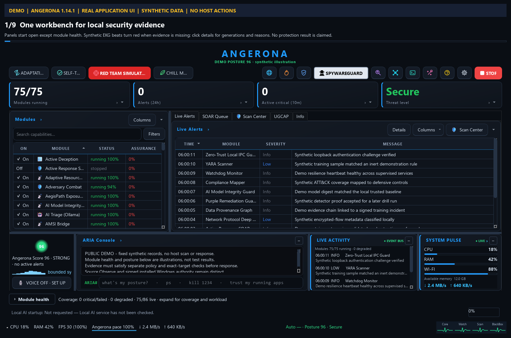
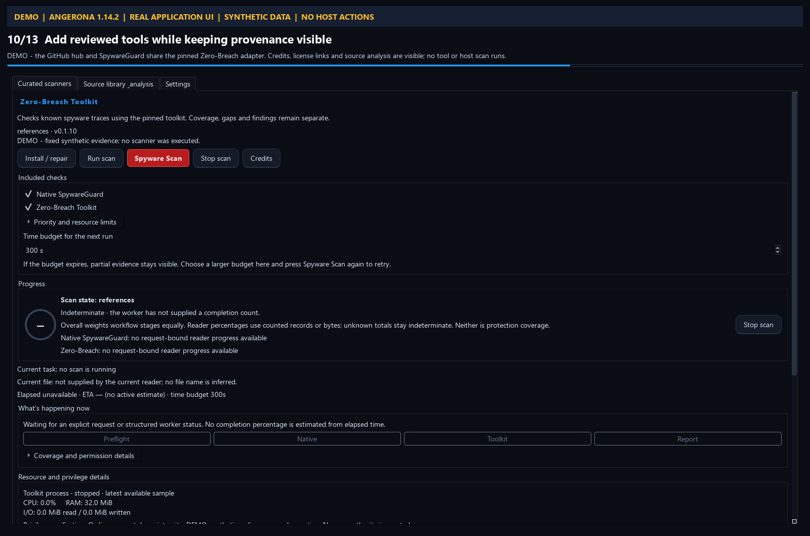
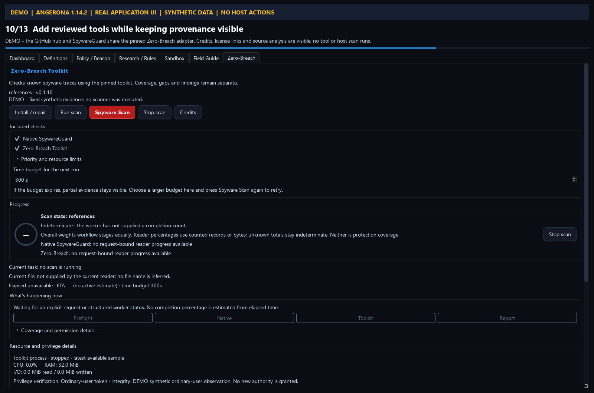
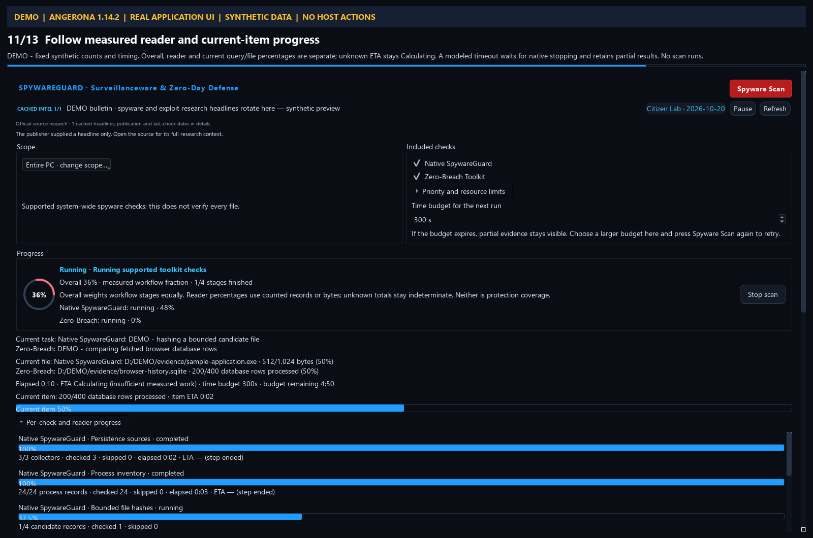
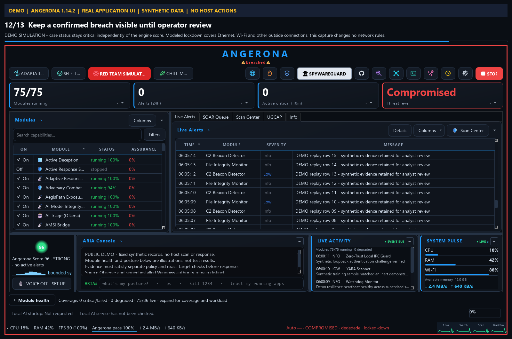
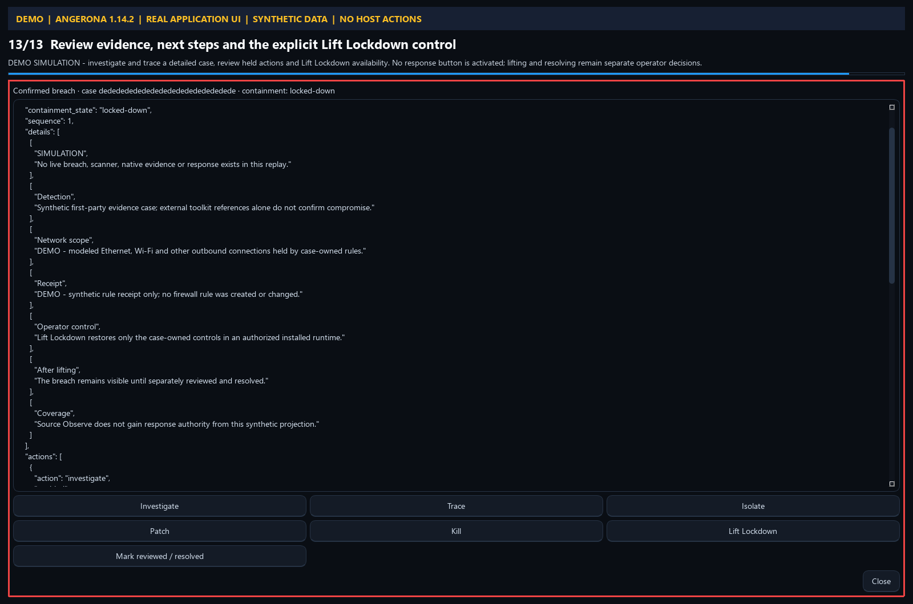

# Angerona Security Suite

Angerona is a desktop security suite for endpoint monitoring,
evidence-led investigation, and policy-controlled incident response.
Angerona combines Endpoint Detection and Response
(EDR), Network Detection and Response (NDR), Security Orchestration, Automation,
and Response (SOAR), forensics and defensive practice in one desktop application.

**For home labs, defenders, researchers and security-engineering portfolios.**
Deterministic defense works without an AI model; optional local AI helps explain
evidence and propose next steps.

## Current development: v1.14.2

[Download and installation choices](#choose-your-installation) ·
[Release downloads](https://github.com/Ag3nt47/AngeronaSuite/releases) ·
[Latest changes](CHANGELOG.md) ·
[Read the Master Manual online](docs/master-manual.md) ·
[PDF manual](Angerona_Master_Manual.pdf) ·
[Download Word manual](https://github.com/Ag3nt47/AngeronaSuite/raw/refs/heads/main/Angerona_Master_Manual.docx) ·
[Security flow and review map](docs/security-flow.md)

[Play the application demonstration](assets/demo/angerona-demo.gif): dashboard,
scrolling alerts, SpywareGuard, curated tools, breach review, Settings and scans.

**DEMO:** actual Qt interface with fixed examples; all displayed telemetry,
identifiers, timestamps and counts are synthetic. No host scan or response is
performed to create this demonstration.

| Curated tools | Integrated toolkit |
| --- | --- |
|  |  |
|  |  |
|  | All views are labeled DEMO. Shown lockdown and response states are synthetic; these images do not demonstrate a host network action. |

## Latest maintenance

v1.14.2 adds a **GitHub Tools** hub, pinned **Zero Breach Toolkit**, priority
**Spyware Scan** and linked after-action review. Verified native breach evidence
can latch a visible case; supported installed response paths separately check
authority, policy and network-rule receipts before reporting containment.
Source Observe shows response holds, and third-party findings remain leads.
Startup recovery, storage controls and component heartbeat EKGs remain available.
[What changed and current limits](docs/releases/v1.14.2.md) ·
[Toolkit modes, credits and downloads](docs/zero-breach-toolkit.md).

## Suite at a glance

- **Endpoint evidence:** process, file, memory, identity, persistence and
  removable-media observations, with explicit missing or stale coverage.
- **Network visibility:** connection, protocol, wireless, ARP and beacon
  analysis through the available platform sensors.
- **Scans and detection:** Scan Center, YARA matching, memory-injection checks,
  behavioral rules and correlated exposure or tradecraft evidence.
- **Investigation and forensics:** SentinelLens graphs, MITRE ATT&CK technique
  and evidence views, cases, timelines and supported captures connect observations.
- **Governed response:** SOAR queues supported exact-target quarantine,
  process and network operations under policy, with recorded outcomes and Undo.
- **SpywareGuard:** surveillanceware evidence review and governed response,
  subject to its published preview and platform prerequisites.
- **GitHub Tools:** curated, version-pinned scanners, source review, settings,
  analysis, integrity checks, managed revert and visible third-party credits.
- **Spyware Scan:** selected native and toolkit checks with priority, resource
  and privilege-coverage controls; unavailable collection remains visible.
- **Breach review:** qualified native evidence, persistent case visibility and
  Investigate/Trace/Isolate/Patch/Kill next steps with explicit action holds.
  Managed network lockdown and Lift require the accepted installed authority.
- **Integrity and provenance:** source, model, audit, IPC and enrolled UGCAP
  checks; independent witness authority requires its own deployment.
- **Defensive practice:** benign validation, deception and canary exercises
  produce labeled receipts; synthetic markers cannot authorize host actions.
- **Optional AI:** local Ollama explanations and manual sanitized preview/Send
  assist review; model text has no response authority.
- **Operations and recovery:** resource controls, watchdogs, storage warnings,
  component heartbeat EKGs, safe startup alternatives and preserved-edit recovery
  decisions.
- **Integration and review:** module contracts, optional intelligence/fleet/SIEM
  connections and bounded read-only Live AI Review.

Static discovery includes **86 modules**. Declared platforms, modes, dependencies,
response authority and actual live coverage differ.
[Capability register](ANGERONA_CAPABILITIES.md) ·
[Complete built-in source inventory](docs/security-flow.md#built-in-capability-source-inventory).

## Choose your installation

| Platform and purpose | Start here | Authority and availability |
| --- | --- | --- |
| Windows signed installed release | [Check Releases for an accepted signed package](https://github.com/Ag3nt47/AngeronaSuite/releases) | Use an available trusted-publisher MSIX and its adjacent SHA-256 file. Signed Protect, native service acceptance and clean-VM release gates remain separate requirements. |
| Windows source development | [Clone this repository](https://github.com/Ag3nt47/AngeronaSuite), then run `Install-Angerona.bat` as your ordinary user | Unelevated Observe/development in Chill Mode. Source startup cannot create signed installed Protect authority. |
| macOS 14+ source | [Start-Angerona-macOS.command](Start-Angerona-macOS.command) | Observe preview; Intel, Apple Silicon and Rosetta detection. [Prerequisites](docs/NATIVE_INSTALL.md). |
| Linux source | [Start-Angerona-Linux.sh](Start-Angerona-Linux.sh) | Observe with optional explicitly configured eBPF. [Prerequisites and native scope](docs/NATIVE_INSTALL.md). |

**Estimated download and disk space** — app and reviewed runtime, before optional
AI models or accumulated security data. GB below means decimal gigabytes.
These are planning ranges, not measurements of published release archives.

| Installation | Estimated first download | Estimated app/runtime disk use |
| --- | --- | --- |
| Windows signed package, when available | Pending a measured release build; use the accepted asset's listed size | Pending measurement; allow several GB for separate runtime extraction and installation/upgrade staging |
| Windows source setup | 0.35–0.60 GB | 1–2 GB |
| macOS source setup | 0.50–0.75 GB | 1.5–3 GB |
| Linux source setup | 0.30–0.50 GB | 1–2 GB |

The current Windows dependency wheels total about **300 MB downloaded / 840 MB
expanded**; source estimates also allow for the checkout. The platform inputs
are listed in the [Linux](release/locks/posix/source/linux-x86_64.manifest.json),
[Apple Silicon](release/locks/posix/source/macos-arm64.manifest.json) and
[Intel macOS](release/locks/posix/source/macos-x86_64-base.manifest.json)
wheel manifests. OS prerequisites, Intel macOS
Xcode/Rust/OpenSSL builds, Git history, retained backups and evidence are extra.
Windows source repair requires **5 GiB free**: a 2 GiB reserve plus 3 GiB working
capacity. Its one retained previous runtime can add another runtime's disk use.
The bundled Zero Breach engine is about **0.97 MB**, plus its retained licenses
and notices. Optional managed scans require a separate **3 GiB free-space
reserve plus the working-data allowance**; a scanner storage hold does not block
normal Angerona startup.

**Optional models are separate:** [Llama 3 8B](https://ollama.com/library/llama3:8b)
adds about **4.7 GB** for model weights alone, plus the Ollama runtime. Other
models vary. The [small English Vosk speech model](https://alphacephei.com/vosk/models)
adds about **40 MB of download** when not already bundled. No LLM is required
for deterministic defense.

When an accepted signed release is available, its Windows package is
`Angerona-<version>-win64.msix`. Protect requires the signed installed authority;
unelevated source runs in Observe/development scope.

A release tag or unsigned download does not establish publisher trust. A trusted
signed release needs no Python or terminal setup. Portable ZIPs
are upgrade-only; the classic Setup wrapper is not a public first-install path.
The project does not claim Microsoft Store distribution.

For Windows source:

1. Clone the canonical repository into your development directory.
2. Run `Install-Angerona.bat` without elevation to create the reviewed runtime.
3. Run `start-angerona.bat`. Start with the dashboard's actual coverage state,
   then enable the modules and integrations you need.

Use dashboard **STOP** or **Quit** from the tray for a clean stop; closing the
window can leave the engine running. A shared Ollama server and downloaded
models remain; configured model residency is unloaded. Automatic recovery stays
stopped until an explicit launch. [Startup recovery](docs/safe-startup-recovery.md) explains safe
alternatives, logs and held conditions.

## How the security flow works

The [full flow and attack-surface matrix](docs/security-flow.md) connect each
boundary to implementation and regression entry points. A visible dashboard,
fresh sensor evidence and authority to act are separate states. Imported logs,
URLs, AI prose and review notes remain untrusted data.

| Curated scanner boundary | Breach and response boundary |
| --- | --- |
|  |  |

Angerona is user-mode and ships no production kernel driver. Ring 3 code does
not gain kernel immunity through UAC, signing or cryptographic checks. Hostile
administrator, kernel, firmware, hypervisor and compromised-OS threats remain
outside any universal protection claim. Windows Filtering Platform (WFP) and
other OS integrations still require their actual platform, privilege and
deployment prerequisites. [Architecture](docs/architecture.md) · [Security](SECURITY.md).

## Privacy, recovery and drive usage

Cloud integrations are optional and off by default. Optional AI, intelligence,
fleet and witness integrations have their own endpoint and consent boundaries.
The separately controlled public GitHub fallback for source startup defaults on;
it downloads verified public code and uploads no host evidence or preserved edits.
Manual AI consultation shows a bounded sanitized preview before explicit Send.
[AI privacy](docs/ai-consult-privacy.md).

Normal Windows source data is under
`%LOCALAPPDATA%\Angerona\SourceData`. Historical protected elevated-source
custody uses the checkout's sibling `AngeronaData` directory; the normal source
launcher refuses elevation. Packaged Windows data prefers `D:\AngeronaData`,
with protected `%ProgramData%\Angerona` fallback according to installed authority.
Credentials, baselines, audit journals, cases and disposable caches have separate
retention. Hash-based Message Authentication Code (HMAC) verification of record
bytes does not alone establish producer truth.
[Data and key boundaries](docs/key-and-communication-integrity.md).

File recovery has configurable cache/reserve controls and visible storage
warnings. Windows source Safe Startup treats retained diagnostic history and
recommended reserves as advisory, with private bounded launcher work and actual
I/O checks. Optional repairs and scans keep their own admission limits. Full
capacity never
justifies silently evicting unreviewed edits or clearing protected evidence.
Some direct dashboard/native-installer logs still need retention review.
[Storage budgets and limits](docs/safe-startup-recovery.md#capacity-and-retention).

Safe Startup tries fixed verified alternatives and keeps a separate recovery
interface available when app code or Qt fails. Automatic recovery and GitHub
source fetches are individually controlled in Settings. Every candidate repeats
trust/runtime/readiness gates; an open recovery window does not mean protection
is active. [Recovery guide](docs/safe-startup-recovery.md).

## More application views

| Investigation and response | Capability views |
| --- | --- |
|  |  |
|  |  |
|  |  |
|  | All views use synthetic public demonstrations. They are not live coverage, efficacy or scale benchmarks. |

## Guides and current work

- [Master Manual online](docs/master-manual.md) and [PDF](Angerona_Master_Manual.pdf): operating reference, complete
  security flow, all built-in source entries and recovery decisions.
- [Safe Startup](docs/safe-startup-recovery.md): alternatives, diagnostics,
  preserved edits, optional GitHub egress and honest storage limits.
- [Live AI Review](docs/live-debug-harness.md): opt-in bounded read-only diagnosis;
  [interaction map](analysis/live-debug-2026-10-22/interaction-map.md).
- [UGCAP and Enclave Mesh](docs/ugcap-enclave-mesh.md): explicit known-clean
  enrollment, fresh integrity evidence and separately deployed witness authority.
- [SpywareGuard](docs/spyware-guard.md): surveillanceware evidence review and
  governed response with explicit preview/prerequisite limits.
- [GitHub Tools and Zero Breach](docs/zero-breach-toolkit.md): pinned engine,
  integrated and held modes, priority scans, private reports and retained credits.
- [Hardware and self-check](docs/hardware-and-selfcheck.md), [native setup](docs/NATIVE_INSTALL.md),
  [v1.14 acceptance register](docs/releases/v1.14-security-integration.md).

Native process-bound egress, signed privileged-service deployment and independent
witness/backup authorities retain separate acceptance gates. Passing source
tests cannot deploy those authorities or prove field detection rates.
Broader v1.15 remains incomplete.

## Validation and contributing

Historical release evidence: **Final Cycle 34 verification.** The gate on
`7eef1f0a0c400b34f170cbd1463cd3c6a454de3b` passes **2882 tests with 15 intentional platform skips**.
This is a dated checkpoint, not the current revision's result or live coverage.
[Retained maintenance history](analysis/public-maintenance-history.md) preserves
the previous README and its scoped measurements;
[the issue map](analysis/live-debug-2026-10-22/README.md) records further evidence
and remaining work.
The [v1.14.2 review map](analysis/curated-tools-breach-2026-10-29.md) records the
new integration and breach-control checks with their scope and remaining holds.

For a configured development environment, run the focused checks relevant to
your change, then the required integration/self-check gates. Preserve skips and
coverage gaps. Maintainer publication must verify canonical public `main`, a
clean worktree and byte-identical tracked README assets.

[Contributing](CONTRIBUTING.md) · [Writing modules](docs/writing-modules.md) ·
[Report security issues](SECURITY.md) · [Changelog](CHANGELOG.md) · [MIT license](LICENSE)

Third-party components retain their own terms. Zero Breach Toolkit code is
Apache-2.0; its research data and optional rules retain their separate licenses
and author notices. [Credits and bundled notices](docs/zero-breach-toolkit.md#credits-licenses-and-integrity).

<!-- ANGERONA_DOC_STATUS tests=2882 skips=15 modules=86 -->
