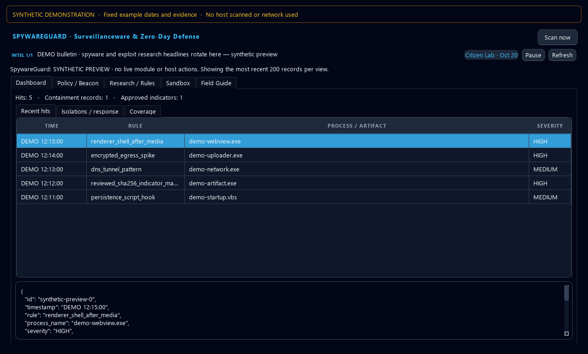
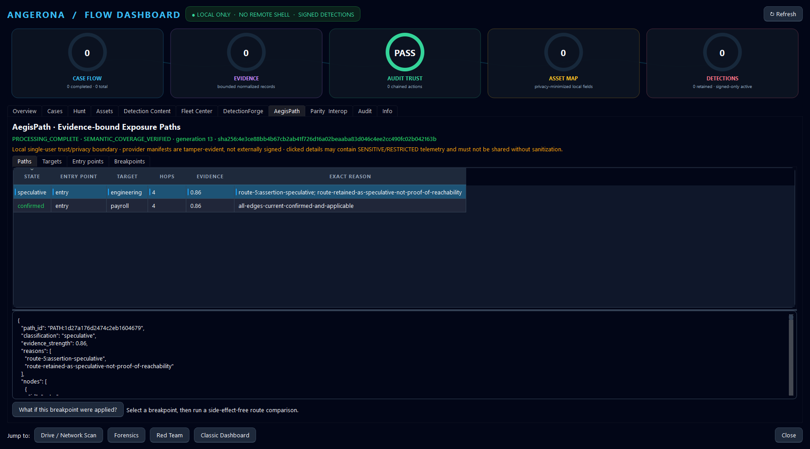
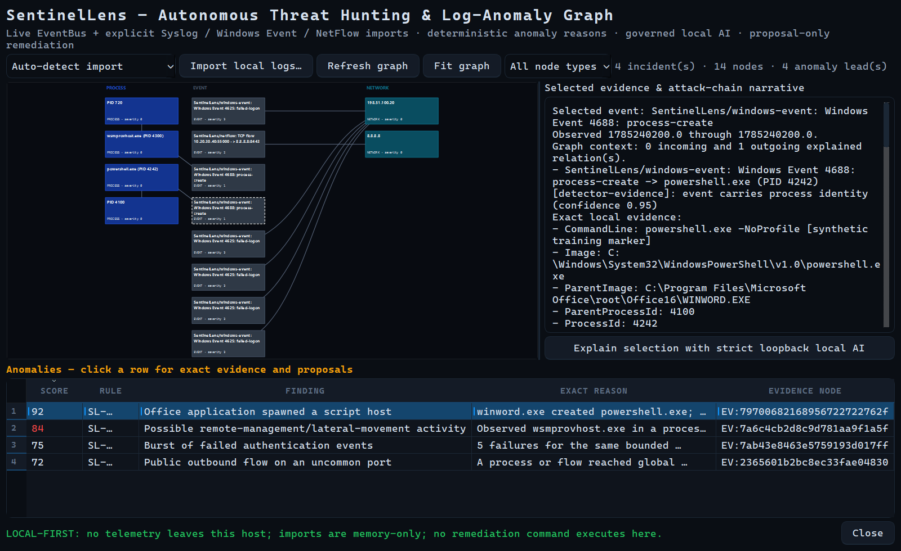
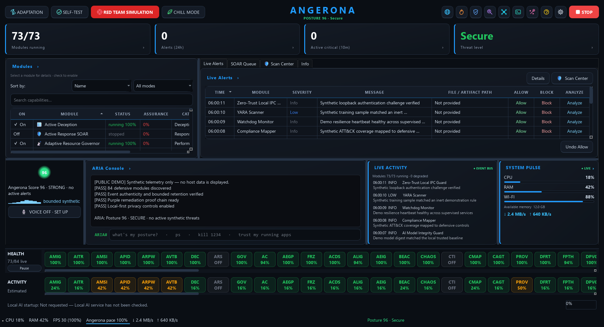
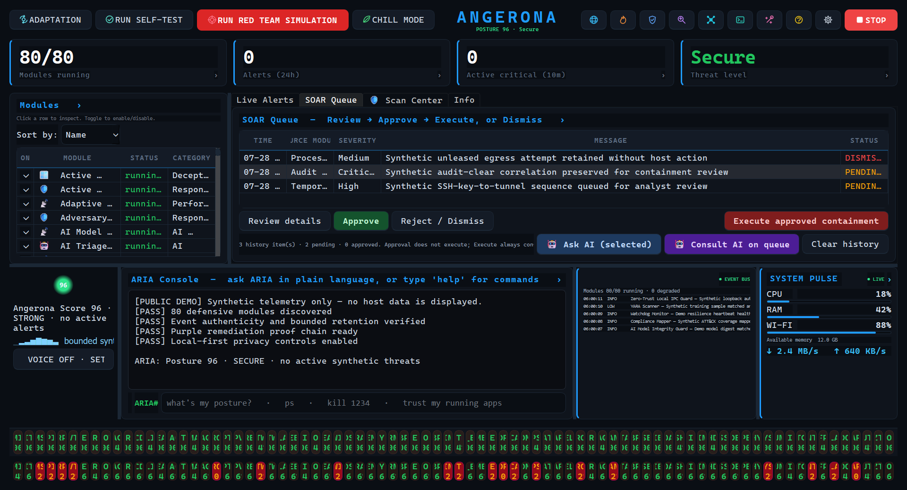
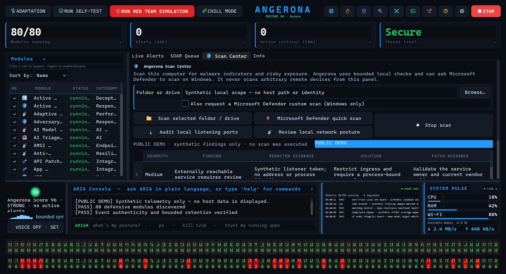
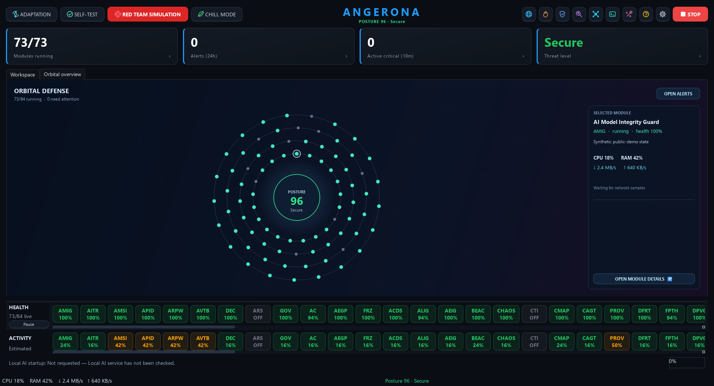

# Angerona Security Suite

Angerona brings local security telemetry, investigation and governed response
into one desktop workbench. It combines Endpoint Detection and Response (EDR),
Network Detection and Response (NDR), Security Orchestration, Automation, and
Response (SOAR), digital forensics, defensive ATT&CK exercises and an optional
local Ollama assistant.

Built for home labs, defensive research, learning and security-engineering
portfolios. Follow an alert from its sensor evidence to a verified response,
review the action, and undo supported changes. Automatic defense follows your
configured policy and works without an AI model.

[](https://github.com/Ag3nt47/AngeronaSuite/actions/workflows/ci.yml)
[](https://github.com/Ag3nt47/AngeronaSuite/actions/workflows/security.yml)


Current development version: **v1.14.0** · [Capabilities](ANGERONA_CAPABILITIES.md) ·
[Master Manual](Angerona_Master_Manual.docx) ·
[Hardware and self-check guide](docs/hardware-and-selfcheck.md) · [Security](SECURITY.md)

**New in v1.14.0: [Live AI Review and debugging](docs/live-debug-harness.md), under active development.**
Opt in to an outbound diagnostic feed and connect an AI's local command-line
reader while Angerona runs. Black Box's dedicated review tab combines live
alerts, errors, explicit coverage gaps and reasoned review notes. Use the
documented reproduce–patch–test loop for performance, bug and security testing.
Review notes do not grant response authority or silently dismiss detections.
See the [issue map and validation evidence](analysis/live-debug-2026-10-22/README.md)
for reproduced defects, measured improvements and unresolved observations.

**Also in the [v1.14 security integration scope](docs/releases/v1.14-security-integration.md):**
verified protection readiness, a UGCAP witness protocol requiring separate deployment,
authenticated operator approvals, privilege separation, process egress enforcement,
identity collectors, guided prevention, independent recovery and release efficacy.
The register distinguishes implemented and tested components from ongoing work
and required external deployment. Observation and bug fixes precede publication.

**Newest safeguards, under active development: [UGCAP and the rotating Enclave Mesh](docs/ugcap-enclave-mesh.md).**
Bring a user-enrolled offline integrity vault, Windows TPM key proof, exact
source verification and ten-second authenticated local key exchange into one
reviewable workflow. The dedicated UGCAP tab exposes challenges, differences,
hardware readiness and selected-path recovery. This opt-in source preview
requires a restart for strict bootstrap enforcement; it does not claim an
impenetrable operating system or hardware enclave.

**Also new and actively evolving: [SpywareGuard](docs/spyware-guard.md).**
A dedicated surveillanceware dashboard brings together host audits, reviewed
intelligence, single-rule lockdown requests, an inert sandbox, dated news and
an opt-in Hail Mary emergency beacon. Inspect recent hits and response receipts,
add research URLs, and tune the policy from its top-right black-spy button and
dedicated window. Header buttons adapt to dashboard width. Dated reference
briefs keep the banner useful offline; live official reporting remains opt-in.
The Modules window also offers a governed **Turn all on** action with progress
and explicit held/skipped results. This is a preview with
explicit sensor coverage and platform limits.

The minimized globe has separate colour-coded Core, Watchdog, Scanner and
Black Box moons. Scan Center and detector modules reuse immutable connection
snapshots to avoid duplicate collection while preserving age and coverage gaps.

[](docs/screenshots/angerona-spywareguard-preview.png)

**DEMO:** actual SpywareGuard application UI populated with fixed synthetic
examples. No host was scanned and no network was used for this screenshot.

## Dashboard and major features

| v1.13.0 enterprise-pattern Local SOC programs | SentinelLens local-first hunt graph |
| --- | --- |
| [](docs/screenshots/angerona-v1.13-enterprise-programs.png) | [](docs/screenshots/angerona-v1.12-sentinel-lens.png) |
| Main defensive dashboard | Human-reviewed SOAR queue |
| [](docs/screenshots/dashboard-public-demo.png) | [](docs/screenshots/angerona-v1.11-soar-review.png) |
| Scan Center | Optional orbital dashboard |
| [](docs/screenshots/angerona-v1.11-scan-center.png) | [](docs/screenshots/dashboard-orbital-demo.png) |

These are reproducible public demonstrations. All displayed telemetry,
identifiers, timestamps, and counts are synthetic.

## What you can do

- **Observe and investigate:** inspect process, file, memory, removable-media,
  authentication and network evidence; correlate events in SentinelLens;
  review alerts, scan results, source provenance and recorded coverage gaps.
- **Respond under policy:** use exact-target quarantine, process and network
  controls with typed authority, durable journals, verified outcomes and Undo
  where supported. The deterministic response worker operates without Ollama;
  model narrative alone cannot authorize containment.
- **Practice and inspect:** run benign defensive validation, compare evidence
  with curated ATT&CK mappings, review pinned GitHub source archives as text,
  and inspect local Fleet Fabric, DetectionForge and AegisPath lab programs.
- **Assist locally:** ask the optional Ollama-backed assistant for explanations.
  Model approval, source provenance and response permissions remain separate.
- **Check the program itself:** explicitly enroll a known-clean installation in
  the optional UGCAP vault, review integrity differences and authorize supported
  recovery. Fresh source receipts gate the opt-in authenticated module mesh.

Windows sources include event logs, Defender, process and file telemetry, and
Windows Filtering Platform (WFP) integration. Individual collection and response
features depend on platform, permissions, configuration and trusted evidence.
[Architecture and boundaries](docs/architecture.md).

## Choose your installation

| Platform | Starting point | Current scope |
| --- | --- | --- |
| Windows | Signed release package, or `Install-Angerona.bat` for source development | Protect requires the signed installed authority; unelevated source runs in Observe/development scope. |
| macOS 14+ | [Start-Angerona-macOS.command](Start-Angerona-macOS.command) | Observe preview; one launcher detects Intel, Apple Silicon and Rosetta. |
| Linux x86_64 | [Start-Angerona-Linux.sh](Start-Angerona-Linux.sh) | Observe, with optional explicitly configured eBPF; reviewed native CI target is Ubuntu 24.04. |

Publisher signing and Apple notarization require independently provisioned
credentials and trust. The source launchers below provide development setup;
an unsigned artifact does not establish Windows Protect authority.

For a tagged Windows release with signing provisioned, use its `Angerona-<version>-win64.msix` and adjacent
SHA-256 file from [Releases](../../releases). Windows must trust the provisioned
package publisher. Installing a trusted signed Windows release needs
no Python or terminal. Release signing and clean-VM acceptance remain release gates;
the repository does not claim Microsoft Store deployment. The portable ZIP is
upgrade-only, and the classic Setup wrapper is not a public first-install path.

For Windows source setup, clone the repository and run `Install-Angerona.bat`
as your ordinary user. It installs locked dependencies and refuses an elevated
terminal. `start-angerona.bat` uses [Safe Startup](docs/safe-startup.md) to prepare
and launch the dashboard in Chill Mode, with visible repair guidance on failure.

Mac/Linux source setup needs Python 3.12 and guides prerequisite installation.
Intel Mac additionally builds pinned cryptography 50 with Xcode Command Line
Tools, Rust and OpenSSL; Apple Silicon uses reviewed wheels. Linux setup checks
Qt graphics/font libraries and validates real offscreen widget rendering before
publishing a launcher. Failed installation preserves the previous runtime.
[Native setup, prerequisites and recovery](docs/NATIVE_INSTALL.md).

Intel and Apple Silicon macOS and Ubuntu source installation passed their native
CI lanes, including the Intel dependency build and actual offscreen GUI rendering.
See the [CI follow-up](analysis/deep-review-20260923/publication-followup.md).
Visible desktop operation is a separate check. Source-runtime locks are complete;
older full POSIX release-build locks still need dependency-graph repair.

## Modules, resource use and local AI

Static discovery reports **86 modules** in the Windows catalog. Runtime counts
show **running / enabled for this machine**, excluding unsupported, disabled
and unconfigured optional integrations. Failed expected sensors and paused
configured modules remain visible; quiet telemetry does not prove irrelevance.
USB and WLAN guards keep watching for future device or link arrivals.

Chill Mode limits optional analytical and presentation work while retaining its
configured protection paths. Local AI requests, service startup and model loading
remain blocked throughout Chill, including alert escalation and self-check.
The catalog is not a recommendation to activate
all modules, and a running count is not a protection score. Module details expose
availability, health and the reason for an inactive state.

To try the separate protection engine from an installed source environment, run
`python -m angerona --engine-console`. Closing this console leaves the engine
running; **Stop protection** is a separate explicit control. This is an optional
ordinary-user console, with a smaller interface than the full workbench.
Per-user automatic startup is available through `tools/manage_engine.py`.
It does not establish privileged service protection or survive every sign-out.
[Engine setup and resource measurements](analysis/upgrade-20260923/usage.md).

Ollama service percentages describe completed startup checks. **100% means the
local service and inventory passed validation; it does not approve or load a
model.** Inference still needs the exact installed model and a fresh approved
attestation. Automatic startup requires a recognized trusted installation;
user-owned or symlinked POSIX installation paths may be refused. Missing AI leaves
deterministic detection and authorized response available. Protected Windows
launches require a checked normal-user token. Native testing exposed a linked-token
type mismatch; a compatibility change supports tokens with sufficient authority,
but elevated startup remains unverified after a cancelled UAC request.
Hostile telemetry is treated as data;
failed neutralization skips the optional narrative request.
[Startup evidence](analysis/continuation-20260923/ollama-native.md).

## Optional Analysis Lab

Analysis Lab checks a copy of your source with pinned **Bandit 1.9.4** and
**Gitleaks 8.30.1** inside a disposable, offline QEMU guest. It looks for Python
security issues and exposed secrets; it does not execute the submitted source.
Reports are redacted and cannot authorize host response. The current backend
requires **64-bit Windows on Intel/AMD and a normal, non-administrator Angerona
session**. Monitoring, automatic defense and Ollama work without it.

Open **Full Setup → Optional Analysis Lab**, or the Lab's setup button. Choosing
setup downloads the reviewed QEMU 11.1.0 installer (about **197 MiB**) if needed,
opens its normal installer/license and Windows administrator prompts, and
configures a protected **122 MiB** Lab runtime. Keep the vendor installer's
default location and allow **2 GiB free disk space**. An exact matching QEMU
installation can be reused. **Skip** leaves setup unchanged. The distributor's
certificate is expired; Angerona verifies the exact reviewed download and
runtime files against pinned hashes. [Runtime provenance](analysis/continuation-20260923/qemu-design.md).

After setup, choose **Prepare runtime**, then **Check readiness**. Installation
alone never enables Run: both real analyzer fixtures must pass for the current
runtime. Native Windows checks passed for both analyzers, including their
expected findings and isolation checks.

Each requested job uses one virtual CPU and **768 MiB guest RAM**, with a
five-minute deadline, a **2 GiB host-process memory limit** and a **25% host-CPU
cap**. There is no guest disk, external network adapter or host folder share.
The VM stops when the job ends; no Lab VM runs in the background while idle.
Normal Windows paging and crash dumps still apply to host memory.

Separate VMware setup remains available for users who want Workstation.
VMware is not required for this Lab: its tested backend remains blocked by
Workstation's need to write its configuration, and that protection has not been
relaxed. [Continuation results and limits](analysis/continuation-20260923/README.md).

## Data, trust and limits

Unelevated Windows source launches use `%LOCALAPPDATA%\Angerona\SourceData`.
Protected elevated-source state uses the checkout's sibling `AngeronaData` directory.
Packaged Windows installs prefer `D:\AngeronaData`, with protected
`%ProgramData%\Angerona` as fallback when D: is unavailable.
Cloud integrations are optional and off by default.

Disposable `diagnostics/runtime_alerts.log` copies rotate at 4 MiB. Background
cleanup removes eligible closed archives by age and total-size target, with
adjustable limits of 1–3,650 days and 8–16,384 MiB. Pinned or inaccessible files
can leave storage above the target; the settings panel shows cleanup status.
Turning cleanup off allows archives to grow. It never sweeps the whole data
directory or deletes signed event/action records, cases, backups or exports.

Angerona is user-mode and ships no production kernel driver. It cannot promise
tamper resistance against compromised Administrator/SYSTEM or kernel authority,
recover events deleted before collection, or prove full-history rollback without
an independent witness. This is not an independently certified commercial EDR
or a claim of complete detection coverage. Local fleet/research programs and
curated standards mappings do not imply enterprise or upstream-feature parity.

Imported source and external analyzer reports have no native response authority.
Personal Sentinel is a separately administered reference authority, not a router
appliance. No offensive intrusion, arbitrary response shell or hack-back is a
product capability. See [Security](SECURITY.md) and [capability limits](ANGERONA_CAPABILITIES.md).

## Validation and development

v1.14 brings Live AI Review, SpywareGuard, shared scanning and governed module
controls into one workbench. Daily GitHub checks default off in Settings and
Full Setup; background manual checks and three-way source staging preserve
local customizations and explicit conflicts. The frozen full R10 regression
passed **7,554 tests with 49 skips and no failures**, with unchanged source,
runtime and harness, exact native retirement and MainThread-only shutdown.

Later installer and tooltip changes passed **141 focused controls**, followed
by a **29-phase default selfcheck** accounting for 86 module rows (68 passed,
18 explicit skips), a separate pipeline and nine verifiers. These are separate
validation scopes; the isolated selfcheck does not prove live coverage of every
module. The [144-issue review](analysis/live-debug-2026-10-22/README.md) preserves
original failed gates, unknown historical causes and deployment gaps. Timings
are not whole-product benchmarks, and simulated responses are not native
detection efficacy.

The published [43417d5 follow-up](https://github.com/Ag3nt47/AngeronaSuite/commit/43417d51df89b740d8a7b085517cb3ba2afc7236)
finished [CI](https://github.com/Ag3nt47/AngeronaSuite/actions/runs/39953683336) with
**11 of 12 jobs passing**; [Security](https://github.com/Ag3nt47/AngeronaSuite/actions/runs/39953683286)
passed all three. Python 3.10–3.12 each passed **7,621 tests with 19 skips**.
Python 3.13 retained **1 failure, 7,593 passes, 19 skips and 27 setup errors**:
a strict certificate-fixture rejection and one confinement-preflight timeout
cascading through setup. The joint fixture follow-up passed **71 controls** and
a fresh **29-phase default selfcheck**, with exact retirement. The original
timeout cause remains unknown; these source checks do not establish a new hosted
CI pass. Source activation remains held until independently trusted release,
recovery and runtime checks are available. Durable installer crash reconciliation,
restart health and signed deployment remain separate gates.
See the [update guide](docs/github-updates.md) and [validation evidence](analysis/live-debug-2026-10-22/validation.json).

The [SpywareGuard, UGCAP and Enclave Mesh review](analysis/spyware-enclave-2026-10-21/README.md)
records the preceding feature checks, adversarial fixes and remaining coverage limits.
The full local regression recorded **5,775 passes and 28 skips**. One Windows
file-replacement failure passed three exact repeats and all **33 repair tests**
on follow-up. The offline selfcheck passed **28/28 phases**, accounting for all **86 modules**.

Users can edit the MIT-licensed source and build their own security features:
add sensors, improve rules, extend dashboards or contribute a reviewed module.
Start with [Contributing](CONTRIBUTING.md) and
[Writing a module](docs/writing-modules.md). UGCAP intentionally detects source
edits; review an intentional change and explicitly enroll a new baseline. If
an independent witness is required, changed vault/baseline identities also need
separately reviewed witness enrollment or reconciliation. Preserve its retained
head and evidence; disabling it or deleting its state cannot establish trust.

The [Adaptation review](docs/adaptation-button-review.md) and
[Self-Test / Red Team review](docs/selftest-redteam-button-review.md) trace the
actual button paths and document their improvements. Five injected 20-ms
collectors achieved a **4.321×** median scheduling ratio; the measured PID-count
query was approximately **34×** faster on its test host. These are component
measurements, not whole-PC speed or spyware-detection claims. The review's
28-phase / 85-module selfcheck predates the new UGCAP module.

The [October 21 local complete regression](analysis/timeout-rootcause-2026-10-21/README.md)
on commit `306911a`
passed **5,107 tests with 25 skips and zero failures or errors**. Its 994 Python
source files matched before and after the run. Both previously timed-out cases
passed with their original deadlines; fresh offline self-check passed all 28
phases and all nine verifier checks. Skips do not establish live coverage.
The subsequent [hosted CI correction](analysis/ci-scan-followup-2026-10-21/README.md)
addresses the new fixture's observation phase, coordinator priority and hash
false positives. Its report preserves both failed hosted attempts and the dated
local record; each published correction requires separate hosted acceptance.

The historical September 23 upgrade regression suite passed **4,303 tests with 20 skips**.
The [validation record](analysis/upgrade-20260923/validation.md) separates native
automatic-containment checks, module self-tests and component benchmarks.
Its isolated selfcheck passed all 26 phases; SelfTestRunner reported 66 module
passes, one separate event-pipeline pass and 18 explicit prerequisite skips.
Skips do not establish live coverage.

The prior [continuation record](analysis/continuation-20260923/validation.md)
reconciles 4,107 passes and 18 skips from a full baseline plus fixture
corrections. Both real Lab readiness fixtures and an end-to-end scan passed.
Elevated Ollama acceptance remains open; 24-hour/7-day stability and trusted
installer acceptance are also outstanding.

The earlier [three-round review](analysis/deep-review-20260923/README.md)
accounts for all 84 modules: 66 self-tests passed, 18 had explicit optional or
platform prerequisites, and the separate event-pipeline test passed. Skips are
not passing live-sensor tests. Its full-suite reconciliation, component
benchmarks and subsequent [native CI results](analysis/deep-review-20260923/publication-followup.md)
remain linked evidence for their respective checkpoints.

For an existing development environment:

```powershell
python -m pytest -q
python tools/selfcheck.py
python tools/validate_documentation_drift.py
```

Contributions: [Contributing](CONTRIBUTING.md) · [Architecture](docs/architecture.md) ·
[Research comparison and proposed follow-ups](analysis/upgrade-20260923/comparison.md).
Maintainer publication uses `python tools/publish_github_update.py`, which checks
canonical fast-forward publication and the public bytes of every README image.

Historical published release evidence: Cycle 35's exact-commit five-check gate on
`5feda7322c44bc0d5cc0149b2ef5031573c557fd` passed **4,353 tests with 20
skips** and the guarded publisher verified canonical public `main`.

Historical release evidence: **Final Cycle 34 verification.** The gate on commit
`7eef1f0a0c400b34f170cbd1463cd3c6a454de3b` passes **2882 tests with 15 intentional platform skips**.
This is the earlier release record, not the September 23 full-suite result.
[Historical validation details](analysis/loop/LOOP_LOG.md).

## What's new

The [v1.14 development update](docs/releases/v1.14.0.md) adds opt-in local
Live AI Review, a dedicated SpywareGuard window, governed background bulk
startup, four named function moons and shared connection-scan receipts.
Expiring readiness, authenticated approvals, witness checkpoints, staged
Windows prevention, isolated recovery and replay/training separation have
explicit [implementation and acceptance boundaries](docs/releases/v1.14-security-integration.md).
Native process-bound egress admission, signed installed privileged-service
deployment and independently administered witness/backup authorities remain
acceptance work; the diagnostic service exposes no mutators.

The review also hardens fresh executable hashing, runtime fingerprints,
persistence classification, witness replay/freshness, recovery bounds and
approval dispatch. Qt/pipe shutdown retains worker and native-I/O ownership.
Cached presentation, bounded log turns and scan reuse reduce repeated work;
component measurements and unresolved startup delays are retained in the
[issue and interaction maps](analysis/live-debug-2026-10-22/README.md).
The catalog remains **86 modules**. The [validation record](analysis/live-debug-2026-10-22/validation.json)
separates full-suite, focused, isolated-selfcheck and live-observation evidence;
unsupported providers and deployment prerequisites remain explicit.

The [UGCAP / Enclave Mesh preview](docs/ugcap-enclave-mesh.md) adds a dedicated
integrity challenge and recovery tab, a hardware-bound encrypted baseline on
separately attached media, and authenticated local producer/handler traffic.
[SpywareGuard](docs/spyware-guard.md) adds its own surveillanceware dashboard,
reviewed research intake, sandbox and authorized emergency beacon. Both are
active development features with explicit prerequisites and coverage limits.

The [automatic startup repair](docs/safe-startup.md#repairs-and-failures)
supervisor can run one verified runtime/dependency/Tk/Qt repair, preserve the
previous environment, and repeat the complete startup checks. Concurrent helper
startup is excluded during repair; interrupted replacement is reconciled from
private transaction evidence before the environment executes. Retry always
starts in Chill with Ollama blocked. Unknown failures, trust/custody problems,
low persistent storage and a live dashboard timeout remain visible failures.

The corrected [startup-repair validation](analysis/startup-repair-2026-10-21/README.md)
passed **5,230 tests / 25 skipped**, with clean native shutdown and an unchanged
1,018-file source/lock snapshot. Chill-locked selfcheck passed **28/28 phases**
and **9/9 independent verifier checks**. Earlier Full-mode diagnostics correctly
failed AI endpoint attestation for an existing wildcard Ollama listener; that
finding is preserved separately. The observer fixtures isolate collection to their
own temporary directories, retaining the original 30-second deadline.

The first hosted repair run exposed fresh-file ownership assumptions and a
descendant timeout fixture without its expected PID witness. The
[repair follow-up](analysis/startup-repair-2026-10-21/README.md#hosted-follow-up-at-3ed14db)
makes ownership and private ACLs explicit at file creation, verifies fixture
custody before content checks, and tests native descendant containment against
an uncontained control. Existing unsafe files remain rejected and unchanged;
the original deadlines remain. [Corrective evidence](analysis/startup-repair-2026-10-21/hosted-followup.json)
records the failed hosted revision and the passing frozen local rerun separately.

The [hosted CI follow-up](analysis/ci-scan-followup-2026-10-21/README.md)
corrects the scheduling fixture's observation phase and inherited coordinator
priority, and records narrow historical exceptions for public source hashes
flagged by secret scan. CI records pytest and interpreter exit status separately
to diagnose failures after a passing summary. Native crash analysis identified
a presentation timer querying a deleted dialog during teardown; its window
checks and destruction handling now prevent that callback error. The test session
also explicitly releases its own Qt application. Original deadlines and security
checks remain. Local and hosted validation are recorded separately.
The earlier correction's local rerun passed **5,138 tests / 24 skipped**, with successful
native process shutdown and an unchanged 999-file Python source snapshot.
The [hosted rerun](https://github.com/Ag3nt47/AngeronaSuite/actions/runs/39681727025)
passed on Python **3.10–3.13: 5,150 passed / 12 skipped per version**, with
clean native exits. [Security checks](https://github.com/Ag3nt47/AngeronaSuite/actions/runs/39681727269)
also passed.
A later documentation-only repetition exposed a separate Python 3.11 GUI
response assertion: the signed report correctly rejected zero containment
actions. Local Python 3.11 and 3.12 drills passed, but its source cause remains
unproved. The follow-up records that failure and adds bounded diagnostics
without changing deadlines or acceptance checks.

The [October 21 timeout investigation](analysis/timeout-rootcause-2026-10-21/README.md)
corrects sandbox child priority under CPU contention and reduces repeated
Windows credential-file permission overhead in response checkpoints. The
record distinguishes controlled cause reproduction, component measurements
and the complete regression result while retaining the original deadlines
and containment durability checks.

The [October 18 Chill update](analysis/chill-efficiency-2026-10-18/README.md)
slows optional background work and dashboard refreshes substantially, stops idle
animations and FPS sampling, and reduces empty recorder wakeups. **Ollama and
Llama stay blocked while the Chill toggle is on, including `CHILL: ALERT`.**
Only manually switching Chill off permits local AI startup and inference again;
threat escalation wakes security modules without enabling AI. See the
[Chill instructions](docs/hardware-and-selfcheck.md#chill-mode) for refresh
periods and the scope of service cleanup.

The [October 18 hardware and self-check update](analysis/hardware-adaptation-2026-10-18/README.md)
adds RAM-pressure feedback for routine pacing, suspends refresh and animation
timers in hidden or minimized views, reduces blocked snapshot polling, and removes
idle entropy-worker polling. Self-check now includes shared module contract
checks, resource-aware concurrency, timings, structured evidence and controlled
failure challenges that verify the checker itself. Missing prerequisites remain
explicit skips. See the [operator guide](docs/hardware-and-selfcheck.md) for
settings, interpretation and reproducible checks. Component fixtures and virtual
resource profiles do not establish performance on every older computer.

The [October 14 performance review](analysis/hardware-responsiveness-2026-10-14.md)
removes unattended Black Box detail inspections, moves periodic module lifecycle
work off the dashboard thread, and reduces YARA traversal allocations and
Memory Time-Machine connection queries. These changes reduce unnecessary work
on older hardware. Lower **Angerona pace** now also makes slow routine batches
yield by elapsed work time instead of waiting for a fixed item count. Pace is
an adaptive work budget, not measured throughput or protection coverage.

The [October 9 simulation and diagnostic review](analysis/simulation-responsiveness-2026-10-09.md)
moves simulation preparation and cleanup off the GUI thread, bounds Black Box
refresh work, and extends adaptive pacing to scanner discovery and Scan Center
batches. It also fixes repeated sandbox tests and strengthens isolated test
resource limits. The review explains the October 9 incomplete run separately from
older scored reports; a partial run never becomes a passing containment score.

The [simulation and unattended-response update](analysis/unattended-response-2026-10-08.md)
lets benign Shark and Red Team exercises continue with a visible warning when
Combat response is unavailable. Selected techniques still run; a warning never
counts as verified containment. The dashboard footer now shows **Auto ARMED**,
**Auto HELD**, or the applicable inactive state. **Settings → Adversary Combat**
lists the effective automatic rules beside readiness and verified action history.
Automatic defense already defaults to enabled and follows exact authenticated
detector contracts without per-alert approval or an AI-model dependency.
Fresh alerts arriving during response startup enter a bounded queue. A narrowly
proved, unapplied fixed simulation-marker checkpoint can recover at startup
with verified private backups; unrelated recovery holds remain visible.
Window teardown and worker cleanup are hardened, and package installation uses
the tested PySide6 6.11.1 runtime.

The [sustained responsiveness follow-up](analysis/sustained-responsiveness-2026-10-04.md)
adds **default-on adaptive routine scan pacing**. Low dashboard FPS or high host
CPU progressively delays routine scans, then restores their pace as load eases.
The footer shows a 30-Hz paint-heartbeat FPS percentage and a separate
**Angerona pace** bar. Pace is the requested scan budget, not a CPU quota,
measured throughput or protection percentage. Watchdogs, event delivery and
urgent response keep their cadence; delayed routine scans can discover changes later.
Change pacing under **Settings → Appearance**.

The same update fixes repeated Memory Time-Machine forwarding above 256
processes and moves sandbox-editor file work off the GUI thread. The
[complete module review](analysis/module-review-2026-10-04/README.md) covers all
87 module source files and records tested fixes and remaining limits. These
changes do not establish that every source of sustained host load is resolved.

The [dashboard layout and responsiveness update](analysis/dashboard-ui-polish-2026-10-02.md)
adds readable synchronized module ribbons with slow scrolling and manual controls,
responsive panels, an optional inline alert inspector, and a persistent system
summary. Choose **Settings → Appearance → Dashboard display → Orbital dashboard**
for a live module constellation; Standard remains the default. The orbital view
uses existing snapshots and adds no collectors or animation timers. Resize work
is coalesced, hidden alert tables defer reads, and the Sysmon fallback avoids
fetching metadata for unchanged processes. SOAR receipt reconciliation remains
active while hidden. These bounded improvements do not establish freeze-free
operation with every sensor running.

The [Cycle 40 CI and presentation update](analysis/loop/cycle40/README.md)
waits for fixture-owned validation workers before deleting their data, gives
PowerShell custody tests private temporary storage and timeout phase evidence,
and removes redundant module-table changes. Mode freezes and variable native
simulation coverage remain under investigation.
Deferred dialogs survive parent destruction until their workers finish, and
closing SentinelLens rejects callbacks that could restart snapshot work.
Alert rotation preserves oversized and replacement content. Device-lab,
temporal-correlation and CVE proposal state saves tolerate bounded Windows
sharing locks; permanent storage failures remain visible.

The [Cycle 39 Scan Center update](analysis/loop/cycle39/README.md) makes read and
signature failures visibly incomplete, bounds signature-result consumption,
and clears thread-bound native scanners even when exception tracebacks survive
their workers. Six regression challenges fail against the published baseline
and pass with the repairs. Earlier mode freezes and variable native Red Team
coverage remain open; this update does not claim complete detection.
The optional flight cache now moves event serialization outside its database
lock and rejects SQL queries that exceed operation or result-row budgets.
Three cache challenges reproduce the old behavior and pass after the repair.
Periodic module-table refreshes now project small batches between Qt events,
coalesce repeated requests, and cancel stale work after explicit UI actions.
The staged-start mode witness still paused for **2.152 seconds** in returned
Chill; sustained responsiveness remains unresolved.
With the combined patch, a separate simultaneous-start stress run measured
**5.809/1.495/0.605 seconds** in initial Chill/Full/returned Chill; its separate
Qt control peaked at **58 ms**. Initial-mode and Full freezes remain open.
An opt-in [gate execution trace](tools/pytest_execution_trace.py) preserves
failing test identities and Qt fatal messages if a full test process aborts.
The observed native Qt abort remains unresolved; isolated subgroup passes do
not certify whole-suite stability.

The [Cycle 37 security, simulation and performance repairs](analysis/loop/cycle37/README.md)
bind practice markers to observed file identity and content, fix Windows FIM
reads during containment, keep YARA scanners on their owning thread, and load
authenticated AAR history asynchronously. Two FIM-enabled GUI drills each
verified **37/37 containment responses**; native detections were **34/37 and
11/37**, independently checked against quarantine hashes and process exits.
In a 66-worker, 90-second-per-mode run, Full's maximum Qt pause was **527 ms**;
Chill still paused for **1,480 ms and 1,074 ms**. A separate Qt control peaked
at **43 ms**. Freezes and variable native coverage remain open issues.
The follow-up bounds Storage Hygiene's tree inspection with visible incomplete
coverage and upgrades PyJWT/urllib3 with refreshed release hashes.
A later repeat still paused for **8.48 seconds** after returning to Chill;
lower CPU did not resolve responsiveness. The no-NumPy byte histogram now uses
an exact C-backed counter, with **42% less thread CPU** in a paired component
benchmark; this alone is not evidence of freeze-free mode operation.
Independent sampling exposed overhead in the test fixture's own resource
polling. With that polling disabled, a 66-worker repeat measured **699/683 ms**
maximum pauses in Full/returned Chill and no gaps over one second, while
initial Chill still paused for **1,776 ms**. The separate Qt control peaked at
**43 ms**. Initial-mode pauses and variable native coverage remain open.

The [Cycle 36 scoring and performance follow-up](analysis/loop/cycle36/README.md)
clarifies native versus simulation scores. In an actual FIM-enabled GUI drill, all **38/38**
steps completed; the signed AAR credited **37/37 verified simulation
containment responses** and **14/37 native analytic detections overall**. The
reviewed plan had **36 file-marker opportunities** for FIM and one process
observation-only step, so the file result was **14/36**. An independent process
matched all 36 quarantined files by SHA-256 after custody release and checked
three tagged process exits. A separate concurrent base test credited **11/12**
native file-marker detections and **13/13** verified responses. These are inert
drill measurements, not real-attack efficacy estimates.

A controlled offscreen six-minute Chill → Full → Chill run with Process Monitor,
FIM and YARA Scanner enabled saw **zero Qt heartbeat gaps over 250 ms**; CPU
averaged **11.01%, 34.92%, and 8.27% of one core** in the three phases. This
selected-worker result does not establish all-worker or long physical-host
stability. Targeted checks remain distinct from the exact-commit release gate.

The [September 26 Red Team and responsiveness maintenance](analysis/loop/cycle35/README.md)
repairs the simulation's response path and makes its score harder to spoof:

- **Passing signed simulation response:** Two consecutive real GUI Settings
  **Arm** and Red Team **Launch** runs completed the 38-step comprehensive
  drill, each with a signed **37/37 Purple simulation validation and 37/37
  verified response** AAR. An
  independent process checked original marker removal, quarantine names and
  tagged process identities before cleanup, then matched all 36 quarantine
  files by SHA-256 after Windows handles were released in each run. Native
  analytic detection was **0/37** in both because the isolated GUI fixture did
  not enroll FIM; a separate genuine FIM receipt test passed. The drill is an
  inert canary, not a claim about detecting real attacks.
- **Exact response accounting:** Windows marker custody and Combat quarantine
  now coordinate exact-object handoff and synchronized moves. Short-lived
  authenticated process requests receive queue priority. AAR containment
  credit requires a matching applied Combat journal action and rejects an
  action once Undo has begun. Lost producer authority ends a drill as
  incomplete instead of continuing with an ineligible score.
- **Measured responsiveness fixes:** Ordinary process observations skip full
  Red Team lease validation when they carry no enrolled challenge. Packet
  Sniffer child cleanup no longer blocks the Qt thread during Chill transition.
  The isolated fixtures improved from 1,832.75 to 0.49 ms for 100 denied
  process offers and from 3,000.8 to 1.0 ms for a full-timeout sniffer stop.
  These measurements do not establish long-running Chill/Full stability.
- **Local AI request hardening:** The Ollama guardrail caps the complete
  forwarded request and scans model-facing fields beyond the prompt for
  instruction injection. No module was added; the catalog remains 84.
- **GUI lifecycle follow-up:** Overlay shutdown now releases global window
  filters and masks; deferred QThread closes retry until the native worker has
  stopped. Saving unrelated settings avoids a second Windows Task Scheduler
  query when autostart is unchanged. Red Team now previews containment
  readiness, Combat status clears stale green state, and the AAR shows report
  integrity while withholding Practice Fix after a binding error. Five new UI
  tests and 60 selected existing UI tests pass.

Cycle 35's final five-check gate passed on commit `5feda732`, including
**4,353 tests passed and 20 skipped**; the guarded publisher verified that
commit on canonical public `main`. Its earlier failed gate attempts and fixes
remain in the [validation sequence](analysis/loop/cycle35/README.md#post-commit-release-gate-follow-up).

The [September 23 maintenance upgrade](analysis/upgrade-20260923/README.md)
repairs a real detection-to-response gap and reduces repeated background work:

- **Automatic, verifiable file containment.** Real YARA detections now carry
  exact content identity into the live response worker. Native Windows tests
  verified automatic quarantine, signed results and Undo for inert files and
  ZIPs, without Ollama or manually dispatching an action. Shark reports also
  recognize the actual registered detector's evidence.
- **Less repeated scanning.** Shared process snapshots avoid duplicate OS
  collection, and unchanged files reuse bounded YARA scan results. A 48-file
  fixture fell from 2,557 ms to 67 ms on repeated scans; this is a component
  measurement, not a whole-PC speed or long-term stability claim.
- **Automatic alert cleanup.** Runtime alert archives default to 30 days and
  a 256 MiB target. Change or disable cleanup in **Settings → System**; signed
  evidence, response journals and recovery data are excluded.
- **Protection beyond the window.** The opt-in detached engine keeps running
  after its console closes. It exposes live module readiness, response state,
  events and controls through authenticated local communication.
- **More testable defenses.** Enroll AI instruction and tool files for drift
  checks, run an encrypted restore drill, and compare detection rules against
  labelled benign and suspicious events. [Usage and limits](analysis/upgrade-20260923/usage.md).

The earlier [QEMU Analysis Lab and Ollama startup work](analysis/continuation-20260923/README.md)
and [native Mac/Linux source launchers](docs/NATIVE_INSTALL.md) remain available.
Unused or unsupported modules stay off and outside the running/enabled count.
Restart Angerona to load changes. [Review, tests and remaining work](analysis/upgrade-20260923/validation.md).

A later run of the same canonical GUI test after the two-file cadence change
passed both actual launches, with stable inputs and exact retirement. This is
scoped observation, not full-regression, failure-capture or R7 cause proof.

<!-- ANGERONA_DOC_STATUS tests=2882 skips=15 modules=86 -->
