# Angerona Security Suite

Angerona is an open-source desktop security suite for monitoring computers and
networks, investigating suspicious activity, and managing incident response.

The suite combines endpoint detection and response (EDR), network detection
and response (NDR), and security orchestration, automation, and response (SOAR).
Platform support and installed authority determine which sensors and response
actions are available.

Built for home labs, defenders, researchers, and security engineering portfolios.
The suite runs deterministic checks locally and offers optional local AI to
explain evidence and propose next steps.

## Current development: v1.15.0

**Source preview.** Validation and deployment acceptance remain in progress.

[Download and installation choices](#choose-your-installation) ·
[Latest changes](CHANGELOG.md) ·
[Read the Master Manual online](docs/master-manual.md) ·
[PDF manual](Angerona_Master_Manual.pdf) ·
[Security fixes and residual exposure report (Word)](https://github.com/Ag3nt47/AngeronaSuite/raw/refs/heads/main/docs/releases/Angerona_1.15_Security_Patch_Summary.docx) ·
[Download Word manual](https://github.com/Ag3nt47/AngeronaSuite/raw/refs/heads/main/Angerona_Master_Manual.docx) ·
[Security flow and review map](docs/security-flow.md)

## See Angerona in action

[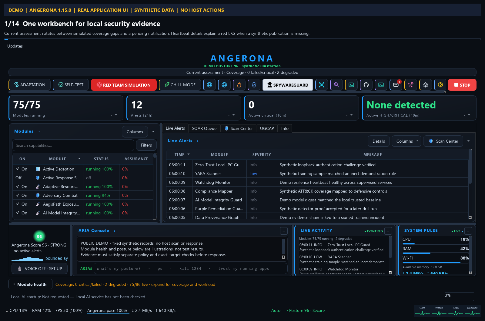](assets/demo/angerona-demo.gif)

The demo covers Current Assessment, the notification badge, scrolling alerts,
SpywareGuard and Research Wire, MITRE ATT&CK, curated tools, breach review,
Settings, scan progress, Auto Adapt, Red Team scoring and component heartbeats. [Play the 70-second application demonstration](assets/demo/angerona-demo.gif)

**Demo data.** All displayed telemetry, identifiers, timestamps and counts are
synthetic.

| Curated tools | Integrated toolkit |
| --- | --- |
| [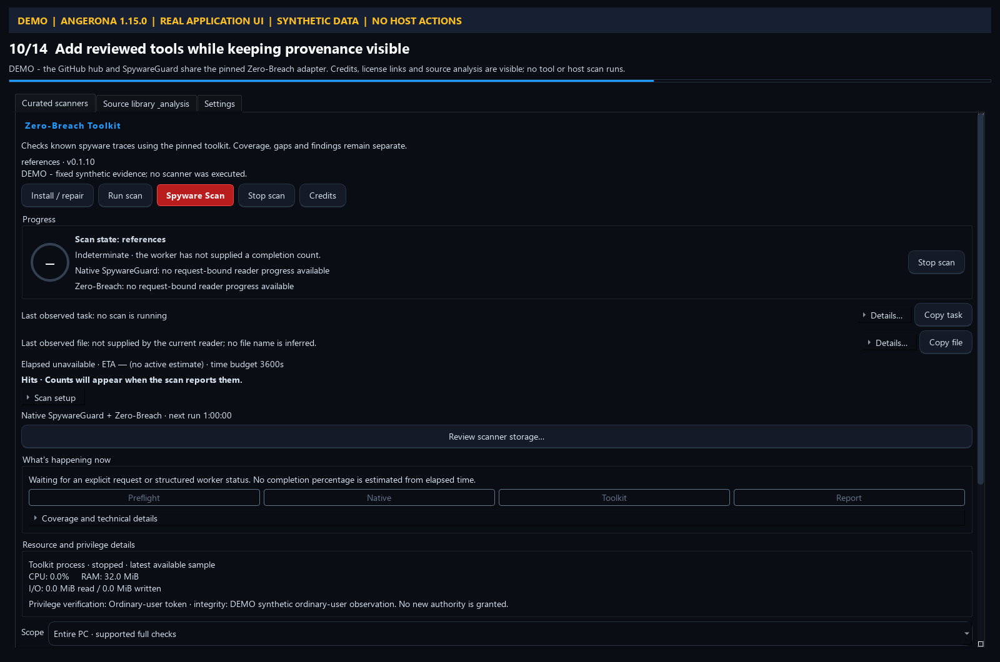](docs/zero-breach-toolkit.md) | [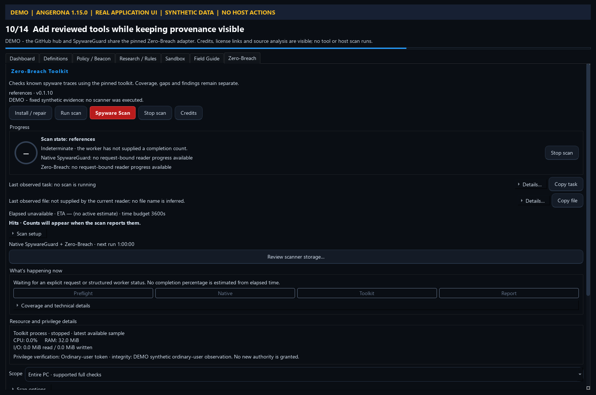](docs/zero-breach-toolkit.md) |
| [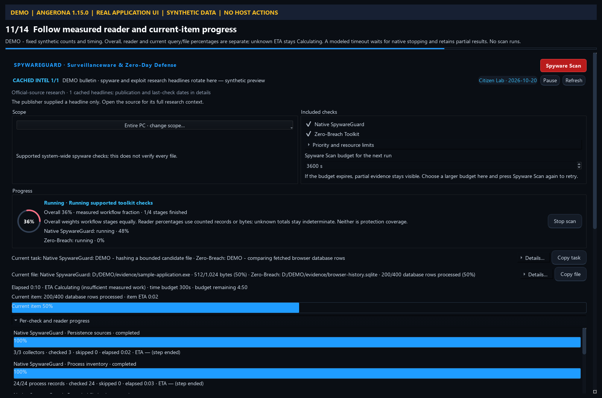](docs/zero-breach-toolkit.md#priority-spyware-scan) | [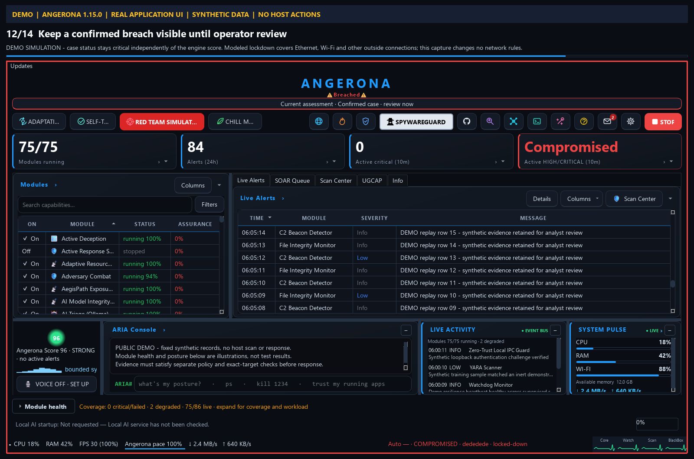](docs/security-flow.md#verified-breach-review-and-lockdown) |
| [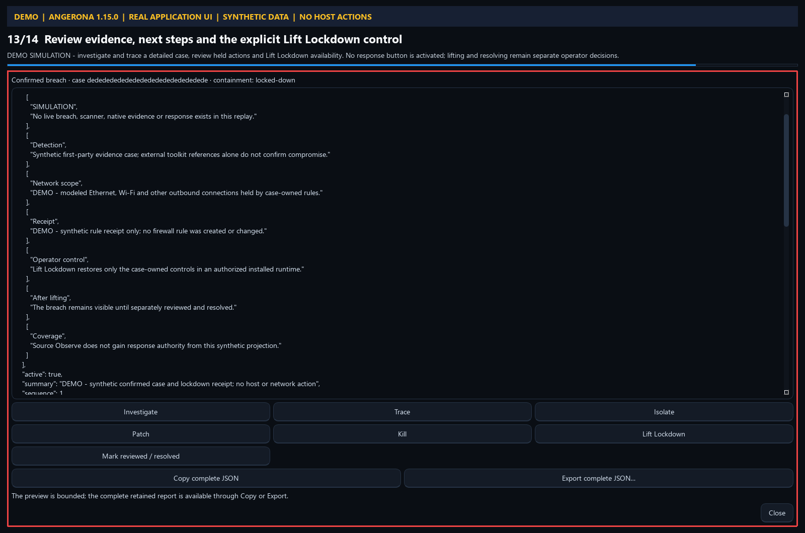](docs/security-flow.md#verified-breach-review-and-lockdown) | [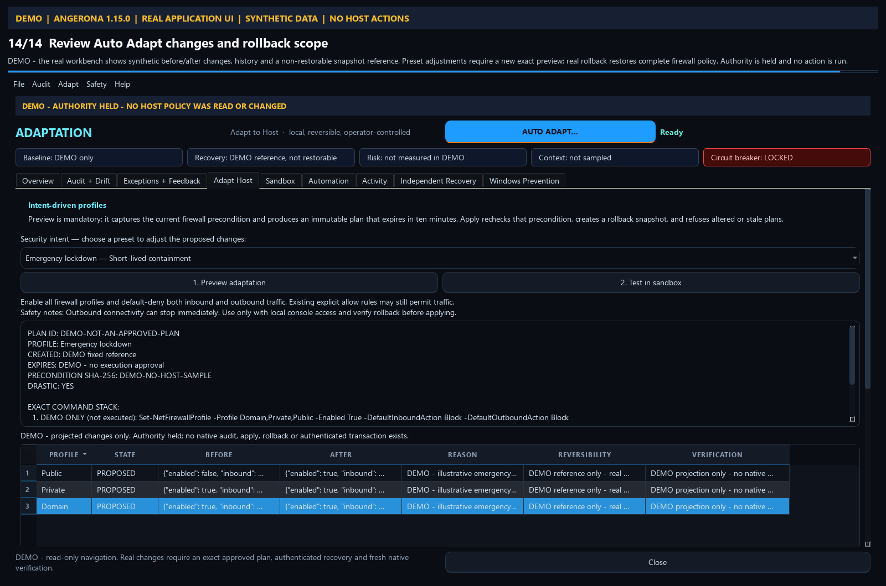](docs/security-flow.md) |
| [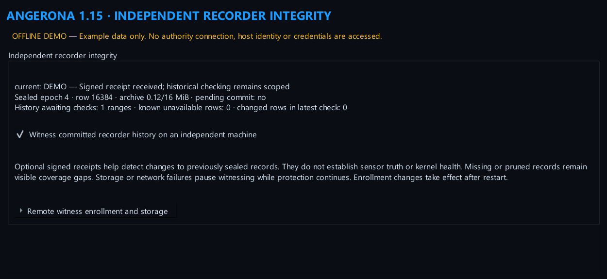](docs/releases/v1.15.0.md) | [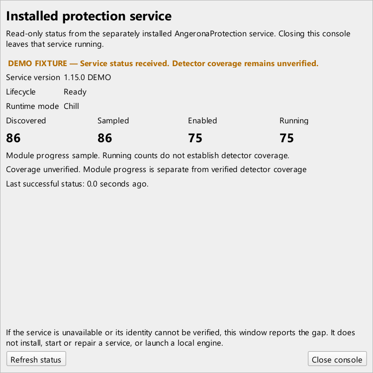](docs/releases/v1.15.0.md) |
| [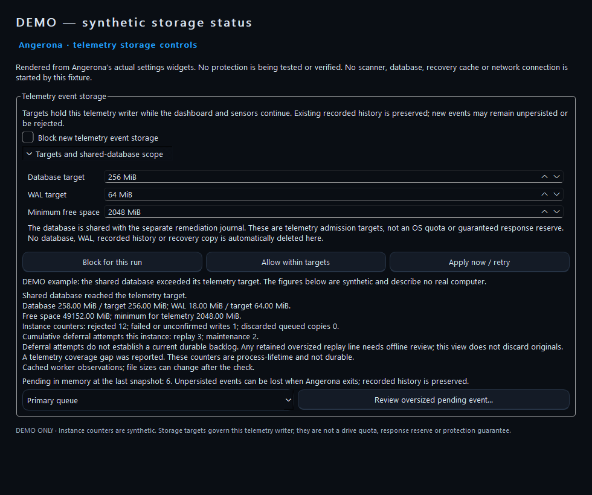](docs/releases/v1.15.0.md#telemetry-storage-and-dialog-recovery) | DEMO only: synthetic data; no recorded history or host policy changed. |

| Red Team progress | Verified step diagnostics |
| --- | --- |
| [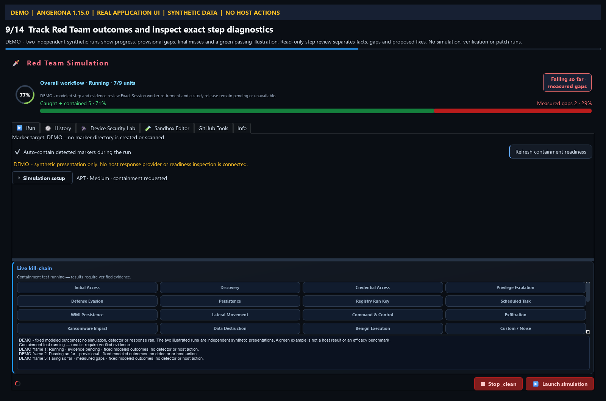](docs/security-flow.md) | [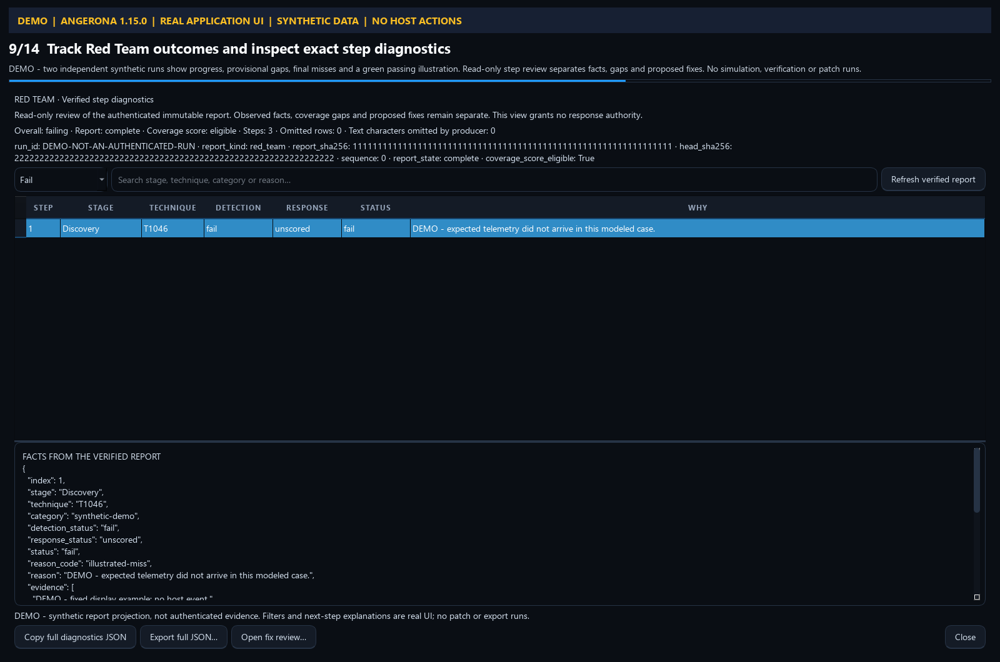](docs/security-flow.md) |
| [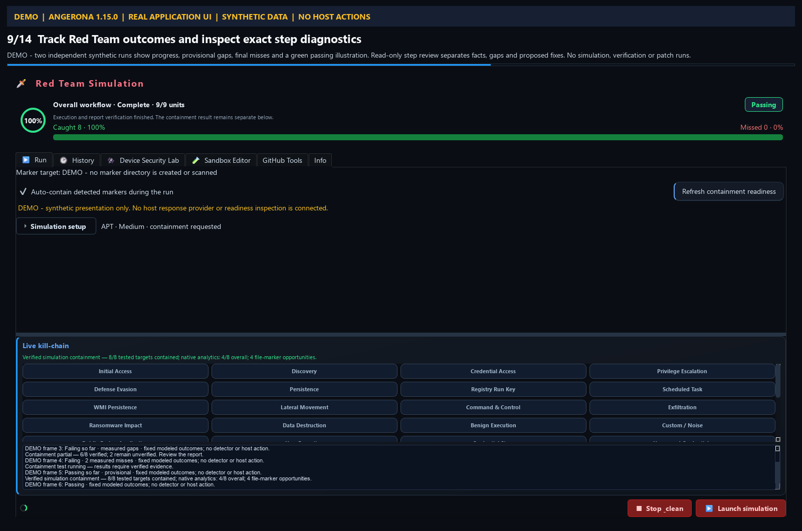](docs/security-flow.md) | [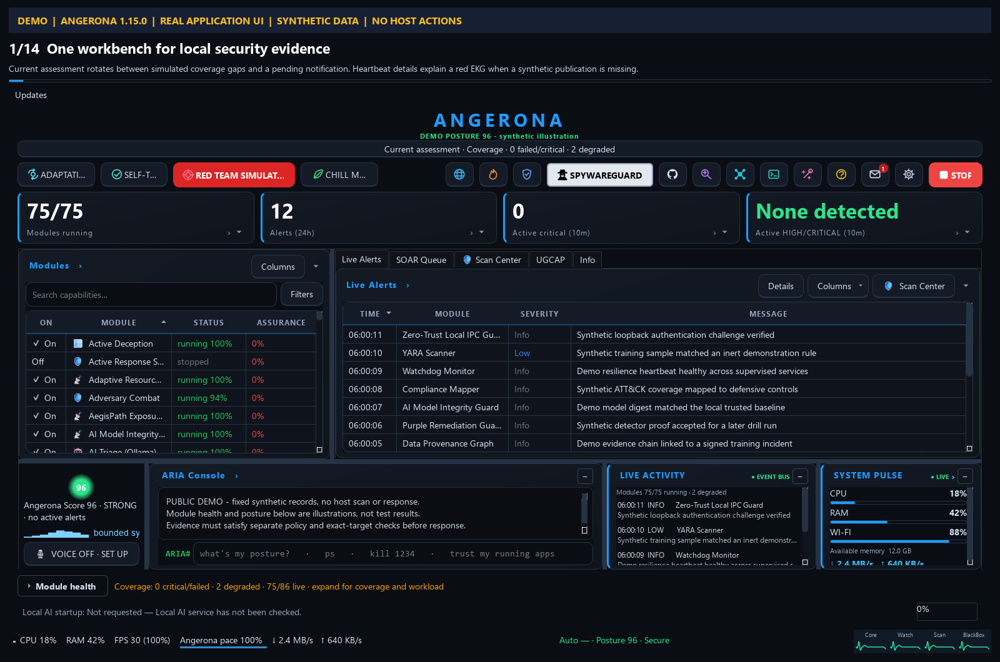](docs/live-debug-harness.md) |
| [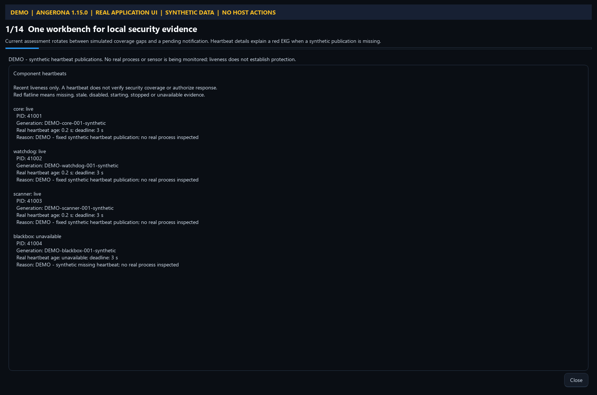](docs/live-debug-harness.md) | DEMO only: simulation outcomes do not establish real-world detection coverage. |

## Suite at a glance

- **Endpoint evidence:** process, file, memory, identity, persistence and
  removable-media observations, with explicit missing or stale coverage.
- **Network visibility:** connection, protocol, wireless, ARP and beacon
  analysis through the available platform sensors.
- **Scans and detection:** Scan Center, YARA matching, memory-injection checks,
  behavioral rules and correlated exposure or tradecraft evidence.
- **Investigation and forensics:** SentinelLens graphs, MITRE ATT&CK technique
  and evidence views, cases, timelines and supported captures connect observations.
- **Governed response.** SOAR queues supported quarantine, process and network
  actions for specific targets under policy and records outcomes and available
  undo actions.
- **SpywareGuard:** surveillanceware evidence review and governed response,
  subject to its published preview and platform prerequisites.
- **GitHub Tools:** curated, version-pinned scanners, source review, settings,
  analysis, integrity checks, managed revert and visible third-party credits.
- **Spyware Scan:** selected native and toolkit checks with priority, resource
  and privilege-coverage controls; unavailable collection remains visible.
- **Breach review:** qualified native evidence, persistent case visibility and
  Investigate/Trace/Isolate/Patch/Kill next steps with explicit action holds.
  Managed network lockdown and Lift require the accepted installed authority.
- **Integrity and provenance:** source, model, audit, IPC and enrolled UGCAP
  checks; independent witness authority requires its own deployment.
- **Defensive practice:** benign validation, deception and canary exercises
  produce labeled receipts; synthetic markers cannot authorize host actions.
- **Optional AI:** local Ollama explanations and manual sanitized preview/Send
  assist review; model text has no response authority.
- **Operations and recovery:** resource controls, watchdogs, storage warnings,
  component heartbeat EKGs, safe startup alternatives and preserved-edit recovery
  decisions.
- **Integration and review:** module contracts, optional intelligence/fleet/SIEM
  connections and bounded read-only Live AI Review.

Static discovery includes **86 modules**. Declared platforms, modes, dependencies,
response authority and actual live coverage differ.
[Capability register](ANGERONA_CAPABILITIES.md) ·
[Complete built-in source inventory](docs/security-flow.md#built-in-capability-source-inventory).

## Choose your installation

[Download the current source ZIP](https://github.com/Ag3nt47/AngeronaSuite/archive/refs/heads/main.zip) ·
[Release downloads](https://github.com/Ag3nt47/AngeronaSuite/releases)

| Platform and purpose | Start here | Authority and availability |
| --- | --- | --- |
| Windows signed installed release | [Check Releases for an accepted signed package](https://github.com/Ag3nt47/AngeronaSuite/releases) | Use an available trusted-publisher `Angerona-<version>-win64.msix` and its adjacent SHA-256 file. It needs no Python or terminal setup. Signed Protect, native service acceptance and clean-VM release gates remain separate requirements. |
| Windows source development | [Clone this repository](https://github.com/Ag3nt47/AngeronaSuite), then run `Install-Angerona.bat` as your ordinary user | Unelevated Observe/development in Chill Mode. Source startup cannot create signed installed Protect authority. |
| macOS 14+ source | [Start-Angerona-macOS.command](Start-Angerona-macOS.command) | Observe preview; Intel, Apple Silicon and Rosetta detection. [Prerequisites](docs/NATIVE_INSTALL.md). |
| Linux source | [Start-Angerona-Linux.sh](Start-Angerona-Linux.sh) | Observe with optional explicitly configured eBPF. [Prerequisites and native scope](docs/NATIVE_INSTALL.md). |

**Estimated download and disk space.** These planning ranges cover the app and
its runtime in decimal gigabytes (GB). Optional models, accumulated security data
and separate installation staging require additional space.

| Installation | Estimated first download | Estimated app/runtime disk use |
| --- | --- | --- |
| Windows signed package, when available | Pending a measured release build; use the accepted asset's listed size | Pending measurement; allow several GB for separate runtime extraction and installation/upgrade staging |
| Windows source setup | 0.35–0.60 GB | 1–2 GB |
| macOS source setup | 0.50–0.75 GB | 1.5–3 GB |
| Linux source setup | 0.30–0.50 GB | 1–2 GB |

## What's new in 1.15

- **Red Team progress and diagnosis:** overall progress, a caught/missed bar,
  provisional and final outcome badges, and verified step-by-step failure reasons
  with a read-only review harness.
- **Reviewable Auto Adapt:** responsive before/after details, recent history,
  transaction inspection, rollback access and profile adjustments. Changes require
  a fresh preview; incomplete audits remain visible and hold Apply.
- **Concurrent workspaces:** supported content windows have native window
  controls and F11 fullscreen; reports and Settings retain their workers safely.
- **Daily Spyware Scan.** Entire PC is the default automatic scope. Save the
  switch and scope in Scan setup. Due runs wait for an available scanner,
  and their results appear in Notifications.
- **Scan evidence and review.** Progress, the current item and Hits appear
  above setup. A plain-English report separates native advisories, toolkit
  matches and coverage gaps. Report counts default to Unlimited with separate
  disk and inventory limits.
- **Connected devices and automation.** Review bounded results for approved
  Windows storage, host-visible accessory functions and process-linked
  automation observations.
- **Dashboard and research links.** The inbox collects device, setup, storage,
  update and scan notices. Current Assessment opens the relevant view, and
  SpywareGuard's Research Wire shows dated briefs and source status.
- **Current proof for response:** native observed hashes, current producer
  evidence and retained target identities constrain automatic actions.
- **Administrator access per session:** the signed Windows startup path opens
  an ordinary read-only status console. Its Settings checkbox starts off and
  requests Windows consent for the current session. Signed-package and UAC
  acceptance remain pending.
- **Bounded evidence storage:** crash-snapshot admission and visible storage
  holds preserve existing history; held writes do not establish complete coverage.

## Installation details

The current Windows dependency wheels total about **300 MB downloaded / 840 MB
expanded**; source estimates also allow for the checkout. The platform inputs
are listed in the [Linux](release/locks/posix/source/linux-x86_64.manifest.json),
[Apple Silicon](release/locks/posix/source/macos-arm64.manifest.json) and
[Intel macOS](release/locks/posix/source/macos-x86_64-base.manifest.json)
wheel manifests. OS prerequisites, Intel macOS
Xcode/Rust/OpenSSL builds, Git history, retained backups and evidence are extra.
Windows source repair requires **5 GiB free**: a 2 GiB reserve plus 3 GiB working
capacity. Its one retained previous runtime can add another runtime's disk use.
The bundled Zero Breach engine is about **0.97 MB**, plus its retained licenses
and notices. Optional managed scans require a separate **3 GiB free-space
reserve plus the working-data allowance**; a scanner storage hold does not block
normal Angerona startup.

**Optional models are separate:** [Llama 3 8B](https://ollama.com/library/llama3:8b)
adds about **4.7 GB** for model weights alone, plus the Ollama runtime. Other
models vary. The [small English Vosk speech model](https://alphacephei.com/vosk/models)
adds about **40 MB of download** when not already bundled. No LLM is required
for deterministic defense.

When an accepted signed release is available, its Windows package is
`Angerona-<version>-win64.msix`. Protect requires the signed installed authority
and per-session administrator approval. For development, unelevated source
runs in Observe/development scope. **Settings → General → Integrity & Performance**
explains why administrator access is held for the unsigned checkout.

A release tag or unsigned download does not establish publisher trust. A trusted
signed release needs no Python or terminal setup. Portable ZIPs
are upgrade-only; the classic Setup wrapper is not a public first-install path.
The project does not claim Microsoft Store distribution.

For Windows source:

1. Clone the canonical repository into your development directory.
2. Run `Install-Angerona.bat` without elevation to create the reviewed runtime.
3. Run `start-angerona.bat`. Start with the dashboard's actual coverage state,
   then enable the modules and integrations you need.

Use dashboard **STOP** or **Quit** from the tray for a clean stop; closing the
window can leave the engine running. A shared Ollama server and downloaded
models remain; configured model residency is unloaded. Automatic recovery stays
stopped until an explicit launch. [Startup recovery](docs/safe-startup-recovery.md) explains safe
alternatives, logs and held conditions.

## How the security flow works

[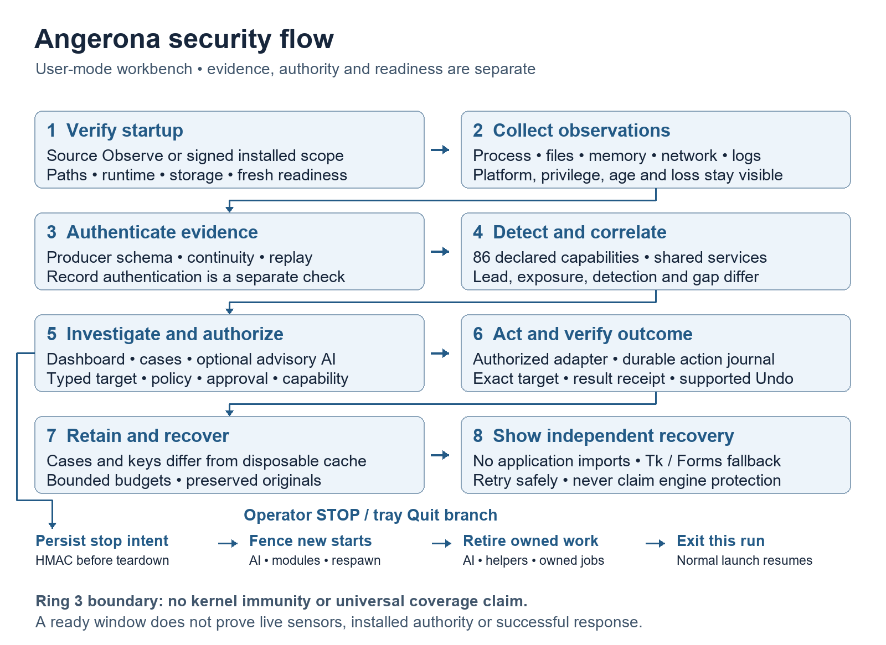](docs/security-flow.md)

The [full flow and attack-surface matrix](docs/security-flow.md) connect each
boundary to implementation and regression entry points. A visible dashboard,
fresh sensor evidence and authority to act are separate states. Imported logs,
URLs, AI prose and review notes remain untrusted data.

| Curated scanner boundary | Breach and response boundary |
| --- | --- |
| [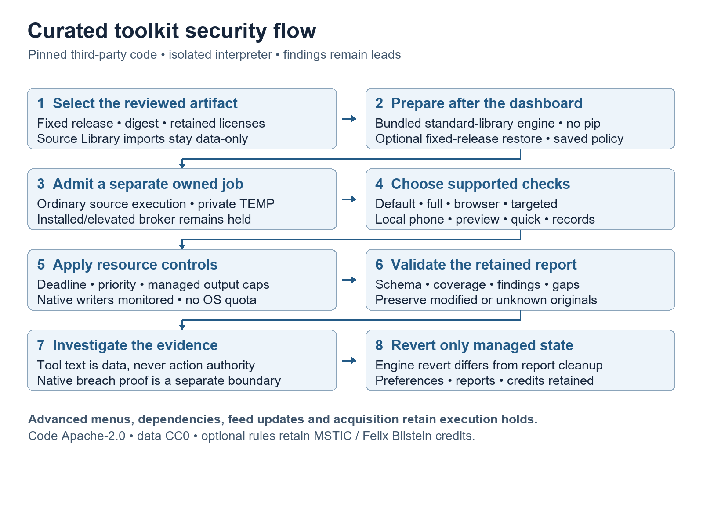](docs/zero-breach-toolkit.md) | [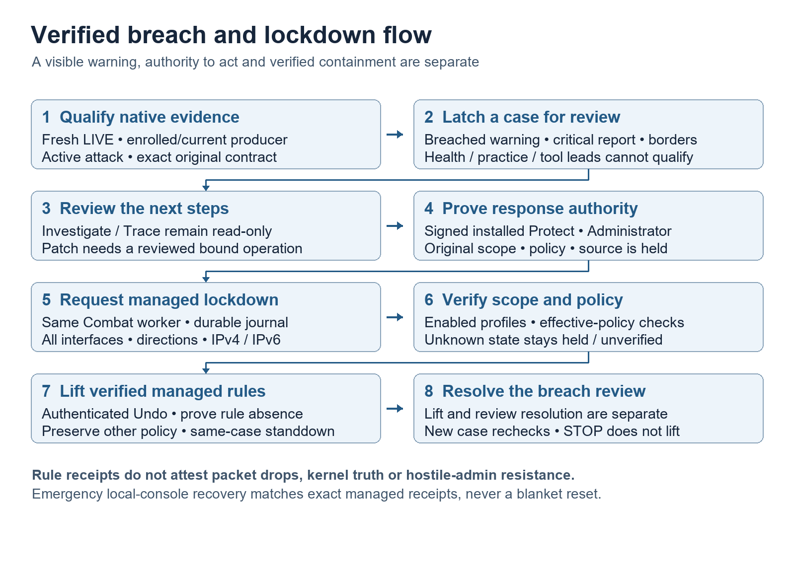](docs/security-flow.md#verified-breach-review-and-lockdown) |

Angerona is user-mode and ships no production kernel driver. Ring 3 code does
not gain kernel immunity through UAC, signing or cryptographic checks. Hostile
administrator, kernel, firmware, hypervisor and compromised-OS threats remain
outside any universal protection claim. Windows Filtering Platform (WFP) and
other OS integrations still require their actual platform, privilege and
deployment prerequisites. [Architecture](docs/architecture.md) · [Security](SECURITY.md).

## Privacy, recovery and drive usage

Cloud integrations are optional and off by default. Optional AI, intelligence,
fleet and witness integrations have their own endpoint and consent boundaries.
The separately controlled public GitHub fallback for source startup defaults on;
it downloads verified public code and uploads no host evidence or preserved edits.
Manual AI consultation shows a bounded sanitized preview before explicit Send.
[AI privacy](docs/ai-consult-privacy.md).

Normal Windows source data is under
`%LOCALAPPDATA%\Angerona\SourceData`. Historical protected elevated-source
custody uses the checkout's sibling `AngeronaData` directory; the normal source
launcher refuses elevation. Packaged Windows data prefers `D:\AngeronaData`,
with protected `%ProgramData%\Angerona` fallback according to installed authority.
Credentials, baselines, audit journals, cases and disposable caches have separate
retention. Hash-based Message Authentication Code (HMAC) verification of record
bytes does not alone establish producer truth.
[Data and key boundaries](docs/key-and-communication-integrity.md).

File recovery has configurable cache/reserve controls and visible storage
warnings. Windows source Safe Startup treats retained diagnostic history and
recommended reserves as advisory, with private bounded launcher work and actual
I/O checks. Optional repairs and scans keep their own admission limits. Full
capacity never
justifies silently evicting unreviewed edits or clearing protected evidence.
Some direct dashboard/native-installer logs still need retention review.
[Storage budgets and limits](docs/safe-startup-recovery.md#capacity-and-retention).

Safe Startup tries fixed verified alternatives and keeps a separate recovery
interface available when app code or Qt fails. Automatic recovery and GitHub
source fetches are individually controlled in Settings. Every candidate repeats
trust/runtime/readiness gates; an open recovery window does not mean protection
is active. [Recovery guide](docs/safe-startup-recovery.md).

## More application views

| Investigation and response | Capability views |
| --- | --- |
| [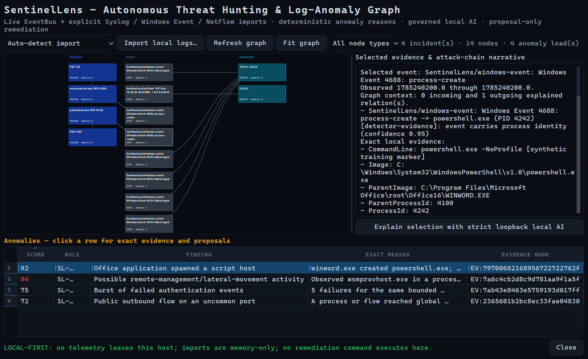](docs/screenshots/angerona-v1.12-sentinel-lens.png) | [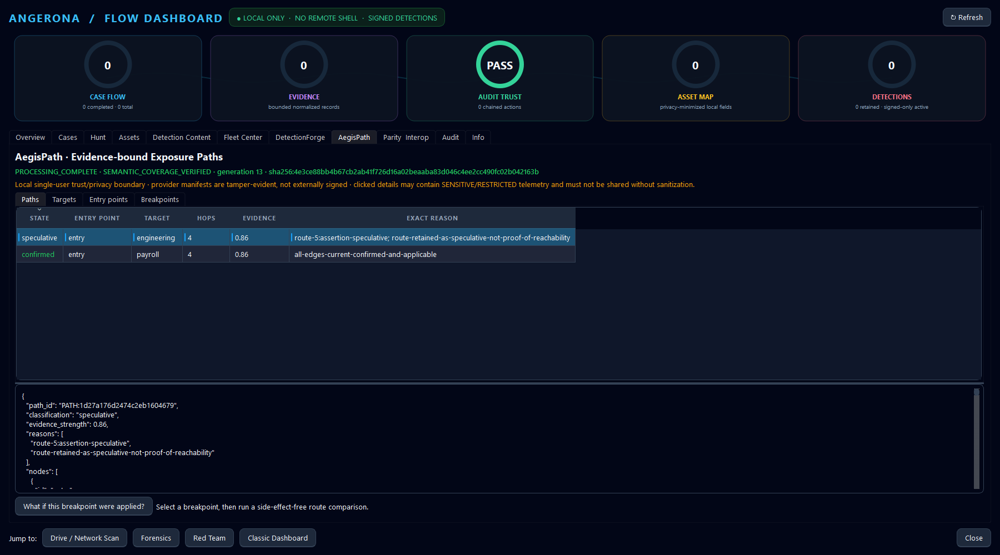](docs/screenshots/angerona-v1.13-enterprise-programs.png) |
| [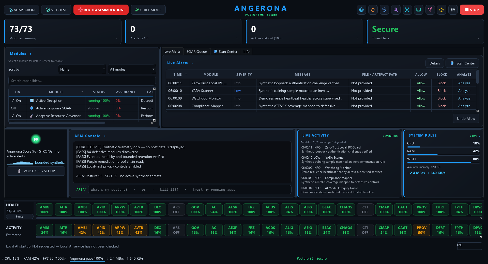](docs/screenshots/dashboard-public-demo.png) | [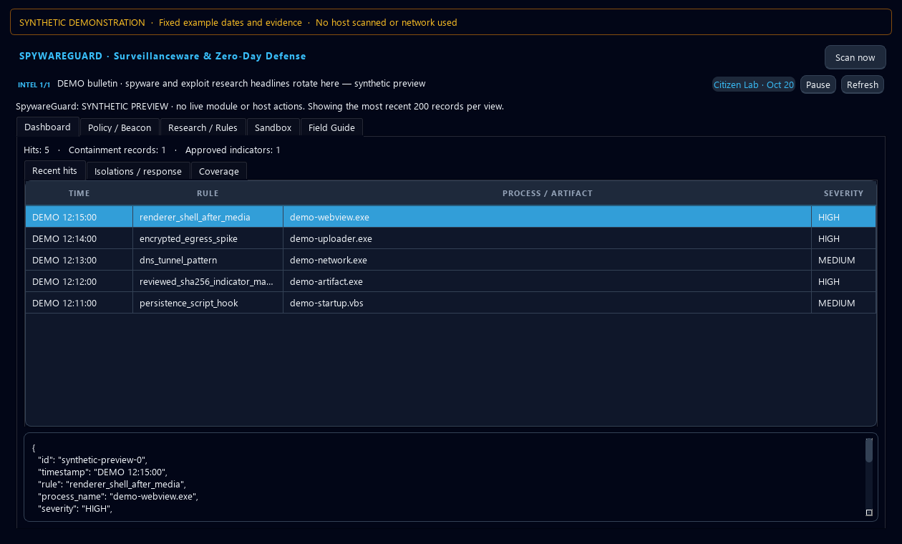](docs/screenshots/angerona-spywareguard-preview.png) |
| [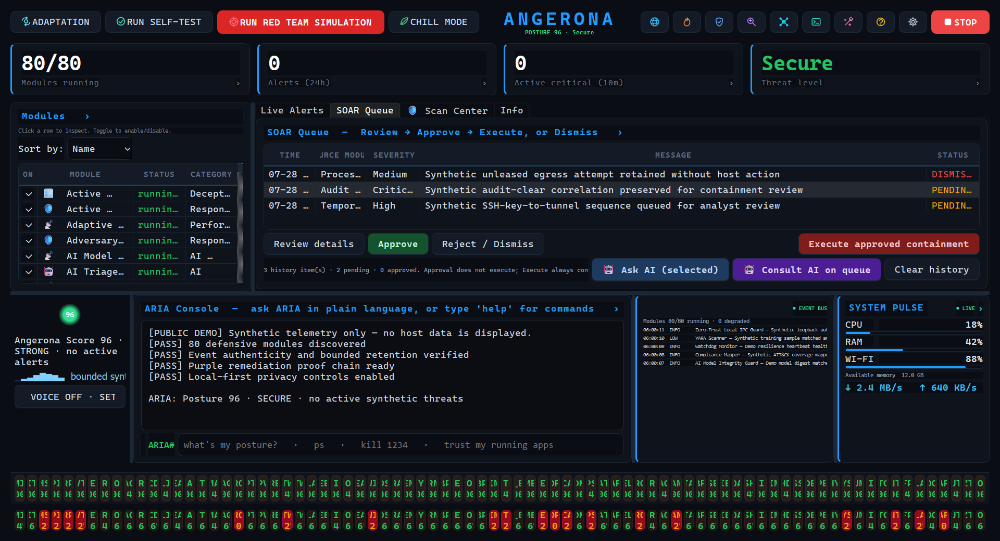](docs/screenshots/angerona-v1.11-soar-review.png) | [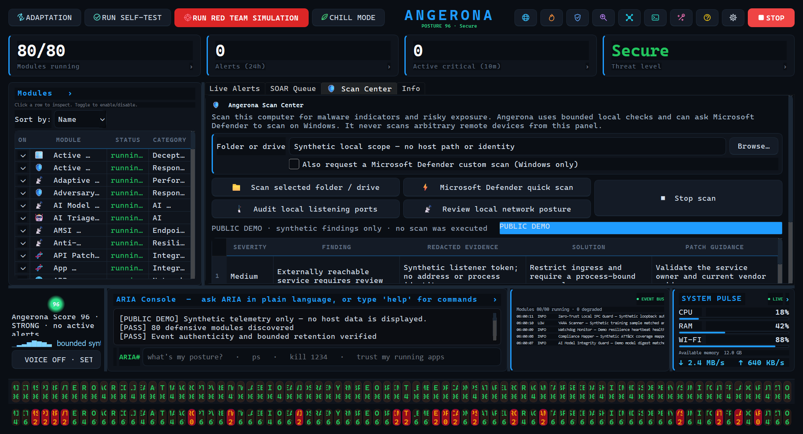](docs/screenshots/angerona-v1.11-scan-center.png) |
| [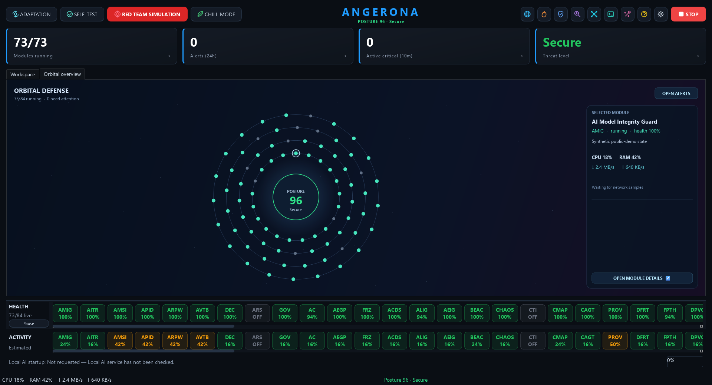](docs/screenshots/dashboard-orbital-demo.png) | All views use synthetic public demonstrations. They are not live coverage, efficacy or scale benchmarks. |

## Guides and current work

- [Master Manual online](docs/master-manual.md) and [PDF](Angerona_Master_Manual.pdf): operating reference, complete
  security flow, all built-in source entries and recovery decisions.
- [Safe Startup](docs/safe-startup-recovery.md): alternatives, diagnostics,
  preserved edits, optional GitHub egress and honest storage limits.
- [Live AI Review](docs/live-debug-harness.md): opt-in bounded read-only diagnosis;
  [interaction map](analysis/live-debug-2026-10-22/interaction-map.md).
- [UGCAP and Enclave Mesh](docs/ugcap-enclave-mesh.md): explicit known-clean
  enrollment, fresh integrity evidence and separately deployed witness authority.
- [SpywareGuard](docs/spyware-guard.md): surveillanceware evidence review and
  governed response with explicit preview/prerequisite limits.
- [GitHub Tools and Zero Breach](docs/zero-breach-toolkit.md): pinned engine,
  integrated and held modes, priority scans, private reports and retained credits.
- [Hardware and self-check](docs/hardware-and-selfcheck.md), [native setup](docs/NATIVE_INSTALL.md),
  [v1.14 acceptance register](docs/releases/v1.14-security-integration.md).

Native process-bound egress, signed privileged-service deployment and independent
witness/backup authorities retain separate acceptance gates. Passing source
tests cannot deploy those authorities or prove field detection rates.
Broader v1.15 remains incomplete.

## Detailed v1.15 hardening notes

**Development status:** source preview. An unresolved native shutdown crash,
coverage gaps and CPU/UI pressure remain documented. A later normal exit does
not establish a crash fix; signed deployment and hardware acceptance are separate.

[Telemetry storage, dialog recovery and validation limits](analysis/hardening-v1.15-2026-11-01-telemetry-storage-dialogs.md).

[What changed, validation and current limits](docs/releases/v1.15.0.md) ·
[Reviewed observation](analysis/hardening-v1.15-2026-10-30.md) ·
[Follow-up fixes and observation](analysis/hardening-v1.15-2026-10-30-followup.md) ·
[Runtime and shutdown review](analysis/hardening-v1.15-2026-11-01.md) ·
[Advisory and setup review](analysis/hardening-v1.15-2026-11-01-advisory-bursts.md) ·
[Recorder and storage review](analysis/hardening-v1.15-2026-11-01-recorder-admission.md) ·
[Remediation custody review](analysis/hardening-v1.15-2026-11-01-remediation-custody.md) ·
[Recorder commit review](analysis/hardening-v1.15-2026-11-01-recorder-commit-boundary.md) ·
[Latest optional audit review](analysis/hardening-v1.15-2026-11-01-optional-audit-admission.md) ·
[Workspace, Auto Adapt and scan review](analysis/hardening-v1.15-2026-11-02-workspaces-and-scan-review.md) ·
[CI diagnostics and response verification](analysis/hardening-v1.15-2026-11-02-ci-response-verification.md) ·
[Toolkit modes, credits and downloads](docs/zero-breach-toolkit.md).

Angerona combines Endpoint Detection and Response
(EDR), Network Detection and Response (NDR), Security Orchestration, Automation,
and Response (SOAR), forensics and defensive practice in one desktop application.

v1.15.0 strengthens telemetry assurance, tampering review and containment
identity custody. Existing **GitHub Tools**, **Spyware Scan** and after-action
review remain available.

- **Telemetry assurance:** separate kernel-provider canary observations,
  polling coverage and process liveness.
- **Tampering review:** bounded WER precursor correlation with current owned
  process context, consistent cache timing and read-only cached availability.
- **Advisory identity reads:** bounded, compatibility-gated Windows birth maps
  retain fresh observations and explicit partial coverage.
- **Containment custody:** retained process and executable identities across
  program-firewall operations and managed rollback.
- **Independent freshness:** configured authorities reach integrity consumers
  before their persisted state is admitted.
- **Recorder history:** optional independent signatures, bounded receipt storage,
  explicit missing-history gaps and protected public-key enrollment controls.
- **Service separation:** an installed virtual-account engine boundary and a
  status-only desktop console, subject to signed deployment and enrollment.
- **Managed driver policy:** a separately enrolled installed profile with
  reviewed materials, two independent approvals and verified configuration
  readback; default source and diagnostic profiles cannot activate it.
- **Rollback review:** bounded servicing-queue version checks and a policy-bound
  TPM certification verifier; physical enrollment and hardware writes are separate.
- **Operational accuracy:** lifecycle-scoped watchdog wording, retained native
  cleanup ownership and bounded recorder verification; optional failures and
  actual coverage gaps stay visible.
- **November reliability fixes:** bounded normal logging, early AI refusal,
  accurate historical reports, owned-startup readiness and nonmodal recovery
  confirmation improve review and keep that decision from blocking STOP.
- **Advisory accuracy:** port-only leads and SOAR burst counts retain their
  advisory scope; Full Setup exposes the existing normal-log controls.
- **Recorder responsiveness:** exhausted recorder queues report rejected
  deliveries without publisher disk waits; STOP and restart preserve owned
  queues and expose process-lifetime admission gaps.
- **Remediation custody:** finding closure requires authenticated committed
  evidence; durable receipt writers follow the existing audit retention policy.
- **Recorder storage accuracy:** housekeeping errors after a successful save
  cannot retry or spill those committed events as another copy.
- **Optional audit limits:** oversized new entries are rejected with visible
  omission counts; durable action and recovery journals retain separate rules.
- **Telemetry storage controls:** worker-observed database, WAL and free-space
  targets hold new event writes while preserving history and exposing pending
  work, rejections and gaps. Apply now and Save have separate effects.
- **Window recovery:** interrupted reveal transitions restore queued windows
  and release their temporary masks.
- **Persistence evidence:** pre-existing startup entries retain urgent review
  priority as observations; enrollment alone grants no trust or attack verdict.

## Validation and contributing

Historical release evidence: **Final Cycle 34 verification.** The gate on
`7eef1f0a0c400b34f170cbd1463cd3c6a454de3b` passes **2882 tests with 15 intentional platform skips**.
This is a dated checkpoint, not the current revision's result or live coverage.
[Retained maintenance history](analysis/public-maintenance-history.md) preserves
the previous README and its scoped measurements;
[the issue map](analysis/live-debug-2026-10-22/README.md) records further evidence
and remaining work.
The [v1.14.2 review map](analysis/curated-tools-breach-2026-10-29.md) records the
new integration and breach-control checks with their scope and remaining holds.

For a configured development environment, run the focused checks relevant to
your change, then the required integration/self-check gates. Preserve skips and
coverage gaps. Maintainer publication must verify canonical public `main`, a
clean worktree and byte-identical tracked README assets.

[Contributing](CONTRIBUTING.md) · [Writing modules](docs/writing-modules.md) ·
[Report security issues](SECURITY.md) · [Changelog](CHANGELOG.md) · [MIT license](LICENSE)

Third-party components retain their own terms. Zero Breach Toolkit code is
Apache-2.0; its research data and optional rules retain their separate licenses
and author notices. [Credits and bundled notices](docs/zero-breach-toolkit.md#credits-licenses-and-integrity).

<!-- ANGERONA_DOC_STATUS tests=2882 skips=15 modules=86 -->
