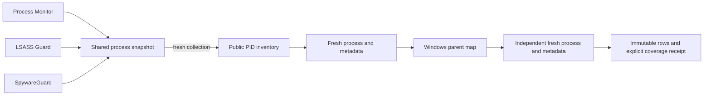

# Shared process-inventory performance review

Angerona v1.14.0, 23 October 2026. Measurements are private ordinary-user
observations; the reviewed counts below omit host process rows and identifiers.

## Measured work and interaction

The accepted 90.219-second baseline used fifteen audited modules and consumed
52.46875 seconds of process CPU. Retained native worker handles attributed
24.515625 seconds to Process Monitor, 23.5625 to LSASS Credential-Access Guard,
and 1.515625 to SpywareGuard. Other measured primary workers each consumed
less than 0.3 seconds. Helper threads are not attributed and the differing
worker intervals must not be subtracted from whole-process CPU. All fifteen
primary worker generations stayed stable; all sixteen query handles closed.
The observation retained seventeen coverage-gap strings and establishes no
physical-host protection verdict.

Nine direct snapshot calls across three fresh interpreters produced eight
distinct refresh receipts and one reused receipt. The first default call took
1.510 seconds of wall time; its start-age was already 1.516 seconds at return,
so the next default call correctly refreshed against the unchanged 1.5-second
limit. Fresh collection in this cohort took roughly 1.27–1.73 seconds. Every
receipt retained unreadable and identity-incomplete counts. These observations
do not measure native API counts or establish the cause of previous watchdog
incidents.

A separate self-only socket control made 53 queries without creating sockets:
0.1689731 seconds total wall time and 0.109375 seconds of quantized thread CPU.
This is a different workload and does not explain the combined process CPU.
A closed-provider FastPath control showed 64 qualifying same-PID events still
perform 64 inert socket queries before 120-second positive-alert deduplication;
26 semantic cohorts/563 signed fixtures passed. No negative-result cache or
network detection change was introduced.

## Reviewed change

The process inventory uses public `psutil.pids()` instead of constructing
unused cached `process_iter()` objects. Both independent fresh metadata
passes, birth/image comparison, parent-map bracket, lock, start timestamp,
1.5-second cache limit and collection bounds remain. Newly vanished PIDs remain
explicit losses. No caller receives cached `Process.info` as identity proof.

Seven new inert cases cover independent identities/order, access-denied and
vanished processes, and PID-enumeration failure without an iterator fallback.
All 134 existing assertion lines in the four adapted test fixtures remain.

## Validation and fresh observation

Fourteen complete regression suites passed 452 tests, with no failures, errors
or skips. The default isolated selfcheck passed 29 phases; 68 module rows passed
and 18 were explicitly skipped, with a separate pipeline row and 8 controlled
verification checks. Native processes retired cleanly and no Qt widgets remained.
This accounts for 86 modules; it does not exercise 86 native sensors.

The fresh 15-module run completed in 90.437 seconds with no recorded errors,
capture/export drops or pending threads. All 15 primary-worker profiles were
usable and all 16 query handles closed; exact outer and core process generations
retired. Seventeen coverage-gap strings remain, state OBSERVED_WITH_GAPS.

| Measured CPU seconds | Earlier observation | After reviewed change |
| --- | ---: | ---: |
| Observation process |52.46875|55.59375|
| Process Monitor primary worker |24.515625|22.734375|
| LSASS Guard primary worker |23.5625|27.78125|
| SpywareGuard primary worker |1.515625|1.90625|

These are separate uncontrolled runs, not a controlled performance experiment.
The later total is higher. The small allocation cleanup is retained without
a demonstrated speed-gain claim; the shared-collector CPU hotspot remains open.
See [the sanitized evidence](process-inventory-evidence.json) for exact scopes,
source digests and private-receipt digests. Later documentation edits do not
change the six tested code/test files.

## Evidence limits

A private profiling setup rejected its first native attempt before any scan
because it assumed the legacy profile-hook API for Python 3.12. The rejected
attempt retired cleanly and remains recorded; no scan cost is inferred from
its zero admitted calls. A second attempt also stopped before scanning on a
monitoring-mask mismatch; profiler idle cleanup was unproved, while both owned
processes retired. Profiling is deferred. Python 3.12 cProfile uses `sys.monitoring`.
See [CPython's profiler implementation](https://github.com/python/cpython/blob/3.12/Modules/_lsprof.c).

HOST-03 native-custody refusal and HOST-04 volatile system-volume capacity
remain open. No alert was cleared, trust baseline replaced, host ACL changed,
installer activated or collection gap relabelled as healthy.
