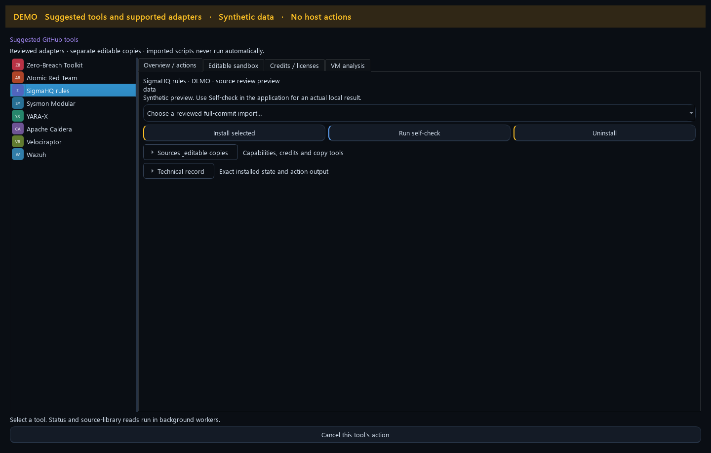
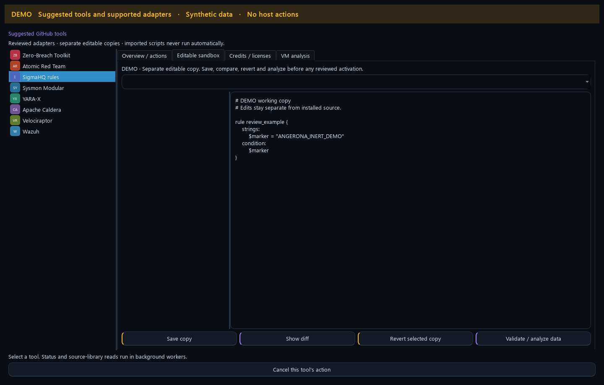

# Community tools and standalone Red Team

Angerona 1.15.0 provides a GitHub Tools hub for reviewed source, managed scanner
integration and bounded data adapters. These controls help a defender compare
community detection logic, preserve its provenance and test compatible content
without turning a repository download into permission to run its code.

Open the GitHub icon on the dashboard. The hub contains **Curated scanners**,
**Source library & analysis**, **Suggested tools**, **Rules & Playbooks** and
**Settings**. The Red Team button opens its separate application window while
the running Angerona Core retains validation and response authority.

[Watch the 18-second DEMO workspace tour](media/community-suite-tour-demo.gif).
The tour shows Suggested tools, editable copies, Rules & Playbooks and the
Suite Map. It contains synthetic data and performs no host actions.

## Compact workspace controls

Installed state, supported adapter mode and scanner hold/storage reasons stay
visible above the primary install, self-check and uninstall controls. Expand
**Sources & editable copies** for capability details, copy tools, source review,
upstream links, credits and Refresh. Expand **Technical record** for the exact
status JSON. An explicit action result, diff or error reveals its record;
ordinary polling preserves your choice to collapse it. Progress and Cancel
remain available outside these details.

Function cues supplement each label: monitoring/inspection blue, analysis/
research violet, configuration/recovery amber and controlled response red.
They do not replace severity, health, unknown-state colors or permission checks.

## Suggested tools: what is integrated

Select an entry to see its current state, upstream project, pinned source,
capabilities, exclusions and credits. An adapter represents the behavior below;
it does not embed the upstream project's entire platform.

| Entry | Angerona integration | Important limit |
| --- | --- | --- |
| [Zero-Breach Toolkit](https://github.com/interplains/zero-breach-toolkit) | Prepare the bundled pinned scanner, verify it and use managed scan/report controls. | Native SpywareGuard and toolkit coverage remain separate. Missing readers, permissions and incomplete scans remain visible. |
| [Atomic Red Team](https://github.com/redcanaryco/atomic-red-team) | Browse compatible test metadata and map supported techniques to Angerona's reviewed controls. | Upstream attack commands, executors, prerequisites and cleanup scripts are not run. |
| [SigmaHQ](https://github.com/SigmaHQ/sigma) | Validate and evaluate a constrained subset against explicitly supplied normalized event records. Preserve source/logsource bindings. | Unsupported log sources, missing fields, modifiers or conditions are refused. This does not install a full Sigma engine or subscribe to every host log. |
| [Sysmon Modular](https://github.com/olafhartong/sysmon-modular) | Inspect compatible XML configuration, event coverage and storage implications. | The adapter does not install Sysmon or silently apply its configuration. |
| [YARA-X](https://github.com/virustotal/yara-x) | Review rule data and self-check the existing pinned engine against explicit inert buffers. | No downloaded engine, plugin, module or arbitrary host directory scan is authorized by this adapter. |
| [Apache Caldera](https://github.com/apache/caldera), [Velociraptor](https://github.com/Velocidex/velociraptor), [Wazuh](https://github.com/wazuh/wazuh) | Advisory external-result adapters and project references. | These buttons do not install their servers/agents, enroll hosts or grant external findings response authority. Bounded report import through the adapter API is not a live connector. |

## Install, check, remove and restore

1. For a data adapter, open **Source Library**, resolve its canonical repository
   to a full commit, import it, inspect the files/licenses and explicitly mark
   that exact import reviewed. Choose it in **Reviewed pinned source import**.
2. Choose **Install selected**. Compatible data is bounded and indexed with
   its source identity; skipped or unsupported content is reported. Zero-Breach
   instead uses its maintained scanner preparation path and download preference.
3. Choose **Run self-check** to check this adapter's prerequisites and fixtures.
   Read the exact result: an adapter check does not establish that a host scan
   completed or that malware is absent.
4. Expand **Sources & editable copies**, then choose **Refresh** for current
   status. **Open upstream**, **Source Library** and **Credits / licenses**
   provide project and review context. Project icons are local UI symbols,
   not publisher endorsements.
5. **Uninstall** removes the managed integration. It preserves source imports,
   editable copies, preferences and reports. For Zero-Breach, durable uninstall
   intent prevents automatic preparation from immediately restoring the scanner.
   A later explicit **Install selected** or **Prepare** can restore it.

Downloads and parsing run in background workers. **Cancel this tool's action**
requests cancellation of that operation. Closing a view does not discard an
unproved native worker retirement or authorize deleting its files. Existing
unknown or modified files are retained for review.
The authenticated Windows scanner worker hides background toolkit and
PowerShell consoles without modifying the pinned engine.

The source library accepts public HTTPS GitHub identities and pins an immutable
commit. It stores ZIP bytes without extracting or running repository content.
Review is operator intent, not an upstream signature or a guarantee that the
code is safe. Revoking a source prevents later compatible activation/evaluation;
it does not erase its preserved original.

## Edit a separate source copy

In **Sources & editable copies**, **Create editable copy** creates a bounded
working copy of selected managed
source. In **Editable sandbox**, choose a copy and file, then use:

| Control | Effect |
| --- | --- |
| **Save copy** | Save the selected working file; the reviewed original remains unchanged. |
| **Show diff** | Compare that file with its pinned baseline. |
| **Revert selected copy** | Restore the selected working file from that baseline. |
| **Validate / analyze data** | Run the supported data parser/check, with unsupported content reported. |

Here, **sandbox** means a separate editable source copy. It is not an operating
system security boundary. Saving or analyzing a Python, PowerShell or shell file
does not execute it, activate it in Core or replace the maintained Zero-Breach
engine. Use the separate [Rules & Playbooks](rules-playbooks.md) workflow to
activate compatible detection data explicitly.

Managed data packs have finite file/byte limits; editable copies have separate
limits. A full store holds new admissions while preserving existing evidence.
Scanner reports have their own count, byte, inventory and free-space settings.
[Scanner storage and priority controls](zero-breach-toolkit.md#priority-spyware-scan)
explain why Unlimited report count does not mean unlimited disk usage.

## Separate VM analysis

**VM analysis** opens the existing Analysis Lab for fixed Gitleaks/Bandit source
analysis. **Prepare runtime**, **Check readiness**, **Run** and **Cancel** use
that backend's own prerequisites and job custody. This is separate from the
editable-copy feature and from host Spyware Scan.

Native VMware acceptance remains held at the documented configuration-custody
boundary. A prepared runtime or a green parser/self-check cannot authorize a VM
run. The UI reports the actual readiness reason. VMware is unnecessary for
ordinary monitoring, the source library and compatible data adapters.
[Backend design, quotas and remaining acceptance work](design/red-team-github-tool-library.md)

## Standalone Red Team

The dashboard's **Red Team Simulation** button starts a separate ordinary-user
tool window. Its familiar Run, progress, history and review controls remain
available while Angerona's Core continues monitoring. The tool is explicitly
launched; watchdog recovery does not automatically relaunch it.

Core retains the prepared plan, detector enrollment, validation lease, report
verification and response policy. A private inherited channel binds commands
to the current parent, launcher and actual child process generations. Direction,
authentication and sequence checks reject changed/replayed messages; queued Qt
requests retain that exact owner generation.

Independent process probes use fixed inert commands. Marker writes receive a
capability for one newly created Core-owned file, rather than a child-selected
path. Core checks the resulting bytes and retains its read custody. The tool
does not receive Core signing keys or permission to run arbitrary repository
commands. On Windows, retained Job ownership includes its actual descendants.

An exact enrolled inert probe can be eligible for the existing canary response
path. The tool's UI, Core, launcher and other companions remain protected. A
copied PID, role, token or report cannot create that exception. Native catch and
response scores require original detector evidence and committed action
receipts; cleanup of a probe earns no response credit. Unsupported network or
other steps remain explicit gaps.

Closing the tool requests session/report/lease cleanup before its owned process
tree retires. Dashboard **STOP** also requests its shutdown. An uncertain close
or native retirement stays held with custody retained. Process separation
improves attribution and UI isolation; it does not create kernel immunity or a
measured detection rate.

## Practical examples

- **Review a new technique:** import Atomic metadata, inspect the technique and
  map it to a supported Angerona control. Run the reviewed local control rather
  than an upstream attack command. Inspect misses and unavailable prerequisites.
- **Add a specific indicator rule:** review its YARA source and license, create
  a draft, run the available validation/sample checks and inspect what those
  fixtures establish. Explicitly activate compatible data and retain rollback.
- **Check a suspicious source project:** inspect an editable copy or request a
  supported VM analysis when its separate readiness gate is satisfied. A source
  finding is an investigation lead, not proof that a running process is malware.

Angerona is a Ring 3 application. Same-user compromise, hostile administrator or
kernel control can attack user-mode code and evidence. Installed privileges,
native response prerequisites and independent trust boundaries remain separate.
[Security flow](security-flow.md) · [SpywareGuard](spyware-guard.md) ·
[Zero-Breach and bundled notices](zero-breach-toolkit.md#credits-licenses-and-integrity)
