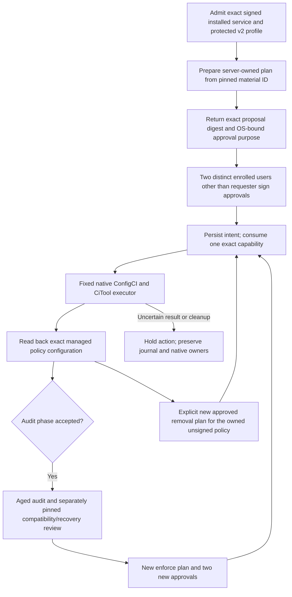

# Managed vulnerable-driver policy

Angerona 1.15 includes an installed-service path for preparing, approving and
applying a reviewed driver deny policy. Source Observe has no enrollment or
elevation shortcut. The default response-service v1 provisioning remains
diagnostic-only. Only an explicitly provisioned v2 profile can register the
native policy executor.

The implemented profile is an **unsigned, removable multiple-policy base deny
policy**. Its checks constrain kernel driver denials while preserving the
required user-mode allow rules. It does not activate HVCI, change Secure Boot,
install a kernel driver or remove arbitrary Windows policies. Local
administrators can tamper with an unsigned policy; boot audit fallback and
reboot requirements remain part of deployment review.

## Fixed enrollment

A signed installed package, immutable publisher pins, actual SCM registration,
restricted service token, native administration rights and protected data/key
custody are prerequisites. Installation must supply exact
`angerona.response-service.provisioning.v2` provisioning with the
`own-unsigned-multiple-policy` profile and its pinned manifest hash.

The fixed service root is native ProgramData's
`Angerona/ResponseBroker/DriverPolicy`. The profile references reviewed local
material IDs and pinned artifacts: the manifest, catalog, XML, compiled CIP,
compatibility reports and fixed native-tool hashes/publishers. Separate private
broker, journal, capability and transport keys stay under service custody.
Downloaded blocklists, arbitrary caller paths, script text and GUI claims do
not enroll authority. Review the actual
[service composition](../src/angerona/core/driver_policy_service.py) and
[host admission](../src/angerona/core/response_service_host.py).

## Audit, approval, enforcement and removal

The requester prepares a server-owned plan and receives its proposal digest.
Two other enrolled OS users independently sign the exact approval purpose.
The requester can then request execution. Enforce mode requires the previous
audit evidence, elapsed review window and separately pinned compatibility and
recovery review. Removal requires its own approved plan and proof of the exact
owned unsigned policy. Signed/UEFI-locked policy removal is unavailable.

The closed IPC operations are `driver.status`, `driver.prepare`,
`driver.approve`, `driver.execute`, `driver.poll` and `driver.cancel`.
Prepare/approve/execute queue onto one retained service worker and immediately
return opaque job IDs; polling reads bounded cached results. The native pipe
captures the Windows peer identity. Requests cannot supply a replacement peer,
executor, credential verifier, native guard or raw policy. Each request,
including polling/cancellation, rechecks the pinned provisioning generation
and current enrollment. A changed profile requires controlled service review
and restart, rather than silent authority replacement.

Cancellation fences future work. It cannot undo a native change that already
committed. An interrupted or uncertain operation requires reconciliation with
the durable intent journal and actual native configuration before retrying.
The runtime bounds its plan and job caches to 64 entries each; capacity holds
require operator review rather than unbounded cache growth.

## Configuration receipts and remaining acceptance

`configured` means the admitted backend or an exact native configuration
postcondition was observed in its stated scope. The service always reports
`kernel_prevention_verified: false`. Configuration readback alone does not
prove a driver was blocked, remove an already loaded driver, restore stripped
callbacks, verify telemetry, or prove reboot compatibility. Actual Windows
build-specific audit/enforce/reboot/removal testing belongs in a disposable
signed-installation acceptance environment.

The native paths retain process/job, file, pipe, OVERLAPPED, event, buffer and
peer/token/SCM handle owners. STOP cancels queued work and requires real
retirement before releasing custody. Unknown completion or close results keep
their owners and fence replacement; they cannot become successful cleanup
receipts. This implementation does not grant ELAM/PPL protection or immunity
to an administrator or kernel compromise.

Source updates do not activate host enforcement. Signed installation, native
rights, enrollment, ConfigCI availability, independent approvals and clean-VM
acceptance remain required.
