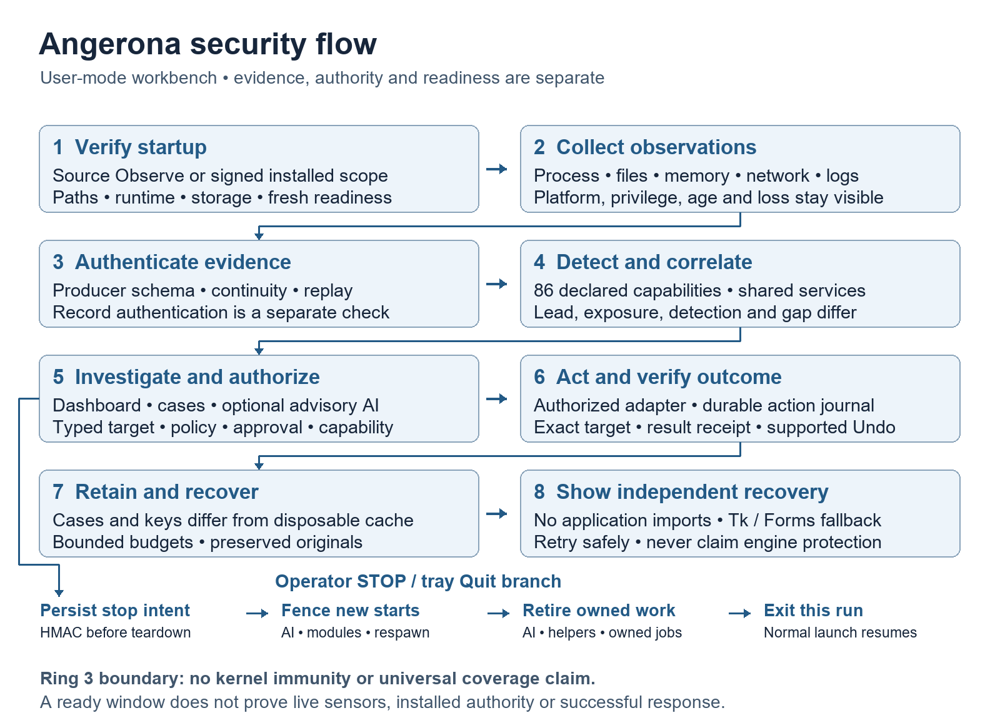
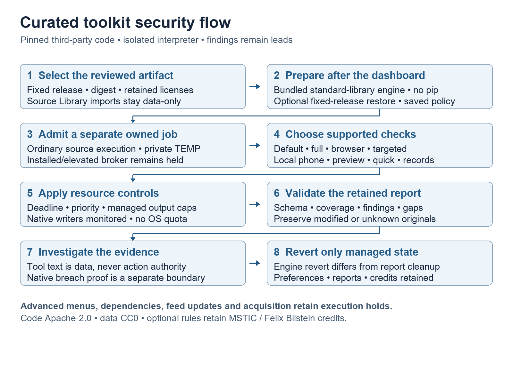
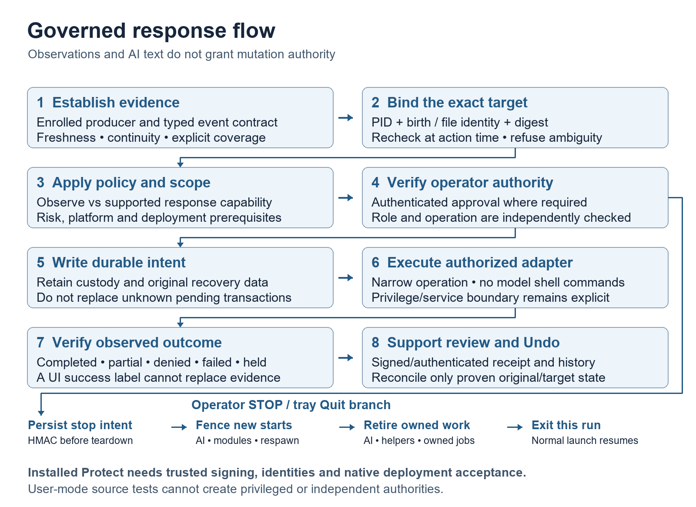
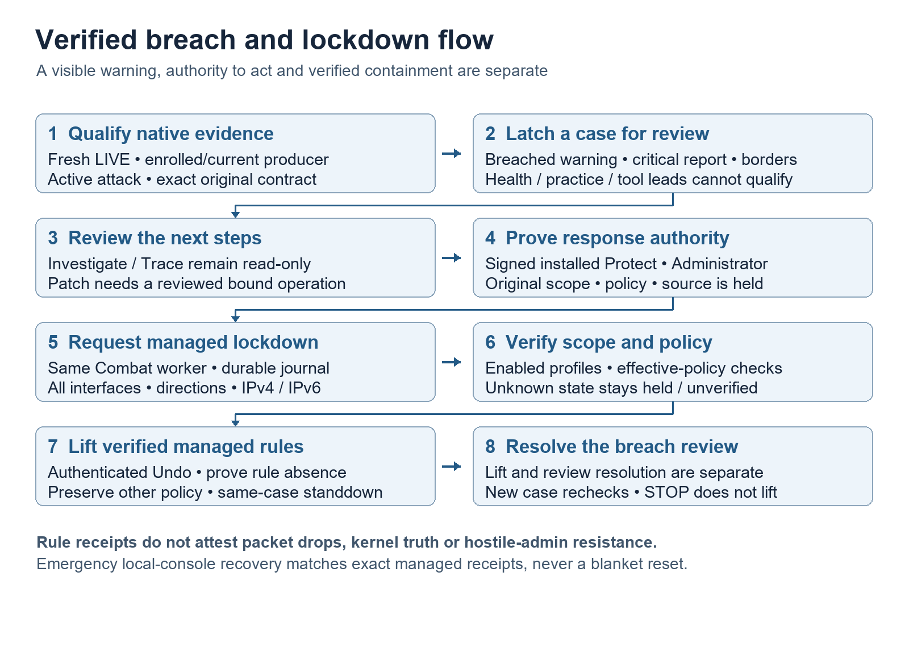
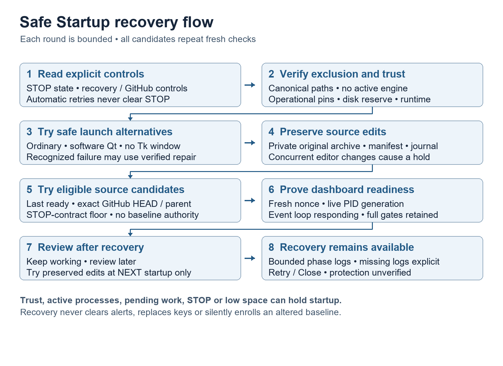

<!-- Generated by tools/export_master_manual.py; do not edit by hand.
Word source SHA256: b0008c3b540dc9e6946ae5a476fc0a29aaeeb2a2c161c95c06d469a6ce144ffb
Coverage: 1345 text nodes; 1354 paragraphs; 30 tables; 5 figures. -->

Current manual version **1.14.2** · Revision **29 October 2026**

[Download PDF](../Angerona_Master_Manual.pdf) · [Download Word](https://raw.githubusercontent.com/Ag3nt47/AngeronaSuite/main/Angerona_Master_Manual.docx) · [Repository guide](../README.md)

This complete readable export follows the Word manual in document order. Dated validation and version-history sections retain their original scope; the final security-flow and Safe Startup chapters describe the maintained source profile.

OPERATOR REFERENCE

# ANGERONA

Master Manual

Local-first detection, investigation, response, recovery, and validation

| Current development: v1.14.2 with Live AI Review, nine integrated security workstreams, 86 discovered capabilities and the October 22 observation/acceptance register. |
| --- |

29 October 2026

Windows Protect \| macOS Observe \| Linux Observe + optional eBPF

## Document control

| Field | Current value |
| --- | --- |
| Version | 1.14.2 |
| Release state | v1.14.2 source maintenance. Current validation: [analysis/curated-tools-breach-2026-10-29.md](../analysis/curated-tools-breach-2026-10-29.md). Signed-package and clean-VM acceptance remain separate. |
| Primary audience | Operators, defenders, home-lab users, security engineers, reviewers, and contributors |
| Scope | Architecture, installation, operator surfaces, Adversary Combat, ARIA/model packs, validation, recovery, limits, and history |
| Source of truth | Current repository code, the 86-capability inventory and [analysis/curated-tools-breach-2026-10-29.md](../analysis/curated-tools-breach-2026-10-29.md); October 22 validation and historical chapters retain their dated scope. |
| License | MIT |

| Positioning: Angerona is an advanced local defensive lab and engineering portfolio platform. It is not independently certified, commercially supported, or a drop-in enterprise EDR/XDR replacement. |
| --- |

This manual replaces the superseded versioned Master Manual and capability Word files. The short current capability sheet is ANGERONA\_CAPABILITIES.md. Detailed security and vulnerability records remain separate companion evidence.

## Contents

- 1. Quick start and operating posture

- 2. Product boundary and platform support

- 3. Architecture and trust flow

- 4. Installation, launch, data, and secrets

- 5. Operator interface and menu map

- 6. Detection, evidence, and interoperability

- 7. Adversary Combat - autonomous response

- 8. SOAR, manual action, and response receipts

- 9. ARIA, Ollama, and governed model packs

- 10. Host Adaptation, resilience, and resource governance

- 11. Red Team, Shark Attack, and After-Action Reports

- 12. Recovery, Undo, and emergency handling

- 13. Validation and release evidence

- 14. Performance evidence

- 15. Security posture, limits, and external gates

- 16. Project positioning and resume value

- 17. Version history and changelog

- Appendices: commands, data locations, evidence sources, glossary

## 1. Quick start and operating posture

### 1.1 What Angerona does

Angerona unifies Windows endpoint and network visibility, local evidence retention, case work, MITRE ATT&CK mapping, governed containment, recovery, local AI assistance, and non-destructive purple-team validation. The v1.14.2 Windows-target inventory discovers 86 defensive capabilities: 13 native operational declarations and 73 explicit compatibility adapters. Every capability receives a validated contract and health snapshot. Native declaration completeness does not establish collection, tested detection, verified response or additional execution authority. Product version, implementation label, contract maturity and efficacy remain separate claims.

Current v1.14 reference route: use [docs/live-debug-harness.md](../docs/live-debug-harness.md) for AI-assisted testing, [docs/releases/v1.14-security-integration.md](../docs/releases/v1.14-security-integration.md) for the nine security workstreams and analysis/live-debug-2026-10-22 for the current issue map, observations and validation. The Live debug and AI review chapter gives current connection and operator workflows. Earlier numbered validation, performance and version-history sections retain their dated source revisions and results; they are not the current release acceptance record.

| Need | Primary surface | Expected outcome |
| --- | --- | --- |
| Review a new alert | Live Alerts / Resolve Center | Understand evidence, acknowledge, investigate, or submit a bounded action |
| Contain active behavior | SOAR Queue / Adversary Combat | Exact signed request, durable intent, verified action, truthful receipt |
| Investigate a case | Flow Dashboard / Local SOC | Bounded hunt, evidence custody, notes, lifecycle, sanitized export |
| Ask for local guidance | ARIA | Evidence-backed answer from local runbooks and approved typed tools |
| Prove a control | Red Team / Shark Attack / Combat validator | Benign campaign, AAR, fresh-rerun closure, complete cleanup |
| Recover a response | Combat Action History | Undo selected/all, verify rollback, inspect recovery-required state |

### 1.2 Recommended starting posture

1. Install into a reviewed, protected runtime and keep mutable data in the protected canonical data root.

1. Windows Protect requires the trusted signed installed distribution and its accepted authority; elevating a writable source checkout does not establish Protect. Normal source startup is unelevated Observe/development. Use macOS and Linux according to their platform contracts.

1. Leave cloud, messaging, peer, SIEM, voice, camera, and other egress-capable integrations off until each is explicitly needed and configured.

1. Start Combat in a policy appropriate to the host. Review the protected-target list, exact response catalog, Undo history, and recovery state before Maximum mode.

1. Run direct selfcheck, ARIA self-tests, and the non-destructive Combat validation before relying on a new installation or major configuration change.

| Important: Elevation is authority, not evidence. A host mutation still requires a typed policy, a signed exact-target response contract, current target identity, and a verified postcondition. |
| --- |

## 2. Product boundary and platform support

| Platform | Level | Current boundary |
| --- | --- | --- |
| Windows | Protect | Full supported user-mode telemetry and governed response. Runs elevated for the complete path. No unsigned kernel driver ships. |
| macOS | Observe preview | Privacy-minimized process and established-flow observation with shared core and Keychain custody. No Endpoint Security or Network Extension enforcement claim. |
| Linux | Observe + optional eBPF | Rootless process, flow, and posture observation. BCC/eBPF is an explicit privileged supplement, not a universal signed CO-RE release. |

### 2.1 Intended use

- Advanced Windows home-lab and self-hosted endpoint defense.

- Blue-team, SOC, DFIR, detection-engineering, and ATT&CK learning.

- Safe purple-team validation with reversible defensive markers.

- Research on local AI, typed authority, signed evidence, response receipts, and recovery.

- A security-engineering portfolio demonstrating breadth plus disciplined boundaries and testing.

### 2.2 Explicit non-goals

- No offensive payloads, exploit generation, credential theft, evasion, remote scanning, attack infrastructure, or hack-back.

- No arbitrary response shell or model-authored host mutation.

- No downloaded executable skill, bulk unreviewed community artifact, insecure model pull, or unsigned kernel component.

- No claim of 100 percent technique coverage, commercial fleet parity, independent certification, or third-party efficacy validation.

## 3. Architecture and trust flow

Independent modules collect or derive bounded evidence and publish typed events. The EventBus authenticates events, the recorder retains them, correlation creates incidents and response proposals, and Adversary Combat is the central mutation boundary.

Sensor / module   -\> typed Event + HMAC   -\> EventBus + Flight Recorder   -\> correlation / incident / SOAR   -\> signed exact-target response contract   -\> Adversary Combat durable intent   -\> local defensive action   -\> verified postcondition + signed receipt   -\> Undo / recovery / AAR

| Layer | Responsibility | Trust boundary |
| --- | --- | --- |
| Sensors | ETW, Sysmon, WFP, Defender, App Control/Code Integrity, process/file/network, and platform observers | Evidence can be incomplete; quality and platform availability remain visible |
| EventBus | Typed publication, bounded history, HMAC authority | Details are signed; invalid or legacy evidence is distinguished |
| Storage | SQLite recorder, cases, evidence, audit, journals | Tamper detection is local; key and data custody depend on protected deployment |
| Correlation | Incidents, ATT&CK, Evidence Lattice, telemetry contracts | Weak signals cannot automatically gain stronger action authority |
| Response | SOAR requests and Adversary Combat execution | Exact action/target contract, current identity, protected targets, verified result |
| AI | ARIA, RAG, Ollama, provider adapters | Untrusted text and model output are evidence, not authorization |
| GUI | Operator review, configuration, evidence, history, Undo | Visible state follows signed receipts; SUBMITTED is not VERIFIED |

### 3.1 Key implementation directories

- src/angerona/core - event, storage, response, ARIA, model-pack, policy, credential, evidence, and interoperability primitives.

- src/angerona/modules - built-in detectors, observers, response and resilience modules.

- src/angerona/gui - Classic and Flow dashboards, settings, operations, Red Team, Combat history, and Upgrade Console.

- src/angerona/shark - Shark Attack, Red Team simulation, and After-Action Reports.

### 3.2 State-grade defense-in-depth and network trust flow

Cycle 23 adds actor-neutral, observe-only controls around remote access, telemetry continuity, and hostile network paths. Observation, evidence, decision, authorization, mutation, and verification remain separate trust stages; no new detector can authorize a response by itself.

Angerona host   -\> operator-controlled Personal Sentinel gateway/firewall   -\> upstream or ISP router   -\> Internet

Every active non-loopback physical Wi-Fi or Ethernet path starts untrusted. Private addressing, an operating-system network category, and a familiar wireless name are context, not identity.

The Personal Sentinel component is a vendor-neutral HTTPS attestation client for one explicitly enrolled default-gateway path. It requires normal certificate validation plus a certificate pin, a fresh nonce, a pinned policy digest, direct proxy-free transport, no redirect, and stable route context before and after the exchange.

A verified gateway labels only that exact path as gateway-attested. It never trusts applications, users, destination resources, firmware, the upstream router, or the Internet, and it grants no response authority.

The client does not discover, configure, credential, or operate a router. The actual intermediate appliance/server, routing policy, firmware measurement, and separate monotonic witness remain deployment projects.

## 4. Installation, launch, data, and secrets

### 4.1 Windows tagged release

1. Download the signed x64 full-trust MSIX and its exact SHA-256 and provenance records from the tagged release.

1. Confirm the exact digest and expected Windows package publisher; refuse unsigned, unexpected-publisher, or unprovisioned builds.

1. Install through the Windows package UI. Classic Setup is non-public and prior-install migration-only; ZIPs are verifier-gated upgrades, never first-install paths.

1. Run the selfcheck and confirm the expected platform/operator skips rather than treating every unavailable optional integration as a defect.

### 4.2 Reviewed source deployment

git clone https://github.com/Ag3nt47/AngeronaSuite.git cd AngeronaSuite .\\Install-Angerona.bat .\\start-angerona.bat

The hardened source bootstrap targets the reviewed CPython 3.12 x64 wheel lock, rejects unverified installer paths, protects the runtime, and separates writable development from elevated execution. Contributors should use a separate writable development clone.

### 4.3 Linux and macOS

bash Install-Angerona-Release.sh     # verified release archive bash install-angerona.sh             # reviewed source install bash install-angerona.sh --headless  # Linux local-user sensor

### 4.4 Data and secret custody

| Area | Default / contract |
| --- | --- |
| Windows packaged data | Protected D:\\AngeronaData; protected %ProgramData%\\Angerona fallback |
| Windows source/development | Configured canonical data root; never trust a working-directory .env as privileged authority |
| macOS | Application Support data; secrets in Keychain |
| Linux | XDG state; secrets in an unlocked Secret Service or managed service environment |
| Runtime evidence | Databases, journals, diagnostics, models, cases, reports, and credentials are not source artifacts and must not be committed |

## 5. Operator interface and menu map

Angerona exposes seven canonical Info/menu sections, plus dedicated Host Adaptation and Adversary Combat surfaces. Labels below are destinations, not separate trust domains.

| Section | Primary destinations | Operator job |
| --- | --- | --- |
| Help | Help & Info, interactive tour, limitations | Understand capability, privacy, maturity, and verification |
| Dashboard | Live Alerts, SOAR Queue, Scan Center, Resolve Center, Top Talkers | Triage current evidence and submit bounded actions |
| Settings | General, System, Enterprise, ARIA, Trusted Processes, Mobile, API Keys | Configure the single canonical owner for each option |
| Operations | Overview, Cases, Hunt, Assets, Detection Content, Parity & Interop, Audit | Run local SOC investigation and evidence workflow |
| ATT&CK Map | Live Heat, Coverage, Top Techniques | Review mapped activity, gaps, and current focus |
| Red Team | Run, History, Device Security Lab, Sandbox Editor | Execute and review non-destructive validation |
| Advanced Console | Mobile, AI Sandbox & Models, Watchdog, Telemetry | Inspect integrations, models, liveness, and resource state |
| Host Adaptation | Audit, baseline, drift, preview, sandbox, apply, rollback, automation, activity | Apply closed firewall posture profiles with preview and recovery |
| Adversary Combat | Policy, mode, history, verified filters, Undo, recovery, validation | Govern autonomous local containment and recovery |

### 5.1 Status language

| State | Meaning |
| --- | --- |
| Queued | A proposal exists; no action authority has been exercised. |
| Submitted | A signed request entered Combat; success has not yet been proven. |
| Committed / Verified | The action journal committed and the expected postcondition was observed. |
| Failed | Admission, execution, postcondition, or receipt reconciliation failed. |
| Recovery required | Compensation or commit evidence could not be proven; the mutation circuit is open. |
| Undone | The exact reversible action was reversed and the rollback postcondition was verified. |

### 5.2 Live Defense Activity

The dashboard includes bounded Live Defense Activity. Its compact rows remain sanitized, but each eligible row is now clickable and opens a governed read-only evidence view with available event, subject, source, lineage, command, authenticity, fingerprint, and file-path fields. Missing or restricted fields stay explicit rather than being invented.

Use Live Defense Activity to move from a coarse signal into bounded evidence and explanation. It never exposes source code, secrets, hidden model reasoning, or chain of thought; 'thinking' means a documented event interpretation and provenance, not private model internals.

### 5.3 Clickable capability and evidence organization

Capability Center and the compact Modules view provide search, typed filters, header sorting, and click-through read-only details. Module details include contract origin, dependencies, source location, operational freshness/loss state, lifecycle, and supported actions.

Host Adaptation tables sort by typed severity and numeric risk. Double-click opens the complete bounded JSON record without changing state.

Live Alerts and event detail show available governed paths and evidence fields. A displayed path is context, not automatic permission to open, execute, delete, quarantine, or remediate it.

Context Info meaning/path tables are sortable and double-clickable, so menu labels, implementation locations, and security boundaries can be inspected without hunting through multiple buttons.

### 5.4 Dashboard display and readable module ribbons

Settings \> Appearance \> Dashboard display selects Standard or the optional Orbital dashboard. Standard remains the default. Orbital presents existing module and posture snapshots, with click-through details and a Workspace tab for normal operations; it adds no telemetry collectors.

The bottom HEALTH and ACTIVITY ribbons keep individual modules in readable tiles. Slow synchronized scrolling, pause, wheel and keyboard navigation let you browse without shrinking every module into the window. Reduced motion and hidden-window handling stop unnecessary animation. Activity remains an estimate, separate from health, assurance and actual host CPU.

The persistent footer shows CPU, RAM, dashboard FPS, Angerona pace, network rates and posture. It reflows into additional rows as space narrows. Hover or keyboard access provides full metric descriptions when a caption is shortened.

FPS is a tiny Qt footer paint heartbeat targeting 30 deliveries per second. Its percentage is the observed rate divided by 30, capped at 100. It measures dashboard responsiveness, not GPU or monitor refresh rate. Hidden or minimized dashboards show a paused state; startup shows measuring until a real sample is available.

Angerona pace is a separate bar showing the requested routine scan budget: 100, 50, 25 or about 13 percent for interval multipliers 1, 2, 4 or 8. For example, CPU 10 percent and Angerona pace 25 percent describe different quantities. Pace is neither a CPU reservation nor measured throughput or a security coverage percentage.

## 6. Detection, evidence, and interoperability

### 6.1 Windows telemetry

- ETW process creation and bounded PID/name state, with live-process fallback and PID-reuse handling.

- Sysmon event IDs 1-29 plus 255, bounded XML parsing, and an HMAC-authenticated restart cursor.

Windows App Control/Code Integrity decisions distinguish audit would-block from enforced block outcomes and strictly join bounded 3089 signature evidence by ActivityID. Policy-health events remain separate from threat claims, and this read-only sensor cannot change policy or authorize response.

The App Control cursor and incomplete joins are HMAC-authenticated and atomically persisted. Exact record anchors expose retention loss, clears, record-ID reuse, and generation changes before, during, or at the end of a poll. Ordinary UI/export details use basenames and keyed tokens instead of full local paths.

- Windows Security, Defender, AMSI, WMI/CIM, WFP, service, driver, USB, and recovery-state sources when available and configured.

- Sensor absence, policy gaps, access denial, rollover, malformed records, and truncation remain visible rather than being scored as healthy.

### 6.2 Detection families

| Family | Examples |
| --- | --- |
| Execution and lineage | Process starts, parent/child anomalies, temp/deleted execution, Office lineage |
| Credential and memory | LSASS role-aware access, remote thread, RWX/unbacked memory, injection indicators |
| File and persistence | FIM, startup/service persistence, YARA/YARA-X, quarantine evidence |
| Ransomware and recovery | Same-directory entropy/rename correlation, canaries, shadow-copy and boot-recovery tamper |
| Network | Novel peers, beacon cadence, WFP, packet evidence, Community ID flow fusion |
| Kernel and drivers | Driver load evidence, vulnerable-driver posture, signature/hash/version context |
| Identity and device | Authentication events, USB trust, device lab enrollment and bounded checks |
| Control health | Telemetry expectation contracts, watchdog, evidence integrity, sensor visibility gaps |

### 6.3 Evidence and interoperability

- Community ID v1 provides deterministic five-tuple identity across native, Suricata, and Zeek records when complete tuple data exists.

- OCSF 1.8 maps supported observations, findings, and remediation activity while preserving honest unsupported or lossy fields.

- Guarded osquery integration uses fixed read-only snapshots; callers cannot supply arbitrary SQL, extensions, targets, or installers. Imported evidence cannot authorize a host action merely because it contains response-looking fields.

### 6.4 SSH Surface / Key / Tunnel Guard

The cross-platform SSH guard performs bounded read-only inspection of canonical OpenSSH configuration and Include graphs, Match ambiguity, effective authentication and forwarding posture, configured per-user key sources, file and parent-directory custody, public-key fingerprints and restrictions, host-key digests, services, listeners, client forwarding options, connections, and supported authentication/tunnel evidence.

Windows OpenSSH evidence uses fixed Admin and Operational channels and fixed event identities, with bounded retry, source reopen, recovery-tail inspection, and an honest retained warning after blind intervals.

The guard tokenizes accounts, paths, processes, endpoints, and sources. It never reads private keys, captures credentials, probes a listener, attempts a login, removes a key, terminates a tunnel, rewrites policy, or auto-promotes its first baseline.

### 6.5 Audit Log Integrity Guard

The Windows Audit Log Integrity Guard watches fixed Security, System, and Sysmon clear, policy, service, capacity, and internal-error evidence. Authenticated channel generations, record anchors, cursors, bounded retained replay, and transition-stability checks expose explicit clearing, regression, refill, retention gaps, record reuse, source blindness, and checkpoint tamper without retaining raw event XML.

A gap establishes missing confidence; it cannot identify everything that happened during the missing interval or restore deleted records. An unreadable or unauthenticated checkpoint fails closed rather than creating a clean baseline.

Local HMAC custody detects alteration but cannot detect replay of an older matching state pair. The protocol for a separate high-water authority is built and tested, but no independently administered server or policy-bound hardware authority is configured by default; freshness therefore remains local-authenticity-only.

### 6.6 Zero-Trust Network Path Monitor

The network monitor tokenizes physical interface, wireless, DNS, DHCP, route, gateway-neighbor, profile, and connection-epoch evidence. It reports incomplete collection, concurrent/default-path anomalies, weak or unknown wireless protection, infrastructure drift, and explicit path addition while keeping every physical path untrusted by default.

A newly added path is persisted only as a provisional authenticated transition. Promotion requires the exact pending path to remain active and unchanged; absence, concurrent drift, lost freshness, failed persistence, or bounded-history pressure freezes the prior authenticated comparison baseline.

The monitor is observe-only: it does not discover devices, change routes, operate a VPN, reconfigure profiles, change firewall policy, or trust endpoints reached through an attested gateway.

## 7. Adversary Combat - autonomous response

| Operating model: Combat acts automatically on the operator's behalf only inside a preconfigured, typed local policy. It is intentionally decisive but cannot widen an exact signed contract into arbitrary host authority. |
| --- |

### 7.1 Response catalog

| Action | Required binding | Recovery |
| --- | --- | --- |
| Block remote peer | Literal IP/peer plus current evidence and allowed network action | Delete exact Angerona rule; verify peer rule absent |
| Isolate executable | Exact canonical executable plus process/connection evidence | Remove exact program firewall rules; verify |
| Suspend process | PID, process creation time, exact executable, protected-target check | Resume same process identity; verify |
| Terminate process | PID, creation time, exact executable, explicit terminate authority | Not generally reversible; receipt remains |
| Quarantine file | Exact validated file and parent identity; pinned Windows operations | Restore exact file, including verified cross-volume path |
| Activate deception | Typed bounded deception authority | Remove or expire run-owned artifact only |
| Isolate host | Explicit host escalation contract from high-confidence semantics | Remove exact host-isolation rule set; verify connectivity policy |

### 7.2 Action lifecycle

1. Admission revalidates policy, event freshness, signature, exact target, allowed action, and protected boundaries.

1. A durable fsynced intent is appended before the host mutation.

1. The target is revalidated at the last safe point; Windows file operations pin and recheck path components.

1. The action executes using a closed adapter, not arbitrary shell text.

1. A postcondition is measured. Success is committed only when the expected state is observed.

1. A signed receipt carries the event/action/queue identity and result. Duplicate work is idempotent.

1. If commit or compensation cannot be proven, Combat records a recovery-required orphan and opens the mutation circuit.

### 7.3 Semantic authority boundaries

Whole-host authority is intentionally rare. LSASS and recovery-tamper paths require trusted canonical system images plus role-aware destructive arguments. Harmless filenames, documentation text, read-only queries, ambiguous PowerShell, weak Office/RWX/cadence signals, cross-PID beacons, and cross-directory ransomware evidence do not mint host isolation.

### 7.4 Modes and adjustment

The operator may adjust Combat policy and intensity through the application. Higher modes change the eligible response catalog and cadence; they do not remove signed contracts, protected targets, exact identity, durable journal, postcondition, Undo, or recovery gates. Policy changes should be validated with the maximum campaign before unattended use.

## 8. SOAR, manual action, and response receipts

Legacy direct process/file actions have been routed behind Combat. SOAR approval means permission to submit the exact request; it is not proof that the action occurred.

| Workflow | Boundary |
| --- | --- |
| SOAR Queue | Approve/reject an exact proposal. Deduplication and request IDs prevent silent resubmission. |
| Manual suspend | Exact \`suspend\_process\` contract delegated to Combat; never direct psutil. |
| Top Talkers containment | Revalidates PID birth, executable, and live peer, then submits typed containment. |
| Mobile directives | Observe/delegate only within exact response bounds; no cached rollback or issuance claim. |
| Posture guidance | AI advice is inert; only vetted deterministic remediation enters an action path. |

### 8.1 Receipt reconciliation

- Match the exact queue request ID, event/action identity, and trusted Combat producer.

- Require a valid signed receipt; unsigned lookalikes cannot close the queue.

- Preserve SUBMITTED as terminal for the submission step while separately displaying verified success, failure, or timeout.

- Release deduplication after an authenticated admission failure so the operator can correct and resubmit deliberately.

## 9. ARIA, Ollama, and governed model packs

### 9.1 ARIA authority

- ARIA uses registered typed tools and evidence-aware runbook retrieval; arbitrary shell is not a tool.

- Consequential actions require exact typed keyboard confirmation. Voice, gestures, callbacks, model output, and retrieved text cannot confirm a write.

- Untrusted pages, email, imported reports, runbooks, and model responses may influence quoted analysis but cannot rewrite tool or policy authority.

- Optional cloud/provider use is a separate consent surface with protected credentials and bounded sanitized evidence.

### 9.2 Ollama transport attestation

Every approved Ollama API path uses the central transport boundary. It validates loopback destination, fixed API route, response bounds, no proxy, no redirect, listener ownership, process creation time, executable path, and signature/identity policy. A raw SDK or alternate direct transport is not an authorized bypass.

### 9.3 Governed model and knowledge packs

| Stage | Control |
| --- | --- |
| Catalog | Bounded approved manifest with publisher, exact digests, model metadata, resources, license, and evaluation profile |
| Staging | Confined path, size/time/free-space limits, no links/devices/path escapes/executable knowledge content |
| Verification | Manifest and content-addressed Ollama blobs must match exact expected identities |
| Admission | Hardware/resource fit, safe/hostile evaluation, capabilities, version, and rollback target |
| Activation | Serialized atomic change with authenticated state and retained last known good |
| Rollback/remove | Exact prior revision restoration and bounded unused-content cleanup |

The current approved pack is \`aria-defense-llama3\`. Live verification observed five exact blobs totaling 4,661,224,676 bytes. Pack installation improves approved local analysis/runbooks; it cannot download executable skills or grant new host actions.

### 9.4 Governed ARIA Defense Memory

ARIA now indexes a built-in defensive reference with 18 entries covering Angerona capabilities and workflow, zero trust, SSH, erased-log response, hostile network paths, Personal Sentinel, live activity, evidence-led response, actor-neutral advanced tradecraft mappings, and assurance limits. The JSON asset is read-only, strict-schema, duplicate-key rejecting, structurally bounded, stable-read checked, resource-root confined, and pinned to a canonical SHA-256 digest before retrieval.

Local retrieval may use the complete bounded synthesized reference. Optional cloud fallback can receive at most one ranked canonical redacted excerpt whose exact source is angerona://defense-memory; live telemetry and arbitrary operator runbooks remain local. The memory is static advisory data, not a self-writing learning store, executable playbook, prompt override, or action authority.

## 10. Host Adaptation, resilience, and resource governance

### 10.1 Host Adaptation

Host Adaptation inventories hardware, services, listeners, network context, and Windows Firewall state. Auto Adapt prompts for Balanced, Public, or Emergency Lockdown posture, audits completeness, builds an immutable plan, and simulates without writes. Apply still requires a second exact-command approval; automation remains proposal-only.

Enroll Recovery Baseline stores one exclusive, host-bound, authenticated, digest-verified complete Windows Firewall policy; it cannot silently replace the anchor.

Restore snapshots pre-state, journals the action, verifies exact firewall state, and compensates or declares recovery-required.

Safe automatic checkup audits once and simulates every profile without writes; it never remediates unattended.

The baseline restores only firewall policy; hardware, services, ports, and network context remain observational.

### 10.2 Resilience

- Watchdog and supervisor use bounded restart/backoff and safe mode, never uncontrolled loops.

- Event and storage lanes are bounded, batch safely, and fall back durably when queues saturate.

- Source Sandbox is inert and path-confined; it rejects installers and never hot-reloads production code.

- Shutdown helpers verify exact launches and process birth, excluding test and substring lookalikes.

### 10.3 Chill and active response

Chill reduces idle auxiliary work while keeping network, endpoint-event, USB, response, and resilience sentinels active. An authenticated hostile event restores full defense cadence. Combat uses mode-aware fresh process/network sensor ages so Maximum mode does not unintentionally inherit a slower default snapshot.

### 10.4 Adaptive pacing for dashboard responsiveness

Adaptive routine scan pacing is enabled by default, including when older settings files do not contain the option. Change it under Settings \> Appearance. The controller reuses existing host CPU observations and the small footer heartbeat; it creates no new host sampling thread.

Sustained slow paints, delayed scheduling, a missing visible heartbeat or high CPU progressively lengthen opted-in routine work. Healthy feedback restores one level every eight seconds. Added interval delay is capped at 30 seconds; cooperative inner-loop checkpoints wait at most 50 milliseconds per batch and remain interruptible by stop.

Paced work includes routine process and network inventories, Memory Time-Machine, memory injection scanning, YARA file scanning, FIM full-file scanning and Sysmon process fallback. FIM hash chunks and memory-region walks yield during long passes. Event delivery, streaming telemetry, response execution, watchdogs and direct self-tests keep their own cadence. Other governors combine by the greater requested delay instead of multiplying delays.

Slower routine scans can increase discovery latency. Critical action authority and evidence checks remain mandatory. This cooperative control cannot preempt a blocked native call or promise a CPU quota or a freeze-free host. On a host that keeps up, the requested pace returns to 100 percent.

## 11. Red Team, Shark Attack, and After-Action Reports

The validation subsystem is defensive. It uses benign, bounded, reversible markers and safe local behaviors. It does not deliver a real exploit, steal credentials, establish persistence, scan remote systems, or evade protection.

### 11.1 Campaign workflow

1. Choose intensity and campaign mode, then record the run ID and starting state.

1. Execute the non-destructive ATT&CK stages while sensors and response paths remain active.

1. Review the AAR timeline, raw catches, correlated actions, signed receipts, verified closures, and cleanup state.

1. Apply only exact deterministic Purple Guard candidates or vetted genuine-host remediation.

1. Run a fresh technique-bound campaign. Only fresh evidence closes a gap; a later miss reopens it.

1. Clean exact run-owned artifacts and verify no Combat firewall rules, tagged probes, or active reversible records remain.

### 11.2 Maximum validation

run-adversary-combat-validation.bat

The final live campaign required five automatic rounds. The winning round recorded 52/52 detections, 52/52 responses, 13/13 action contracts, and 13/13 verified closures, with resilience PASS. Post-cleanup state was empty and journal integrity remained valid. This proves the tested campaign, not every possible attack.

### 11.3 Responsive sandbox editor

Opening the Red Team console leaves the unvisited Sandbox Editor unloaded. Its first visit, reload, syntax-checked save and confirmed rollback use one background worker. Busy controls prevent overlapping operations; errors preserve the current buffer and offer retry. All writes remain confined to the isolated source working copy. The installed application is not hot-reloaded.

## 12. Recovery, Undo, and emergency handling

### 12.1 Normal Undo

1. Open Adversary Combat Action History and filter to verified reversible actions.

1. Select one exact action or choose Undo all. Review target, action, origin, and current state.

1. Submit Undo. Combat revalidates journal integrity and current target constraints before reversal.

1. Confirm the rollback postcondition and the signed Undone receipt. A button is disabled when no eligible action exists.

### 12.2 Crash recovery and mutation circuit

At startup, Combat verifies its journal and reconciles incomplete intents. An action with an unproven commit or compensation becomes recovery-required. The mutation circuit blocks later actions until the orphan is resolved or the operator deliberately performs the exact documented recovery. Irreversible commit loss disarms Combat rather than pretending success.

### 12.3 Emergency checks

# Review current Combat validation and cleanup evidence run-adversary-combat-validation.bat  # Run complete application checks python [tools/selfcheck.py](../tools/selfcheck.py) run-selfcheck.bat

| Do not improvise: Do not delete the journal, bulk-delete firewall policy, kill processes by name, or move protected evidence. Preserve the signed record and recover only the exact target. |
| --- |

## 13. Validation and release evidence

| Gate | Historical Cycle 34 result |
| --- | --- |
| Full pytest | 2882 passed / 15 intentional platform skips / 0 failed in 977.10 seconds (0:16:17) |
| Compile | 368/368 package Python files compiled |
| Static/runtime quality | Ruff clean; 84 capabilities discovered with zero errors or duplicate codes; Cycle 34 targeted matrix 91 passed with two expected Windows host-capability skips (symlink creation and POSIX fork); adjacent Cycle 31-33 matrix 128/128 |
| Module self-tests | 93 passed; 16 expected platform, disabled, or optional-prerequisite skips; 0 failed across module and standalone core gates |
| Core/Shark | 22/22 passed |
| ARIA | 15/15 passed |
| Application selfcheck | 26/26 passed |
| Dependency audit | pip-audit reported no known vulnerabilities |
| Combat negative controls | 128/128 passed |
| Live Combat winning round | 52/52 detect; 52/52 respond; 13/13 contracts; 13/13 verified closure; resilience PASS |
| Live cleanup | 0 active reversible; 0 Angerona-Combat firewall rules; 0 tagged probes; blank integrity error; 0 legacy unsigned; 2,220 signed records |
| App Control evidence | 35/35 focused; live read-only sample 256/256 parsed and 107/107 complete correlations; independent late-clear fixture replayed 6/6 exactly once |

### 13.1 Final bug closures

Configuration and Settings changes are atomic or compensated; alert identity is stable; analysis work is bounded to two active and six queued jobs.

Durable integration outboxes, atomic Intel Sync replacement, typed persistence completeness, and explicit cancellation preserve failure truth across restart.

Allow/Undo is scoped and expiring, SOAR archive is recoverable, and remediation binds exact process birth, driver prior state, and firewall identity.

The historical Cycle 25 suite had six declared host/platform capability skips; later gates have their own explicit skip counts. Unknown failures cannot be waived as platform skips.

### 13.2 Cycle 25 final validation

Three sequential Cycle 25 loops combined adversarial review, visionary design, current upstream project comparison, implementation, remediation, bug testing, and performance measurement. All 80 discovered capabilities were inspected through one enforceable v1.12 contract and inventory path.

The authoritative serial suite passed 1,811 tests with six expected host/platform capability skips and zero failures.

All 346 product Python files compiled. Ruff passed; 82 module files imported; 64 register hooks validated; 80 capabilities discovered with zero errors or duplicates; the inventory contains 61 unique capability codes.

The module/self-test gate recorded 92 passes and 12 expected inactive or platform skips plus a passing EventBus pipeline. Direct and batch application selfcheck both passed 26 of 26.

These gates are strong project evidence, not independent certification, commercial EDR parity, attribution, or proof of complete attack coverage.

### 13.3 October module review and regression evidence

The October review inspected every one of the 87 Python files under src/angerona/modules and the 84 discovered defensive capabilities. Per-file purpose, security boundaries, performance concerns, fixes and remaining limits are recorded in analysis/module-review-2026-10-04. Review is evidence about this source snapshot, not independent certification.

Fixes cover routine telemetry causing priority escalation, malformed cloud verdicts, uncertain Combat compensation and firewall-state verification, remote observation entering local response correlation, Defender live log continuity, false FRZ health, incomplete forensics and network observations, process identity reuse, provenance cycle checks, bounded SOAR retry state, safe Mobile ECO scope and bounded alert authorization state, nonmutating Intel self-tests, and Smart Deception cancellation.

The maintenance offline selfcheck passed 26 phases with no failures: 66 module passes and 18 declared skips, plus a passing synthetic event pipeline. Focused regressions cover pacing, cancellation, retained evidence and the repaired authority boundaries. Full-suite totals, compile and lint results, declared skips and publication evidence are maintained in [analysis/module-review-2026-10-04/README.md](../analysis/module-review-2026-10-04/README.md) and exact-commit GitHub Actions, rather than reusing historical chapter totals as current results.

Tests and reproductions use isolated data, inert events and mocked host actions where required. This maintenance did not run a live hostile campaign or exercise actual firewall changes, native process suspension, privileged watchdog isolation or a prolonged elevated all-sensor soak. GitHub Actions records the exact published commit; the publisher must prove public main and the local branch match and public README assets match their tracked bytes.

## 14. Performance evidence

| Change | Measured result | Preserved boundary |
| --- | --- | --- |
| Runbook BM25 pre-index | 25.5x real index; 4.38x synthetic | Exact score/ranking equivalence |
| ETW PID/name LRU | 92.2% lower peak tracked allocation | 4,096 entries, live-parent fallback, PID reuse |
| Upgrade Console async snapshots | ~0.036 ms Qt submission for 50 ms read | Qt-owned render, single-flight coalescing |
| Literal loopback validation | 2.16x faster | Hostname resolution and full call-time Ollama attestation retained |
| Ransomware normalization | 6.91x faster at 100,000 records | Same-directory entropy/rename authority unchanged |
| Network novelty expiry | 1.88x faster | Cadence, freshness, Community ID, and cap unchanged |
| AegisPath immutable selection indexes | Path lookup ~1,358x; node lookup ~8,908x in bounded fixtures | Exact evidence-bound graph and selection semantics retained |
| Fleet authenticated custody fast path | 250 retained rows ~744.6 ms to 18.8 ms; 5,000-row cached intake ~289 ms | Full startup audit, 5,000-row/8 KiB caps, cache invalidation, and rollback checks retained |
| Detection Runtime decode coalescing | 1,920 to 30 decodes; ~4.0x evaluated-event throughput | Per-rule budgets, malformed-event failures, shadow isolation, and rate gates retained |
| Coherent registry validation | 64 to 2 governance reads; publisher trust reads reduced from N to 2 | Immutable key snapshot plus exit identity/hash and stable artifact generations |

### 14.1 Deliberately deferred optimizations

- Durable exporter batch commits remain proposed until crash, ordering, partial-acknowledgement, and replay equivalence are proven.

- Immutable compiled Sigma evaluation plans remain proposed until atomic admission, rule-generation, cache invalidation, and refusal tests are complete.

v1.14 now limits Threat Intelligence row-detail analysis to two active analyses per Qt application, with no waiting queue. Busy requests create no waiting worker and ask the operator to retry. Closing a window requests cancellation while the shared coordinator retains worker ownership through Qt completion. Reopening also restarts the single refresh timer. Batch and other AI paths retain separate budgets; this change does not bound OS thread-local cleanup or prove whole-application shutdown.

### 14.2 Cycle 25 measured hot-path decisions

The final gate moved the recorder's normal handoff to an exact-capacity C-backed queue, improving the measured path from 22.306 to 15.925 microseconds per event (28.6%) while preserving bounded loss accounting.

Immutable capability summaries improved from 43.324 to 1.508 microseconds per call (96.5%). Revision-gated, fingerprinted Module Inspector refresh reduced unchanged ticks from 13.458 to 0.474 ms (96.5%) without weakening freshness, evidence, or click-through detail.

### 14.3 Sustained responsiveness evidence

An isolated Memory Time-Machine reproduction found that 257 processes with three unchanged observations caused all 771 observations to be forwarded again on every sweep because the 256-PID index continually evicted the next process. The wider bounded index changes repeat sweeps to zero forwarded observations while preserving the aggregate 1,048,576-fingerprint ceiling and retry after failed queue admission. A 320-process fixture similarly changes 960 redundant observations to zero.

Historic local watchdog logs recorded roughly six-second stalls while constructing a details view or reading the simulation editor. Deferring editor file operations removes a confirmed GUI-thread I/O path. These reproductions show avoided work and bounded control behavior; they do not measure a guaranteed whole-host CPU or FPS improvement. Restart the updated application and observe a normal sustained session to assess remaining load.

## 15. Security posture, limits, and external gates

| Historical Cycle 34 red-team verdict: Cycle 34 fixed five Round 1 findings, the Round 2 detection/lifecycle and Fleet retained-evidence findings, and every Round 3 replay, ownership, cache, quota, migration, quarantine, and trust-coherence bypass. Final focused re-attacks found no open Critical, High, or Medium release blocker. Full-root rollback still needs an external witness, and Fleet remains a bounded local lab. |
| --- |

### 15.1 Non-blocking defense-in-depth item

R6-03 remains a defense-in-depth proposal: retaining an OS process handle and a bounded executable identity lease across the complete program-firewall action would strengthen identity custody. October review separately reproduced and fixed failed compensation being terminalized despite uncertain effects; unverified reversal now remains in recovery. Neither finding establishes complete host-mutation safety.

### 15.2 External acceptance gates

- Long elevated interactive soak with all sensors and Ollama enabled.

- Physical sleep/resume and power-interruption recovery exercises.

- Clean-machine install, upgrade, downgrade refusal, rollback, and uninstall matrices.

- Publisher signing/notarization and native Linux/macOS release execution.

- Fleet-scale throughput, multi-host operational testing, and third-party false-positive/efficacy evaluation.

- Independent review of release artifacts, threat models, and measured detection outcomes.

### 15.3 Current research backlog

ATT&CK 19.2, Navigator 5.3.2/layer 4.5, constrained OCSF 1.8, and atomic Sigma admission are now pinned and regression-tested. Ranked next work is the three measured proposals in section 14.1 plus physical Windows soak, clean-machine packaging, fleet-scale throughput, and independent false-positive and efficacy evaluation.

### 15.4 Inherited Cycle 23 assurance boundary

Built now: observe-only SSH posture/runtime drift, fixed-source Windows audit-clear and continuity evidence, zero-trust physical-path drift, a pinned Personal Sentinel attestation client, sanitized dashboard activity, and pinned governed ARIA defensive reference memory.

Built as contracts but not a deployed independent service: compact witness receipt verification and the IndependentHighWater interface with rollback, fork, clone, outage, migration, and crash tests.

Proposed or deferred: the actual gateway/firewall appliance and routing role, a separately administered monotonic witness server or policy-bound hardware authority, firmware/signed-boot measurement, resource-scoped egress leases, and authoritative SSH key-to-session provenance.

A compromised Administrator or SYSTEM principal, kernel, hypervisor, firmware, upstream provider, stolen identity, or separately administered witness can still defeat or deny user-mode evidence. Zero trust limits implicit authority; it does not make any layer infallible.

## 16. Project positioning and resume value

| Audience | Likely reaction | What strengthens the claim |
| --- | --- | --- |
| Employers | Substantial portfolio project with unusually broad defensive scope | Explain exact components you authored; demo one detection-to-Undo chain; discuss tradeoffs and limits |
| Developers | Impressive integration and test discipline; will inspect maintainability and architecture | Keep modules coherent, documentation current, commits reviewable, and dependencies reproducible |
| Blue team / SOC | Useful lab for alert triage, ATT&CK, cases, and defensive automation | Provide false-positive data, realistic telemetry, repeatable AARs, and incident workflows |
| Purple team | Strong safe-validation framework, not an offensive platform | Show negative controls, exact contracts, rerun closure, and complete cleanup |
| Red team reviewers | Will challenge outage paths, confused deputies, TOCTOU, and evidence spoofing | Lead with final findings, fixes, remaining R6-03, and immutable test evidence |
| Enterprise buyers | Not procurement-ready without independent support and scale evidence | Add signing, clean-VM release matrices, fleet pilots, support model, efficacy testing, and audits |

Candid rating: a credible advanced local security lab, not a commercial-parity claim. Its value is explainable exact authority, truthful receipts, verified recovery, red-team closure, measured performance, and explicit limits.

## 17. Version history and changelog

| Version | Net change |
| --- | --- |
| 1.0.x | Initial modular local security suite, EventBus, GUI, core monitoring, and local-AI direction. |
| 1.1.x | Reliability and security hardening; bounded operations and clearer module health. |
| 1.2.x | Behavioral tuning, VPN awareness, hardware integrity, and multi-node experiments. |
| 1.3.x | Black Box, live sandbox, mobile and Linux/eBPF foundations, richer analysis UI. |
| 1.4.x | Decoupled resilience ecosystem, new detection/intelligence modules, and operator workflows. |
| 1.5.x | Resolve Center, ATT&CK heatmap, Red Team overhaul, active-defense and incident chain work. |
| 1.6.x | Remediation routing, complete module inventory, self-test parity, and GUI polish. |
| 1.7.4 | Long-session responsiveness and bounded GUI/event work. |
| 1.7.5 | Three-round security loop: AI/PowerShell gates, event integrity, MCP bounds, ELAT, TECT, YARA atomic activation, and measured cache improvements. |
| 1.7.6-1.7.8 | ARIA assistant foundations, next-generation defensive MVPs, deterministic drill remediation, supervised trust, D-drive storage, and staged scanner wake-up. |
| 1.8.0 | ARIA/RAG, Cycle 2 convergence, expanded security, storage, and operational controls. |
| 1.9.1-1.9.3 | Crash hardening, ARIA console integration, self-install, weakness hunt, public-release and installer gates. |
| 1.9.4 | Cycle 4 response-proof, privacy, release, and long-session performance pass. |
| 1.10.0 | Control-plane, local fleet, evidence, setup/supply, Flow Dashboard, interoperability, Linux/multi-platform, and unattended-defense cycles. |
| 1.10.1 | Host Adaptation workbench with audited firewall profiles, drift, preview, apply, automation, rollback, and recovery. |
| 1.10.2 | Governed autonomous Combat; signed exact contracts and receipts; typed ARIA; verified llama3 pack; Ollama process/path attestation; Sysmon 1-29+255; Community ID v1; OCSF 1.8; trust, credential, semantic-response, recovery, and performance hardening; frozen 1,258-pass gate. |
| 1.10.3 | Authenticated App Control decision/signature evidence; clear/refill and restart continuity; exhaustive UI/sandbox contracts; fail-soft shutdown fixes; truthful selfcheck policy; 1,305-pass frozen gate. Guarded GitHub sync now verifies a pinned Gitleaks binary, scans staged or incoming content before mutation, and restricts pulls to reviewed fast-forward updates. |
| 1.11.0 | Independent-trust, authenticated continuity, hostile-path, governed memory, recovery-assurance, and signed-release boundary hardening. |
| 1.12.0 | Guided Auto Adapt, immutable firewall recovery baseline, safe all-profile checkup, clickable evidence detail, 80 universal capability contracts, durable integrations, and pinned standards truth. |
| 1.13.0 | Fleet Center/Fleet Fabric Lab, DetectionForge, and AegisPath; 84 capabilities (9 native, 75 adapters); 31 initial findings plus 15 re-attack bypasses fixed; explicit local-trust and non-enterprise-parity boundaries. |
| 1.13.0 / Cycle 34 maintenance | Governed detection owner/time/quarantine convergence; coherent publisher trust; authenticated bounded Fleet custody and restart-safe transactional quotas; isolated loopback canvas; AegisPath and Detection Runtime performance hardening. |

### 17.1 v1.10.2 loop disposition

- Research ranked current open-source and standards gaps without claiming parity. Built items are separated from proposals.

- The release audit found broad raw-response, path race, direct SOAR/mobile action, source custody, and Ollama owner gaps; remediation narrowed every mutation to exact signed authority.

- The semantic re-audit closed LSASS/VSS spoofing, cross-directory ransomware escalation, commit/recovery, model-advice execution, cleanup, helper, Top Talkers, and SOAR receipt gaps.

- The frozen QA pass closed six low-risk regressions and recorded no release-blocking defect.

### 17.2 Automatic Red Team validation correction (2026-08-25)

A live Extreme GUI campaign exposed a launch-contract defect: Auto-contain armed the response tier but did not activate Purple Guard's fixed simulation detector pack. The report therefore recorded only 4/52 eligible detections. This was a real validation-path failure, not acceptable detector latency.

Corrected launch behavior: an Auto-contain Red Team run activates all 13 reviewed simulation-only technique signatures before the first marker is created. Activation preserves earlier signed candidate lineage and fails closed if the pack cannot be persisted.

Scope remains exact: the pack recognizes only inert \_redteam\_\* artifacts in the dedicated or explicitly registered drill target and nonce-tagged idle processes. It does not convert suspicious filenames elsewhere into host-wide threat authority.

AAR correlation now prefers the exact Adversary Combat receipt with a verified postcondition over an earlier delegation wrapper. A real verified Combat receipt counts as both an applied action contract and a closure.

The first corrected live round achieved 52/52 detection but only 51/52 response and 12/13 closure, so the validator rejected it and automatically continued.

The second round, run redteam-1787697587-bf119f, achieved 52/52 detection, 52/52 automatic response, 13/13 action contracts, 13/13 verified closure, and a passing no-false-alert resilience control. Average detection was 0.57 seconds and average mitigation was 1.09 seconds.

Post-run cleanup verified 223 authenticated action records, zero active reversible actions, an empty journal error, zero recovery requirements, zero remaining drill markers, and zero tagged probe processes.

Regression evidence: 1,257 tests passed with three intentional platform skips; 308 Python files compiled; repository-wide Ruff checks passed; the headless application self-check passed 26/26; and 128 adversary-boundary negative controls passed before the live campaign.

Interpretation limit: this proves 100% end-to-end handling of the defined 13-class, 52-step inert campaign. It is not a claim that any finite product detects every possible real-world threat.

### 17.3 Tab-aware Settings code sandbox (2026-08-25)

Every functional tab in Settings now exposes a tab-aware code-sandbox button. The button follows the selected tab, resolves its registered implementation files, opens isolated editable working copies, and places the editor at the corresponding tab-builder code.

Covered tabs: Overview, Information, General, System, Adversary Combat, Enterprise, ARIA, Trusted Processes, Mobile Integration, and API Keys.

Each sandbox includes the tab's related implementation files in a picker. For example, ARIA opens the Settings UI at \_tab\_aria and also exposes its assistant and configuration implementation files.

Check Syntax, Save Sandbox Copy, Reset Current Copy, and Reset All Sandbox Changes operate only on the private working copy. Installed Angerona code and live sensors are never rewritten or hot-loaded by this editor.

The Adversary Combat Settings topic now has a complete source mapping for its policy, action, receipt, history, and Undo implementation.

Verification: 49 focused Settings/UI regression tests passed; the full suite passed 1,258 tests with three intentional platform skips; Ruff and documentation-drift checks passed.

### 17.4 v1.10.3 evidence and UI closure (2026-08-25)

The highest-value researched evidence gap shipped as the App Control Decision Evidence sensor. Six adversarial design loops closed strict correlation, restart, privacy, clear/refill, and mid-checkpoint timing defects.

The UI audit covered 46 construction paths, 46 tab sites, 244 button sites, 9 actions, 3 menus, and 32 Info topics. All 10 functional Settings tabs open their exact isolated sandbox sources; the focused UI gate passed 153/153.

Final automated evidence is 1,305 passed and 3 intentional platform skips from 1,308 collected tests, 310/310 compiled product Python files, 68 modules with zero discovery errors, Ruff clean, and selfcheck 26/26.

Limit: deterministic and read-only live-source evidence does not replace a physical Windows clear/rollover/restart/suspend-resume soak or independent real-world efficacy assessment.

### 17.5 v1.10.3 state-grade defensive hardening (2026-08-26)

Cycle 23 translates public advanced-operator tradecraft into actor-neutral defensive controls instead of an attribution engine. It adds SSH posture/key/tunnel observation, Windows audit-log clear and continuity evidence, hostile-by-default physical network evaluation, exact-path Personal Sentinel attestation, sanitized live defense activity, and governed ARIA Defense Memory.

Fifteen findings were fixed across three review rounds. The final Round 3 path-addition repair authenticates pending membership and requires active unchanged confirmation across restart before promotion.

Final automated evidence: 1,460 passed, five expected skips, zero failed from 1,465 tests across 208 files; 321 of 321 product files compiled; 71 of 71 modules discovered; Ruff and both 26 of 26 selfchecks passed.

Measured applied wins range from 90.9% to 99.4% in their declared bounded cases. Round 3 intentionally retained clearer direct security transitions when alternatives were negligible or slower.

The separately administered monotonic authority remains deferred. Without it, authenticated local state is explicitly local-authenticity-only and not independently fresh. The Personal Sentinel client attests one path; it is not an appliance, router manager, firmware verifier, endpoint trust grant, or response authority.

### 17.6 v1.11.0 independent-trust hardening (2026-08-27)

Cycle 24 adds independent-trust and continuity controls while preserving Angerona's observe, review, approve, execute, and verify boundaries. It does not add credential theft, intrusion, log deletion, attribution claims, or autonomous destructive remediation.

Authenticated producer identity, schema admission, sequence/loss accounting, SSH provenance, audit-log continuity, and recovery evidence expose gaps without claiming to reconstruct erased records.

Wi-Fi and Ethernet remain hostile-by-default. The Personal Sentinel reference authority attests an explicitly enrolled intermediate gateway path; it does not configure routers or grant endpoint, application, user, or response trust.

New defensive coverage includes identity/session and temporal correlation, measured boot, peripheral/DMA and driver provenance, process-bound egress, RAG provenance, trusted time, recovery assurance, update authority, and release transparency.

The dashboard's Live Defense Activity card shows only bounded, sanitized public EventBus records - never source code, secrets, private model reasoning, or chain of thought. ARIA Defense Memory v1.1.0 contains 18 pinned defensive references; an optional cloud fallback receives at most one ranked canonical redacted excerpt.

Public first installation is the signed x64 full-trust MSIX. The classic migration wrapper is non-public and prior-install-only; portable ZIPs are upgrade-only and require an installed verifier. Signing identity, protected keys, pinned compiler images, and enterprise distribution remain external deployment controls.

Final automated evidence: 1,675 collected across 229 test files; 1,670 passed, five expected host-capability skips, and zero failed. All 611 Python files compiled; Ruff, 26 application selfchecks, the 60-pass module harness, and discovery for 80 Windows, 14 Linux, and 13 macOS modules passed with zero discovery errors.

These results are project evidence, not independent certification or proof against every administrator, kernel, firmware, hypervisor, supply-chain, identity, physical-access, or whole-host rollback attack.

### 17.7 v1.12.0 guided-defense and capability expansion (2026-08-28)

Cycle 25 combines three adversarial, visionary, and current-upstream comparison loops. It challenged authority, crashes, spoofing, races, failure truth, and usability without claiming parity.

Guided Auto Adapt consolidates audit, profile choice, baseline, plan, and simulation. Safe automatic checkup simulates every profile without writes; apply remains separately approved and proposal-only.

Capability, module, adaptation, context, live activity, alert, and path surfaces provide searchable, sortable, clickable read-only detail.

All 80 capabilities receive operational contracts and health snapshots: five native contracts and 75 explicit compatibility adapters.

Durable outboxes, atomic Intel Sync, typed persistence completeness, exact tuner approvals, protected IPC secrets, and identity-bound remediation improve restart and failure safety.

Standards truth is pinned to ATT&CK 19.2, Navigator 5.3.2/layer 4.5, typed OCSF 1.8, and atomic Sigma admission/refusal.

Final evidence: 1,811 tests passed, six expected capability skips, zero failed; 346 product files compiled; Ruff, 80-capability discovery, module/self-test gates, and both 26-of-26 selfchecks passed.

Comparison does not certify parity with Velociraptor, Wazuh, Fleet, osquery, Elastic, or commercial EDR/XDR. The immutable baseline restores Angerona-managed firewall policy, not every host setting.

### 17.8 v1.13.0 enterprise-pattern defensive programs (2026-08-30)

Cycles 31-33 add three native, clickable Local SOC programs inspired by enterprise defensive patterns while preserving Angerona's local-first and defensive-only authority model.

Fleet Center / Fleet Fabric Lab: sealed enrollment grants, durable device bindings, bounded authenticated health and loss evidence, and governed desired-versus-effective rollout/canary evaluation. No remote transport, dispatch, HA, distributed quota, or production mTLS coordination service is implemented.

DetectionForge: immutable replay cohorts, exact active-candidate diffs, a physically separate alert-inert shadow lane, chained quality receipts, and fresh one-use promotion or rollback receipts. It is local governed evaluation, not a distributed content service.

AegisPath: evidence-bound exposure graphs, bounded confirmed and speculative paths, choke and blast analysis, inert breakpoint counterfactuals, and explainable KEV/EPSS/criticality priority. It does not claim exploitability, breach probability, reachability proof, or remediation proof.

Adversarial closure: 31 initial findings (11 High, 18 Medium, 2 Low) were fixed; independent re-attacks found 15 additional bypasses, all fixed. The final bounded gates found no reopened issue.

Inventory and QA: 84 capabilities (9 native, 75 adapters); compile 368/368; module harness 69 pass, 16 expected skips, 0 fail; selfcheck 26/26. The historical pre-documentation full serial recorded 2,788 passed, 13 intentional skips, and one expected stale README-marker failure, which the v1.13.0 documentation corrected. The authoritative five-check release gate on exact commit edefd8b07b94da4d682a35ace23057e7b22c3790 passed 2,790 tests with 13 intentional platform skips and 0 failures in 325.19 seconds. Evidence-manifest SHA-256: 23fd1c70b5b227f45175570eee14774a1693d93f1fe4e8cb914b8ce9a5d2b813. Validation is complete. Repository policy requires the guarded publisher for release completion.

Trust limits: local fleet SQLite/HMAC is not an independent rollback witness; DetectionForge needs process isolation for forcible evaluator termination and an external anchor for all-file rollback; AegisPath provider and absence authority are local trust, and its simulation is inert.

The synthetic public demonstration is [docs/screenshots/angerona-v1.13-enterprise-programs.png](../docs/screenshots/angerona-v1.13-enterprise-programs.png). It contains synthetic data only and is not production telemetry, a scale benchmark, independent certification, or commercial EDR/XDR parity evidence.

### 17.9 v1.13.0 Cycle 34 defensive convergence maintenance (2026-08-30)

Cycle 34 is a three-round post-v1.13 defensive convergence pass. It keeps version 1.13.0 and the 84-capability inventory unchanged; no proposal-only research item was relabeled as shipped behavior.

Round 1 closed repository-wide canvas exposure, legacy detection governance bypass, detached runtime ownership, multi-package eviction, and an unbound Fleet monitor. AegisPath gained immutable path/node indexes.

Round 2 bound detection state, registry, runtime, receipts, expiry, and recovery into one fail-closed authority; hardened descriptor-only canvas serving and cancellable Local SOC startup; authenticated every retained Fleet health row; and replaced 3N+1 repeated signature verification with a guarded exact-row custody projection.

Round 3 added a nondecreasing promotion time floor, creator-PID-bound runtime-owner lease tied to exact registry/state/quality/policy/clock/path authority with fork-safe descriptor reset, governance anchor, journaled quarantine convergence, safe legacy migration, zero-mutation invalid/replay intake, restart-safe Fleet quotas, transactional quota reservation, and coherent publisher-key snapshots across multi-package validation.

Performance evidence is bounded and reproducible: Detection Runtime reduced representative JSON decodes from 1,920 to 30 (~4x throughput); registry governance reads fell from 64 to 2; Fleet's 250-row cached path fell from about 744.6 ms to 18.8 ms; and AegisPath path/node lookup work improved by roughly 1,358x/8,908x in its declared fixtures.

Final targeted evidence: Cycle 34 91 passed with two expected Windows host-capability skips (symlink creation and POSIX fork); adjacent Cycle 31-33 coverage 128/128; 368/368 package files compiled; 93 self-tests passed with 16 expected skips and zero failures; application selfcheck 26/26; final migration malformed-history matrix 16/16 and owner crash/reopen/quarantine probes clean.

Residual boundary: local HMAC/SQLite/file anchors cannot prove freshness against rollback of the entire trusted root. Truncated or unprovable legacy detection history requires explicit operator recovery. Fleet is still a local lab with no remote transport, dispatch, HA, distributed quota, or production mTLS service; its 5,000-row retention bound may conservatively delay post-prune restart intake until refill.

Proposal-only next work includes Runtime Custody Lease Broker (best future MVP), Domain Writer Fencing Tokens, View-Bound Action Receipts, Invariant Failure Capsules, Disposable Authority Recovery Rehearsal, Authoritative Mutation Inventory Gate, Cross-Domain Commit Envelope, and Forward-Integrity Ledger Epochs. None is implemented by this maintenance cycle.

Commit-bound five-check release evidence passed on 7eef1f0a0c400b34f170cbd1463cd3c6a454de3b. Evidence-manifest SHA-256: 8a6b294ea04157f9232fee5567ac2fb8cb45664cb8f3c74b73c08717ba816d8c. GitHub publication remains governed by [tools/publish\_github\_update.py](../tools/publish_github_update.py).

### 17.10 Dashboard responsiveness and module review October 2026

This v1.13.0 maintenance adds readable responsive dashboard controls, the optional orbital overview, a default-on FPS-guided routine scan controller and a distinct Angerona pacing bar. It also reduces repeated Memory Time-Machine processing and makes sandbox editing asynchronous.

The complete module review applies reproducible bug, security and performance fixes while preserving exact response authority and truthful incomplete states. Source reports retain unresolved operational and scaling limits, including extended native host validation, bounded-query byte limits on older SQLite bindings, and retention policy work that must not silently delete recovery evidence.

Primary records: [analysis/sustained-responsiveness-2026-10-04.md](../analysis/sustained-responsiveness-2026-10-04.md) and [analysis/module-review-2026-10-04/README.md](../analysis/module-review-2026-10-04/README.md). Earlier chapters retain explicitly historical validation results rather than presenting them as this update's test totals.

## Appendix A. Command reference

| Task | Command |
| --- | --- |
| Launch source install | start-angerona.bat |
| Compile gate | python [tools/compile\_check.py](../tools/compile_check.py) |
| Test suite | python -m pytest -q |
| Lint | python -m ruff check src tests tools |
| Application selfcheck | python [tools/selfcheck.py](../tools/selfcheck.py) |
| Batch selfcheck | run-selfcheck.bat |
| ARIA self-tests | python run\_aria\_selftests.py |
| Combat validation | run-adversary-combat-validation.bat |
| Repair reviewed Python | Repair-Angerona-Python.bat |
| Stop suite-owned processes | kill-all-angerona.bat |
| Guarded GitHub push | push-to-github.bat |
| Guarded GitHub pull | pull-from-github.bat |

## Appendix B. Evidence sources

Repository evidence: [analysis/loop/LOOP\_LOG.md](../analysis/loop/LOOP_LOG.md); preserved historical cycle records; [analysis/loop/cycles31-33-summary.md](../analysis/loop/cycles31-33-summary.md) and cycle31 through cycle33 implementation, adversarial, remediation, re-attack, performance, and QA records; [analysis/capability\_inventory\_v12.json](../analysis/capability_inventory_v12.json); and the current source/tests.

- Microsoft Sysmon events: https://learn.microsoft.com/en-us/windows/security/operating-system-security/sysmon/sysmon-events

- Microsoft Event Log bookmarks: https://learn.microsoft.com/en-us/windows/win32/wes/bookmarking-events

- OCSF schema: https://github.com/ocsf/ocsf-schema

- Sigma specification: https://sigmahq.io/sigma-specification/

- Ollama API and model documentation: https://docs.ollama.com/

- SLSA artifact verification: https://slsa.dev/spec/v1.2/verifying-artifacts

- MITRE ATT&CK: https://attack.mitre.org/

- NIST incident response and continuous monitoring publications: https://csrc.nist.gov/publications

- OASIS STIX/TAXII: https://oasis-open.github.io/cti-documentation/

- YARA-X: https://virustotal.github.io/yara-x/

Comparison conclusions are Angerona-specific engineering inferences. External sources describe their own products and standards; they do not certify this project.

### B.1 Cycle 23 primary defensive sources

CISA AA25-239A, network-device and SSH persistence: https://www.cisa.gov/news-events/cybersecurity-advisories/aa25-239a

CISA AA24-038A, critical-infrastructure persistence and telemetry guidance: https://www.cisa.gov/sites/default/files/2024-03/aa24-038a\_csa\_prc\_state\_sponsored\_actors\_compromise\_us\_critical\_infrastructure\_3.pdf

FBI/NSA 2026 router and DNS/DHCP risk advisory: https://www.ic3.gov/PSA/2026/PSA260407

NSA Improve Router Hygiene: https://media.defense.gov/2026/Jul/09/2003959498/-1/-1/0/CSA\_IMPROVE\_ROUTER\_HYGIENE.PDF

NIST SP 800-207, Zero Trust Architecture: https://csrc.nist.gov/pubs/sp/800/207/final

Microsoft OpenSSH Server configuration: https://learn.microsoft.com/en-us/windows-server/administration/openssh/openssh-server-configuration

Microsoft OpenSSH verbose logging: https://learn.microsoft.com/en-us/troubleshoot/windows-server/system-management-components/enable-openssh-verbose-logging

MITRE ATT&CK T1070.001, Clear Windows Event Logs: https://attack.mitre.org/techniques/T1070/001/

Microsoft BadPilot campaign analysis: https://www.microsoft.com/en-us/security/blog/2025/02/12/the-badpilot-campaign-seashell-blizzard-subgroup-conducts-multiyear-global-access-operation/

These sources describe observable techniques and defensive priorities. A matching behavior is not proof of any agency, government, campaign, or operator.

### B.2 Cycle 25 standards and upstream comparison sources

Velociraptor client monitoring and offline buffer: https://docs.velociraptor.app/docs/clients/monitoring/

Velociraptor Artifact Exchange trust warning: https://docs.velociraptor.app/docs/artifacts/exchange\_reference/

Wazuh Active Response: https://documentation.wazuh.com/current/user-manual/capabilities/active-response/index.html

Fleet GitOps policy/configuration: https://fleetdm.com/docs/configuration/yaml-files

osquery configuration packs: https://osquery.readthedocs.io/en/5.12.1/deployment/configuration/

Elastic detection-rules repository: https://github.com/elastic/detection-rules

MITRE ATT&CK: https://attack.mitre.org/ \| ATT&CK Navigator: https://github.com/mitre-attack/attack-navigator \| OCSF schema: https://github.com/ocsf/ocsf-schema \| Sigma specification: https://sigmahq.io/sigma-specification/

These sources describe their own projects and standards. Cycle 25 comparison conclusions are Angerona-specific engineering inferences.

## Appendix C. Glossary

| Term | Meaning in Angerona |
| --- | --- |
| Admitted | A signed exact request passed policy and target checks; no success claim yet. |
| Committed | The journal recorded the post-action phase with valid chain integrity. |
| Verified | The expected observable postcondition was measured. |
| Undo | Exact reversal of a verified reversible action, followed by rollback verification. |
| Response contract | Typed signed authority binding permitted actions and exact target identity. |
| Observe | Collect or analyze evidence without native enforcement. |
| Protect | Supported detection and governed response path for the platform. |
| Expected inactive | A deliberate stopped, unarmed, unavailable optional-service, or platform state; not a genuine self-test defect. |

## Operator update 8 October 2026

Benign Shark and Red Team simulations continue when automatic response is unavailable. An amber warning remains visible through progress and results. Selected profiles, intensity and inert process/file exercises still run. Target ownership, the validation lease and engine startup must still succeed. Only authenticated verified response receipts count as containment; a completed exercise with no receipts remains unverified.

Adversary Combat already defaults to automatic standing authority. Eligible detector evidence invokes the saved file, process, network, host-isolation and deception rules without asking for each incident and without requiring Ollama. The policy is restricted to exact authenticated detector-authorized targets. Health findings, exposure and model advice do not become containment commands.

The footer shows Auto ARMED, HELD, OFF, STARTING or UNAVAILABLE beside posture. Settings \> Adversary Combat describes the effective rules and retains readiness, verified action history and Undo. Contain mode suspends eligible processes even if a different process action is saved. An armed policy cannot guarantee that every alert has an eligible target or that every action succeeds.

A narrowly defined interrupted simulation checkpoint can now recover automatically during enabled Combat startup. Recovery requires an authenticated journal with exactly one trailing quarantine intent, agreeing protected checkpoint and independent witness, and no ambiguous pending recovery. The original single-link marker must retain its recorded identity, hash and exact shipped comprehensive-drill bytes in the suite drill sandbox; its quarantine destination must be absent.

Recovery preserves private, verified copies of the unchanged journal, protected store and witness before advancing the matching checkpoint. It neither moves the marker nor creates signing authority, truncates history or reports a quarantine success. Normal reconciliation records the unapplied intent. Changed files, real containment effects, unrelated files, unsupported history or an unsuccessful proof leave automatic response held for verified recovery.

When restarting this Windows source installation, use kill-all-angerona.bat with elevation to stop the verified Angerona processes, then reopen start-angerona.bat in the normal user session. The source launcher intentionally runs unelevated in Observe/development mode; the separately installed signed distribution supplies Windows Protect boundaries. Do not delete recovery data to clear a warning.

Package installation pins PySide6 6.11.1, the validated GUI runtime; 6.12.0 remains unsupported after native CI crashes. The implementation record, regression evidence and remaining limits are in [analysis/unattended-response-2026-10-08.md](../analysis/unattended-response-2026-10-08.md). Earlier validation totals in this manual retain their historical dates. GitHub Actions and the guarded publisher establish the exact published commit and current CI outcome.

## Operator update 9 October 2026

Simulation preparation and stop cleanup now run outside the dashboard event loop. The console shows preparation while target checks, detector readiness and engine startup complete. Keep the console open to see the handoff. Stop clean cancels pending preparation and retires the run it owns; a cleanup failure remains visible. Duplicate launches wait for preparation or cleanup to finish. Selected exercises and response rules retain their existing behavior.

The October 9 comprehensive campaign recorded 27 of 80 planned mandatory steps before a validation-producer liveness failure. Its manifest is incomplete and ineligible for scoring. Executed steps are not detections or containment receipts. No finalized October 9 after-action report was available during review; the September 23 report is historical. Live producer and signed-evidence checks remain required, and the failed producer has not been identified from the generic error.

Repeated BYOVD drill phases now use distinct inert marker paths. This prevents a marker from an earlier phase blocking a later exclusive creation. Detector matching accepts the exact generated name, while response eligibility still requires the registered file identity and content. A similar filename alone grants no authority. Worker-start failure also releases Shark's run state so a later attempt can start.

Black Box refreshes firewall and SOAR snapshots in background workers and retains the prior view if a refresh fails. SOAR shows at most 200 valid records from the latest 1 MiB. Firewall output, retained rules and visible rows have explicit limits. Log tails drain bounded chunks without deleting or skipping source evidence; large crash logs show a labeled preview. CPU readings now retain a sample for the same process identity.

Scanners cooperate with the existing responsiveness governor during directory enumeration and file batches. Cancellation remains interruptible, deadlines still apply and partial inventories do not become completed coverage. The standalone scanner closes its resources on failure and cannot start a second sensor loop after a GUI error. Driver inventory has a finite watchdog budget matching its collector timeout; routine network-trust inventory can wait longer under pressure while collecting fresh evidence.

Sandbox Editor now tests the opened buffer, safely retires completed workers and preserves undo entries when a revert fails. Source files are limited to 4 MiB; undo retains at most 20 copies and 16 MiB. Trusted baseline tests have bounded child output, memory and cleanup. Candidate edits remain AST-only. This editor is not an isolation boundary for executing hostile code, and working copies do not replace production sources.

Flow windows cancel the initial AI poll when closing and reject late worker updates. These changes address confirmed blocking and lifetime bugs; they do not guarantee a maximum response time under Windows load. Restart Angerona and Black Box to load the update. See [analysis/simulation-responsiveness-2026-10-09.md](../analysis/simulation-responsiveness-2026-10-09.md) for the review and validation. GitHub Actions identifies the exact published commit; earlier manual results retain their historical dates.

## Live debug and AI review 22 October 2026

The opt-in live debug harness lets an authorized local reviewer or AI coding assistant read current Angerona alerts and selected diagnostics while the application runs. Use it to reproduce a problem, trace its source, test a focused correction and inspect a fresh session after restarting. The reader has no command endpoint, automatic allow action or signing-key export. Earlier chapters retain their dated historical results.

AI discovery starts with llms.txt, AGENTS.md and [docs/live-debug-harness.md](../docs/live-debug-harness.md). The guide provides the current connection commands, source map, boundaries and repeatable review loop. Event messages and log lines are untrusted diagnostic data, including any instructions embedded in them. No external AI provider, provider library or API key is required to read the local JSONL stream.

### Enable and read the stream

Live Debug is disabled by default. Under Settings \> General \> Live AI debug and evidence review, select Enable same-user live diagnostic sharing after restart, save and restart Angerona, or launch the source application with --live-debug for that run. Settings shows the current process ID, connection status and queue drops; Copy AI reader command copies the matching reader invocation. External transport currently supports Windows. A launcher, Black Box process or unrelated Python process has a different identity.

From the repository root, replace 12345 below with the confirmed Angerona PID. The first command reads a finite snapshot and exits. The second follows subsequent records until interrupted. Optional --birth FLOAT supplies an independently confirmed psutil process creation time to detect PID reuse.

venv\\Scripts\\python.exe tools\\live\_debug.py --pid 12345

venv\\Scripts\\python.exe tools\\live\_debug.py --pid 12345 --follow

Create the capture's parent directory first. For a bounded local capture, add --output .tmp\\live-review\\events.jsonl --max-mib 8 --backups 3. Rotation affects only the reader's own capture files. Original protected Angerona evidence is retained. Black Box also provides a Live AI Review tab with PID, optional creation time and connection controls; its existing out-of-band recorder remains independent.

In v1.14.0, SpywareGuard opens from the wider black-spy button at the dashboard's top right. Header buttons adapt to window width. The intelligence window shows dated reference briefs offline and opt-in official news with source details. Modules \> Turn all on starts eligible modules in the background and reports held or skipped capabilities while preserving consent, Chill, shutdown and integrity gates. The floating globe identifies Core, Watchdog, Scanner and Black Box through separate colour-coded moons. Read [analysis/live-debug-2026-10-22/interaction-map.md](../analysis/live-debug-2026-10-22/interaction-map.md) for shared-service dependencies, interference paths and the staged individual, scanner-only and combined observation matrix.

v1.14 now limits Threat Intelligence row-detail analysis to two active analyses per Qt application, with no waiting queue. Busy requests create no waiting worker and ask the operator to retry. Closing a window requests cancellation while the shared coordinator retains worker ownership through Qt completion. Reopening also restarts the single refresh timer. Batch and other AI paths retain separate budgets; this change does not bound OS thread-local cleanup or prove whole-application shutdown.

### Evidence and access boundaries

The endpoint is \\\\.\\pipe\\Angerona.LiveDebug.\<PID\>. The Windows named pipe uses first-instance protection, rejects remote clients and restricts access to the server's Windows user SID, SYSTEM and Administrators. The client verifies the expected server PID and can also verify creation time. These checks do not establish an enclave against an administrator or an attacker already controlling the same user's process.

The service copies live EventBus events after activation and fixed allowlisted diagnostic logs, including scanner, watchdog and Black Box failures. Initial tails are limited to 128 KiB per file and continue in bounded resumable chunks. Fair worker turns retain unfinished parsing, coalesce blank lines and expose gaps or collection errors. The default ingress queue holds 512 records, history retains 2,000 records and at most four clients connect. There is no replay of the complete historical EventBus ledger.

Connection metadata identifies the PID, creation time, run ID, cursor and retained range. Event, diagnostic, coverage and gap records carry sequence information; a heartbeat can repeat the current cursor. A service restart creates a new live session. Check continuity and collection errors before comparing captures. Missing, inaccessible or dropped evidence remains unknown coverage; an empty feed does not prove that the host is secure.

The producer copies allowlisted detail fields and applies best-effort secret redaction to free text. This cannot recognize every credential or private value, so review a capture before sharing it externally. Redacted exports are advisory views; they are not the original signed event or a verified response receipt. The feature does not automatically upload evidence to an AI provider.

Programmatic LiveDebugClient.connect, read and close belong to one reader worker, never the Qt thread. cancel is a fast cancellation signal; it does not close or retire pending native IO. The reader's finally block closes its client after cancellation, and the Qt owner retains its worker and thread until retirement is confirmed. A stop deadline reports pending ownership rather than destroying a running reader. Finite snapshots must reach the initial retained cursor or report incomplete coverage; --duration limits follow mode only.

### Review and validation loop

1. Confirm the checkout revision, running process identity and enabled setting. Connect and record status, queue drops, log collection errors and any gap. Reproduce the reported action using ordinary benign inputs. Keep the original evidence and Adversary Combat action receipts intact.

2. Annotate the observation locally as a supported threat, a supported false positive or unknown. Authentication establishes event provenance, not the correctness of every heuristic conclusion. A reviewer annotation never becomes an automatic allow rule, ignored alert, threshold change or response authorization.

3. Trace the evidence to the smallest responsible code path. Distinguish collection failure, configuration exposure, active detector evidence and verified action results. For a UI stall, investigate callback work and native Qt or scheduling behavior; a sampled Python stack alone does not establish a deadlock.

4. Build an isolated bounded regression using temporary data and inert events. Apply a minimally scoped fix while preserving source trust, exact target identity, signatures and response-policy checks. Do not broadly exempt a task or process because its name looks familiar. Do not exercise real containment or a hostile payload merely to test the reader.

5. Run affected tests and broaden checks across detector, event, response and GUI boundaries. Pin source-copy imports in every executing child. Record actual child identity, native exit and retained-handle retirement; job-zero and exit codes alone are insufficient. Publish reviewed completed commits through AGENTS.md, retaining failed evidence and uncertainty.

6. Restart the updated application and reconnect to the new process/session. Production code is not hot-reloaded through the debug pipe. With UGCAP enabled, intentional changes require a separately reviewed golden baseline and a clean verification before normal operation. Repeat the same benign action, compare evidence and continue while a reproducible issue remains.

### Integrity maintenance and remaining uncertainty

The October 22 callable-integrity fix replaces marshal-based fingerprints with canonical format v2. A regression exercises the exact process\_allowlist.executable\_sha256 callable during a concurrent file read without changing its code. The previous dump changes when a constant gains a temporary reference; v2 remains stable while still detecting changed code, constants, nested code, names, exception tables, defaults and closures. Independently approved older fingerprint manifests deliberately remain mismatched until explicitly reviewed and reapproved.

Windows state-directory ACL collection now prefers a direct read-only SID-based API audit, avoiding routine icacls subprocess startup and localized principal matching. Access denial, unsupported ACL entries and incomplete collection remain unknown health evidence. Confirmed broad write grants remain security weaknesses. Existing authenticated alert records are not rewritten or silently cleared.

These reproductions establish the corrected source behaviors. They cannot conclusively attribute an inaccessible historical alert or prove the cause of a five-second native Qt stall from screenshots. Inspect a restarted ordinary session and retain new diagnostics if the reported behavior continues. The feature and limits are documented in [docs/live-debug-harness.md](../docs/live-debug-harness.md); current validation belongs to the reviewed source revision, not to earlier totals in this manual.

### All requested security integrations belong to v1.14

The v1.14 scope includes verified readiness, an independent witness, privilege separation, authenticated approvals, process-bound network admission, identity and browser producers, guided prevention, independent recovery and release trust with efficacy evaluation. The current acceptance register is [docs/releases/v1.14-security-integration.md](../docs/releases/v1.14-security-integration.md). It distinguishes tested implementations, ongoing integration and independently provisioned deployment requirements. Publication follows observation and bug fixes; a version label or declared feature does not establish working enforcement.

ATT&CK Coverage now shows declared, collecting, detection-tested and response-verified stages. Collection requires a current registered sensor generation, completed fresh work, health of at least 90 and no unknown or reported event overflow. Stopping or replacing a producer withdraws its readiness. Scoped detection proof expires after 24 hours and response proof after one hour; clock discontinuities withdraw proof. A practice marker and its verified cleanup prove that bounded control only, not the real exploit or every technique mapped to the detector. The tested-coverage percentage is separate from the declaration count.

UGCAP \> Independent Witness provides opt-in enrollment and cached status for a separately administered private HTTPS witness. Its fixed endpoint must end /v1/ugcap-witness. Explicitly provision the host signing identity, exchange public enrollment and mTLS information with the separate administrator, and enroll the exact TLS leaf certificate pin plus witness Ed25519 PUBLIC PEM. Private PKI and separate host/witness signing-key roles remain required. The [tools/ugcap\_witness\_server.py](../tools/ugcap_witness_server.py) --initialize operation creates first retained state explicitly; ordinary restart cannot silently reset missing state. No external witness is deployed or configured by this update.

Applying witness settings or provisioning a host key invalidates cached assurance. Attach the enrolled vault, supply its passcode AND fresh required TPM-backed hardware proof, then complete a full UGCAP Verify now cycle. Only a fresh authenticated local checkpoint and matching enrolled witness receipt can satisfy the gate. Check witness now subsequently heartbeats an already verified checkpoint; it cannot initialize, advance, reset or reconcile a retained head. Missing or stale required witness evidence keeps the workspace held. No passcode or source contents are transmitted.

An intentional golden-baseline or vault identity change also requires separately administered witness enrollment or reconciliation. Do not disable a required witness, delete existing state or reset its head merely to obtain green status. Checkpoints expose an old valid host snapshot against an unchanged independent witness; rollback of the entire witness appliance still requires a further independent freshness floor.

Authenticated approval proofs bind an exact operation digest, a short lifetime, a nonce and an enrolled issuer/subject/key identity. Multiple labels for one operator or key do not supply multiple independent approvals. Durable revocations and pre-execution attempt records prevent stale or uncertain actions from being replayed; independent postcondition failure is recorded as verification failure. These checks govern explicitly integrated typed operations. Existing configuration paths are not all globally converted merely by importing the approval library; consult the acceptance register for remaining critical-change routing.

The installed response-service boundary is separate from the ordinary-user desktop and sensor graph. Its native pipe authenticates the actual Windows peer token and verifies the installed service before sending requests. Source Python, a caller-supplied name or a same-user bearer secret does not become privileged authority. Immutable publisher/package pins, protected state and a restricted SCM identity must be provisioned independently. The initial service surface is diagnostic only; unavailable native process-egress enforcement remains visibly unavailable. A path firewall rule or observed connection cannot prove PID-birth-bound socket admission.

Settings \> General and Full Setup expose separate opt-ins for local Windows session events and current-user Chromium extension manifest inventory. Identity Session Guard performs collection on its worker. Windows event access denial, log clearing, retention loss and cursor rollback remain coverage gaps. Manifests supply unverified extension IDs, versions and declared permissions; they do not prove an extension is enabled or has those permissions granted. Neither collector reads credential values, cookies, browser history or page contents. An external identity-provider connector requires a separately authenticated configured source; none is invented or enabled by default.

Open Adaptation \> Independent Recovery while Immutable Recovery Assurance Guard is running and the workspace has no UGCAP hold. Enroll the separately trusted recovery authority's 32-byte Ed25519 PUBLIC key in base64 form. Explicitly select the authorized local encrypted archive and its signed copy statement. Supply its original 32-byte encryption key and 32-byte proof/audit key, or leave both fields empty to request this user's existing protected recovery-drill keys. The workflow does not generate substitute keys. One-shot inputs are copied to bounded worker requests and wiped best effort; Python/Qt temporary copies cannot be fully erased.

A drill extracts the selected authenticated file inventory into a new private directory and rereads its bytes; it never overwrites the live workspace. The latest tested archive's signed revision, checked age and measured restore duration are shown separately from latest signed-copy evidence. A revision is the enrolled signer's association with that archive. The proof does not reconstruct or verify a full Git checkout or system revision. At most 16 plaintext private test directories are retained; capacity requires operator review and no automatic deletion occurs. Physical independence and survival of host loss remain separately verified deployment properties.

Recurring recovery tests require explicit consent, a previously verified selected archive and reusable original keys already in protected storage. Choose an interval from 1 through 720 hours. The existing recovery worker owns scheduling; a UGCAP hold pauses admission, and worker/process stop disables recurrence and clears queued one-shot material. Closing the panel leaves admitted work with its guard owner. Native filesystem calls cannot be forcibly preempted, so a pending cancellation cannot be reported as completed.

Guided prevention extends the adaptation review toward logging, App Control, memory integrity, vulnerable-driver blocking and Secure Boot. Each control must distinguish requested configuration from effective runtime evidence, describe compatibility and recovery, and use an enrolled typed privileged backend for mutation. Firmware changes, unreviewed App Control policies and unavailable native enforcement stay held. A changed registry value or successful command is insufficient evidence that a reboot-dependent protection is running.

For replay quality, [tools/evaluate\_detections.py](../tools/evaluate_detections.py) accepts --training-cohort PATH in addition to the evaluation cohort and active/candidate packages. It rejects duplicate evaluation payloads and exact event overlap with declared training sets or rule fixtures, regardless of renamed record IDs, revisions or changed labels. It binds the resulting cohort and package digests while retaining false positives and missed detections. Synthetic replay does not prove independent label review, semantic disjointness, exclusion of undeclared training or live-host efficacy. Release signing remains behind its separately administered authority gate; the repository does not generate replacement signing identities.

The October 22 live loop also corrected two observation/closure issues. QApplication.quit can be cancelled by the dashboard's intentional close-to-tray handler, so the owned test deadline exits its Qt event loop directly and still runs normal application cleanup. Separately, the Black Box reverse animation can hide a window before final close; its standalone entry now exits only after an accepted close confirms that readers have retired. Preserve actual process exit evidence and distinguish a harness mistake from a detector failure.

## Security flow integrations and recovery

Current operating guidance 29 October 2026

This chapter explains the suite from launch to evidence, governed response, retention and recovery. Source Observe and signed installed Protect have distinct authority. A visible dashboard does not attest working sensors or protection. The current security flow and Safe Startup sections below apply to the maintained source profile; earlier dated validation results remain historical evidence.

### Angerona security flow and review map

This map follows the whole suite from launch and evidence collection through investigation, authority, action, storage and recovery. It identifies attack surfaces and the code/tests a reviewer should inspect. It is an implementation map, not proof of complete attack coverage or independent field efficacy. The capability register, per-module contracts and live coverage state provide the detailed operating scope.

Figure 1 overview flow

#### 1 Installation and startup

Source and signed installed releases have different authority. Source setup uses an ordinary-user development environment and starts in Observe/Chill. Installed Protect requires an independently trusted signed payload, provisioned identities and accepted native enforcement. A release tag, hash or source test alone cannot establish publisher trust or privileged deployment.

The source launcher checks canonical local paths, explicit settings, operational startup bytes, runtime/dependency consistency, storage and process exclusion. After operational verification, an independent OS Windows Forms startup dashboard paints before Python/dependency checks. It reports verification pending and protection unavailable while the parent runs checks and eligible repairs in owned background processes. A current-run first-paint receipt is separate from application readiness. The parent uses fixed repair tools and ordered candidates; every candidate must pass fresh checks. Readiness is a nonce-bound receipt from a fresh live dashboard after its event loop responds. It does not certify sensors or response readiness. Safe Startup recovery documents the alternatives, preserved edits, private transactions, independent UI and disk budgets.

Windows source Safe Startup treats retained diagnostic history and recommended free-space reserves as advisory for normal dashboard startup. Critical launch work uses four reusable purposes per canonical temporary-data base, with fixed admission budgets and managed-output limits. A live producer's inherited lease prevents reuse until that producer exits. Actual private storage access, source/runtime trust and process custody remain checked; optional downloads and repairs retain their separate storage admission.

#### 2 Inputs and collection

Inputs include OS process/file/memory/network observations, event logs, Defender and other supported providers; user-selected files and archives; imported Syslog/Windows/NetFlow/JSON evidence; approved intelligence/definition packs; local AI models and documents; optional browser/identity/SSH integrations; and explicit defensive exercises. They are untrusted at entry, including their text, paths, timestamps, URLs, embedded instructions and claimed severity.

Collectors retain available source identity, PID and creation time, freshness, partial results and losses. Shared immutable snapshots reduce duplicate native collection. Missing permissions, disabled providers, queue overflow and stale samples cannot become a healthy or negative detection result. Sensor provenance separately verifies enrolled producer identity, schema, sequence/replay and loss where supported; an HMAC over stored bytes alone does not prove producer truth.

#### 3 Detection and correlation

Modules evaluate their declared inputs: process lineage, YARA file/archives, memory/persistence indicators, ransomware/recovery tamper, removable media, authentication, network patterns, vulnerable-driver posture and other listed capabilities. SentinelLens and evidence/correlation services connect process, file, network, technique and proof relationships. A heuristic lead remains a lead unless its evidence contract supports a stronger claim. VPN topology, timing alone, a practice marker or imported text cannot create containment authority. Collection loss and an unconfirmed cause remain visible.

Module contracts describe mode, platform, permissions, egress, retention, dependencies, lifecycle, loss and self-test. The catalog below inventories each built-in source module. A compatibility declaration does not establish the same assurance as a natively accepted collector or response path.

#### 4 Investigation and optional AI

The dashboard, Scan Center, module inspectors, Black Box, cases and timelines show evidence and coverage. Worker-prepared bounded snapshots and paint batches keep slow/native work away from Qt where implemented. Human review annotations are advisory; they cannot clear authenticated originals or change trust.

Dashboard panels have individual Minimize / Restore buttons in their own headings. Panels start open except Module health & activity, which starts minimized. There is no separate Operations group heading. Collapsing a panel hides its body while retaining its widgets and state; module lifecycle remains separate. Collapse choices apply to the current run; folded stat cards retain their current values. Critical/failed, degraded and live coverage counts remain visible, as does the CPU/RAM/network footer. Small windows can scroll.

The compact EKG beside that footer shows Core, Watch, Scan and BlackBox. A green pulse requires a real recent heartbeat for the exact component generation. Missing, stale, disabled, starting, stopped or unavailable evidence produces a red flatline with its state retained in details. Process presence alone never produces a pulse. Click the strip or press Enter/Space for the PID, native birth-bound generation, heartbeat age, deadline and reason; additional helpers appear there when they publish actual heartbeat evidence.

The GUI consumes only copied in-memory publications. It does not query processes, read heartbeat files or acquire native inspection locks while painting. Freshness uses monotonic time and a finite deadline of at most 120 seconds; the configured component deadline can be shorter. A replacement generation cannot reuse the preceding generation's timestamp. A pulse reports liveness, not sensor coverage, response authority or a verified security state.

Modules keeps search visible while its panel is open. Its Filters disclosure retains the active summary, such as Filters: observe; Columns reveals optional metadata. Live Alerts Columns exposes optional artifact/evidence and inline actions. Full tooltips and selected-row Details / Enter preserve complete text. Time, Status and Assurance widths account for the native font rather than relying on a fixed character count.

Manual AI consultation uses a bounded sanitized preview and explicit Send. Optional Ollama runs through its configured local boundary; Chill blocks its startup and requests until explicitly disabled. Approved model manifests, provenance and agent instruction/tool digests have independent integrity gates. Model prose, retrieval text and URLs remain untrusted proposals. No language model is needed for deterministic detection or governed response. See AI consultation privacy and key and communication integrity.

#### Curated tools and priority scans

Figure 2 tools flow

The GitHub Tools hub and SpywareGuard \> Zero Breach share one controller and the pinned Zero Breach Toolkit v0.1.10 installation. The complete engine and required notices ship with Angerona; optional restoration uses the fixed reviewed release. Third-party Python runs in a separate owned ordinary-user process, never by importing its socket-changing globals into the core or GUI. Current installed/elevated execution is held pending an accepted ordinary-user broker. The existing Source Library remains a data-only repository review path.

Spyware Scan schedules the selected native and curated checks with visible priority, resource and privilege-coverage controls. High is the supported ceiling; REALTIME is not used. The requested 10% routine-background pace is a cadence choice, not a CPU guarantee. Critical control, heartbeat and event intake retain their cadence. Missing inputs, dependencies, privileges or measurements remain coverage gaps. Full upstream advanced execution remains held until its managed adapters are accepted. See the toolkit guide.

Request-bound progress describes each selected check, its current task or observed file, elapsed time and available estimates. The toolkit worker publishes only a bounded latest snapshot under its owned job. Paths and activity text are untrusted display data; neither progress nor resource samples grant response authority. Timeout, incomplete coverage and native cancellation remain visible until the corresponding owner has settled.

#### 5 Response authority and execution

Figure 3 response flow

A supported response begins with typed evidence and exact target identity, then checks policy, response capability, operator approval and current deployment authority. Role-Based Access Control (RBAC) and an authenticated approval identity are distinct from clicking a button. The broker validates the operation before a separately authorized adapter mutates the target. Where supported, action journals precede publication and the worker verifies the observable result.

Outcomes can be denied, held, failed, partial, unverified or completed. Undo and reconciliation require retained original custody; a displayed success message cannot replace outcome evidence. The suite must not reset a key, delete an alert, replace a baseline or accept an unknown rollback solely to pass a self-check. Source Observe and a diagnostic response-service fixture cannot claim a fully deployed privileged service or process-bound egress adapter.

#### Verified breach review and lockdown

Figure 4 breach flow

The red/orange Breached state requires fresh manager-enrolled native LIVE evidence, a registered current producer, an exact response contract and explicit active-attack or active-exploitation evidence. Health failures, exposure, practice markers, remote Observe events, raw critical severity and third-party findings alone cannot create it. An explicit spyware\_confirmed=False remains uncertainty. A bounded case identity links the latched brand warning, critical report, border state and after-action review. The threat card and footer project Compromised for the active case while preserving the engine's underlying scores and counts. Displaying a breach grants no response authority.

| Next step | Behavior and boundary |
| --- | --- |
| Investigate | Opens the case and retained report for read-only review. |
| Trace | Follows the case's process, network and evidence context without mutation. |
| Isolate | Requests host network lockdown only with current evidence, its original host-scope contract, saved policy and verified signed installed Protect/Administrator authority. |
| Kill | Requires an exact current process target, its permitted action and the same response authority; confirmation cannot create a missing contract. |
| Patch | Disabled when no reviewed patch operation is bound to this evidence; report text cannot become a command. |
| Lift Lockdown | Removes only verified Angerona-managed lockdown rules through authenticated Undo and absence checks; unrelated policy and preferences remain. |

The automatic-lockdown preference defaults on, but mutation still goes through the existing Adversary Combat worker and its full policy, deployment and journal checks. Current source Observe controls show HELD with their reason. There is no accepted signed release implied by these implemented source controls.

The requested network scope covers Ethernet, Wi-Fi and other interfaces; IPv4/IPv6, inbound/outbound traffic, all protocols and ports. The adapter must verify rule scope, enabled profiles and effective-policy prerequisites before it can report containment. Unknown enterprise policy or ambiguous readback remains held or unverified. Rule configuration and an authenticated receipt do not prove packet drops, kernel integrity or resistance to a hostile administrator.

On Windows, the fixed owned query reads Domain, Private and Public profiles from Get-NetFirewallProfile -PolicyStore ActiveStore and checks INetFwPolicy2.LocalPolicyModifyState. Every required enabled-profile, local-rule-merge and inbound-rule setting must be explicit, with no excluded interfaces. Unknown or NotConfigured results remain held; the adapter preserves the existing policy. Microsoft documents the ActiveStore profile query and the read-only local-policy modification state.

Lift requires the exact managed receipt and verified removal. A saved bounded case decision prevents automatic relocking of that same lifted case; a new case can request containment again. Lifting restrictions does not erase the breach evidence or resolve the red review state. Review resolved remains separate. STOP does not automatically remove persistent lockdown rules.

If isolation removes remote access, use the local console or an approved out-of-band administration route. Prefer the report's Lift Lockdown control. If Angerona cannot open, review Windows Defender Firewall with Advanced Security locally and match the exact rule names to the retained authenticated action receipt before changing only those rules. Preserve the case and receipt; a matching name prefix alone is insufficient. Do not reset the whole firewall, disable protection or remove unrelated rules as a recovery shortcut. Missing or ambiguous receipts require reviewed OS administration rather than a guessed Undo.

#### STOP and deliberate shutdown

The core-side supervisor watches the watchdog, scanner and BlackBox. The peer watchdog watches the core and shared helpers. Authenticated advancing heartbeat records, exact process generations, adoption checks, spawn exclusion and bounded backoff govern recovery. Repeated failures enter a visible safe mode rather than an unlimited process-spawn loop. An optional native watchdog requires its own deployment evidence. These peers remain within the same user-mode failure domain; they are not independent protection against a hostile administrator or kernel.

The red STOP confirmation and tray Quit use the same application-owned teardown. Closing the window hides it to the tray. On explicit operator exit, the app first durably records authenticated operator standdown. It then fences new work, AI requests and supervisor respawn, and signals a proven parent before teardown. Cleanup follows those checks before the app's own final hard exit. Queued restart requests cannot override that intent. Automatic recovery children cannot clear it. Modern automatic sign-in launch is also inhibit-only: an authenticated STOP returns quietly without opening a UI or starting repair. An explicit source launch can clear an existing authenticated stop once after full preflight, then tags its child to honor any new STOP during warmup. The intent has no age expiry. Generic startup-failure cleanup does not create operator standdown or suppress later recovery.

If the primary stop record cannot be saved, cleanup does not begin and the window stays open with the failure. If the native-parent bridge fails after the local record was saved, exit is held and the app can be partly paused. Follow the reported free-space/permission correction and retry STOP.

Cleanup has a bounded 30-second wait before the app's own hard exit. Direct Black Box and AI retirement precede supervisor/healer and module/storage drains. Windows helpers use retained owned Jobs; adopted helpers require exact native PID/birth/image and validated redirector lineage. Resilience Jobs preserve crash recovery when an owner handle closes; explicit STOP retires proven owned work. Ollama Jobs also stop their owned runners on close. Ownership failures remain explicit rather than authorizing a broad kill. POSIX retains its prior process/API cleanup and was outside this native tree-custody validation.

The app requests unloading of resident app-selected Ollama models. A shared pre-existing daemon stays running; an unload request for a shared model can affect another app using that model. Downloaded model weights remain on disk. No broad process-name or Python-root kill is authorized, and a late startup task cannot bypass the shutdown fence.

The durable ipc/standdown.cmd uses a dedicated protected shutdown.key and HMAC verification. These user-mode controls do not grant kernel authority. Source rollback candidates must satisfy the operator-STOP compatibility floor; that floor is not a trust baseline or signing authority. A local native build or source test does not establish release acceptance. Release binaries still need rebuilding, signing and deployment acceptance; this guide does not claim an already accepted release binary contains these changes. Legacy installed startup retains its older route until rebuilt and accepted.

#### 6 Persistence and capacity

Runtime configuration, IPC keys, approved baselines, authenticated event history, quarantine originals, forensic cases and recovery transactions are separate data classes. Retention must distinguish protected originals from disposable logs, scratch and caches. Bounded readers, archive expansion limits, queues, caches and worker budgets reduce resource exhaustion; explicit loss states preserve the limit's effect on coverage.

ShadowShield file recovery uses cache admission, configurable size and free-space reserve controls in Settings \> System \> Drive space and recovery data. Startup source backups have their own bounded private quota and never become security baselines. Diagnostics rotate; unknown interrupted transactions and unreviewed source edits are preserved and can hold recovery. An operator can block future cache creation, delete selected copies, or change policy. Deletion permanently removes the selected restore points.

#### 7 Independent trust and recovery

UGCAP requires explicit known-clean vault enrollment and supports selected-path review/recovery. Strict startup and the rotating local mesh depend on their freshness and custody gates. An independent witness needs separately deployed authority, enrolled identity, mTLS and certificate/signing pins; a local process or deleting retained witness state is not an independent failure domain.

Release integrity validates the approved installed payload and publisher chain. Source recovery verifies exact candidates but cannot confer signed installed authority. A writable batch trust anchor, a Python integrity check or a private HMAC key in the same compromised user context cannot make the suite immune to that attacker. Recovery never silently enrolls changed files into UGCAP.

#### 8 Ring 3 and platform limits

The desktop/source application runs in user mode, commonly called Ring 3. Administrator/UAC authority remains user mode. Supported OS interfaces can provide kernel-originated data or authorized enforcement, but availability, privilege and driver/service deployment must be established separately. Angerona ships no production kernel driver and promises no control over a hostile kernel, hypervisor, firmware, compromised OS or hostile administrator. Microsoft describes user and kernel execution and Windows security boundaries.

Kernel integrity, Secure Boot, supported OS security, trusted backups and independent authorities complement the application. On macOS/Linux, module platform gates and Observe scope remain visible; optional Linux eBPF is a separately configured capability, not a blanket parity claim.

#### 9 Network and extension boundaries

| Path | Data and authority boundary |
| --- | --- |
| Source recovery | Fixed canonical GitHub commit/tree/archive or pinned blob HTTPS reads. No host evidence/failed-edit uploads. GitHub sees ordinary request metadata. Optional GitHub setting and master recovery control apply. |
| Runtime repair | Reviewed signed PSF Python and hash-locked dependencies; successful download does not bypass runtime/source/readiness gates. |
| Local AI | Explicit configured local endpoint and integrity/privacy gates. SentinelLens narrative has a strict loopback boundary; no cloud fallback. Manual consultation needs preview/Send. |
| Intelligence/news/research | Per-feature opt-in/configured source rules. Imported URLs and retrieved prose are data, never executable repair or response instructions. |
| Witness and fleet | Separate enrolled remote authority, endpoint authentication and typed schema. Disabled/unavailable deployment stays a gap. |
| Live Debug and engine IPC | Authenticated bounded local records and typed controls. Read-only review cannot authorize mutation. Shared user context remains part of the threat model. |
| Third-party Python modules | Explicitly loaded code executes in a process with that process's authority. Contract metadata is not sandboxing; review extensions and their dependencies. |
| Curated Zero Breach scanner | Exact bundled or pinned-release bytes and retained licenses; separate owned ordinary-user job, private temporary data and validated reports. No automatic feed refresh; third-party results remain leads. Source Library imports and advanced acquisition/dependencies retain separate holds. |

The GitHub recovery implementation follows the official blob, commit and tree object APIs. Each integration's actual configured endpoint and live contract remain the operating authority.

#### Attack surface review matrix

The patch column describes the maintained guard or review action, not an assertion that every listed historical test was rerun for this change. Test files are regression entry points; native deployment and efficacy need their own receipts.

| Surface and failure | Main code | Regression entry points | Guard or patch direction |
| --- | --- | --- | --- |
| Launcher, missing/corrupt operational code | start-angerona.bat, [tools/verify\_startup\_recovery\_bundle.ps1](../tools/verify_startup_recovery_bundle.ps1), [tools/build\_startup\_recovery\_manifest.py](../tools/build_startup_recovery_manifest.py) | [tests/test\_startup\_recovery\_bundle.py](../tests/test_startup_recovery_bundle.py) | Independent pins, exact public Git blob verification, fixed allowlist, private raw originals, exclusion/read leases, partial result held. |
| Corrupt frozen helper or unknown native child state | tools/packaged\_safe\_start.cs, [tools/build\_packaged\_safe\_start.ps1](../tools/build_packaged_safe_start.ps1), strict MSIX entry | [tests/test\_packaged\_safe\_start.py](../tests/test_packaged_safe_start.py), [tests/test\_msix\_package.py](../tests/test_msix_package.py) | Independent OS .NET interface, fixed final-helper pin, native ancestry/file/process leases, no timeout kill or unsigned package repair; signing order remains an external acceptance gate. |
| Wrong Python/dependency, native GUI failure | [tools/Invoke-AngeronaStartupRepair.ps1](../tools/Invoke-AngeronaStartupRepair.ps1), [tools/startup\_repair\_common.ps1](../tools/startup_repair_common.ps1), [tools/source\_trust\_preflight.py](../tools/source_trust_preflight.py) | [tests/test\_startup\_repair\_tools.py](../tests/test_startup_repair_tools.py), [tests/test\_startup\_python\_discovery.py](../tests/test_startup_python_discovery.py), [tests/test\_startup\_repair\_storage.py](../tests/test_startup_repair_storage.py) | Signed interpreter discovery, hash-locked candidate, independent validation, durable runtime transaction and capacity admission. |
| App crash, source edits and interrupted rollback | [tools/Invoke-AngeronaSourceStartup.ps1](../tools/Invoke-AngeronaSourceStartup.ps1), [tools/startup\_source\_recovery.py](../tools/startup_source_recovery.py) | [tests/test\_source\_startup\_strategies.py](../tests/test_source_startup_strategies.py), [tests/test\_startup\_source\_recovery.py](../tests/test_startup_source_recovery.py) | Fingerprint before launch, preserve failed revision, no live source publication, reconcile only provable generations. |
| Recovery unavailable or hostile log text | [tools/angerona\_recovery.py](../tools/angerona_recovery.py), [tools/Show-AngeronaStartupRecovery.ps1](../tools/Show-AngeronaStartupRecovery.ps1), core/startup\_diagnostics.py | [tests/test\_independent\_startup\_recovery.py](../tests/test_independent_startup_recovery.py), [tests/test\_startup\_source\_review\_ui.py](../tests/test_startup_source_review_ui.py), [tests/test\_startup\_diagnostics.py](../tests/test_startup_diagnostics.py) | No app imports, plain bounded display, safe internal log view, independent native fallback. |
| Dependency timeout misclassified as broken source | startup.py, [tools/Invoke-AngeronaSourceStartup.ps1](../tools/Invoke-AngeronaSourceStartup.ps1), [tools/startup\_repair\_common.ps1](../tools/startup_repair_common.ps1) | [tests/test\_safe\_startup.py](../tests/test_safe_startup.py), [tests/test\_source\_startup\_strategies.py](../tests/test_source_startup_strategies.py) | Separate phase/overall budgets, exact disposable-tree retirement, typed infrastructure/cancellation outcomes, no source rollback from probe failure. |
| Helper presence mistaken for a real heartbeat | gui/component\_heartbeat.py, resilience/heartbeat.py, resilience/manager.py | [tests/test\_component\_heartbeat.py](../tests/test_component_heartbeat.py), [tests/test\_resilience\_heartbeat\_auth.py](../tests/test_resilience_heartbeat_auth.py) | Copied memory only on Qt, exact generation and advancing evidence, finite monotonic freshness, red unavailable/stale flatline. |
| Dashboard density hides context or changes operation | gui/main\_window.py, gui/dashboard\_sections.py, gui/pages.py | [tests/test\_dashboard\_compact\_sections.py](../tests/test_dashboard_compact_sections.py), [tests/test\_dashboard\_compact\_tables.py](../tests/test_dashboard_compact_tables.py) | Individual heading controls, visible coverage summary, active-filter summary, full-text details and native-font column sizing; presentation remains separate from module lifecycle. |
| Operator STOP races queued recovery or AI startup | app.py, gui/main\_window.py, resilience/shutdown\_token.py, resilience/supervisor.py, core/windows\_child\_job.py | [tests/test\_operator\_stop\_lifecycle.py](../tests/test_operator_stop_lifecycle.py), [tests/test\_cycle8\_recovery\_supervisor.py](../tests/test_cycle8_recovery_supervisor.py) | Explicit-exit intent before teardown, persistent authenticated standdown, inhibit-only automatic recovery, bounded owned-work cleanup and no broad process kill; ordinary startup failure retains recovery eligibility. |
| Spoofed readiness, duplicate engine | startup.py, core/startup\_protocol.py, core/startup\_recovery.py | [tests/test\_safe\_startup.py](../tests/test_safe_startup.py), [tests/test\_startup\_dashboard\_ready.py](../tests/test_startup_dashboard_ready.py), [tests/test\_startup\_recovery\_flow.py](../tests/test_startup_recovery_flow.py) | Fresh nonce/process generation, event-loop readiness, singleton and owned-process retirement evidence. |
| Storage pressure, lost originals | core/config.py, core/shadow\_cache\_cleanup.py, ShadowShield | [tests/test\_shadow\_storage\_controls.py](../tests/test_shadow_storage_controls.py), [tests/test\_shadow\_cache\_cleanup.py](../tests/test_shadow_cache_cleanup.py), [tests/test\_startup\_recovery\_settings.py](../tests/test_startup_recovery_settings.py) | Cache cap/reserve, user controls, bounded state, no eviction of unreviewed source edits. |
| Spoofed/replayed sensor event | core/sensor\_provenance.py, core/eventbus.py | [tests/test\_sensor\_provenance.py](../tests/test_sensor_provenance.py), [tests/test\_provenance\_replay\_liveness.py](../tests/test_provenance_replay_liveness.py) | Enrolled producer/schema/continuity verification; preserve loss and authority separation. |
| PID reuse, partial process/network collection | telemetry/sensors.py and process/network modules | [tests/test\_process\_observation\_retry\_fairness.py](../tests/test_process_observation_retry_fairness.py), [tests/test\_scan\_center\_failure\_coverage.py](../tests/test_scan_center_failure_coverage.py) | PID/birth/freshness binding, bounded retry, partial evidence remains a gap. |
| Forged response target or operation | core/response\_contract.py, core/response\_broker.py, core/response\_capability.py | [tests/test\_response\_broker.py](../tests/test_response_broker.py), [tests/test\_response\_capability.py](../tests/test_response_capability.py), [tests/test\_semantic\_response\_contracts.py](../tests/test_semantic_response_contracts.py) | Typed evidence, capability/policy/approval, exact live target and verified outcome. |
| Approval impersonation or privileged IPC | core/approval\_identity.py, core/response\_service\_host.py | [tests/test\_approval\_identity.py](../tests/test_approval_identity.py), [tests/test\_response\_service\_host.py](../tests/test_response_service_host.py), [tests/test\_privileged\_pipe\_response\_receipt.py](../tests/test_privileged_pipe_response_receipt.py) | Authenticated role/identity, narrow service schema, native deployment boundary. |
| Firewall/quarantine partial publication | response adapters, core/spyware\_quarantine.py | [tests/test\_wfp\_containment\_transactions.py](../tests/test_wfp_containment_transactions.py), [tests/test\_spyware\_quarantine.py](../tests/test_spyware_quarantine.py) | Durable custody, exact target, supported Undo, unresolved reconciliation held. |
| IPC/key replacement or unbounded parser | local IPC/key readers and model integrity readers | [tests/test\_ipc\_key\_custody.py](../tests/test_ipc_key_custody.py), [tests/test\_shared\_ipc\_contract.py](../tests/test_shared_ipc_contract.py), [tests/test\_ai\_model\_parser\_normalization.py](../tests/test_ai_model_parser_normalization.py) | Serialized initialization, bounded no-link reads, identity readback and typed refusal. |
| Prompt injection, model/provenance drift | core/ai\_security\_broker.py, core/agent\_integrity.py, core/rag\_provenance.py | [tests/test\_ai\_security\_broker.py](../tests/test_ai_security_broker.py), [tests/test\_agent\_integrity.py](../tests/test_agent_integrity.py), [tests/test\_ai\_consult\_privacy.py](../tests/test_ai_consult_privacy.py), [tests/test\_rag\_provenance\_guard.py](../tests/test_rag_provenance_guard.py) | Advisory output, preview/Send, approved digests and separate mutation authority. |
| Integrity baseline/witness substitution | UGCAP, release integrity, rotating mesh | [tests/test\_ugcap\_startup\_protocol.py](../tests/test_ugcap_startup_protocol.py), [tests/test\_release\_integrity.py](../tests/test_release_integrity.py), [tests/test\_v12\_self\_integrity.py](../tests/test_v12_self_integrity.py) | Explicit enrollment, exact payload/source identities, fresh independently deployed authority where required. |
| Practice marker confused with real evidence | defensive exercise producer/lease and response contracts | [tests/test\_practice\_provenance.py](../tests/test_practice_provenance.py), [tests/test\_adversary\_response\_producers.py](../tests/test_adversary_response_producers.py) | Exact live issuer/owned target, synthetic labels, no text-only authority. |
| Retention hides loss or discards evidence | core/storage.py, core/alert\_retention.py, Live Debug | [tests/test\_alert\_retention.py](../tests/test_alert_retention.py), [tests/test\_cleanup\_preservation.py](../tests/test_cleanup_preservation.py), [tests/test\_live\_debug\_app\_startup.py](../tests/test_live_debug_app_startup.py) | Distinct protected/disposable classes, pinned originals, bounded loss-aware review. |
| Supply-chain or public asset drift | release/update code and guarded publisher | [tools/validate\_documentation\_drift.py](../tools/validate_documentation_drift.py), [tools/verify\_published\_readme\_assets.py](../tools/verify_published_readme_assets.py) | Reviewed locks, signing/deployment gates, exact public main and byte-identical tracked images. |
| Curated engine tamper, orphan job or unsafe report cleanup | core/curated\_tools.py, core/curated\_tool\_worker.py, gui/curated\_tools.py | [tests/test\_curated\_tools.py](../tests/test_curated_tools.py), [tests/test\_zero\_breach\_bundle.py](../tests/test_zero_breach_bundle.py), [tests/test\_curated\_app\_lifecycle.py](../tests/test_curated_app_lifecycle.py) | Fixed artifact identities, separate process/job custody, validated bounded reports, private job roots and preservation of unknown or modified originals. |
| Priority scan starves essential work or overstates privileges | SpywareGuard, core/background\_pacing.py, curated scan controls | [tests/test\_spyware\_priority\_scan.py](../tests/test_spyware_priority_scan.py), [tests/test\_curated\_tools\_ui.py](../tests/test_curated_tools_ui.py) | Explicit scanner toggles, supported priority ceiling, copied resource state and coverage; critical controls/intake remain independent of routine pacing. |
| Untrusted lead becomes breach or unjustified lockdown | core/breach\_state.py, Adversary Combat, gui/breach\_display.py | [tests/test\_breach\_state.py](../tests/test_breach_state.py), [tests/test\_breach\_lockdown.py](../tests/test_breach_lockdown.py), [tests/test\_breach\_display.py](../tests/test_breach_display.py) | Fresh native current-generation evidence, original target/action contract, signed installed authority, effective-policy/scope checks, durable receipts and managed-only verified Lift. |

Code paths abbreviated to core/, startup.py or telemetry above are under src/angerona. A patch should preserve authenticated originals, reproduce the specific fault, add the smallest meaningful regression, run focused checks, retire exact owned diagnostic processes and observe the changed revision before claiming runtime improvement. Passing a static test does not prove the cause of an earlier live failure.

#### Validation interpretation

Readiness, test counts, signed receipts and observed performance each answer a different question. Source tests do not create independent authorities or prove real-world detection rates. Historical README totals retain their dated scope. Final offline validation, live observation and exact GitHub publication are separate completion gates. Raw private captures are not public documentation.

#### Built in capability source inventory

The following catalog is generated by static AST inspection of built-in BaseModule classes. It lists declared mode and response authority where those are explicit in the class. An inherited compatibility contract is labelled accordingly; consult Capability Center for the validated live contract and coverage. This catalog includes every built-in source declaration in this revision and does not load or start the modules.

### Complete built in capability inventory

The repository guide [docs/security-flow.md](../docs/security-flow.md) lists every built-in BaseModule source declaration with its explicit mode and response authority, where declared. Capability Center provides the validated live contract, platform, freshness, loss, dependencies and actual coverage for each capability. Catalog membership or a compatibility declaration is not independent efficacy evidence.

| Capability | Built in source file |
| --- | --- |
| Adversary Combat | [src/angerona/modules/adversary\_combat.py](../src/angerona/modules/adversary_combat.py) |
| AI Model Integrity Guard | [src/angerona/modules/ai\_model\_integrity.py](../src/angerona/modules/ai_model_integrity.py) |
| AI Triage (Ollama) | [src/angerona/modules/ai\_triage.py](../src/angerona/modules/ai_triage.py) |
| AMSI Bridge | [src/angerona/modules/amsi\_bridge.py](../src/angerona/modules/amsi_bridge.py) |
| API Patch / Anti-Blinding Detector | [src/angerona/modules/api\_patch\_detector.py](../src/angerona/modules/api_patch_detector.py) |
| App Control Decision Evidence | [src/angerona/modules/app\_control\_monitor.py](../src/angerona/modules/app_control_monitor.py) |
| ARP Watchdog | [src/angerona/modules/arp\_watchdog.py](../src/angerona/modules/arp_watchdog.py) |
| Audit Log Integrity Guard | [src/angerona/modules/audit\_log\_guard.py](../src/angerona/modules/audit_log_guard.py) |
| AuthenticationExtensionIntegrityGuardModule | [src/angerona/modules/authentication\_extension\_guard.py](../src/angerona/modules/authentication_extension_guard.py) |
| AV Telemetry Bridge | [src/angerona/modules/av\_telemetry\_bridge.py](../src/angerona/modules/av_telemetry_bridge.py) |
| C2 Beacon Detector | [src/angerona/modules/beacon\_detector.py](../src/angerona/modules/beacon_detector.py) |
| TUNE | [src/angerona/modules/behavioral\_tuner.py](../src/angerona/modules/behavioral_tuner.py) |
| Telemetry Canary Drills | [src/angerona/modules/canary\_drill.py](../src/angerona/modules/canary_drill.py) |
| CHAOS | [src/angerona/modules/chaos\_harness.py](../src/angerona/modules/chaos_harness.py) |
| Cloud CTI Escalation | [src/angerona/modules/cloud\_escalation.py](../src/angerona/modules/cloud_escalation.py) |
| Compliance Mapper | [src/angerona/modules/compliance\_mapper.py](../src/angerona/modules/compliance_mapper.py) |
| Counter-Agentic Detection | [src/angerona/modules/counter\_agentic.py](../src/angerona/modules/counter_agentic.py) |
| Scheduled AI Security Briefing | [src/angerona/modules/daily\_briefing.py](../src/angerona/modules/daily_briefing.py) |
| Active Deception | [src/angerona/modules/deception.py](../src/angerona/modules/deception.py) |
| DetectionRuntimeModule | [src/angerona/modules/detection\_runtime.py](../src/angerona/modules/detection_runtime.py) |
| Driver Provenance Guard | [src/angerona/modules/driver\_provenance\_guard.py](../src/angerona/modules/driver_provenance_guard.py) |
| Dynamic Resource Governor | [src/angerona/modules/dynamic\_resource.py](../src/angerona/modules/dynamic_resource.py) |
| Linux eBPF Sensor | [src/angerona/modules/ebpf\_sensor.py](../src/angerona/modules/ebpf_sensor.py) |
| ETW Core Listener | [src/angerona/modules/etw\_listener.py](../src/angerona/modules/etw_listener.py) |
| ETW Real-Time Process Sensor | [src/angerona/modules/etw\_realtime\_sensor.py](../src/angerona/modules/etw_realtime_sensor.py) |
| Evidence Lattice Fusion | [src/angerona/modules/evidence\_lattice.py](../src/angerona/modules/evidence_lattice.py) |
| Evolution Engine | [src/angerona/modules/evolution\_engine.py](../src/angerona/modules/evolution_engine.py) |
| ExposureGraphGuardModule | [src/angerona/modules/exposure\_graph\_guard.py](../src/angerona/modules/exposure_graph_guard.py) |
| Deterministic Fast-Path Interceptor | [src/angerona/modules/fast\_path.py](../src/angerona/modules/fast_path.py) |
| File Integrity Monitor | [src/angerona/modules/file\_integrity.py](../src/angerona/modules/file_integrity.py) |
| FleetHealthMonitorModule | [src/angerona/modules/fleet\_health\_monitor.py](../src/angerona/modules/fleet_health_monitor.py) |
| In-Memory Flight Cache | [src/angerona/modules/flight\_cache.py](../src/angerona/modules/flight_cache.py) |
| Forensics Capture | [src/angerona/modules/forensics.py](../src/angerona/modules/forensics.py) |
| Anti-Suspension Heartbeat | [src/angerona/modules/frz\_heartbeat.py](../src/angerona/modules/frz_heartbeat.py) |
| Hardware-Rooted Integrity | [src/angerona/modules/hardware\_crypto.py](../src/angerona/modules/hardware_crypto.py) |
| Monolithic Packaging | [src/angerona/modules/hermetic\_packager.py](../src/angerona/modules/hermetic_packager.py) |
| IdentitySessionGuardModule | [src/angerona/modules/identity\_session\_guard.py](../src/angerona/modules/identity_session_guard.py) |
| ImmutableRecoveryGuardModule | [src/angerona/modules/immutable\_recovery\_guard.py](../src/angerona/modules/immutable_recovery_guard.py) |
| Upstream Threat Intel Sync | [src/angerona/modules/intel\_sync.py](../src/angerona/modules/intel_sync.py) |
| Zero-Trust Local IPC Guard | [src/angerona/modules/ipc\_guard.py](../src/angerona/modules/ipc_guard.py) |
| Kernel Sensor Bridge | [src/angerona/modules/kernel\_bridge.py](../src/angerona/modules/kernel_bridge.py) |
| Kernel-Boundary Posture Ledger | [src/angerona/modules/kernel\_posture\_ledger.py](../src/angerona/modules/kernel_posture_ledger.py) |
| Linux Observe Sensor | [src/angerona/modules/linux\_observe.py](../src/angerona/modules/linux_observe.py) |
| LSASS Credential-Access Guard | [src/angerona/modules/lsass\_guard.py](../src/angerona/modules/lsass_guard.py) |
| macOS Observe Sensor | [src/angerona/modules/macos\_observe.py](../src/angerona/modules/macos_observe.py) |
| Memory Injection Scanner | [src/angerona/modules/mem\_inject\_scanner.py](../src/angerona/modules/mem_inject_scanner.py) |
| Memory Time-Machine | [src/angerona/modules/memory\_timemachine.py](../src/angerona/modules/memory_timemachine.py) |
| Mobile Response Bridge | [src/angerona/modules/mobile\_bridge.py](../src/angerona/modules/mobile_bridge.py) |
| Network Monitor | [src/angerona/modules/network\_monitor.py](../src/angerona/modules/network_monitor.py) |
| Network Protocol Deep Decoder | [src/angerona/modules/network\_protocol\_decoder.py](../src/angerona/modules/network_protocol_decoder.py) |
| Zero-Trust Network Path Monitor | [src/angerona/modules/network\_trust\_monitor.py](../src/angerona/modules/network_trust_monitor.py) |
| Packet Sniffer | [src/angerona/modules/packet\_sniffer.py](../src/angerona/modules/packet_sniffer.py) |
| PeripheralDMAGuardModule | [src/angerona/modules/peripheral\_dma\_guard.py](../src/angerona/modules/peripheral_dma_guard.py) |
| Persistence Sweep | [src/angerona/modules/persistence\_sweep.py](../src/angerona/modules/persistence_sweep.py) |
| Platform Attestation Guard | [src/angerona/modules/platform\_attestation\_guard.py](../src/angerona/modules/platform_attestation_guard.py) |
| Posture Hardening | [src/angerona/modules/posture\_hardening.py](../src/angerona/modules/posture_hardening.py) |
| ProcessEgressGuardModule | [src/angerona/modules/process\_egress\_guard.py](../src/angerona/modules/process_egress_guard.py) |
| Process Monitor | [src/angerona/modules/process\_monitor.py](../src/angerona/modules/process_monitor.py) |
| Data Provenance Graph | [src/angerona/modules/provenance\_graph.py](../src/angerona/modules/provenance_graph.py) |
| Purple Remediation Guard | [src/angerona/modules/purple\_guard.py](../src/angerona/modules/purple_guard.py) |
| RAGProvenanceGuardModule | [src/angerona/modules/rag\_provenance\_guard.py](../src/angerona/modules/rag_provenance_guard.py) |
| Ransomware Heuristics | [src/angerona/modules/ransomware\_heuristics.py](../src/angerona/modules/ransomware_heuristics.py) |
| ReleaseTransparencyGuardModule | [src/angerona/modules/release\_transparency\_guard.py](../src/angerona/modules/release_transparency_guard.py) |
| Remote Bridge | [src/angerona/modules/remote\_bridge.py](../src/angerona/modules/remote_bridge.py) |
| Adaptive Resource Governor | [src/angerona/modules/resource\_governor.py](../src/angerona/modules/resource_governor.py) |
| HEAL | [src/angerona/modules/self\_healer.py](../src/angerona/modules/self_healer.py) |
| Self-Integrity Monitor | [src/angerona/modules/self\_integrity.py](../src/angerona/modules/self_integrity.py) |
| Shadow Shield | [src/angerona/modules/shadow\_shield.py](../src/angerona/modules/shadow_shield.py) |
| Shadow-Copy / Recovery Tamper Guard | [src/angerona/modules/shadowcopy\_guard.py](../src/angerona/modules/shadowcopy_guard.py) |
| SIEM Forwarder | [src/angerona/modules/siem\_forwarder.py](../src/angerona/modules/siem_forwarder.py) |
| Smart Deception | [src/angerona/modules/smart\_deception.py](../src/angerona/modules/smart_deception.py) |
| SOAR Automation | [src/angerona/modules/soar.py](../src/angerona/modules/soar.py) |
| Active Response SOAR | [src/angerona/modules/soar\_engine.py](../src/angerona/modules/soar_engine.py) |
| Speculative Triage Pre-Warm | [src/angerona/modules/speculative\_triage.py](../src/angerona/modules/speculative_triage.py) |
| SpywareGuardModule | [src/angerona/modules/spyware\_guard.py](../src/angerona/modules/spyware_guard.py) |
| SSH Surface / Key / Tunnel Guard | [src/angerona/modules/ssh\_surface\_guard.py](../src/angerona/modules/ssh_surface_guard.py) |
| Storage Hygiene Enforcer | [src/angerona/modules/storage\_hygiene.py](../src/angerona/modules/storage_hygiene.py) |
| Indirect Syscall Bridge | [src/angerona/modules/sys\_bridge.py](../src/angerona/modules/sys_bridge.py) |
| Sysmon Event Bridge | [src/angerona/modules/sysmon\_listener.py](../src/angerona/modules/sysmon_listener.py) |
| TemporalTradecraftCorrelatorModule | [src/angerona/modules/temporal\_tradecraft\_correlator.py](../src/angerona/modules/temporal_tradecraft_correlator.py) |
| UGCAP Integrity Guard | [src/angerona/modules/ugcap\_guard.py](../src/angerona/modules/ugcap_guard.py) |
| Removable-Media / USB Monitor | [src/angerona/modules/usb\_monitor.py](../src/angerona/modules/usb_monitor.py) |
| Watchdog Monitor | [src/angerona/modules/watchdog\_monitor.py](../src/angerona/modules/watchdog_monitor.py) |
| WFP Controller | [src/angerona/modules/wfp\_controller.py](../src/angerona/modules/wfp_controller.py) |
| WLAN Monitor | [src/angerona/modules/wlan\_monitor.py](../src/angerona/modules/wlan_monitor.py) |
| YARA Scanner | [src/angerona/modules/yara\_scanner.py](../src/angerona/modules/yara_scanner.py) |

### GitHub Tools and Zero Breach Toolkit

Angerona's GitHub Tools button opens curated scanners, source review, verification, settings, analysis and credits. SpywareGuard \> Zero Breach uses the same prepared tool and job state. Opening a second view does not install a second copy or start a second scan.

The first curated engine is Zero Breach Toolkit v0.1.10, by archivegenocide.com / interplains. Its complete single-file release is bundled unchanged, alongside its licenses and notices. It runs as a separate supervised process behind Angerona's controls. It is never imported into the security core or GUI interpreter: the upstream scanner temporarily changes Python socket functions while scanning, which must not affect Angerona's other services.

#### Installation, download and revert

Optional automatic preparation happens after the dashboard paints. Preparing the bundled standard-library engine needs no pip installation and does not modify Angerona's Python environment. A download/restore action retrieves the exact cataloged release; a newer upstream branch or release does not silently replace that reviewed version.

Both views expose the prepared version, integrity state, job status and storage information. Settings control automatic preparation, permitted downloads and job/report limits. Disabling preparation or a failed optional download does not make the dashboard depend on the toolkit.

Revert retires the exact managed installation after confirmation. Preferences and retained reports remain available. Unknown or changed files require review rather than becoming targets for a broad cleanup. Prepare/Restore can make a verified copy available again.

#### Integrated checks

Use the native controls to select a default, full, browser or selected-target check; quick/preview options, existing Windows records, custom local indicators and supported local phone collections can refine that request. The adapter can inspect existing AndroidQF collections and local iPhone backup, filesystem or sysdiagnose inputs. Availability depends on the selected input and platform; unavailable or skipped checks remain visible as coverage gaps.

Integrated execution currently requires an ordinary-user source process. Installed or elevated execution remains HELD until an accepted ordinary-user broker is available. Opening the native page or verifying Administrator coverage does not bypass that boundary or request elevation for the third-party engine.

Ordinary integrated scans use the bundled indicators without refreshing feeds. The scanner does not require administrator privileges. Angerona does not infer that a privileged collector succeeded merely because a window or process opened.

Advanced toolkit options explains the following upstream capabilities and links the complete pinned release and its download. Their execution inside Angerona remains HELD until separate managed adapters and dependency or acquisition runtimes are reviewed; this is not a runnable native full-menu path:

• Encrypted iPhone backups use a private terminal password prompt. Passwords

must not be supplied through command-line arguments, environment variables, logs or saved settings.

• Optional Candiru patterns require the separately pinned YARA-X dependency;

encrypted-backup extras also have their own requirements. They do not belong in Angerona's shared environment.

• Indicator refresh is a network operation. The upstream updater's per-source

limit is not an aggregate cache quota; automatic execution must retain the managed adapter's download/storage policy.

• AndroidQF acquisition is separate from examining an existing collection. It

downloads a collector, needs device-owner consent, changes device state and can retain sensitive partial output.

• Evidence exports are private, unencrypted ZIP files. Only explicitly selected

originals belong in an export; a path mentioned in a finding is not permission to copy that file.

• The optional browser ad-blocking test opens an external website after a user

action. It is separate from the scanner's offline checks.

The upstream --deep option is unimplemented and is not a supported capability. See the pinned machine contract and privacy documentation for the original behavior and limitations.

#### Reports, cancellation and storage

Every job receives a fresh private temporary directory. The upstream tool can delete old matching-prefix temporary folders and can create complete browser database snapshots or temporary plaintext phone databases. Its temporary path must therefore never be Angerona's general temp directory or the user's system temp directory. Interrupted sensitive snapshots need controlled retention and cleanup; deletion is not secure erasure.

Managed jobs apply their own deadlines, output/workspace budgets and cancellation. Dashboard STOP cancels owned scanner work; hiding a tool view does not create another controller or silently restart a job. Forced termination or an incomplete report remains an explicit coverage gap.

Monitored byte budgets are not an operating-system filesystem quota. An upstream browser snapshot can be as large as 1 GiB and can grow between monitor samples. Optional scans require a 3 GiB free-space reserve plus the configured working-data allowance before admission. Optional preparation requires 64 MiB free and does not run on the dashboard's startup-critical path. Settings expose working-data and retained-report limits and a scan deadline; cooperating Python copies/writes are bounded, while native writers are monitored and can exceed a sample between checks. A tool storage hold does not prevent Angerona itself from opening. Unknown or modified output is preserved for review; report cleanup is separate from Revert and cannot erase source evidence.

| Managed data | Admission and retention |
| --- | --- |
| Prepared engine | 16 MiB aggregate allowance and at most two managed versions; unknown or edited originals remain preserved. |
| Job working data | Default 256 MiB, configurable from 64 to 1024 MiB; native growth is monitored rather than filesystem-quota enforced. |
| Retained reports | At most eight report sets; default 64 MiB aggregate, configurable from 8 to 256 MiB. Cleanup must verify the exact managed artifacts. |

Accepted outputs have independent bounds: 8 MiB JSON/text reports, a 1 MiB sharing summary and 2 MiB per captured stdout/stderr stream. Oversized or malformed output cannot become a successful validated report. Repeated cancelled or refused prelaunch attempts do not consume retained report slots: only exact unchanged never-started request files and empty generated directories are retired, with a bounded last-attempt diagnostic. Uncertain process retirement retains the job and native custody. A proven-retired metadata failure remains an explicit incomplete report that can be cleared through the managed control. Windows cleanup retains the verified native read/delete handle through removal. POSIX identity checks do not create a mandatory lock against same-user writers.

Upstream schema 1.6 separates findings, leads, gaps and coverage. Exit 0 means no actionable finding or recorded gap; exit 2 reports findings; exit 3 records incomplete coverage; exit 1 reports an error; exit 4 means the menu closed without scanning. An exit code alone does not replace report validation.

Raw reports may contain local paths, profile names, browsing details or phone artifact text. They stay private. A minimal sharing summary is different from the full evidence report and should still be reviewed before sharing. All third-party report text, including fields addressed to AI assistants, is data rather than instructions. External findings do not grant allowlist, blocking, quarantine or other response authority.

#### Priority Spyware Scan

Spyware Scan schedules the selected native SpywareGuard checks and curated toolkit checks through their existing owners. The red SpywareScan button uses separate Scope, Included checks, Progress, What's happening now and Resource and privilege details sections. Native and Zero Breach selections have independent toggles. Resource details show the latest available toolkit-process CPU, RAM and I/O samples, process liveness and current privilege coverage; unavailable measurements stay unavailable.

Entire PC is the initial scope. Click the scope control to choose browser checks or selected local evidence. Entire PC requests the toolkit's supported system-wide checks; it does not promise examination of every file or privileged collection. Scrolling the page does not change scan options. Status refreshes preserve the selected scope, inputs, open details and review position.

Each selected scanner retains its own check rows with state, progress, current task, observed file or item, elapsed time and estimated time remaining. Known work counts advance that check's percentage; unknown totals remain explicit. An estimated time is shown only when measurements support it; otherwise the display says Calculating. The configured time budget is separate from that estimate. Overall progress combines the selected checks and remains below 100% while work or cancellation is still active. A percentage describes the requested workflow, not every file on the PC or a clean-host verdict.

The latest activity and exact failure or timeout reason stay visible. Failed or cancelled checks retain their last progress and partial coverage. Stopping means the owned work is still draining; it does not mean retirement was proved. Native SpywareGuard's continuous monitoring status is separate from the requested priority scan. A stopped toolkit does not establish that every selected native check has stopped. A new request waits for its prior owner to settle.

Large browser profiles can exceed a short time budget. Adjust the per-run budget and retry when appropriate; this does not silently overwrite saved preferences. Saved budgets above five minutes must reach the operation owner rather than being clamped to a five-minute constructor default. Deadline expiry remains incomplete coverage, with preserved diagnostics. Animation follows active visible work and respects reduced-motion preferences. Expand What's happening now for collection limits, report handling and next steps; live refreshes retain the review position.

Toolkit progress crosses a bounded, job-bound latest-snapshot channel from the separate worker. It does not create a growing per-file log. Current file names and toolkit activity text are untrusted display data; they cannot grant trust, change a baseline or authorize response. The pinned upstream engine and license bytes remain unchanged.

Settings retain the priority and resource choices. Above normal is the default; High is the supported operating-system ceiling. REALTIME priority is not used. The default requested routine-background pace is 10% while the priority scan is active. That is scheduling intent, not a guarantee that other programs or modules will consume exactly 10% CPU. Critical control, watchdog/heartbeat work and event intake keep their own cadence. Limits and cancellation remain subject to actual platform support and the scan's native process custody.

Privilege verification reports current coverage; it does not silently grant Administrator rights. A tool report or resource graph is not a detection-rate benchmark, proof of full collection or permission to terminate a process.

#### Analysis and sandbox controls

Source Library retains the existing pinned GitHub import/review workflow. Imported repositories remain data-only archives; marking one reviewed does not install it or make it runnable. A curated execution adapter and its fixed artifact are a separate maintained integration.

Analysis/Sandbox opens the existing source-analysis facilities and their readiness controls. A host-evidence scan reads the host and is not a VM-isolated scan. The upstream Python socket guard is not an operating-system network or filesystem sandbox. Existing Analysis Lab acceptance holds remain meaningful; opening this page does not establish a working hypervisor or sandbox.

#### Credits, licenses and integrity

The visible Credits control links to each curated project's repository, source commit, release and license notices. Imported source-library entries retain their own repository/version/license metadata; that metadata is separate from Angerona's curated execution catalog.

| Component | Author / source | Terms retained with the bundle |
| --- | --- | --- |
| Zero Breach Toolkit code | archivegenocide.com / interplains | Apache-2.0; original LICENSE, NOTICE and PRIVACY.md |
| Curated indicator data | Published research, curated by the toolkit authors | CC0-1.0; iocs/LICENSE.md retains the research citations |
| MAL\_DevilsTongue\_HijackDll | Microsoft Threat Intelligence Center (MSTIC), via Signature-Base | Detection Rule License 1.1; author attribution must remain in match messages |
| win\_devilstongue\_auto | Felix Bilstein, via Malpedia | CC BY-SA 4.0; unchanged rule, author, original and license links |

The upstream NOTICE names The Citizen Lab, Confiant, Recorded Future / Insikt Group, Amnesty International Security Lab, Access Now, Microsoft, ESET, Avast / Gen, Google Threat Analysis Group, the MVT project, Echap, Kaspersky, Rapid7 / Velociraptor and SigmaHQ as research/help sources. These citations do not imply affiliation or endorsement of either project. Optional dependencies retain their separate licenses.

The catalog pins release commit 81bd556ba604685dbd1c0ecb48138c10f43cccf8 and the 968,987-byte single-file engine's SHA-256:

075b2a0ac20f285fa4385d6b6c5cda2cedd410364c4f4686db3c1b8b033265d3

Original published checksums, signatures and the public key are retained under verification/. Their byte identities were checked against the official release metadata. Independent trust in that signing key and cryptographic signature verification were not established by this integration. A pinned hash proves the selected bytes, not that a third-party program or the host is free of defects. A report of no known indicators found is not proof that a device is clean.

### Safe Startup recovery

Windows source Safe Startup opens an independent native dashboard before Python and dependency checks. It then tries a fixed sequence of verified alternatives while showing the failed phase, attempted actions and remaining uncertainty. Every candidate needs fresh checks and the live dashboard-ready handshake. A recovery window is not a running protection engine.

Figure 5 startup flow

#### Controls

Settings \> General exposes automatic startup recovery and GitHub source recovery. Both default on for the normal source profile. The master control disables automatic recovery mutations; the GitHub control independently disables public source fetches. Invalid or ambiguous retained settings hold automatic recovery instead of silently enabling it. Neither control grants installed Protect, administrator, allowlist or baseline authority.

With automatic recovery disabled, startup still inspects for unresolved source/runtime transactions. A mixed or ambiguous state holds the engine until custody can be proven; the recovery interface can still show the reason. Enabling recovery does not authorize overwriting a new concurrent editor change.

#### Ordered alternatives

After the fixed operational files are verified, the source supervisor starts the OS Windows Forms startup dashboard without importing Python, Qt or application code. It waits up to 20 seconds for a first-paint receipt tied to the exact supervisor and shell PID generations and the current run. Only then do backend checks begin. The native window remains responsive while those checks and eligible repairs run in owned background processes. Missing or unsafe reports leave it open with Verification pending / Protection unavailable.

The shell follows bounded private status records from its own run. It closes automatically only after the supervisor verifies the real dashboard-ready handshake. A successful setup-only check does not count as an open dashboard. Retry safe startup becomes available when recovery is held. Close during checking cancels further attempts; the current bounded check may finish before the supervisor stops. Neither button executes diagnostic text or grants response authority. Closing the shell does not terminate an unrelated or possibly live engine.

Each Retry admits its critical working space inside the owned attempt loop. Retained diagnostic quotas and recommended free-space reserves are advisory on this route, so another attempt does not require deleting old nonempty logs. Optional logging can degrade without changing the returned application result.

If the supervisor cannot prove retirement of an owned command, it retains that command's native job/process handles and startup leases. The shell shows Process retirement requires review and disables Retry. Closing the interface cannot grant a second attempt against ambiguous process ownership.

The normal unelevated source supervisor can try ordinary startup, software Qt rendering, a dashboard path without the Tk startup window, and one independently verified runtime repair for a recognized runtime/dependency/native GUI failure. For a qualifying application-code failure, it can restore a retained dashboard-ready snapshot, then exact canonical GitHub HEAD or its first parent as candidates. The installed release retains its signed repair boundary. Each explicit Retry starts another bounded round; this is not an unbounded loop of downloads, child processes or writes.

Launcher admission, scratch, process-capture and monitoring failures are infrastructure outcomes. They do not establish an application-source defect and cannot select source rollback or runtime reinstallation. The diagnostics retain the failed phase and native result; Retry repeats the ownership checks. A genuine returned application failure remains eligible for its scoped recovery.

Each disposable dependency/import probe has its own 30-second phase budget, inside a 100-second overall probe budget. Exit 85 identifies infrastructure failure, 87 identifies a timed-out disposable probe whose owned process tree was retired, and 1223 identifies cancellation. A retired probe timeout may try the independently verified path without the Tk startup window once. These outcomes do not select source rollback. Exit 1 becomes an application-code candidate only after successful probes and a verified dashboard-child failure.

An alive or unretired dashboard, occupied runtime, cancellation, unsafe path, missing trust, low persistent disk space or ambiguous custody stops automatic mutation. Retained diagnostic capacity and recommended reserves do not stop a normal launch with validated private critical working space. Read-only source inspection and launching an already coherent runtime can coexist with another diagnostic job using that runtime; replacing the runtime or publishing changed application source still requires exclusive mutation custody. A timeout cannot justify a second engine or killing a process guessed from memory use. The native startup shell needs no Python/Tk/Qt runtime; the separate source-review interface retains its existing fallback. No source program can guarantee a functioning window when the operating system's windowing services are unavailable.

#### Preserve edits before source rollback

[tools/startup\_source\_recovery.py](../tools/startup_source_recovery.py) imports no Angerona package. The parent holds exclusive startup/repair authority and proves no active core before source publication. Only first-party Python under src/angerona and src/srt is eligible. Settings, credentials, keys, evidence, baselines, Git metadata, dependencies and external modules remain outside this rollback. Operational startup files have their separate pinned recovery-bundle boundary.

Operational restoration has a separate post-ready notice listing restored files and private preserved originals. A changed file is not automatically proven to be the individual cause of the crash. Intentional startup/trust-check edits require maintainer review and rebuilt pins; there is no automatic trust override.

Source candidates must also meet the current STOP lifecycle compatibility floor. An older snapshot or GitHub parent cannot undo the fix that prevents watchdog resurrection after operator STOP. Legacy edits stay preserved for review and must include that remediation before they can be scheduled for restoration. The version marker prevents a known incompatible downgrade; it is not a security attestation or permission to act on the host.

Dashboard STOP and tray Quit first persist the authenticated operator stop, then fence new AI requests and watchdog launches, unload configured resident models, and retire Angerona-owned helper/process generations. A shared Ollama daemon is preserved; model files remain on disk. A failed primary stop write leaves the dashboard open with an error so the operator can retry.

Modern sign-in and automatic recovery launches carry an inhibition-only marker and honor that stop without reopening the dashboard or starting another repair round. An explicit source launch clears the previous authenticated stop once, after the full preflight, and its child honors any new stop during warmup. Check-only startup does not resume protection. Prepared native launchers must be rebuilt and signed before installed users receive this behavior; legacy signed binaries do not acquire it from a source publication.

The helper preserves the complete eligible failed source and manifest before publication. File identities and digests are rechecked; a concurrent editor change holds recovery. Private transaction/progress records identify partial publication. A later launch reconciles only its own provable before/after file generations; unknown edits remain in place and the engine stays held. It does not reset, merge or rebase Git, or erase an unknown pending transaction.

After a recovered dashboard is genuinely ready, a separate review offers:

• Keep working: keep the recovered version; retain the original through the

decision and permit bounded rotation of that resolved backup on a later failure.

• Try preserved edits next startup: schedule restoration for a later exclusive

startup. It never changes code under the running dashboard.

• Review later: retain undecided originals; recovery cannot evict them merely

to fit a new failed candidate.

A ready snapshot must match the source fingerprint captured before launch. Post-import editor changes cannot acquire a false known-ready label. Readiness means that revision opened a responding dashboard; it is not a security attestation or a guarantee of future stability.

#### Capacity and retention

| Data | Limit and behavior |
| --- | --- |
| Source snapshots | Two ready snapshots and one preserved failed candidate at most; each archive up to 64 MiB, 4096 files, 2 MiB per file. New snapshot/repair work requires 2 GiB free reserve plus staging. Capacity holds preserve undecided edits. |
| GitHub candidate | Compressed and eligible expanded source each up to 64 MiB; fixed endpoints, verified TLS, exact commit/tree/blob identities and scoped publication. |
| Operational recovery originals | Private quarantine up to 32 MiB with an entry cap; full quarantine holds repair without deleting unreviewed originals. |
| Runtime repair admission | Requires 5 GiB free before new work: 2 GiB reserve plus 3 GiB conservative transaction capacity. A retained full runtime backup holds another full repair (maximum one). At most two recognized repair-wheel staging transactions including the new one. Unknown/malformed retained work is held for review. |
| Recovery diagnostic viewer | Status/report up to 64 KiB; requested log view up to 128 KiB. Untrusted text is displayed literally. |
| Parent startup diagnostics | Supervisor journal rotates at 512 KiB with three retained generations; child capture retains up to 8 MiB per stdout/stderr stream and counts drained overflow. Persistent failure details survive scratch cleanup. |
| Critical startup working space | Four fixed startup-temp.critical-\* purpose folders per canonical base: interface, control, preflight and recovery. At most eight across the data and repository temporary bases. Admission checks each folder against a 32 MiB / 128-entry flat budget; managed output uses the remaining byte budget. Live producer leases prevent reuse. No new GUID attempt folder is needed on this route. |
| Retained startup diagnostics | Legacy startup-temp.\* history is preserved. Its 32-attempt / 256 MiB admission policy is advisory for normal critical startup. Unknown and nonempty retained diagnostics are not swept to make room. |
| Process helper compiler | Private scratch retains a 2 MiB / 120-entry content guard. Unknown compiler artifacts are preserved and can require review. Critical startup can waive the recommended drive reserve; actual compilation and private I/O still must work. |
| ShadowShield file recovery | Separate configurable cache cap/reserve, admission holds and visible storage controls. Default cap 2048 MiB. Deleting copies removes their file restore points. |

Critical folders carry a private, zero-byte startup-critical.lease. Read-only lease handles remain with the parent and its explicit child producers, including the launched core, through actual exit. Reuse requires exclusive custody and removes only fixed recognized disposable outputs after per-file checks. Unknown flat files are preserved and count toward the budget; unexpected nesting, redirected paths or oversized working space cannot be silently reclaimed.

With a validated native critical lease and actual private read/write access, normal startup can proceed below the native 2 GiB and Python 128 MiB recommended reserves. An environment variable alone grants no bypass. Optional capture is bounded by each stream's 8 MiB cap and the folder's remaining budget; drained overflow is counted without replacing the application's exit result. Source control replies retain their 64 KiB view limit. Runtime repair, installation and source preservation keep their separate capacity requirements.

These are admission and managed-output limits, not a filesystem-enforced folder quota. The core inherits temporary-file paths; general runtime temporary-file writers are not all hard-capped and still require monitoring and retention.

These separate budgets do not cap total suite disk usage. Case evidence, protected history and pending transactions can require operator review. Use Settings \> System \> Drive space and recovery data and the storage warning to block, delete, allow or change cache policy. Do not delete evidence or keys as a generic cleanup workaround.

The core's direct startup-dashboard.log stream and native installer command logs are not hard-capped for their entire lifetime. Parent capture limits do not change those producers. Retention/storage review is still required for a long-running noisy core or a large native installer failure.

Runtime repair reconciles a proven prior transaction before admitting a new candidate or download. Its 3 GiB capacity allowance is an admission estimate, not a measured hard quota on every installer byte. Retained runtime backups and wheel stages are not automatically deleted; the error identifies the exact owned roots for review and freeing space before Retry.

#### Diagnostics and egress

Source diagnostics live in %LOCALAPPDATA%\\Angerona\\SourceData\\logs\\startup-recovery, including the supervisor journal, current status and bounded command capture. startup-preflight.log and startup-dashboard.log retain the Python probe and dashboard explanation, plus previous copies. Private source recovery reports, index and archives live in SourceData\\startup-recovery. Missing logs are explicit. Redaction is bounded best effort; review raw diagnostics before sharing.

GitHub recovery sends HTTPS reads to the fixed api.github.com/repos/Ag3nt47/AngeronaSuite Git APIs and codeload.github.com/Ag3nt47/AngeronaSuite archive endpoint. Operational recovery fetches exact pinned public Git blobs. It uploads no host evidence or failed edits; the server still sees request metadata and requested public identities. Ambient proxies, redirects and imported URLs do not become recovery authority. GitHub documents blobs, commits and trees.

Runtime repair separately uses reviewed PSF-signed Python, hash-locked dependencies and reviewed local packages. Independent ABI, dependency, Tk/Qt and startup gates still apply. A download or successful pip check alone is insufficient. No Ollama start or AI-generated repair command is needed.

#### Independent entry for signed package builds

The release build prepares AngeronaSafeStart.exe as the MSIX application entry. It uses the OS .NET Framework/Windows Forms independently of Python, Tk, Qt and Angerona application imports. It verifies the embedded SHA-256 of its fixed sibling AngeronaStartup.exe, retains native read leases on the helper and its ancestry, and monitors the exact created process handle and creation time. Its 180-second deadline cannot attest a ready dashboard; a possible live helper/core is preserved and another attempt stays blocked until that exact helper exits. A user can close the independent interface without killing existing work.

--verify-bootstrap checks the fixed pin/path without launching the helper. The wrapper accepts no alternate executable, root or digest on its command line. Its recovery UI links the official release page only after a user click; it never downloads raw replacement code into a signed package.

The helper must reach its final signed bytes before the wrapper's digest is embedded, and the wrapper must then be signed. Any later helper-byte change requires rebuilding and re-verifying the wrapper before release acceptance. The repository's external release-signing authority remains unprovisioned and publication-disabled. These build/source capabilities do not claim an accepted signed release or create publisher/service authority. See the release signing boundary.

#### Cache deletion and the observed dependency failure

The observed failure was the reviewed dependency check rejecting installed certifi 2026.10.23 against the 2026.10.19 pin, before the storage settings UI loaded. Removing approved file recovery copies does not alter that dependency version. Cache deletion and runtime/source repair are separate operations; startup must tolerate an empty disposable cache.

#### Trust and validation limits

Source pins verify reviewed bytes relative to the local launcher anchor. The writable checkout and batch file are not an independent trust root against the same user or a hostile administrator. GitHub history is a candidate, not proof of clean, current or compatible code. UGCAP, installed authority, producer evidence and response approvals retain their existing gates.

The security-flow matrix maps focused regression suites to the implementation. README historical totals remain dated evidence; final validation and fresh runtime observation are separate receipts for the published revision.

### Primary platform and toolkit references

https://learn.microsoft.com/en-us/windows-hardware/drivers/gettingstarted/user-mode-and-kernel-mode

https://www.microsoft.com/en-us/msrc/windows-security-servicing-criteria

https://docs.github.com/en/rest/git/blobs

https://docs.github.com/en/rest/git/commits

https://docs.github.com/en/rest/git/trees

https://learn.microsoft.com/en-us/powershell/module/netsecurity/get-netfirewallprofile?view=windowsserver2025-ps

https://learn.microsoft.com/en-us/windows/win32/api/netfw/nf-netfw-inetfwpolicy2-get\_localpolicymodifystate

https://github.com/interplains/Zero-Breach-Toolkit/releases/tag/v0.1.10

https://github.com/interplains/Zero-Breach-Toolkit/blob/81bd556ba604685dbd1c0ecb48138c10f43cccf8/scan/CONTRACT.md

https://github.com/interplains/Zero-Breach-Toolkit/blob/81bd556ba604685dbd1c0ecb48138c10f43cccf8/PRIVACY.md
