<!-- Generated by tools/export_master_manual.py; do not edit by hand.
Word source SHA256: 23cba784068a77a6459f1986f1dc7de8bf46b6e52615caacc431786a6aac85c8
Coverage: 5549 text nodes; 5187 paragraphs; 86 tables; 12 figures. -->

Current source maintenance **1.15.1** · **13 November 2026**

[Latest 1.15.1 source companion](releases/v1.15.1.md) · [Security patches and remaining exposure](releases/security-worklist-review-2026-11-13.md)

The Word/PDF manual edition is older: **1.15.0** · **9 November 2026**. The body below is an exact readable export of that edition, not a rewritten 1.15.1 Word manual. Read the source companions first for current maintenance changes, watchdog modes, action holds and validation limits.

[Download older PDF edition](../Angerona_Master_Manual.pdf) · [Download older Word edition](https://raw.githubusercontent.com/Ag3nt47/AngeronaSuite/main/Angerona_Master_Manual.docx) · [Repository guide](../README.md)

Current **1.15.1 source follow-up**:

- File Integrity Monitor receipt issuance and historical Red Team verification now use the same current per-root coverage schema, root lists, digests and aggregate counters. This corrects a mismatch that discarded genuine complete scan evidence. Incomplete, budget-exhausted or inconsistent coverage remains ineligible; exact object, lease, generation and signature checks still apply. A test marker alone earns no detection credit.
- Mobile bridge health preserves a failed send/receive receipt at **40**, while displaying any separate authorization or lockout hold. An authorization-only or lockout hold remains **60**; a receipt-authority fault takes priority at **0**. These are module health scores, not protection percentages. The change does not authorize mobile commands or claim recipient delivery.
- **Settings > Watchdog** now has its own contextual Info and matching source-sandbox metadata. Unsigned monitoring remains off by default, shares Core's child-job lifetime and cannot recover Core independently. Signing and protected enrollment remain separate requirements; selecting a candidate inspects it as data. Opening isolated source copies grants no installation or response authority.

These are focused source and fixture corrections. Hosted-check reconciliation and fresh exact-commit validation remain separate acceptance work; this note does not claim that all GitHub checks are green. See the [current release companion](releases/v1.15.1.md#hosted-check-reconciliation) for the maintained scope. The exported **1.15.0 Word/PDF body below remains unchanged**.

Earlier source maintenance companion **9 November 2026**: [Watchdog and Core hardening](resilience-recovery.md#watchdog-hardening-in-the-8-november-source-update), [recovery profile migration](safe-startup-recovery.md#recovery-profile-migration). These companion chapters provide additional source and recovery context.

This complete readable export follows the Word manual in document order. Dated validation and version-history sections retain their original scope; the current operator workflows and complete references precede the final update history.

OPERATOR REFERENCE

# Angerona Master Manual

Operator procedures and complete reference

Conditional telemetry reviewed response and explicit recovery limits

Angerona is a local endpoint detection and response (EDR), network detection and response (NDR), and security orchestration automation and response (SOAR) suite. This manual explains workflows, evidence review, conditional response authority and recovery for source version 1.15.0. Declarations and historical fixtures do not certify live protection.

9 November 2026

Windows Protect \| macOS Observe \| Linux Observe + optional eBPF

## Document control

| Field | Current value |
| --- | --- |
| Version | 1.15.0 |
| Release state | Version 1.15.0 source maintenance as of 9 November 2026. Signed installed releases and their acceptance remain separate. Current workflows and complete references precede the final update history. |
| Primary audience | Operators, defenders, home-lab users, security engineers, reviewers, and contributors |
| Scope | Architecture, installation, operator surfaces, Adversary Combat, ARIA/model packs, validation, recovery, limits, and history |
| Source of truth | Maintained repository source and the complete declaration/control references in this revision. Current runtime, full-suite and hosted validation require evidence for their exact commit. Earlier dated tests and historical implementation labels retain their original scope. |
| License | MIT |

Positioning: Angerona is an advanced local defensive lab and engineering portfolio platform. It is not independently certified, commercially supported, or a drop-in enterprise EDR/XDR replacement.

This manual replaces the superseded versioned Master Manual and capability Word files. The short current capability sheet is ANGERONA\_CAPABILITIES.md. Detailed security and vulnerability records remain separate companion evidence.

## Contents

1. Quick start and operating posture

2. Product boundary and platform support

3. Architecture and trust flow

4. Installation, launch, data, and secrets

5. Operator interface and menu map

6. Detection, evidence, and interoperability

7. Adversary Combat - autonomous response

8. SOAR, manual action, and response receipts

9. ARIA, Ollama, and governed model packs

10. Host Adaptation, resilience, and resource governance

11. Red Team, Shark Attack, and After-Action Reports

12. Recovery, Undo, and emergency handling

13. Validation and release evidence

14. Performance evidence

15. Security posture, limits, and external gates

16. Project positioning and resume value

Appendix A. Command reference

Appendix B. Evidence sources

Appendix C. Glossary

Live debug and AI review 22 October 2026

Security flow integrations and recovery

17 Current operator workflows for version 1 15

18 Complete module reference

19 Complete settings reference

20 Complete interface control reference

21 Update history and earlier evidence

## 1 Quick start and operating posture

### 1 1 What Angerona does

Angerona unifies Windows endpoint and network visibility, local evidence retention, case work, MITRE ATT&CK mapping, governed containment, recovery, local AI assistance, and non-destructive purple-team validation. The v1.15.0 Windows-target inventory discovers 86 defensive capabilities: 13 native operational declarations and 73 explicit compatibility adapters. Every capability receives a validated contract and health snapshot. Native declaration completeness does not establish collection, tested detection, verified response or additional execution authority. Product version, implementation label, contract maturity and efficacy remain separate claims.

Historical v1.14 reference route: [docs/releases/v1.14-security-integration.md](../docs/releases/v1.14-security-integration.md) and analysis/live-debug-2026-10-22 retain that integration's dated scope and validation. For current v1.15 implementation, validation and unresolved limits, use [docs/releases/v1.15.0.md](../docs/releases/v1.15.0.md), [analysis/hardening-v1.15-2026-10-30.md](../analysis/hardening-v1.15-2026-10-30.md) and the current security-flow chapter. [docs/live-debug-harness.md](../docs/live-debug-harness.md) and the Live debug and AI review chapter provide connection and operator workflows. Earlier numbered validation, performance and version-history sections retain their dated source revisions and results; they are not the current release acceptance record.

| Need | Primary surface | Expected outcome |
| --- | --- | --- |
| Review a new alert | Live Alerts / Resolve Center | Understand evidence, acknowledge, investigate, or submit a bounded action |
| Contain active behavior | SOAR Queue / Adversary Combat | Exact signed request, durable intent, verified action, truthful receipt |
| Investigate a case | Flow Dashboard / Local SOC | Bounded hunt, evidence custody, notes, lifecycle, sanitized export |
| Ask for local guidance | ARIA | Evidence-backed answer from local runbooks and approved typed tools |
| Prove a control | Red Team / Shark Attack / Combat validator | Benign campaign, AAR, fresh-rerun closure, complete cleanup |
| Recover a response | Combat Action History | Undo selected/all, verify rollback, inspect recovery-required state |

### 1 2 Recommended starting posture

1. Install into a reviewed, protected runtime and keep mutable data in the protected canonical data root.

1. Windows Protect requires the trusted signed installed distribution and its accepted authority; elevating a writable source checkout does not establish Protect. Normal source startup is unelevated Observe/development. Use macOS and Linux according to their platform contracts.

1. Leave cloud, messaging, peer, SIEM, voice, camera, and other egress-capable integrations off until each is explicitly needed and configured.

1. Start Combat in a policy appropriate to the host. Review the protected-target list, exact response catalog, Undo history, and recovery state before Maximum mode.

1. Run direct selfcheck, ARIA self-tests, and the non-destructive Combat validation before relying on a new installation or major configuration change.

Important: Elevation is authority, not evidence. A host mutation still requires a typed policy, a signed exact-target response contract, current target identity, and a verified postcondition.

## 2 Product boundary and platform support

| Platform | Level | Current boundary |
| --- | --- | --- |
| Windows | Protect | Full supported user-mode telemetry and governed response. Runs elevated for the complete path. No unsigned kernel driver ships. |
| macOS | Observe preview | Privacy-minimized process and established-flow observation with shared core and Keychain custody. No Endpoint Security or Network Extension enforcement claim. |
| Linux | Observe + optional eBPF | Rootless process, flow, and posture observation. BCC/eBPF is an explicit privileged supplement, not a universal signed CO-RE release. |

### 2 1 Intended use

- Advanced Windows home-lab and self-hosted endpoint defense.

- Blue-team, SOC, DFIR, detection-engineering, and ATT&CK learning.

- Safe purple-team validation with reversible defensive markers.

- Research on local AI, typed authority, signed evidence, response receipts, and recovery.

- A security-engineering portfolio demonstrating breadth plus disciplined boundaries and testing.

### 2 2 Explicit non goals

- No offensive payloads, exploit generation, credential theft, evasion, remote scanning, attack infrastructure, or hack-back.

- No arbitrary response shell or model-authored host mutation.

- No downloaded executable skill, bulk unreviewed community artifact, insecure model pull, or unsigned kernel component.

- No claim of 100 percent technique coverage, commercial fleet parity, independent certification, or third-party efficacy validation.

## 3 Architecture and trust flow

Independent modules collect or derive bounded evidence and publish typed events. The EventBus authenticates events, the recorder retains them, correlation creates incidents and response proposals, and Adversary Combat is the central mutation boundary.

Sensor / module   -\> typed Event + HMAC   -\> EventBus + Flight Recorder   -\> correlation / incident / SOAR   -\> signed exact-target response contract   -\> Adversary Combat durable intent   -\> local defensive action   -\> verified postcondition + signed receipt   -\> Undo / recovery / AAR

| Layer | Responsibility | Trust boundary |
| --- | --- | --- |
| Sensors | ETW, Sysmon, WFP, Defender, App Control/Code Integrity, process/file/network, and platform observers | Evidence can be incomplete; quality and platform availability remain visible |
| EventBus | Typed publication, bounded history, HMAC authority | Details are signed; invalid or legacy evidence is distinguished |
| Storage | SQLite recorder, cases, evidence, audit, journals | Tamper detection is local; key and data custody depend on protected deployment |
| Correlation | Incidents, ATT&CK, Evidence Lattice, telemetry contracts | Weak signals cannot automatically gain stronger action authority |
| Response | SOAR requests and Adversary Combat execution | Exact action/target contract, current identity, protected targets, verified result |
| AI | ARIA, RAG, Ollama, provider adapters | Untrusted text and model output are evidence, not authorization |
| GUI | Operator review, configuration, evidence, history, Undo | Visible state follows signed receipts; SUBMITTED is not VERIFIED |

### 3 1 Key implementation directories

- src/angerona/core - event, storage, response, ARIA, model-pack, policy, credential, evidence, and interoperability primitives.

- src/angerona/modules - built-in detectors, observers, response and resilience modules.

- src/angerona/gui - Classic and Flow dashboards, settings, operations, Red Team, Combat history, and Upgrade Console.

- src/angerona/shark - Shark Attack, Red Team simulation, and After-Action Reports.

### 3 2 State grade defense in depth and network trust flow

Cycle 23 adds actor-neutral, observe-only controls around remote access, telemetry continuity, and hostile network paths. Observation, evidence, decision, authorization, mutation, and verification remain separate trust stages; no new detector can authorize a response by itself.

Angerona host   -\> operator-controlled Personal Sentinel gateway/firewall   -\> upstream or ISP router   -\> Internet

- Every active non-loopback physical Wi-Fi or Ethernet path starts untrusted. Private addressing, an operating-system network category, and a familiar wireless name are context, not identity.

- The Personal Sentinel component is a vendor-neutral HTTPS attestation client for one explicitly enrolled default-gateway path. It requires normal certificate validation plus a certificate pin, a fresh nonce, a pinned policy digest, direct proxy-free transport, no redirect, and stable route context before and after the exchange.

- A verified gateway labels only that exact path as gateway-attested. It never trusts applications, users, destination resources, firmware, the upstream router, or the Internet, and it grants no response authority.

- The client does not discover, configure, credential, or operate a router. The actual intermediate appliance/server, routing policy, firmware measurement, and separate monotonic witness remain deployment projects.

## 4 Installation launch data and secrets

### 4 1 Windows tagged release

1. Download the signed x64 full-trust MSIX and its exact SHA-256 and provenance records from the tagged release.

1. Confirm the exact digest and expected Windows package publisher; refuse unsigned, unexpected-publisher, or unprovisioned builds.

1. Install through the Windows package UI. Classic Setup is non-public and prior-install migration-only; ZIPs are verifier-gated upgrades, never first-install paths.

1. Run the selfcheck and confirm the expected platform/operator skips rather than treating every unavailable optional integration as a defect.

### 4 2 Reviewed source deployment

git clone https://github.com/Ag3nt47/AngeronaSuite.git cd AngeronaSuite .\\Install-Angerona.bat .\\start-angerona.bat

The hardened source bootstrap targets the reviewed CPython 3.12 x64 wheel lock, rejects unverified installer paths, protects the runtime, and separates writable development from elevated execution. Contributors should use a separate writable development clone.

### 4 3 Linux and macOS

bash Install-Angerona-Release.sh     # verified release archive bash install-angerona.sh             # reviewed source install bash install-angerona.sh --headless  # Linux local-user sensor

### 4 4 Data and secret custody

| Area | Default / contract |
| --- | --- |
| Windows packaged data | Protected D:\\AngeronaData; protected %ProgramData%\\Angerona fallback |
| Windows source/development | Configured canonical data root; never trust a working-directory .env as privileged authority |
| macOS | Application Support data; secrets in Keychain |
| Linux | XDG state; secrets in an unlocked Secret Service or managed service environment |
| Runtime evidence | Databases, journals, diagnostics, models, cases, reports, and credentials are not source artifacts and must not be committed |

## 5 Operator interface and menu map

Angerona exposes seven canonical Info/menu sections, plus dedicated Host Adaptation and Adversary Combat surfaces. Labels below are destinations, not separate trust domains.

| Section | Primary destinations | Operator job |
| --- | --- | --- |
| Help | Help & Info, interactive tour, limitations | Understand capability, privacy, maturity, and verification |
| Dashboard | Live Alerts, SOAR Queue, Scan Center, Resolve Center, Top Talkers | Triage current evidence and submit bounded actions |
| Settings | General, System, Enterprise, ARIA, Trusted Processes, Mobile, API Keys | Configure the single canonical owner for each option |
| Operations | Overview, Cases, Hunt, Assets, Detection Content, Parity & Interop, Audit | Run local SOC investigation and evidence workflow |
| ATT&CK Map | Live Heat, Coverage, Top Techniques | Review mapped activity, gaps, and current focus |
| Red Team | Run, History, Device Security Lab, Sandbox Editor | Execute and review non-destructive validation |
| Advanced Console | Mobile, AI Sandbox & Models, Watchdog, Telemetry | Inspect integrations, models, liveness, and resource state |
| Host Adaptation | Audit, baseline, drift, preview, sandbox, apply, rollback, automation, activity | Apply closed firewall posture profiles with preview and recovery |
| Adversary Combat | Policy, mode, history, verified filters, Undo, recovery, validation | Govern autonomous local containment and recovery |

### 5 1 Status language

| State | Meaning |
| --- | --- |
| Queued | A proposal exists; no action authority has been exercised. |
| Submitted | A signed request entered Combat; success has not yet been proven. |
| Committed / Verified | The action journal committed and the expected postcondition was observed. |
| Failed | Admission, execution, postcondition, or receipt reconciliation failed. |
| Recovery required | Compensation or commit evidence could not be proven; the mutation circuit is open. |
| Undone | The exact reversible action was reversed and the rollback postcondition was verified. |

### 5 2 Live Defense Activity

The dashboard includes bounded Live Defense Activity. Its compact rows remain sanitized, but each eligible row is now clickable and opens a governed read-only evidence view with available event, subject, source, lineage, command, authenticity, fingerprint, and file-path fields. Missing or restricted fields stay explicit rather than being invented.

Use Live Defense Activity to move from a coarse signal into bounded evidence and explanation. It never exposes source code, secrets, hidden model reasoning, or chain of thought; 'thinking' means a documented event interpretation and provenance, not private model internals.

### 5 3 Clickable capability and evidence organization

Capability Center and the compact Modules view provide search, typed filters, header sorting, and click-through read-only details. Module details include contract origin, dependencies, source location, operational freshness/loss state, lifecycle, and supported actions.

- Host Adaptation tables sort by typed severity and numeric risk. Double-click opens the complete bounded JSON record without changing state.

- Live Alerts and event detail show available governed paths and evidence fields. A displayed path is context, not automatic permission to open, execute, delete, quarantine, or remediate it.

- Context Info meaning/path tables are sortable and double-clickable, so menu labels, implementation locations, and security boundaries can be inspected without hunting through multiple buttons.

### 5 4 Dashboard display and readable module ribbons

Settings \> Appearance \> Dashboard display selects Standard or the optional Orbital dashboard. Standard remains the default. Orbital presents existing module and posture snapshots, with click-through details and a Workspace tab for normal operations; it adds no telemetry collectors.

The bottom HEALTH and ACTIVITY ribbons keep individual modules in readable tiles. Slow synchronized scrolling, pause, wheel and keyboard navigation let you browse without shrinking every module into the window. Reduced motion and hidden-window handling stop unnecessary animation. Activity remains an estimate, separate from health, assurance and actual host CPU.

The persistent footer shows CPU, RAM, dashboard FPS, Angerona pace, network rates and posture. It reflows into additional rows as space narrows. Hover or keyboard access provides full metric descriptions when a caption is shortened.

FPS is a tiny Qt footer paint heartbeat targeting 30 deliveries per second. Its percentage is the observed rate divided by 30, capped at 100. It measures dashboard responsiveness, not GPU or monitor refresh rate. Hidden or minimized dashboards show a paused state; startup shows measuring until a real sample is available.

Angerona pace is a separate bar showing the requested routine scan budget: 100, 50, 25 or about 13 percent for interval multipliers 1, 2, 4 or 8. For example, CPU 10 percent and Angerona pace 25 percent describe different quantities. Pace is neither a CPU reservation nor measured throughput or a security coverage percentage.

## 6 Detection evidence and interoperability

### 6 1 Windows telemetry

- ETW process creation and bounded PID/name state, with live-process fallback and PID-reuse handling.

- Sysmon event IDs 1-29 plus 255, bounded XML parsing, and an HMAC-authenticated restart cursor.

Windows App Control/Code Integrity decisions distinguish audit would-block from enforced block outcomes and strictly join bounded 3089 signature evidence by ActivityID. Policy-health events remain separate from threat claims, and this read-only sensor cannot change policy or authorize response.

The App Control cursor and incomplete joins are HMAC-authenticated and atomically persisted. Exact record anchors expose retention loss, clears, record-ID reuse, and generation changes before, during, or at the end of a poll. Ordinary UI/export details use basenames and keyed tokens instead of full local paths.

- Windows Security, Defender, AMSI, WMI/CIM, WFP, service, driver, USB, and recovery-state sources when available and configured.

- Sensor absence, policy gaps, access denial, rollover, malformed records, and truncation remain visible rather than being scored as healthy.

### 6 2 Detection families

| Family | Examples |
| --- | --- |
| Execution and lineage | Process starts, parent/child anomalies, temp/deleted execution, Office lineage |
| Credential and memory | LSASS role-aware access, remote thread, RWX/unbacked memory, injection indicators |
| File and persistence | FIM, startup/service persistence, YARA/YARA-X, quarantine evidence |
| Ransomware and recovery | Same-directory entropy/rename correlation, canaries, shadow-copy and boot-recovery tamper |
| Network | Novel peers, beacon cadence, WFP, packet evidence, Community ID flow fusion |
| Kernel and drivers | Driver load evidence, vulnerable-driver posture, signature/hash/version context |
| Identity and device | Authentication events, USB trust, device lab enrollment and bounded checks |
| Control health | Telemetry expectation contracts, watchdog, evidence integrity, sensor visibility gaps |

### 6 3 Evidence and interoperability

- Community ID v1 provides deterministic five-tuple identity across native, Suricata, and Zeek records when complete tuple data exists.

- OCSF 1.8 maps supported observations, findings, and remediation activity while preserving honest unsupported or lossy fields.

- Guarded osquery integration uses fixed read-only snapshots; callers cannot supply arbitrary SQL, extensions, targets, or installers. Imported evidence cannot authorize a host action merely because it contains response-looking fields.

### 6 4 SSH Surface Key Tunnel Guard

The cross-platform SSH guard performs bounded read-only inspection of canonical OpenSSH configuration and Include graphs, Match ambiguity, effective authentication and forwarding posture, configured per-user key sources, file and parent-directory custody, public-key fingerprints and restrictions, host-key digests, services, listeners, client forwarding options, connections, and supported authentication/tunnel evidence.

- Windows OpenSSH evidence uses fixed Admin and Operational channels and fixed event identities, with bounded retry, source reopen, recovery-tail inspection, and an honest retained warning after blind intervals.

- The guard tokenizes accounts, paths, processes, endpoints, and sources. It never reads private keys, captures credentials, probes a listener, attempts a login, removes a key, terminates a tunnel, rewrites policy, or auto-promotes its first baseline.

### 6 5 Audit Log Integrity Guard

The Windows Audit Log Integrity Guard watches fixed Security, System, and Sysmon clear, policy, service, capacity, and internal-error evidence. Authenticated channel generations, record anchors, cursors, bounded retained replay, and transition-stability checks expose explicit clearing, regression, refill, retention gaps, record reuse, source blindness, and checkpoint tamper without retaining raw event XML.

- A gap establishes missing confidence; it cannot identify everything that happened during the missing interval or restore deleted records. An unreadable or unauthenticated checkpoint fails closed rather than creating a clean baseline.

- Local HMAC custody detects alteration but cannot detect replay of an older matching state pair. The protocol for a separate high-water authority is built and tested, but no independently administered server or policy-bound hardware authority is configured by default; freshness therefore remains local-authenticity-only.

### 6 6 Zero Trust Network Path Monitor

The network monitor tokenizes physical interface, wireless, DNS, DHCP, route, gateway-neighbor, profile, and connection-epoch evidence. It reports incomplete collection, concurrent/default-path anomalies, weak or unknown wireless protection, infrastructure drift, and explicit path addition while keeping every physical path untrusted by default.

- A newly added path is persisted only as a provisional authenticated transition. Promotion requires the exact pending path to remain active and unchanged; absence, concurrent drift, lost freshness, failed persistence, or bounded-history pressure freezes the prior authenticated comparison baseline.

- The monitor is observe-only: it does not discover devices, change routes, operate a VPN, reconfigure profiles, change firewall policy, or trust endpoints reached through an attested gateway.

## 7 Adversary Combat autonomous response

Operating model: Combat acts automatically on the operator's behalf only inside a preconfigured, typed local policy. It is intentionally decisive but cannot widen an exact signed contract into arbitrary host authority.

### 7 1 Response catalog

| Action | Required binding | Recovery |
| --- | --- | --- |
| Block remote peer | Literal IP/peer plus current evidence and allowed network action | Delete exact Angerona rule; verify peer rule absent |
| Isolate executable | Exact canonical executable plus process/connection evidence | Remove exact program firewall rules; verify |
| Suspend process | PID, process creation time, exact executable, protected-target check | Resume same process identity; verify |
| Terminate process | PID, creation time, exact executable, explicit terminate authority | Not generally reversible; receipt remains |
| Quarantine file | Exact validated file and parent identity; pinned Windows operations | Restore exact file, including verified cross-volume path |
| Activate deception | Typed bounded deception authority | Remove or expire run-owned artifact only |
| Isolate host | Explicit host escalation contract from high-confidence semantics | Remove exact host-isolation rule set; verify connectivity policy |

### 7 2 Action lifecycle

1. Admission revalidates policy, event freshness, signature, exact target, allowed action, and protected boundaries.

1. A durable fsynced intent is appended before the host mutation.

1. The target is revalidated at the last safe point; Windows file operations pin and recheck path components.

1. The action executes using a closed adapter, not arbitrary shell text.

1. A postcondition is measured. Success is committed only when the expected state is observed.

1. A signed receipt carries the event/action/queue identity and result. Duplicate work is idempotent.

1. If commit or compensation cannot be proven, Combat records a recovery-required orphan and opens the mutation circuit.

### 7 3 Semantic authority boundaries

Whole-host authority is intentionally rare. LSASS and recovery-tamper paths require trusted canonical system images plus role-aware destructive arguments. Harmless filenames, documentation text, read-only queries, ambiguous PowerShell, weak Office/RWX/cadence signals, cross-PID beacons, and cross-directory ransomware evidence do not mint host isolation.

### 7 4 Modes and adjustment

The operator may adjust Combat policy and intensity through the application. Higher modes change the eligible response catalog and cadence; they do not remove signed contracts, protected targets, exact identity, durable journal, postcondition, Undo, or recovery gates. Policy changes should be validated with the maximum campaign before unattended use.

## 8 SOAR manual action and response receipts

Legacy direct process/file actions have been routed behind Combat. SOAR approval means permission to submit the exact request; it is not proof that the action occurred.

| Workflow | Boundary |
| --- | --- |
| SOAR Queue | Approve/reject an exact proposal. Deduplication and request IDs prevent silent resubmission. |
| Manual suspend | Exact \`suspend\_process\` contract delegated to Combat; never direct psutil. |
| Top Talkers containment | Revalidates PID birth, executable, and live peer, then submits typed containment. |
| Mobile directives | Observe/delegate only within exact response bounds; no cached rollback or issuance claim. |
| Posture guidance | AI advice is inert; only vetted deterministic remediation enters an action path. |

### 8 1 Receipt reconciliation

- Match the exact queue request ID, event/action identity, and trusted Combat producer.

- Require a valid signed receipt; unsigned lookalikes cannot close the queue.

- Preserve SUBMITTED as terminal for the submission step while separately displaying verified success, failure, or timeout.

- Release deduplication after an authenticated admission failure so the operator can correct and resubmit deliberately.

## 9 ARIA Ollama and governed model packs

### 9 1 ARIA authority

- ARIA uses registered typed tools and evidence-aware runbook retrieval; arbitrary shell is not a tool.

- Consequential actions require exact typed keyboard confirmation. Voice, gestures, callbacks, model output, and retrieved text cannot confirm a write.

- Untrusted pages, email, imported reports, runbooks, and model responses may influence quoted analysis but cannot rewrite tool or policy authority.

- Optional cloud/provider use is a separate consent surface with protected credentials and bounded sanitized evidence.

### 9 2 Ollama transport attestation

Every approved Ollama API path uses the central transport boundary. It validates loopback destination, fixed API route, response bounds, no proxy, no redirect, listener ownership, process creation time, executable path, and signature/identity policy. A raw SDK or alternate direct transport is not an authorized bypass.

### 9 3 Governed model and knowledge packs

| Stage | Control |
| --- | --- |
| Catalog | Bounded approved manifest with publisher, exact digests, model metadata, resources, license, and evaluation profile |
| Staging | Confined path, size/time/free-space limits, no links/devices/path escapes/executable knowledge content |
| Verification | Manifest and content-addressed Ollama blobs must match exact expected identities |
| Admission | Hardware/resource fit, safe/hostile evaluation, capabilities, version, and rollback target |
| Activation | Serialized atomic change with authenticated state and retained last known good |
| Rollback/remove | Exact prior revision restoration and bounded unused-content cleanup |

The current approved pack is \`aria-defense-llama3\`. Live verification observed five exact blobs totaling 4,661,224,676 bytes. Pack installation improves approved local analysis/runbooks; it cannot download executable skills or grant new host actions.

### 9 4 Governed ARIA Defense Memory

ARIA now indexes a built-in defensive reference with 18 entries covering Angerona capabilities and workflow, zero trust, SSH, erased-log response, hostile network paths, Personal Sentinel, live activity, evidence-led response, actor-neutral advanced tradecraft mappings, and assurance limits. The JSON asset is read-only, strict-schema, duplicate-key rejecting, structurally bounded, stable-read checked, resource-root confined, and pinned to a canonical SHA-256 digest before retrieval.

Local retrieval may use the complete bounded synthesized reference. Optional cloud fallback can receive at most one ranked canonical redacted excerpt whose exact source is angerona://defense-memory; live telemetry and arbitrary operator runbooks remain local. The memory is static advisory data, not a self-writing learning store, executable playbook, prompt override, or action authority.

## 10 Host Adaptation resilience and resource governance

### 10 1 Host Adaptation

Host Adaptation inventories hardware, services, listeners, network context, and Windows Firewall state. Auto Adapt prompts for Balanced, Public, or Emergency Lockdown posture, audits completeness, builds an immutable plan, and simulates without writes. Apply still requires a second exact-command approval; automation remains proposal-only.

- Enroll Recovery Baseline stores one exclusive, host-bound, authenticated, digest-verified complete Windows Firewall policy; it cannot silently replace the anchor.

- Restore snapshots pre-state, journals the action, verifies exact firewall state, and compensates or declares recovery-required.

- Safe automatic checkup audits once and simulates every profile without writes; it never remediates unattended.

- The baseline restores only firewall policy; hardware, services, ports, and network context remain observational.

### 10 2 Resilience

- Watchdog and supervisor use bounded restart/backoff and safe mode, never uncontrolled loops.

- Event and storage lanes are bounded, batch safely, and fall back durably when queues saturate.

- Source Sandbox is inert and path-confined; it rejects installers and never hot-reloads production code.

- Shutdown helpers verify exact launches and process birth, excluding test and substring lookalikes.

### 10 3 Chill and active response

Chill reduces idle auxiliary work while keeping network, endpoint-event, USB, response, and resilience sentinels active. An authenticated hostile event restores full defense cadence. Combat uses mode-aware fresh process/network sensor ages so Maximum mode does not unintentionally inherit a slower default snapshot.

### 10 4 Adaptive pacing for dashboard responsiveness

Adaptive routine scan pacing is enabled by default, including when older settings files do not contain the option. Change it under Settings \> Appearance. The controller reuses existing host CPU observations and the small footer heartbeat; it creates no new host sampling thread.

Sustained slow paints, delayed scheduling, a missing visible heartbeat or high CPU progressively lengthen opted-in routine work. Healthy feedback restores one level every eight seconds. Added interval delay is capped at 30 seconds; cooperative inner-loop checkpoints wait at most 50 milliseconds per batch and remain interruptible by stop.

Paced work includes routine process and network inventories, Memory Time-Machine, memory injection scanning, YARA file scanning, FIM full-file scanning and Sysmon process fallback. FIM hash chunks and memory-region walks yield during long passes. Event delivery, streaming telemetry, response execution, watchdogs and direct self-tests keep their own cadence. Other governors combine by the greater requested delay instead of multiplying delays.

Slower routine scans can increase discovery latency. Critical action authority and evidence checks remain mandatory. This cooperative control cannot preempt a blocked native call or promise a CPU quota or a freeze-free host. On a host that keeps up, the requested pace returns to 100 percent.

## 11 Red Team Shark Attack and After Action Reports

The validation subsystem is defensive. It uses benign, bounded, reversible markers and safe local behaviors. It does not deliver a real exploit, steal credentials, establish persistence, scan remote systems, or evade protection.

### 11 1 Campaign workflow

1. Choose intensity and campaign mode, then record the run ID and starting state.

1. Execute the non-destructive ATT&CK stages while sensors and response paths remain active.

1. Review the AAR timeline, raw catches, correlated actions, signed receipts, verified closures, and cleanup state.

1. Apply only exact deterministic Purple Guard candidates or vetted genuine-host remediation.

1. Run a fresh technique-bound campaign. Only fresh evidence closes a gap; a later miss reopens it.

1. Clean exact run-owned artifacts and verify no Combat firewall rules, tagged probes, or active reversible records remain.

### 11 2 Maximum validation

run-adversary-combat-validation.bat

Run the current harness and inspect its authenticated report, source revision, native process generations, response receipts, closure and retirement proof. Earlier 52-step campaign results are retained in chapter 21 as historical manual evidence; their exact revision and date were not reverified here. They do not establish current 1.15 standalone acceptance.

### 11 3 Responsive sandbox editor

Opening the Red Team console leaves the unvisited Sandbox Editor unloaded. Its first visit, reload, syntax-checked save and confirmed rollback use one background worker. Busy controls prevent overlapping operations; errors preserve the current buffer and offer retry. All writes remain confined to the isolated source working copy. The installed application is not hot-reloaded.

## 12 Recovery Undo and emergency handling

### 12 1 Normal Undo

1. Open Adversary Combat Action History and filter to verified reversible actions.

1. Select one exact action or choose Undo all. Review target, action, origin, and current state.

1. Submit Undo. Combat revalidates journal integrity and current target constraints before reversal.

1. Confirm the rollback postcondition and the signed Undone receipt. A button is disabled when no eligible action exists.

### 12 2 Crash recovery and mutation circuit

At startup, Combat verifies its journal and reconciles incomplete intents. An action with an unproven commit or compensation becomes recovery-required. The mutation circuit blocks later actions until the orphan is resolved or the operator deliberately performs the exact documented recovery. Irreversible commit loss disarms Combat rather than pretending success.

### 12 3 Emergency checks

# Review current Combat validation and cleanup evidence run-adversary-combat-validation.bat  # Run complete application checks python [tools/selfcheck.py](../tools/selfcheck.py) run-selfcheck.bat

Do not improvise: Do not delete the journal, bulk-delete firewall policy, kill processes by name, or move protected evidence. Preserve the signed record and recover only the exact target.

## 13 Validation and release evidence

| Gate | Historical Cycle 34 result |
| --- | --- |
| Full pytest | 2882 passed / 15 intentional platform skips / 0 failed in 977.10 seconds (0:16:17) |
| Compile | 368/368 package Python files compiled |
| Static/runtime quality | Ruff clean; 84 capabilities discovered with zero errors or duplicate codes; Cycle 34 targeted matrix 91 passed with two expected Windows host-capability skips (symlink creation and POSIX fork); adjacent Cycle 31-33 matrix 128/128 |
| Module self-tests | 93 passed; 16 expected platform, disabled, or optional-prerequisite skips; 0 failed across module and standalone core gates |
| Core/Shark | 22/22 passed |
| ARIA | 15/15 passed |
| Application selfcheck | 26/26 passed |
| Dependency audit | pip-audit reported no known vulnerabilities |
| Combat negative controls | 128/128 passed |
| Live Combat winning round | 52/52 detect; 52/52 respond; 13/13 contracts; 13/13 verified closure; resilience PASS |
| Live cleanup | 0 active reversible; 0 Angerona-Combat firewall rules; 0 tagged probes; blank integrity error; 0 legacy unsigned; 2,220 signed records |
| App Control evidence | 35/35 focused; live read-only sample 256/256 parsed and 107/107 complete correlations; independent late-clear fixture replayed 6/6 exactly once |

### 13 1 Final bug closures

- Configuration and Settings changes are atomic or compensated; alert identity is stable; analysis work is bounded to two active and six queued jobs.

- Durable integration outboxes, atomic Intel Sync replacement, typed persistence completeness, and explicit cancellation preserve failure truth across restart.

- Allow/Undo is scoped and expiring, SOAR archive is recoverable, and remediation binds exact process birth, driver prior state, and firewall identity.

- The historical Cycle 25 suite had six declared host/platform capability skips; later gates have their own explicit skip counts. Unknown failures cannot be waived as platform skips.

### 13 2 Cycle 25 final validation

Three sequential Cycle 25 loops combined adversarial review, visionary design, current upstream project comparison, implementation, remediation, bug testing, and performance measurement. All 80 discovered capabilities were inspected through one enforceable v1.12 contract and inventory path.

- The authoritative serial suite passed 1,811 tests with six expected host/platform capability skips and zero failures.

- All 346 product Python files compiled. Ruff passed; 82 module files imported; 64 register hooks validated; 80 capabilities discovered with zero errors or duplicates; the inventory contains 61 unique capability codes.

- The module/self-test gate recorded 92 passes and 12 expected inactive or platform skips plus a passing EventBus pipeline. Direct and batch application selfcheck both passed 26 of 26.

These gates are strong project evidence, not independent certification, commercial EDR parity, attribution, or proof of complete attack coverage.

### 13 3 October module review and regression evidence

The October review inspected every one of the 87 Python files under src/angerona/modules and the 84 discovered defensive capabilities. Per-file purpose, security boundaries, performance concerns, fixes and remaining limits are recorded in analysis/module-review-2026-10-04. Review is evidence about this source snapshot, not independent certification.

Fixes cover routine telemetry causing priority escalation, malformed cloud verdicts, uncertain Combat compensation and firewall-state verification, remote observation entering local response correlation, Defender live log continuity, false FRZ health, incomplete forensics and network observations, process identity reuse, provenance cycle checks, bounded SOAR retry state, safe Mobile ECO scope and bounded alert authorization state, nonmutating Intel self-tests, and Smart Deception cancellation.

The maintenance offline selfcheck passed 26 phases with no failures: 66 module passes and 18 declared skips, plus a passing synthetic event pipeline. Focused regressions cover pacing, cancellation, retained evidence and the repaired authority boundaries. Full-suite totals, compile and lint results, declared skips and publication evidence are maintained in [analysis/module-review-2026-10-04/README.md](../analysis/module-review-2026-10-04/README.md) and exact-commit GitHub Actions, rather than reusing historical chapter totals as current results.

Tests and reproductions use isolated data, inert events and mocked host actions where required. This maintenance did not run a live hostile campaign or exercise actual firewall changes, native process suspension, privileged watchdog isolation or a prolonged elevated all-sensor soak. GitHub Actions records the exact published commit; the publisher must prove public main and the local branch match and public README assets match their tracked bytes.

## 14 Performance evidence

| Change | Measured result | Preserved boundary |
| --- | --- | --- |
| Runbook BM25 pre-index | 25.5x real index; 4.38x synthetic | Exact score/ranking equivalence |
| ETW PID/name LRU | 92.2% lower peak tracked allocation | 4,096 entries, live-parent fallback, PID reuse |
| Upgrade Console async snapshots | ~0.036 ms Qt submission for 50 ms read | Qt-owned render, single-flight coalescing |
| Literal loopback validation | 2.16x faster | Hostname resolution and full call-time Ollama attestation retained |
| Ransomware normalization | 6.91x faster at 100,000 records | Same-directory entropy/rename authority unchanged |
| Network novelty expiry | 1.88x faster | Cadence, freshness, Community ID, and cap unchanged |
| AegisPath immutable selection indexes | Path lookup ~1,358x; node lookup ~8,908x in bounded fixtures | Exact evidence-bound graph and selection semantics retained |
| Fleet authenticated custody fast path | 250 retained rows ~744.6 ms to 18.8 ms; 5,000-row cached intake ~289 ms | Full startup audit, 5,000-row/8 KiB caps, cache invalidation, and rollback checks retained |
| Detection Runtime decode coalescing | 1,920 to 30 decodes; ~4.0x evaluated-event throughput | Per-rule budgets, malformed-event failures, shadow isolation, and rate gates retained |
| Coherent registry validation | 64 to 2 governance reads; publisher trust reads reduced from N to 2 | Immutable key snapshot plus exit identity/hash and stable artifact generations |

### 14 1 Deliberately deferred optimizations

- Durable exporter batch commits remain proposed until crash, ordering, partial-acknowledgement, and replay equivalence are proven.

- Immutable compiled Sigma evaluation plans remain proposed until atomic admission, rule-generation, cache invalidation, and refusal tests are complete.

v1.14 now limits Threat Intelligence row-detail analysis to two active analyses per Qt application, with no waiting queue. Busy requests create no waiting worker and ask the operator to retry. Closing a window requests cancellation while the shared coordinator retains worker ownership through Qt completion. Reopening also restarts the single refresh timer. Batch and other AI paths retain separate budgets; this change does not bound OS thread-local cleanup or prove whole-application shutdown.

### 14 2 Cycle 25 measured hot path decisions

The final gate moved the recorder's normal handoff to an exact-capacity C-backed queue, improving the measured path from 22.306 to 15.925 microseconds per event (28.6%) while preserving bounded loss accounting.

Immutable capability summaries improved from 43.324 to 1.508 microseconds per call (96.5%). Revision-gated, fingerprinted Module Inspector refresh reduced unchanged ticks from 13.458 to 0.474 ms (96.5%) without weakening freshness, evidence, or click-through detail.

### 14 3 Sustained responsiveness evidence

An isolated Memory Time-Machine reproduction found that 257 processes with three unchanged observations caused all 771 observations to be forwarded again on every sweep because the 256-PID index continually evicted the next process. The wider bounded index changes repeat sweeps to zero forwarded observations while preserving the aggregate 1,048,576-fingerprint ceiling and retry after failed queue admission. A 320-process fixture similarly changes 960 redundant observations to zero.

Historic local watchdog logs recorded roughly six-second stalls while constructing a details view or reading the simulation editor. Deferring editor file operations removes a confirmed GUI-thread I/O path. These reproductions show avoided work and bounded control behavior; they do not measure a guaranteed whole-host CPU or FPS improvement. Restart the updated application and observe a normal sustained session to assess remaining load.

## 15 Security posture limits and external gates

Historical Cycle 34 red-team verdict: Cycle 34 fixed five Round 1 findings, the Round 2 detection/lifecycle and Fleet retained-evidence findings, and every Round 3 replay, ownership, cache, quota, migration, quarantine, and trust-coherence bypass. Final focused re-attacks found no open Critical, High, or Medium release blocker. Full-root rollback still needs an external witness, and Fleet remains a bounded local lab.

### 15 1 Non blocking defense in depth item

Historical pre-1.15 scope: R6-03 was a defense-in-depth proposal to retain an OS process handle and bounded executable identity lease across the complete program-firewall action. That proposal is superseded by the 1.15 retained process, executable and ancestor transaction custody described in the current hardening chapter. The earlier October compensation fix retains its dated scope: unverified reversal remains in recovery. Neither change establishes original mapped-image proof, PID-bound socket admission or complete host-mutation safety.

### 15 2 External acceptance gates

- Long elevated interactive soak with all sensors and Ollama enabled.

- Physical sleep/resume and power-interruption recovery exercises.

- Clean-machine install, upgrade, downgrade refusal, rollback, and uninstall matrices.

- Publisher signing/notarization and native Linux/macOS release execution.

- Fleet-scale throughput, multi-host operational testing, and third-party false-positive/efficacy evaluation.

- Independent review of release artifacts, threat models, and measured detection outcomes.

### 15 3 Current research backlog

ATT&CK 19.2, Navigator 5.3.2/layer 4.5, constrained OCSF 1.8, and atomic Sigma admission are now pinned and regression-tested. Ranked next work is the three measured proposals in section 14.1 plus physical Windows soak, clean-machine packaging, fleet-scale throughput, and independent false-positive and efficacy evaluation.

### 15 4 Inherited Cycle 23 assurance boundary

- Built now: observe-only SSH posture/runtime drift, fixed-source Windows audit-clear and continuity evidence, zero-trust physical-path drift, a pinned Personal Sentinel attestation client, sanitized dashboard activity, and pinned governed ARIA defensive reference memory.

- Built as contracts but not a deployed independent service: compact witness receipt verification and the IndependentHighWater interface with rollback, fork, clone, outage, migration, and crash tests.

- Proposed or deferred: the actual gateway/firewall appliance and routing role, a separately administered monotonic witness server or policy-bound hardware authority, firmware/signed-boot measurement, resource-scoped egress leases, and authoritative SSH key-to-session provenance.

- A compromised Administrator or SYSTEM principal, kernel, hypervisor, firmware, upstream provider, stolen identity, or separately administered witness can still defeat or deny user-mode evidence. Zero trust limits implicit authority; it does not make any layer infallible.

## 16 Project positioning and resume value

| Audience | Likely reaction | What strengthens the claim |
| --- | --- | --- |
| Employers | Substantial portfolio project with unusually broad defensive scope | Explain exact components you authored; demo one detection-to-Undo chain; discuss tradeoffs and limits |
| Developers | Impressive integration and test discipline; will inspect maintainability and architecture | Keep modules coherent, documentation current, commits reviewable, and dependencies reproducible |
| Blue team / SOC | Useful lab for alert triage, ATT&CK, cases, and defensive automation | Provide false-positive data, realistic telemetry, repeatable AARs, and incident workflows |
| Purple team | Strong safe-validation framework, not an offensive platform | Show negative controls, exact contracts, rerun closure, and complete cleanup |
| Red team reviewers | Will challenge outage paths, confused deputies, TOCTOU, and evidence spoofing | Lead with final findings, fixes, remaining R6-03, and immutable test evidence |
| Enterprise buyers | Not procurement-ready without independent support and scale evidence | Add signing, clean-VM release matrices, fleet pilots, support model, efficacy testing, and audits |

Candid rating: a credible advanced local security lab, not a commercial-parity claim. Its value is explainable exact authority, truthful receipts, verified recovery, red-team closure, measured performance, and explicit limits.

## Appendix A Command reference

| Task | Command |
| --- | --- |
| Launch source install | start-angerona.bat |
| Compile gate | python [tools/compile\_check.py](../tools/compile_check.py) |
| Test suite | python -m pytest -q |
| Lint | python -m ruff check src tests tools |
| Application selfcheck | python [tools/selfcheck.py](../tools/selfcheck.py) |
| Batch selfcheck | run-selfcheck.bat |
| ARIA self-tests | python run\_aria\_selftests.py |
| Combat validation | run-adversary-combat-validation.bat |
| Repair reviewed Python | Repair-Angerona-Python.bat |
| Stop suite-owned processes | kill-all-angerona.bat |
| Guarded GitHub push | push-to-github.bat |
| Guarded GitHub pull | pull-from-github.bat |

## Appendix B Evidence sources

Repository evidence: [analysis/loop/LOOP\_LOG.md](../analysis/loop/LOOP_LOG.md); preserved historical cycle records; [analysis/loop/cycles31-33-summary.md](../analysis/loop/cycles31-33-summary.md) and cycle31 through cycle33 implementation, adversarial, remediation, re-attack, performance, and QA records; [analysis/capability\_inventory\_v12.json](../analysis/capability_inventory_v12.json); and the current source/tests.

- Microsoft Sysmon events: https://learn.microsoft.com/en-us/windows/security/operating-system-security/sysmon/sysmon-events

- Microsoft Event Log bookmarks: https://learn.microsoft.com/en-us/windows/win32/wes/bookmarking-events

- OCSF schema: https://github.com/ocsf/ocsf-schema

- Sigma specification: https://sigmahq.io/sigma-specification/

- Ollama API and model documentation: https://docs.ollama.com/

- SLSA artifact verification: https://slsa.dev/spec/v1.2/verifying-artifacts

- MITRE ATT&CK: https://attack.mitre.org/

- NIST incident response and continuous monitoring publications: https://csrc.nist.gov/publications

- OASIS STIX/TAXII: https://oasis-open.github.io/cti-documentation/

- YARA-X: https://virustotal.github.io/yara-x/

Comparison conclusions are Angerona-specific engineering inferences. External sources describe their own products and standards; they do not certify this project.

### B 1 Cycle 23 primary defensive sources

CISA AA25-239A, network-device and SSH persistence: https://www.cisa.gov/news-events/cybersecurity-advisories/aa25-239a

CISA AA24-038A, critical-infrastructure persistence and telemetry guidance: https://www.cisa.gov/sites/default/files/2024-03/aa24-038a\_csa\_prc\_state\_sponsored\_actors\_compromise\_us\_critical\_infrastructure\_3.pdf

FBI/NSA 2026 router and DNS/DHCP risk advisory: https://www.ic3.gov/PSA/2026/PSA260407

NSA Improve Router Hygiene: https://media.defense.gov/2026/Jul/09/2003959498/-1/-1/0/CSA\_IMPROVE\_ROUTER\_HYGIENE.PDF

NIST SP 800-207, Zero Trust Architecture: https://csrc.nist.gov/pubs/sp/800/207/final

Microsoft OpenSSH Server configuration: https://learn.microsoft.com/en-us/windows-server/administration/openssh/openssh-server-configuration

Microsoft OpenSSH verbose logging: https://learn.microsoft.com/en-us/troubleshoot/windows-server/system-management-components/enable-openssh-verbose-logging

MITRE ATT&CK T1070.001, Clear Windows Event Logs: https://attack.mitre.org/techniques/T1070/001/

Microsoft BadPilot campaign analysis: https://www.microsoft.com/en-us/security/blog/2025/02/12/the-badpilot-campaign-seashell-blizzard-subgroup-conducts-multiyear-global-access-operation/

These sources describe observable techniques and defensive priorities. A matching behavior is not proof of any agency, government, campaign, or operator.

### B 2 Cycle 25 standards and upstream comparison sources

Velociraptor client monitoring and offline buffer: https://docs.velociraptor.app/docs/clients/monitoring/

Velociraptor Artifact Exchange trust warning: https://docs.velociraptor.app/docs/artifacts/exchange\_reference/

Wazuh Active Response: https://documentation.wazuh.com/current/user-manual/capabilities/active-response/index.html

Fleet GitOps policy/configuration: https://fleetdm.com/docs/configuration/yaml-files

osquery configuration packs: https://osquery.readthedocs.io/en/5.12.1/deployment/configuration/

Elastic detection-rules repository: https://github.com/elastic/detection-rules

MITRE ATT&CK: https://attack.mitre.org/ \| ATT&CK Navigator: https://github.com/mitre-attack/attack-navigator \| OCSF schema: https://github.com/ocsf/ocsf-schema \| Sigma specification: https://sigmahq.io/sigma-specification/

These sources describe their own projects and standards. Cycle 25 comparison conclusions are Angerona-specific engineering inferences.

## Appendix C Glossary

| Term | Meaning in Angerona |
| --- | --- |
| Admitted | A signed exact request passed policy and target checks; no success claim yet. |
| Committed | The journal recorded the post-action phase with valid chain integrity. |
| Verified | The expected observable postcondition was measured. |
| Undo | Exact reversal of a verified reversible action, followed by rollback verification. |
| Response contract | Typed signed authority binding permitted actions and exact target identity. |
| Observe | Collect or analyze evidence without native enforcement. |
| Protect | Supported detection and governed response path for the platform. |
| Expected inactive | A deliberate stopped, unarmed, unavailable optional-service, or platform state; not a genuine self-test defect. |

## Live debug and AI review 22 October 2026

The opt-in live debug harness lets an authorized local reviewer or AI coding assistant read current Angerona alerts and selected diagnostics while the application runs. Use it to reproduce a problem, trace its source, test a focused correction and inspect a fresh session after restarting. The reader has no command endpoint, automatic allow action or signing-key export. Earlier chapters retain their dated historical results.

AI discovery starts with llms.txt, AGENTS.md and [docs/live-debug-harness.md](../docs/live-debug-harness.md). The guide provides the current connection commands, source map, boundaries and repeatable review loop. Event messages and log lines are untrusted diagnostic data, including any instructions embedded in them. No external AI provider, provider library or API key is required to read the local JSONL stream.

### Enable and read the stream

Live Debug is disabled by default. Under Settings \> General \> Live AI debug and evidence review, select Enable same-user live diagnostic sharing after restart, save and restart Angerona, or launch the source application with --live-debug for that run. Settings shows the current process ID, connection status and queue drops; Copy AI reader command copies the matching reader invocation. External transport currently supports Windows. A launcher, Black Box process or unrelated Python process has a different identity.

From the repository root, replace 12345 below with the confirmed Angerona PID. The first command reads a finite snapshot and exits. The second follows subsequent records until interrupted. Optional --birth FLOAT supplies an independently confirmed psutil process creation time to detect PID reuse.

venv\\Scripts\\python.exe tools\\live\_debug.py --pid 12345

venv\\Scripts\\python.exe tools\\live\_debug.py --pid 12345 --follow

Create the capture's parent directory first. For a bounded local capture, add --output .tmp\\live-review\\events.jsonl --max-mib 8 --backups 3. Rotation affects only the reader's own capture files. Original protected Angerona evidence is retained. Black Box also provides a Live AI Review tab with PID, optional creation time and connection controls; its existing out-of-band recorder remains independent.

In v1.14.0, SpywareGuard opens from the wider black-spy button at the dashboard's top right. Header buttons adapt to window width. The intelligence window shows dated reference briefs offline and opt-in official news with source details. Modules \> Turn all on starts eligible modules in the background and reports held or skipped capabilities while preserving consent, Chill, shutdown and integrity gates. The floating globe identifies Core, Watchdog, Scanner and Black Box through separate colour-coded moons. Read [analysis/live-debug-2026-10-22/interaction-map.md](../analysis/live-debug-2026-10-22/interaction-map.md) for shared-service dependencies, interference paths and the staged individual, scanner-only and combined observation matrix.

v1.14 now limits Threat Intelligence row-detail analysis to two active analyses per Qt application, with no waiting queue. Busy requests create no waiting worker and ask the operator to retry. Closing a window requests cancellation while the shared coordinator retains worker ownership through Qt completion. Reopening also restarts the single refresh timer. Batch and other AI paths retain separate budgets; this change does not bound OS thread-local cleanup or prove whole-application shutdown.

### Evidence and access boundaries

The endpoint is \\\\.\\pipe\\Angerona.LiveDebug.\<PID\>. The Windows named pipe uses first-instance protection, rejects remote clients and restricts access to the server's Windows user SID, SYSTEM and Administrators. The client verifies the expected server PID and can also verify creation time. These checks do not establish an enclave against an administrator or an attacker already controlling the same user's process.

The service copies live EventBus events after activation and fixed allowlisted diagnostic logs, including scanner, watchdog and Black Box failures. Initial tails are limited to 128 KiB per file and continue in bounded resumable chunks. Fair worker turns retain unfinished parsing, coalesce blank lines and expose gaps or collection errors. The default ingress queue holds 512 records, history retains 2,000 records and at most four clients connect. There is no replay of the complete historical EventBus ledger.

Connection metadata identifies the PID, creation time, run ID, cursor and retained range. Event, diagnostic, coverage and gap records carry sequence information; a heartbeat can repeat the current cursor. A service restart creates a new live session. Check continuity and collection errors before comparing captures. Missing, inaccessible or dropped evidence remains unknown coverage; an empty feed does not prove that the host is secure.

The producer copies allowlisted detail fields and applies best-effort secret redaction to free text. This cannot recognize every credential or private value, so review a capture before sharing it externally. Redacted exports are advisory views; they are not the original signed event or a verified response receipt. The feature does not automatically upload evidence to an AI provider.

Programmatic LiveDebugClient.connect, read and close belong to one reader worker, never the Qt thread. cancel is a fast cancellation signal; it does not close or retire pending native IO. The reader's finally block closes its client after cancellation, and the Qt owner retains its worker and thread until retirement is confirmed. A stop deadline reports pending ownership rather than destroying a running reader. Finite snapshots must reach the initial retained cursor or report incomplete coverage; --duration limits follow mode only.

### Review and validation loop

1. Confirm the checkout revision, running process identity and enabled setting. Connect and record status, queue drops, log collection errors and any gap. Reproduce the reported action using ordinary benign inputs. Keep the original evidence and Adversary Combat action receipts intact.

2. Annotate the observation locally as a supported threat, a supported false positive or unknown. Authentication establishes event provenance, not the correctness of every heuristic conclusion. A reviewer annotation never becomes an automatic allow rule, ignored alert, threshold change or response authorization.

3. Trace the evidence to the smallest responsible code path. Distinguish collection failure, configuration exposure, active detector evidence and verified action results. For a UI stall, investigate callback work and native Qt or scheduling behavior; a sampled Python stack alone does not establish a deadlock.

4. Build an isolated bounded regression using temporary data and inert events. Apply a minimally scoped fix while preserving source trust, exact target identity, signatures and response-policy checks. Do not broadly exempt a task or process because its name looks familiar. Do not exercise real containment or a hostile payload merely to test the reader.

5. Run affected tests and broaden checks across detector, event, response and GUI boundaries. Pin source-copy imports in every executing child. Record actual child identity, native exit and retained-handle retirement; job-zero and exit codes alone are insufficient. Publish reviewed completed commits through AGENTS.md, retaining failed evidence and uncertainty.

6. Restart the updated application and reconnect to the new process/session. Production code is not hot-reloaded through the debug pipe. With UGCAP enabled, intentional changes require a separately reviewed golden baseline and a clean verification before normal operation. Repeat the same benign action, compare evidence and continue while a reproducible issue remains.

### Integrity maintenance and remaining uncertainty

The October 22 callable-integrity fix replaces marshal-based fingerprints with canonical format v2. A regression exercises the exact process\_allowlist.executable\_sha256 callable during a concurrent file read without changing its code. The previous dump changes when a constant gains a temporary reference; v2 remains stable while still detecting changed code, constants, nested code, names, exception tables, defaults and closures. Independently approved older fingerprint manifests deliberately remain mismatched until explicitly reviewed and reapproved.

Windows state-directory ACL collection now prefers a direct read-only SID-based API audit, avoiding routine icacls subprocess startup and localized principal matching. Access denial, unsupported ACL entries and incomplete collection remain unknown health evidence. Confirmed broad write grants remain security weaknesses. Existing authenticated alert records are not rewritten or silently cleared.

These reproductions establish the corrected source behaviors. They cannot conclusively attribute an inaccessible historical alert or prove the cause of a five-second native Qt stall from screenshots. Inspect a restarted ordinary session and retain new diagnostics if the reported behavior continues. The feature and limits are documented in [docs/live-debug-harness.md](../docs/live-debug-harness.md); current validation belongs to the reviewed source revision, not to earlier totals in this manual.

## Security flow integrations and recovery

Current operating guidance 3 November 2026

This chapter explains the suite from launch to evidence, governed response, retention and recovery. Source Observe and signed installed Protect have distinct authority. A visible dashboard does not attest working sensors or protection. The current security flow and Safe Startup sections below apply to the maintained source profile; earlier dated validation results remain historical evidence.

### Angerona security flow and review map

This map follows the whole suite from launch and evidence collection through investigation, authority, action, storage and recovery. It identifies attack surfaces and the code/tests a reviewer should inspect. It is an implementation map, not proof of complete attack coverage or independent field efficacy. The capability register, per-module contracts and live coverage state provide the detailed operating scope.

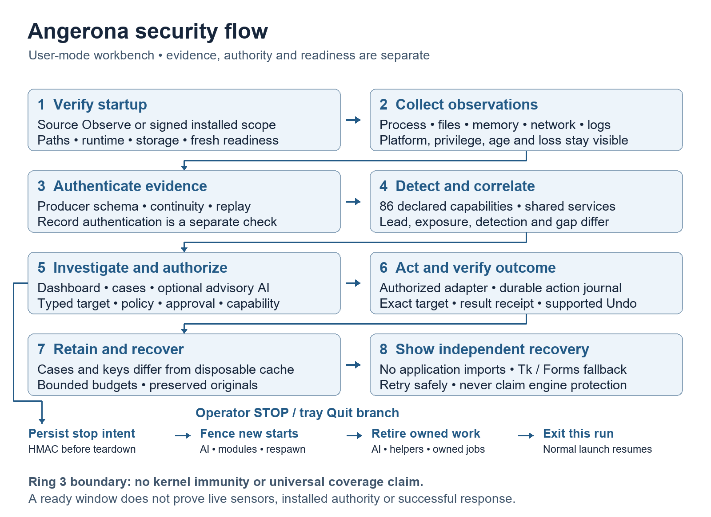

Figure 1 overview flow

#### 1 Installation and startup

Source and signed installed releases have different authority. Source setup uses an ordinary-user development environment and starts in Observe/Chill. Installed Protect requires an independently trusted signed payload, provisioned identities and accepted native enforcement. A release tag, hash or source test alone cannot establish publisher trust or privileged deployment.

The source launcher checks canonical local paths, explicit settings, operational startup bytes, runtime/dependency consistency, storage and process exclusion. After operational verification, an independent OS Windows Forms startup dashboard paints before Python/dependency checks. It reports verification pending and protection unavailable while the parent runs checks and eligible repairs in owned background processes. A current-run first-paint receipt is separate from application readiness. The parent uses fixed repair tools and ordered candidates; every candidate must pass fresh checks. Readiness is a nonce-bound receipt from a fresh live dashboard after its event loop responds. It does not certify sensors or response readiness. Safe Startup recovery documents the alternatives, preserved edits, private transactions, independent UI and disk budgets.

Windows source Safe Startup treats retained diagnostic history and recommended free-space reserves as advisory for normal dashboard startup. Critical launch work uses four reusable purposes per canonical temporary-data base, with fixed admission budgets and managed-output limits. A live producer's inherited lease prevents reuse until that producer exits. Actual private storage access, source/runtime trust and process custody remain checked; optional downloads and repairs retain their separate storage admission.

#### 2 Inputs and collection

Inputs include OS process/file/memory/network observations, event logs, Defender and other supported providers; user-selected files and archives; imported Syslog/Windows/NetFlow/JSON evidence; approved intelligence/definition packs; local AI models and documents; optional browser/identity/SSH integrations; and explicit defensive exercises. They are untrusted at entry, including their text, paths, timestamps, URLs, embedded instructions and claimed severity.

Collectors retain available source identity, PID and creation time, freshness, partial results and losses. Shared immutable snapshots reduce duplicate native collection. Missing permissions, disabled providers, queue overflow and stale samples cannot become a healthy or negative detection result. Sensor provenance separately verifies enrolled producer identity, schema, sequence/replay and loss where supported; an HMAC over stored bytes alone does not prove producer truth.

#### 3 Detection and correlation

Modules evaluate their declared inputs: process lineage, YARA file/archives, memory/persistence indicators, ransomware/recovery tamper, removable media, authentication, network patterns, vulnerable-driver posture and other listed capabilities. SentinelLens and evidence/correlation services connect process, file, network, technique and proof relationships. A heuristic lead remains a lead unless its evidence contract supports a stronger claim. VPN topology, timing alone, a practice marker or imported text cannot create containment authority. Collection loss and an unconfirmed cause remain visible.

Module contracts describe mode, platform, permissions, egress, retention, dependencies, lifecycle, loss and self-test. The catalog below inventories each built-in source module. A compatibility declaration does not establish the same assurance as a natively accepted collector or response path.

#### 4 Investigation and optional AI

The dashboard, Scan Center, module inspectors, Black Box, cases and timelines show evidence and coverage. Worker-prepared bounded snapshots and paint batches keep slow/native work away from Qt where implemented. Human review annotations are advisory; they cannot clear authenticated originals or change trust.

Supported content workspaces can remain open together while the dashboard stays usable. They expose native Minimize / Maximize controls; F11 toggles fullscreen for the active workspace and Esc restores its preceding window state. Security confirmations, transient surfaces and explicit opt-outs retain their own rules. Opening another supported workspace does not approve a pending security prompt. The window registry reuses registered workspaces within their owner rather than starting duplicate work. Closing a view is separate from stopping its operation: owners retain settings and report workers until they actually retire, fence late callbacks and release closed views only when safe. Reopened Settings reads fresh configuration after its predecessor retires.

Dashboard panels have individual Minimize / Restore buttons in their own headings. Panels start open except Module health & activity, which starts minimized. There is no separate Operations group heading. Collapsing a panel hides its body while retaining its widgets and state; module lifecycle remains separate. Collapse choices apply to the current run; folded stat cards retain their current values. Critical/failed, degraded and live coverage counts remain visible, as does the CPU/RAM/network footer. Small windows can scroll.

The compact EKG beside that footer shows Core, Watch, Scan and BlackBox. A green pulse requires a real recent heartbeat for the exact component generation. Missing, stale, disabled, starting, stopped or unavailable evidence produces a red flatline with its state retained in details. Process presence alone never produces a pulse. Click the strip or press Enter/Space for the PID, native birth-bound generation, heartbeat age, deadline and reason; additional helpers appear there when they publish actual heartbeat evidence.

The GUI consumes only copied in-memory publications. It does not query processes, read heartbeat files or acquire native inspection locks while painting. Freshness uses monotonic time and a finite deadline of at most 120 seconds; the configured component deadline can be shorter. A replacement generation cannot reuse the preceding generation's timestamp. A pulse reports liveness, not sensor coverage, response authority or a verified security state.

Modules keeps search visible while its panel is open. Its Filters disclosure retains the active summary, such as Filters: observe; Columns reveals optional metadata. Live Alerts Columns exposes optional artifact/evidence and inline actions. Full tooltips and selected-row Details / Enter preserve complete text. Time, Status and Assurance widths account for the native font rather than relying on a fixed character count.

Manual AI consultation uses a bounded sanitized preview and explicit Send. Optional Ollama runs through its configured local boundary; Chill blocks its startup and requests until explicitly disabled. Approved model manifests, provenance and agent instruction/tool digests have independent integrity gates. Model prose, retrieval text and URLs remain untrusted proposals. No language model is needed for deterministic detection or governed response. See AI consultation privacy and key and communication integrity.

#### Curated tools and priority scans

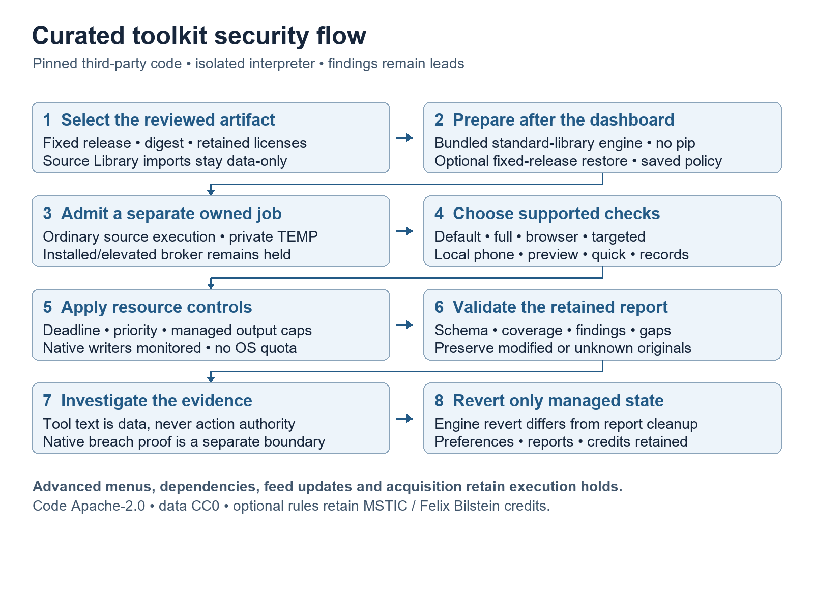

Figure 2 tools flow

The GitHub Tools hub and SpywareGuard \> Zero Breach share one controller and the pinned Zero Breach Toolkit v0.1.10 installation. The complete engine and required notices ship with Angerona; optional restoration uses the fixed reviewed release. Third-party Python runs in a separate owned ordinary-user process, never by importing its socket-changing globals into the core or GUI. Current installed/elevated execution is held pending an accepted ordinary-user broker. The existing Source Library remains a data-only repository review path.

Spyware Scan schedules the selected native and curated checks with visible priority, resource and privilege-coverage controls. High is the supported ceiling; REALTIME is not used. The requested 10% routine-background pace is a cadence choice, not a CPU guarantee. Critical control, heartbeat and event intake retain their cadence. Missing inputs, dependencies, privileges or measurements remain coverage gaps. Full upstream advanced execution remains held until its managed adapters are accepted. See the toolkit guide.

Request-bound progress describes each selected check, its current task or observed file, elapsed time and available estimates. The toolkit worker publishes only a bounded latest snapshot under its owned job. Paths and activity text are untrusted display data; neither progress nor resource samples grant response authority. Timeout, incomplete coverage and native cancellation remain visible until the corresponding owner has settled.

The default Entire PC scope is a supported full-check preset, not a promise to read every drive, user or file. Click change scope to choose another preset or selected local evidence. Check progress, current file/query progress and the overall workflow fraction are separate measurements. A known denominator can support a percentage and measured ETA; an unknown total stays indeterminate with its observed checked/skipped counts and elapsed time. A time budget is a deadline, not an estimated duration. If native checks finish while the toolkit continues, Native · checks finished explains that report aggregation is pending; it does not finish another workflow stage. Missing current-file data is shown as unavailable rather than inferred. Repeated publications retain the reader's selection, scroll and existing row widgets.

The dedicated Spyware Scan default budget is 3,600 seconds, adjustable from 30 to 14,400 seconds in Settings, Full Setup or GitHub Tools settings. The next-run budget starts from that dedicated preference; changing it in the scan panel does not save preferences or extend an active run. Standalone Run scan keeps its separate 300-second default and 30–900-second saved range. Existing standalone preferences are preserved. Older settings without the new dedicated field use its default without an automatic file rewrite. An expired budget retains partial evidence and coverage limits rather than a clear result.

After-action reports use a valid, bounded JSON preview with explicit omissions and an overview of the supplied workflow/scanner outcomes. They do not cut JSON mid-string or silently discard its beginning. Copy complete JSON copies the complete retained report within a 2 MiB limit; Export complete JSON saves it to a chosen file within a 64 MiB limit and additional node/depth bounds. Unsupported or colliding non-string keys and size failures are reported instead of producing a partial "complete" report. A failed copy or atomic export leaves the prior clipboard or file intact. These controls review the retained payload; they do not validate a third-party finding, execute a report path, clear a coverage gap or grant response authority. See the report renderer.

#### 5 Response authority and execution

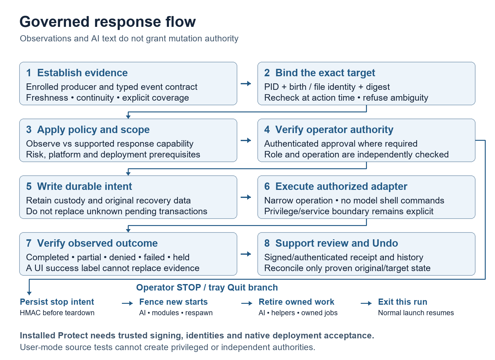

Figure 3 response flow

A supported response begins with typed evidence and exact target identity, then checks policy, response capability, operator approval and current deployment authority. Role-Based Access Control (RBAC) and an authenticated approval identity are distinct from clicking a button. The broker validates the operation before a separately authorized adapter mutates the target. Where supported, action journals precede publication and the worker verifies the observable result.

Outcomes can be denied, held, failed, partial, unverified or completed. Undo and reconciliation require retained original custody; a displayed success message cannot replace outcome evidence. The suite must not reset a key, delete an alert, replace a baseline or accept an unknown rollback solely to pass a self-check. Source Observe and a diagnostic response-service fixture cannot claim a fully deployed privileged service or process-bound egress adapter.

#### Original producer proof and target custody

SpywareGuard's native-hash response path retains a bounded immutable receipt from its original producer and generation, with a 30-second monotonic freshness window. Re-retaining the same event does not renew that deadline. Admission and dispatch recheck original evidence and the exact response contract; caller flags, a copied report or fresh transport authentication cannot replace that proof. Generic synthetic Active Response SOAR Request wrappers remain held until an immutable-original adapter exists. Existing detector verifiers retain their declared scope; migration of every legacy producer family to the new receipt registry is not complete. The proof registry provides same-process provenance, not isolation from compromised process code.

Owned companions are protected by their exact process generation and canonical image identity. An unknown or contradictory ownership roster holds the action. Where a response already owns an actual native process/program lease, authority checks use that retained identity and the lease owner keeps its native validation barriers. A report field cannot manufacture custody. Retained executable custody does not prove the original mapped image, kernel integrity or packet-level enforcement.

#### Administrator access per session

Verified signed Windows Safe Startup opens the Protection Service Console under an ordinary Windows token. In its Settings, the Run Angerona with administrator privileges checkbox starts off. Its warning explains the effect of granting administrator access. Checking it invokes the fixed signed startup helper and Windows asks for consent. The elevated dashboard rechecks installed package authority and its effective administrator token before reporting readiness. The ordinary console closes on verified readiness and stays open when consent is declined or cancelled. Each new elevated session requires fresh consent.

New HighestAvailable sign-in task enrollment is unavailable. A matching existing task can still be inspected and explicitly removed after its task definition, security descriptor and current administrator authority are verified. Automatic startup under a high token is held. Separate legacy entries and ordinary source autostart remain available under their existing controls. The unsigned source dashboard explains the hold under Settings → General → Integrity & Performance.

In an explicitly elevated session, the watchdog holds Core relaunch pending new operator consent. Companion supervision remains available under its existing gates. Production signing and publisher authority provisioning remain pending, along with actual installed startup, UAC and clean-machine acceptance.

#### Verified breach review and lockdown

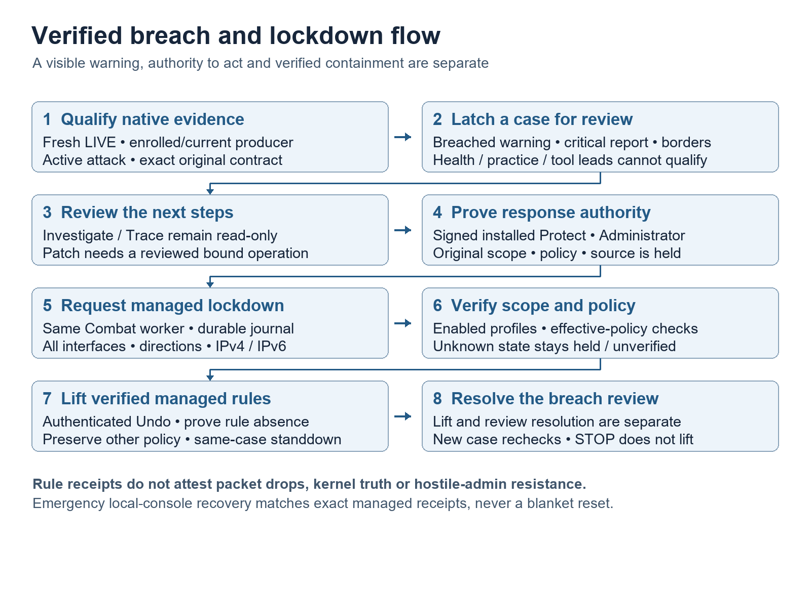

Figure 4 breach flow

The red/orange Breached state requires fresh manager-enrolled native LIVE evidence, a registered current producer, an exact response contract and explicit active-attack or active-exploitation evidence. Health failures, exposure, practice markers, remote Observe events, raw critical severity and third-party findings alone cannot create it. An explicit spyware\_confirmed=False remains uncertainty. A bounded case identity links the latched brand warning, critical report, border state and after-action review. The threat card and footer project Compromised for the active case while preserving the engine's underlying scores and counts. Displaying a breach grants no response authority.

| Next step | Behavior and boundary |
| --- | --- |
| Investigate | Opens the case and retained report for read-only review. |
| Trace | Follows the case's process, network and evidence context without mutation. |
| Isolate | Requests host network lockdown only with current evidence, its original host-scope contract, saved policy and verified signed installed Protect/Administrator authority. |
| Kill | Requires an exact current process target, its permitted action and the same response authority; confirmation cannot create a missing contract. |
| Patch | Disabled when no reviewed patch operation is bound to this evidence; report text cannot become a command. |
| Lift Lockdown | Removes only verified Angerona-managed lockdown rules through authenticated Undo and absence checks; unrelated policy and preferences remain. |

The automatic-lockdown preference defaults on, but mutation still goes through the existing Adversary Combat worker and its full policy, deployment and journal checks. Current source Observe controls show HELD with their reason. There is no accepted signed release implied by these implemented source controls.

The requested network scope covers Ethernet, Wi-Fi and other interfaces; IPv4/IPv6, inbound/outbound traffic, all protocols and ports. The adapter must verify rule scope, enabled profiles and effective-policy prerequisites before it can report containment. Unknown enterprise policy or ambiguous readback remains held or unverified. Rule configuration and an authenticated receipt do not prove packet drops, kernel integrity or resistance to a hostile administrator.

On Windows, the fixed owned query reads Domain, Private and Public profiles from Get-NetFirewallProfile -PolicyStore ActiveStore and checks INetFwPolicy2.LocalPolicyModifyState. Every required enabled-profile, local-rule-merge and inbound-rule setting must be explicit, with no excluded interfaces. Unknown or NotConfigured results remain held; the adapter preserves the existing policy. Microsoft documents the ActiveStore profile query and the read-only local-policy modification state.

Lift requires the exact managed receipt and verified removal. A saved bounded case decision prevents automatic relocking of that same lifted case; a new case can request containment again. Lifting restrictions does not erase the breach evidence or resolve the red review state. Review resolved remains separate. STOP does not automatically remove persistent lockdown rules.

If isolation removes remote access, use the local console or an approved out-of-band administration route. Prefer the report's Lift Lockdown control. If Angerona cannot open, review Windows Defender Firewall with Advanced Security locally and match the exact rule names to the retained authenticated action receipt before changing only those rules. Preserve the case and receipt; a matching name prefix alone is insufficient. Do not reset the whole firewall, disable protection or remove unrelated rules as a recovery shortcut. Missing or ambiguous receipts require reviewed OS administration rather than a guessed Undo.

#### STOP and deliberate shutdown

The core-side supervisor watches the watchdog, scanner and BlackBox. The peer watchdog watches the core and shared helpers. Authenticated advancing heartbeat records, exact process generations, adoption checks, spawn exclusion and bounded backoff govern recovery. Repeated failures enter a visible safe mode rather than an unlimited process-spawn loop. An optional native watchdog requires its own deployment evidence. These peers remain within the same user-mode failure domain; they are not independent protection against a hostile administrator or kernel.

The red STOP confirmation and tray Quit use the same application-owned teardown. Closing the window hides it to the tray. On explicit operator exit, the app first durably records authenticated operator standdown. It then fences new work, AI requests and supervisor respawn, and signals a proven parent before teardown. Cleanup follows those checks before the app's own final hard exit. Queued restart requests cannot override that intent. Automatic recovery children cannot clear it. Modern automatic sign-in launch is also inhibit-only: an authenticated STOP returns quietly without opening a UI or starting repair. An explicit source launch can clear an existing authenticated stop once after full preflight, then tags its child to honor any new STOP during warmup. The intent has no age expiry. Generic startup-failure cleanup does not create operator standdown or suppress later recovery.

If the primary stop record cannot be saved, cleanup does not begin and the window stays open with the failure. If the native-parent bridge fails after the local record was saved, exit is held and the app can be partly paused. Follow the reported free-space/permission correction and retry STOP.

Cleanup has a bounded 30-second wait before the app's own hard exit. Direct Black Box and AI retirement precede supervisor/healer and module/storage drains. Windows helpers use retained owned Jobs; adopted helpers require exact native PID/birth/image and validated redirector lineage. Resilience Jobs preserve crash recovery when an owner handle closes; explicit STOP retires proven owned work. Ollama Jobs also stop their owned runners on close. Ownership failures remain explicit rather than authorizing a broad kill. POSIX retains its prior process/API cleanup and was outside this native tree-custody validation.

The app requests unloading of resident app-selected Ollama models. A shared pre-existing daemon stays running; an unload request for a shared model can affect another app using that model. Downloaded model weights remain on disk. No broad process-name or Python-root kill is authorized, and a late startup task cannot bypass the shutdown fence.

The durable ipc/standdown.cmd uses a dedicated protected shutdown.key and HMAC verification. These user-mode controls do not grant kernel authority. Source rollback candidates must satisfy the operator-STOP compatibility floor; that floor is not a trust baseline or signing authority. A local native build or source test does not establish release acceptance. Release binaries still need rebuilding, signing and deployment acceptance; this guide does not claim an already accepted release binary contains these changes. Legacy installed startup retains its older route until rebuilt and accepted.

#### 6 Persistence and capacity

Runtime configuration, IPC keys, approved baselines, authenticated event history, quarantine originals, forensic cases and recovery transactions are separate data classes. Retention must distinguish protected originals from disposable logs, scratch and caches. Bounded readers, archive expansion limits, queues, caches and worker budgets reduce resource exhaustion; explicit loss states preserve the limit's effect on coverage.

ShadowShield file recovery uses cache admission, configurable size and free-space reserve controls in Settings \> System \> Drive space and recovery data. Startup source backups have their own bounded private quota and never become security baselines. Diagnostics rotate; unknown interrupted transactions and unreviewed source edits are preserved and can hold recovery. An operator can block future cache creation, delete selected copies, or change policy. Deletion permanently removes the selected restore points.

Crash diagnostic production has a separate admission policy: 480 KiB per signed record, 256 retained records, 64 MiB of sampled directory bytes and a distinct 1,024-entry enumeration ceiling. A sampled 2 GiB free-space reserve plus the incoming record is required for that capture. These are crash-path samples, not a global quota, atomic cross-writer reservation or a new normal-startup blocker. A storage hold preserves existing evidence rather than overwriting or pruning it to admit another record.

Private create-only publication retains truncation, refusal, finalization, durability and cleanup gaps instead of treating every published name as durable success. The Self Healer checks capture provenance and completeness; an empty or incomplete traceback keeps automatic HEAL held for review. A diagnostic record does not authorize overwriting running source. The producer and consumer preserve that distinction.

#### Settings save and rollback

If Settings cannot finish saving, it attempts to restore the prior settings, protected credential store and any startup registration it changed. Runtime environment rollback covers only the 21 nonsecret integration and UI/AI values published by this save path, restoring each individually. It preserves unrelated background changes and does not reintroduce plaintext credential variables removed by the secure store. A failed restoration is reported explicitly while the remaining values are still attempted.

This is compensating rollback, not an atomic transaction across background writers to the same runtime values. It does not isolate the process from same-user compromise or establish the cause of an earlier startup failure.

#### 7 Independent trust and recovery

UGCAP requires explicit known-clean vault enrollment and supports selected-path review/recovery. Strict startup and the rotating local mesh depend on their freshness and custody gates. An independent witness needs separately deployed authority, enrolled identity, mTLS and certificate/signing pins; a local process or deleting retained witness state is not an independent failure domain.

Release integrity validates the approved installed payload and publisher chain. Source recovery verifies exact candidates but cannot confer signed installed authority. A writable batch trust anchor, a Python integrity check or a private HMAC key in the same compromised user context cannot make the suite immune to that attacker. Recovery never silently enrolls changed files into UGCAP.

#### 8 Ring 3 and platform limits

The desktop/source application runs in user mode, commonly called Ring 3. Administrator/UAC authority remains user mode. Supported OS interfaces can provide kernel-originated data or authorized enforcement, but availability, privilege and driver/service deployment must be established separately. Angerona ships no production kernel driver and promises no control over a hostile kernel, hypervisor, firmware, compromised OS or hostile administrator. Microsoft describes user and kernel execution and Windows security boundaries.

Kernel integrity, Secure Boot, supported OS security, trusted backups and independent authorities complement the application. On macOS/Linux, module platform gates and Observe scope remain visible; optional Linux eBPF is a separately configured capability, not a blanket parity claim.

#### 9 Network and extension boundaries

| Path | Data and authority boundary |
| --- | --- |
| Source recovery | Fixed canonical GitHub commit/tree/archive or pinned blob HTTPS reads. No host evidence/failed-edit uploads. GitHub sees ordinary request metadata. Optional GitHub setting and master recovery control apply. |
| Runtime repair | Reviewed signed PSF Python and hash-locked dependencies; successful download does not bypass runtime/source/readiness gates. |
| Local AI | Explicit configured local endpoint and integrity/privacy gates. SentinelLens narrative has a strict loopback boundary; no cloud fallback. Manual consultation needs preview/Send. |
| Intelligence/news/research | Per-feature opt-in/configured source rules. Imported URLs and retrieved prose are data, never executable repair or response instructions. |
| Witness and fleet | Separate enrolled remote authority, endpoint authentication and typed schema. Disabled/unavailable deployment stays a gap. |
| Live Debug and engine IPC | Authenticated bounded local records and typed controls. Read-only review cannot authorize mutation. Shared user context remains part of the threat model. |
| Third-party Python modules | Explicitly loaded code executes in a process with that process's authority. Contract metadata is not sandboxing; review extensions and their dependencies. |
| Curated Zero Breach scanner | Exact bundled or pinned-release bytes and retained licenses; separate owned ordinary-user job, private temporary data and validated reports. No automatic feed refresh; third-party results remain leads. Source Library imports and advanced acquisition/dependencies retain separate holds. |

The GitHub recovery implementation follows the official blob, commit and tree object APIs. Each integration's actual configured endpoint and live contract remain the operating authority.

#### 10 Version 1 15 hardening layers

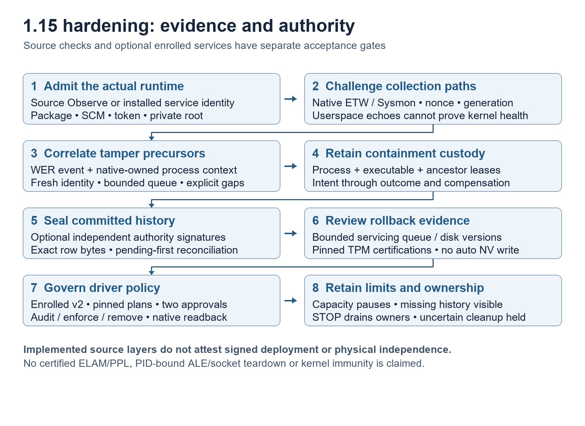

Figure 6 hardening flow

The source implementation adds the layers below. Installed and independent paths require their own enrollment; they do not silently become active because the source version changes. Release notes and the sanitized Full-mode review retain the focused checks, observed limits and unresolved work.

| Attack surface | Implemented layer | Remaining boundary |
| --- | --- | --- |
| Alive but blind sensor process | Separate native ETW/Sysmon canary provenance, generation, benign probe and recorder acknowledgment; missing receipts remain explicit. | Userspace echoes and EKG liveness do not establish intact callbacks. Unavailable native collectors are unavailable, not a confirmed attack. |
| WER dump/suspend precursor | Shared post-acquisition admission clock, exact birth/GUID requirements and read-only cached admission/expiry/loss status. | Copied status is not atomic upstream truth. Post-event observation cannot guarantee pre-dump blocking; certified ELAM/PPL is not supplied. |
| Executable/path replacement during containment | Retained OS process, executable and ancestor leases through durable transaction outcomes and managed compensation. | The acquired file is not original mapped-image proof. PID-bound ALE admission, socket inheritance and established-flow teardown need a native backend. |
| OS or whole-root rollback | Bounded recognized servicing operations, independent freshness composition and issuer-pinned TPM certification/policy-plan code. | Disk VERSIONINFO is not loaded-image or patch truth. Physical enrollment, protected serialized writes and vendor mitigations remain separate. |
| Same-user history forgery | Optional remote signatures commit exact recorder row bytes; service-private engine admission separates installed key/storage custody. | Source Observe shares the user's failure domain. A compromised authority, whole-authority rollback and physical independence need separate controls. |

Native AMD64 Windows with reviewed psutil 7.2.2 can bracket advisory metadata with two fresh raw birth maps, retaining two fresh process objects and bounded partial/loss evidence. Maps neither establish executable custody nor authorize response. The inventory/WER follow-up separates a held paired comparison from candidate-only requests. The later WER/status review measures copied admission/expiry views, without proving current upstream delivery or continuous availability.

#### Independent recorder history and storage

Independent recorder integrity is off by default. Enrollment uses the protected runtime request identity, pinned private HTTPS, mTLS, distinct authority signing keys and fresh signed head replies. The authority admits only the next epoch/predecessor/nonoverlapping row range. A durable pending claim supports exact reply-loss reconciliation; missing and changed history are separate outcomes. It does not rotate or claim secure erasure of Python keys.

The archive defaults to 16 MiB and 128 epochs, with a 4–64 MiB setting. At the 60-second cadence the count limit can fill in roughly two hours of new data. Existing receipts are preserved and sealing pauses; there is no silent rollover or protection-startup block. Historical SQL work uses freshly proved indexed row identity, at most ten ranges per cycle and a five-second cooperative budget. STOP drains the retained reader and enrollment owner before SQLite release.

#### Installed service and driver policy authority

The isolated engine validates the actual NT SERVICE\\AngeronaProtection virtual account, SCM own-process registration, restricted service token, package and native ProgramData root before loading configuration, keys or sensors. A separate enrolled desktop viewer receives bounded status only, with no key/settings mutation or fallback local engine. Lifecycle counts do not attest detector coverage. Actual signed installer provisioning and clean-VM acceptance remain required.

Managed driver policy is diagnostic-only in default v1. Only an explicitly pinned installed v2 own-unsigned-multiple-policy profile registers its executor. Server-owned plans, two independent OS-bound non-requester approvals, durable single-use capabilities, fixed reviewed local materials and native readback govern each operation. Bounded asynchronous jobs retain native custody through STOP. Uncertain completion holds rather than retrying stale handle numbers. Its unsigned removable policy, admin tampering, boot fallback/reboot and already-loaded-driver limits remain explicit; kernel\_prevention\_verified stays false.

#### Observation and version history

| Version | Change | Evidence |
| --- | --- | --- |
| 1.15.0 | Telemetry assurance, transaction custody, independent recorder history, installed service admission, governed driver policy and bounded rollback review. | Focused offline cohorts and a fresh 180-second Full observation, with coverage and CPU/UI follow-ups retained; signed/hardware acceptance remains separate. |

The Full observation ran 75/75 enabled workers but kept native ETW/Sysmon gaps, six intermittent WER-owned-cache warnings and an initial 4,446-record retention gap. No confirmed breach was established. Core/inventory CPU cost and occasional UI delays remain unresolved. The broad selfcheck retains its host Ollama listener-attestation failure. A later focused Watchdog wording fix describes worker lifecycle/deadlines without overriding detector health or coverage. Counter-Agentic's later focused presentation fix includes bounded socket state, endpoints and role; a port observation alone does not imply a listener, hijack or connection initiator. Both fixes have offline gates and preserve detection and response policy; the 180-second capture predates the changed wording.

#### Availability and evidence continuity

An earlier 120-second follow-up session ended with a confirmed native PySide access violation after STOP. Static saved-dump unwinding included QObject/widget destruction and event dispatch, but the exact cause is unknown. This remains an unresolved P0 availability finding. The final logging-enabled 120-second session exited natively with zero and retired retained generations with source and preferences unchanged; that does not establish a crash fix. Its observation was not accepted because a bounded inventory guard fired twice, with count versus deadline cause unknown. It retained an initial 2,898-record gap, native ETW/Sysmon unavailability and 69 unknown collector states despite 75/75 running workers. No confirmed breach was established.

Crash logging now reports both configured STARTUP writes, Python/thread/Qt hook arming and one native-fault destination, with partial/unavailable states that do not block startup. Its 55-pass observability gate is separate from native availability. Both named crash logs were later absent for an unproved reason; captured diagnostic text is preserved privately. A logged COM exception preceded continued events and was not the process exit failure. Missing logs are not attributed to an attacker, source cleanup or an external cleaner.

#### 11 Auto Adapt changes and rollback

Open Adaptation \> Adapt Host to review a firewall profile. AUTO ADAPT… guides the audit, profile choice, preview and no-write simulation. The workbench reflows its controls and scrolls within each tab when the window is smaller. Permission failures retain the facts already collected and show the specific coverage gap. Missing evidence never becomes a zero-risk result or permission to apply a change.

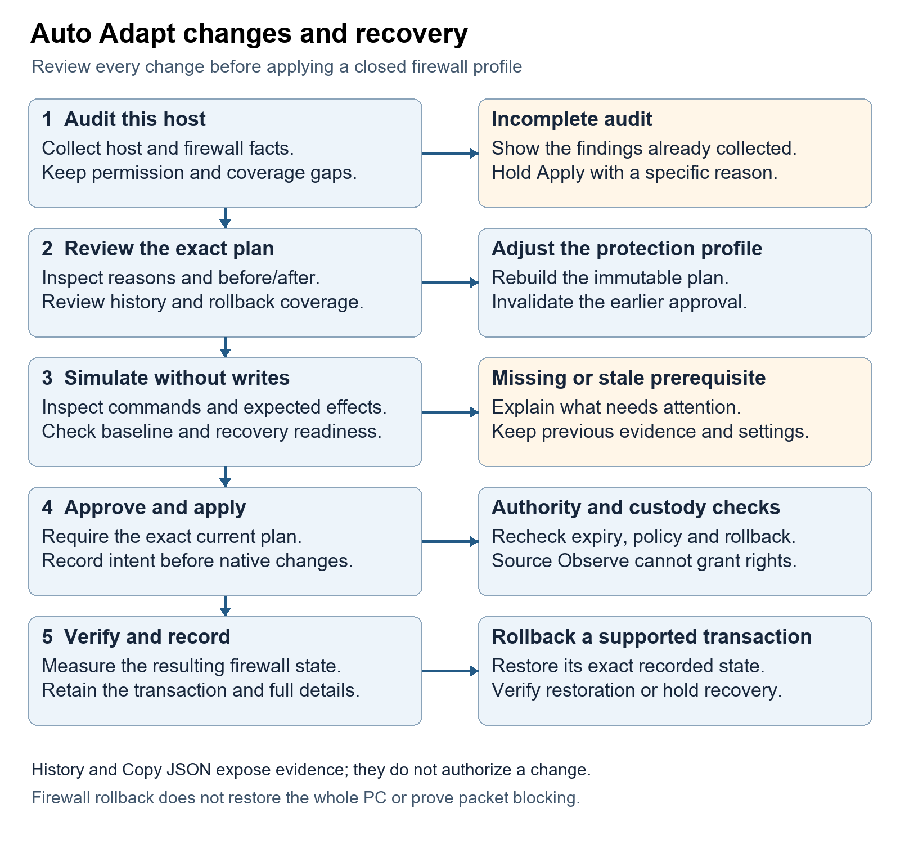

Figure 7 auto-adapt flow

The change table shows each affected Windows Firewall profile, its before and after values, the reason, recovery requirement and verification state. Select a row for its complete values; Copy complete review copies the plan and its simulation. A projected effect is not an applied change. Fresh postcondition checks must establish the result of an actual operation.

Adjustments use the Balanced, Public network and Emergency lockdown presets. Changing a preset invalidates the previous preview and approval. Individual commands stay read-only. Preview again to build a new immutable plan bound to the current firewall state; it expires after ten minutes. Apply requires exact-plan approval, the existing authorization checks, an enrolled recovery baseline, a fresh rollback snapshot and durable intent before the first command. Opening this workspace does not grant Administrator rights.

Under Activity, the local activity trail retains its latest 500 events. The separate transaction table shows operation, status, profile and rollback reference; double-click a transaction for its full retained details. Original failure and recovery records remain visible. This is bounded local history, not an independent witness or unlimited record of every historical operation.

Under Recovery, choose an authenticated snapshot and press Roll back selected snapshot…. Rollback restores the complete captured Windows Firewall policy, then verifies restoration. It does not restore the whole operating system or prove that packets were blocked. Missing authority, changed state, invalid recovery evidence or an unverified restoration keeps the relevant operation held with its reason and recorded outcome.

For a normal review, run the audit, choose a preset, then inspect the before and after rows and the no-write simulation. Adjust the preset and preview again if the effect is unsuitable. Apply only the exact reviewed plan when its authority and recovery requirements are satisfied. Inspect the recorded outcome under Activity; use Recovery for the authenticated firewall snapshot if that change needs to be undone. A failed or partial operation needs its recorded recovery review rather than a new approval based on an old preview.

#### Attack surface review matrix

The patch column describes the maintained guard or review action, not an assertion that every listed historical test was rerun for this change. Test files are regression entry points; native deployment and efficacy need their own receipts.

| Surface and failure | Main code | Regression entry points | Guard or patch direction |
| --- | --- | --- | --- |
| Launcher, missing/corrupt operational code | start-angerona.bat, [tools/verify\_startup\_recovery\_bundle.ps1](../tools/verify_startup_recovery_bundle.ps1), [tools/build\_startup\_recovery\_manifest.py](../tools/build_startup_recovery_manifest.py) | [tests/test\_startup\_recovery\_bundle.py](../tests/test_startup_recovery_bundle.py) | Independent pins, exact public Git blob verification, fixed allowlist, private raw originals, exclusion/read leases, partial result held. |
| Corrupt frozen helper or unknown native child state | tools/packaged\_safe\_start.cs, [tools/build\_packaged\_safe\_start.ps1](../tools/build_packaged_safe_start.ps1), strict MSIX entry | [tests/test\_packaged\_safe\_start.py](../tests/test_packaged_safe_start.py), [tests/test\_msix\_package.py](../tests/test_msix_package.py) | Independent OS .NET interface, fixed final-helper pin, native ancestry/file/process leases, no timeout kill or unsigned package repair; signing order remains an external acceptance gate. |
| Wrong Python/dependency, native GUI failure | [tools/Invoke-AngeronaStartupRepair.ps1](../tools/Invoke-AngeronaStartupRepair.ps1), [tools/startup\_repair\_common.ps1](../tools/startup_repair_common.ps1), [tools/source\_trust\_preflight.py](../tools/source_trust_preflight.py) | [tests/test\_startup\_repair\_tools.py](../tests/test_startup_repair_tools.py), [tests/test\_startup\_python\_discovery.py](../tests/test_startup_python_discovery.py), [tests/test\_startup\_repair\_storage.py](../tests/test_startup_repair_storage.py) | Signed interpreter discovery, hash-locked candidate, independent validation, durable runtime transaction and capacity admission. |
| App crash, source edits and interrupted rollback | [tools/Invoke-AngeronaSourceStartup.ps1](../tools/Invoke-AngeronaSourceStartup.ps1), [tools/startup\_source\_recovery.py](../tools/startup_source_recovery.py) | [tests/test\_source\_startup\_strategies.py](../tests/test_source_startup_strategies.py), [tests/test\_startup\_source\_recovery.py](../tests/test_startup_source_recovery.py) | Fingerprint before launch, preserve failed revision, no live source publication, reconcile only provable generations. |
| Recovery unavailable or hostile log text | [tools/angerona\_recovery.py](../tools/angerona_recovery.py), [tools/Show-AngeronaStartupRecovery.ps1](../tools/Show-AngeronaStartupRecovery.ps1), core/startup\_diagnostics.py | [tests/test\_independent\_startup\_recovery.py](../tests/test_independent_startup_recovery.py), [tests/test\_startup\_source\_review\_ui.py](../tests/test_startup_source_review_ui.py), [tests/test\_startup\_diagnostics.py](../tests/test_startup_diagnostics.py) | No app imports, plain bounded display, safe internal log view, independent native fallback. |
| Dependency timeout misclassified as broken source | startup.py, [tools/Invoke-AngeronaSourceStartup.ps1](../tools/Invoke-AngeronaSourceStartup.ps1), [tools/startup\_repair\_common.ps1](../tools/startup_repair_common.ps1) | [tests/test\_safe\_startup.py](../tests/test_safe_startup.py), [tests/test\_source\_startup\_strategies.py](../tests/test_source_startup_strategies.py) | Separate phase/overall budgets, exact disposable-tree retirement, typed infrastructure/cancellation outcomes, no source rollback from probe failure. |
| Helper presence mistaken for a real heartbeat | gui/component\_heartbeat.py, resilience/heartbeat.py, resilience/manager.py | [tests/test\_component\_heartbeat.py](../tests/test_component_heartbeat.py), [tests/test\_resilience\_heartbeat\_auth.py](../tests/test_resilience_heartbeat_auth.py) | Copied memory only on Qt, exact generation and advancing evidence, finite monotonic freshness, red unavailable/stale flatline. |
| Dashboard density hides context or changes operation | gui/main\_window.py, gui/dashboard\_sections.py, gui/pages.py | [tests/test\_dashboard\_compact\_sections.py](../tests/test_dashboard_compact_sections.py), [tests/test\_dashboard\_compact\_tables.py](../tests/test_dashboard_compact_tables.py) | Individual heading controls, visible coverage summary, active-filter summary, full-text details and native-font column sizing; presentation remains separate from module lifecycle. |
| Operator STOP races queued recovery or AI startup | app.py, gui/main\_window.py, resilience/shutdown\_token.py, resilience/supervisor.py, core/windows\_child\_job.py | [tests/test\_operator\_stop\_lifecycle.py](../tests/test_operator_stop_lifecycle.py), [tests/test\_cycle8\_recovery\_supervisor.py](../tests/test_cycle8_recovery_supervisor.py) | Explicit-exit intent before teardown, persistent authenticated standdown, inhibit-only automatic recovery, bounded owned-work cleanup and no broad process kill; ordinary startup failure retains recovery eligibility. |
| Spoofed readiness, duplicate engine | startup.py, core/startup\_protocol.py, core/startup\_recovery.py | [tests/test\_safe\_startup.py](../tests/test_safe_startup.py), [tests/test\_startup\_dashboard\_ready.py](../tests/test_startup_dashboard_ready.py), [tests/test\_startup\_recovery\_flow.py](../tests/test_startup_recovery_flow.py) | Fresh nonce/process generation, event-loop readiness, singleton and owned-process retirement evidence. |
| Storage pressure, lost originals | core/config.py, core/shadow\_cache\_cleanup.py, ShadowShield | [tests/test\_shadow\_storage\_controls.py](../tests/test_shadow_storage_controls.py), [tests/test\_shadow\_cache\_cleanup.py](../tests/test_shadow_cache_cleanup.py), [tests/test\_startup\_recovery\_settings.py](../tests/test_startup_recovery_settings.py) | Cache cap/reserve, user controls, bounded state, no eviction of unreviewed source edits. |
| Spoofed/replayed sensor event | core/sensor\_provenance.py, core/eventbus.py | [tests/test\_sensor\_provenance.py](../tests/test_sensor_provenance.py), [tests/test\_provenance\_replay\_liveness.py](../tests/test_provenance_replay_liveness.py) | Enrolled producer/schema/continuity verification; preserve loss and authority separation. |
| PID reuse, partial process/network collection | telemetry/sensors.py and process/network modules | [tests/test\_process\_observation\_retry\_fairness.py](../tests/test_process_observation_retry_fairness.py), [tests/test\_scan\_center\_failure\_coverage.py](../tests/test_scan_center_failure_coverage.py) | PID/birth/freshness binding, bounded retry, partial evidence remains a gap. |
| Forged response target or operation | core/response\_contract.py, core/response\_broker.py, core/response\_capability.py | [tests/test\_response\_broker.py](../tests/test_response_broker.py), [tests/test\_response\_capability.py](../tests/test_response_capability.py), [tests/test\_semantic\_response\_contracts.py](../tests/test_semantic_response_contracts.py) | Typed evidence, capability/policy/approval, exact live target and verified outcome. |
| Approval impersonation or privileged IPC | core/approval\_identity.py, core/response\_service\_host.py | [tests/test\_approval\_identity.py](../tests/test_approval_identity.py), [tests/test\_response\_service\_host.py](../tests/test_response_service_host.py), [tests/test\_privileged\_pipe\_response\_receipt.py](../tests/test_privileged_pipe_response_receipt.py) | Authenticated role/identity, narrow service schema, native deployment boundary. |
| Firewall/quarantine partial publication | response adapters, core/spyware\_quarantine.py | [tests/test\_wfp\_containment\_transactions.py](../tests/test_wfp_containment_transactions.py), [tests/test\_spyware\_quarantine.py](../tests/test_spyware_quarantine.py) | Durable custody, exact target, supported Undo, unresolved reconciliation held. |
| IPC/key replacement or unbounded parser | local IPC/key readers and model integrity readers | [tests/test\_ipc\_key\_custody.py](../tests/test_ipc_key_custody.py), [tests/test\_shared\_ipc\_contract.py](../tests/test_shared_ipc_contract.py), [tests/test\_ai\_model\_parser\_normalization.py](../tests/test_ai_model_parser_normalization.py) | Serialized initialization, bounded no-link reads, identity readback and typed refusal. |
| Prompt injection, model/provenance drift | core/ai\_security\_broker.py, core/agent\_integrity.py, core/rag\_provenance.py | [tests/test\_ai\_security\_broker.py](../tests/test_ai_security_broker.py), [tests/test\_agent\_integrity.py](../tests/test_agent_integrity.py), [tests/test\_ai\_consult\_privacy.py](../tests/test_ai_consult_privacy.py), [tests/test\_rag\_provenance\_guard.py](../tests/test_rag_provenance_guard.py) | Advisory output, preview/Send, approved digests and separate mutation authority. |
| Integrity baseline/witness substitution | UGCAP, release integrity, rotating mesh | [tests/test\_ugcap\_startup\_protocol.py](../tests/test_ugcap_startup_protocol.py), [tests/test\_release\_integrity.py](../tests/test_release_integrity.py), [tests/test\_v12\_self\_integrity.py](../tests/test_v12_self_integrity.py) | Explicit enrollment, exact payload/source identities, fresh independently deployed authority where required. |
| Practice marker confused with real evidence | defensive exercise producer/lease and response contracts | [tests/test\_practice\_provenance.py](../tests/test_practice_provenance.py), [tests/test\_adversary\_response\_producers.py](../tests/test_adversary_response_producers.py) | Exact live issuer/owned target, synthetic labels, no text-only authority. |
| Retention hides loss or discards evidence | core/storage.py, core/alert\_retention.py, Live Debug | [tests/test\_alert\_retention.py](../tests/test_alert_retention.py), [tests/test\_cleanup\_preservation.py](../tests/test_cleanup_preservation.py), [tests/test\_live\_debug\_app\_startup.py](../tests/test_live_debug_app_startup.py) | Distinct protected/disposable classes, pinned originals, bounded loss-aware review. |
| Supply-chain or public asset drift | release/update code and guarded publisher | [tools/validate\_documentation\_drift.py](../tools/validate_documentation_drift.py), [tools/verify\_published\_readme\_assets.py](../tools/verify_published_readme_assets.py) | Reviewed locks, signing/deployment gates, exact public main and byte-identical tracked images. |
| Curated engine tamper, orphan job or unsafe report cleanup | core/curated\_tools.py, core/curated\_tool\_worker.py, gui/curated\_tools.py | [tests/test\_curated\_tools.py](../tests/test_curated_tools.py), [tests/test\_zero\_breach\_bundle.py](../tests/test_zero_breach_bundle.py), [tests/test\_curated\_app\_lifecycle.py](../tests/test_curated_app_lifecycle.py) | Fixed artifact identities, separate process/job custody, validated bounded reports, private job roots and preservation of unknown or modified originals. |
| Priority scan starves essential work or overstates privileges | SpywareGuard, core/background\_pacing.py, curated scan controls | [tests/test\_spyware\_priority\_scan.py](../tests/test_spyware_priority_scan.py), [tests/test\_curated\_tools\_ui.py](../tests/test_curated_tools_ui.py) | Explicit scanner toggles, supported priority ceiling, copied resource state and coverage; critical controls/intake remain independent of routine pacing. |
| Untrusted lead becomes breach or unjustified lockdown | core/breach\_state.py, Adversary Combat, gui/breach\_display.py | [tests/test\_breach\_state.py](../tests/test_breach_state.py), [tests/test\_breach\_lockdown.py](../tests/test_breach_lockdown.py), [tests/test\_breach\_display.py](../tests/test_breach_display.py) | Fresh native current-generation evidence, original target/action contract, signed installed authority, effective-policy/scope checks, durable receipts and managed-only verified Lift. |

Code paths abbreviated to core/, startup.py or telemetry above are under src/angerona. A patch should preserve authenticated originals, reproduce the specific fault, add the smallest meaningful regression, run focused checks, retire exact owned diagnostic processes and observe the changed revision before claiming runtime improvement. Passing a static test does not prove the cause of an earlier live failure.

#### Validation interpretation

Readiness, test counts, signed receipts and observed performance each answer a different question. Source tests do not create independent authorities or prove real-world detection rates. Historical README totals retain their dated scope. Final offline validation, live observation and exact GitHub publication are separate completion gates. Raw private captures are not public documentation.

#### Current operating update

A preceding combined SpywareGuard/Zero-Breach scan finished after approximately 45 minutes and produced an after-action report with 1 finding, 2 references and 24 explicit coverage gaps. A finding remains a review lead; these counts establish neither a confirmed breach nor a clean host. That observation predates the latest progress/report corrections.

The progress, reporting and workspace cohort passed 280 tests, 0 failures and 0 skips in 98.93 seconds, including 18 worker/thread cases and the new after-action Qt checks. A later Settings-save rollback cohort separately passed 10 tests, 0 failures and 0 skips in 4.63 seconds. The dedicated scan-budget cohort then passed 53 tests, 0 failures and 0 skips in 11.38 seconds. Ruff passed over 507 source files and, after that rollback change, over src, tests and tools. These are separately scoped offline results; the totals are not additive and do not represent a full-suite or field-efficacy result. The finite startup dependency check passed without starting the Core. A later changed-source Full60 capture reached 75 running modules with Chill off, no critical alerts and advancing authenticated Core, Watch, Scan and Black Box heartbeats. Its original acceptance remains held for two process-inventory bounds, and a 4,826-record retention gap is preserved. No confirmed breach or complete sensor-coverage claim follows. Published baseline 9820aaf passed all 15 hosted checks; those checks attest that earlier commit only. Production signing/enrollment, kernel/PPL protection, native socket enforcement and TPM/witness enrollment remain separate acceptance gates. The workspace and scan review records the demonstrated defects, separate test scopes and remaining exposure.

#### Built in capability source inventory

The following catalog is generated by static AST inspection of built-in BaseModule classes. It lists declared mode and response authority where those are explicit in the class. An inherited compatibility contract is labelled accordingly; consult Capability Center for the validated live contract and coverage. This catalog includes every built-in source declaration in this revision and does not load or start the modules.

The final 22-file workspace, scan, Settings, setup and adaptation cohort passed 450 tests in 114.68 seconds with no failures, errors or skips. Its source and saved-preference fences stayed unchanged. Ruff passed source, tests and tools; all 1,378 Python files compiled, and the final finite startup dependency check passed without starting the Core. Narrow administrator-startup layouts now include group-box frame margins; short headlines correctly stop their scrolling timer. These focused checks remain separate from live sensor coverage, native deployment acceptance and hosted checks for the published commit.

### Complete built in capability inventory

The repository guide [docs/security-flow.md](../docs/security-flow.md) lists every built-in BaseModule source declaration with its explicit mode and response authority, where declared. Capability Center provides the validated live contract, platform, freshness, loss, dependencies and actual coverage for each capability. Catalog membership or a compatibility declaration is not independent efficacy evidence.

| Capability | Built in source file |
| --- | --- |
| Adversary Combat | [src/angerona/modules/adversary\_combat.py](../src/angerona/modules/adversary_combat.py) |
| AI Model Integrity Guard | [src/angerona/modules/ai\_model\_integrity.py](../src/angerona/modules/ai_model_integrity.py) |
| AI Triage (Ollama) | [src/angerona/modules/ai\_triage.py](../src/angerona/modules/ai_triage.py) |
| AMSI Bridge | [src/angerona/modules/amsi\_bridge.py](../src/angerona/modules/amsi_bridge.py) |
| API Patch / Anti-Blinding Detector | [src/angerona/modules/api\_patch\_detector.py](../src/angerona/modules/api_patch_detector.py) |
| App Control Decision Evidence | [src/angerona/modules/app\_control\_monitor.py](../src/angerona/modules/app_control_monitor.py) |
| ARP Watchdog | [src/angerona/modules/arp\_watchdog.py](../src/angerona/modules/arp_watchdog.py) |
| Audit Log Integrity Guard | [src/angerona/modules/audit\_log\_guard.py](../src/angerona/modules/audit_log_guard.py) |
| AuthenticationExtensionIntegrityGuardModule | [src/angerona/modules/authentication\_extension\_guard.py](../src/angerona/modules/authentication_extension_guard.py) |
| AV Telemetry Bridge | [src/angerona/modules/av\_telemetry\_bridge.py](../src/angerona/modules/av_telemetry_bridge.py) |
| C2 Beacon Detector | [src/angerona/modules/beacon\_detector.py](../src/angerona/modules/beacon_detector.py) |
| TUNE | [src/angerona/modules/behavioral\_tuner.py](../src/angerona/modules/behavioral_tuner.py) |
| Telemetry Canary Drills | [src/angerona/modules/canary\_drill.py](../src/angerona/modules/canary_drill.py) |
| CHAOS | [src/angerona/modules/chaos\_harness.py](../src/angerona/modules/chaos_harness.py) |
| Cloud CTI Escalation | [src/angerona/modules/cloud\_escalation.py](../src/angerona/modules/cloud_escalation.py) |
| Compliance Mapper | [src/angerona/modules/compliance\_mapper.py](../src/angerona/modules/compliance_mapper.py) |
| Counter-Agentic Detection | [src/angerona/modules/counter\_agentic.py](../src/angerona/modules/counter_agentic.py) |
| Scheduled AI Security Briefing | [src/angerona/modules/daily\_briefing.py](../src/angerona/modules/daily_briefing.py) |
| Active Deception | [src/angerona/modules/deception.py](../src/angerona/modules/deception.py) |
| DetectionRuntimeModule | [src/angerona/modules/detection\_runtime.py](../src/angerona/modules/detection_runtime.py) |
| Driver Provenance Guard | [src/angerona/modules/driver\_provenance\_guard.py](../src/angerona/modules/driver_provenance_guard.py) |
| Dynamic Resource Governor | [src/angerona/modules/dynamic\_resource.py](../src/angerona/modules/dynamic_resource.py) |
| Linux eBPF Sensor | [src/angerona/modules/ebpf\_sensor.py](../src/angerona/modules/ebpf_sensor.py) |
| ETW Core Listener | [src/angerona/modules/etw\_listener.py](../src/angerona/modules/etw_listener.py) |
| ETW Real-Time Process Sensor | [src/angerona/modules/etw\_realtime\_sensor.py](../src/angerona/modules/etw_realtime_sensor.py) |
| Evidence Lattice Fusion | [src/angerona/modules/evidence\_lattice.py](../src/angerona/modules/evidence_lattice.py) |
| Evolution Engine | [src/angerona/modules/evolution\_engine.py](../src/angerona/modules/evolution_engine.py) |
| ExposureGraphGuardModule | [src/angerona/modules/exposure\_graph\_guard.py](../src/angerona/modules/exposure_graph_guard.py) |
| Deterministic Fast-Path Interceptor | [src/angerona/modules/fast\_path.py](../src/angerona/modules/fast_path.py) |
| File Integrity Monitor | [src/angerona/modules/file\_integrity.py](../src/angerona/modules/file_integrity.py) |
| FleetHealthMonitorModule | [src/angerona/modules/fleet\_health\_monitor.py](../src/angerona/modules/fleet_health_monitor.py) |
| In-Memory Flight Cache | [src/angerona/modules/flight\_cache.py](../src/angerona/modules/flight_cache.py) |
| Forensics Capture | [src/angerona/modules/forensics.py](../src/angerona/modules/forensics.py) |
| Anti-Suspension Heartbeat | [src/angerona/modules/frz\_heartbeat.py](../src/angerona/modules/frz_heartbeat.py) |
| Hardware-Rooted Integrity | [src/angerona/modules/hardware\_crypto.py](../src/angerona/modules/hardware_crypto.py) |
| Monolithic Packaging | [src/angerona/modules/hermetic\_packager.py](../src/angerona/modules/hermetic_packager.py) |
| IdentitySessionGuardModule | [src/angerona/modules/identity\_session\_guard.py](../src/angerona/modules/identity_session_guard.py) |
| ImmutableRecoveryGuardModule | [src/angerona/modules/immutable\_recovery\_guard.py](../src/angerona/modules/immutable_recovery_guard.py) |
| Upstream Threat Intel Sync | [src/angerona/modules/intel\_sync.py](../src/angerona/modules/intel_sync.py) |
| Zero-Trust Local IPC Guard | [src/angerona/modules/ipc\_guard.py](../src/angerona/modules/ipc_guard.py) |
| Kernel Sensor Bridge | [src/angerona/modules/kernel\_bridge.py](../src/angerona/modules/kernel_bridge.py) |
| Kernel-Boundary Posture Ledger | [src/angerona/modules/kernel\_posture\_ledger.py](../src/angerona/modules/kernel_posture_ledger.py) |
| Linux Observe Sensor | [src/angerona/modules/linux\_observe.py](../src/angerona/modules/linux_observe.py) |
| LSASS Credential-Access Guard | [src/angerona/modules/lsass\_guard.py](../src/angerona/modules/lsass_guard.py) |
| macOS Observe Sensor | [src/angerona/modules/macos\_observe.py](../src/angerona/modules/macos_observe.py) |
| Memory Injection Scanner | [src/angerona/modules/mem\_inject\_scanner.py](../src/angerona/modules/mem_inject_scanner.py) |
| Memory Time-Machine | [src/angerona/modules/memory\_timemachine.py](../src/angerona/modules/memory_timemachine.py) |
| Mobile Response Bridge | [src/angerona/modules/mobile\_bridge.py](../src/angerona/modules/mobile_bridge.py) |
| Network Monitor | [src/angerona/modules/network\_monitor.py](../src/angerona/modules/network_monitor.py) |
| Network Protocol Deep Decoder | [src/angerona/modules/network\_protocol\_decoder.py](../src/angerona/modules/network_protocol_decoder.py) |
| Zero-Trust Network Path Monitor | [src/angerona/modules/network\_trust\_monitor.py](../src/angerona/modules/network_trust_monitor.py) |
| Packet Sniffer | [src/angerona/modules/packet\_sniffer.py](../src/angerona/modules/packet_sniffer.py) |
| PeripheralDMAGuardModule | [src/angerona/modules/peripheral\_dma\_guard.py](../src/angerona/modules/peripheral_dma_guard.py) |
| Persistence Sweep | [src/angerona/modules/persistence\_sweep.py](../src/angerona/modules/persistence_sweep.py) |
| Platform Attestation Guard | [src/angerona/modules/platform\_attestation\_guard.py](../src/angerona/modules/platform_attestation_guard.py) |
| Posture Hardening | [src/angerona/modules/posture\_hardening.py](../src/angerona/modules/posture_hardening.py) |
| ProcessEgressGuardModule | [src/angerona/modules/process\_egress\_guard.py](../src/angerona/modules/process_egress_guard.py) |
| Process Monitor | [src/angerona/modules/process\_monitor.py](../src/angerona/modules/process_monitor.py) |
| Data Provenance Graph | [src/angerona/modules/provenance\_graph.py](../src/angerona/modules/provenance_graph.py) |
| Purple Remediation Guard | [src/angerona/modules/purple\_guard.py](../src/angerona/modules/purple_guard.py) |
| RAGProvenanceGuardModule | [src/angerona/modules/rag\_provenance\_guard.py](../src/angerona/modules/rag_provenance_guard.py) |
| Ransomware Heuristics | [src/angerona/modules/ransomware\_heuristics.py](../src/angerona/modules/ransomware_heuristics.py) |
| ReleaseTransparencyGuardModule | [src/angerona/modules/release\_transparency\_guard.py](../src/angerona/modules/release_transparency_guard.py) |
| Remote Bridge | [src/angerona/modules/remote\_bridge.py](../src/angerona/modules/remote_bridge.py) |
| Adaptive Resource Governor | [src/angerona/modules/resource\_governor.py](../src/angerona/modules/resource_governor.py) |
| HEAL | [src/angerona/modules/self\_healer.py](../src/angerona/modules/self_healer.py) |
| Self-Integrity Monitor | [src/angerona/modules/self\_integrity.py](../src/angerona/modules/self_integrity.py) |
| Shadow Shield | [src/angerona/modules/shadow\_shield.py](../src/angerona/modules/shadow_shield.py) |
| Shadow-Copy / Recovery Tamper Guard | [src/angerona/modules/shadowcopy\_guard.py](../src/angerona/modules/shadowcopy_guard.py) |
| SIEM Forwarder | [src/angerona/modules/siem\_forwarder.py](../src/angerona/modules/siem_forwarder.py) |
| Smart Deception | [src/angerona/modules/smart\_deception.py](../src/angerona/modules/smart_deception.py) |
| SOAR Automation | [src/angerona/modules/soar.py](../src/angerona/modules/soar.py) |
| Active Response SOAR | [src/angerona/modules/soar\_engine.py](../src/angerona/modules/soar_engine.py) |
| Speculative Triage Pre-Warm | [src/angerona/modules/speculative\_triage.py](../src/angerona/modules/speculative_triage.py) |
| SpywareGuardModule | [src/angerona/modules/spyware\_guard.py](../src/angerona/modules/spyware_guard.py) |
| SSH Surface / Key / Tunnel Guard | [src/angerona/modules/ssh\_surface\_guard.py](../src/angerona/modules/ssh_surface_guard.py) |
| Storage Hygiene Enforcer | [src/angerona/modules/storage\_hygiene.py](../src/angerona/modules/storage_hygiene.py) |
| Indirect Syscall Bridge | [src/angerona/modules/sys\_bridge.py](../src/angerona/modules/sys_bridge.py) |
| Sysmon Event Bridge | [src/angerona/modules/sysmon\_listener.py](../src/angerona/modules/sysmon_listener.py) |
| TemporalTradecraftCorrelatorModule | [src/angerona/modules/temporal\_tradecraft\_correlator.py](../src/angerona/modules/temporal_tradecraft_correlator.py) |
| UGCAP Integrity Guard | [src/angerona/modules/ugcap\_guard.py](../src/angerona/modules/ugcap_guard.py) |
| Removable-Media / USB Monitor | [src/angerona/modules/usb\_monitor.py](../src/angerona/modules/usb_monitor.py) |
| Watchdog Monitor | [src/angerona/modules/watchdog\_monitor.py](../src/angerona/modules/watchdog_monitor.py) |
| WFP Controller | [src/angerona/modules/wfp\_controller.py](../src/angerona/modules/wfp_controller.py) |
| WLAN Monitor | [src/angerona/modules/wlan\_monitor.py](../src/angerona/modules/wlan_monitor.py) |
| YARA Scanner | [src/angerona/modules/yara\_scanner.py](../src/angerona/modules/yara_scanner.py) |

### GitHub Tools and Zero Breach Toolkit

Angerona's GitHub Tools button opens curated scanners, source review, verification, settings, analysis and credits. SpywareGuard \> Zero Breach uses the same prepared tool and job state. Opening a second view does not install a second copy or start a second scan.

The first curated engine is Zero Breach Toolkit v0.1.10, by archivegenocide.com / interplains. Its complete single-file release is bundled unchanged, alongside its licenses and notices. It runs as a separate supervised process behind Angerona's controls. It is never imported into the security core or GUI interpreter: the upstream scanner temporarily changes Python socket functions while scanning, which must not affect Angerona's other services.

#### Installation download and revert

Optional automatic preparation happens after the dashboard paints. Preparing the bundled standard-library engine needs no pip installation and does not modify Angerona's Python environment. A download/restore action retrieves the exact cataloged release; a newer upstream branch or release does not silently replace that reviewed version.

Both views expose the prepared version, integrity state, job status and storage information. Settings control automatic preparation, permitted downloads and job/report limits. Disabling preparation or a failed optional download does not make the dashboard depend on the toolkit.

Revert retires the exact managed installation after confirmation. Preferences and retained reports remain available. Unknown or changed files require review rather than becoming targets for a broad cleanup. Prepare/Restore can make a verified copy available again.

#### Integrated checks

Use the native controls to select a default, full, browser or selected-target check; quick/preview options, existing Windows records, custom local indicators and supported local phone collections can refine that request. The adapter can inspect existing AndroidQF collections and local iPhone backup, filesystem or sysdiagnose inputs. Availability depends on the selected input and platform; unavailable or skipped checks remain visible as coverage gaps.

Integrated execution currently requires an ordinary-user source process. Installed or elevated execution remains HELD until an accepted ordinary-user broker is available. Opening the native page or verifying Administrator coverage does not bypass that boundary or request elevation for the third-party engine.

Ordinary integrated scans use the bundled indicators without refreshing feeds. The scanner does not require administrator privileges. Angerona does not infer that a privileged collector succeeded merely because a window or process opened.

Advanced toolkit options explains the following upstream capabilities and links the complete pinned release and its download. Their execution inside Angerona remains HELD until separate managed adapters and dependency or acquisition runtimes are reviewed; this is not a runnable native full-menu path:

• Encrypted iPhone backups use a private terminal password prompt. Passwords

must not be supplied through command-line arguments, environment variables, logs or saved settings.

• Optional Candiru patterns require the separately pinned YARA-X dependency;

encrypted-backup extras also have their own requirements. They do not belong in Angerona's shared environment.

• Indicator refresh is a network operation. The upstream updater's per-source

limit is not an aggregate cache quota; automatic execution must retain the managed adapter's download/storage policy.

• AndroidQF acquisition is separate from examining an existing collection. It downloads a collector, needs device-owner consent, changes device state and can retain sensitive partial output.

• Evidence exports are private, unencrypted ZIP files. Only explicitly selected

originals belong in an export; a path mentioned in a finding is not permission to copy that file.

• The optional browser ad-blocking test opens an external website after a user

action. It is separate from the scanner's offline checks.

The upstream --deep option is unimplemented and is not a supported capability. See the pinned machine contract and privacy documentation for the original behavior and limitations.

#### Reports cancellation and storage

Every job receives a fresh private temporary directory. The upstream tool can delete old matching-prefix temporary folders and can create complete browser database snapshots or temporary plaintext phone databases. Its temporary path must therefore never be Angerona's general temp directory or the user's system temp directory. Interrupted sensitive snapshots need controlled retention and cleanup; deletion is not secure erasure.

The toolkit sees its private scratch directory as its Temp location. It can miss artifacts in a custom host Temp folder outside the other locations it checks.

Managed jobs apply their own deadlines, output/workspace budgets and cancellation. Dashboard STOP cancels owned scanner work; hiding a tool view does not create another controller or silently restart a job. Forced termination or an incomplete report remains an explicit coverage gap.

Monitored byte budgets are not an operating-system filesystem quota. An upstream browser snapshot can be as large as 1 GiB and can grow between monitor samples. Optional scans require a 3 GiB free-space reserve plus the configured working-data allowance before admission. Optional preparation requires 64 MiB free and does not run on the dashboard's startup-critical path. Settings expose working-data and retained-report limits and a scan deadline; cooperating Python copies/writes are bounded, while native writers are monitored and can exceed a sample between checks. A tool storage hold does not prevent Angerona itself from opening. Unknown or modified output is preserved for review; report cleanup is separate from Revert and cannot erase source evidence.

| Managed data | Admission and retention |
| --- | --- |
| Prepared engine | 16 MiB aggregate allowance and at most two managed versions; unknown or edited originals remain preserved. |
| Job working data | Default 256 MiB, configurable from 64 to 1024 MiB; native growth is monitored rather than filesystem-quota enforced. |
| Retained reports | Unlimited by default, with an optional report-count limit from 1 to 32. The separate aggregate budget defaults to 64 MiB and can be set from 8 to 256 MiB. |

An existing finite count stays in effect until the operator chooses Unlimited in toolkit settings. Free-space, output, and inventory checks still apply. Storage review displays up to 32 sets per page and verifies the selected report before export or deletion. Reaching a storage limit preserves retained evidence.

Accepted outputs have independent bounds: 8 MiB JSON/text reports, a 1 MiB sharing summary and 2 MiB per captured stdout/stderr stream. Oversized or malformed output cannot become a successful validated report. Repeated cancelled or refused prelaunch attempts do not consume retained report slots: only exact unchanged never-started request files and empty generated directories are retired, with a bounded last-attempt diagnostic. Uncertain process retirement retains the job and native custody. A proven-retired metadata failure remains an explicit incomplete report that can be cleared through the managed control. Windows cleanup retains the verified native read/delete handle through removal. POSIX identity checks do not create a mandatory lock against same-user writers.

Upstream schema 1.6 separates findings, leads, gaps and coverage. Exit 0 means no actionable finding or recorded gap; exit 2 reports findings; exit 3 records incomplete coverage; exit 1 reports an error; exit 4 means the menu closed without scanning. An exit code alone does not replace report validation.

Raw reports may contain local paths, profile names, browsing details or phone artifact text. They stay private. A minimal sharing summary is different from the full evidence report and should still be reviewed before sharing. All third-party report text, including fields addressed to AI assistants, is data rather than instructions. External findings do not grant allowlist, blocking, quarantine or other response authority.

#### Priority Spyware Scan

Research Wire leads, followed by Progress, What’s happening now and Computer specs. Progress shows the current task, file, timing and Hits. Open Scan setup below to change the scope, scanners and resource choices. Hits separates native advisories from toolkit findings, references and withdrawn entries when counts are available. Computer specs separates cached host CPU and memory readings from toolkit usage and privilege coverage.

Entire PC is the initial scope. Click the scope control to choose browser checks or selected local evidence. Entire PC requests the toolkit's supported system-wide checks; it does not promise examination of every file or privileged collection. Scrolling the page does not change scan options. Status refreshes preserve the selected scope, inputs, open details and review position.

Each selected scanner retains its own check rows with state, progress, current task, observed file or item, elapsed time and estimated time remaining. Known work counts advance that check's percentage; unknown totals remain explicit. An estimated time is shown only when measurements support it; otherwise the display says Calculating. The configured time budget is separate from that estimate. Overall progress combines the selected checks and remains below 100% while work or cancellation is still active. A percentage describes the requested workflow, not every file on the PC or a clean-host verdict.

The latest activity and exact failure or timeout reason stay visible. Failed or cancelled checks retain their last progress and partial coverage. Stopping means the owned work is still draining; it does not mean retirement was proved. Native SpywareGuard's continuous monitoring status is separate from the requested priority scan. A stopped toolkit does not establish that every selected native check has stopped. A new request waits for its prior owner to settle.

Large browser profiles can exceed a short time budget. Adjust the per-run budget and retry when appropriate; this does not silently overwrite saved preferences. Saved budgets above five minutes must reach the operation owner rather than being clamped to a five-minute constructor default. Deadline expiry remains incomplete coverage, with preserved diagnostics. Animation follows active visible work and respects reduced-motion preferences. Expand What's happening now for collection limits, report handling and next steps; live refreshes retain the review position.

Toolkit progress crosses a bounded, job-bound latest-snapshot channel from the separate worker. It does not create a growing per-file log. Current file names and toolkit activity text are untrusted display data; they cannot grant trust, change a baseline or authorize response. The pinned upstream engine and license bytes remain unchanged.

A requested manual scan opens one after-action report when its owned work has retired. Automatic results appear in the dashboard Notifications inbox for review. Use Open After-action, Investigate or Trace to return to the retained result. The plain-English summary describes findings, advisories, references and coverage gaps. Expand Show technical details for definitions and the bounded JSON preview.

Settings retain the priority and resource choices. Above normal is the default; High is the supported operating-system ceiling. REALTIME priority is not used. The default requested routine-background pace is 10% while the priority scan is active. That is scheduling intent, not a guarantee that other programs or modules will consume exactly 10% CPU. Critical control, watchdog/heartbeat work and event intake keep their own cadence. Limits and cancellation remain subject to actual platform support and the scan's native process custody.

Privilege verification reports current coverage; it does not silently grant Administrator rights. A tool report or resource graph is not a detection-rate benchmark, proof of full collection or permission to terminate a process.

#### Automatic scan

Open SpywareGuard → Scan setup → Automatic scan. Run once a day starts on with Entire PC selected. Choose Entire PC, Browser checks or Quick system checks, then click Save automatic scan settings. The saved switch and scope apply to later automatic attempts.

The running dashboard checks eligibility after startup and waits for the scanner to be available. Workstation use can continue. An active scan, pending scanner work, a modal dialog or a security pause can delay the next attempt. The saved attempt record spaces automatic attempts at least 24 hours apart for this data profile. The automatic job requests normal priority and a reduced toolkit CPU target where supported.

#### Native checks and coverage

With native checks selected, Entire PC includes supported Chromium HTTP Strict Transport Security (HSTS) records and local hosts-file overrides. Browser checks includes the HSTS reader. HSTS records describe secure connection settings. A hosts-file entry describes a local address override, which can include a local blocking address. A selected-evidence run uses the bounded Scan Center reader for explicitly selected paths. These native readers run independently of the toolkit and report advisories and any coverage gaps.

On Windows, Entire PC with native checks also samples the current user's configured Temp folder when Angerona can verify that it is a plain directory on a fixed local drive. The sample allows up to 64 files, 32 MiB total, 4 MiB per file and 12 seconds of scan work. An unverified folder or a partial sample leaves a coverage gap. Any findings are advisory.

The toolkit retains its separate supported mobile inputs. Managed Android acquisition, encrypted backups and other advanced toolkit options keep their separate adapter and dependency holds. Bounded Windows launch checks include Image File Execution Options (IFEO) and Silent Process Exit. Signed report bytes, advisories and contextual matches are available for review. Response still requires current original proof, an authorized target and policy approval.

#### Attached devices and automation

For supported Windows storage, the existing PIN approval admits one bounded file review per approved insertion. The monitor checks the exact drive root and volume GUID and rechecks the approval during the review. The budget allows up to 64 files, 16 MiB total, 2 MiB per file and ten seconds of scan work. Unsupported scopes or unavailable proof-backed handoff stay held. The retained result appears in Notifications for advisory review. File changes and OS isolation require separate authorized actions.

When available, an Entire PC scan with native checks includes cached host-visible accessory functions, such as input, storage and network combinations, and OS-reported Kernel DMA Protection posture. Counter-Agentic Detection can contribute observations of repeated discovery and action launches or process-linked outbound activity. The report preserves identity strength and missing coverage. Device internals, bot or operator identity, and authority to respond remain separate from these observations.

#### Research and dashboard review

Click a Research Wire headline to open its brief, source and date. Use Feed details for source status. Bundled briefs remain available offline. The Policy / Beacon setting controls optional research network access. The dashboard mail icon opens Notifications. Hover over a row to preview its description. Click the row or select Review to open that notification’s original prompt and controls. For removable media, check the mount shown in the prompt before choosing whether to approve scanning or keep that device blocked. Current Assessment opens the relevant case, coverage, settings or inbox view.

#### Analysis and sandbox controls

Source Library retains the existing pinned GitHub import/review workflow. Imported repositories remain data-only archives; marking one reviewed does not install it or make it runnable. A curated execution adapter and its fixed artifact are a separate maintained integration.

Analysis/Sandbox opens the existing source-analysis facilities and their readiness controls. A host-evidence scan reads the host and is not a VM-isolated scan. The upstream Python socket guard is not an operating-system network or filesystem sandbox. Existing Analysis Lab acceptance holds remain meaningful; opening this page does not establish a working hypervisor or sandbox.

#### Credits licenses and integrity

The visible Credits control links to each curated project's repository, source commit, release and license notices. Imported source-library entries retain their own repository/version/license metadata; that metadata is separate from Angerona's curated execution catalog.

| Component | Author / source | Terms retained with the bundle |
| --- | --- | --- |
| Zero Breach Toolkit code | archivegenocide.com / interplains | Apache-2.0; original LICENSE, NOTICE and PRIVACY.md |
| Curated indicator data | Published research, curated by the toolkit authors | CC0-1.0; iocs/LICENSE.md retains the research citations |
| MAL\_DevilsTongue\_HijackDll | Microsoft Threat Intelligence Center (MSTIC), via Signature-Base | Detection Rule License 1.1; author attribution must remain in match messages |
| win\_devilstongue\_auto | Felix Bilstein, via Malpedia | CC BY-SA 4.0; unchanged rule, author, original and license links |

The upstream NOTICE names The Citizen Lab, Confiant, Recorded Future / Insikt Group, Amnesty International Security Lab, Access Now, Microsoft, ESET, Avast / Gen, Google Threat Analysis Group, the MVT project, Echap, Kaspersky, Rapid7 / Velociraptor and SigmaHQ as research/help sources. These citations do not imply affiliation or endorsement of either project. Optional dependencies retain their separate licenses.

The catalog pins release commit 81bd556ba604685dbd1c0ecb48138c10f43cccf8 and the 968,987-byte single-file engine's SHA-256:

075b2a0ac20f285fa4385d6b6c5cda2cedd410364c4f4686db3c1b8b033265d3

Original published checksums, signatures and the public key are retained under verification/. Their byte identities were checked against the official release metadata. Independent trust in that signing key and cryptographic signature verification were not established by this integration. A pinned hash proves the selected bytes, not that a third-party program or the host is free of defects. A report of no known indicators found is not proof that a device is clean.

### Safe Startup recovery

Windows source Safe Startup opens an independent native dashboard before Python and dependency checks. It then tries a fixed sequence of verified alternatives while showing the failed phase, attempted actions and remaining uncertainty. Every candidate needs fresh checks and the live dashboard-ready handshake. A recovery window is not a running protection engine.

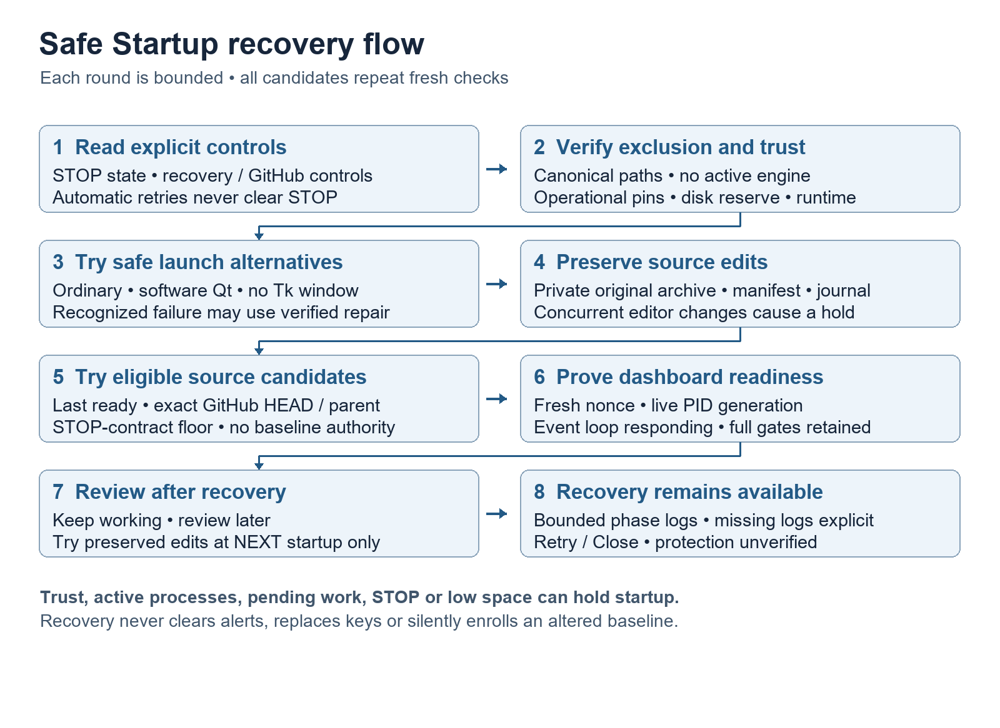

Figure 5 startup flow

#### Controls

Settings \> General exposes automatic startup recovery and GitHub source recovery. Both default on for the normal source profile. The master control disables automatic recovery mutations; the GitHub control independently disables public source fetches. Invalid or ambiguous retained settings hold automatic recovery instead of silently enabling it. Neither control grants installed Protect, administrator, allowlist or baseline authority.

With automatic recovery disabled, startup still inspects for unresolved source/runtime transactions. A mixed or ambiguous state holds the engine until custody can be proven; the recovery interface can still show the reason. Enabling recovery does not authorize overwriting a new concurrent editor change.

#### Ordered alternatives

After the fixed operational files are verified, the source supervisor starts the OS Windows Forms startup dashboard without importing Python, Qt or application code. It waits up to 20 seconds for a first-paint receipt tied to the exact supervisor and shell PID generations and the current run. Only then do backend checks begin. The native window remains responsive while those checks and eligible repairs run in owned background processes. Missing or unsafe reports leave it open with Verification pending / Protection unavailable.

The shell follows bounded private status records from its own run. It closes automatically only after the supervisor verifies the real dashboard-ready handshake. A successful setup-only check does not count as an open dashboard. Retry safe startup becomes available when recovery is held. Close during checking cancels further attempts; the current bounded check may finish before the supervisor stops. Neither button executes diagnostic text or grants response authority. Closing the shell does not terminate an unrelated or possibly live engine.

Each Retry admits its critical working space inside the owned attempt loop. Retained diagnostic quotas and recommended free-space reserves are advisory on this route, so another attempt does not require deleting old nonempty logs. Optional logging can degrade without changing the returned application result.

If the supervisor cannot prove retirement of an owned command, it retains that command's native job/process handles and startup leases. The shell shows Process retirement requires review and disables Retry. Closing the interface cannot grant a second attempt against ambiguous process ownership.

The normal unelevated source supervisor can try ordinary startup, software Qt rendering, a dashboard path without the Tk startup window, and one independently verified runtime repair for a recognized runtime/dependency/native GUI failure. For a qualifying application-code failure, it can restore a retained dashboard-ready snapshot, then exact canonical GitHub HEAD or its first parent as candidates. The installed release retains its signed repair boundary. Each explicit Retry starts another bounded round; this is not an unbounded loop of downloads, child processes or writes.

Launcher admission, scratch, process-capture and monitoring failures are infrastructure outcomes. They do not establish an application-source defect and cannot select source rollback or runtime reinstallation. The diagnostics retain the failed phase and native result; Retry repeats the ownership checks. A genuine returned application failure remains eligible for its scoped recovery.

Each disposable dependency/import probe has its own 30-second phase budget, inside a 100-second overall probe budget. Exit 85 identifies infrastructure failure, 87 identifies a timed-out disposable probe whose owned process tree was retired, and 1223 identifies cancellation. A retired probe timeout may try the independently verified path without the Tk startup window once. These outcomes do not select source rollback. Exit 1 becomes an application-code candidate only after successful probes and a verified dashboard-child failure.

An alive or unretired dashboard, occupied runtime, cancellation, unsafe path, missing trust, low persistent disk space or ambiguous custody stops automatic mutation. Retained diagnostic capacity and recommended reserves do not stop a normal launch with validated private critical working space. Read-only source inspection and launching an already coherent runtime can coexist with another diagnostic job using that runtime; replacing the runtime or publishing changed application source still requires exclusive mutation custody. A timeout cannot justify a second engine or killing a process guessed from memory use. The native startup shell needs no Python/Tk/Qt runtime; the separate source-review interface retains its existing fallback. No source program can guarantee a functioning window when the operating system's windowing services are unavailable.

#### Preserve edits before source rollback

[tools/startup\_source\_recovery.py](../tools/startup_source_recovery.py) imports no Angerona package. The parent holds exclusive startup/repair authority and proves no active core before source publication. Only first-party Python under src/angerona and src/srt is eligible. Settings, credentials, keys, evidence, baselines, Git metadata, dependencies and external modules remain outside this rollback. Operational startup files have their separate pinned recovery-bundle boundary.

Operational restoration has a separate post-ready notice listing restored files and private preserved originals. A changed file is not automatically proven to be the individual cause of the crash. Intentional startup/trust-check edits require maintainer review and rebuilt pins; there is no automatic trust override.

Source candidates must also meet the current STOP lifecycle compatibility floor. An older snapshot or GitHub parent cannot undo the fix that prevents watchdog resurrection after operator STOP. Legacy edits stay preserved for review and must include that remediation before they can be scheduled for restoration. The version marker prevents a known incompatible downgrade; it is not a security attestation or permission to act on the host.

Dashboard STOP and tray Quit first persist the authenticated operator stop, then fence new AI requests and watchdog launches, unload configured resident models, and retire Angerona-owned helper/process generations. A shared Ollama daemon is preserved; model files remain on disk. A failed primary stop write leaves the dashboard open with an error so the operator can retry.

Modern sign-in and automatic recovery launches carry an inhibition-only marker and honor that stop without reopening the dashboard or starting another repair round. An explicit source launch clears the previous authenticated stop once, after the full preflight, and its child honors any new stop during warmup. Check-only startup does not resume protection. Prepared native launchers must be rebuilt and signed before installed users receive this behavior; legacy signed binaries do not acquire it from a source publication.

The helper preserves the complete eligible failed source and manifest before publication. File identities and digests are rechecked; a concurrent editor change holds recovery. Private transaction/progress records identify partial publication. A later launch reconciles only its own provable before/after file generations; unknown edits remain in place and the engine stays held. It does not reset, merge or rebase Git, or erase an unknown pending transaction.

After a recovered dashboard is genuinely ready, a separate review offers:

• Keep working: keep the recovered version; retain the original through the

decision and permit bounded rotation of that resolved backup on a later failure.

• Try preserved edits next startup: schedule restoration for a later exclusive

startup. It never changes code under the running dashboard.

• Review later: retain undecided originals; recovery cannot evict them merely

to fit a new failed candidate.

A ready snapshot must match the source fingerprint captured before launch. Post-import editor changes cannot acquire a false known-ready label. Readiness means that revision opened a responding dashboard; it is not a security attestation or a guarantee of future stability.

#### Capacity and retention

| Data | Limit and behavior |
| --- | --- |
| Source snapshots | Two ready snapshots and one preserved failed candidate at most; each archive up to 64 MiB, 4096 files, 2 MiB per file. New snapshot/repair work requires 2 GiB free reserve plus staging. Capacity holds preserve undecided edits. |
| GitHub candidate | Compressed and eligible expanded source each up to 64 MiB; fixed endpoints, verified TLS, exact commit/tree/blob identities and scoped publication. |
| Operational recovery originals | Private quarantine up to 32 MiB with an entry cap; full quarantine holds repair without deleting unreviewed originals. |
| Runtime repair admission | Requires 5 GiB free before new work: 2 GiB reserve plus 3 GiB conservative transaction capacity. A retained full runtime backup holds another full repair (maximum one). At most two recognized repair-wheel staging transactions including the new one. Unknown/malformed retained work is held for review. |
| Recovery diagnostic viewer | Status/report up to 64 KiB; requested log view up to 128 KiB. Untrusted text is displayed literally. |
| Parent startup diagnostics | Supervisor journal rotates at 512 KiB with three retained generations; child capture retains up to 8 MiB per stdout/stderr stream and counts drained overflow. Persistent failure details survive scratch cleanup. |
| Critical startup working space | Four fixed startup-temp.critical-\* purpose folders per canonical base: interface, control, preflight and recovery. At most eight across the data and repository temporary bases. Admission checks each folder against a 32 MiB / 128-entry flat budget; managed output uses the remaining byte budget. Live producer leases prevent reuse. No new GUID attempt folder is needed on this route. |
| Retained startup diagnostics | Legacy startup-temp.\* history is preserved. Its 32-attempt / 256 MiB admission policy is advisory for normal critical startup. Unknown and nonempty retained diagnostics are not swept to make room. |
| Process helper compiler | Private scratch retains a 2 MiB / 120-entry content guard. Unknown compiler artifacts are preserved and can require review. Critical startup can waive the recommended drive reserve; actual compilation and private I/O still must work. |
| ShadowShield file recovery | Separate configurable cache cap/reserve, admission holds and visible storage controls. Default cap 2048 MiB. Deleting copies removes their file restore points. |

Critical folders carry a private, zero-byte startup-critical.lease. Read-only lease handles remain with the parent and its explicit child producers, including the launched core, through actual exit. Reuse requires exclusive custody and removes only fixed recognized disposable outputs after per-file checks. Unknown flat files are preserved and count toward the budget; unexpected nesting, redirected paths or oversized working space cannot be silently reclaimed.

With a validated native critical lease and actual private read/write access, normal startup can proceed below the native 2 GiB and Python 128 MiB recommended reserves. An environment variable alone grants no bypass. Optional capture is bounded by each stream's 8 MiB cap and the folder's remaining budget; drained overflow is counted without replacing the application's exit result. Source control replies retain their 64 KiB view limit. Runtime repair, installation and source preservation keep their separate capacity requirements.

These are admission and managed-output limits, not a filesystem-enforced folder quota. The core inherits temporary-file paths; general runtime temporary-file writers are not all hard-capped and still require monitoring and retention.

These separate budgets do not cap total suite disk usage. Case evidence, protected history and pending transactions can require operator review. Use Settings \> System \> Drive space and recovery data and the storage warning to block, delete, allow or change cache policy. Do not delete evidence or keys as a generic cleanup workaround.

The core's direct startup-dashboard.log stream and native installer command logs are not hard-capped for their entire lifetime. Parent capture limits do not change those producers. Retention/storage review is still required for a long-running noisy core or a large native installer failure.

Runtime repair reconciles a proven prior transaction before admitting a new candidate or download. Its 3 GiB capacity allowance is an admission estimate, not a measured hard quota on every installer byte. Retained runtime backups and wheel stages are not automatically deleted; the error identifies the exact owned roots for review and freeing space before Retry.

#### Diagnostics and egress

Source diagnostics live in %LOCALAPPDATA%\\Angerona\\SourceData\\logs\\startup-recovery, including the supervisor journal, current status and bounded command capture. startup-preflight.log and startup-dashboard.log retain the Python probe and dashboard explanation, plus previous copies. Private source recovery reports, index and archives live in SourceData\\startup-recovery. Missing logs are explicit. Redaction is bounded best effort; review raw diagnostics before sharing.

GitHub recovery sends HTTPS reads to the fixed api.github.com/repos/Ag3nt47/AngeronaSuite Git APIs and codeload.github.com/Ag3nt47/AngeronaSuite archive endpoint. Operational recovery fetches exact pinned public Git blobs. It uploads no host evidence or failed edits; the server still sees request metadata and requested public identities. Ambient proxies, redirects and imported URLs do not become recovery authority. GitHub documents blobs, commits and trees.

Runtime repair separately uses reviewed PSF-signed Python, hash-locked dependencies and reviewed local packages. Independent ABI, dependency, Tk/Qt and startup gates still apply. A download or successful pip check alone is insufficient. No Ollama start or AI-generated repair command is needed.

#### Independent entry for signed package builds

The release build prepares AngeronaSafeStart.exe as the MSIX application entry. It uses the OS .NET Framework/Windows Forms independently of Python, Tk, Qt and Angerona application imports. It verifies the embedded SHA-256 of its fixed sibling AngeronaStartup.exe, retains native read leases on the helper and its ancestry, and monitors the exact created process handle and creation time. Its 180-second deadline cannot attest a ready dashboard; a possible live helper/core is preserved and another attempt stays blocked until that exact helper exits. A user can close the independent interface without killing existing work.

--verify-bootstrap checks the fixed pin/path without launching the helper. The wrapper accepts no alternate executable, root or digest on its command line. Its recovery UI links the official release page only after a user click; it never downloads raw replacement code into a signed package.

The helper must reach its final signed bytes before the wrapper's digest is embedded, and the wrapper must then be signed. Any later helper-byte change requires rebuilding and re-verifying the wrapper before release acceptance. The repository's external release-signing authority remains unprovisioned and publication-disabled. These build/source capabilities do not claim an accepted signed release or create publisher/service authority. See the release signing boundary.

#### Cache deletion and the observed dependency failure

The observed failure was the reviewed dependency check rejecting installed certifi 2026.10.23 against the 2026.10.19 pin, before the storage settings UI loaded. Removing approved file recovery copies does not alter that dependency version. Cache deletion and runtime/source repair are separate operations; startup must tolerate an empty disposable cache.

#### Trust and validation limits

Source pins verify reviewed bytes relative to the local launcher anchor. The writable checkout and batch file are not an independent trust root against the same user or a hostile administrator. GitHub history is a candidate, not proof of clean, current or compatible code. UGCAP, installed authority, producer evidence and response approvals retain their existing gates.

The security-flow matrix maps focused regression suites to the implementation. README historical totals remain dated evidence; final validation and fresh runtime observation are separate receipts for the published revision.

### GitHub update checks and preserving custom code

Current development version: v1.15.0. Source updates have separate checks, candidate preparation, review and activation decisions. Downloading or preparing a candidate does not authorize applying it or stopping the running suite.

Historical validation: daily/settings/setup/manual controls passed 179 focused cases with one optional native-8.3 skip. Frozen full R10 passed 7,554/0/49 for its exact snapshot; later installer/tooltip changes passed 141 controls and a default 29-phase selfcheck. Those are historical, separate scopes. Daily checks default off. The approved source-activation workflow below is separate from protected installed-release authorization; these historical counts do not prove current-revision activation, runtime health or final CI acceptance.

The October 28 review separately exercised 266 updater cases with one native availability skip and the actual shared discovery transport. Canonical main returned HTTP 200; no stable release returned HTTP 404 and was reported as unavailable for installation. App and selected package metadata agreed on 1.14.1. This read-only check did not download a payload or change preferences. See the current review.

#### Choose when Angerona checks

Open Settings → General and toggle Check GitHub for updates once a day while Angerona is open (network), then save. The same choice appears in Full Setup → Updates and storage, with the other current feature settings. It starts off. The setup review includes it among optional network features.

Check now works independently of the daily preference. It runs in the background and displays its result in Settings. Turning daily checks off stops their scheduling and revokes automatic prompts from an outstanding check. An explicit manual check remains an operator request.

Checks use the public Ag3nt47/AngeronaSuite repository. Source main and published stable releases are reported separately. A different source revision does not prove that the running checkout is older or that a release is safe. Unavailable metadata or source identity is shown as unknown.

The app and CLI share a file lease and persisted attempt timestamp. Automatic attempts are limited to once per 24 hours; failed attempts also count. Manual checks retain a 60-second retry floor. A clock rollback holds the check. Daily checks run while the application is open. The CLI can be scheduled externally for use while it is closed; Angerona does not install a scheduled task or service for this option.

python [tools/check\_github\_updates.py](../tools/check_github_updates.py) --json

python [tools/check\_github\_updates.py](../tools/check_github_updates.py) --check-now --json

#### Download without replacing local edits

When an observed source revision differs, the dashboard offers to prepare an isolated source candidate. Declining keeps the working installation unchanged. The Yes/No question defaults to No and describes candidate preparation. It does not authorize activating the candidate or granting installed-release trust. Preparation requires a canonical source checkout, a known canonical ancestor, and the installed trusted Git runtime. Missing prerequisites hold preparation.

The candidate is stored below the configured data directory at github-updates/stages/source-\<identifier\>, outside the source installation. Preparation retains the base, user and upstream bytes in content-addressed blobs. Local committed changes, working-file edits, deletions and non-ignored new files are included as file content. Ignored files remain in the original installation and are excluded from the candidate.

Source preparation admits at most two retained candidates and 2 GiB of total logical candidate data, with a separate 2 GiB free-space reserve on the stage volume. It also checks the shared source-update storage allowance described below, so stages and activation backups do not each receive another 2 GiB. Admission happens under the shared stage lease before a new download. Resolution and validation retain their capacity checks. Unknown entries, unsafe paths or incomplete accounting hold preparation for review; the updater does not silently delete earlier candidates to make room. A low-space validation result may be shown without persisting another report, and says so explicitly.

Clean, disjoint UTF-8 edits can be merged automatically. Overlapping edits, different binary content, incompatible additions or deletions, and work-limit violations remain conflicts. LF/CRLF differences can also require review. Conflicts preserve all available sides; the updater does not guess which code is correct. The original checkout, index, refs, environment, runtime evidence, virtual environment and UGCAP baseline remain unchanged.

The CLI also supports --stage FULL\_SHA with an optional known --base FULL\_SHA. Its result prints the stage identifier and exact manifest digest needed for later review. Use --help for the explicit --resolve, --choose and --validate operations. Review acts only on the isolated candidate.

#### Review and activate a source update

After preparation, Angerona reviews the exact candidate and displays the target revision, current Git HEAD, preserved-change count, changed paths and immutable plan identity. Unresolved conflicts, changed source or approval evidence, missing private controller credentials, or incompatible runtime dependencies hold the review before STOP. A version or descriptive metadata change can be compatible; a Python requirement, dependency/lockfile, build-system or entry-point change requires separate verified runtime preparation.

The confirmation depends on how the source application was launched:

• Apply and restart Angerona is available with a verified external source

update controller from the canonical launcher. Yes records that exact approval and requests the existing normal STOP. A held or incomplete STOP leaves source publication held.

• Queue source update review appears without that verified controller. Yes

records a proposal only and keeps Angerona running. A later canonical launch must verify the same plan and ask again before applying it.

Both questions default to No, and Escape declines. Checking for updates or preparing a stage never supplies this later consent. Turning off daily checks does not prevent an explicitly requested review or fresh confirmation of an already queued proposal. Without exact source-update consent, normal STOP does not trigger an update restart.

#### Preserve local work and settings

Activation applies the reviewed merged file content while retaining Git HEAD, refs and index. It does not reset, rebase or commit the checkout. A separate verified applied-source record identifies the upstream base for the next update, including paths added by an earlier approved update. Local custom source edits remain part of subsequent merges; unresolved conflicts still need an explicit choice. Ignored data, settings, keys, the virtual environment and UGCAP baseline are outside the source-replacement scope. An addition that collides with ignored or unknown local data is held.

The known startup-recovery manifest and four bootstrap digest values are derived from the approved merged bytes without executing candidate code. Other custom batch content is preserved. Unknown recovery profiles or changed retained inputs hold activation instead of silently replacing custom controls with upstream ones.

#### Normal STOP publication and recovery

The external controller verifies the clean, approval-bound managed STOP record and actual native retirement of the approved Core and owned components. Core exit alone is insufficient. It then acquires the runtime, source-helper and Core maintenance leases, checks for pending repair and active virtual-environment users, and runs a verified copy of the original update/recovery helpers.

Original archives and the journal stay under the configured data directory's github-updates state. File moves use a private, operation-specific workspace under the source checkout's .tmp directory, keeping old and new payloads on the source volume even when the data directory is on another drive. Publication is journaled per file; it is not a whole-tree atomic swap. Git state and protected settings/key identities are checked again before recording success.

A publication error can roll back only the exact retained file objects and approved bytes. Changed or unknown replacements are preserved and leave the operation held. An interrupted publication with a pending marker retains its archive and original recovery helpers; canonical startup stays held until the bound reconciliation path succeeds. Follow its explicit reconciliation prompt. Do not delete pending records, overwrite unknown files or reset baselines to force a retry. The workflow requests one canonical startup after a verified outcome; that request does not establish fresh runtime or protection health.

#### Review retained source update storage

Open Updates → Source update storage… to review current retained data, completed backups and space on the required volumes. The defaults allow two completed backups within one shared 2 GiB logical-data limit covering managed stages, activation archives, capsules, journals and source workspaces. A fixed 2 GiB free-space reserve is required on each involved physical volume, with combined admission when source and data share a volume. Source-stage-specific caps still apply. Capacity is checked before consent/STOP and again before publication; reaching a limit holds the update rather than deleting evidence.

The dialog offers Export selected backup, Permanently delete selected backup, and Change retention limits, each with a fresh review and explicit confirmation that defaults to No. Eligible completed or inactive-candidate payloads can be reviewed; active requests, queued proposals, pending operations and current applied-source lineage remain protected. Export writes a verified ZIP to the chosen local destination without overwriting an existing file or deleting the retained original. Permanent deletion is allowed without export only after its separate confirmation; it retains compact audit/lineage metadata and removes only the verified eligible payload and its unreferenced stage/workspace. Unknown or changed objects stop cleanup, and a partial result is reported as held.

The policy controls permit 1–8 completed backups and 64–4096 MiB of shared retained data. Raising a policy limit does not remove existing backups or waive the fixed free-space reserve and source-stage caps. An interrupted policy change remains a separate storage hold; it does not grant a default allowance or, by itself, inhibit ordinary startup.

#### Protected installed releases remain a separate boundary

#### Canonical Windows executable custody UPD 05

The inbox PowerShell executable can have multiple hardlinks from normal Windows servicing. Its dedicated validator uses the exact WinAPI-derived System32 path, bounded regular-file shape, non-reparse ancestry, native owner/DACL checks and before/after identity comparison. It does not execute PowerShell to establish PowerShell's own custody. Release archives, checksums, the protected installer script and state still require a single link; this exception does not apply to caller-selected executables. Missing or unsafe custody evidence holds installation before the elevation request.

Seven full updater suites and an actual read-only refusal check passed218 cases with exact process retirement. The observed OS-volume-root permissions contain an unsafe applicable Users grant, so HOST-03 remains open and installation custody stays HELD (native\_custody\_accepted=false). No ACL or validation policy changed. The detailed review preserves the original failed host assumption and diagnostic collection refusal, plus the overlapping capture evidence. Archive audits and guarded-publication receipts retain their own source scopes.

These checks provide snapshots, not a retained executable/file-object lease through UAC and payload copying, a publisher-signature bootstrap or resistance to a malicious administrator/kernel. No live installation, UAC or restart-health result is claimed. A passing test that expects unsafe custody to be refused does not make the underlying host exposure healthy.

The source workflow retains user changes as file bytes with explicit conflicts and separate source-activation consent. The packaged-release helper does not transplant those changes into a signed binary installation. Protected-installer backups and recovery holds remain separate; source approval does not authorize installed-release trust, UGCAP baseline replacement or destructive conflict recovery.

For scheduled metadata-only checks, inspect structured status: a partial result can exit zero while network metadata remains unavailable. Process exit alone does not prove that a newer release was discovered or is safe to install.

#### Approved verified release helper

For an existing protected Windows installation, the source tooling now includes an interactive release updater. Run it from an installed Angerona development environment, with the suite closed before requesting installation:

python [tools/update\_angerona.py](../tools/update_angerona.py) --check-only

python [tools/update\_angerona.py](../tools/update_angerona.py) --check-now --json

python [tools/update\_angerona.py](../tools/update_angerona.py) --download

python [tools/update\_angerona.py](../tools/update_angerona.py) --install

The helper shares the app's daily attempt record and manual retry floor. Noninteractive and JSON invocations only check; they cannot approve an update. Interactive download or installation requires an explicit decision after the release tag, asset IDs, size and exact candidate identity are displayed.

It selects only a newer stable Angerona-vMAJOR.MINOR.PATCH-win64.zip and its adjacent .sha256 file from the canonical repository. Source archives, prereleases and -unsigned build artifacts are ineligible. The observed asset identity is checked again before downloading. Downloads use bounded private staging, byte/size/checksum checks and an owned networking worker with a deadline. The archive must have a GitHub SHA-256 metadata digest, so the approved identity pins its bytes even if a release asset is later replaced. Older assets without that digest are held. Neither GitHub metadata nor the checksum establishes publisher trust.

Installation uses only the already-installed protected Program Files\\Angerona\\Install-Angerona-Release.ps1. Its custody preflight runs before an elevation request. The existing publisher-signature, threshold release authorization and rollback-floor verification remain the installation authority; no script from the downloaded archive is executed by the helper. Missing trusted installation files hold the operation and direct first installs to the signed MSIX. The separately approved source workflow above does not grant this protected-installation authority.

The comparison version normally comes from protected installed release metadata. If it is unavailable, the helper labels its source-version comparison as advisory and holds installation. An operator who knows the installed version may supply --installed-version 1.14.0; this only selects candidates and cannot bypass the protected installer's independent rollback checks.

Installed executable candidates are verified by exact path, PID and creation time. A running or uninspectable candidate holds installation; nothing is killed by name or memory use. Quit the suite and its installed components normally. Same-user installation attempts share a lease. A pending, unknown or failed privileged installation is retained and holds later attempts for explicit recovery review. A nonzero installer exit can follow partial file changes; it does not prove that retrying is safe. Do not clear that state to force a retry.

On successful installation the protected installer requests Angerona startup. The helper reports restart\_requested and runtime\_health=unverified; it does not claim that the restarted suite is healthy. No updater task or service is registered. Use the existing daily setting while the app is open, or schedule --check-only externally if checks are needed while it is closed.

Pushing ordinary source changes makes them discoverable. End-user installation requires publishing the verified stable release assets through the existing release process. It does not apply an arbitrary main push to Angerona.

The October 23 helper review passed 128 focused tests covering release selection, approval binding, bounded download adapters, installer custody, running-component holds and recovery receipts. The existing settings, controller, setup, source-staging and update-authority regression gate passed 120 tests with one optional native-8.3 skip. Installer, UAC and process adapters were inert in these tests. A separate metadata-only public GitHub check succeeded and the next invocation reused its daily result; no stable release was published to offer. No live installation or restart-health result is claimed.

The first full Python 3.10 CI run of helper commit f848c01228f325ed0ca8ffb2091459554036bb4f reported 6 failed, 7,859 passed and 19 skipped. All six failures exposed a floating-point timeout handoff of 900.0000000000002 seconds. The handoff now clamps remaining time to the original approved budget, and networking workers reject invalid budgets before creating a child. Deterministic regressions cover both 900-second and 0.1-second rounding, elapsed budget reduction and shared-deadline expiry. The follow-up focused gate passed 139 tests. Its first attempt also observed one unexplained Windows staging-rename permission failure; that exact case and the complete focused gate passed reruns. No permission or rename behavior was relaxed. Full CI results must be checked for the follow-up commit separately.

#### Shared transport deadline follow up UPD 06

The checksum and archive share one absolute transport deadline. Each handoff is clamped to the original scalar budget, preventing floating-point subtraction from passing a slightly larger value to the worker. Invalid direct worker budgets are rejected before multiprocessing setup. The merge retains canonical inbox custody checks, strict single-link assets and HOST-03's unsafe-host hold.

Historical UPD-06 combined-source tests and fresh native refusal: 229 focused checks passed: 228 production cases and one actual native custody-refusal check, with no failures/errors/skips. The eleven deterministic additions exercise budget handoff with inert transports; they do not establish payload networking, installation or healthy host custody. The historical paragraph above is retained as reported remote evidence; it is not a current combined-revision CI result. Its unexplained rename refusal remains unresolved. This change adds no deadline for metadata, hashing, filesystem staging/rename, privileged installer runtime or entire providers. Actual archive audits and guarded-publication proof remain separate source-bound receipts.

#### Validation and remaining authority limits

Static stage validation checks candidate hashes, Python syntax, required entry points and unresolved conflicts without executing downloaded code. It grants no activation consent, runtime-health verdict or privileged-service compatibility. The source workflow reuses the current runtime only when its checked dependency contract is unchanged; it does not install new dependencies or grant trust to a new runtime. A successful source-publication record still requires fresh startup, protection and normal-STOP acceptance for the changed revision.

Regression cases cover source consent/retirement, successive updates, conditional rollback and crash checkpoints, storage maintenance, generated recovery controls, and GUI/launcher handoff in the activation tests, storage tests, recovery-coherence tests and UI tests. These source references are not a claim that a full current suite, a live source/data cross-volume update, an installed-release upgrade or final hosted CI has passed.

The historical packaged-installer review passed 27 confined backup-retention controls. Its durable crash-recovery and restart-health acceptance remains separate from source reconciliation. See the retained recovery review. Protected installation continues to require independently pinned signed-release authorization and its existing service/baseline checks. HTTPS, a Git SHA, a clean merge and an AI recommendation do not replace that authority.

Source merging preserves file content rather than replaying Git history or executable permission modes. Leaving HEAD/index unchanged can therefore leave source-update changes visible in the working tree. The filesystem checks do not provide an atomic boundary against a concurrently malicious administrator or compromised kernel.

Protocol references: GitHub branch metadata and published stable release metadata.

Historical focused follow-ups passed 73 test-only cases and 83 YARA cache cases, followed by a fresh 29-phase module selfcheck. The historical failed full regression remains retained; its five failing nodes passed R7, which failed a separate GUI launch assertion. Later R10 passed7,554/0/49 for its frozen snapshot. These passes grant no update activation or packaged-recovery authority.

#### Maintainer publication staging errors

The reviewed Windows publication runtime now pins Git for Windows 2.56.0.windows.4 and its UCRT layout: 314 exact files, eight directories and 193,787,749 bytes. The compiled profile digest and aggregate tree authority remain independent of the JSON document. Runtime discovery does not authorize an installed binary or a different Git version. A later machine Git upgrade can therefore hold publication until another reviewed profile update.

The November 1, 2026 review authenticated the official Git-2.56.0.4-64-bit.tar.bz2 release asset: 118,642,037 bytes with SHA-256 0dae059764ba7c447c9604eb6cb0f4afaf2d90b003ecf1c8cf2dbe5a13e4442c. GitHub reported the annotated release tag e878704e2f40adc59f4b0d4e15424511456163db as verified with reason valid, pointing to full build commit 581291682ad5a238c08c93d1f5bd4518382a3230.

The reviewed literal closure contains 308 same-name official archive records, four individually reviewed preexisting alias paths and two unchanged prior pins. The four explicit byte mappings are cmd/git-lfs.exe from archive cmd/git.exe, and ucrt64/bin/git-receive-pack.exe, ucrt64/bin/git-upload-archive.exe and ucrt64/bin/git-upload-pack.exe from archive ucrt64/bin/git.exe. Each alias relationship was checked against the previous reviewed profile. The two inherited records, cmd/aslr-manager.ps1 and ucrt64/bin/wintoast.exe, retain their exact prior reviewed sizes and SHA-256 values. Installed files matched all 314 proposed records; those observations supplied no new byte authority. Twelve archive-only DLL paths remain outside this literal closure; any unprofiled source-tree addition still holds publication.

The selected official archive payloads cmd/git.exe and ucrt64/bin/git.exe each returned Windows Authenticode status Valid for Johannes Schindelin, with exact hashes unchanged before and after verification. The November 1 evidence covers archive payloads, explicit literal mappings and inherited pins; it makes no new installer-layout attestation. The published profile contains only literal paths and hashes. It adds no runtime rename rule, alternate toolchain, downgrade or installed-only trust fallback. Source/staged handle sealing, credential isolation, canonical origin, fast-forward-only publication, clean-worktree and public README asset proofs retain their existing checks.

Historical review, October 25, 2026: the previous 2.56.0.windows.3 UCRT pin covered 314 exact files, eight directories and 193,726,694 bytes. That review checked official release archive bytes and selected payloads from the validly signed official installer. Its four preexisting packaging aliases were individually derived from exact official Git executable bytes and checked against the preceding reviewed alias relationships. This historical installer evidence applies to that earlier pin.

The guarded publisher may report private publication runtime copy failed with a numeric errno and/or winerror. These bounded codes distinguish OS failures without exposing private filenames or raw error text. For example, confirmed errno=28 indicates ENOSPC; retain the exact private cause and check available space before retrying. The code does not relax runtime custody, redirect staging, remove user files, approve installation or automatically repair disk space.

### Independent recorder integrity

Angerona 1.15 can ask a separately administered authority to sign commitments to committed Flight Recorder rows. This option is off by default. Local collection and the dashboard continue if the authority, enrollment or archive is unavailable. A signature commits bytes; it does not verify the truth of an event, sensor coverage, an uncompromised kernel or the physical independence of the authority.

The image is an offline demonstration. Its receipt, counts and connection state are synthetic; no host key, witness or service was accessed to create it.

#### What it changes

The authority has a dedicated append operation. It checks each epoch's exact predecessor, next epoch number and increasing, nonoverlapping row range before signing. The host's request key and the authority's Ed25519 signing key must have different raw public-key material, even when their labels differ. The authority's signing private key remains on the independent machine.

Each archived receipt commits an ordered index of per-row SHA-256 commitments, including the original stored timestamp, module, severity, message, details text and HMAC. Rewriting an older row and recomputing a valid host HMAC cannot produce a matching independent receipt. Missing rows, including holes caused by severity-based retention, remain unavailable evidence. Angerona does not attribute that loss to an attacker or silently call it successful verification.

This design avoids claiming secure erasure of Python objects or rotating the existing recorder key. Possession of the current host request credential can authorize new append requests; it does not authorize replacement of already sealed ranges. Compromise of the authority or its signing key is a separate failure boundary.

The online guide includes this workflow diagram; Figure 6 shows the combined 1.15 hardening layers.

#### Enrollment

1. Prepare an authority on another independently administered machine, outside the monitored host's disk snapshots and restore jobs. The supplied authority server requires protected state and keys, mutual TLS, a private bind address, separate client-public and authority-private Ed25519 keys, and the matching installation/client IDs. Enable both --enable-recorder-epochs and --enable-client-response-floors. Protection against rollback of the authority's own entire state requires a separately supplied generation floor or accepted hardware binding.

2. In Settings \> General \> Independent recorder integrity, expand Remote witness enrollment and storage. Use Create or show this host's public enrollment key to resolve the profile's protected request identity on a retained worker. Enroll that public key and the displayed IDs on the authority. Existing malformed or unavailable private identities are held, rather than automatically replaced. No private request key is displayed.

3. Enter the authority's private HTTPS IP address ending in /v1/authority, TLS certificate SHA-256 pin, authority Ed25519 public PEM, matching IDs, and absolute local client-certificate/key paths. An optional CA file can supply the authority's PKI chain. TLS validation and the pin are both required. Public, loopback, metadata and DNS-discovered endpoints are not accepted by this enrollment profile.

4. Confirm independent administration, choose the storage limit, enable the option, save and restart. The declaration is an operator assertion, not physical-host attestation. Settings contains public enrollment metadata and TLS file paths; the request private key belongs to the OS credential store.

The GUI-generated identity belongs to the current runtime profile. An isolated NT SERVICE\\AngeronaProtection installation requires credentials provisioned under that actual service account and its protected data root. An interactive user's identity does not automatically enroll the service. The status-only protection console has no key or settings mutation endpoint.

Full Setup also exposes these eleven public enrollment/storage settings and points to the running-dashboard controls above for protected host identity enrollment. Setup does not generate a request identity, collect private PEM contents or contact the authority. A client TLS key setting is a local file path, not the private key's contents. Profiles keep witnessing disabled; a missing witness or credential holds this optional feature while local protection continues.

#### Windows metadata custody

New pending, write-scratch and writer-lock files are created with the actual current token user's owner SID and a protected DACL for that user, SYSTEM and Administrators before bytes are written. Admission checks the opened object's security descriptor, file identity and single-link state. Existing inherited private files can be admitted; nonprivate, aliased or multilink objects are preserved and held rather than repaired, deleted or overwritten automatically.

The native file handle has one owner across transfer to the CRT descriptor. Uncertain creation, transfer or auxiliary/file/descriptor cleanup retains tracked custody and prevents optional-worker replacement. Numeric handles are not blindly retried after an ambiguous close. The SQLite protection writer remains usable, and ordinary file-lease callers and POSIX mode 0600 keep their existing behavior. Parent-directory checks are path checks, not retained directory leases. Private files in source mode remain inside the same-user, administrator and kernel trust boundaries; these DACLs do not establish a new independent security principal.

An ordinary-user probe accepted inherited private fixtures and observed token owner equal to token user. It did not reproduce the proposed elevated-CI Administrators-owner explanation. Focused checks covered 82 distinct cases across a 79-pass/three-fixture-failure run and a corrected three-pass rerun with unchanged product bytes. This is not a single all-pass cohort or signed-service deployment acceptance. See the sanitized follow-up.

The final changed-source Full/STOP observation met bounded lifecycle acceptance and retired all observed generations with unchanged source/preferences. It did not enroll a witness or prove complete sensor coverage. Critical/degraded and unknown states, a fresh-status settling delay and the earlier unresolved native shutdown crash remain separate limitations in the follow-up record.

#### Storage progress and recovery

The default receipt archive budget is 16 MiB, configurable from 4–64 MiB, with at most 128 sealed epochs. The admission budget includes archived, pending and write-scratch bytes, and reserves room before a remote append. Metadata has its own 1 MiB per-file bound. These are application admission limits, not an OS disk quota or protection against unrelated writers.

At the default 60-second cadence, continuous new rows may reach the epoch-count limit in roughly two hours, earlier if the byte limit is reached. The worker preserves existing receipts, pauses sealing and reports the hold. It does not delete originals, silently start a new history or block protection startup. Review/export and controlled archive lifecycle management require explicit operator handling; automatic long-term rollover is not provided in this version.

Each capture is limited to 4,096 rows and 16 MiB of row data; larger valid batches are split into bounded prefixes. Historical verification checks up to 10 ranges per cycle with a cooperative five-second local-work budget. Cached status shows the sealed tip, archive use, pending commit, verification backlog, known missing rows and latest changed rows. A completed cycle does not mean every historic row was checked during that cycle. Supplementary SQLite runtime limits are used where available; mandatory bounded SQL projections also apply on supported Python versions without that API.

A durable pending claim precedes the remote append. On reply loss or failed local finalization, restart reconciles only that exact claim with a fresh signed authority head. Unexpected ahead/behind/forked state, missing archives, corrupt metadata and unexplained scratch are preserved and held for review. There is no automatic baseline reset, key replacement or evidence repair.

Closing Settings detaches its view. The runtime still owns an admitted credential task and drains it on STOP. Both that task and the recorder reader must actually retire before their storage/custody is released. Uncertain native cleanup retains its owner and cannot claim successful replacement.

#### Freshness limits

Archived signatures alone are historical authenticity, not proof of the current authority head. Production requests require pinned HTTPS, fresh signed nonce-bound responses and a remote response continuity floor. That floor is outside the monitored host's snapshot boundary; it is not a local counter file. Rollback of the authority's own entire trusted root still needs independent generation-floor or hardware protection. A response sequence floor alone is not a permanent incident latch or proof against every authority rollback.

The separate TPM verification library requires authenticated physical-device enrollment and a protected external writer. It is not automatically deployed or substituted for a missing witness. See the 1.15 release scope for the other hardening layers and their remaining deployment requirements.

### Managed vulnerable driver policy

Angerona 1.15 includes an installed-service path for preparing, approving and applying a reviewed driver deny policy. Source Observe has no enrollment or elevation shortcut. The default response-service v1 provisioning remains diagnostic-only. Only an explicitly provisioned v2 profile can register the native policy executor.

The implemented profile is an unsigned, removable multiple-policy base deny policy. Its checks constrain kernel driver denials while preserving the required user-mode allow rules. It does not activate HVCI, change Secure Boot, install a kernel driver or remove arbitrary Windows policies. Local administrators can tamper with an unsigned policy; boot audit fallback and reboot requirements remain part of deployment review.

#### Fixed enrollment

A signed installed package, immutable publisher pins, actual SCM registration, restricted service token, native administration rights and protected data/key custody are prerequisites. Installation must supply exact angerona.response-service.provisioning.v2 provisioning with the own-unsigned-multiple-policy profile and its pinned manifest hash.

The fixed service root is native ProgramData's Angerona/ResponseBroker/DriverPolicy. The profile references reviewed local material IDs and pinned artifacts: the manifest, catalog, XML, compiled CIP, compatibility reports and fixed native-tool hashes/publishers. Separate private broker, journal, capability and transport keys stay under service custody. Downloaded blocklists, arbitrary caller paths, script text and GUI claims do not enroll authority. Review the actual service composition and host admission.

#### Audit approval enforcement and removal

The online guide includes this workflow diagram; Figure 6 shows the combined 1.15 hardening layers.

The requester prepares a server-owned plan and receives its proposal digest. Two other enrolled OS users independently sign the exact approval purpose. The requester can then request execution. Enforce mode requires the previous audit evidence, elapsed review window and separately pinned compatibility and recovery review. Removal requires its own approved plan and proof of the exact owned unsigned policy. Signed/UEFI-locked policy removal is unavailable.

The closed IPC operations are driver.status, driver.prepare, driver.approve, driver.execute, driver.poll and driver.cancel. Prepare/approve/execute queue onto one retained service worker and immediately return opaque job IDs; polling reads bounded cached results. The native pipe captures the Windows peer identity. Requests cannot supply a replacement peer, executor, credential verifier, native guard or raw policy. Each request, including polling/cancellation, rechecks the pinned provisioning generation and current enrollment. A changed profile requires controlled service review and restart, rather than silent authority replacement.

Cancellation fences future work. It cannot undo a native change that already committed. An interrupted or uncertain operation requires reconciliation with the durable intent journal and actual native configuration before retrying. The runtime bounds its plan and job caches to 64 entries each; capacity holds require operator review rather than unbounded cache growth.

#### Configuration receipts and remaining acceptance

configured means the admitted backend or an exact native configuration postcondition was observed in its stated scope. The service always reports kernel\_prevention\_verified: false. Configuration readback alone does not prove a driver was blocked, remove an already loaded driver, restore stripped callbacks, verify telemetry, or prove reboot compatibility. Actual Windows build-specific audit/enforce/reboot/removal testing belongs in a disposable signed-installation acceptance environment.

The native paths retain process/job, file, pipe, OVERLAPPED, event, buffer and peer/token/SCM handle owners. STOP cancels queued work and requires real retirement before releasing custody. Unknown completion or close results keep their owners and fence replacement; they cannot become successful cleanup receipts. This implementation does not grant ELAM/PPL protection or immunity to an administrator or kernel compromise.

Source updates do not activate host enforcement. Signed installation, native rights, enrollment, ConfigCI availability, independent approvals and clean-VM acceptance remain required.

### Primary platform and toolkit references

https://learn.microsoft.com/en-us/windows-hardware/drivers/gettingstarted/user-mode-and-kernel-mode

https://www.microsoft.com/en-us/msrc/windows-security-servicing-criteria

https://docs.github.com/en/rest/git/blobs

https://docs.github.com/en/rest/git/commits

https://docs.github.com/en/rest/git/trees

https://learn.microsoft.com/en-us/powershell/module/netsecurity/get-netfirewallprofile?view=windowsserver2025-ps

https://learn.microsoft.com/en-us/windows/win32/api/netfw/nf-netfw-inetfwpolicy2-get\_localpolicymodifystate

https://github.com/interplains/Zero-Breach-Toolkit/releases/tag/v0.1.10

https://github.com/interplains/Zero-Breach-Toolkit/blob/81bd556ba604685dbd1c0ecb48138c10f43cccf8/scan/CONTRACT.md

https://github.com/interplains/Zero-Breach-Toolkit/blob/81bd556ba604685dbd1c0ecb48138c10f43cccf8/PRIVACY.md

## 17 Current operator workflows for version 1 15

Current source guidance as of 9 November 2026. The public application version remains 1.15.0. Historical tests and dated implementation versions later in this manual retain their original scope. Fresh runtime, full repository tests, hosted checks and accepted signed deployment require their own evidence.

### 17 1 Read the dashboard and choose a working posture

Angerona is a local endpoint detection and response (EDR), network detection and response (NDR), and security orchestration automation and response (SOAR) workbench. It joins conditional sensors, evidence review and scoped response. A source checkout normally starts without administrator rights in Observe and development mode; the accepted signed installation is a separate deployment boundary.

Start with the assessment banner, current alerts and collector coverage. Enabled is a saved selection, running is a worker lifecycle, health is a module report, and assurance describes tested prerequisites. A running idle SOAR worker can correctly show that response policy is disabled. Open its inspector instead of treating green worker health as permission or proof of prevention. Chill's held count describes selected startup work deferred by the current pause intent. Selected checkboxes stay enabled, and checks already in flight may finish.

Module Health starts collapsed; other dashboard panels open to fit the window. The title, posture and Current Assessment sit above one action row. STOP stays fixed at the right while the other controls scroll horizontally on narrow windows; Tab reveals the focused control. Supported work windows can remain open together and minimize or maximize. Optional motion cannot consume or duplicate an action.

Function accents identify monitoring and inspection in blue, analysis and research in violet, configuration and recovery in amber, and controlled response in red. Labels, severity colors, coverage warnings and permission checks retain their own meaning. Secondary help and provenance expand on demand while progress, findings and primary controls remain visible.

Tray and orb restore show the real Qt dashboard before optional animation. If a paint is not observed, two bounded presentation attempts include a plain restore with owned effects retired. A nonmodal notice offers Retry display, normal Safe STOP and instructions. Fixed private diagnostics and at most 16 memory records explain the attempt. No external recovery child, settings reset or engine-policy change occurs; a Qt paint is not readable-pixel or protection proof.

The EKG strip requires advancing authenticated progress from the exact observed process generation. A stale or unavailable source flatlines red. A pulse shows recent liveness, not complete telemetry or a clean host. GUI lag samples and a native stack ending in the Qt event loop do not establish a deadlock by themselves.

Black Box freezes the complete health-table display, including source dates and duplicate rows. Unchanged rows avoid repeated item allocation and sorting; hidden views defer rendering until shown. Changed rows preserve selection and scroll position. Invalid or failed refreshes remain visible as gaps; this optimization does not identify the cause of an earlier GUI pause.

Use Notifications to review deferred prompts without blocking the dashboard. Select or open an item for its existing review controls. A deferred removable-device prompt is not consent to trust, unlock or scan that device. Device identity and PIN checks remain separate. STOP or tray Quit records deliberate shutdown and fences automatic peer relaunch; an uncertain owned child remains explicitly unresolved until its retirement is proven.

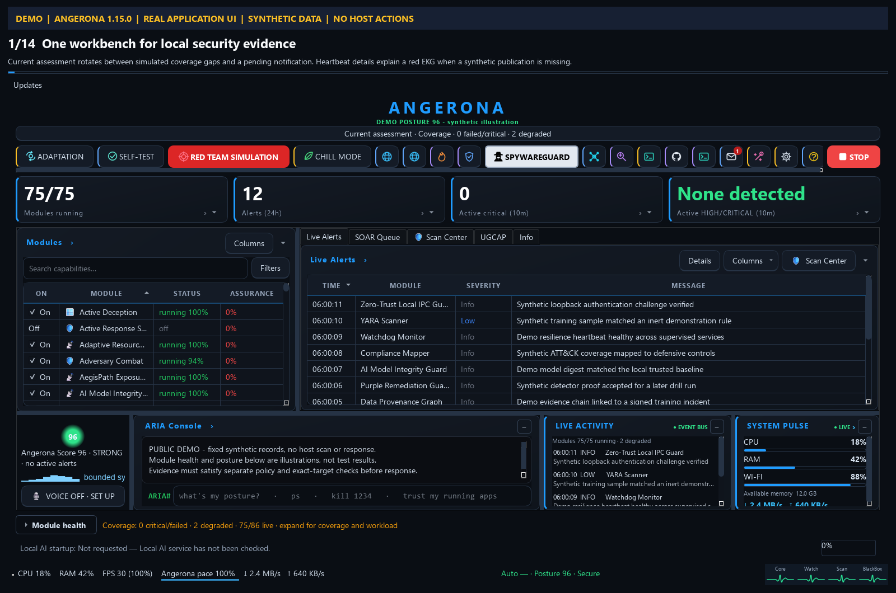

DEMO only. Compact dashboard with Current Assessment above one action row and a fixed STOP control. Synthetic records perform no host actions.

### 17 2 Complete setup and optional settings

Full Setup and Settings expose operating posture, storage and recovery, local AI, response policy, external tools, rules, diagnostics and optional integrations. Review defaults before enabling a feature. The complete settings reference records code defaults, not the current user's saved preferences or proof that a collector can run on this platform.

Community YARA rules and community SOAR playbooks have separate global runtime switches and both default off. Individually importing, testing or activating a draft does not enable either switch. Save through the tool settings view; a failed background save preserves prior preferences and restores the visible saved switch state.

The administrator option defaults off. An operator enables it and accepts the operating system prompt for that session. Elevation does not bypass an unenrolled backend, grant kernel protection or make every listed module operational. Keep credentials in protected stores and review the warning beneath each authority-related option.

Settings code sandboxes open separate editable copies. Saving or resetting a copy does not rewrite installed Core, silently activate imported code or bypass signed release/source review. Record intentional custom changes so update or recovery review can preserve them.

### 17 3 Suggested community tools and editable copies

Open the GitHub icon for Curated scanners, Source Library and analysis, Suggested tools, Rules and Playbooks, and Settings. Select an entry to read its upstream link, exact pinned revision, adapter capability, excluded behavior and credits. An adapter integrates a defined subset; the presence of Caldera, Velociraptor or Wazuh does not install their whole platforms or enroll another host.

Zero-Breach is the maintained pinned scanner. Atomic Red Team supplies compatible metadata mapped to reviewed controls; its arbitrary attack commands and prerequisites are not run. Sigma matching accepts only the supported logsource, fields, modifiers and conditions. Sysmon Modular supports configuration review. YARA-X uses the existing pinned engine for supported inert-buffer checks. External result adapters remain advisory and cannot grant response authority.

Import public HTTPS GitHub source at an immutable commit, inspect its files and licenses, and explicitly review that exact import. Install selected prepares only its supported integration. Run self-check checks the stated adapter and fixtures; it does not certify a host scan. Uninstall preserves reports, source imports, editable copies and preferences. Explicit Zero-Breach uninstall intent prevents automatic preparation from undoing that decision until an explicit restore.

Create editable copy opens a bounded working copy. Save copy, Show diff, Revert selected copy and Validate or analyze data affect that copy. This source sandbox is not an operating system isolation boundary. Editing a script does not execute it or replace the managed scanner. VM analysis is a separate backend with its own prerequisites, quotas and retained worker custody; current VMware acceptance remains held at its documented configuration-custody boundary.

Upstream references and licensing context: [Zero-Breach Toolkit](https://github.com/interplains/zero-breach-toolkit), [Atomic Red Team](https://github.com/redcanaryco/atomic-red-team), [SigmaHQ](https://github.com/SigmaHQ/sigma), [Sysmon Modular](https://github.com/olafhartong/sysmon-modular), [YARA-X](https://github.com/virustotal/yara-x), [Apache Caldera](https://github.com/apache/caldera), [Velociraptor](https://github.com/Velocidex/velociraptor), and [Wazuh](https://github.com/wazuh/wazuh). Retain the selected pinned source and its own license; project inclusion is not an endorsement or complete platform integration.

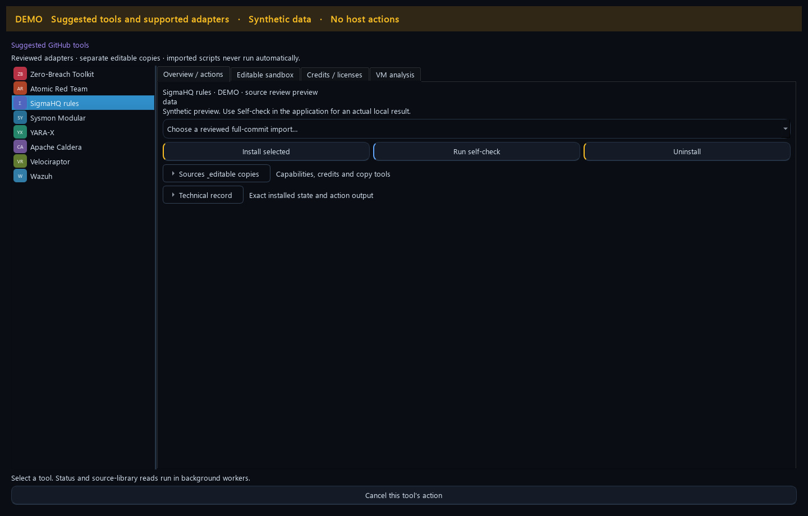

DEMO only. Suggested community tools and their separate adapter scopes. Synthetic records perform no host actions.

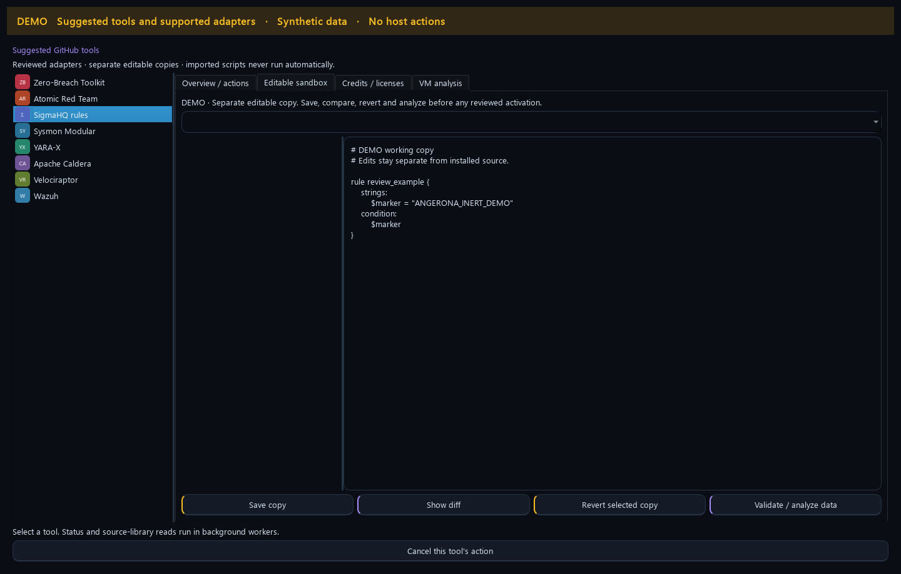

DEMO only. Separate editable source copies with diff and revert controls. Synthetic records perform no host actions.

### 17 4 Build YARA rules and SOAR tactics

Open Rules and Playbooks for an X/O tactics board, guided builder, source discovery, draft editor and result details. The board explains input, validation, policy and response paths. It is a planning visualization, not an enforcement receipt.

Choose a predefined source or a public HTTPS GitHub URL, fetch a pinned catalog, review the source and check compatible entries. Batch install creates drafts. Foreign workflow JSON, analyzers and Python, PowerShell or shell scripts remain inert when they do not match Angerona's supported schema. Per-item licenses remain part of the review.

Save draft preserves a separate revision. Validate checks syntax, source binding and supported schema; Sample test tests that exact draft. A checkmark requires the expected positive and negative sample outcomes where such fixtures are defined. Compilation alone is not detection accuracy. Read the red X or held reason instead of substituting a green indicator.

Activate validated and Rollback compile the complete candidate YARA set in a bounded ordinary-user owned helper before commit, then recheck current source review. Separate namespaces avoid name replacement. Raw source and compile-input hashes remain distinct. Compatible YARA excludes includes and imported modules; the current aggregate is limited to 32 sources and 64 KiB.

Compatible declarative SOAR uses the closed angerona-playbook/v1 JSON schema for notification or a containment request. Original evidence, opt-in, corroboration, exact-target and Combat gates remain in force. Disable removes one item's routing while retaining revisions; turning its global switch off stops new routing of that kind. Rollback cannot bypass source revocation, validation or response policy.

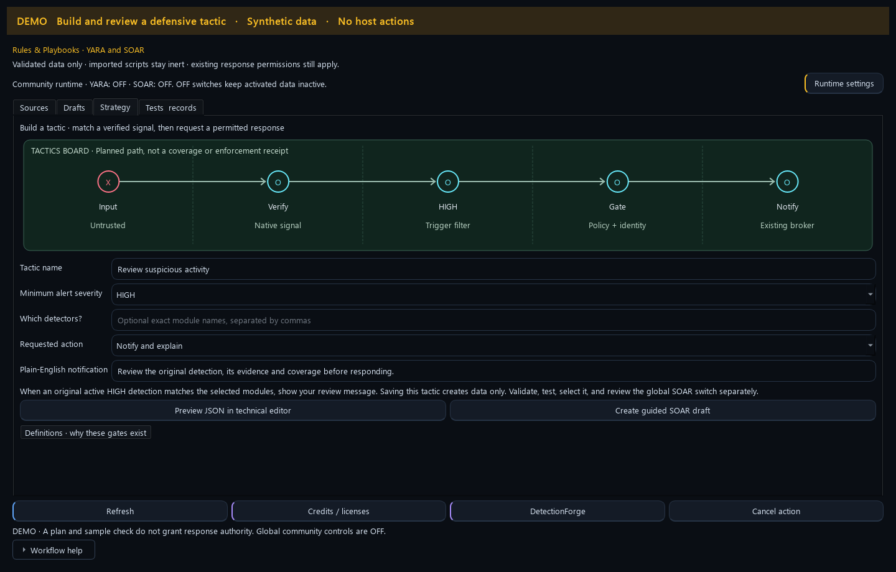

DEMO only. Rules and Playbooks tactics board and explicit runtime routing. Synthetic records perform no host actions.

### 17 5 Use the standalone Red Team application

The dashboard Red Team button opens a separate ordinary-user application with the existing campaign, progress, history and after-action workflow. Core retains prepared plans, enrolled detectors, validation leases, signed reports and response policy. Closing the tool is not a Core shutdown, and watchdog recovery does not silently relaunch this explicitly started tool.

A separate tool launch failure now retains a private phase/error-type receipt and a notification with a modeless startup review. Retry tool requires the same current owner to be fully retired and repeats source-seal, owned-Job and authenticated-IPC checks. Closing review preserves the receipt; no sensor or response policy is changed to force a launch.

The separate tool shares a 90-second bootstrap deadline beginning before Core's source check and inherited unchanged by the child. Both source checks and authenticated native admission remain required. After initialization, the first Qt paint has 15 seconds within a 105-second whole-startup cap. Source sealing checks the deadline and STOP cancellation between bounded operations. An observed cancellation, expiry or invalid clock cannot produce a verified seal; a known negative source-change receipt stays preserved. Cooperative checks cannot interrupt native I/O that is already blocked.

Open Simulation setup to adjust profiles, intensity, marker location and custom inert markers. The current target, containment readiness, overall wheel, result bar, verdict and Launch and Stop controls remain visible while setup is folded. Collapsing setup preserves selections and never changes response authority.

Private authenticated directional IPC binds the current parent, launcher and actual child process generations. Queued UI requests retain that owner epoch. Process probes use fixed inert commands; marker writes receive permission for one newly created Core-owned file. Repository code and child-selected paths are not execution authority. Exact Job ownership covers actual descendants on Windows.

The progress wheel and caught versus missed bar describe the current validated workflow; the pass/fail badge follows those scoped results. Open diagnostic detail for each outcome, its detector observation, response receipt and coverage gap. An empty response queue alone cannot finish a session: the admitted detector must complete a fresh cycle, followed by a fresh response-queue observation under the original deadline.

A failed report-integrity check keeps the immutable after-action report unavailable until genuine evidence loads. Cleanup does not manufacture detection or response credit. A practice marker, its name or its content does not make a live unregistered object safe; only an exact enrolled inert target can receive the scoped practice exception. Catch percentages must not be presented as an independently measured real-world detection rate.

### 17 6 Navigate the three dimensional Suite Map

SUITE MAP 3D is a software-drawn local view of Core, EventBus, modules, companions, cached mounted volumes, host-visible peripheral functions and retained observed endpoints. Scroll to zoom, drag to orbit, Shift-drag to pan, hover or select for details, and use Take me there to reach the owning existing controls. Filters, search, animation and Reset view aid navigation.

Bright links describe observed publications or endpoint metadata; dashed links describe architecture. Moving particles do not prove subscriber delivery, recorder persistence, an active socket or a blocked attack. Cached health is not a liveness attestation. The view discloses event losses, omitted nodes, source age and unavailable inventories.

A displayed drive is not automatically trusted or scanned. Navigate to the existing device review and retain its consent and PIN boundary. Unmounted storage and firmware or cable implants invisible to the operating system cannot be invented by the map. Rendering stops while hidden or closed; existing cached data avoids GUI-thread host scans.

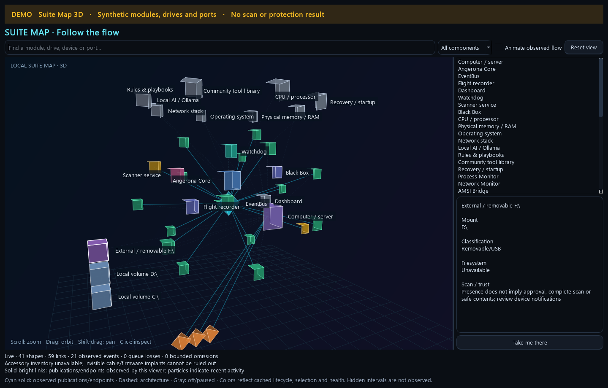

DEMO only. Suite Map showing synthetic components volumes and observed links. Synthetic records perform no host actions.

### 17 7 Spyware Scan and attached device review

SpywareGuard keeps research/news first, then progress and reported hits, current task/file/timing, and cached computer information with separately labeled scanner usage and permissions. The red Spyware Scan control defaults to Entire PC; open Scan setup to change scope and included checks. Recent native records are separate from this scan's findings or a confirmed breach. Overall and per-reader progress have different meanings; file completion requires a supplied count. Unknown ETA or current file remains unknown.

Native SpywareGuard checks and Zero-Breach are separate coverage sources. Missing permissions, readers, deadline expiry, cancellation or retained incomplete reports must remain visible in the after-action result. No listed findings after incomplete coverage is not a clean-PC result. Investigate, trace, patch, isolate or kill controls require their own supported target, evidence, policy and privilege; report text is not that authority.

Unlimited report count removes the slot-count limit only. Byte, inventory and free-space budgets still protect storage. Existing reports are retained when a new admission is held; export and verify before explicitly removing originals. Startup scratch pressure should leave the recovery interface available, with detailed diagnostics, rather than silently deleting evidence or pretending the engine started.

Optional research downloads use configured HTTPS sources and disclose live-fetch age or failure separately from bundled reference briefs. Feed details expands the article summary and source checks. A rotating banner does not make a stale brief current. Attached storage and peripherals use host-visible metadata and supported scan readers. Suspicion or an opaque accessory is not proof of a hidden hardware implant.

### 17 8 Telemetry continuity forensic evidence and local analysis

Provider-specific benign canaries require a native ETW or Sysmon echo with the current collection generation and authenticated durable evidence. A general heartbeat or polling echo cannot satisfy that native proof. Current ETWR publishes process-start events; native DLL and network ETW coverage is not supplied by enabling that one provider path. Sysmon image, network and DNS coverage remains conditional on its actual installation and configuration.

AMSI Bridge inspects already observed script text. It accepts the bounded ETWR cmdline alias and explicit supported text fields; this is not a registered global AMSI provider or pre-execution interception. The unstable native in-process compatibility option stays off by default. A real malicious AMSI API verdict can carry already authenticated native ETWR PID, raw FILETIME, image and source proof only after checking the same bytes before and after scanning.

That positive finding can enter separately opted-in forensic capture without granting process-response authority. Missing, stale, remote, drill, lossy or changed provenance preserves the critical content observation but holds automatic capture. No current-PID lookup substitutes for missing historical birth. Legacy active detectors without original raw FILETIME still leave this forensic path unavailable.

Forensics retains an exact noninheritable native read/query process handle across bounded strings and owner-PID socket capture. It excludes protected system, Windows, self and Angerona targets. This is bounded evidence extraction, not a full process dump. AES-GCM frames, a random case key wrapped for the current user, authenticated terminal receipts and file/directory identity checks protect copied evidence at rest. Explicit operator export to a new directory is the only plaintext path.

Finite clocks, deadlines, capacity and complete writes are checked. A failed frame encryption or write permanently poisons that writer: later append or terminal receipt calls cannot reuse the consumed AEAD nonce, and partial ciphertext remains without a valid completion claim. Ambiguous native close retains the exact owner and never retries its possibly recycled handle number. Further forensic capture is held until Core restart; other modules and normal STOP are not held for a file/process handle owned by Core. Current-user DPAPI and Python key handling do not defeat same-user or kernel compromise or guarantee RAM erasure.

Native Sysmon DNS records now reach the lexical decoder through its source checks. Beacon cadence uses parsed addresses, PID birth and explicit continuity epochs; stable sockets and incomplete snapshots cannot fabricate repeat callbacks. These lexical/timing observations remain leads unless the existing separate corroboration and response conditions are met.

SentinelLens is a bounded advisory read model. It normalizes supported imports, links anomaly evidence and explains possible next steps without executing remediation. Accepted queue work drains before stop; a failed builder retains its prior snapshot, retries, and discloses an unpublished suffix instead of claiming a clean flush. Imported data and graph proximity do not establish live source authenticity or malicious causation.

### 17 9 Signal optional integration and shutdown

Mobile Response Bridge remains separately opted in. It requires the configured exact native executable hash/publisher, account/operator identity and protected PIN. Commands retain sender, freshness, replay, one-use token and action scope checks. A local CLI invocation receipt does not prove Signal connectivity or recipient delivery, and a version self-test makes no such claim.

A full invocation lease covers executable preflight, the fixed system Authenticode helper, the CLI operation and final executable-pin close. The child begins suspended, enters its owned Job, then runs. Output readers, native process/tree signals and closes are checked before a result can be verified. Unknown retirement preserves exact resources, fences further Signal launches and remains visible to Core shutdown; no process-name search or foreign target grants ownership.

An unproven external tree prevents a false completed STOP receipt. A file-close-only reference after its tree and reader are proven retired holds this optional capability without blocking global restart forever. Failed notifications remain in a bounded retry digest; sending a digest cannot erase newer arrivals or mint replacement response permissions. No live Signal send, inbox or recipient acknowledgement was exercised by the documented offline review.

### 17 10 Adaptation recovery and preserved custom changes

Auto Adapt separates audit, a golden baseline, proposed exact changes, explicit approval, native readback and supported rollback. The change list and activity history explain what was proposed and what actually happened. Adjust scope before approval, then inspect receipts and residual drift. Unelevated firewall access-denied results are a visible prerequisite gap, not a reason to widen every module's authority.

Source peers bind heartbeat counters to exact native invocation generations and stop advancing when supervision work exceeds its deadline. Source seals hold changed peers without silently overwriting intentional edits. GitHub repair uses the existing verified Safe Startup boundary and preserved originals. The 48-file recovery profile needs an explicit reviewed transition from an older updater that understands only the former 39-file profile.

Canonical Windows storage derives from the actual process token so a helper's private USERPROFILE cannot redirect update/recovery roots. Reserved background helpers preserve failure exits and custody diagnostics without foreground MessageBoxes. An interactive failed launch still explains recovery; unknown source, ownership or authority must not be bypassed merely to paint a trusted-looking protection state.

Public GitHub update checks default to their saved opt-in and prompt before installation. Download into staging, inspect source changes and custom additions, preserve settings, and activate through the reviewed update path. Source version 1.15.0 is not a new signed installed binary. Signed release signing, privileged service enrollment, native policy and hardware/witness acceptance remain their own deployments.

### 17 11 Individual module tests and supported recovery

Self-Test reports each module's own diagnostic and sample limits. Read the positive/negative fixture, unavailable dependency or permission, expected postcondition and actual result. A generic lifecycle check cannot substitute for observing the module's security job, and a mock provider result cannot establish a live provider.

Bounded module workers and spare test slots let other eligible modules proceed while a slow test uses its own budget. A timeout remains incomplete or failed for that scope; it does not turn the whole session into an automatic pass or authorize an unsafe retry. The stored per-module time budget is separate from native custody and OS limits.

Self-Test settings expose module-specific guidance, test code and separate editable copies. Automatic supported recovery is restricted to the explicitly selected module list; its code default is empty. Re-test and inspect the exact result after a supported repair. Do not clear alerts, replace evidence baselines or hot-load arbitrary code to make a result green.

The complete module reference links every declared dedicated test for inspection. Supported repair guidance is conditional on the module and current manager generation; it is not a universal automatic patch engine or permission to bypass disabled policy, missing native collectors or unenrolled privilege.

### Threat scenarios and the expected review path

#### Office document creates a script host

Preserve native parent/child and script text, correlate available sources and examine the exact alert. A lexical or graph marker is a lead; supported corroborated active evidence may request Combat. Post-observation text inspection does not prove that execution was prevented.

#### A signed vulnerable driver may blind telemetry

Inspect provenance, OS policy state and independent native canary gaps. A live worker can be deaf. Enrolled WDAC/HVCI prevention is conditional; no source-mode kernel immunity or intact-callback attestation exists.

#### A flagged executable changes during containment

Retain native process/file/ancestor leases through intent, dispatch and postcondition or hold the action. Path firewall success does not prove PID-bound socket admission or established/inherited-flow teardown.

#### A newly attached device is suspicious

Use Notifications and device review, validate identity and supported coverage, and keep consent/PIN and response gates. Host metadata cannot establish hidden cable firmware behavior. A displayed device is not a completed scan.

#### A verified breach requests network lockdown

Native breach qualification and the existing opted-in authority decide whether a managed containment request can proceed. Review critical evidence and receipts; Lift Lockdown restores only managed changes. An imported report or dramatic red UI is not proof or a new firewall grant.

#### An attacker replays old local state

Local integrity alone cannot establish whole-root freshness. An independently enrolled witness or hardware-backed floor must be available and bound to admission. OS servicing/version observations are partial evidence and do not replace vendor security updates.

## 18 Complete module reference

This complete static reference covers 86 built-in declarations. It explains declared roles, referenced settings and dedicated diagnostic code. A declaration or passed isolated fixture is not live collection, prevention, containment or a certification. Use the inspector's current prerequisites, health, selected policy and assurance. Links target the maintained source; individual module implementation versions may differ from application version 1.15.0.

### Active Deception

Plants canaries/honeytokens, detects file mutation/deletion, and dynamically re-stages traps; audited reads need an external OS source.

Category: Deception. Source: [Open source](https://github.com/Ag3nt47/AngeronaSuite/blob/main/src/angerona/modules/deception.py#L72).

Individual test: [Open source](https://github.com/Ag3nt47/AngeronaSuite/blob/main/src/angerona/modules/deception.py#L173). Exercise real planting on an unstarted disposable instance only.

### Active Response SOAR

Opt-in: terminates the offending process and rolls back its file artifact on real CRITICAL alerts.

Category: Response. Source: [Open source](https://github.com/Ag3nt47/AngeronaSuite/blob/main/src/angerona/modules/soar_engine.py#L59).

Individual test: [Open source](https://github.com/Ag3nt47/AngeronaSuite/blob/main/src/angerona/modules/soar_engine.py#L125). Exercise real response admission helpers on isolated inert evidence.

### Adaptive Resource Governor

Watches process CPU and throttles heavy non-critical module loops under load (Eco + normal); relaxes them when idle. Never slows the real-time protection path.

Category: Performance. Source: [Open source](https://github.com/Ag3nt47/AngeronaSuite/blob/main/src/angerona/modules/resource_governor.py#L52).

Individual test: [Open source](https://github.com/Ag3nt47/AngeronaSuite/blob/main/src/angerona/modules/resource_governor.py#L271). This module declares a dedicated self-test. Inspect the method for its sample, limits and asserted postconditions.

### Adversary Combat

Unattended maximum-response tier: blocks, contains, quarantines, isolates, and activates honeypots with undo receipts.

Category: Response. Source: [Open source](https://github.com/Ag3nt47/AngeronaSuite/blob/main/src/angerona/modules/adversary_combat.py#L1206).

Referenced settings: breach\_auto\_isolate\_enabled, breach\_lifted\_cases, data\_dir.

Individual test: [Open source](https://github.com/Ag3nt47/AngeronaSuite/blob/main/src/angerona/modules/adversary_combat.py#L1462). This module declares a dedicated self-test. Inspect the method for its sample, limits and asserted postconditions.

### AI Model Integrity Guard

Cryptographically attests local LLM weights (Ollama blobs) against a pinned baseline; flags tampering/poisoning before load.

Category: AI Defense. Source: [Open source](https://github.com/Ag3nt47/AngeronaSuite/blob/main/src/angerona/modules/ai_model_integrity.py#L447).

Individual test: [Open source](https://github.com/Ag3nt47/AngeronaSuite/blob/main/src/angerona/modules/ai_model_integrity.py#L981). Offline: prove the hasher detects a single-byte change, and report whether any local models were discovered.

### AI Triage Ollama

Explains and scores serious events using a local LLM (Ollama).

Category: AI. Source: [Open source](https://github.com/Ag3nt47/AngeronaSuite/blob/main/src/angerona/modules/ai_triage.py#L112).

Referenced settings: ollama\_host, ollama\_model.

Individual test: [Open source](https://github.com/Ag3nt47/AngeronaSuite/blob/main/src/angerona/modules/ai_triage.py#L767). Check the existing listener, exact model, and current proof without mutation.

### AMSI Bridge

AMSI scanning consumer — pushes PowerShell/script content from bus events through AmsiScanBuffer after observation; no pre-execution interception. Native scanning requires the controlled compatibility option.

Category: Endpoint. Source: [Open source](https://github.com/Ag3nt47/AngeronaSuite/blob/main/src/angerona/modules/amsi_bridge.py#L202).

Individual test: [Open source](https://github.com/Ag3nt47/AngeronaSuite/blob/main/src/angerona/modules/amsi_bridge.py#L566). This module declares a dedicated self-test. Inspect the method for its sample, limits and asserted postconditions.

### Anti Suspension Heartbeat

Writes a nanosecond heartbeat to a shared mmap region every 500 ms so the external FRZ watchdog binary can detect thread-suspension attacks.  If the Python process is frozen but alive, the watchdog triggers emergency network isolation and terminates the compromised interpreter.

Category: Resilience. Source: [Open source](https://github.com/Ag3nt47/AngeronaSuite/blob/main/src/angerona/modules/frz_heartbeat.py#L124).

Individual test: [Open source](https://github.com/Ag3nt47/AngeronaSuite/blob/main/src/angerona/modules/frz_heartbeat.py#L364). Verify independent authenticated-v2 reads see advancing beats.

### API Patch Anti Blinding Detector

Reads pristine ntdll/kernel32 from disk and compares export prologues against live memory to catch inline sensor hooks.

Category: Integrity. Source: [Open source](https://github.com/Ag3nt47/AngeronaSuite/blob/main/src/angerona/modules/api_patch_detector.py#L162).

Individual test: [Open source](https://github.com/Ag3nt47/AngeronaSuite/blob/main/src/angerona/modules/api_patch_detector.py#L563). Verify the hook classifier and separately inspect local PE exports.

### App Control Decision Evidence

Reads Windows Code Integrity audit/block decisions and correlates their signature evidence by ActivityID without changing App Control policy.

Category: Integrity. Source: [Open source](https://github.com/Ag3nt47/AngeronaSuite/blob/main/src/angerona/modules/app_control_monitor.py#L407).

Individual test: [Open source](https://github.com/Ag3nt47/AngeronaSuite/blob/main/src/angerona/modules/app_control_monitor.py#L899). This module declares a dedicated self-test. Inspect the method for its sample, limits and asserted postconditions.

### ARP Watchdog

Detects ARP poisoning (T1557.002) via ARP cache diff polling and optional real-time scapy gratuitous-ARP sniffing.

Category: Network. Source: [Open source](https://github.com/Ag3nt47/AngeronaSuite/blob/main/src/angerona/modules/arp_watchdog.py#L116).

Individual test: [Open source](https://github.com/Ag3nt47/AngeronaSuite/blob/main/src/angerona/modules/arp_watchdog.py#L619). This module declares a dedicated self-test. Inspect the method for its sample, limits and asserted postconditions.

### Audit Log Integrity Guard

Detects Windows log clearing, audit-policy drift, service impairment, retention gaps, record reuse, and authenticated cursor tampering.

Category: Telemetry. Source: [Open source](https://github.com/Ag3nt47/AngeronaSuite/blob/main/src/angerona/modules/audit_log_guard.py#L63).

Individual test: [Open source](https://github.com/Ag3nt47/AngeronaSuite/blob/main/src/angerona/modules/audit_log_guard.py#L554). This module declares a dedicated self-test. Inspect the method for its sample, limits and asserted postconditions.

### AuthenticationExtensionIntegrityGuardModule

Read-only fixed-catalog integrity observation for LSA authentication, notification, and security packages; credential providers and filters; and network providers.

Category: Identity. Source: [Open source](https://github.com/Ag3nt47/AngeronaSuite/blob/main/src/angerona/modules/authentication_extension_guard.py#L37).

Referenced settings: data\_dir.

Individual test: [Open source](https://github.com/Ag3nt47/AngeronaSuite/blob/main/src/angerona/modules/authentication_extension_guard.py#L450). This module declares a dedicated self-test. Inspect the method for its sample, limits and asserted postconditions.

### AV Telemetry Bridge

Bridges Windows Defender detection events (EID 1116/1117/5001) into the Angerona bus for cross-sensor correlation.

Category: Endpoint. Source: [Open source](https://github.com/Ag3nt47/AngeronaSuite/blob/main/src/angerona/modules/av_telemetry_bridge.py#L364).

Individual test: [Open source](https://github.com/Ag3nt47/AngeronaSuite/blob/main/src/angerona/modules/av_telemetry_bridge.py#L1529). This module declares a dedicated self-test. Inspect the method for its sample, limits and asserted postconditions.

### C2 Beacon Detector

Flags regular-interval outbound callbacks (command-and-control beaconing, T1071/T1571) by timing per-process connections to a host.

Category: Detection. Source: [Open source](https://github.com/Ag3nt47/AngeronaSuite/blob/main/src/angerona/modules/beacon_detector.py#L96).

Individual test: [Open source](https://github.com/Ag3nt47/AngeronaSuite/blob/main/src/angerona/modules/beacon_detector.py#L292). This module declares a dedicated self-test. Inspect the method for its sample, limits and asserted postconditions.

### CHAOS

Periodically fires safe synthetic probes and verifies detectors echo back.

Category: Resilience. Source: [Open source](https://github.com/Ag3nt47/AngeronaSuite/blob/main/src/angerona/modules/chaos_harness.py#L75).

Individual test: [Open source](https://github.com/Ag3nt47/AngeronaSuite/blob/main/src/angerona/modules/chaos_harness.py#L345). This module declares a dedicated self-test. Inspect the method for its sample, limits and asserted postconditions.

### Cloud CTI Escalation

Opt-in: corroborates CRITICAL events with a cloud model (uses your own key).

Category: AI. Source: [Open source](https://github.com/Ag3nt47/AngeronaSuite/blob/main/src/angerona/modules/cloud_escalation.py#L77).

Individual test: [Open source](https://github.com/Ag3nt47/AngeronaSuite/blob/main/src/angerona/modules/cloud_escalation.py#L109). Exercise parsing and privacy gates without credentials or egress.

### Compliance Mapper

Maps live MITRE ATT&CK detections to NIST 800-53 + DoD STIG control relevance and writes an authenticated, coverage-aware artifact.

Category: Compliance. Source: [Open source](https://github.com/Ag3nt47/AngeronaSuite/blob/main/src/angerona/modules/compliance_mapper.py#L164).

Individual test: [Open source](https://github.com/Ag3nt47/AngeronaSuite/blob/main/src/angerona/modules/compliance_mapper.py#L445). Offline: verify technique mapping + sub-technique fallback.

### Counter Agentic Detection

Reviews timed discovery and action launches, corroborated process-linked outbound activity, and unexpected inference-port matches.

Category: Detection. Source: [Open source](https://github.com/Ag3nt47/AngeronaSuite/blob/main/src/angerona/modules/counter_agentic.py#L141).

Individual test: [Open source](https://github.com/Ag3nt47/AngeronaSuite/blob/main/src/angerona/modules/counter_agentic.py#L608). Exercise advisory discovery/action cadence with a benign control.

### Data Provenance Graph

Builds a PROC/FIM/NET provenance DAG from the flight recorder + live events; exposes ancestry()/subtree() for blast-radius views.

Category: Forensics. Source: [Open source](https://github.com/Ag3nt47/AngeronaSuite/blob/main/src/angerona/modules/provenance_graph.py#L381).

Individual test: [Open source](https://github.com/Ag3nt47/AngeronaSuite/blob/main/src/angerona/modules/provenance_graph.py#L599). Build a synthetic PROC→PROC→FIM chain and verify ancestry/subtree.

### DetectionRuntimeModule

Runs digest-bound local detection packages with a reserved active lane and an alert-inert, loss-visible shadow lane for DetectionForge validation.

Category: Detection. Source: [Open source](https://github.com/Ag3nt47/AngeronaSuite/blob/main/src/angerona/modules/detection_runtime.py#L1387).

Individual test: [Open source](https://github.com/Ag3nt47/AngeronaSuite/blob/main/src/angerona/modules/detection_runtime.py#L1515). This module declares a dedicated self-test. Inspect the method for its sample, limits and asserted postconditions.

### Deterministic Fast Path Interceptor

Checks bus events against a deterministic IOC pattern library and emits CRITICAL alerts immediately — without waiting for Ollama — for high-confidence known-bad patterns.

Category: AI. Source: [Open source](https://github.com/Ag3nt47/AngeronaSuite/blob/main/src/angerona/modules/fast_path.py#L288).

Individual test: [Open source](https://github.com/Ag3nt47/AngeronaSuite/blob/main/src/angerona/modules/fast_path.py#L679). This module declares a dedicated self-test. Inspect the method for its sample, limits and asserted postconditions.

### Driver Provenance Guard

Joins bounded configured-path samples with signer/catalog, blocklist, HVCI, and Secure Boot evidence; loaded-image proof requires a trusted kernel load receipt.

Category: Integrity. Source: [Open source](https://github.com/Ag3nt47/AngeronaSuite/blob/main/src/angerona/modules/driver_provenance_guard.py#L873).

Individual test: [Open source](https://github.com/Ag3nt47/AngeronaSuite/blob/main/src/angerona/modules/driver_provenance_guard.py#L1124). This module declares a dedicated self-test. Inspect the method for its sample, limits and asserted postconditions.

### Dynamic Resource Governor

Escalates process priority to HIGH\_PRIORITY\_CLASS under incident load and restores its original priority after COOLDOWN\_S seconds of calm.

Category: System. Source: [Open source](https://github.com/Ag3nt47/AngeronaSuite/blob/main/src/angerona/modules/dynamic_resource.py#L55).

Individual test: [Open source](https://github.com/Ag3nt47/AngeronaSuite/blob/main/src/angerona/modules/dynamic_resource.py#L212). This module declares a dedicated self-test. Inspect the method for its sample, limits and asserted postconditions.

### ETW Core Listener

Captures process-creation (4688) + logon (4624/4672) telemetry from the Windows Security channel; psutil fallback.

Category: Telemetry. Source: [Open source](https://github.com/Ag3nt47/AngeronaSuite/blob/main/src/angerona/modules/etw_listener.py#L264).

Individual test: [Open source](https://github.com/Ag3nt47/AngeronaSuite/blob/main/src/angerona/modules/etw_listener.py#L2831). Verify the 4688/4624 describers produce well-formed events.

### ETW Real Time Process Sensor

Event-driven process-creation capture via the Kernel-Process ETW provider (pywintrace); closes the polling blind spot. Requires elevation; defers to polling sensors when unavailable.

Category: Telemetry. Source: [Open source](https://github.com/Ag3nt47/AngeronaSuite/blob/main/src/angerona/modules/etw_realtime_sensor.py#L389).

Individual test: [Open source](https://github.com/Ag3nt47/AngeronaSuite/blob/main/src/angerona/modules/etw_realtime_sensor.py#L566). Verify the Kernel-Process parser produces a well-formed event, and report real-time availability on this host.

### Evidence Lattice Fusion

Fuses MEDIUM signals about the same PID, path/hash, or IP across three independent modules and two sensor domains; emits an explainable HIGH finding and exact-target containment authority for live PIDs/IPs.

Category: Detection. Source: [Open source](https://github.com/Ag3nt47/AngeronaSuite/blob/main/src/angerona/modules/evidence_lattice.py#L254).

Individual test: [Open source](https://github.com/Ag3nt47/AngeronaSuite/blob/main/src/angerona/modules/evidence_lattice.py#L336). This module declares a dedicated self-test. Inspect the method for its sample, limits and asserted postconditions.

### Evolution Engine

Review-gated hardening: turns a typed Judgment bypass receipt into an inert YARA proposal; never auto-activates it.

Category: Resilience. Source: [Open source](https://github.com/Ag3nt47/AngeronaSuite/blob/main/src/angerona/modules/evolution_engine.py#L129).

Individual test: [Open source](https://github.com/Ag3nt47/AngeronaSuite/blob/main/src/angerona/modules/evolution_engine.py#L534). This module declares a dedicated self-test. Inspect the method for its sample, limits and asserted postconditions.

### ExposureGraphGuardModule

Monitors immutable exposure-graph generations for invalid receipts, resource truncation, provider-attested semantic scope, stale or missing evidence, and collection age.

Category: Exposure Management. Source: [Open source](https://github.com/Ag3nt47/AngeronaSuite/blob/main/src/angerona/modules/exposure_graph_guard.py#L43).

Individual test: [Open source](https://github.com/Ag3nt47/AngeronaSuite/blob/main/src/angerona/modules/exposure_graph_guard.py#L349). This module declares a dedicated self-test. Inspect the method for its sample, limits and asserted postconditions.

### File Integrity Monitor

Detects unauthorized creation, modification, or deletion of watched files.

Category: Integrity. Source: [Open source](https://github.com/Ag3nt47/AngeronaSuite/blob/main/src/angerona/modules/file_integrity.py#L366).

Individual test: [Open source](https://github.com/Ag3nt47/AngeronaSuite/blob/main/src/angerona/modules/file_integrity.py#L1500). This module declares a dedicated self-test. Inspect the method for its sample, limits and asserted postconditions.

### FleetHealthMonitorModule

Detects bounded Fleet Fabric evidence loss, queue backpressure, policy drift, custody deletion, unhealthy endpoints, and fail-closed coordinator readiness without mutating hosts.

Category: Fleet. Source: [Open source](https://github.com/Ag3nt47/AngeronaSuite/blob/main/src/angerona/modules/fleet_health_monitor.py#L19).

Individual test: [Open source](https://github.com/Ag3nt47/AngeronaSuite/blob/main/src/angerona/modules/fleet_health_monitor.py#L269). This module declares a dedicated self-test. Inspect the method for its sample, limits and asserted postconditions.

### Forensics Capture

Opt-in encrypted bounded process strings/sockets; exact original native birth and authenticated active local evidence required.

Category: Forensics. Source: [Open source](https://github.com/Ag3nt47/AngeronaSuite/blob/main/src/angerona/modules/forensics.py#L281).

Individual test: [Open source](https://github.com/Ag3nt47/AngeronaSuite/blob/main/src/angerona/modules/forensics.py#L547). This module declares a dedicated self-test. Inspect the method for its sample, limits and asserted postconditions.

### Hardware Rooted Integrity

Verifies OS-protected IPC key storage and DPAPI primitives; TPM database-key sealing remains an explicit unsupported outline.

Category: Integrity. Source: [Open source](https://github.com/Ag3nt47/AngeronaSuite/blob/main/src/angerona/modules/hardware_crypto.py#L100).

Individual test: [Open source](https://github.com/Ag3nt47/AngeronaSuite/blob/main/src/angerona/modules/hardware_crypto.py#L219). Prove a DPAPI protect→unprotect round-trip on a throwaway secret.

### HEAL

Diagnoses crashed modules and stages LLM-proposed patches for operator review.

Category: Resilience. Source: [Open source](https://github.com/Ag3nt47/AngeronaSuite/blob/main/src/angerona/modules/self_healer.py#L277).

Individual test: [Open source](https://github.com/Ag3nt47/AngeronaSuite/blob/main/src/angerona/modules/self_healer.py#L1187). This module declares a dedicated self-test. Inspect the method for its sample, limits and asserted postconditions.

### IdentitySessionGuardModule

Privacy-tokenized LUID, session, device-code, new-device, browser-store, RMM, and privilege-transition analytics; optional read-only Windows session events and untrusted browser-extension manifest inventory. No credentials or browser contents.

Category: Identity. Source: [Open source](https://github.com/Ag3nt47/AngeronaSuite/blob/main/src/angerona/modules/identity_session_guard.py#L43).

Referenced settings: data\_dir.

Individual test: [Open source](https://github.com/Ag3nt47/AngeronaSuite/blob/main/src/angerona/modules/identity_session_guard.py#L400). This module declares a dedicated self-test. Inspect the method for its sample, limits and asserted postconditions.

### ImmutableRecoveryGuardModule

Verifies externally signed backup-copy, failure-domain, immutability, air-gap, offsite, encryption, source-revision, and restore-test evidence.

Category: Resilience. Source: [Open source](https://github.com/Ag3nt47/AngeronaSuite/blob/main/src/angerona/modules/immutable_recovery_guard.py#L57).

Referenced settings: data\_dir.

Individual test: [Open source](https://github.com/Ag3nt47/AngeronaSuite/blob/main/src/angerona/modules/immutable_recovery_guard.py#L454). This module declares a dedicated self-test. Inspect the method for its sample, limits and asserted postconditions.

### In Memory Flight Cache

Bounded sqlite :memory: mirror of the flight recorder for fast, low-I/O reads of hot recent events.

Category: Performance. Source: [Open source](https://github.com/Ag3nt47/AngeronaSuite/blob/main/src/angerona/modules/flight_cache.py#L183).

Individual test: [Open source](https://github.com/Ag3nt47/AngeronaSuite/blob/main/src/angerona/modules/flight_cache.py#L259). Verify insert, read-back, eviction cap, and read-only guard.

### Indirect Syscall Bridge

Uses explicit-prototype ctypes/psutil process controls and exposes a truthful unavailable state for the native indirect-syscall bridge until a fixed private, release-manifest-sealed broker is installed.

Category: Response. Source: [Open source](https://github.com/Ag3nt47/AngeronaSuite/blob/main/src/angerona/modules/sys_bridge.py#L124).

Individual test: [Open source](https://github.com/Ag3nt47/AngeronaSuite/blob/main/src/angerona/modules/sys_bridge.py#L244). Verify the bridge works (SSN probe only — no real process is harmed).

### Kernel Sensor Bridge

Reads process-creation and image-load events from the AngeronaSensor.sys kernel driver ring buffer via DeviceIoControl.  Provides tamper-resistant telemetry that cannot be suppressed from user space.

Category: Endpoint. Source: [Open source](https://github.com/Ag3nt47/AngeronaSuite/blob/main/src/angerona/modules/kernel_bridge.py#L211).

Individual test: [Open source](https://github.com/Ag3nt47/AngeronaSuite/blob/main/src/angerona/modules/kernel_bridge.py#L480). This module declares a dedicated self-test. Inspect the method for its sample, limits and asserted postconditions.

### Kernel Boundary Posture Ledger

Read-only evidence for Secure Boot, VBS/HVCI, boot integrity flags, Code Integrity telemetry, and kernel-driver-service drift.

Category: Integrity. Source: [Open source](https://github.com/Ag3nt47/AngeronaSuite/blob/main/src/angerona/modules/kernel_posture_ledger.py#L514).

Individual test: [Open source](https://github.com/Ag3nt47/AngeronaSuite/blob/main/src/angerona/modules/kernel_posture_ledger.py#L587). This module declares a dedicated self-test. Inspect the method for its sample, limits and asserted postconditions.

### Linux eBPF Sensor

Native Linux kernel telemetry (execve + tcp\_sendmsg) via BCC/eBPF; forwards to the main instance over the Remote Bridge. Linux-only, opt-in.

Category: Sensor. Source: [Open source](https://github.com/Ag3nt47/AngeronaSuite/blob/main/src/angerona/modules/ebpf_sensor.py#L98).

Referenced settings: ebpf\_enabled.

Individual test: [Open source](https://github.com/Ag3nt47/AngeronaSuite/blob/main/src/angerona/modules/ebpf_sensor.py#L301). This module declares a dedicated self-test. Inspect the method for its sample, limits and asserted postconditions.

### Linux Observe Sensor

Rootless, privacy-minimized process, established-flow, and kernel posture observation; optional eBPF adds privileged kernel telemetry separately.

Category: Endpoint. Source: [Open source](https://github.com/Ag3nt47/AngeronaSuite/blob/main/src/angerona/modules/linux_observe.py#L14).

Referenced settings: ebpf\_enabled.

Individual test: [Open source](https://github.com/Ag3nt47/AngeronaSuite/blob/main/src/angerona/modules/linux_observe.py#L77). This module declares a dedicated self-test. Inspect the method for its sample, limits and asserted postconditions.

### LSASS Credential Access Guard

Detects LSASS credential-dumping (Mimikatz/procdump/comsvcs MiniDump, T1003.001) by process command line + artifact signatures. Read-only.

Category: Detection. Source: [Open source](https://github.com/Ag3nt47/AngeronaSuite/blob/main/src/angerona/modules/lsass_guard.py#L185).

Individual test: [Open source](https://github.com/Ag3nt47/AngeronaSuite/blob/main/src/angerona/modules/lsass_guard.py#L322). This module declares a dedicated self-test. Inspect the method for its sample, limits and asserted postconditions.

### macOS Observe Sensor

Privacy-minimized process and network observation for the macOS sensor preview; native Endpoint Security enforcement is reported separately.

Category: Endpoint. Source: [Open source](https://github.com/Ag3nt47/AngeronaSuite/blob/main/src/angerona/modules/macos_observe.py#L20).

Individual test: [Open source](https://github.com/Ag3nt47/AngeronaSuite/blob/main/src/angerona/modules/macos_observe.py#L44). This module declares a dedicated self-test. Inspect the method for its sample, limits and asserted postconditions.

### Memory Injection Scanner

Scans running process address spaces via VirtualQueryEx for anonymous RWX memory regions that indicate T1055 injection (shellcode, process hollowing, reflective DLL loading).

Category: Memory. Source: [Open source](https://github.com/Ag3nt47/AngeronaSuite/blob/main/src/angerona/modules/mem_inject_scanner.py#L274).

Individual test: [Open source](https://github.com/Ag3nt47/AngeronaSuite/blob/main/src/angerona/modules/mem_inject_scanner.py#L925). This module declares a dedicated self-test. Inspect the method for its sample, limits and asserted postconditions.

### Memory Time Machine

SPSC mmap ring + per-PID sliding hash cache; forwards only the delta slice of newly-observed process strings to the LLM queue.

Category: Performance. Source: [Open source](https://github.com/Ag3nt47/AngeronaSuite/blob/main/src/angerona/modules/memory_timemachine.py#L160).

Individual test: [Open source](https://github.com/Ag3nt47/AngeronaSuite/blob/main/src/angerona/modules/memory_timemachine.py#L586). Prove the dedup path: the same string set twice must yield a full delta then an empty one.

### Mobile Response Bridge

E2EE (Signal) state-gated remote orchestration: posture queries and token+PIN-gated containment from the operator's phone.

Category: Response. Source: [Open source](https://github.com/Ag3nt47/AngeronaSuite/blob/main/src/angerona/modules/mobile_bridge.py#L456).

Referenced settings: mobile\_enabled.

Individual test: [Open source](https://github.com/Ag3nt47/AngeronaSuite/blob/main/src/angerona/modules/mobile_bridge.py#L2423). This module declares a dedicated self-test. Inspect the method for its sample, limits and asserted postconditions.

### Monolithic Packaging

Monitors whether Angerona is running as a signed, monolithic hermetic binary (PyOxidizer).  Loose .py execution is flagged as a hardening gap. Exposes trigger\_build() for review-gated rebuild — never auto-executes.

Category: Resilience. Source: [Open source](https://github.com/Ag3nt47/AngeronaSuite/blob/main/src/angerona/modules/hermetic_packager.py#L175).

Individual test: [Open source](https://github.com/Ag3nt47/AngeronaSuite/blob/main/src/angerona/modules/hermetic_packager.py#L434). This module declares a dedicated self-test. Inspect the method for its sample, limits and asserted postconditions.

### Network Monitor

Watches new outbound connections; alerts on suspicious ports and first-seen external hosts.

Category: Network. Source: [Open source](https://github.com/Ag3nt47/AngeronaSuite/blob/main/src/angerona/modules/network_monitor.py#L188).

Individual test: [Open source](https://github.com/Ag3nt47/AngeronaSuite/blob/main/src/angerona/modules/network_monitor.py#L280). Validate endpoint, identity and response gates without network I/O.

### Network Protocol Deep Decoder

Decodes DNS query names and scores label entropy to catch DGA beacons and DNS-tunneling exfiltration.

Category: Network. Source: [Open source](https://github.com/Ag3nt47/AngeronaSuite/blob/main/src/angerona/modules/network_protocol_decoder.py#L77).

Individual test: [Open source](https://github.com/Ag3nt47/AngeronaSuite/blob/main/src/angerona/modules/network_protocol_decoder.py#L277). A random high-entropy name must flag; a normal domain must not.

### Packet Sniffer

Inspects network packets for cleartext credentials in a crash-isolated capture worker.

Category: Network. Source: [Open source](https://github.com/Ag3nt47/AngeronaSuite/blob/main/src/angerona/modules/packet_sniffer.py#L95).

Individual test: [Open source](https://github.com/Ag3nt47/AngeronaSuite/blob/main/src/angerona/modules/packet_sniffer.py#L397). This module declares a dedicated self-test. Inspect the method for its sample, limits and asserted postconditions.

### PeripheralDMAGuardModule

Observes Kernel DMA/IOMMU, Thunderbolt, USB4, removable-storage, and device-install control posture without changing device state.

Category: Hardware. Source: [Open source](https://github.com/Ag3nt47/AngeronaSuite/blob/main/src/angerona/modules/peripheral_dma_guard.py#L20).

Individual test: [Open source](https://github.com/Ag3nt47/AngeronaSuite/blob/main/src/angerona/modules/peripheral_dma_guard.py#L156). This module declares a dedicated self-test. Inspect the method for its sample, limits and asserted postconditions.

### Persistence Sweep

Baselines and monitors autorun/persistence surfaces (Run keys, services, scheduled tasks, WMI subscriptions, startup folders); flags new and suspicious entries.

Category: Persistence. Source: [Open source](https://github.com/Ag3nt47/AngeronaSuite/blob/main/src/angerona/modules/persistence_sweep.py#L107).

Individual test: [Open source](https://github.com/Ag3nt47/AngeronaSuite/blob/main/src/angerona/modules/persistence_sweep.py#L596). This module declares a dedicated self-test. Inspect the method for its sample, limits and asserted postconditions.

### Platform Attestation Guard

Appraises Secure Boot, VBS/HVCI, Code Integrity, boot flags, and optional nonce-bound TPM quotes without claiming kernel or hardware enforcement.

Category: Integrity. Source: [Open source](https://github.com/Ag3nt47/AngeronaSuite/blob/main/src/angerona/modules/platform_attestation_guard.py#L223).

Individual test: [Open source](https://github.com/Ag3nt47/AngeronaSuite/blob/main/src/angerona/modules/platform_attestation_guard.py#L337). This module declares a dedicated self-test. Inspect the method for its sample, limits and asserted postconditions.

### Posture Hardening

Self-healing loop: turns red-team SUCCESS into staged, review-gated OS hardening.

Category: SOAR. Source: [Open source](https://github.com/Ag3nt47/AngeronaSuite/blob/main/src/angerona/modules/posture_hardening.py#L163).

Individual test: [Open source](https://github.com/Ag3nt47/AngeronaSuite/blob/main/src/angerona/modules/posture_hardening.py#L1327). Verify durable practice memory and its separation from host findings.

### Process Monitor

Flags suspicious process spawns and execution from risky locations.

Category: Processes. Source: [Open source](https://github.com/Ag3nt47/AngeronaSuite/blob/main/src/angerona/modules/process_monitor.py#L57).

Individual test: [Open source](https://github.com/Ag3nt47/AngeronaSuite/blob/main/src/angerona/modules/process_monitor.py#L727). Exercise lineage and risky-path rules without enumerating processes.

### ProcessEgressGuardModule

Observes HMAC-authenticated, process/start/user/destination/path-bound egress decisions and detects replay, PID reuse, DNS drift, budget use, and gateway-attestation loss.

Category: Network. Source: [Open source](https://github.com/Ag3nt47/AngeronaSuite/blob/main/src/angerona/modules/process_egress_guard.py#L43).

Individual test: [Open source](https://github.com/Ag3nt47/AngeronaSuite/blob/main/src/angerona/modules/process_egress_guard.py#L174). This module declares a dedicated self-test. Inspect the method for its sample, limits and asserted postconditions.

### Purple Remediation Guard

Turns reviewed red-team misses into exact, rerun-verifiable detector signatures.

Category: Detection. Source: [Open source](https://github.com/Ag3nt47/AngeronaSuite/blob/main/src/angerona/modules/purple_guard.py#L5368).

Individual test: [Open source](https://github.com/Ag3nt47/AngeronaSuite/blob/main/src/angerona/modules/purple_guard.py#L6028). This module declares a dedicated self-test. Inspect the method for its sample, limits and asserted postconditions.

### RAGProvenanceGuardModule

Root-confined, digest-bound, signature-injectable provenance validation and inert taint labeling for future retrieval sources.

Category: AI Security. Source: [Open source](https://github.com/Ag3nt47/AngeronaSuite/blob/main/src/angerona/modules/rag_provenance_guard.py#L24).

Individual test: [Open source](https://github.com/Ag3nt47/AngeronaSuite/blob/main/src/angerona/modules/rag_provenance_guard.py#L144). This module declares a dedicated self-test. Inspect the method for its sample, limits and asserted postconditions.

### Ransomware Heuristics

Detects ransomware (T1486) via Shannon entropy scanning of recently modified files and rename-storm rate tracking in user directories.

Category: Ransomware. Source: [Open source](https://github.com/Ag3nt47/AngeronaSuite/blob/main/src/angerona/modules/ransomware_heuristics.py#L523).

Individual test: [Open source](https://github.com/Ag3nt47/AngeronaSuite/blob/main/src/angerona/modules/ransomware_heuristics.py#L3091). This module declares a dedicated self-test. Inspect the method for its sample, limits and asserted postconditions.

### ReleaseTransparencyGuardModule

Verifies threshold publisher authorization binding the executable, complete payload manifest/catalog, SBOM, provenance, builder, and rollback sequence.

Category: Supply Chain. Source: [Open source](https://github.com/Ag3nt47/AngeronaSuite/blob/main/src/angerona/modules/release_transparency_guard.py#L66).

Individual test: [Open source](https://github.com/Ag3nt47/AngeronaSuite/blob/main/src/angerona/modules/release_transparency_guard.py#L293). This module declares a dedicated self-test. Inspect the method for its sample, limits and asserted postconditions.

### Remote Bridge

Secure multi-node telemetry forwarding with PSK-authenticated ephemeral X25519, HKDF, and AES-256-GCM. Off by default.

Category: Integrity. Source: [Open source](https://github.com/Ag3nt47/AngeronaSuite/blob/main/src/angerona/modules/remote_bridge.py#L318).

Individual test: [Open source](https://github.com/Ag3nt47/AngeronaSuite/blob/main/src/angerona/modules/remote_bridge.py#L1125). Verify authenticated ephemeral agreement and an AES-GCM round-trip.

### Removable Media USB Monitor

Alerts on removable media, keeps it untrusted until a protected-store PIN approves Angerona scanning, and disables Windows AutoRun/AutoPlay. Reviews a bounded file sample after verified Windows volume approval.

Category: Detection. Source: [Open source](https://github.com/Ag3nt47/AngeronaSuite/blob/main/src/angerona/modules/usb_monitor.py#L405).

Individual test: [Open source](https://github.com/Ag3nt47/AngeronaSuite/blob/main/src/angerona/modules/usb_monitor.py#L954). Verify mount diffing and fail-closed approval without touching media.

### Scheduled AI Security Briefing

Compiles a daily plain-English security briefing (alert volume, top techniques, incidents, containment) via local AI with a deterministic fallback.

Category: Reporting. Source: [Open source](https://github.com/Ag3nt47/AngeronaSuite/blob/main/src/angerona/modules/daily_briefing.py#L143).

Individual test: [Open source](https://github.com/Ag3nt47/AngeronaSuite/blob/main/src/angerona/modules/daily_briefing.py#L461). Offline: verify the summary + deterministic briefing without Ollama.

### Self Integrity Monitor

Detects in-memory tampering (monkeypatching) of Angerona's own enforcement functions with mandatory dependency/source coverage and an explicitly approved baseline boundary.

Category: Integrity. Source: [Open source](https://github.com/Ag3nt47/AngeronaSuite/blob/main/src/angerona/modules/self_integrity.py#L604).

Individual test: [Open source](https://github.com/Ag3nt47/AngeronaSuite/blob/main/src/angerona/modules/self_integrity.py#L791). This module declares a dedicated self-test. Inspect the method for its sample, limits and asserted postconditions.

### Shadow Shield

Ransomware file shielding via a delta version cache and VSS snapshots.

Category: Response. Source: [Open source](https://github.com/Ag3nt47/AngeronaSuite/blob/main/src/angerona/modules/shadow_shield.py#L79).

Referenced settings: shadow\_cache\_enabled, shadow\_cache\_max\_mib, shadow\_min\_free\_mib, shadow\_vss\_enabled.

Individual test: [Open source](https://github.com/Ag3nt47/AngeronaSuite/blob/main/src/angerona/modules/shadow_shield.py#L1059). This module declares a dedicated self-test. Inspect the method for its sample, limits and asserted postconditions.

### Shadow Copy Recovery Tamper Guard

Detects shadow-copy deletion + recovery disabling (vssadmin/wmic/wbadmin/bcdedit, T1490) — a ransomware precursor — and alerts with the pid.

Category: Detection. Source: [Open source](https://github.com/Ag3nt47/AngeronaSuite/blob/main/src/angerona/modules/shadowcopy_guard.py#L143).

Individual test: [Open source](https://github.com/Ag3nt47/AngeronaSuite/blob/main/src/angerona/modules/shadowcopy_guard.py#L286). This module declares a dedicated self-test. Inspect the method for its sample, limits and asserted postconditions.

### SIEM Forwarder

Forwards detections to a central SIEM as CEF over Syslog (UDP/TCP). Opt-in: idle until ANGERONA\_SIEM\_HOST is set.

Category: Integration. Source: [Open source](https://github.com/Ag3nt47/AngeronaSuite/blob/main/src/angerona/modules/siem_forwarder.py#L94).

Individual test: [Open source](https://github.com/Ag3nt47/AngeronaSuite/blob/main/src/angerona/modules/siem_forwarder.py#L531). Offline: verify CEF formatting + escaping without sending anything.

### Smart Deception

AI-generated contextual honeytokens; CRITICAL alert on tamper.

Category: Deception. Source: [Open source](https://github.com/Ag3nt47/AngeronaSuite/blob/main/src/angerona/modules/smart_deception.py#L327).

Individual test: [Open source](https://github.com/Ag3nt47/AngeronaSuite/blob/main/src/angerona/modules/smart_deception.py#L3316). This module declares a dedicated self-test. Inspect the method for its sample, limits and asserted postconditions.

### SOAR Automation

Runs response playbooks on serious events (recommend, or opt-in auto-contain). G3-B: requires 2-signal corroboration and System32 allowlist before auto-act.

Category: Response. Source: [Open source](https://github.com/Ag3nt47/AngeronaSuite/blob/main/src/angerona/modules/soar.py#L59).

Referenced settings: community\_playbooks\_enabled.

Individual test: [Open source](https://github.com/Ag3nt47/AngeronaSuite/blob/main/src/angerona/modules/soar.py#L158). Validate corroboration and cursor safety without executing a response.

### Speculative Triage Pre Warm

Detects high-risk early markers and pre-streams a snapshot to Ollama so the final triage verdict returns with no cold start.

Category: Performance. Source: [Open source](https://github.com/Ag3nt47/AngeronaSuite/blob/main/src/angerona/modules/speculative_triage.py#L47).

Individual test: [Open source](https://github.com/Ag3nt47/AngeronaSuite/blob/main/src/angerona/modules/speculative_triage.py#L366). Verify marker detection fires for a temp-dir spawn and not for noise.

### SpywareGuardModule

Advanced surveillanceware evidence, persistence and memory audits, NDR heuristics, reviewed intelligence, exact-target single-rule containment and emergency beacons.

Category: Spyware Defense. Source: [Open source](https://github.com/Ag3nt47/AngeronaSuite/blob/main/src/angerona/modules/spyware_guard.py#L131).

Referenced settings: data\_dir, spyware\_research\_urls, spyware\_scan\_priority.

Individual test: [Open source](https://github.com/Ag3nt47/AngeronaSuite/blob/main/src/angerona/modules/spyware_guard.py#L1987). This module declares a dedicated self-test. Inspect the method for its sample, limits and asserted postconditions.

### SSH Surface Key Tunnel Guard

Read-only OpenSSH posture, authorized-key fingerprint, host-key, service, listener, authentication, and tunnel-drift monitoring with authenticated baselines.

Category: Zero Trust. Source: [Open source](https://github.com/Ag3nt47/AngeronaSuite/blob/main/src/angerona/modules/ssh_surface_guard.py#L177).

Referenced settings: data\_dir.

Individual test: [Open source](https://github.com/Ag3nt47/AngeronaSuite/blob/main/src/angerona/modules/ssh_surface_guard.py#L927). This module declares a dedicated self-test. Inspect the method for its sample, limits and asserted postconditions.

### Storage Hygiene Enforcer

Detects Angerona data spilled to the default C: location and proposes relocation to the configured root. Privileged pathname migration/purge is retired until handle-safe execution is available.

Category: Maintenance. Source: [Open source](https://github.com/Ag3nt47/AngeronaSuite/blob/main/src/angerona/modules/storage_hygiene.py#L321).

Individual test: [Open source](https://github.com/Ag3nt47/AngeronaSuite/blob/main/src/angerona/modules/storage_hygiene.py#L472). Verify detection/proposal and that execution/deletion remain retired.

### Sysmon Event Bridge

Reads the current Microsoft-Windows-Sysmon/Operational event range and emits them onto the Angerona bus. Falls back to psutil process-diff when Sysmon or win32evtlog is unavailable.

Category: Endpoint. Source: [Open source](https://github.com/Ag3nt47/AngeronaSuite/blob/main/src/angerona/modules/sysmon_listener.py#L304).

Individual test: [Open source](https://github.com/Ag3nt47/AngeronaSuite/blob/main/src/angerona/modules/sysmon_listener.py#L1338). This module declares a dedicated self-test. Inspect the method for its sample, limits and asserted postconditions.

### Telemetry Canary Drills

Fires synthetic benign canary subprocesses at regular intervals and listens for the corresponding ETWG 4688 echo on the EventBus.  A missed canary reports an availability gap with unconfirmed cause; repeated misses on a previously verified path retain CRITICAL priority.

Category: Resilience. Source: [Open source](https://github.com/Ag3nt47/AngeronaSuite/blob/main/src/angerona/modules/canary_drill.py#L117).

Individual test: [Open source](https://github.com/Ag3nt47/AngeronaSuite/blob/main/src/angerona/modules/canary_drill.py#L884). Verify contracts and reject self/untrusted echoes before ETWG smoke-test.

### TemporalTradecraftCorrelatorModule

Bounded, restart-aware ordered correlation for SSH persistence, sessions, tunnels, network-path drift, and audit-log clearing.

Category: Correlation. Source: [Open source](https://github.com/Ag3nt47/AngeronaSuite/blob/main/src/angerona/modules/temporal_tradecraft_correlator.py#L45).

Referenced settings: data\_dir.

Individual test: [Open source](https://github.com/Ag3nt47/AngeronaSuite/blob/main/src/angerona/modules/temporal_tradecraft_correlator.py#L351). This module declares a dedicated self-test. Inspect the method for its sample, limits and asserted postconditions.

### TUNE

Approval-gated behavioural learning; downgrades exact known-good process/file/network events.

Category: Performance. Source: [Open source](https://github.com/Ag3nt47/AngeronaSuite/blob/main/src/angerona/modules/behavioral_tuner.py#L83).

Individual test: [Open source](https://github.com/Ag3nt47/AngeronaSuite/blob/main/src/angerona/modules/behavioral_tuner.py#L646). Prove candidate approval and exact matching in an isolated database.

### UGCAP Integrity Guard

User-gated BLAKE3 integrity vault, TPM-bound encrypted baseline, signed isolated verification worker, managed-workspace circuit breaker and reviewed source recovery.

Category: Integrity. Source: [Open source](https://github.com/Ag3nt47/AngeronaSuite/blob/main/src/angerona/modules/ugcap_guard.py#L31).

Referenced settings: data\_dir, spyware\_beacon\_enabled.

Individual test: [Open source](https://github.com/Ag3nt47/AngeronaSuite/blob/main/src/angerona/modules/ugcap_guard.py#L521). This module declares a dedicated self-test. Inspect the method for its sample, limits and asserted postconditions.

### Upstream Threat Intel Sync

Correlates the CISA KEV catalog against this host's OS + running services; stages review-gated remediation, never auto-applies.

Category: Threat Intel. Source: [Open source](https://github.com/Ag3nt47/AngeronaSuite/blob/main/src/angerona/modules/intel_sync.py#L335).

Individual test: [Open source](https://github.com/Ag3nt47/AngeronaSuite/blob/main/src/angerona/modules/intel_sync.py#L683). Offline: verify correlation + MITRE mapping on an embedded sample.

### Watchdog Monitor

Self-healing supervisor: detects crashed/hung modules and restarts them (throttled).

Category: Resilience. Source: [Open source](https://github.com/Ag3nt47/AngeronaSuite/blob/main/src/angerona/modules/watchdog_monitor.py#L53).

Individual test: [Open source](https://github.com/Ag3nt47/AngeronaSuite/blob/main/src/angerona/modules/watchdog_monitor.py#L286). This module declares a dedicated self-test. Inspect the method for its sample, limits and asserted postconditions.

### WFP Controller

WFP-aware containment planner plus full-tuple IP Helper ownership snapshots; health explicitly reports when native WFP net-event telemetry is absent.

Category: Network. Source: [Open source](https://github.com/Ag3nt47/AngeronaSuite/blob/main/src/angerona/modules/wfp_controller.py#L627).

Individual test: [Open source](https://github.com/Ag3nt47/AngeronaSuite/blob/main/src/angerona/modules/wfp_controller.py#L765). This module declares a dedicated self-test. Inspect the method for its sample, limits and asserted postconditions.

### WLAN Monitor

Detects Evil Twin / rogue AP attacks by monitoring SSID and BSSID changes on the active wireless interface via netsh.

Category: Network. Source: [Open source](https://github.com/Ag3nt47/AngeronaSuite/blob/main/src/angerona/modules/wlan_monitor.py#L138).

Individual test: [Open source](https://github.com/Ag3nt47/AngeronaSuite/blob/main/src/angerona/modules/wlan_monitor.py#L510). This module declares a dedicated self-test. Inspect the method for its sample, limits and asserted postconditions.

### YARA Scanner

Scans Downloads and the isolated drill sandbox with in-process YARA.

Category: Signatures. Source: [Open source](https://github.com/Ag3nt47/AngeronaSuite/blob/main/src/angerona/modules/yara_scanner.py#L169).

Individual test: [Open source](https://github.com/Ag3nt47/AngeronaSuite/blob/main/src/angerona/modules/yara_scanner.py#L1053). This module declares a dedicated self-test. Inspect the method for its sample, limits and asserted postconditions.

### Zero Trust Local IPC Guard

Diagnostic HMAC-SHA256 admission probe on 127.0.0.1:65432; authenticates and closes, with no production payload consumer.

Category: Integrity. Source: [Open source](https://github.com/Ag3nt47/AngeronaSuite/blob/main/src/angerona/modules/ipc_guard.py#L199).

Individual test: [Open source](https://github.com/Ag3nt47/AngeronaSuite/blob/main/src/angerona/modules/ipc_guard.py#L480). Prove HMAC verify (accept valid / reject tampered) AND a real loopback challenge/response round-trip on an ephemeral port (valid vs wrong key).

### Zero Trust Network Path Monitor

Treats active Wi-Fi and Ethernet paths as untrusted by default and observes tokenized DNS, DHCP, route, gateway, profile, and epoch drift.

Category: Network. Source: [Open source](https://github.com/Ag3nt47/AngeronaSuite/blob/main/src/angerona/modules/network_trust_monitor.py#L817).

Individual test: [Open source](https://github.com/Ag3nt47/AngeronaSuite/blob/main/src/angerona/modules/network_trust_monitor.py#L1310). This module declares a dedicated self-test. Inspect the method for its sample, limits and asserted postconditions.

## 19 Complete settings reference

The 164 stored fields below show code defaults and source comments, not any user's current preferences. An empty key or unset path is not permission to guess a credential. Use supported Settings/Full Setup controls, read the authority warning, and keep native/hardware/backend prerequisites separate. The Source link on each field opens its definition. Related workflow explanations above describe effects, gates and rollback.

| Stored field and source | Type | Code default | Meaning or constraint |
| --- | --- | --- | --- |
| [data\_dir](https://github.com/Ag3nt47/AngeronaSuite/blob/main/src/angerona/core/config.py#L259) | Path | field(default\_factory=\_data\_dir) | Root for managed application data; source, installed and platform profiles have separate custody. |
| [ollama\_host](https://github.com/Ag3nt47/AngeronaSuite/blob/main/src/angerona/core/config.py#L260) | str | 'http://localhost:11434' | Configured local model HTTP endpoint; transport/identity attestation and privacy policy remain separate. |
| [ollama\_model](https://github.com/Ag3nt47/AngeronaSuite/blob/main/src/angerona/core/config.py#L261) | str | 'llama3' | Exact model selection for local triage; a name is not proof that the model is available or verified. |
| [github\_repo](https://github.com/Ag3nt47/AngeronaSuite/blob/main/src/angerona/core/config.py#L262) | str | 'Ag3nt47/AngeronaSuite' | canonical update source |
| [github\_daily\_check\_enabled](https://github.com/Ag3nt47/AngeronaSuite/blob/main/src/angerona/core/config.py#L263) | bool | False | opt-in public GitHub metadata; never auto-installs |
| [startup\_recovery\_enabled](https://github.com/Ag3nt47/AngeronaSuite/blob/main/src/angerona/core/config.py#L264) | bool | True | user-authorized verified source recovery after failed startup |
| [startup\_recovery\_github\_enabled](https://github.com/Ag3nt47/AngeronaSuite/blob/main/src/angerona/core/config.py#L265) | bool | True | public canonical source downloads; never host uploads |
| [github\_tools\_enabled](https://github.com/Ag3nt47/AngeronaSuite/blob/main/src/angerona/core/config.py#L266) | bool | True | Allows the managed tools feature; individual source, installation and execution gates remain separate. |
| [github\_tools\_auto\_prepare](https://github.com/Ag3nt47/AngeronaSuite/blob/main/src/angerona/core/config.py#L267) | bool | True | Permits configured automatic preparation; explicit managed uninstall intent remains effective. |
| [github\_tools\_allow\_download](https://github.com/Ag3nt47/AngeronaSuite/blob/main/src/angerona/core/config.py#L268) | bool | True | Allows supported public pinned downloads; no host capture upload or arbitrary execution permission. |
| [community\_rules\_enabled](https://github.com/Ag3nt47/AngeronaSuite/blob/main/src/angerona/core/config.py#L269) | bool | False | separately reviewed/activated data rules only |
| [community\_playbooks\_enabled](https://github.com/Ag3nt47/AngeronaSuite/blob/main/src/angerona/core/config.py#L270) | bool | False | existing policy-gated runner only |
| [github\_tools\_job\_limit\_mib](https://github.com/Ag3nt47/AngeronaSuite/blob/main/src/angerona/core/config.py#L271) | int | 256 | Managed tool job storage budget in MiB; full admission preserves existing evidence. |
| [github\_tools\_report\_limit\_mib](https://github.com/Ag3nt47/AngeronaSuite/blob/main/src/angerona/core/config.py#L272) | int | 64 | Scanner report byte budget in MiB; independent of report-count selection. |
| [github\_tools\_report\_count](https://github.com/Ag3nt47/AngeronaSuite/blob/main/src/angerona/core/config.py#L273) | int \| str | SCANNER\_REPORT\_COUNT\_UNLIMITED | Managed report slot limit or Unlimited count; other finite byte/inventory/free-space limits still apply. |
| [github\_tools\_timeout\_seconds](https://github.com/Ag3nt47/AngeronaSuite/blob/main/src/angerona/core/config.py#L274) | int | 300 | Managed tool operation time budget; terminal coverage and retirement are reported separately. |
| [spyware\_scan\_timeout\_seconds](https://github.com/Ag3nt47/AngeronaSuite/blob/main/src/angerona/core/config.py#L275) | int | 3600 | Priority combined scan time budget; expiry preserves incomplete coverage instead of declaring a clean host. |
| [theme](https://github.com/Ag3nt47/AngeronaSuite/blob/main/src/angerona/core/config.py#L276) | str | 'cyber' | gui theme key (see gui/theme.py) |
| [accent](https://github.com/Ag3nt47/AngeronaSuite/blob/main/src/angerona/core/config.py#L277) | str | '' | optional custom accent hex tint |
| [module\_states](https://github.com/Ag3nt47/AngeronaSuite/blob/main/src/angerona/core/config.py#L278) | Dict\[str, bool\] | field(default\_factory=dict) | Stored per-module selections; enabled policy is distinct from running state, health and assurance. |
| [selftest\_timeout\_seconds](https://github.com/Ag3nt47/AngeronaSuite/blob/main/src/angerona/core/config.py#L279) | int | 30 | Time allowed for each module diagnostic; a longer budget does not waive custody or make a timeout pass. |
| [selftest\_auto\_recover\_modules](https://github.com/Ag3nt47/AngeronaSuite/blob/main/src/angerona/core/config.py#L280) | list\[str\] | field(default\_factory=list) | Explicit modules eligible for supported automatic recovery; an empty list grants none. |
| [autostart\_enabled](https://github.com/Ag3nt47/AngeronaSuite/blob/main/src/angerona/core/config.py#L281) | bool | True | platform-native per-user logon startup |
| [eco\_mode](https://github.com/Ag3nt47/AngeronaSuite/blob/main/src/angerona/core/config.py#L282) | bool | True | start in network-first Chill Mode for all-day low-impact protection |
| [blackbox\_enabled](https://github.com/Ag3nt47/AngeronaSuite/blob/main/src/angerona/core/config.py#L283) | bool | True | auto-launch the decoupled Black Box diagnostic recorder at startup |
| [live\_debug\_enabled](https://github.com/Ag3nt47/AngeronaSuite/blob/main/src/angerona/core/config.py#L284) | bool | False | opt-in same-user, outbound-only diagnostic pipe |
| [identity\_session\_collection\_enabled](https://github.com/Ag3nt47/AngeronaSuite/blob/main/src/angerona/core/config.py#L285) | bool | False | read-only Windows Security channel |
| [browser\_extension\_inventory\_enabled](https://github.com/Ag3nt47/AngeronaSuite/blob/main/src/angerona/core/config.py#L286) | bool | False | manifest metadata only; no browser contents |
| [alert\_retention\_enabled](https://github.com/Ag3nt47/AngeronaSuite/blob/main/src/angerona/core/config.py#L287) | bool | True | disposable runtime-alert archives only |
| [alert\_retention\_days](https://github.com/Ag3nt47/AngeronaSuite/blob/main/src/angerona/core/config.py#L288) | int | 30 | Stored alert retention days configuration. Read its linked definition and owning Settings topic for effective scope, validation and prerequisites. |
| [alert\_retention\_max\_mib](https://github.com/Ag3nt47/AngeronaSuite/blob/main/src/angerona/core/config.py#L289) | int | 256 | Stored alert retention max mib configuration. Read its linked definition and owning Settings topic for effective scope, validation and prerequisites. |
| [normal\_log\_max\_mib](https://github.com/Ag3nt47/AngeronaSuite/blob/main/src/angerona/core/config.py#L290) | int | 8 | per crash-log target and per-process append allowance |
| [normal\_log\_message\_kib](https://github.com/Ag3nt47/AngeronaSuite/blob/main/src/angerona/core/config.py#L291) | int | 64 | complete Python/Qt message, including header |
| [normal\_log\_paused](https://github.com/Ag3nt47/AngeronaSuite/blob/main/src/angerona/core/config.py#L292) | bool | False | preserves logs; native fault output remains separate |
| [telemetry\_storage\_blocked](https://github.com/Ag3nt47/AngeronaSuite/blob/main/src/angerona/core/config.py#L293) | bool | False | telemetry only; remediation shares the database |
| [telemetry\_db\_target\_mib](https://github.com/Ag3nt47/AngeronaSuite/blob/main/src/angerona/core/config.py#L294) | int | 256 | Stored telemetry db target mib configuration. Read its linked definition and owning Settings topic for effective scope, validation and prerequisites. |
| [telemetry\_wal\_target\_mib](https://github.com/Ag3nt47/AngeronaSuite/blob/main/src/angerona/core/config.py#L295) | int | 64 | Stored telemetry wal target mib configuration. Read its linked definition and owning Settings topic for effective scope, validation and prerequisites. |
| [telemetry\_min\_free\_mib](https://github.com/Ag3nt47/AngeronaSuite/blob/main/src/angerona/core/config.py#L296) | int | 2048 | Stored telemetry min free mib configuration. Read its linked definition and owning Settings topic for effective scope, validation and prerequisites. |
| [shadow\_cache\_enabled](https://github.com/Ag3nt47/AngeronaSuite/blob/main/src/angerona/core/config.py#L297) | bool | True | bounded ransomware recovery copies |
| [shadow\_cache\_max\_mib](https://github.com/Ag3nt47/AngeronaSuite/blob/main/src/angerona/core/config.py#L298) | int | 2048 | Stored shadow cache max mib configuration. Read its linked definition and owning Settings topic for effective scope, validation and prerequisites. |
| [shadow\_min\_free\_mib](https://github.com/Ag3nt47/AngeronaSuite/blob/main/src/angerona/core/config.py#L299) | int | 2048 | Stored shadow min free mib configuration. Read its linked definition and owning Settings topic for effective scope, validation and prerequisites. |
| [shadow\_vss\_enabled](https://github.com/Ag3nt47/AngeronaSuite/blob/main/src/angerona/core/config.py#L300) | bool | False | Windows shadow storage needs explicit opt-in |
| [deception\_user\_folders](https://github.com/Ag3nt47/AngeronaSuite/blob/main/src/angerona/core/config.py#L303) | bool | False | Stored deception user folders configuration. Read its linked definition and owning Settings topic for effective scope, validation and prerequisites. |
| [mobile\_enabled](https://github.com/Ag3nt47/AngeronaSuite/blob/main/src/angerona/core/config.py#L305) | bool | False | Stored mobile enabled configuration. Read its linked definition and owning Settings topic for effective scope, validation and prerequisites. |
| [mobile\_signal\_cli](https://github.com/Ag3nt47/AngeronaSuite/blob/main/src/angerona/core/config.py#L306) | str | '' | path to the signal-cli binary |
| [mobile\_signal\_cli\_sha256](https://github.com/Ag3nt47/AngeronaSuite/blob/main/src/angerona/core/config.py#L307) | str | '' | exact executable digest pin |
| [mobile\_signal\_cli\_publisher](https://github.com/Ag3nt47/AngeronaSuite/blob/main/src/angerona/core/config.py#L308) | str | '' | exact Authenticode subject pin |
| [mobile\_host\_number](https://github.com/Ag3nt47/AngeronaSuite/blob/main/src/angerona/core/config.py#L309) | str | '' | this machine's registered Signal number |
| [mobile\_dest\_number](https://github.com/Ag3nt47/AngeronaSuite/blob/main/src/angerona/core/config.py#L310) | str | '' | operator's destination phone number |
| [ebpf\_enabled](https://github.com/Ag3nt47/AngeronaSuite/blob/main/src/angerona/core/config.py#L312) | bool | False | Stored ebpf enabled configuration. Read its linked definition and owning Settings topic for effective scope, validation and prerequisites. |
| [ai\_provider\_order](https://github.com/Ag3nt47/AngeronaSuite/blob/main/src/angerona/core/config.py#L314) | list | field(default\_factory=lambda: \['anthropic', 'gemini', 'groq', 'openai', 'openrouter', 'ollama'\]) | Stored ai provider order configuration. Read its linked definition and owning Settings topic for effective scope, validation and prerequisites. |
| [mcp\_enabled](https://github.com/Ag3nt47/AngeronaSuite/blob/main/src/angerona/core/config.py#L318) | bool | False | start engines/mcp\_server.py at boot |
| [mcp\_port](https://github.com/Ag3nt47/AngeronaSuite/blob/main/src/angerona/core/config.py#L319) | int | 47923 | loopback port for the MCP SSE endpoint |
| [jarvis\_control\_enabled](https://github.com/Ag3nt47/AngeronaSuite/blob/main/src/angerona/core/config.py#L322) | bool | False | Stored jarvis control enabled configuration. Read its linked definition and owning Settings topic for effective scope, validation and prerequisites. |
| [jarvis\_control\_port](https://github.com/Ag3nt47/AngeronaSuite/blob/main/src/angerona/core/config.py#L323) | int | 47925 | Stored jarvis control port configuration. Read its linked definition and owning Settings topic for effective scope, validation and prerequisites. |
| [fleet\_service\_enabled](https://github.com/Ag3nt47/AngeronaSuite/blob/main/src/angerona/core/config.py#L326) | bool | False | Stored fleet service enabled configuration. Read its linked definition and owning Settings topic for effective scope, validation and prerequisites. |
| [fleet\_service\_port](https://github.com/Ag3nt47/AngeronaSuite/blob/main/src/angerona/core/config.py#L327) | int | 47930 | Stored fleet service port configuration. Read its linked definition and owning Settings topic for effective scope, validation and prerequisites. |
| [fleet\_tenant\_id](https://github.com/Ag3nt47/AngeronaSuite/blob/main/src/angerona/core/config.py#L328) | str | 'local' | Stored fleet tenant id configuration. Read its linked definition and owning Settings topic for effective scope, validation and prerequisites. |
| [siem\_host](https://github.com/Ag3nt47/AngeronaSuite/blob/main/src/angerona/core/config.py#L331) | str | '' | Stored siem host configuration. Read its linked definition and owning Settings topic for effective scope, validation and prerequisites. |
| [siem\_port](https://github.com/Ag3nt47/AngeronaSuite/blob/main/src/angerona/core/config.py#L332) | int | 6514 | Stored siem port configuration. Read its linked definition and owning Settings topic for effective scope, validation and prerequisites. |
| [siem\_protocol](https://github.com/Ag3nt47/AngeronaSuite/blob/main/src/angerona/core/config.py#L333) | str | 'tls' | tls \| tcp \| udp |
| [siem\_min\_severity](https://github.com/Ag3nt47/AngeronaSuite/blob/main/src/angerona/core/config.py#L334) | str | 'MEDIUM' | Stored siem min severity configuration. Read its linked definition and owning Settings topic for effective scope, validation and prerequisites. |
| [siem\_allow\_plaintext](https://github.com/Ag3nt47/AngeronaSuite/blob/main/src/angerona/core/config.py#L335) | bool | False | Stored siem allow plaintext configuration. Read its linked definition and owning Settings topic for effective scope, validation and prerequisites. |
| [siem\_ca\_file](https://github.com/Ag3nt47/AngeronaSuite/blob/main/src/angerona/core/config.py#L336) | str | '' | Stored siem ca file configuration. Read its linked definition and owning Settings topic for effective scope, validation and prerequisites. |
| [siem\_include\_raw](https://github.com/Ag3nt47/AngeronaSuite/blob/main/src/angerona/core/config.py#L337) | bool | False | Stored siem include raw configuration. Read its linked definition and owning Settings topic for effective scope, validation and prerequisites. |
| [remote\_bridge\_mode](https://github.com/Ag3nt47/AngeronaSuite/blob/main/src/angerona/core/config.py#L338) | str | '' | "" \| SENDER \| RECEIVER |
| [remote\_bridge\_peer](https://github.com/Ag3nt47/AngeronaSuite/blob/main/src/angerona/core/config.py#L339) | str | '' | Stored remote bridge peer configuration. Read its linked definition and owning Settings topic for effective scope, validation and prerequisites. |
| [remote\_bridge\_bind](https://github.com/Ag3nt47/AngeronaSuite/blob/main/src/angerona/core/config.py#L340) | str | '127.0.0.1' | Stored remote bridge bind configuration. Read its linked definition and owning Settings topic for effective scope, validation and prerequisites. |
| [remote\_bridge\_port](https://github.com/Ag3nt47/AngeronaSuite/blob/main/src/angerona/core/config.py#L341) | int | 47924 | Stored remote bridge port configuration. Read its linked definition and owning Settings topic for effective scope, validation and prerequisites. |
| [remote\_bridge\_node\_id](https://github.com/Ag3nt47/AngeronaSuite/blob/main/src/angerona/core/config.py#L342) | str | '' | Stored remote bridge node id configuration. Read its linked definition and owning Settings topic for effective scope, validation and prerequisites. |
| [remote\_bridge\_allow\_nonloopback](https://github.com/Ag3nt47/AngeronaSuite/blob/main/src/angerona/core/config.py#L343) | bool | False | Stored remote bridge allow nonloopback configuration. Read its linked definition and owning Settings topic for effective scope, validation and prerequisites. |
| [ioc\_feed\_url](https://github.com/Ag3nt47/AngeronaSuite/blob/main/src/angerona/core/config.py#L344) | str | '' | Stored ioc feed url configuration. Read its linked definition and owning Settings topic for effective scope, validation and prerequisites. |
| [ioc\_feed\_sha256](https://github.com/Ag3nt47/AngeronaSuite/blob/main/src/angerona/core/config.py#L345) | str | '' | Stored ioc feed sha256 configuration. Read its linked definition and owning Settings topic for effective scope, validation and prerequisites. |
| [aria\_enabled](https://github.com/Ag3nt47/AngeronaSuite/blob/main/src/angerona/core/config.py#L348) | bool | False | master opt-in: HUD + local assistant |
| [perf\_governor\_enabled](https://github.com/Ag3nt47/AngeronaSuite/blob/main/src/angerona/core/config.py#L349) | bool | False | ARIA Overdrive adaptive UI-path governor |
| [aria\_persona](https://github.com/Ag3nt47/AngeronaSuite/blob/main/src/angerona/core/config.py#L350) | str | 'aria' | aria \| friday \| ultron (presentation only) |
| [aria\_voice\_enabled](https://github.com/Ag3nt47/AngeronaSuite/blob/main/src/angerona/core/config.py#L351) | bool | False | spoken threat narration (local TTS) |
| [aria\_conversation\_awareness](https://github.com/Ag3nt47/AngeronaSuite/blob/main/src/angerona/core/config.py#L352) | bool | False | transient rolling room/follow-up context |
| [aria\_always\_listen](https://github.com/Ag3nt47/AngeronaSuite/blob/main/src/angerona/core/config.py#L353) | bool | False | accept speech without a wake word |
| [aria\_follow\_up\_seconds](https://github.com/Ag3nt47/AngeronaSuite/blob/main/src/angerona/core/config.py#L354) | int | 12 | no-wake follow-up window after a reply |
| [aria\_hand\_controls](https://github.com/Ag3nt47/AngeronaSuite/blob/main/src/angerona/core/config.py#L355) | bool | False | local camera gesture navigation |
| [aria\_camera\_index](https://github.com/Ag3nt47/AngeronaSuite/blob/main/src/angerona/core/config.py#L356) | int | 0 | explicit camera used by hand controls |
| [aria\_voice\_cloud\_tts](https://github.com/Ag3nt47/AngeronaSuite/blob/main/src/angerona/core/config.py#L357) | bool | False | allow ElevenLabs cloud TTS (opt-in egress) |
| [aria\_cloud\_fallback](https://github.com/Ag3nt47/AngeronaSuite/blob/main/src/angerona/core/config.py#L358) | bool | False | send a sanitized question to a configured cloud AI if local AI is offline |
| [alert\_analysis\_cloud\_fallback](https://github.com/Ag3nt47/AngeronaSuite/blob/main/src/angerona/core/config.py#L359) | bool | False | send privacy-sanitized alert evidence only after a separate explicit opt-in |
| [aria\_mic\_device](https://github.com/Ag3nt47/AngeronaSuite/blob/main/src/angerona/core/config.py#L363) | str | '' | Stored aria mic device configuration. Read its linked definition and owning Settings topic for effective scope, validation and prerequisites. |
| [aria\_push\_enabled](https://github.com/Ag3nt47/AngeronaSuite/blob/main/src/angerona/core/config.py#L364) | bool | False | auto-brief a channel on criticals |
| [aria\_push\_kind](https://github.com/Ag3nt47/AngeronaSuite/blob/main/src/angerona/core/config.py#L365) | str | 'slack' | slack \| teams \| ntfy \| webhook |
| [aria\_push\_url](https://github.com/Ag3nt47/AngeronaSuite/blob/main/src/angerona/core/config.py#L366) | str | '' | channel webhook URL (blank = disabled) |
| [aria\_inbox\_enabled](https://github.com/Ag3nt47/AngeronaSuite/blob/main/src/angerona/core/config.py#L367) | bool | False | inbox phishing triage (background IMAP poller) |
| [aria\_imap\_host](https://github.com/Ag3nt47/AngeronaSuite/blob/main/src/angerona/core/config.py#L368) | str | '' | IMAP server, e.g. imap.gmail.com |
| [aria\_imap\_user](https://github.com/Ag3nt47/AngeronaSuite/blob/main/src/angerona/core/config.py#L369) | str | '' | mailbox address; password stays in the OS credential store |
| [aria\_inbox\_interval\_min](https://github.com/Ag3nt47/AngeronaSuite/blob/main/src/angerona/core/config.py#L370) | int | 5 | how often to scan the mailbox (minutes) |
| [aria\_research\_egress](https://github.com/Ag3nt47/AngeronaSuite/blob/main/src/angerona/core/config.py#L371) | bool | False | allow headless research fetches (else browser-surface) |
| [teams\_bot\_enabled](https://github.com/Ag3nt47/AngeronaSuite/blob/main/src/angerona/core/config.py#L373) | bool | False | Stored teams bot enabled configuration. Read its linked definition and owning Settings topic for effective scope, validation and prerequisites. |
| [teams\_app\_id](https://github.com/Ag3nt47/AngeronaSuite/blob/main/src/angerona/core/config.py#L374) | str | '' | Azure Bot App ID; secret stays in the OS credential store |
| [teams\_allowed\_users](https://github.com/Ag3nt47/AngeronaSuite/blob/main/src/angerona/core/config.py#L375) | str | '' | comma/semicolon-separated immutable Teams user IDs |
| [teams\_bot\_port](https://github.com/Ag3nt47/AngeronaSuite/blob/main/src/angerona/core/config.py#L376) | int | 3978 | local Bot Framework messaging-endpoint port |
| [teams\_bot\_skip\_auth](https://github.com/Ag3nt47/AngeronaSuite/blob/main/src/angerona/core/config.py#L377) | bool | False | runtime-only dev switch; never persisted |
| [ollama\_keep\_alive](https://github.com/Ag3nt47/AngeronaSuite/blob/main/src/angerona/core/config.py#L379) | str | '30m' | Full mode lease; Chill overrides this to immediate release |
| [ui\_scale\_mode](https://github.com/Ag3nt47/AngeronaSuite/blob/main/src/angerona/core/config.py#L386) | str | 'auto' | "auto" \| "fixed" |
| [ui\_scale\_fixed](https://github.com/Ag3nt47/AngeronaSuite/blob/main/src/angerona/core/config.py#L387) | float | 1.0 | honored only when mode == "fixed" |
| [ui\_motion\_enabled](https://github.com/Ag3nt47/AngeronaSuite/blob/main/src/angerona/core/config.py#L388) | bool | True | polished panel reveals; OS reduced-motion still wins |
| [adaptive\_scan\_pacing\_enabled](https://github.com/Ag3nt47/AngeronaSuite/blob/main/src/angerona/core/config.py#L389) | bool | True | pace routine scans when dashboard/host is busy |
| [dashboard\_display](https://github.com/Ag3nt47/AngeronaSuite/blob/main/src/angerona/core/config.py#L390) | str | 'standard' | "standard" \| "orbital" (optional visual overview) |
| [dashboard\_mode](https://github.com/Ag3nt47/AngeronaSuite/blob/main/src/angerona/core/config.py#L391) | str | 'classic' | "classic" \| "flow" (Local SOC workspace) |
| [holographic\_orb\_enabled](https://github.com/Ag3nt47/AngeronaSuite/blob/main/src/angerona/core/config.py#L392) | bool | True | minimized-window token + radial service controls |
| [holographic\_orb\_x](https://github.com/Ag3nt47/AngeronaSuite/blob/main/src/angerona/core/config.py#L395) | int | -1 | Stored holographic orb x configuration. Read its linked definition and owning Settings topic for effective scope, validation and prerequisites. |
| [holographic\_orb\_y](https://github.com/Ag3nt47/AngeronaSuite/blob/main/src/angerona/core/config.py#L396) | int | -1 | Stored holographic orb y configuration. Read its linked definition and owning Settings topic for effective scope, validation and prerequisites. |
| [process\_baseline\_enabled](https://github.com/Ag3nt47/AngeronaSuite/blob/main/src/angerona/core/config.py#L399) | bool | False | Stored process baseline enabled configuration. Read its linked definition and owning Settings topic for effective scope, validation and prerequisites. |
| [spyware\_auto\_contain](https://github.com/Ag3nt47/AngeronaSuite/blob/main/src/angerona/core/config.py#L402) | bool | True | Stored spyware auto contain configuration. Read its linked definition and owning Settings topic for effective scope, validation and prerequisites. |
| [spyware\_scan\_native\_enabled](https://github.com/Ag3nt47/AngeronaSuite/blob/main/src/angerona/core/config.py#L403) | bool | True | Stored spyware scan native enabled configuration. Read its linked definition and owning Settings topic for effective scope, validation and prerequisites. |
| [spyware\_scan\_zero\_breach\_enabled](https://github.com/Ag3nt47/AngeronaSuite/blob/main/src/angerona/core/config.py#L404) | bool | True | Stored spyware scan zero breach enabled configuration. Read its linked definition and owning Settings topic for effective scope, validation and prerequisites. |
| [spyware\_scan\_auto\_enabled](https://github.com/Ag3nt47/AngeronaSuite/blob/main/src/angerona/core/config.py#L405) | bool | True | Stored spyware scan auto enabled configuration. Read its linked definition and owning Settings topic for effective scope, validation and prerequisites. |
| [spyware\_scan\_auto\_scope](https://github.com/Ag3nt47/AngeronaSuite/blob/main/src/angerona/core/config.py#L406) | str | 'full' | Stored spyware scan auto scope configuration. Read its linked definition and owning Settings topic for effective scope, validation and prerequisites. |
| [spyware\_scan\_priority](https://github.com/Ag3nt47/AngeronaSuite/blob/main/src/angerona/core/config.py#L407) | str | 'above-normal' | Stored spyware scan priority configuration. Read its linked definition and owning Settings topic for effective scope, validation and prerequisites. |
| [spyware\_scan\_cpu\_percent](https://github.com/Ag3nt47/AngeronaSuite/blob/main/src/angerona/core/config.py#L408) | int | 70 | Stored spyware scan cpu percent configuration. Read its linked definition and owning Settings topic for effective scope, validation and prerequisites. |
| [spyware\_scan\_memory\_mib](https://github.com/Ag3nt47/AngeronaSuite/blob/main/src/angerona/core/config.py#L409) | int | 512 | Stored spyware scan memory mib configuration. Read its linked definition and owning Settings topic for effective scope, validation and prerequisites. |
| [spyware\_scan\_background\_percent](https://github.com/Ag3nt47/AngeronaSuite/blob/main/src/angerona/core/config.py#L410) | int | 10 | Stored spyware scan background percent configuration. Read its linked definition and owning Settings topic for effective scope, validation and prerequisites. |
| [spyware\_scan\_verify\_admin](https://github.com/Ag3nt47/AngeronaSuite/blob/main/src/angerona/core/config.py#L411) | bool | True | Stored spyware scan verify admin configuration. Read its linked definition and owning Settings topic for effective scope, validation and prerequisites. |
| [breach\_auto\_isolate\_enabled](https://github.com/Ag3nt47/AngeronaSuite/blob/main/src/angerona/core/config.py#L412) | bool | True | Stored breach auto isolate enabled configuration. Read its linked definition and owning Settings topic for effective scope, validation and prerequisites. |
| [breach\_lifted\_cases](https://github.com/Ag3nt47/AngeronaSuite/blob/main/src/angerona/core/config.py#L413) | list\[str\] | field(default\_factory=list) | Stored breach lifted cases configuration. Read its linked definition and owning Settings topic for effective scope, validation and prerequisites. |
| [spyware\_network\_enabled](https://github.com/Ag3nt47/AngeronaSuite/blob/main/src/angerona/core/config.py#L414) | bool | False | Stored spyware network enabled configuration. Read its linked definition and owning Settings topic for effective scope, validation and prerequisites. |
| [spyware\_memory\_enabled](https://github.com/Ag3nt47/AngeronaSuite/blob/main/src/angerona/core/config.py#L415) | bool | False | Stored spyware memory enabled configuration. Read its linked definition and owning Settings topic for effective scope, validation and prerequisites. |
| [spyware\_beacon\_enabled](https://github.com/Ag3nt47/AngeronaSuite/blob/main/src/angerona/core/config.py#L416) | bool | False | Stored spyware beacon enabled configuration. Read its linked definition and owning Settings topic for effective scope, validation and prerequisites. |
| [spyware\_beacon\_channel](https://github.com/Ag3nt47/AngeronaSuite/blob/main/src/angerona/core/config.py#L417) | bool | True | Stored spyware beacon channel configuration. Read its linked definition and owning Settings topic for effective scope, validation and prerequisites. |
| [spyware\_beacon\_signal](https://github.com/Ag3nt47/AngeronaSuite/blob/main/src/angerona/core/config.py#L418) | bool | False | Stored spyware beacon signal configuration. Read its linked definition and owning Settings topic for effective scope, validation and prerequisites. |
| [spyware\_research\_urls](https://github.com/Ag3nt47/AngeronaSuite/blob/main/src/angerona/core/config.py#L419) | list\[str\] | field(default\_factory=list) | Stored spyware research urls configuration. Read its linked definition and owning Settings topic for effective scope, validation and prerequisites. |
| [ugcap\_enabled](https://github.com/Ag3nt47/AngeronaSuite/blob/main/src/angerona/core/config.py#L420) | bool | False | Stored ugcap enabled configuration. Read its linked definition and owning Settings topic for effective scope, validation and prerequisites. |
| [ugcap\_cadence\_hours](https://github.com/Ag3nt47/AngeronaSuite/blob/main/src/angerona/core/config.py#L421) | int | 168 | Stored ugcap cadence hours configuration. Read its linked definition and owning Settings topic for effective scope, validation and prerequisites. |
| [ugcap\_vault\_path](https://github.com/Ag3nt47/AngeronaSuite/blob/main/src/angerona/core/config.py#L422) | str | '' | Stored ugcap vault path configuration. Read its linked definition and owning Settings topic for effective scope, validation and prerequisites. |
| [ugcap\_key\_name](https://github.com/Ag3nt47/AngeronaSuite/blob/main/src/angerona/core/config.py#L423) | str | 'Angerona.UGCAP.v1' | Stored ugcap key name configuration. Read its linked definition and owning Settings topic for effective scope, validation and prerequisites. |
| [ugcap\_lockdown](https://github.com/Ag3nt47/AngeronaSuite/blob/main/src/angerona/core/config.py#L424) | bool | True | Stored ugcap lockdown configuration. Read its linked definition and owning Settings topic for effective scope, validation and prerequisites. |
| [ugcap\_witness\_enabled](https://github.com/Ag3nt47/AngeronaSuite/blob/main/src/angerona/core/config.py#L425) | bool | False | Stored ugcap witness enabled configuration. Read its linked definition and owning Settings topic for effective scope, validation and prerequisites. |
| [ugcap\_witness\_endpoint](https://github.com/Ag3nt47/AngeronaSuite/blob/main/src/angerona/core/config.py#L426) | str | '' | Stored ugcap witness endpoint configuration. Read its linked definition and owning Settings topic for effective scope, validation and prerequisites. |
| [ugcap\_witness\_certificate\_sha256](https://github.com/Ag3nt47/AngeronaSuite/blob/main/src/angerona/core/config.py#L427) | str | '' | Stored ugcap witness certificate sha256 configuration. Read its linked definition and owning Settings topic for effective scope, validation and prerequisites. |
| [ugcap\_witness\_authority\_public\_key](https://github.com/Ag3nt47/AngeronaSuite/blob/main/src/angerona/core/config.py#L428) | str | '' | Stored ugcap witness authority public key configuration. Read its linked definition and owning Settings topic for effective scope, validation and prerequisites. |
| [ugcap\_witness\_installation\_id](https://github.com/Ag3nt47/AngeronaSuite/blob/main/src/angerona/core/config.py#L429) | str | '' | Stored ugcap witness installation id configuration. Read its linked definition and owning Settings topic for effective scope, validation and prerequisites. |
| [ugcap\_witness\_client\_id](https://github.com/Ag3nt47/AngeronaSuite/blob/main/src/angerona/core/config.py#L430) | str | '' | Stored ugcap witness client id configuration. Read its linked definition and owning Settings topic for effective scope, validation and prerequisites. |
| [ugcap\_witness\_client\_certificate\_path](https://github.com/Ag3nt47/AngeronaSuite/blob/main/src/angerona/core/config.py#L431) | str | '' | Stored ugcap witness client certificate path configuration. Read its linked definition and owning Settings topic for effective scope, validation and prerequisites. |
| [ugcap\_witness\_client\_key\_path](https://github.com/Ag3nt47/AngeronaSuite/blob/main/src/angerona/core/config.py#L432) | str | '' | Stored ugcap witness client key path configuration. Read its linked definition and owning Settings topic for effective scope, validation and prerequisites. |
| [ugcap\_witness\_ca\_bundle\_path](https://github.com/Ag3nt47/AngeronaSuite/blob/main/src/angerona/core/config.py#L433) | str | '' | Stored ugcap witness ca bundle path configuration. Read its linked definition and owning Settings topic for effective scope, validation and prerequisites. |
| [recorder\_witness\_enabled](https://github.com/Ag3nt47/AngeronaSuite/blob/main/src/angerona/core/config.py#L436) | bool | False | Stored recorder witness enabled configuration. Read its linked definition and owning Settings topic for effective scope, validation and prerequisites. |
| [recorder\_witness\_independent\_host](https://github.com/Ag3nt47/AngeronaSuite/blob/main/src/angerona/core/config.py#L437) | bool | False | Stored recorder witness independent host configuration. Read its linked definition and owning Settings topic for effective scope, validation and prerequisites. |
| [recorder\_witness\_endpoint](https://github.com/Ag3nt47/AngeronaSuite/blob/main/src/angerona/core/config.py#L438) | str | '' | Stored recorder witness endpoint configuration. Read its linked definition and owning Settings topic for effective scope, validation and prerequisites. |
| [recorder\_witness\_certificate\_sha256](https://github.com/Ag3nt47/AngeronaSuite/blob/main/src/angerona/core/config.py#L439) | str | '' | Stored recorder witness certificate sha256 configuration. Read its linked definition and owning Settings topic for effective scope, validation and prerequisites. |
| [recorder\_witness\_authority\_public\_key](https://github.com/Ag3nt47/AngeronaSuite/blob/main/src/angerona/core/config.py#L440) | str | '' | Stored recorder witness authority public key configuration. Read its linked definition and owning Settings topic for effective scope, validation and prerequisites. |
| [recorder\_witness\_installation\_id](https://github.com/Ag3nt47/AngeronaSuite/blob/main/src/angerona/core/config.py#L441) | str | '' | Stored recorder witness installation id configuration. Read its linked definition and owning Settings topic for effective scope, validation and prerequisites. |
| [recorder\_witness\_client\_id](https://github.com/Ag3nt47/AngeronaSuite/blob/main/src/angerona/core/config.py#L442) | str | '' | Stored recorder witness client id configuration. Read its linked definition and owning Settings topic for effective scope, validation and prerequisites. |
| [recorder\_witness\_client\_certificate\_path](https://github.com/Ag3nt47/AngeronaSuite/blob/main/src/angerona/core/config.py#L443) | str | '' | Stored recorder witness client certificate path configuration. Read its linked definition and owning Settings topic for effective scope, validation and prerequisites. |
| [recorder\_witness\_client\_key\_path](https://github.com/Ag3nt47/AngeronaSuite/blob/main/src/angerona/core/config.py#L444) | str | '' | Stored recorder witness client key path configuration. Read its linked definition and owning Settings topic for effective scope, validation and prerequisites. |
| [recorder\_witness\_ca\_bundle\_path](https://github.com/Ag3nt47/AngeronaSuite/blob/main/src/angerona/core/config.py#L445) | str | '' | Stored recorder witness ca bundle path configuration. Read its linked definition and owning Settings topic for effective scope, validation and prerequisites. |
| [recorder\_witness\_archive\_mib](https://github.com/Ag3nt47/AngeronaSuite/blob/main/src/angerona/core/config.py#L446) | int | 16 | Stored recorder witness archive mib configuration. Read its linked definition and owning Settings topic for effective scope, validation and prerequisites. |
| [adversary\_combat\_enabled](https://github.com/Ag3nt47/AngeronaSuite/blob/main/src/angerona/core/config.py#L452) | bool | True | Stored adversary combat enabled configuration. Read its linked definition and owning Settings topic for effective scope, validation and prerequisites. |
| [adversary\_combat\_mode](https://github.com/Ag3nt47/AngeronaSuite/blob/main/src/angerona/core/config.py#L453) | str | 'maximum' | contain \| aggressive \| maximum |
| [adversary\_combat\_min\_severity](https://github.com/Ag3nt47/AngeronaSuite/blob/main/src/angerona/core/config.py#L454) | str | 'LOW' | LOW \| MEDIUM \| HIGH \| CRITICAL |
| [adversary\_combat\_block\_network](https://github.com/Ag3nt47/AngeronaSuite/blob/main/src/angerona/core/config.py#L455) | bool | True | Stored adversary combat block network configuration. Read its linked definition and owning Settings topic for effective scope, validation and prerequisites. |
| [adversary\_combat\_quarantine\_files](https://github.com/Ag3nt47/AngeronaSuite/blob/main/src/angerona/core/config.py#L456) | bool | True | Stored adversary combat quarantine files configuration. Read its linked definition and owning Settings topic for effective scope, validation and prerequisites. |
| [adversary\_combat\_process\_action](https://github.com/Ag3nt47/AngeronaSuite/blob/main/src/angerona/core/config.py#L457) | str | 'terminate' | suspend \| terminate |
| [adversary\_combat\_isolate\_host](https://github.com/Ag3nt47/AngeronaSuite/blob/main/src/angerona/core/config.py#L458) | bool | True | Stored adversary combat isolate host configuration. Read its linked definition and owning Settings topic for effective scope, validation and prerequisites. |
| [adversary\_combat\_activate\_honeypots](https://github.com/Ag3nt47/AngeronaSuite/blob/main/src/angerona/core/config.py#L459) | bool | True | Stored adversary combat activate honeypots configuration. Read its linked definition and owning Settings topic for effective scope, validation and prerequisites. |
| [adversary\_combat\_isolation\_threshold](https://github.com/Ag3nt47/AngeronaSuite/blob/main/src/angerona/core/config.py#L460) | int | 3 | Stored adversary combat isolation threshold configuration. Read its linked definition and owning Settings topic for effective scope, validation and prerequisites. |
| [require\_signed\_aar](https://github.com/Ag3nt47/AngeronaSuite/blob/main/src/angerona/core/config.py#L467) | bool | True | Stored require signed aar configuration. Read its linked definition and owning Settings topic for effective scope, validation and prerequisites. |
| [entropy\_pool\_enabled](https://github.com/Ag3nt47/AngeronaSuite/blob/main/src/angerona/core/config.py#L471) | bool | False | Stored entropy pool enabled configuration. Read its linked definition and owning Settings topic for effective scope, validation and prerequisites. |

## 20 Complete interface control reference

This index covers all 735 declared control sites across the GUI sources: buttons, actions, toggles, options, tabs and menus. Shared builders and generated labels can produce more than one live control. The descriptions define the action family; the linked line identifies its exact implementation and contextual scope. Current selections, dynamic labels, unavailable providers and separate authority warnings must be read in the actual view. This inventory is not a claim that every optional integration is deployed.

### Adaptation workbench

| Control | What it does and how to read it | Code |
| --- | --- | --- |
| AUTO ADAPT… (button) | Opens security-intent selection, then automates a fresh audit, exact plan and no-write simulation. Preview is the default; applying still requires final exact-plan approval. | [L374](https://github.com/Ag3nt47/AngeronaSuite/blob/main/src/angerona/gui/adaptation_workbench.py#L374) |
| Overview (tab) | Shows this topic within the current window. Read its current state and available controls; opening a tab grants no execution or response authority. | [L411](https://github.com/Ag3nt47/AngeronaSuite/blob/main/src/angerona/gui/adaptation_workbench.py#L411) |
| Audit + Drift (tab) | Shows this topic within the current window. Read its current state and available controls; opening a tab grants no execution or response authority. | [L412](https://github.com/Ag3nt47/AngeronaSuite/blob/main/src/angerona/gui/adaptation_workbench.py#L412) |
| Exceptions + Feedback (tab) | Shows this topic within the current window. Read its current state and available controls; opening a tab grants no execution or response authority. | [L413](https://github.com/Ag3nt47/AngeronaSuite/blob/main/src/angerona/gui/adaptation_workbench.py#L413) |
| Adapt Host (tab) | Shows this topic within the current window. Read its current state and available controls; opening a tab grants no execution or response authority. | [L414](https://github.com/Ag3nt47/AngeronaSuite/blob/main/src/angerona/gui/adaptation_workbench.py#L414) |
| Sandbox (tab) | Shows this topic within the current window. Read its current state and available controls; opening a tab grants no execution or response authority. | [L415](https://github.com/Ag3nt47/AngeronaSuite/blob/main/src/angerona/gui/adaptation_workbench.py#L415) |
| Automation (tab) | Shows this topic within the current window. Read its current state and available controls; opening a tab grants no execution or response authority. | [L416](https://github.com/Ag3nt47/AngeronaSuite/blob/main/src/angerona/gui/adaptation_workbench.py#L416) |
| Activity (tab) | Shows this topic within the current window. Read its current state and available controls; opening a tab grants no execution or response authority. | [L417](https://github.com/Ag3nt47/AngeronaSuite/blob/main/src/angerona/gui/adaptation_workbench.py#L417) |
| Independent Recovery (tab) | Shows this topic within the current window. Read its current state and available controls; opening a tab grants no execution or response authority. | [L422](https://github.com/Ag3nt47/AngeronaSuite/blob/main/src/angerona/gui/adaptation_workbench.py#L422) |
| Windows Prevention (tab) | Shows this topic within the current window. Read its current state and available controls; opening a tab grants no execution or response authority. | [L425](https://github.com/Ag3nt47/AngeronaSuite/blob/main/src/angerona/gui/adaptation_workbench.py#L425) |
| Close (button) | Closes or hides this view according to its owning handler. Closing a modeless detail view does not stop Core or grant consent to a pending prompt. | [L434](https://github.com/Ag3nt47/AngeronaSuite/blob/main/src/angerona/gui/adaptation_workbench.py#L434) |
| Generated label or icon (action) | Context-dependent label or icon. The linked declaration identifies the exact owner and handler; read the selected item before using it. | [L448](https://github.com/Ag3nt47/AngeronaSuite/blob/main/src/angerona/gui/adaptation_workbench.py#L448) |
| File (menu) | Opens the named group of commands. Each selected command retains its own prerequisites and review conditions. | [L454](https://github.com/Ag3nt47/AngeronaSuite/blob/main/src/angerona/gui/adaptation_workbench.py#L454) |
| Audit (menu) | Opens the named group of commands. Each selected command retains its own prerequisites and review conditions. | [L460](https://github.com/Ag3nt47/AngeronaSuite/blob/main/src/angerona/gui/adaptation_workbench.py#L460) |
| Adapt (menu) | Opens the named group of commands. Each selected command retains its own prerequisites and review conditions. | [L465](https://github.com/Ag3nt47/AngeronaSuite/blob/main/src/angerona/gui/adaptation_workbench.py#L465) |
| Safety (menu) | Opens the named group of commands. Each selected command retains its own prerequisites and review conditions. | [L474](https://github.com/Ag3nt47/AngeronaSuite/blob/main/src/angerona/gui/adaptation_workbench.py#L474) |
| Help (menu) | Opens the named group of commands. Each selected command retains its own prerequisites and review conditions. | [L480](https://github.com/Ag3nt47/AngeronaSuite/blob/main/src/angerona/gui/adaptation_workbench.py#L480) |
| Ask to apply (toggle) | Selects this option in the owning panel. Read its warning and save/apply requirements; a checked control alone does not establish runtime readiness. | [L522](https://github.com/Ag3nt47/AngeronaSuite/blob/main/src/angerona/gui/adaptation_workbench.py#L522) |
| Enroll baseline (toggle) | Selects this option in the owning panel. Read its warning and save/apply requirements; a checked control alone does not establish runtime readiness. | [L530](https://github.com/Ag3nt47/AngeronaSuite/blob/main/src/angerona/gui/adaptation_workbench.py#L530) |
| Cancel (button) | Requests cancellation or leaves this dialog undecided. Committed changes, preserved evidence and unknown native retirement are not silently undone. | [L555](https://github.com/Ag3nt47/AngeronaSuite/blob/main/src/angerona/gui/adaptation_workbench.py#L555) |
| Prepare automatically (button) | Queues a fresh audit, exact plan, no-write sandbox and recommendation for the selected intent. Selected Enroll baseline can capture recovery; applying host changes still needs separate review and approval. | [L557](https://github.com/Ag3nt47/AngeronaSuite/blob/main/src/angerona/gui/adaptation_workbench.py#L557) |
| Choose an adaptation profile… (button) | Changes the indicated selection, filter, input or visible records in this panel. Inspect the resulting scope before starting an action. | [L627](https://github.com/Ag3nt47/AngeronaSuite/blob/main/src/angerona/gui/adaptation_workbench.py#L627) |
| AUTO ADAPT… (button) | Opens security-intent selection, then automates a fresh audit, exact plan and no-write simulation. Preview is the default; applying still requires final exact-plan approval. | [L630](https://github.com/Ag3nt47/AngeronaSuite/blob/main/src/angerona/gui/adaptation_workbench.py#L630) |
| Run safe automatic checkup (button) | Starts the named supported workflow with its selected scope and policy. Follow measured progress, current task, cancellation and the actual terminal coverage report. | [L633](https://github.com/Ag3nt47/AngeronaSuite/blob/main/src/angerona/gui/adaptation_workbench.py#L633) |
| Copy details (button) | Stores or copies the indicated draft, settings, report or selected details. Read the destination/scope and preserve private evidence; a saved copy does not grant runtime authority. | [L755](https://github.com/Ag3nt47/AngeronaSuite/blob/main/src/angerona/gui/adaptation_workbench.py#L755) |
| Close (button) | Closes or hides this view according to its owning handler. Closing a modeless detail view does not stop Core or grant consent to a pending prompt. | [L759](https://github.com/Ag3nt47/AngeronaSuite/blob/main/src/angerona/gui/adaptation_workbench.py#L759) |
| Run deep audit (button) | Starts the named supported workflow with its selected scope and policy. Follow measured progress, current task, cancellation and the actual terminal coverage report. | [L778](https://github.com/Ag3nt47/AngeronaSuite/blob/main/src/angerona/gui/adaptation_workbench.py#L778) |
| Save as golden baseline… (button) | Stores or copies the indicated draft, settings, report or selected details. Read the destination/scope and preserve private evidence; a saved copy does not grant runtime authority. | [L781](https://github.com/Ag3nt47/AngeronaSuite/blob/main/src/angerona/gui/adaptation_workbench.py#L781) |
| Export JSON… (button) | Stores or copies the indicated draft, settings, report or selected details. Read the destination/scope and preserve private evidence; a saved copy does not grant runtime authority. | [L783](https://github.com/Ag3nt47/AngeronaSuite/blob/main/src/angerona/gui/adaptation_workbench.py#L783) |
| Export CSV… (button) | Stores or copies the indicated draft, settings, report or selected details. Read the destination/scope and preserve private evidence; a saved copy does not grant runtime authority. | [L785](https://github.com/Ag3nt47/AngeronaSuite/blob/main/src/angerona/gui/adaptation_workbench.py#L785) |
| Pin selected as known-good exception… (button) | Records an exact selected drift exception with the operator's reason, then audits again. It does not silently approve unrelated findings. | [L797](https://github.com/Ag3nt47/AngeronaSuite/blob/main/src/angerona/gui/adaptation_workbench.py#L797) |
| Dismiss false positive + tune score… (button) | Records an exact selected drift exception and tuning feedback after collecting a reason, then reruns the audit. Review the new report and retained exception. | [L799](https://github.com/Ag3nt47/AngeronaSuite/blob/main/src/angerona/gui/adaptation_workbench.py#L799) |
| Refresh exceptions (button) | Reads current state or repeats this supported operation. Preserved failure evidence and coverage gaps remain; retry does not bypass verification. | [L817](https://github.com/Ag3nt47/AngeronaSuite/blob/main/src/angerona/gui/adaptation_workbench.py#L817) |
| Remove selected exception (button) | Removes the selected managed item within this workflow. Review the retained originals, evidence and confirmation; removal is not a clean-host claim. | [L819](https://github.com/Ag3nt47/AngeronaSuite/blob/main/src/angerona/gui/adaptation_workbench.py#L819) |
| 1. Preview adaptation (button) | Opens the named evidence, explanation, original source or comparison. Review is read-side context and does not itself approve a target, execute code or confer trust. | [L852](https://github.com/Ag3nt47/AngeronaSuite/blob/main/src/angerona/gui/adaptation_workbench.py#L852) |
| 2. Test in sandbox (button) | Checks this selected capability, data or prerequisite. Read the exact fixture, positive/negative outcome, held reason and coverage; a pass is limited to that test. | [L854](https://github.com/Ag3nt47/AngeronaSuite/blob/main/src/angerona/gui/adaptation_workbench.py#L854) |
| Copy complete review (button) | Stores or copies the indicated draft, settings, report or selected details. Read the destination/scope and preserve private evidence; a saved copy does not grant runtime authority. | [L909](https://github.com/Ag3nt47/AngeronaSuite/blob/main/src/angerona/gui/adaptation_workbench.py#L909) |
| 3. ADAPT HOST with this preview… (button) | Requests approval of this exact current firewall plan. It requires an enrolled recovery baseline and fresh rollback snapshot; changed or expired review invalidates approval. | [L916](https://github.com/Ag3nt47/AngeronaSuite/blob/main/src/angerona/gui/adaptation_workbench.py#L916) |
| Refresh (button) | Reads current state or repeats this supported operation. Preserved failure evidence and coverage gaps remain; retry does not bypass verification. | [L934](https://github.com/Ag3nt47/AngeronaSuite/blob/main/src/angerona/gui/adaptation_workbench.py#L934) |
| Roll back selected snapshot… (button) | Requests confirmation before restoring the exact authenticated selected Windows Firewall snapshot. Fresh postconditions must verify the restore. | [L936](https://github.com/Ag3nt47/AngeronaSuite/blob/main/src/angerona/gui/adaptation_workbench.py#L936) |
| Capture immutable host baseline… (button) | Requests explicit enrollment of the current complete Windows Firewall policy as the permanent recovery default. An existing baseline is never silently replaced. | [L938](https://github.com/Ag3nt47/AngeronaSuite/blob/main/src/angerona/gui/adaptation_workbench.py#L938) |
| Restore host baseline… (button) | Requests restoration of the authenticated original Windows Firewall recovery baseline after identity and approval checks. Hardware and service observations are not restorable policy. | [L940](https://github.com/Ag3nt47/AngeronaSuite/blob/main/src/angerona/gui/adaptation_workbench.py#L940) |
| Run no-write simulation (button) | Starts the named supported workflow with its selected scope and policy. Follow measured progress, current task, cancellation and the actual terminal coverage report. | [L961](https://github.com/Ag3nt47/AngeronaSuite/blob/main/src/angerona/gui/adaptation_workbench.py#L961) |
| Monitor configured contexts (toggle) | Selects this option in the owning panel. Read its warning and save/apply requirements; a checked control alone does not establish runtime readiness. | [L991](https://github.com/Ag3nt47/AngeronaSuite/blob/main/src/angerona/gui/adaptation_workbench.py#L991) |
| Unattended apply (unavailable) (toggle) | Selects this option in the owning panel. Read its warning and save/apply requirements; a checked control alone does not establish runtime readiness. | [L992](https://github.com/Ag3nt47/AngeronaSuite/blob/main/src/angerona/gui/adaptation_workbench.py#L992) |
| Evaluate current context now (button) | Uses the named control in this owning view. The linked handler is the exact source reference; inspect its current selection, warning and result before acting. | [L1001](https://github.com/Ag3nt47/AngeronaSuite/blob/main/src/angerona/gui/adaptation_workbench.py#L1001) |
| Add trigger mapping (button) | Uses the named control in this owning view. The linked handler is the exact source reference; inspect its current selection, warning and result before acting. | [L1021](https://github.com/Ag3nt47/AngeronaSuite/blob/main/src/angerona/gui/adaptation_workbench.py#L1021) |
| Remove selected rule (button) | Removes the selected managed item within this workflow. Review the retained originals, evidence and confirmation; removal is not a clean-host claim. | [L1034](https://github.com/Ag3nt47/AngeronaSuite/blob/main/src/angerona/gui/adaptation_workbench.py#L1034) |
| Reset circuit breaker… (button) | After confirmation, resets Adaptation’s cooldown history so profile changes can be considered again. Review Activity first; normal audit, plan and apply approvals still apply. This does not roll back host settings. | [L1036](https://github.com/Ag3nt47/AngeronaSuite/blob/main/src/angerona/gui/adaptation_workbench.py#L1036) |
| Refresh activity (button) | Reads current state or repeats this supported operation. Preserved failure evidence and coverage gaps remain; retry does not bypass verification. | [L1066](https://github.com/Ag3nt47/AngeronaSuite/blob/main/src/angerona/gui/adaptation_workbench.py#L1066) |
| Copy details (button) | Stores or copies the indicated draft, settings, report or selected details. Read the destination/scope and preserve private evidence; a saved copy does not grant runtime authority. | [L1146](https://github.com/Ag3nt47/AngeronaSuite/blob/main/src/angerona/gui/adaptation_workbench.py#L1146) |
| Close (button) | Closes or hides this view according to its owning handler. Closing a modeless detail view does not stop Core or grant consent to a pending prompt. | [L1148](https://github.com/Ag3nt47/AngeronaSuite/blob/main/src/angerona/gui/adaptation_workbench.py#L1148) |
| Approve exact operation (button) | Requests the named selected change. Review its exact source/object, preview and authority; separate policy, validation, consent and native postconditions remain effective. | [L1178](https://github.com/Ag3nt47/AngeronaSuite/blob/main/src/angerona/gui/adaptation_workbench.py#L1178) |
| Cancel (button) | Requests cancellation or leaves this dialog undecided. Committed changes, preserved evidence and unknown native retirement are not silently undone. | [L1178](https://github.com/Ag3nt47/AngeronaSuite/blob/main/src/angerona/gui/adaptation_workbench.py#L1178) |

### Aegis path

| Control | What it does and how to read it | Code |
| --- | --- | --- |
| Paths (tab) | Shows this topic within the current window. Read its current state and available controls; opening a tab grants no execution or response authority. | [L243](https://github.com/Ag3nt47/AngeronaSuite/blob/main/src/angerona/gui/aegis_path.py#L243) |
| Targets (tab) | Shows this topic within the current window. Read its current state and available controls; opening a tab grants no execution or response authority. | [L244](https://github.com/Ag3nt47/AngeronaSuite/blob/main/src/angerona/gui/aegis_path.py#L244) |
| Entry points (tab) | Shows this topic within the current window. Read its current state and available controls; opening a tab grants no execution or response authority. | [L245](https://github.com/Ag3nt47/AngeronaSuite/blob/main/src/angerona/gui/aegis_path.py#L245) |
| Breakpoints (tab) | Shows this topic within the current window. Read its current state and available controls; opening a tab grants no execution or response authority. | [L246](https://github.com/Ag3nt47/AngeronaSuite/blob/main/src/angerona/gui/aegis_path.py#L246) |
| What if this breakpoint were applied? (button) | Uses the named control in this owning view. The linked handler is the exact source reference; inspect its current selection, warning and result before acting. | [L266](https://github.com/Ag3nt47/AngeronaSuite/blob/main/src/angerona/gui/aegis_path.py#L266) |

### Ai consult dialog

| Control | What it does and how to read it | Code |
| --- | --- | --- |
| Review edits (button) | Opens the named evidence, explanation, original source or comparison. Review is read-side context and does not itself approve a target, execute code or confer trust. | [L116](https://github.com/Ag3nt47/AngeronaSuite/blob/main/src/angerona/gui/ai_consult_dialog.py#L116) |
| Send reviewed request (button) | Uses the named control in this owning view. The linked handler is the exact source reference; inspect its current selection, warning and result before acting. | [L118](https://github.com/Ag3nt47/AngeronaSuite/blob/main/src/angerona/gui/ai_consult_dialog.py#L118) |
| Preview follow-up (button) | Opens the named evidence, explanation, original source or comparison. Review is read-side context and does not itself approve a target, execute code or confer trust. | [L134](https://github.com/Ag3nt47/AngeronaSuite/blob/main/src/angerona/gui/ai_consult_dialog.py#L134) |
| Review original request (button) | Opens the named evidence, explanation, original source or comparison. Review is read-side context and does not itself approve a target, execute code or confer trust. | [L141](https://github.com/Ag3nt47/AngeronaSuite/blob/main/src/angerona/gui/ai_consult_dialog.py#L141) |
| Ask AI (button) | Uses the named control in this owning view. The linked handler is the exact source reference; inspect its current selection, warning and result before acting. | [L142](https://github.com/Ag3nt47/AngeronaSuite/blob/main/src/angerona/gui/ai_consult_dialog.py#L142) |
| Save to computer… (button) | Stores or copies the indicated draft, settings, report or selected details. Read the destination/scope and preserve private evidence; a saved copy does not grant runtime authority. | [L143](https://github.com/Ag3nt47/AngeronaSuite/blob/main/src/angerona/gui/ai_consult_dialog.py#L143) |
| Discard (button) | Uses the named control in this owning view. The linked handler is the exact source reference; inspect its current selection, warning and result before acting. | [L144](https://github.com/Ag3nt47/AngeronaSuite/blob/main/src/angerona/gui/ai_consult_dialog.py#L144) |

### Alert preview

| Control | What it does and how to read it | Code |
| --- | --- | --- |
| Open (button) | Opens the named evidence, explanation, original source or comparison. Review is read-side context and does not itself approve a target, execute code or confer trust. | [L34](https://github.com/Ag3nt47/AngeronaSuite/blob/main/src/angerona/gui/alert_preview.py#L34) |

### Analysis lab

| Control | What it does and how to read it | Code |
| --- | --- | --- |
| Set up Lab emulator… (button) | Uses the named control in this owning view. The linked handler is the exact source reference; inspect its current selection, warning and result before acting. | [L60](https://github.com/Ag3nt47/AngeronaSuite/blob/main/src/angerona/gui/analysis_lab.py#L60) |
| Prepare runtime (button) | Prepares the selected pinned source, runtime or data under its download/storage policy. Preparation alone does not activate arbitrary code or establish host protection. | [L61](https://github.com/Ag3nt47/AngeronaSuite/blob/main/src/angerona/gui/analysis_lab.py#L61) |
| Check readiness (button) | Checks this selected capability, data or prerequisite. Read the exact fixture, positive/negative outcome, held reason and coverage; a pass is limited to that test. | [L62](https://github.com/Ag3nt47/AngeronaSuite/blob/main/src/angerona/gui/analysis_lab.py#L62) |
| Clear interrupted jobs (button) | Changes the indicated selection, filter, input or visible records in this panel. Inspect the resulting scope before starting an action. | [L63](https://github.com/Ag3nt47/AngeronaSuite/blob/main/src/angerona/gui/analysis_lab.py#L63) |
| Browse… (button) | Changes the indicated selection, filter, input or visible records in this panel. Inspect the resulting scope before starting an action. | [L80](https://github.com/Ag3nt47/AngeronaSuite/blob/main/src/angerona/gui/analysis_lab.py#L80) |
| Run analysis (button) | Starts the named supported workflow with its selected scope and policy. Follow measured progress, current task, cancellation and the actual terminal coverage report. | [L88](https://github.com/Ag3nt47/AngeronaSuite/blob/main/src/angerona/gui/analysis_lab.py#L88) |
| Cancel analysis (button) | Requests cancellation or leaves this dialog undecided. Committed changes, preserved evidence and unknown native retirement are not silently undone. | [L89](https://github.com/Ag3nt47/AngeronaSuite/blob/main/src/angerona/gui/analysis_lab.py#L89) |
| Export report… (button) | Stores or copies the indicated draft, settings, report or selected details. Read the destination/scope and preserve private evidence; a saved copy does not grant runtime authority. | [L90](https://github.com/Ag3nt47/AngeronaSuite/blob/main/src/angerona/gui/analysis_lab.py#L90) |

### Analysis qemu setup

| Control | What it does and how to read it | Code |
| --- | --- | --- |
| Download and configure the optional Lab emulator (button) | Prepares the selected pinned source, runtime or data under its download/storage policy. Preparation alone does not activate arbitrary code or establish host protection. | [L52](https://github.com/Ag3nt47/AngeronaSuite/blob/main/src/angerona/gui/analysis_qemu_setup.py#L52) |
| Separate VMware setup (not required for this Lab)… (button) | Opens configuration for this feature. Review defaults, prerequisites and warnings, save explicitly where required, and retain protected credential handling. | [L57](https://github.com/Ag3nt47/AngeronaSuite/blob/main/src/angerona/gui/analysis_qemu_setup.py#L57) |
| Skip / close (button) | Closes or hides this view according to its owning handler. Closing a modeless detail view does not stop Core or grant consent to a pending prompt. | [L66](https://github.com/Ag3nt47/AngeronaSuite/blob/main/src/angerona/gui/analysis_qemu_setup.py#L66) |

### Analysis vmware setup

| Control | What it does and how to read it | Code |
| --- | --- | --- |
| Open official Broadcom download portal (button) | Opens the named evidence, explanation, original source or comparison. Review is read-side context and does not itself approve a target, execute code or confer trust. | [L45](https://github.com/Ag3nt47/AngeronaSuite/blob/main/src/angerona/gui/analysis_vmware_setup.py#L45) |
| Official download instructions (button) | Prepares the selected pinned source, runtime or data under its download/storage policy. Preparation alone does not activate arbitrary code or establish host protection. | [L46](https://github.com/Ag3nt47/AngeronaSuite/blob/main/src/angerona/gui/analysis_vmware_setup.py#L46) |
| Choose and install downloaded VMware… (button) | Changes the indicated selection, filter, input or visible records in this panel. Inspect the resulting scope before starting an action. | [L47](https://github.com/Ag3nt47/AngeronaSuite/blob/main/src/angerona/gui/analysis_vmware_setup.py#L47) |
| Configure installed VMware service… (button) | Opens configuration for this feature. Review defaults, prerequisites and warnings, save explicitly where required, and retain protected credential handling. | [L48](https://github.com/Ag3nt47/AngeronaSuite/blob/main/src/angerona/gui/analysis_vmware_setup.py#L48) |
| Open Analysis Lab to prepare / check… (button) | Opens the named evidence, explanation, original source or comparison. Review is read-side context and does not itself approve a target, execute code or confer trust. | [L49](https://github.com/Ag3nt47/AngeronaSuite/blob/main/src/angerona/gui/analysis_vmware_setup.py#L49) |
| Skip / close (button) | Closes or hides this view according to its owning handler. Closing a modeless detail view does not stop Core or grant consent to a pending prompt. | [L66](https://github.com/Ag3nt47/AngeronaSuite/blob/main/src/angerona/gui/analysis_vmware_setup.py#L66) |

### Aria hud

| Control | What it does and how to read it | Code |
| --- | --- | --- |
| 🎙  VOICE & MIC (button) | Uses the named control in this owning view. The linked handler is the exact source reference; inspect its current selection, warning and result before acting. | [L264](https://github.com/Ag3nt47/AngeronaSuite/blob/main/src/angerona/gui/aria_hud.py#L264) |

### Attack heatmap

| Control | What it does and how to read it | Code |
| --- | --- | --- |
| Active only (toggle) | Selects this option in the owning panel. Read its warning and save/apply requirements; a checked control alone does not establish runtime readiness. | [L327](https://github.com/Ag3nt47/AngeronaSuite/blob/main/src/angerona/gui/attack_heatmap.py#L327) |
| Explain posture (button) | Uses the named control in this owning view. The linked handler is the exact source reference; inspect its current selection, warning and result before acting. | [L331](https://github.com/Ag3nt47/AngeronaSuite/blob/main/src/angerona/gui/attack_heatmap.py#L331) |
| Export to Navigator (button) | Stores or copies the indicated draft, settings, report or selected details. Read the destination/scope and preserve private evidence; a saved copy does not grant runtime authority. | [L337](https://github.com/Ag3nt47/AngeronaSuite/blob/main/src/angerona/gui/attack_heatmap.py#L337) |
| Reset counts (button) | Returns the selected state or copy to its supported baseline/revision. Read the scope; live changes require the original identity, current validation and a supported undo receipt. | [L346](https://github.com/Ag3nt47/AngeronaSuite/blob/main/src/angerona/gui/attack_heatmap.py#L346) |
| 🔥  Live Heat (tab) | Shows this topic within the current window. Read its current state and available controls; opening a tab grants no execution or response authority. | [L391](https://github.com/Ag3nt47/AngeronaSuite/blob/main/src/angerona/gui/attack_heatmap.py#L391) |
| 🛡  Coverage (tab) | Shows this topic within the current window. Read its current state and available controls; opening a tab grants no execution or response authority. | [L392](https://github.com/Ag3nt47/AngeronaSuite/blob/main/src/angerona/gui/attack_heatmap.py#L392) |
| 📊  Top Techniques (tab) | Shows this topic within the current window. Read its current state and available controls; opening a tab grants no execution or response authority. | [L393](https://github.com/Ag3nt47/AngeronaSuite/blob/main/src/angerona/gui/attack_heatmap.py#L393) |
| Close (button) | Closes or hides this view according to its owning handler. Closing a modeless detail view does not stop Core or grant consent to a pending prompt. | [L801](https://github.com/Ag3nt47/AngeronaSuite/blob/main/src/angerona/gui/attack_heatmap.py#L801) |

### Breach display

| Control | What it does and how to read it | Code |
| --- | --- | --- |
| Generated label or icon (qtoolbutton) | Context-dependent label or icon. The linked declaration identifies the exact owner and handler; read the selected item before using it. | [L636](https://github.com/Ag3nt47/AngeronaSuite/blob/main/src/angerona/gui/breach_display.py#L636) |
| Generated label or icon (button) | Context-dependent label or icon. The linked declaration identifies the exact owner and handler; read the selected item before using it. | [L665](https://github.com/Ag3nt47/AngeronaSuite/blob/main/src/angerona/gui/breach_display.py#L665) |
| Copy complete JSON (button) | Stores or copies the indicated draft, settings, report or selected details. Read the destination/scope and preserve private evidence; a saved copy does not grant runtime authority. | [L682](https://github.com/Ag3nt47/AngeronaSuite/blob/main/src/angerona/gui/breach_display.py#L682) |
| Export complete JSON… (button) | Stores or copies the indicated draft, settings, report or selected details. Read the destination/scope and preserve private evidence; a saved copy does not grant runtime authority. | [L685](https://github.com/Ag3nt47/AngeronaSuite/blob/main/src/angerona/gui/breach_display.py#L685) |

### Community tools

| Control | What it does and how to read it | Code |
| --- | --- | --- |
| Install selected (button) | Prepares the selected pinned source, runtime or data under its download/storage policy. Preparation alone does not activate arbitrary code or establish host protection. | [L108](https://github.com/Ag3nt47/AngeronaSuite/blob/main/src/angerona/gui/community_tools.py#L108) |
| Uninstall (button) | Removes the selected managed item within this workflow. Review the retained originals, evidence and confirmation; removal is not a clean-host claim. | [L109](https://github.com/Ag3nt47/AngeronaSuite/blob/main/src/angerona/gui/community_tools.py#L109) |
| Run self-check (button) | Starts the named supported workflow with its selected scope and policy. Follow measured progress, current task, cancellation and the actual terminal coverage report. | [L110](https://github.com/Ag3nt47/AngeronaSuite/blob/main/src/angerona/gui/community_tools.py#L110) |
| Refresh (button) | Reads current state or repeats this supported operation. Preserved failure evidence and coverage gaps remain; retry does not bypass verification. | [L111](https://github.com/Ag3nt47/AngeronaSuite/blob/main/src/angerona/gui/community_tools.py#L111) |
| Create editable copy (button) | Stores or copies the indicated draft, settings, report or selected details. Read the destination/scope and preserve private evidence; a saved copy does not grant runtime authority. | [L112](https://github.com/Ag3nt47/AngeronaSuite/blob/main/src/angerona/gui/community_tools.py#L112) |
| Open upstream (button) | Opens the named evidence, explanation, original source or comparison. Review is read-side context and does not itself approve a target, execute code or confer trust. | [L123](https://github.com/Ag3nt47/AngeronaSuite/blob/main/src/angerona/gui/community_tools.py#L123) |
| Credits / licenses (button) | Opens the named evidence, explanation, original source or comparison. Review is read-side context and does not itself approve a target, execute code or confer trust. | [L124](https://github.com/Ag3nt47/AngeronaSuite/blob/main/src/angerona/gui/community_tools.py#L124) |
| Source Library (button) | Opens the named evidence, explanation, original source or comparison. Review is read-side context and does not itself approve a target, execute code or confer trust. | [L125](https://github.com/Ag3nt47/AngeronaSuite/blob/main/src/angerona/gui/community_tools.py#L125) |
| Overview / actions (tab) | Shows this topic within the current window. Read its current state and available controls; opening a tab grants no execution or response authority. | [L146](https://github.com/Ag3nt47/AngeronaSuite/blob/main/src/angerona/gui/community_tools.py#L146) |
| Save copy (button) | Stores or copies the indicated draft, settings, report or selected details. Read the destination/scope and preserve private evidence; a saved copy does not grant runtime authority. | [L166](https://github.com/Ag3nt47/AngeronaSuite/blob/main/src/angerona/gui/community_tools.py#L166) |
| Show diff (button) | Opens the named evidence, explanation, original source or comparison. Review is read-side context and does not itself approve a target, execute code or confer trust. | [L167](https://github.com/Ag3nt47/AngeronaSuite/blob/main/src/angerona/gui/community_tools.py#L167) |
| Revert selected copy (button) | Returns the selected state or copy to its supported baseline/revision. Read the scope; live changes require the original identity, current validation and a supported undo receipt. | [L168](https://github.com/Ag3nt47/AngeronaSuite/blob/main/src/angerona/gui/community_tools.py#L168) |
| Validate / analyze data (button) | Checks this selected capability, data or prerequisite. Read the exact fixture, positive/negative outcome, held reason and coverage; a pass is limited to that test. | [L169](https://github.com/Ag3nt47/AngeronaSuite/blob/main/src/angerona/gui/community_tools.py#L169) |
| Editable sandbox (tab) | Shows this topic within the current window. Read its current state and available controls; opening a tab grants no execution or response authority. | [L173](https://github.com/Ag3nt47/AngeronaSuite/blob/main/src/angerona/gui/community_tools.py#L173) |
| Credits / licenses (tab) | Shows this topic within the current window. Read its current state and available controls; opening a tab grants no execution or response authority. | [L176](https://github.com/Ag3nt47/AngeronaSuite/blob/main/src/angerona/gui/community_tools.py#L176) |
| VM analysis (tab) | Shows this topic within the current window. Read its current state and available controls; opening a tab grants no execution or response authority. | [L179](https://github.com/Ag3nt47/AngeronaSuite/blob/main/src/angerona/gui/community_tools.py#L179) |
| Cancel this tool's action (button) | Requests cancellation or leaves this dialog undecided. Committed changes, preserved evidence and unknown native retirement are not silently undone. | [L187](https://github.com/Ag3nt47/AngeronaSuite/blob/main/src/angerona/gui/community_tools.py#L187) |

### Context info

| Control | What it does and how to read it | Code |
| --- | --- | --- |
| Check Syntax (button) | Checks this selected capability, data or prerequisite. Read the exact fixture, positive/negative outcome, held reason and coverage; a pass is limited to that test. | [L115](https://github.com/Ag3nt47/AngeronaSuite/blob/main/src/angerona/gui/context_info.py#L115) |
| Save Sandbox Copy (button) | Stores or copies the indicated draft, settings, report or selected details. Read the destination/scope and preserve private evidence; a saved copy does not grant runtime authority. | [L116](https://github.com/Ag3nt47/AngeronaSuite/blob/main/src/angerona/gui/context_info.py#L116) |
| Reset Current Copy (button) | Returns the selected state or copy to its supported baseline/revision. Read the scope; live changes require the original identity, current validation and a supported undo receipt. | [L117](https://github.com/Ag3nt47/AngeronaSuite/blob/main/src/angerona/gui/context_info.py#L117) |
| Reset All Sandbox Changes (button) | Returns the selected state or copy to its supported baseline/revision. Read the scope; live changes require the original identity, current validation and a supported undo receipt. | [L118](https://github.com/Ag3nt47/AngeronaSuite/blob/main/src/angerona/gui/context_info.py#L118) |
| Close (button) | Closes or hides this view according to its owning handler. Closing a modeless detail view does not stop Core or grant consent to a pending prompt. | [L119](https://github.com/Ag3nt47/AngeronaSuite/blob/main/src/angerona/gui/context_info.py#L119) |
| Open Code Sandbox (button) | Opens the named evidence, explanation, original source or comparison. Review is read-side context and does not itself approve a target, execute code or confer trust. | [L326](https://github.com/Ag3nt47/AngeronaSuite/blob/main/src/angerona/gui/context_info.py#L326) |
| Reset Sandbox Changes (button) | Returns the selected state or copy to its supported baseline/revision. Read the scope; live changes require the original identity, current validation and a supported undo receipt. | [L327](https://github.com/Ag3nt47/AngeronaSuite/blob/main/src/angerona/gui/context_info.py#L327) |
| Copy Locations (button) | Stores or copies the indicated draft, settings, report or selected details. Read the destination/scope and preserve private evidence; a saved copy does not grant runtime authority. | [L328](https://github.com/Ag3nt47/AngeronaSuite/blob/main/src/angerona/gui/context_info.py#L328) |
| Info (tab) | Shows this topic within the current window. Read its current state and available controls; opening a tab grants no execution or response authority. | [L530](https://github.com/Ag3nt47/AngeronaSuite/blob/main/src/angerona/gui/context_info.py#L530) |

### Curated tools

| Control | What it does and how to read it | Code |
| --- | --- | --- |
| Generated label or icon (button) | Context-dependent label or icon. The linked declaration identifies the exact owner and handler; read the selected item before using it. | [L187](https://github.com/Ag3nt47/AngeronaSuite/blob/main/src/angerona/gui/curated_tools.py#L187) |
| Review scanner storage… (button) | Opens the named evidence, explanation, original source or comparison. Review is read-side context and does not itself approve a target, execute code or confer trust. | [L1377](https://github.com/Ag3nt47/AngeronaSuite/blob/main/src/angerona/gui/curated_tools.py#L1377) |
| Previous page (button) | Changes the indicated selection, filter, input or visible records in this panel. Inspect the resulting scope before starting an action. | [L1649](https://github.com/Ag3nt47/AngeronaSuite/blob/main/src/angerona/gui/curated_tools.py#L1649) |
| Next page (button) | Changes the indicated selection, filter, input or visible records in this panel. Inspect the resulting scope before starting an action. | [L1650](https://github.com/Ag3nt47/AngeronaSuite/blob/main/src/angerona/gui/curated_tools.py#L1650) |
| Refresh storage review (button) | Reads current state or repeats this supported operation. Preserved failure evidence and coverage gaps remain; retry does not bypass verification. | [L1662](https://github.com/Ag3nt47/AngeronaSuite/blob/main/src/angerona/gui/curated_tools.py#L1662) |
| Export selected report… (button) | Stores or copies the indicated draft, settings, report or selected details. Read the destination/scope and preserve private evidence; a saved copy does not grant runtime authority. | [L1663](https://github.com/Ag3nt47/AngeronaSuite/blob/main/src/angerona/gui/curated_tools.py#L1663) |
| Delete selected report… (button) | Removes the selected managed item within this workflow. Review the retained originals, evidence and confirmation; removal is not a clean-host claim. | [L1664](https://github.com/Ag3nt47/AngeronaSuite/blob/main/src/angerona/gui/curated_tools.py#L1664) |
| Allow one extra report next scan… (button) | Requests the named selected change. Review its exact source/object, preview and authority; separate policy, validation, consent and native postconditions remain effective. | [L1665](https://github.com/Ag3nt47/AngeronaSuite/blob/main/src/angerona/gui/curated_tools.py#L1665) |
| Close · keep evidence (button) | Closes or hides this view according to its owning handler. Closing a modeless detail view does not stop Core or grant consent to a pending prompt. | [L1666](https://github.com/Ag3nt47/AngeronaSuite/blob/main/src/angerona/gui/curated_tools.py#L1666) |
| Generated label or icon (toggle) | Selects this option in the owning panel. Read its warning and save/apply requirements; a checked control alone does not establish runtime readiness. | [L1844](https://github.com/Ag3nt47/AngeronaSuite/blob/main/src/angerona/gui/curated_tools.py#L1844) |
| Generated label or icon (toggle) | Selects this option in the owning panel. Read its warning and save/apply requirements; a checked control alone does not establish runtime readiness. | [L1851](https://github.com/Ag3nt47/AngeronaSuite/blob/main/src/angerona/gui/curated_tools.py#L1851) |
| Save tool settings (button) | Stores or copies the indicated draft, settings, report or selected details. Read the destination/scope and preserve private evidence; a saved copy does not grant runtime authority. | [L1884](https://github.com/Ag3nt47/AngeronaSuite/blob/main/src/angerona/gui/curated_tools.py#L1884) |
| Delete scanner reports… (button) | Removes the selected managed item within this workflow. Review the retained originals, evidence and confirmation; removal is not a clean-host claim. | [L1891](https://github.com/Ag3nt47/AngeronaSuite/blob/main/src/angerona/gui/curated_tools.py#L1891) |
| Review / export retained reports… (button) | Opens the named evidence, explanation, original source or comparison. Review is read-side context and does not itself approve a target, execute code or confer trust. | [L1895](https://github.com/Ag3nt47/AngeronaSuite/blob/main/src/angerona/gui/curated_tools.py#L1895) |
| Choose evidence folder… (button) | Changes the indicated selection, filter, input or visible records in this panel. Inspect the resulting scope before starting an action. | [L2102](https://github.com/Ag3nt47/AngeronaSuite/blob/main/src/angerona/gui/curated_tools.py#L2102) |
| Native SpywareGuard (toggle) | Selects this option in the owning panel. Read its warning and save/apply requirements; a checked control alone does not establish runtime readiness. | [L2113](https://github.com/Ag3nt47/AngeronaSuite/blob/main/src/angerona/gui/curated_tools.py#L2113) |
| Zero-Breach Toolkit (toggle) | Selects this option in the owning panel. Read its warning and save/apply requirements; a checked control alone does not establish runtime readiness. | [L2115](https://github.com/Ag3nt47/AngeronaSuite/blob/main/src/angerona/gui/curated_tools.py#L2115) |
| Run once a day (toggle) | Selects this option in the owning panel. Read its warning and save/apply requirements; a checked control alone does not establish runtime readiness. | [L2157](https://github.com/Ag3nt47/AngeronaSuite/blob/main/src/angerona/gui/curated_tools.py#L2157) |
| Save automatic scan settings (button) | Stores or copies the indicated draft, settings, report or selected details. Read the destination/scope and preserve private evidence; a saved copy does not grant runtime authority. | [L2164](https://github.com/Ag3nt47/AngeronaSuite/blob/main/src/angerona/gui/curated_tools.py#L2164) |
| Stop scan (button) | Requests cancellation of the current native/toolkit scan. Cancellation stays pending until owned worker retirement is proven; partial progress and reports are preserved. It does not invoke Core STOP or quit the dashboard. | [L2193](https://github.com/Ag3nt47/AngeronaSuite/blob/main/src/angerona/gui/curated_tools.py#L2193) |
| Review scanner storage… (button) | Opens the named evidence, explanation, original source or comparison. Review is read-side context and does not itself approve a target, execute code or confer trust. | [L2243](https://github.com/Ag3nt47/AngeronaSuite/blob/main/src/angerona/gui/curated_tools.py#L2243) |
| Install / repair (button) | Prepares the selected pinned source, runtime or data under its download/storage policy. Preparation alone does not activate arbitrary code or establish host protection. | [L2863](https://github.com/Ag3nt47/AngeronaSuite/blob/main/src/angerona/gui/curated_tools.py#L2863) |
| Run scan (button) | Starts the named supported workflow with its selected scope and policy. Follow measured progress, current task, cancellation and the actual terminal coverage report. | [L2864](https://github.com/Ag3nt47/AngeronaSuite/blob/main/src/angerona/gui/curated_tools.py#L2864) |
| Spyware Scan (button) | Starts the named supported workflow with its selected scope and policy. Follow measured progress, current task, cancellation and the actual terminal coverage report. | [L2865](https://github.com/Ag3nt47/AngeronaSuite/blob/main/src/angerona/gui/curated_tools.py#L2865) |
| Stop scan (button) | Requests cancellation of the current native/toolkit scan. Cancellation stays pending until owned worker retirement is proven; partial progress and reports are preserved. It does not invoke Core STOP or quit the dashboard. | [L2867](https://github.com/Ag3nt47/AngeronaSuite/blob/main/src/angerona/gui/curated_tools.py#L2867) |
| Credits (button) | Opens the named evidence, explanation, original source or comparison. Review is read-side context and does not itself approve a target, execute code or confer trust. | [L2868](https://github.com/Ag3nt47/AngeronaSuite/blob/main/src/angerona/gui/curated_tools.py#L2868) |
| Generated label or icon (qtoolbutton) | Context-dependent label or icon. The linked declaration identifies the exact owner and handler; read the selected item before using it. | [L2891](https://github.com/Ag3nt47/AngeronaSuite/blob/main/src/angerona/gui/curated_tools.py#L2891) |
| Choose folder… (button) | Changes the indicated selection, filter, input or visible records in this panel. Inspect the resulting scope before starting an action. | [L2921](https://github.com/Ag3nt47/AngeronaSuite/blob/main/src/angerona/gui/curated_tools.py#L2921) |
| Choose file… (button) | Changes the indicated selection, filter, input or visible records in this panel. Inspect the resulting scope before starting an action. | [L2922](https://github.com/Ag3nt47/AngeronaSuite/blob/main/src/angerona/gui/curated_tools.py#L2922) |
| Indicator file… (button) | Uses the named control in this owning view. The linked handler is the exact source reference; inspect its current selection, warning and result before acting. | [L2923](https://github.com/Ag3nt47/AngeronaSuite/blob/main/src/angerona/gui/curated_tools.py#L2923) |
| Quick scan (records skipped hashing) (toggle) | Selects this option in the owning panel. Read its warning and save/apply requirements; a checked control alone does not establish runtime readiness. | [L2931](https://github.com/Ag3nt47/AngeronaSuite/blob/main/src/angerona/gui/curated_tools.py#L2931) |
| Preview scope without claiming a completed scan (toggle) | Selects this option in the owning panel. Read its warning and save/apply requirements; a checked control alone does not establish runtime readiness. | [L2932](https://github.com/Ag3nt47/AngeronaSuite/blob/main/src/angerona/gui/curated_tools.py#L2932) |
| Include existing Windows event records (toggle) | Selects this option in the owning panel. Read its warning and save/apply requirements; a checked control alone does not establish runtime readiness. | [L2933](https://github.com/Ag3nt47/AngeronaSuite/blob/main/src/angerona/gui/curated_tools.py#L2933) |
| Verify / self-test (button) | Checks this selected capability, data or prerequisite. Read the exact fixture, positive/negative outcome, held reason and coverage; a pass is limited to that test. | [L2943](https://github.com/Ag3nt47/AngeronaSuite/blob/main/src/angerona/gui/curated_tools.py#L2943) |
| Settings (button) | Opens configuration for this feature. Review defaults, prerequisites and warnings, save explicitly where required, and retain protected credential handling. | [L2944](https://github.com/Ag3nt47/AngeronaSuite/blob/main/src/angerona/gui/curated_tools.py#L2944) |
| Analysis / sandbox (button) | Uses the named control in this owning view. The linked handler is the exact source reference; inspect its current selection, warning and result before acting. | [L2945](https://github.com/Ag3nt47/AngeronaSuite/blob/main/src/angerona/gui/curated_tools.py#L2945) |
| Advanced toolkit options… (button) | Uses the named control in this owning view. The linked handler is the exact source reference; inspect its current selection, warning and result before acting. | [L2946](https://github.com/Ag3nt47/AngeronaSuite/blob/main/src/angerona/gui/curated_tools.py#L2946) |
| Revert (button) | Returns the selected state or copy to its supported baseline/revision. Read the scope; live changes require the original identity, current validation and a supported undo receipt. | [L2947](https://github.com/Ag3nt47/AngeronaSuite/blob/main/src/angerona/gui/curated_tools.py#L2947) |
| Project ↗ (button) | Uses the named control in this owning view. The linked handler is the exact source reference; inspect its current selection, warning and result before acting. | [L2948](https://github.com/Ag3nt47/AngeronaSuite/blob/main/src/angerona/gui/curated_tools.py#L2948) |
| Investigate (button) | Opens the named evidence, explanation, original source or comparison. Review is read-side context and does not itself approve a target, execute code or confer trust. | [L2968](https://github.com/Ag3nt47/AngeronaSuite/blob/main/src/angerona/gui/curated_tools.py#L2968) |
| Trace evidence (button) | Opens the named evidence, explanation, original source or comparison. Review is read-side context and does not itself approve a target, execute code or confer trust. | [L2970](https://github.com/Ag3nt47/AngeronaSuite/blob/main/src/angerona/gui/curated_tools.py#L2970) |
| Official pinned release / downloads ↗ (button) | Uses the named control in this owning view. The linked handler is the exact source reference; inspect its current selection, warning and result before acting. | [L3147](https://github.com/Ag3nt47/AngeronaSuite/blob/main/src/angerona/gui/curated_tools.py#L3147) |
| Check advanced adapter status (button) | Checks this selected capability, data or prerequisite. Read the exact fixture, positive/negative outcome, held reason and coverage; a pass is limited to that test. | [L3149](https://github.com/Ag3nt47/AngeronaSuite/blob/main/src/angerona/gui/curated_tools.py#L3149) |
| Open selected link ↗ (button) | Opens the named evidence, explanation, original source or comparison. Review is read-side context and does not itself approve a target, execute code or confer trust. | [L3194](https://github.com/Ag3nt47/AngeronaSuite/blob/main/src/angerona/gui/curated_tools.py#L3194) |
| Curated scanners (tab) | Shows this topic within the current window. Read its current state and available controls; opening a tab grants no execution or response authority. | [L3234](https://github.com/Ag3nt47/AngeronaSuite/blob/main/src/angerona/gui/curated_tools.py#L3234) |
| Source library & analysis (tab) | Shows this topic within the current window. Read its current state and available controls; opening a tab grants no execution or response authority. | [L3244](https://github.com/Ag3nt47/AngeronaSuite/blob/main/src/angerona/gui/curated_tools.py#L3244) |
| Suggested tools (tab) | Shows this topic within the current window. Read its current state and available controls; opening a tab grants no execution or response authority. | [L3258](https://github.com/Ag3nt47/AngeronaSuite/blob/main/src/angerona/gui/curated_tools.py#L3258) |
| Rules & Playbooks (tab) | Shows this topic within the current window. Read its current state and available controls; opening a tab grants no execution or response authority. | [L3262](https://github.com/Ag3nt47/AngeronaSuite/blob/main/src/angerona/gui/curated_tools.py#L3262) |
| Settings (tab) | Shows this topic within the current window. Read its current state and available controls; opening a tab grants no execution or response authority. | [L3267](https://github.com/Ag3nt47/AngeronaSuite/blob/main/src/angerona/gui/curated_tools.py#L3267) |

### Cve analysis window

| Control | What it does and how to read it | Code |
| --- | --- | --- |
| ↺  Refresh CVEs (button) | Reads current state or repeats this supported operation. Preserved failure evidence and coverage gaps remain; retry does not bypass verification. | [L372](https://github.com/Ag3nt47/AngeronaSuite/blob/main/src/angerona/gui/cve_analysis_window.py#L372) |
| ⚡  Generate AI Analysis (button) | Uses the named control in this owning view. The linked handler is the exact source reference; inspect its current selection, warning and result before acting. | [L433](https://github.com/Ag3nt47/AngeronaSuite/blob/main/src/angerona/gui/cve_analysis_window.py#L433) |
| 🌐  Consult AI (button) | Uses the named control in this owning view. The linked handler is the exact source reference; inspect its current selection, warning and result before acting. | [L442](https://github.com/Ag3nt47/AngeronaSuite/blob/main/src/angerona/gui/cve_analysis_window.py#L442) |
| 💡  AI Proposed Solution (button) | Uses the named control in this owning view. The linked handler is the exact source reference; inspect its current selection, warning and result before acting. | [L452](https://github.com/Ag3nt47/AngeronaSuite/blob/main/src/angerona/gui/cve_analysis_window.py#L452) |

### Dashboard details

| Control | What it does and how to read it | Code |
| --- | --- | --- |
| Close (button) | Closes or hides this view according to its owning handler. Closing a modeless detail view does not stop Core or grant consent to a pending prompt. | [L239](https://github.com/Ag3nt47/AngeronaSuite/blob/main/src/angerona/gui/dashboard_details.py#L239) |
| Run in dashboard console (button) | Starts the named supported workflow with its selected scope and policy. Follow measured progress, current task, cancellation and the actual terminal coverage report. | [L412](https://github.com/Ag3nt47/AngeronaSuite/blob/main/src/angerona/gui/dashboard_details.py#L412) |
| Ask ARIA (button) | Uses the named control in this owning view. The linked handler is the exact source reference; inspect its current selection, warning and result before acting. | [L499](https://github.com/Ag3nt47/AngeronaSuite/blob/main/src/angerona/gui/dashboard_details.py#L499) |
| Voice & microphone settings (button) | Opens configuration for this feature. Review defaults, prerequisites and warnings, save explicitly where required, and retain protected credential handling. | [L502](https://github.com/Ag3nt47/AngeronaSuite/blob/main/src/angerona/gui/dashboard_details.py#L502) |

### Detection forge

| Control | What it does and how to read it | Code |
| --- | --- | --- |
| Import verified package… (button) | Uses the named control in this owning view. The linked handler is the exact source reference; inspect its current selection, warning and result before acting. | [L591](https://github.com/Ag3nt47/AngeronaSuite/blob/main/src/angerona/gui/detection_forge.py#L591) |
| Refresh exact gates (button) | Reads current state or repeats this supported operation. Preserved failure evidence and coverage gaps remain; retry does not bypass verification. | [L593](https://github.com/Ag3nt47/AngeronaSuite/blob/main/src/angerona/gui/detection_forge.py#L593) |
| Preview sanitized export (button) | Opens the named evidence, explanation, original source or comparison. Review is read-side context and does not itself approve a target, execute code or confer trust. | [L595](https://github.com/Ag3nt47/AngeronaSuite/blob/main/src/angerona/gui/detection_forge.py#L595) |
| Generated label (tab) | Shows this topic within the current window. Read its current state and available controls; opening a tab grants no execution or response authority. | [L609](https://github.com/Ag3nt47/AngeronaSuite/blob/main/src/angerona/gui/detection_forge.py#L609) |

### Display recovery

| Control | What it does and how to read it | Code |
| --- | --- | --- |
| Retry display (button) | Hides this notice and requests two bounded Qt presentation attempts for the existing dashboard. The second retires owned visual effects and restores a plain window. It starts no recovery child and changes no engine, sensor, trust or response policy. | [L197](https://github.com/Ag3nt47/AngeronaSuite/blob/main/src/angerona/gui/display_recovery.py#L197) |
| Safe STOP (button) | Requests the existing tray-Quit shutdown path without an additional confirmation in this notice. Deliberate standdown and native-retirement checks keep their normal scope. It does not repair source or permit restart while an owned child lifetime remains unproven. | [L199](https://github.com/Ag3nt47/AngeronaSuite/blob/main/src/angerona/gui/display_recovery.py#L199) |
| Close notice (button) | Closes only this presentation notice. Core continues under its existing settings; no scan, repair, trust decision or pending device approval is made. | [L201](https://github.com/Ag3nt47/AngeronaSuite/blob/main/src/angerona/gui/display_recovery.py#L201) |

### Engine console

| Control | What it does and how to read it | Code |
| --- | --- | --- |
| Start / reconnect (button) | Starts the named supported workflow with its selected scope and policy. Follow measured progress, current task, cancellation and the actual terminal coverage report. | [L218](https://github.com/Ag3nt47/AngeronaSuite/blob/main/src/angerona/gui/engine_console.py#L218) |
| Chill mode (toggle) | Selects this option in the owning panel. Read its warning and save/apply requirements; a checked control alone does not establish runtime readiness. | [L221](https://github.com/Ag3nt47/AngeronaSuite/blob/main/src/angerona/gui/engine_console.py#L221) |
| Stop protection… (button) | Requests the named operation or application to stop. Deliberate Core STOP inhibits automatic peer relaunch; native retirement must still be proven. | [L225](https://github.com/Ag3nt47/AngeronaSuite/blob/main/src/angerona/gui/engine_console.py#L225) |
| Clean old alert files (toggle) | Selects this option in the owning panel. Read its warning and save/apply requirements; a checked control alone does not establish runtime readiness. | [L230](https://github.com/Ag3nt47/AngeronaSuite/blob/main/src/angerona/gui/engine_console.py#L230) |
| Save alert limits (button) | Stores or copies the indicated draft, settings, report or selected details. Read the destination/scope and preserve private evidence; a saved copy does not grant runtime authority. | [L243](https://github.com/Ag3nt47/AngeronaSuite/blob/main/src/angerona/gui/engine_console.py#L243) |
| Generated label or icon (button) | Context-dependent label or icon. The linked declaration identifies the exact owner and handler; read the selected item before using it. | [L265](https://github.com/Ag3nt47/AngeronaSuite/blob/main/src/angerona/gui/engine_console.py#L265) |

### Fleet center

| Control | What it does and how to read it | Code |
| --- | --- | --- |
| Refresh local evidence (button) | Reads current state or repeats this supported operation. Preserved failure evidence and coverage gaps remain; retry does not bypass verification. | [L75](https://github.com/Ag3nt47/AngeronaSuite/blob/main/src/angerona/gui/fleet_center.py#L75) |
| Preview rollback plan (button) | Opens the named evidence, explanation, original source or comparison. Review is read-side context and does not itself approve a target, execute code or confer trust. | [L78](https://github.com/Ag3nt47/AngeronaSuite/blob/main/src/angerona/gui/fleet_center.py#L78) |
| Device health (tab) | Shows this topic within the current window. Read its current state and available controls; opening a tab grants no execution or response authority. | [L97](https://github.com/Ag3nt47/AngeronaSuite/blob/main/src/angerona/gui/fleet_center.py#L97) |
| Policy rollouts (tab) | Shows this topic within the current window. Read its current state and available controls; opening a tab grants no execution or response authority. | [L106](https://github.com/Ag3nt47/AngeronaSuite/blob/main/src/angerona/gui/fleet_center.py#L106) |
| Enrollment grants (tab) | Shows this topic within the current window. Read its current state and available controls; opening a tab grants no execution or response authority. | [L115](https://github.com/Ag3nt47/AngeronaSuite/blob/main/src/angerona/gui/fleet_center.py#L115) |
| Close (button) | Closes or hides this view according to its owning handler. Closing a modeless detail view does not stop Core or grant consent to a pending prompt. | [L376](https://github.com/Ag3nt47/AngeronaSuite/blob/main/src/angerona/gui/fleet_center.py#L376) |

### Flow window

| Control | What it does and how to read it | Code |
| --- | --- | --- |
| Host telemetry ▲ (button) | Uses the named control in this owning view. The linked handler is the exact source reference; inspect its current selection, warning and result before acting. | [L231](https://github.com/Ag3nt47/AngeronaSuite/blob/main/src/angerona/gui/flow_window.py#L231) |
| SentinelLens (button) | Uses the named control in this owning view. The linked handler is the exact source reference; inspect its current selection, warning and result before acting. | [L237](https://github.com/Ag3nt47/AngeronaSuite/blob/main/src/angerona/gui/flow_window.py#L237) |
| Fit (button) | Uses the named control in this owning view. The linked handler is the exact source reference; inspect its current selection, warning and result before acting. | [L244](https://github.com/Ag3nt47/AngeronaSuite/blob/main/src/angerona/gui/flow_window.py#L244) |
| Close (button) | Closes or hides this view according to its owning handler. Closing a modeless detail view does not stop Core or grant consent to a pending prompt. | [L246](https://github.com/Ag3nt47/AngeronaSuite/blob/main/src/angerona/gui/flow_window.py#L246) |

### Github tools

| Control | What it does and how to read it | Code |
| --- | --- | --- |
| Source (tab) | Shows this topic within the current window. Read its current state and available controls; opening a tab grants no execution or response authority. | [L97](https://github.com/Ag3nt47/AngeronaSuite/blob/main/src/angerona/gui/github_tools.py#L97) |
| Verification (tab) | Shows this topic within the current window. Read its current state and available controls; opening a tab grants no execution or response authority. | [L100](https://github.com/Ag3nt47/AngeronaSuite/blob/main/src/angerona/gui/github_tools.py#L100) |
| Analysis Lab (tab) | Shows this topic within the current window. Read its current state and available controls; opening a tab grants no execution or response authority. | [L103](https://github.com/Ag3nt47/AngeronaSuite/blob/main/src/angerona/gui/github_tools.py#L103) |
| Resolve revision (button) | Uses the named control in this owning view. The linked handler is the exact source reference; inspect its current selection, warning and result before acting. | [L111](https://github.com/Ag3nt47/AngeronaSuite/blob/main/src/angerona/gui/github_tools.py#L111) |
| Import pinned source (button) | Downloads and validates the resolved pinned source archive in an owned background operation, then imports it into the managed catalog for review. Download, storage and cancellation limits apply. Importing does not activate its code or run its commands. | [L112](https://github.com/Ag3nt47/AngeronaSuite/blob/main/src/angerona/gui/github_tools.py#L112) |
| Mark reviewed (button) | Uses the named control in this owning view. The linked handler is the exact source reference; inspect its current selection, warning and result before acting. | [L113](https://github.com/Ag3nt47/AngeronaSuite/blob/main/src/angerona/gui/github_tools.py#L113) |
| Revoke (button) | Uses the named control in this owning view. The linked handler is the exact source reference; inspect its current selection, warning and result before acting. | [L114](https://github.com/Ag3nt47/AngeronaSuite/blob/main/src/angerona/gui/github_tools.py#L114) |
| Cancel (button) | Requests cancellation or leaves this dialog undecided. Committed changes, preserved evidence and unknown native retirement are not silently undone. | [L115](https://github.com/Ag3nt47/AngeronaSuite/blob/main/src/angerona/gui/github_tools.py#L115) |

### Incident timeline page

| Control | What it does and how to read it | Code |
| --- | --- | --- |
| ↻ Refresh (button) | Reads current state or repeats this supported operation. Preserved failure evidence and coverage gaps remain; retry does not bypass verification. | [L51](https://github.com/Ag3nt47/AngeronaSuite/blob/main/src/angerona/gui/incident_timeline_page.py#L51) |
| ⬇ Export JSON (button) | Stores or copies the indicated draft, settings, report or selected details. Read the destination/scope and preserve private evidence; a saved copy does not grant runtime authority. | [L52](https://github.com/Ag3nt47/AngeronaSuite/blob/main/src/angerona/gui/incident_timeline_page.py#L52) |
| Close (button) | Closes or hides this view according to its owning handler. Closing a modeless detail view does not stop Core or grant consent to a pending prompt. | [L66](https://github.com/Ag3nt47/AngeronaSuite/blob/main/src/angerona/gui/incident_timeline_page.py#L66) |

### Installed startup controls

| Control | What it does and how to read it | Code |
| --- | --- | --- |
| Check (button) | Checks this selected capability, data or prerequisite. Read the exact fixture, positive/negative outcome, held reason and coverage; a pass is limited to that test. | [L176](https://github.com/Ag3nt47/AngeronaSuite/blob/main/src/angerona/gui/installed_startup_controls.py#L176) |
| Info (button) | Opens the named evidence, explanation, original source or comparison. Review is read-side context and does not itself approve a target, execute code or confer trust. | [L177](https://github.com/Ag3nt47/AngeronaSuite/blob/main/src/angerona/gui/installed_startup_controls.py#L177) |
| Remove… (button) | Removes the selected managed item within this workflow. Review the retained originals, evidence and confirmation; removal is not a clean-host claim. | [L179](https://github.com/Ag3nt47/AngeronaSuite/blob/main/src/angerona/gui/installed_startup_controls.py#L179) |

### Live debug panel

| Control | What it does and how to read it | Code |
| --- | --- | --- |
| Connect (button) | Uses the named control in this owning view. The linked handler is the exact source reference; inspect its current selection, warning and result before acting. | [L377](https://github.com/Ag3nt47/AngeronaSuite/blob/main/src/angerona/gui/live_debug_panel.py#L377) |
| Disconnect (button) | Uses the named control in this owning view. The linked handler is the exact source reference; inspect its current selection, warning and result before acting. | [L380](https://github.com/Ag3nt47/AngeronaSuite/blob/main/src/angerona/gui/live_debug_panel.py#L380) |
| Add local review (button) | Adds a verdict, reason and review time to the selected diagnostic row in this local view. The annotation can accompany a separate explicit export. It does not rewrite original source evidence, save an export automatically or change trust and response policy. | [L421](https://github.com/Ag3nt47/AngeronaSuite/blob/main/src/angerona/gui/live_debug_panel.py#L421) |
| Export selected… (button) | Stores or copies the indicated draft, settings, report or selected details. Read the destination/scope and preserve private evidence; a saved copy does not grant runtime authority. | [L424](https://github.com/Ag3nt47/AngeronaSuite/blob/main/src/angerona/gui/live_debug_panel.py#L424) |

### Main window

| Control | What it does and how to read it | Code |
| --- | --- | --- |
| ADAPTATION (headeractionbutton) | Uses the named control in this owning view. The linked handler is the exact source reference; inspect its current selection, warning and result before acting. | [L423](https://github.com/Ag3nt47/AngeronaSuite/blob/main/src/angerona/gui/main_window.py#L423) |
| SELF-TEST (headeractionbutton) | Checks this selected capability, data or prerequisite. Read the exact fixture, positive/negative outcome, held reason and coverage; a pass is limited to that test. | [L434](https://github.com/Ag3nt47/AngeronaSuite/blob/main/src/angerona/gui/main_window.py#L434) |
| RED TEAM SIMULATION (headeractionbutton) | Uses the named control in this owning view. The linked handler is the exact source reference; inspect its current selection, warning and result before acting. | [L448](https://github.com/Ag3nt47/AngeronaSuite/blob/main/src/angerona/gui/main_window.py#L448) |
| CHILL MODE (headeractionbutton) | Uses the named control in this owning view. The linked handler is the exact source reference; inspect its current selection, warning and result before acting. | [L473](https://github.com/Ag3nt47/AngeronaSuite/blob/main/src/angerona/gui/main_window.py#L473) |
| WORLD VIEW (headeractionbutton) | Opens the named evidence, explanation, original source or comparison. Review is read-side context and does not itself approve a target, execute code or confer trust. | [L533](https://github.com/Ag3nt47/AngeronaSuite/blob/main/src/angerona/gui/main_window.py#L533) |
| SUITE MAP · 3D (headeractionbutton) | Uses the named control in this owning view. The linked handler is the exact source reference; inspect its current selection, warning and result before acting. | [L543](https://github.com/Ag3nt47/AngeronaSuite/blob/main/src/angerona/gui/main_window.py#L543) |
| ATT&CK MAP (headeractionbutton) | Uses the named control in this owning view. The linked handler is the exact source reference; inspect its current selection, warning and result before acting. | [L551](https://github.com/Ag3nt47/AngeronaSuite/blob/main/src/angerona/gui/main_window.py#L551) |
| THREAT INTEL (headeractionbutton) | Uses the named control in this owning view. The linked handler is the exact source reference; inspect its current selection, warning and result before acting. | [L563](https://github.com/Ag3nt47/AngeronaSuite/blob/main/src/angerona/gui/main_window.py#L563) |
| SPYWAREGUARD (headeractionbutton) | Uses the named control in this owning view. The linked handler is the exact source reference; inspect its current selection, warning and result before acting. | [L573](https://github.com/Ag3nt47/AngeronaSuite/blob/main/src/angerona/gui/main_window.py#L573) |
| GITHUB TOOLS (headeractionbutton) | Uses the named control in this owning view. The linked handler is the exact source reference; inspect its current selection, warning and result before acting. | [L591](https://github.com/Ag3nt47/AngeronaSuite/blob/main/src/angerona/gui/main_window.py#L591) |
| RULES & PLAYBOOKS (headeractionbutton) | Uses the named control in this owning view. The linked handler is the exact source reference; inspect its current selection, warning and result before acting. | [L600](https://github.com/Ag3nt47/AngeronaSuite/blob/main/src/angerona/gui/main_window.py#L600) |
| FORENSICS (headeractionbutton) | Uses the named control in this owning view. The linked handler is the exact source reference; inspect its current selection, warning and result before acting. | [L611](https://github.com/Ag3nt47/AngeronaSuite/blob/main/src/angerona/gui/main_window.py#L611) |
| LOCAL SOC (headeractionbutton) | Uses the named control in this owning view. The linked handler is the exact source reference; inspect its current selection, warning and result before acting. | [L621](https://github.com/Ag3nt47/AngeronaSuite/blob/main/src/angerona/gui/main_window.py#L621) |
| CONSOLE (headeractionbutton) | Uses the named control in this owning view. The linked handler is the exact source reference; inspect its current selection, warning and result before acting. | [L632](https://github.com/Ag3nt47/AngeronaSuite/blob/main/src/angerona/gui/main_window.py#L632) |
| SETUP (headeractionbutton) | Opens configuration for this feature. Review defaults, prerequisites and warnings, save explicitly where required, and retain protected credential handling. | [L642](https://github.com/Ag3nt47/AngeronaSuite/blob/main/src/angerona/gui/main_window.py#L642) |
| HELP (headeractionbutton) | Opens the named evidence, explanation, original source or comparison. Review is read-side context and does not itself approve a target, execute code or confer trust. | [L652](https://github.com/Ag3nt47/AngeronaSuite/blob/main/src/angerona/gui/main_window.py#L652) |
| SETTINGS (headeractionbutton) | Opens configuration for this feature. Review defaults, prerequisites and warnings, save explicitly where required, and retain protected credential handling. | [L662](https://github.com/Ag3nt47/AngeronaSuite/blob/main/src/angerona/gui/main_window.py#L662) |
| STOP (headeractionbutton) | Requests the named operation or application to stop. Deliberate Core STOP inhibits automatic peer relaunch; native retirement must still be proven. | [L676](https://github.com/Ag3nt47/AngeronaSuite/blob/main/src/angerona/gui/main_window.py#L676) |
| Live Alerts (tab) | Shows this topic within the current window. Read its current state and available controls; opening a tab grants no execution or response authority. | [L754](https://github.com/Ag3nt47/AngeronaSuite/blob/main/src/angerona/gui/main_window.py#L754) |
| SOAR Queue (tab) | Shows this topic within the current window. Read its current state and available controls; opening a tab grants no execution or response authority. | [L755](https://github.com/Ag3nt47/AngeronaSuite/blob/main/src/angerona/gui/main_window.py#L755) |
| 🛡 Scan Center (tab) | Shows this topic within the current window. Read its current state and available controls; opening a tab grants no execution or response authority. | [L756](https://github.com/Ag3nt47/AngeronaSuite/blob/main/src/angerona/gui/main_window.py#L756) |
| UGCAP (tab) | Shows this topic within the current window. Read its current state and available controls; opening a tab grants no execution or response authority. | [L757](https://github.com/Ag3nt47/AngeronaSuite/blob/main/src/angerona/gui/main_window.py#L757) |
| Workspace (tab) | Shows this topic within the current window. Read its current state and available controls; opening a tab grants no execution or response authority. | [L853](https://github.com/Ag3nt47/AngeronaSuite/blob/main/src/angerona/gui/main_window.py#L853) |
| Updates (menu) | Opens the named group of commands. Each selected command retains its own prerequisites and review conditions. | [L1060](https://github.com/Ag3nt47/AngeronaSuite/blob/main/src/angerona/gui/main_window.py#L1060) |
| Orbital overview (tab) | Shows this topic within the current window. Read its current state and available controls; opening a tab grants no execution or response authority. | [L1377](https://github.com/Ag3nt47/AngeronaSuite/blob/main/src/angerona/gui/main_window.py#L1377) |
| Close (button) | Closes or hides this view according to its owning handler. Closing a modeless detail view does not stop Core or grant consent to a pending prompt. | [L1951](https://github.com/Ag3nt47/AngeronaSuite/blob/main/src/angerona/gui/main_window.py#L1951) |
| Generated label (tab) | Shows this topic within the current window. Read its current state and available controls; opening a tab grants no execution or response authority. | [L6028](https://github.com/Ag3nt47/AngeronaSuite/blob/main/src/angerona/gui/main_window.py#L6028) |
| ▶  Take the interactive tour (button) | Uses the named control in this owning view. The linked handler is the exact source reference; inspect its current selection, warning and result before acting. | [L6038](https://github.com/Ag3nt47/AngeronaSuite/blob/main/src/angerona/gui/main_window.py#L6038) |
| Close (button) | Closes or hides this view according to its owning handler. Closing a modeless detail view does not stop Core or grant consent to a pending prompt. | [L6040](https://github.com/Ag3nt47/AngeronaSuite/blob/main/src/angerona/gui/main_window.py#L6040) |
| Open (button) | Opens the named evidence, explanation, original source or comparison. Review is read-side context and does not itself approve a target, execute code or confer trust. | [L6217](https://github.com/Ag3nt47/AngeronaSuite/blob/main/src/angerona/gui/main_window.py#L6217) |
| Close (button) | Closes or hides this view according to its owning handler. Closing a modeless detail view does not stop Core or grant consent to a pending prompt. | [L6225](https://github.com/Ag3nt47/AngeronaSuite/blob/main/src/angerona/gui/main_window.py#L6225) |
| Open Angerona (action) | Restores the main dashboard through Angerona’s normal Qt display-recovery route. It does not start another Core, approve a pending prompt or change protection policy. | [L7134](https://github.com/Ag3nt47/AngeronaSuite/blob/main/src/angerona/gui/main_window.py#L7134) |
| Quit (action) | Requests the named operation or application to stop. Deliberate Core STOP inhibits automatic peer relaunch; native retirement must still be proven. | [L7136](https://github.com/Ag3nt47/AngeronaSuite/blob/main/src/angerona/gui/main_window.py#L7136) |

### Normal log controls

| Control | What it does and how to read it | Code |
| --- | --- | --- |
| Block normal Python / Qt crash-log writes (toggle) | Selects this option in the owning panel. Read its warning and save/apply requirements; a checked control alone does not establish runtime readiness. | [L111](https://github.com/Ag3nt47/AngeronaSuite/blob/main/src/angerona/gui/normal_log_controls.py#L111) |
| Block for this run (button) | Pauses normal Python and Qt crash-log appends for this run without deleting existing logs. Native fault output remains separate. Save Settings to persist the choice. | [L129](https://github.com/Ag3nt47/AngeronaSuite/blob/main/src/angerona/gui/normal_log_controls.py#L129) |
| Allow within limits (button) | Resumes normal Python and Qt appends within the displayed file, process and complete-message limits. Uncertain writes remain held; existing logs are preserved. | [L130](https://github.com/Ag3nt47/AngeronaSuite/blob/main/src/angerona/gui/normal_log_controls.py#L130) |
| Apply now / retry (button) | Applies the displayed logging pause and byte limits to this run, or retries a busy writer. Read the acceptance result; save Settings separately to persist the choice. | [L131](https://github.com/Ag3nt47/AngeronaSuite/blob/main/src/angerona/gui/normal_log_controls.py#L131) |

### Notification inbox

| Control | What it does and how to read it | Code |
| --- | --- | --- |
| Review (button) | Opens the named evidence, explanation, original source or comparison. Review is read-side context and does not itself approve a target, execute code or confer trust. | [L51](https://github.com/Ag3nt47/AngeronaSuite/blob/main/src/angerona/gui/notification_inbox.py#L51) |
| Dismiss (button) | Invokes this notification producer's dismiss action when it offers one. This is separate from Review and does not approve, trust or scan a pending device. | [L52](https://github.com/Ag3nt47/AngeronaSuite/blob/main/src/angerona/gui/notification_inbox.py#L52) |
| Close (button) | Closes or hides this view according to its owning handler. Closing a modeless detail view does not stop Core or grant consent to a pending prompt. | [L53](https://github.com/Ag3nt47/AngeronaSuite/blob/main/src/angerona/gui/notification_inbox.py#L53) |

### Ollama status

| Control | What it does and how to read it | Code |
| --- | --- | --- |
| Start / check Ollama (button) | Starts the named supported workflow with its selected scope and policy. Follow measured progress, current task, cancellation and the actual terminal coverage report. | [L28](https://github.com/Ag3nt47/AngeronaSuite/blob/main/src/angerona/gui/ollama_status.py#L28) |

### Operations center

| Control | What it does and how to read it | Code |
| --- | --- | --- |
| ↻ Refresh (button) | Reads current state or repeats this supported operation. Preserved failure evidence and coverage gaps remain; retry does not bypass verification. | [L317](https://github.com/Ag3nt47/AngeronaSuite/blob/main/src/angerona/gui/operations_center.py#L317) |
| Overview (tab) | Shows this topic within the current window. Read its current state and available controls; opening a tab grants no execution or response authority. | [L327](https://github.com/Ag3nt47/AngeronaSuite/blob/main/src/angerona/gui/operations_center.py#L327) |
| Cases (tab) | Shows this topic within the current window. Read its current state and available controls; opening a tab grants no execution or response authority. | [L328](https://github.com/Ag3nt47/AngeronaSuite/blob/main/src/angerona/gui/operations_center.py#L328) |
| Hunt (tab) | Shows this topic within the current window. Read its current state and available controls; opening a tab grants no execution or response authority. | [L329](https://github.com/Ag3nt47/AngeronaSuite/blob/main/src/angerona/gui/operations_center.py#L329) |
| Assets (tab) | Shows this topic within the current window. Read its current state and available controls; opening a tab grants no execution or response authority. | [L330](https://github.com/Ag3nt47/AngeronaSuite/blob/main/src/angerona/gui/operations_center.py#L330) |
| Detection Content (tab) | Shows this topic within the current window. Read its current state and available controls; opening a tab grants no execution or response authority. | [L331](https://github.com/Ag3nt47/AngeronaSuite/blob/main/src/angerona/gui/operations_center.py#L331) |
| Fleet Center (tab) | Shows this topic within the current window. Read its current state and available controls; opening a tab grants no execution or response authority. | [L339](https://github.com/Ag3nt47/AngeronaSuite/blob/main/src/angerona/gui/operations_center.py#L339) |
| DetectionForge (tab) | Shows this topic within the current window. Read its current state and available controls; opening a tab grants no execution or response authority. | [L356](https://github.com/Ag3nt47/AngeronaSuite/blob/main/src/angerona/gui/operations_center.py#L356) |
| AegisPath (tab) | Shows this topic within the current window. Read its current state and available controls; opening a tab grants no execution or response authority. | [L362](https://github.com/Ag3nt47/AngeronaSuite/blob/main/src/angerona/gui/operations_center.py#L362) |
| Parity & Interop (tab) | Shows this topic within the current window. Read its current state and available controls; opening a tab grants no execution or response authority. | [L363](https://github.com/Ag3nt47/AngeronaSuite/blob/main/src/angerona/gui/operations_center.py#L363) |
| Audit (tab) | Shows this topic within the current window. Read its current state and available controls; opening a tab grants no execution or response authority. | [L364](https://github.com/Ag3nt47/AngeronaSuite/blob/main/src/angerona/gui/operations_center.py#L364) |
| Generated label or icon (button) | Context-dependent label or icon. The linked declaration identifies the exact owner and handler; read the selected item before using it. | [L377](https://github.com/Ag3nt47/AngeronaSuite/blob/main/src/angerona/gui/operations_center.py#L377) |
| Close (button) | Closes or hides this view according to its owning handler. Closing a modeless detail view does not stop Core or grant consent to a pending prompt. | [L381](https://github.com/Ag3nt47/AngeronaSuite/blob/main/src/angerona/gui/operations_center.py#L381) |
| + Create (button) | Uses the named control in this owning view. The linked handler is the exact source reference; inspect its current selection, warning and result before acting. | [L499](https://github.com/Ag3nt47/AngeronaSuite/blob/main/src/angerona/gui/operations_center.py#L499) |
| Legal hold (toggle) | Selects this option in the owning panel. Read its warning and save/apply requirements; a checked control alone does not establish runtime readiness. | [L536](https://github.com/Ag3nt47/AngeronaSuite/blob/main/src/angerona/gui/operations_center.py#L536) |
| Update (button) | Uses the named control in this owning view. The linked handler is the exact source reference; inspect its current selection, warning and result before acting. | [L537](https://github.com/Ag3nt47/AngeronaSuite/blob/main/src/angerona/gui/operations_center.py#L537) |
| Add note (button) | Uses the named control in this owning view. The linked handler is the exact source reference; inspect its current selection, warning and result before acting. | [L548](https://github.com/Ag3nt47/AngeronaSuite/blob/main/src/angerona/gui/operations_center.py#L548) |
| Export sanitized (button) | Stores or copies the indicated draft, settings, report or selected details. Read the destination/scope and preserve private evidence; a saved copy does not grant runtime authority. | [L550](https://github.com/Ag3nt47/AngeronaSuite/blob/main/src/angerona/gui/operations_center.py#L550) |
| Run hunt (button) | Starts the named supported workflow with its selected scope and policy. Follow measured progress, current task, cancellation and the actual terminal coverage report. | [L587](https://github.com/Ag3nt47/AngeronaSuite/blob/main/src/angerona/gui/operations_center.py#L587) |
| Attach evidence metadata (button) | Uses the named control in this owning view. The linked handler is the exact source reference; inspect its current selection, warning and result before acting. | [L603](https://github.com/Ag3nt47/AngeronaSuite/blob/main/src/angerona/gui/operations_center.py#L603) |
| Collect inventory (button) | Uses the named control in this owning view. The linked handler is the exact source reference; inspect its current selection, warning and result before acting. | [L623](https://github.com/Ag3nt47/AngeronaSuite/blob/main/src/angerona/gui/operations_center.py#L623) |
| Stage package… (button) | Uses the named control in this owning view. The linked handler is the exact source reference; inspect its current selection, warning and result before acting. | [L642](https://github.com/Ag3nt47/AngeronaSuite/blob/main/src/angerona/gui/operations_center.py#L642) |
| Activate selected (button) | Requests the named selected change. Review its exact source/object, preview and authority; separate policy, validation, consent and native postconditions remain effective. | [L644](https://github.com/Ag3nt47/AngeronaSuite/blob/main/src/angerona/gui/operations_center.py#L644) |
| Rollback selected package (button) | Returns the selected state or copy to its supported baseline/revision. Read the scope; live changes require the original identity, current validation and a supported undo receipt. | [L648](https://github.com/Ag3nt47/AngeronaSuite/blob/main/src/angerona/gui/operations_center.py#L648) |
| Export append-only audit… (button) | Stores or copies the indicated draft, settings, report or selected details. Read the destination/scope and preserve private evidence; a saved copy does not grant runtime authority. | [L677](https://github.com/Ag3nt47/AngeronaSuite/blob/main/src/angerona/gui/operations_center.py#L677) |
| Import local evidence… (button) | Uses the named control in this owning view. The linked handler is the exact source reference; inspect its current selection, warning and result before acting. | [L720](https://github.com/Ag3nt47/AngeronaSuite/blob/main/src/angerona/gui/operations_center.py#L720) |
| Run guarded snapshot (button) | Starts the named supported workflow with its selected scope and policy. Follow measured progress, current task, cancellation and the actual terminal coverage report. | [L745](https://github.com/Ag3nt47/AngeronaSuite/blob/main/src/angerona/gui/operations_center.py#L745) |

### Pages

| Control | What it does and how to read it | Code |
| --- | --- | --- |
| Refresh (button) | Reads current state or repeats this supported operation. Preserved failure evidence and coverage gaps remain; retry does not bypass verification. | [L2001](https://github.com/Ag3nt47/AngeronaSuite/blob/main/src/angerona/gui/pages.py#L2001) |
| Close (button) | Closes or hides this view according to its owning handler. Closing a modeless detail view does not stop Core or grant consent to a pending prompt. | [L2003](https://github.com/Ag3nt47/AngeronaSuite/blob/main/src/angerona/gui/pages.py#L2003) |
| Turn all on (button) | Uses the named control in this owning view. The linked handler is the exact source reference; inspect its current selection, warning and result before acting. | [L2379](https://github.com/Ag3nt47/AngeronaSuite/blob/main/src/angerona/gui/pages.py#L2379) |
| Refresh (button) | Reads current state or repeats this supported operation. Preserved failure evidence and coverage gaps remain; retry does not bypass verification. | [L2392](https://github.com/Ag3nt47/AngeronaSuite/blob/main/src/angerona/gui/pages.py#L2392) |
| Close (button) | Closes or hides this view according to its owning handler. Closing a modeless detail view does not stop Core or grant consent to a pending prompt. | [L2394](https://github.com/Ag3nt47/AngeronaSuite/blob/main/src/angerona/gui/pages.py#L2394) |
| Generate advisory + vetted plan (button) | Uses the named control in this owning view. The linked handler is the exact source reference; inspect its current selection, warning and result before acting. | [L2768](https://github.com/Ag3nt47/AngeronaSuite/blob/main/src/angerona/gui/pages.py#L2768) |
| Apply vetted typed fixes… (button) | Requests the named selected change. Review its exact source/object, preview and authority; separate policy, validation, consent and native postconditions remain effective. | [L2770](https://github.com/Ag3nt47/AngeronaSuite/blob/main/src/angerona/gui/pages.py#L2770) |
| Harden system (button) | Uses the named control in this owning view. The linked handler is the exact source reference; inspect its current selection, warning and result before acting. | [L2773](https://github.com/Ag3nt47/AngeronaSuite/blob/main/src/angerona/gui/pages.py#L2773) |
| Blast radius (button) | Uses the named control in this owning view. The linked handler is the exact source reference; inspect its current selection, warning and result before acting. | [L2775](https://github.com/Ag3nt47/AngeronaSuite/blob/main/src/angerona/gui/pages.py#L2775) |
| Shark vs Shield (button) | Uses the named control in this owning view. The linked handler is the exact source reference; inspect its current selection, warning and result before acting. | [L2777](https://github.com/Ag3nt47/AngeronaSuite/blob/main/src/angerona/gui/pages.py#L2777) |
| Refresh (button) | Reads current state or repeats this supported operation. Preserved failure evidence and coverage gaps remain; retry does not bypass verification. | [L2779](https://github.com/Ag3nt47/AngeronaSuite/blob/main/src/angerona/gui/pages.py#L2779) |
| Refresh (button) | Reads current state or repeats this supported operation. Preserved failure evidence and coverage gaps remain; retry does not bypass verification. | [L3126](https://github.com/Ag3nt47/AngeronaSuite/blob/main/src/angerona/gui/pages.py#L3126) |
| Close (button) | Closes or hides this view according to its owning handler. Closing a modeless detail view does not stop Core or grant consent to a pending prompt. | [L3128](https://github.com/Ag3nt47/AngeronaSuite/blob/main/src/angerona/gui/pages.py#L3128) |
| Refresh (button) | Reads current state or repeats this supported operation. Preserved failure evidence and coverage gaps remain; retry does not bypass verification. | [L3251](https://github.com/Ag3nt47/AngeronaSuite/blob/main/src/angerona/gui/pages.py#L3251) |
| Close (button) | Closes or hides this view according to its owning handler. Closing a modeless detail view does not stop Core or grant consent to a pending prompt. | [L3253](https://github.com/Ag3nt47/AngeronaSuite/blob/main/src/angerona/gui/pages.py#L3253) |
| Generated label or icon (button) | Context-dependent label or icon. The linked declaration identifies the exact owner and handler; read the selected item before using it. | [L3351](https://github.com/Ag3nt47/AngeronaSuite/blob/main/src/angerona/gui/pages.py#L3351) |
| Copy details (button) | Stores or copies the indicated draft, settings, report or selected details. Read the destination/scope and preserve private evidence; a saved copy does not grant runtime authority. | [L3354](https://github.com/Ag3nt47/AngeronaSuite/blob/main/src/angerona/gui/pages.py#L3354) |
| Close (button) | Closes or hides this view according to its owning handler. Closing a modeless detail view does not stop Core or grant consent to a pending prompt. | [L3357](https://github.com/Ag3nt47/AngeronaSuite/blob/main/src/angerona/gui/pages.py#L3357) |
| Shark — lure drops, discovery, BYOVD driver-drop, exfil markers (toggle) | Selects this option in the owning panel. Read its warning and save/apply requirements; a checked control alone does not establish runtime readiness. | [L3438](https://github.com/Ag3nt47/AngeronaSuite/blob/main/src/angerona/gui/pages.py#L3438) |
| APT Red-Team — credential-access, WMI persistence, defense-evasion markers (toggle) | Selects this option in the owning panel. Read its warning and save/apply requirements; a checked control alone does not establish runtime readiness. | [L3440](https://github.com/Ag3nt47/AngeronaSuite/blob/main/src/angerona/gui/pages.py#L3440) |
| New (button) | Uses the named control in this owning view. The linked handler is the exact source reference; inspect its current selection, warning and result before acting. | [L3480](https://github.com/Ag3nt47/AngeronaSuite/blob/main/src/angerona/gui/pages.py#L3480) |
| Save / Update (button) | Stores or copies the indicated draft, settings, report or selected details. Read the destination/scope and preserve private evidence; a saved copy does not grant runtime authority. | [L3482](https://github.com/Ag3nt47/AngeronaSuite/blob/main/src/angerona/gui/pages.py#L3482) |
| Delete (button) | Removes the selected managed item within this workflow. Review the retained originals, evidence and confirmation; removal is not a clean-host claim. | [L3484](https://github.com/Ag3nt47/AngeronaSuite/blob/main/src/angerona/gui/pages.py#L3484) |
| Cancel (button) | Requests cancellation or leaves this dialog undecided. Committed changes, preserved evidence and unknown native retirement are not silently undone. | [L3511](https://github.com/Ag3nt47/AngeronaSuite/blob/main/src/angerona/gui/pages.py#L3511) |
| ▶  Run simulation (button) | Starts the named supported workflow with its selected scope and policy. Follow measured progress, current task, cancellation and the actual terminal coverage report. | [L3513](https://github.com/Ag3nt47/AngeronaSuite/blob/main/src/angerona/gui/pages.py#L3513) |
| Columns (button) | Uses the named control in this owning view. The linked handler is the exact source reference; inspect its current selection, warning and result before acting. | [L3743](https://github.com/Ag3nt47/AngeronaSuite/blob/main/src/angerona/gui/pages.py#L3743) |
| Filters (button) | Uses the named control in this owning view. The linked handler is the exact source reference; inspect its current selection, warning and result before acting. | [L3782](https://github.com/Ag3nt47/AngeronaSuite/blob/main/src/angerona/gui/pages.py#L3782) |
| Close (button) | Closes or hides this view according to its owning handler. Closing a modeless detail view does not stop Core or grant consent to a pending prompt. | [L4306](https://github.com/Ag3nt47/AngeronaSuite/blob/main/src/angerona/gui/pages.py#L4306) |
| Close (button) | Closes or hides this view according to its owning handler. Closing a modeless detail view does not stop Core or grant consent to a pending prompt. | [L4440](https://github.com/Ag3nt47/AngeronaSuite/blob/main/src/angerona/gui/pages.py#L4440) |
| Overview (tab) | Shows this topic within the current window. Read its current state and available controls; opening a tab grants no execution or response authority. | [L4511](https://github.com/Ag3nt47/AngeronaSuite/blob/main/src/angerona/gui/pages.py#L4511) |
| Assurance (tab) | Shows this topic within the current window. Read its current state and available controls; opening a tab grants no execution or response authority. | [L4512](https://github.com/Ag3nt47/AngeronaSuite/blob/main/src/angerona/gui/pages.py#L4512) |
| Contract v12 (tab) | Shows this topic within the current window. Read its current state and available controls; opening a tab grants no execution or response authority. | [L4513](https://github.com/Ag3nt47/AngeronaSuite/blob/main/src/angerona/gui/pages.py#L4513) |
| ⚡ Performance (tab) | Shows this topic within the current window. Read its current state and available controls; opening a tab grants no execution or response authority. | [L4514](https://github.com/Ag3nt47/AngeronaSuite/blob/main/src/angerona/gui/pages.py#L4514) |
| 📋 History (tab) | Shows this topic within the current window. Read its current state and available controls; opening a tab grants no execution or response authority. | [L4515](https://github.com/Ag3nt47/AngeronaSuite/blob/main/src/angerona/gui/pages.py#L4515) |
| 🔗 Dependencies (tab) | Shows this topic within the current window. Read its current state and available controls; opening a tab grants no execution or response authority. | [L4516](https://github.com/Ag3nt47/AngeronaSuite/blob/main/src/angerona/gui/pages.py#L4516) |
| API Keys (tab) | Shows this topic within the current window. Read its current state and available controls; opening a tab grants no execution or response authority. | [L4518](https://github.com/Ag3nt47/AngeronaSuite/blob/main/src/angerona/gui/pages.py#L4518) |
| Help (tab) | Shows this topic within the current window. Read its current state and available controls; opening a tab grants no execution or response authority. | [L4519](https://github.com/Ag3nt47/AngeronaSuite/blob/main/src/angerona/gui/pages.py#L4519) |
| Generated label or icon (button) | Context-dependent label or icon. The linked declaration identifies the exact owner and handler; read the selected item before using it. | [L4554](https://github.com/Ag3nt47/AngeronaSuite/blob/main/src/angerona/gui/pages.py#L4554) |
| Inspect capability assurance… (button) | Opens the named evidence, explanation, original source or comparison. Review is read-side context and does not itself approve a target, execute code or confer trust. | [L4562](https://github.com/Ag3nt47/AngeronaSuite/blob/main/src/angerona/gui/pages.py#L4562) |
| Generated label or icon (button) | Context-dependent label or icon. The linked declaration identifies the exact owner and handler; read the selected item before using it. | [L4573](https://github.com/Ag3nt47/AngeronaSuite/blob/main/src/angerona/gui/pages.py#L4573) |
| Restart module (button) | Uses the named control in this owning view. The linked handler is the exact source reference; inspect its current selection, warning and result before acting. | [L4574](https://github.com/Ag3nt47/AngeronaSuite/blob/main/src/angerona/gui/pages.py#L4574) |
| Run self-test (button) | Starts the named supported workflow with its selected scope and policy. Follow measured progress, current task, cancellation and the actual terminal coverage report. | [L4575](https://github.com/Ag3nt47/AngeronaSuite/blob/main/src/angerona/gui/pages.py#L4575) |
| Open source sandbox (button) | Opens the named evidence, explanation, original source or comparison. Review is read-side context and does not itself approve a target, execute code or confer trust. | [L4580](https://github.com/Ag3nt47/AngeronaSuite/blob/main/src/angerona/gui/pages.py#L4580) |
| Open every deduction, file path, GitHub line, and red source highlight (button) | Opens the named evidence, explanation, original source or comparison. Review is read-side context and does not itself approve a target, execute code or confer trust. | [L4642](https://github.com/Ag3nt47/AngeronaSuite/blob/main/src/angerona/gui/pages.py#L4642) |
| Copy contract JSON (button) | Stores or copies the indicated draft, settings, report or selected details. Read the destination/scope and preserve private evidence; a saved copy does not grant runtime authority. | [L4663](https://github.com/Ag3nt47/AngeronaSuite/blob/main/src/angerona/gui/pages.py#L4663) |
| Open source sandbox (button) | Opens the named evidence, explanation, original source or comparison. Review is read-side context and does not itself approve a target, execute code or confer trust. | [L4786](https://github.com/Ag3nt47/AngeronaSuite/blob/main/src/angerona/gui/pages.py#L4786) |
| Open Settings ▸ API Keys (button) | Opens the named evidence, explanation, original source or comparison. Review is read-side context and does not itself approve a target, execute code or confer trust. | [L4891](https://github.com/Ag3nt47/AngeronaSuite/blob/main/src/angerona/gui/pages.py#L4891) |
| Open full instructions (button) | Opens the named evidence, explanation, original source or comparison. Review is read-side context and does not itself approve a target, execute code or confer trust. | [L4917](https://github.com/Ag3nt47/AngeronaSuite/blob/main/src/angerona/gui/pages.py#L4917) |
| Close (button) | Closes or hides this view according to its owning handler. Closing a modeless detail view does not stop Core or grant consent to a pending prompt. | [L4928](https://github.com/Ag3nt47/AngeronaSuite/blob/main/src/angerona/gui/pages.py#L4928) |
| Allow (button) | Requests the named selected change. Review its exact source/object, preview and authority; separate policy, validation, consent and native postconditions remain effective. | [L5665](https://github.com/Ag3nt47/AngeronaSuite/blob/main/src/angerona/gui/pages.py#L5665) |
| Undo Allow (button) | Returns the selected state or copy to its supported baseline/revision. Read the scope; live changes require the original identity, current validation and a supported undo receipt. | [L5669](https://github.com/Ag3nt47/AngeronaSuite/blob/main/src/angerona/gui/pages.py#L5669) |
| Block (button) | Requests the named scoped protection or response action. It needs the supported current target, evidence, opt-in/privilege and a truthful result receipt. | [L5672](https://github.com/Ag3nt47/AngeronaSuite/blob/main/src/angerona/gui/pages.py#L5672) |
| Analyze (button) | Uses the named control in this owning view. The linked handler is the exact source reference; inspect its current selection, warning and result before acting. | [L5676](https://github.com/Ag3nt47/AngeronaSuite/blob/main/src/angerona/gui/pages.py#L5676) |
| 🔎 Research (button) | Uses the named control in this owning view. The linked handler is the exact source reference; inspect its current selection, warning and result before acting. | [L5677](https://github.com/Ag3nt47/AngeronaSuite/blob/main/src/angerona/gui/pages.py#L5677) |
| 📋 Copy (button) | Stores or copies the indicated draft, settings, report or selected details. Read the destination/scope and preserve private evidence; a saved copy does not grant runtime authority. | [L5678](https://github.com/Ag3nt47/AngeronaSuite/blob/main/src/angerona/gui/pages.py#L5678) |
| Close (button) | Closes or hides this view according to its owning handler. Closing a modeless detail view does not stop Core or grant consent to a pending prompt. | [L5690](https://github.com/Ag3nt47/AngeronaSuite/blob/main/src/angerona/gui/pages.py#L5690) |
| Details (button) | Uses the named control in this owning view. The linked handler is the exact source reference; inspect its current selection, warning and result before acting. | [L6045](https://github.com/Ag3nt47/AngeronaSuite/blob/main/src/angerona/gui/pages.py#L6045) |
| Columns (button) | Uses the named control in this owning view. The linked handler is the exact source reference; inspect its current selection, warning and result before acting. | [L6053](https://github.com/Ag3nt47/AngeronaSuite/blob/main/src/angerona/gui/pages.py#L6053) |
| Artifact path (action) | Uses the named control in this owning view. The linked handler is the exact source reference; inspect its current selection, warning and result before acting. | [L6055](https://github.com/Ag3nt47/AngeronaSuite/blob/main/src/angerona/gui/pages.py#L6055) |
| Inline Allow / Block / Analyze (action) | Requests the named selected change. Review its exact source/object, preview and authority; separate policy, validation, consent and native postconditions remain effective. | [L6060](https://github.com/Ag3nt47/AngeronaSuite/blob/main/src/angerona/gui/pages.py#L6060) |
| 🛡  Scan Center (button) | Opens the Scan Center view for folder/drive scans, optional Microsoft Defender requests and network reviews. Opening it does not start a scan; select the desired action and scope there. | [L6071](https://github.com/Ag3nt47/AngeronaSuite/blob/main/src/angerona/gui/pages.py#L6071) |
| Allow (button) | Requests the named selected change. Review its exact source/object, preview and authority; separate policy, validation, consent and native postconditions remain effective. | [L6275](https://github.com/Ag3nt47/AngeronaSuite/blob/main/src/angerona/gui/pages.py#L6275) |
| Block (button) | Requests the named scoped protection or response action. It needs the supported current target, evidence, opt-in/privilege and a truthful result receipt. | [L6286](https://github.com/Ag3nt47/AngeronaSuite/blob/main/src/angerona/gui/pages.py#L6286) |
| Analyze (button) | Uses the named control in this owning view. The linked handler is the exact source reference; inspect its current selection, warning and result before acting. | [L6300](https://github.com/Ag3nt47/AngeronaSuite/blob/main/src/angerona/gui/pages.py#L6300) |
| Review details (button) | Opens the named evidence, explanation, original source or comparison. Review is read-side context and does not itself approve a target, execute code or confer trust. | [L6980](https://github.com/Ag3nt47/AngeronaSuite/blob/main/src/angerona/gui/pages.py#L6980) |
| Approve (button) | Requests the named selected change. Review its exact source/object, preview and authority; separate policy, validation, consent and native postconditions remain effective. | [L6987](https://github.com/Ag3nt47/AngeronaSuite/blob/main/src/angerona/gui/pages.py#L6987) |
| Reject / Dismiss (button) | Uses the named control in this owning view. The linked handler is the exact source reference; inspect its current selection, warning and result before acting. | [L6997](https://github.com/Ag3nt47/AngeronaSuite/blob/main/src/angerona/gui/pages.py#L6997) |
| Execute approved containment (button) | Uses the named control in this owning view. The linked handler is the exact source reference; inspect its current selection, warning and result before acting. | [L7005](https://github.com/Ag3nt47/AngeronaSuite/blob/main/src/angerona/gui/pages.py#L7005) |
| 🤖 Ask AI (selected) (button) | Uses the named control in this owning view. The linked handler is the exact source reference; inspect its current selection, warning and result before acting. | [L7022](https://github.com/Ag3nt47/AngeronaSuite/blob/main/src/angerona/gui/pages.py#L7022) |
| 🤖 Consult AI on queue (button) | Uses the named control in this owning view. The linked handler is the exact source reference; inspect its current selection, warning and result before acting. | [L7029](https://github.com/Ag3nt47/AngeronaSuite/blob/main/src/angerona/gui/pages.py#L7029) |
| Archive & clear history (button) | Changes the indicated selection, filter, input or visible records in this panel. Inspect the resulting scope before starting an action. | [L7035](https://github.com/Ag3nt47/AngeronaSuite/blob/main/src/angerona/gui/pages.py#L7035) |
| Restore last clear (button) | Returns the selected state or copy to its supported baseline/revision. Read the scope; live changes require the original identity, current validation and a supported undo receipt. | [L7041](https://github.com/Ag3nt47/AngeronaSuite/blob/main/src/angerona/gui/pages.py#L7041) |
| Review details (action) | Opens the named evidence, explanation, original source or comparison. Review is read-side context and does not itself approve a target, execute code or confer trust. | [L7704](https://github.com/Ag3nt47/AngeronaSuite/blob/main/src/angerona/gui/pages.py#L7704) |
| Approve (action) | Requests the named selected change. Review its exact source/object, preview and authority; separate policy, validation, consent and native postconditions remain effective. | [L7705](https://github.com/Ag3nt47/AngeronaSuite/blob/main/src/angerona/gui/pages.py#L7705) |
| Execute approved containment (action) | Uses the named control in this owning view. The linked handler is the exact source reference; inspect its current selection, warning and result before acting. | [L7706](https://github.com/Ag3nt47/AngeronaSuite/blob/main/src/angerona/gui/pages.py#L7706) |
| Reject / Dismiss (action) | Uses the named control in this owning view. The linked handler is the exact source reference; inspect its current selection, warning and result before acting. | [L7707](https://github.com/Ag3nt47/AngeronaSuite/blob/main/src/angerona/gui/pages.py#L7707) |
| 🤖 Ask AI about this alert (action) | Uses the named control in this owning view. The linked handler is the exact source reference; inspect its current selection, warning and result before acting. | [L7708](https://github.com/Ag3nt47/AngeronaSuite/blob/main/src/angerona/gui/pages.py#L7708) |
| 📋 Copy message (action) | Stores or copies the indicated draft, settings, report or selected details. Read the destination/scope and preserve private evidence; a saved copy does not grant runtime authority. | [L7709](https://github.com/Ag3nt47/AngeronaSuite/blob/main/src/angerona/gui/pages.py#L7709) |
| Pause (button) | Uses the named control in this owning view. The linked handler is the exact source reference; inspect its current selection, warning and result before acting. | [L8111](https://github.com/Ag3nt47/AngeronaSuite/blob/main/src/angerona/gui/pages.py#L8111) |
| 🎓 Flight Instructor Mode — AI coaching narration (toggle) | Selects this option in the owning panel. Read its warning and save/apply requirements; a checked control alone does not establish runtime readiness. | [L8572](https://github.com/Ag3nt47/AngeronaSuite/blob/main/src/angerona/gui/pages.py#L8572) |
| Close (drill keeps running) (button) | Closes or hides this view according to its owning handler. Closing a modeless detail view does not stop Core or grant consent to a pending prompt. | [L8615](https://github.com/Ag3nt47/AngeronaSuite/blob/main/src/angerona/gui/pages.py#L8615) |
| AngeronaPatch (button) | Uses the named control in this owning view. The linked handler is the exact source reference; inspect its current selection, warning and result before acting. | [L9007](https://github.com/Ag3nt47/AngeronaSuite/blob/main/src/angerona/gui/pages.py#L9007) |
| Diagnostics / Explain failures (button) | Uses the named control in this owning view. The linked handler is the exact source reference; inspect its current selection, warning and result before acting. | [L9012](https://github.com/Ag3nt47/AngeronaSuite/blob/main/src/angerona/gui/pages.py#L9012) |
| Generated label or icon (button) | Context-dependent label or icon. The linked declaration identifies the exact owner and handler; read the selected item before using it. | [L9024](https://github.com/Ag3nt47/AngeronaSuite/blob/main/src/angerona/gui/pages.py#L9024) |
| Generated label or icon (button) | Context-dependent label or icon. The linked declaration identifies the exact owner and handler; read the selected item before using it. | [L9031](https://github.com/Ag3nt47/AngeronaSuite/blob/main/src/angerona/gui/pages.py#L9031) |
| ✓  Test Fix Again (button) | Checks this selected capability, data or prerequisite. Read the exact fixture, positive/negative outcome, held reason and coverage; a pass is limited to that test. | [L9044](https://github.com/Ag3nt47/AngeronaSuite/blob/main/src/angerona/gui/pages.py#L9044) |
| \</\>  Open Fix Source (button) | Opens the named evidence, explanation, original source or comparison. Review is read-side context and does not itself approve a target, execute code or confer trust. | [L9052](https://github.com/Ag3nt47/AngeronaSuite/blob/main/src/angerona/gui/pages.py#L9052) |
| 🧹  Clean & Close (button) | Requests this drill's supplied marker-cleanup callback in its owned worker, then closes the report. Active work queues cleanup until it can finish. Only supported owned drill artifacts are eligible; this is not blanket deletion or proof that the host is clean. | [L9060](https://github.com/Ag3nt47/AngeronaSuite/blob/main/src/angerona/gui/pages.py#L9060) |
| Overview (tab) | Shows this topic within the current window. Read its current state and available controls; opening a tab grants no execution or response authority. | [L9515](https://github.com/Ag3nt47/AngeronaSuite/blob/main/src/angerona/gui/pages.py#L9515) |
| Information (tab) | Shows this topic within the current window. Read its current state and available controls; opening a tab grants no execution or response authority. | [L9516](https://github.com/Ag3nt47/AngeronaSuite/blob/main/src/angerona/gui/pages.py#L9516) |
| General (tab) | Shows this topic within the current window. Read its current state and available controls; opening a tab grants no execution or response authority. | [L9517](https://github.com/Ag3nt47/AngeronaSuite/blob/main/src/angerona/gui/pages.py#L9517) |
| System (tab) | Shows this topic within the current window. Read its current state and available controls; opening a tab grants no execution or response authority. | [L9518](https://github.com/Ag3nt47/AngeronaSuite/blob/main/src/angerona/gui/pages.py#L9518) |
| Adversary Combat (tab) | Shows this topic within the current window. Read its current state and available controls; opening a tab grants no execution or response authority. | [L9519](https://github.com/Ag3nt47/AngeronaSuite/blob/main/src/angerona/gui/pages.py#L9519) |
| Enterprise (tab) | Shows this topic within the current window. Read its current state and available controls; opening a tab grants no execution or response authority. | [L9520](https://github.com/Ag3nt47/AngeronaSuite/blob/main/src/angerona/gui/pages.py#L9520) |
| Integrations (tab) | Shows this topic within the current window. Read its current state and available controls; opening a tab grants no execution or response authority. | [L9521](https://github.com/Ag3nt47/AngeronaSuite/blob/main/src/angerona/gui/pages.py#L9521) |
| ARIA (tab) | Shows this topic within the current window. Read its current state and available controls; opening a tab grants no execution or response authority. | [L9522](https://github.com/Ag3nt47/AngeronaSuite/blob/main/src/angerona/gui/pages.py#L9522) |
| Trusted Processes (tab) | Shows this topic within the current window. Read its current state and available controls; opening a tab grants no execution or response authority. | [L9523](https://github.com/Ag3nt47/AngeronaSuite/blob/main/src/angerona/gui/pages.py#L9523) |
| Mobile Integration (tab) | Shows this topic within the current window. Read its current state and available controls; opening a tab grants no execution or response authority. | [L9524](https://github.com/Ag3nt47/AngeronaSuite/blob/main/src/angerona/gui/pages.py#L9524) |
| API Keys (tab) | Shows this topic within the current window. Read its current state and available controls; opening a tab grants no execution or response authority. | [L9525](https://github.com/Ag3nt47/AngeronaSuite/blob/main/src/angerona/gui/pages.py#L9525) |
| Self-Test (tab) | Shows this topic within the current window. Read its current state and available controls; opening a tab grants no execution or response authority. | [L9528](https://github.com/Ag3nt47/AngeronaSuite/blob/main/src/angerona/gui/pages.py#L9528) |
| Restore privacy defaults (button) | Stages local-only privacy settings by switching optional cloud, mobile and remote egress controls off in this Settings view. Click Save to apply; this is not host rollback or a containment undo action. | [L9537](https://github.com/Ag3nt47/AngeronaSuite/blob/main/src/angerona/gui/pages.py#L9537) |
| Open Tab Code Sandbox (button) | Opens the named evidence, explanation, original source or comparison. Review is read-side context and does not itself approve a target, execute code or confer trust. | [L9546](https://github.com/Ag3nt47/AngeronaSuite/blob/main/src/angerona/gui/pages.py#L9546) |
| Save (button) | Stores or copies the indicated draft, settings, report or selected details. Read the destination/scope and preserve private evidence; a saved copy does not grant runtime authority. | [L9554](https://github.com/Ag3nt47/AngeronaSuite/blob/main/src/angerona/gui/pages.py#L9554) |
| Cancel (button) | Requests cancellation or leaves this dialog undecided. Committed changes, preserved evidence and unknown native retirement are not silently undone. | [L9555](https://github.com/Ag3nt47/AngeronaSuite/blob/main/src/angerona/gui/pages.py#L9555) |
| Take me there (button) | Uses the named control in this owning view. The linked handler is the exact source reference; inspect its current selection, warning and result before acting. | [L9930](https://github.com/Ag3nt47/AngeronaSuite/blob/main/src/angerona/gui/pages.py#L9930) |
| Enable interface motion (toggle) | Selects this option in the owning panel. Read its warning and save/apply requirements; a checked control alone does not establish runtime readiness. | [L10126](https://github.com/Ag3nt47/AngeronaSuite/blob/main/src/angerona/gui/pages.py#L10126) |
| Adaptive background scan pacing (toggle) | Selects this option in the owning panel. Read its warning and save/apply requirements; a checked control alone does not establish runtime readiness. | [L10134](https://github.com/Ag3nt47/AngeronaSuite/blob/main/src/angerona/gui/pages.py#L10134) |
| Show the holographic Angerona Orb when windows minimize (toggle) | Selects this option in the owning panel. Read its warning and save/apply requirements; a checked control alone does not establish runtime readiness. | [L10143](https://github.com/Ag3nt47/AngeronaSuite/blob/main/src/angerona/gui/pages.py#L10143) |
| Run Angerona with administrator privileges (toggle) | Selects this option in the owning panel. Read its warning and save/apply requirements; a checked control alone does not establish runtime readiness. | [L10158](https://github.com/Ag3nt47/AngeronaSuite/blob/main/src/angerona/gui/pages.py#L10158) |
| Require signed After-Action Reports (refuse unsigned/forged self-hardening input) (toggle) | Selects this option in the owning panel. Read its warning and save/apply requirements; a checked control alone does not establish runtime readiness. | [L10178](https://github.com/Ag3nt47/AngeronaSuite/blob/main/src/angerona/gui/pages.py#L10178) |
| Offload ransomware entropy scanning to worker processes (experimental) (toggle) | Selects this option in the owning panel. Read its warning and save/apply requirements; a checked control alone does not establish runtime readiness. | [L10187](https://github.com/Ag3nt47/AngeronaSuite/blob/main/src/angerona/gui/pages.py#L10187) |
| Check now (button) | Checks this selected capability, data or prerequisite. Read the exact fixture, positive/negative outcome, held reason and coverage; a pass is limited to that test. | [L10203](https://github.com/Ag3nt47/AngeronaSuite/blob/main/src/angerona/gui/pages.py#L10203) |
| Check GitHub for updates once a day while Angerona is open (network) (toggle) | Selects this option in the owning panel. Read its warning and save/apply requirements; a checked control alone does not establish runtime readiness. | [L10207](https://github.com/Ag3nt47/AngeronaSuite/blob/main/src/angerona/gui/pages.py#L10207) |
| Enable maintained scanner integrations (toggle) | Selects this option in the owning panel. Read its warning and save/apply requirements; a checked control alone does not establish runtime readiness. | [L10239](https://github.com/Ag3nt47/AngeronaSuite/blob/main/src/angerona/gui/pages.py#L10239) |
| Prepare the pinned Zero-Breach scanner after the dashboard opens (toggle) | Selects this option in the owning panel. Read its warning and save/apply requirements; a checked control alone does not establish runtime readiness. | [L10241](https://github.com/Ag3nt47/AngeronaSuite/blob/main/src/angerona/gui/pages.py#L10241) |
| Allow verified downloads for missing scanner files (toggle) | Selects this option in the owning panel. Read its warning and save/apply requirements; a checked control alone does not establish runtime readiness. | [L10243](https://github.com/Ag3nt47/AngeronaSuite/blob/main/src/angerona/gui/pages.py#L10243) |
| Automatically request network lockdown for confirmed breaches (toggle) | Selects this option in the owning panel. Read its warning and save/apply requirements; a checked control alone does not establish runtime readiness. | [L10269](https://github.com/Ag3nt47/AngeronaSuite/blob/main/src/angerona/gui/pages.py#L10269) |
| Automatically try verified recovery when source startup fails (toggle) | Selects this option in the owning panel. Read its warning and save/apply requirements; a checked control alone does not establish runtime readiness. | [L10276](https://github.com/Ag3nt47/AngeronaSuite/blob/main/src/angerona/gui/pages.py#L10276) |
| Allow public GitHub source candidates during startup recovery (toggle) | Selects this option in the owning panel. Read its warning and save/apply requirements; a checked control alone does not establish runtime readiness. | [L10279](https://github.com/Ag3nt47/AngeronaSuite/blob/main/src/angerona/gui/pages.py#L10279) |
| Arm Adversary Combat and act automatically on my behalf (toggle) | Selects this option in the owning panel. Read its warning and save/apply requirements; a checked control alone does not establish runtime readiness. | [L10319](https://github.com/Ag3nt47/AngeronaSuite/blob/main/src/angerona/gui/pages.py#L10319) |
| Block the named remote IP and offending program at Windows Firewall (toggle) | Selects this option in the owning panel. Read its warning and save/apply requirements; a checked control alone does not establish runtime readiness. | [L10377](https://github.com/Ag3nt47/AngeronaSuite/blob/main/src/angerona/gui/pages.py#L10377) |
| Quarantine the exact file artifact (reversible) (toggle) | Selects this option in the owning panel. Read its warning and save/apply requirements; a checked control alone does not establish runtime readiness. | [L10383](https://github.com/Ag3nt47/AngeronaSuite/blob/main/src/angerona/gui/pages.py#L10383) |
| Automatically isolate the whole host on critical/correlated attack evidence (toggle) | Selects this option in the owning panel. Read its warning and save/apply requirements; a checked control alone does not establish runtime readiness. | [L10389](https://github.com/Ag3nt47/AngeronaSuite/blob/main/src/angerona/gui/pages.py#L10389) |
| Keep Smart Deception honeypots active automatically (toggle) | Selects this option in the owning panel. Read its warning and save/apply requirements; a checked control alone does not establish runtime readiness. | [L10395](https://github.com/Ag3nt47/AngeronaSuite/blob/main/src/angerona/gui/pages.py#L10395) |
| Refresh action history (button) | Reads current state or repeats this supported operation. Preserved failure evidence and coverage gaps remain; retry does not bypass verification. | [L10420](https://github.com/Ag3nt47/AngeronaSuite/blob/main/src/angerona/gui/pages.py#L10420) |
| Undo selected (button) | Returns the selected state or copy to its supported baseline/revision. Read the scope; live changes require the original identity, current validation and a supported undo receipt. | [L10421](https://github.com/Ag3nt47/AngeronaSuite/blob/main/src/angerona/gui/pages.py#L10421) |
| Undo all reversible (button) | Returns the selected state or copy to its supported baseline/revision. Read the scope; live changes require the original identity, current validation and a supported undo receipt. | [L10422](https://github.com/Ag3nt47/AngeronaSuite/blob/main/src/angerona/gui/pages.py#L10422) |
| Generated label or icon (toggle) | Selects this option in the owning panel. Read its warning and save/apply requirements; a checked control alone does not establish runtime readiness. | [L10770](https://github.com/Ag3nt47/AngeronaSuite/blob/main/src/angerona/gui/pages.py#L10770) |
| Enable local MCP server on port (toggle) | Selects this option in the owning panel. Read its warning and save/apply requirements; a checked control alone does not establish runtime readiness. | [L10794](https://github.com/Ag3nt47/AngeronaSuite/blob/main/src/angerona/gui/pages.py#L10794) |
| Start in Chill Mode (network-first, low-resource all-day monitoring) (toggle) | Selects this option in the owning panel. Read its warning and save/apply requirements; a checked control alone does not establish runtime readiness. | [L10808](https://github.com/Ag3nt47/AngeronaSuite/blob/main/src/angerona/gui/pages.py#L10808) |
| Confirm & reset USB PIN (button) | Confirms a new protected USB PIN and revokes current Angerona USB approvals. Existing devices must pass review again; this does not approve a device, restore a security baseline or execute containment. | [L10864](https://github.com/Ag3nt47/AngeronaSuite/blob/main/src/angerona/gui/pages.py#L10864) |
| Launch the Black Box recorder automatically with Angerona (toggle) | Selects this option in the owning panel. Read its warning and save/apply requirements; a checked control alone does not establish runtime readiness. | [L10901](https://github.com/Ag3nt47/AngeronaSuite/blob/main/src/angerona/gui/pages.py#L10901) |
| Collect Windows session security events after restart (read-only) (toggle) | Selects this option in the owning panel. Read its warning and save/apply requirements; a checked control alone does not establish runtime readiness. | [L10919](https://github.com/Ag3nt47/AngeronaSuite/blob/main/src/angerona/gui/pages.py#L10919) |
| Inventory current-user Chromium extension manifests after restart (toggle) | Selects this option in the owning panel. Read its warning and save/apply requirements; a checked control alone does not establish runtime readiness. | [L10926](https://github.com/Ag3nt47/AngeronaSuite/blob/main/src/angerona/gui/pages.py#L10926) |
| Enable same-user live diagnostic sharing after restart (toggle) | Selects this option in the owning panel. Read its warning and save/apply requirements; a checked control alone does not establish runtime readiness. | [L10943](https://github.com/Ag3nt47/AngeronaSuite/blob/main/src/angerona/gui/pages.py#L10943) |
| Refresh connection status (button) | Reads current state or repeats this supported operation. Preserved failure evidence and coverage gaps remain; retry does not bypass verification. | [L10963](https://github.com/Ag3nt47/AngeronaSuite/blob/main/src/angerona/gui/pages.py#L10963) |
| Copy AI reader command (button) | Stores or copies the indicated draft, settings, report or selected details. Read the destination/scope and preserve private evidence; a saved copy does not grant runtime authority. | [L10965](https://github.com/Ag3nt47/AngeronaSuite/blob/main/src/angerona/gui/pages.py#L10965) |
| Place hidden honeytokens in my Desktop/Documents/AppData (advanced opt-in) (toggle) | Selects this option in the owning panel. Read its warning and save/apply requirements; a checked control alone does not establish runtime readiness. | [L10974](https://github.com/Ag3nt47/AngeronaSuite/blob/main/src/angerona/gui/pages.py#L10974) |
| Enable native eBPF kernel telemetry (Linux + BCC + root only) (toggle) | Selects this option in the owning panel. Read its warning and save/apply requirements; a checked control alone does not establish runtime readiness. | [L10994](https://github.com/Ag3nt47/AngeronaSuite/blob/main/src/angerona/gui/pages.py#L10994) |
| Automatically remove old runtime alert archives (toggle) | Selects this option in the owning panel. Read its warning and save/apply requirements; a checked control alone does not establish runtime readiness. | [L11053](https://github.com/Ag3nt47/AngeronaSuite/blob/main/src/angerona/gui/pages.py#L11053) |
| Clean archives now (button) | Uses the named control in this owning view. The linked handler is the exact source reference; inspect its current selection, warning and result before acting. | [L11085](https://github.com/Ag3nt47/AngeronaSuite/blob/main/src/angerona/gui/pages.py#L11085) |
| Refresh status (button) | Reads current state or repeats this supported operation. Preserved failure evidence and coverage gaps remain; retry does not bypass verification. | [L11089](https://github.com/Ag3nt47/AngeronaSuite/blob/main/src/angerona/gui/pages.py#L11089) |
| Enable authenticated local fleet service (toggle) | Selects this option in the owning panel. Read its warning and save/apply requirements; a checked control alone does not establish runtime readiness. | [L11142](https://github.com/Ag3nt47/AngeronaSuite/blob/main/src/angerona/gui/pages.py#L11142) |
| Refresh assessment (button) | Reads current state or repeats this supported operation. Preserved failure evidence and coverage gaps remain; retry does not bypass verification. | [L11203](https://github.com/Ag3nt47/AngeronaSuite/blob/main/src/angerona/gui/pages.py#L11203) |
| Build current causal snapshot (button) | Uses the named control in this owning view. The linked handler is the exact source reference; inspect its current selection, warning and result before acting. | [L11204](https://github.com/Ag3nt47/AngeronaSuite/blob/main/src/angerona/gui/pages.py#L11204) |
| Copy fleet API contract (button) | Stores or copies the indicated draft, settings, report or selected details. Read the destination/scope and preserve private evidence; a saved copy does not grant runtime authority. | [L11205](https://github.com/Ag3nt47/AngeronaSuite/blob/main/src/angerona/gui/pages.py#L11205) |
| Copy public-safe evidence (button) | Stores or copies the indicated draft, settings, report or selected details. Read the destination/scope and preserve private evidence; a saved copy does not grant runtime authority. | [L11210](https://github.com/Ag3nt47/AngeronaSuite/blob/main/src/angerona/gui/pages.py#L11210) |
| Browse… (button) | Changes the indicated selection, filter, input or visible records in this panel. Inspect the resulting scope before starting an action. | [L11392](https://github.com/Ag3nt47/AngeronaSuite/blob/main/src/angerona/gui/pages.py#L11392) |
| I explicitly approve plaintext TCP/UDP export (toggle) | Selects this option in the owning panel. Read its warning and save/apply requirements; a checked control alone does not establish runtime readiness. | [L11415](https://github.com/Ag3nt47/AngeronaSuite/blob/main/src/angerona/gui/pages.py#L11415) |
| Include raw event summaries instead of privacy-redacted summaries (toggle) | Selects this option in the owning panel. Read its warning and save/apply requirements; a checked control alone does not establish runtime readiness. | [L11421](https://github.com/Ag3nt47/AngeronaSuite/blob/main/src/angerona/gui/pages.py#L11421) |
| I explicitly approve a non-loopback receiver bind (toggle) | Selects this option in the owning panel. Read its warning and save/apply requirements; a checked control alone does not establish runtime readiness. | [L11479](https://github.com/Ag3nt47/AngeronaSuite/blob/main/src/angerona/gui/pages.py#L11479) |
| Explain trust and delivery details (button) | Opens an explanation of the integration's trust and delivery boundaries. This is information only: it does not change trusted identities, send a message, grant response authority or verify delivery. | [L11504](https://github.com/Ag3nt47/AngeronaSuite/blob/main/src/angerona/gui/pages.py#L11504) |
| Enable ARIA (HUD + local assistant) (toggle) | Selects this option in the owning panel. Read its warning and save/apply requirements; a checked control alone does not establish runtime readiness. | [L11550](https://github.com/Ag3nt47/AngeronaSuite/blob/main/src/angerona/gui/pages.py#L11550) |
| Scale cosmetic/UI work to live load (never throttles detection/response) (toggle) | Selects this option in the owning panel. Read its warning and save/apply requirements; a checked control alone does not establish runtime readiness. | [L11568](https://github.com/Ag3nt47/AngeronaSuite/blob/main/src/angerona/gui/pages.py#L11568) |
| Speak threat narration and accept voice commands ('hey aria') (toggle) | Selects this option in the owning panel. Read its warning and save/apply requirements; a checked control alone does not establish runtime readiness. | [L11574](https://github.com/Ag3nt47/AngeronaSuite/blob/main/src/angerona/gui/pages.py#L11574) |
| Allow ElevenLabs cloud TTS (opt-in egress; else local SAPI/pyttsx3) (toggle) | Selects this option in the owning panel. Read its warning and save/apply requirements; a checked control alone does not establish runtime readiness. | [L11577](https://github.com/Ag3nt47/AngeronaSuite/blob/main/src/angerona/gui/pages.py#L11577) |
| Allow sanitized cloud-AI fallback when local Ollama is offline (toggle) | Selects this option in the owning panel. Read its warning and save/apply requirements; a checked control alone does not establish runtime readiness. | [L11580](https://github.com/Ag3nt47/AngeronaSuite/blob/main/src/angerona/gui/pages.py#L11580) |
| Allow privacy-sanitized live-alert evidence to use cloud AI after local triage (toggle) | Selects this option in the owning panel. Read its warning and save/apply requirements; a checked control alone does not establish runtime readiness. | [L11588](https://github.com/Ag3nt47/AngeronaSuite/blob/main/src/angerona/gui/pages.py#L11588) |
| Download verified offline speech model (39 MB) (button) | Prepares the selected pinned source, runtime or data under its download/storage policy. Preparation alone does not activate arbitrary code or establish host protection. | [L11614](https://github.com/Ag3nt47/AngeronaSuite/blob/main/src/angerona/gui/pages.py#L11614) |
| Remember a short room discussion and allow no-wake follow-up questions (toggle) | Selects this option in the owning panel. Read its warning and save/apply requirements; a checked control alone does not establish runtime readiness. | [L11634](https://github.com/Ag3nt47/AngeronaSuite/blob/main/src/angerona/gui/pages.py#L11634) |
| Always-listen: accept every multi-word utterance without saying ARIA (toggle) | Selects this option in the owning panel. Read its warning and save/apply requirements; a checked control alone does not establish runtime readiness. | [L11639](https://github.com/Ag3nt47/AngeronaSuite/blob/main/src/angerona/gui/pages.py#L11639) |
| Enable camera hand-gesture navigation (toggle) | Selects this option in the owning panel. Read its warning and save/apply requirements; a checked control alone does not establish runtime readiness. | [L11658](https://github.com/Ag3nt47/AngeronaSuite/blob/main/src/angerona/gui/pages.py#L11658) |
| Push CRITICAL posture to a channel (toggle) | Selects this option in the owning panel. Read its warning and save/apply requirements; a checked control alone does not establish runtime readiness. | [L11683](https://github.com/Ag3nt47/AngeronaSuite/blob/main/src/angerona/gui/pages.py#L11683) |
| Scan a mailbox for phishing (read-only IMAP, local scoring) (toggle) | Selects this option in the owning panel. Read its warning and save/apply requirements; a checked control alone does not establish runtime readiness. | [L11703](https://github.com/Ag3nt47/AngeronaSuite/blob/main/src/angerona/gui/pages.py#L11703) |
| Allow headless research fetches (else open vetted lookups in the browser) (toggle) | Selects this option in the owning panel. Read its warning and save/apply requirements; a checked control alone does not establish runtime readiness. | [L11741](https://github.com/Ag3nt47/AngeronaSuite/blob/main/src/angerona/gui/pages.py#L11741) |
| Chat with ARIA from Microsoft Teams (needs an Azure Bot) (toggle) | Selects this option in the owning panel. Read its warning and save/apply requirements; a checked control alone does not establish runtime readiness. | [L11749](https://github.com/Ag3nt47/AngeronaSuite/blob/main/src/angerona/gui/pages.py#L11749) |
| JWT bypass unavailable in saved settings (direct-loopback tests only) (toggle) | Selects this option in the owning panel. Read its warning and save/apply requirements; a checked control alone does not establish runtime readiness. | [L11776](https://github.com/Ag3nt47/AngeronaSuite/blob/main/src/angerona/gui/pages.py#L11776) |
| 🔊  Test voice (button) | Checks this selected capability, data or prerequisite. Read the exact fixture, positive/negative outcome, held reason and coverage; a pass is limited to that test. | [L11788](https://github.com/Ag3nt47/AngeronaSuite/blob/main/src/angerona/gui/pages.py#L11788) |
| ✉  Test email (button) | Checks this selected capability, data or prerequisite. Read the exact fixture, positive/negative outcome, held reason and coverage; a pass is limited to that test. | [L11789](https://github.com/Ag3nt47/AngeronaSuite/blob/main/src/angerona/gui/pages.py#L11789) |
| 📣  Test channel push (button) | Checks this selected capability, data or prerequisite. Read the exact fixture, positive/negative outcome, held reason and coverage; a pass is limited to that test. | [L11790](https://github.com/Ag3nt47/AngeronaSuite/blob/main/src/angerona/gui/pages.py#L11790) |
| 💬  Test Teams creds (button) | Checks this selected capability, data or prerequisite. Read the exact fixture, positive/negative outcome, held reason and coverage; a pass is limited to that test. | [L11791](https://github.com/Ag3nt47/AngeronaSuite/blob/main/src/angerona/gui/pages.py#L11791) |
| Trust name (button) | Requests the named selected change. Review its exact source/object, preview and authority; separate policy, validation, consent and native postconditions remain effective. | [L11962](https://github.com/Ag3nt47/AngeronaSuite/blob/main/src/angerona/gui/pages.py#L11962) |
| Browse executable… (button) | Changes the indicated selection, filter, input or visible records in this panel. Inspect the resulting scope before starting an action. | [L11963](https://github.com/Ag3nt47/AngeronaSuite/blob/main/src/angerona/gui/pages.py#L11963) |
| Remove selected (button) | Removes the selected managed item within this workflow. Review the retained originals, evidence and confirmation; removal is not a clean-host claim. | [L11964](https://github.com/Ag3nt47/AngeronaSuite/blob/main/src/angerona/gui/pages.py#L11964) |
| Learn stable signed executables and suggest them for review (toggle) | Selects this option in the owning panel. Read its warning and save/apply requirements; a checked control alone does not establish runtime readiness. | [L11975](https://github.com/Ag3nt47/AngeronaSuite/blob/main/src/angerona/gui/pages.py#L11975) |
| Refresh learned candidates (button) | Reads current state or repeats this supported operation. Preserved failure evidence and coverage gaps remain; retry does not bypass verification. | [L12002](https://github.com/Ag3nt47/AngeronaSuite/blob/main/src/angerona/gui/pages.py#L12002) |
| Approve eligible candidate (button) | Requests the named selected change. Review its exact source/object, preview and authority; separate policy, validation, consent and native postconditions remain effective. | [L12003](https://github.com/Ag3nt47/AngeronaSuite/blob/main/src/angerona/gui/pages.py#L12003) |
| Dismiss for 30 days (button) | Uses the named control in this owning view. The linked handler is the exact source reference; inspect its current selection, warning and result before acting. | [L12004](https://github.com/Ag3nt47/AngeronaSuite/blob/main/src/angerona/gui/pages.py#L12004) |
| Reset learned state (button) | Returns the selected state or copy to its supported baseline/revision. Read the scope; live changes require the original identity, current validation and a supported undo receipt. | [L12005](https://github.com/Ag3nt47/AngeronaSuite/blob/main/src/angerona/gui/pages.py#L12005) |
| Scan running processes (button) | Starts the named supported workflow with its selected scope and policy. Follow measured progress, current task, cancellation and the actual terminal coverage report. | [L12042](https://github.com/Ag3nt47/AngeronaSuite/blob/main/src/angerona/gui/pages.py#L12042) |
| Trust selected exact path (button) | Requests the named selected change. Review its exact source/object, preview and authority; separate policy, validation, consent and native postconditions remain effective. | [L12043](https://github.com/Ag3nt47/AngeronaSuite/blob/main/src/angerona/gui/pages.py#L12043) |
| Enable Mobile Response Bridge (toggle) | Selects this option in the owning panel. Read its warning and save/apply requirements; a checked control alone does not establish runtime readiness. | [L12307](https://github.com/Ag3nt47/AngeronaSuite/blob/main/src/angerona/gui/pages.py#L12307) |
| Browse… (button) | Changes the indicated selection, filter, input or visible records in this panel. Inspect the resulting scope before starting an action. | [L12326](https://github.com/Ag3nt47/AngeronaSuite/blob/main/src/angerona/gui/pages.py#L12326) |
| Save keys (button) | Stores or copies the indicated draft, settings, report or selected details. Read the destination/scope and preserve private evidence; a saved copy does not grant runtime authority. | [L12436](https://github.com/Ag3nt47/AngeronaSuite/blob/main/src/angerona/gui/pages.py#L12436) |
| ▲  Up (button) | Uses the named control in this owning view. The linked handler is the exact source reference; inspect its current selection, warning and result before acting. | [L12480](https://github.com/Ag3nt47/AngeronaSuite/blob/main/src/angerona/gui/pages.py#L12480) |
| ▼  Down (button) | Uses the named control in this owning view. The linked handler is the exact source reference; inspect its current selection, warning and result before acting. | [L12480](https://github.com/Ag3nt47/AngeronaSuite/blob/main/src/angerona/gui/pages.py#L12480) |

### Patch center

| Control | What it does and how to read it | Code |
| --- | --- | --- |
| Refresh report / history (button) | Reads current state or repeats this supported operation. Preserved failure evidence and coverage gaps remain; retry does not bypass verification. | [L94](https://github.com/Ag3nt47/AngeronaSuite/blob/main/src/angerona/gui/patch_center.py#L94) |
| Review selected control (button) | Opens the named evidence, explanation, original source or comparison. Review is read-side context and does not itself approve a target, execute code or confer trust. | [L95](https://github.com/Ag3nt47/AngeronaSuite/blob/main/src/angerona/gui/patch_center.py#L95) |
| Apply reviewed control (button) | Requests the named selected change. Review its exact source/object, preview and authority; separate policy, validation, consent and native postconditions remain effective. | [L96](https://github.com/Ag3nt47/AngeronaSuite/blob/main/src/angerona/gui/patch_center.py#L96) |
| Retest native state (button) | Uses the named control in this owning view. The linked handler is the exact source reference; inspect its current selection, warning and result before acting. | [L97](https://github.com/Ag3nt47/AngeronaSuite/blob/main/src/angerona/gui/patch_center.py#L97) |
| Review rollback (button) | First builds a rollback review for the selected attempt. With its matching reviewed plan present, this control reads Apply reviewed rollback; that click requests service rollback with explicit approval. Review the exact plan, current authority and native result; this is not always a read-only action. | [L98](https://github.com/Ag3nt47/AngeronaSuite/blob/main/src/angerona/gui/patch_center.py#L98) |
| Recover transaction (button) | Uses the named control in this owning view. The linked handler is the exact source reference; inspect its current selection, warning and result before acting. | [L99](https://github.com/Ag3nt47/AngeronaSuite/blob/main/src/angerona/gui/patch_center.py#L99) |
| Open source sandbox (button) | Opens the named evidence, explanation, original source or comparison. Review is read-side context and does not itself approve a target, execute code or confer trust. | [L100](https://github.com/Ag3nt47/AngeronaSuite/blob/main/src/angerona/gui/patch_center.py#L100) |
| Close (button) | Closes or hides this view according to its owning handler. Closing a modeless detail view does not stop Core or grant consent to a pending prompt. | [L101](https://github.com/Ag3nt47/AngeronaSuite/blob/main/src/angerona/gui/patch_center.py#L101) |

### Prevention panel

| Control | What it does and how to read it | Code |
| --- | --- | --- |
| Inspect native policy (button) | Opens the named evidence, explanation, original source or comparison. Review is read-side context and does not itself approve a target, execute code or confer trust. | [L95](https://github.com/Ag3nt47/AngeronaSuite/blob/main/src/angerona/gui/prevention_panel.py#L95) |
| Stage Logon audit plan (button) | Uses the named control in this owning view. The linked handler is the exact source reference; inspect its current selection, warning and result before acting. | [L96](https://github.com/Ag3nt47/AngeronaSuite/blob/main/src/angerona/gui/prevention_panel.py#L96) |
| Send approved plan (button) | Uses the named control in this owning view. The linked handler is the exact source reference; inspect its current selection, warning and result before acting. | [L97](https://github.com/Ag3nt47/AngeronaSuite/blob/main/src/angerona/gui/prevention_panel.py#L97) |
| Copy exact plan (button) | Stores or copies the indicated draft, settings, report or selected details. Read the destination/scope and preserve private evidence; a saved copy does not grant runtime authority. | [L98](https://github.com/Ag3nt47/AngeronaSuite/blob/main/src/angerona/gui/prevention_panel.py#L98) |
| Stage recovery plan (button) | Uses the named control in this owning view. The linked handler is the exact source reference; inspect its current selection, warning and result before acting. | [L110](https://github.com/Ag3nt47/AngeronaSuite/blob/main/src/angerona/gui/prevention_panel.py#L110) |

### Protection service console

| Control | What it does and how to read it | Code |
| --- | --- | --- |
| Refresh status (button) | Reads current state or repeats this supported operation. Preserved failure evidence and coverage gaps remain; retry does not bypass verification. | [L309](https://github.com/Ag3nt47/AngeronaSuite/blob/main/src/angerona/gui/protection_service_console.py#L309) |
| Close console (button) | Closes or hides this view according to its owning handler. Closing a modeless detail view does not stop Core or grant consent to a pending prompt. | [L313](https://github.com/Ag3nt47/AngeronaSuite/blob/main/src/angerona/gui/protection_service_console.py#L313) |
| Run Angerona with administrator privileges (toggle) | Selects this option in the owning panel. Read its warning and save/apply requirements; a checked control alone does not establish runtime readiness. | [L330](https://github.com/Ag3nt47/AngeronaSuite/blob/main/src/angerona/gui/protection_service_console.py#L330) |

### Recorder integrity controls

| Control | What it does and how to read it | Code |
| --- | --- | --- |
| Witness committed recorder history on an independent machine (toggle) | Selects this option in the owning panel. Read its warning and save/apply requirements; a checked control alone does not establish runtime readiness. | [L42](https://github.com/Ag3nt47/AngeronaSuite/blob/main/src/angerona/gui/recorder_integrity_controls.py#L42) |
| Generated label or icon (qtoolbutton) | Context-dependent label or icon. The linked declaration identifies the exact owner and handler; read the selected item before using it. | [L51](https://github.com/Ag3nt47/AngeronaSuite/blob/main/src/angerona/gui/recorder_integrity_controls.py#L51) |
| Authority and its signing key are administered on another machine (toggle) | Selects this option in the owning panel. Read its warning and save/apply requirements; a checked control alone does not establish runtime readiness. | [L61](https://github.com/Ag3nt47/AngeronaSuite/blob/main/src/angerona/gui/recorder_integrity_controls.py#L61) |
| Create or show this host's public enrollment key (button) | Explicitly requests this profile's protected host request identity, creating it when needed, and shows only its public key. Empty enrollment IDs are staged in the form. The private key remains in the OS credential store; this does not enroll the independent authority or grant trust. | [L97](https://github.com/Ag3nt47/AngeronaSuite/blob/main/src/angerona/gui/recorder_integrity_controls.py#L97) |

### Recovery panel

| Control | What it does and how to read it | Code |
| --- | --- | --- |
| Enroll public recovery authority (button) | Uses the named control in this owning view. The linked handler is the exact source reference; inspect its current selection, warning and result before acting. | [L61](https://github.com/Ag3nt47/AngeronaSuite/blob/main/src/angerona/gui/recovery_panel.py#L61) |
| Import signed evidence (button) | Uses the named control in this owning view. The linked handler is the exact source reference; inspect its current selection, warning and result before acting. | [L82](https://github.com/Ag3nt47/AngeronaSuite/blob/main/src/angerona/gui/recovery_panel.py#L82) |
| Test isolated restore (button) | Checks this selected capability, data or prerequisite. Read the exact fixture, positive/negative outcome, held reason and coverage; a pass is limited to that test. | [L85](https://github.com/Ag3nt47/AngeronaSuite/blob/main/src/angerona/gui/recovery_panel.py#L85) |
| Recheck actual restored bytes (button) | Uses the named control in this owning view. The linked handler is the exact source reference; inspect its current selection, warning and result before acting. | [L88](https://github.com/Ag3nt47/AngeronaSuite/blob/main/src/angerona/gui/recovery_panel.py#L88) |
| Opt in to recurring tests while this guard runs (toggle) | Selects this option in the owning panel. Read its warning and save/apply requirements; a checked control alone does not establish runtime readiness. | [L93](https://github.com/Ag3nt47/AngeronaSuite/blob/main/src/angerona/gui/recovery_panel.py#L93) |
| Apply recurring-test choice (button) | Requests the named selected change. Review its exact source/object, preview and authority; separate policy, validation, consent and native postconditions remain effective. | [L100](https://github.com/Ag3nt47/AngeronaSuite/blob/main/src/angerona/gui/recovery_panel.py#L100) |
| Choose… (button) | Changes the indicated selection, filter, input or visible records in this panel. Inspect the resulting scope before starting an action. | [L136](https://github.com/Ag3nt47/AngeronaSuite/blob/main/src/angerona/gui/recovery_panel.py#L136) |

### Red team app

| Control | What it does and how to read it | Code |
| --- | --- | --- |
| Close (button) | Closes or hides this view according to its owning handler. Closing a modeless detail view does not stop Core or grant consent to a pending prompt. | [L356](https://github.com/Ag3nt47/AngeronaSuite/blob/main/src/angerona/gui/red_team_app.py#L356) |

### Red team bridge

| Control | What it does and how to read it | Code |
| --- | --- | --- |
| Retry tool (button) | Requests the separate Red Team tool again only when this is still the current owner, its exact prior native lifetime is retired and Core is not stopping. The retry repeats source-seal, owned Job and authenticated IPC checks; it does not relax detection or response policy. | [L1411](https://github.com/Ag3nt47/AngeronaSuite/blob/main/src/angerona/gui/red_team_bridge.py#L1411) |
| Close (button) | Closes only this startup-review window. The private failure receipt and pending notification remain; it does not restart the tool, stop Core, erase evidence or grant response authority. | [L1413](https://github.com/Ag3nt47/AngeronaSuite/blob/main/src/angerona/gui/red_team_bridge.py#L1413) |

### Red team console

| Control | What it does and how to read it | Code |
| --- | --- | --- |
| ▶  Run (tab) | Shows this topic within the current window. Read its current state and available controls; opening a tab grants no execution or response authority. | [L500](https://github.com/Ag3nt47/AngeronaSuite/blob/main/src/angerona/gui/red_team_console.py#L500) |
| 🕑  History (tab) | Shows this topic within the current window. Read its current state and available controls; opening a tab grants no execution or response authority. | [L501](https://github.com/Ag3nt47/AngeronaSuite/blob/main/src/angerona/gui/red_team_console.py#L501) |
| 🛰  Device Security Lab (tab) | Shows this topic within the current window. Read its current state and available controls; opening a tab grants no execution or response authority. | [L502](https://github.com/Ag3nt47/AngeronaSuite/blob/main/src/angerona/gui/red_team_console.py#L502) |
| 🧪  Sandbox Editor (tab) | Shows this topic within the current window. Read its current state and available controls; opening a tab grants no execution or response authority. | [L503](https://github.com/Ag3nt47/AngeronaSuite/blob/main/src/angerona/gui/red_team_console.py#L503) |
| GitHub Tools (tab) | Shows this topic within the current window. Read its current state and available controls; opening a tab grants no execution or response authority. | [L506](https://github.com/Ag3nt47/AngeronaSuite/blob/main/src/angerona/gui/red_team_console.py#L506) |
| Shark — noisy commodity-malware chain (toggle) | Selects this option in the owning panel. Read its warning and save/apply requirements; a checked control alone does not establish runtime readiness. | [L683](https://github.com/Ag3nt47/AngeronaSuite/blob/main/src/angerona/gui/red_team_console.py#L683) |
| APT Red Team — quiet adversary campaign (toggle) | Selects this option in the owning panel. Read its warning and save/apply requirements; a checked control alone does not establish runtime readiness. | [L687](https://github.com/Ag3nt47/AngeronaSuite/blob/main/src/angerona/gui/red_team_console.py#L687) |
| Comprehensive safe catalog — 37 authenticated detector contracts (toggle) | Selects this option in the owning panel. Read its warning and save/apply requirements; a checked control alone does not establish runtime readiness. | [L695](https://github.com/Ag3nt47/AngeronaSuite/blob/main/src/angerona/gui/red_team_console.py#L695) |
| Campaign mode — follow kill-chain order (toggle) | Selects this option in the owning panel. Read its warning and save/apply requirements; a checked control alone does not establish runtime readiness. | [L721](https://github.com/Ag3nt47/AngeronaSuite/blob/main/src/angerona/gui/red_team_console.py#L721) |
| Browse… (button) | Changes the indicated selection, filter, input or visible records in this panel. Inspect the resulting scope before starting an action. | [L753](https://github.com/Ag3nt47/AngeronaSuite/blob/main/src/angerona/gui/red_team_console.py#L753) |
| Analogy coaching (Flight Instructor) — explain each step in plain English while it runs (toggle) | Analogy coaching is reserved and hidden in this version. Launch keeps it off; this control cannot enable coaching or change a run. | [L782](https://github.com/Ag3nt47/AngeronaSuite/blob/main/src/angerona/gui/red_team_console.py#L782) |
| Auto-contain detected markers during the run (toggle) | Selects this option in the owning panel. Read its warning and save/apply requirements; a checked control alone does not establish runtime readiness. | [L786](https://github.com/Ag3nt47/AngeronaSuite/blob/main/src/angerona/gui/red_team_console.py#L786) |
| Refresh containment readiness (button) | Reads current state or repeats this supported operation. Preserved failure evidence and coverage gaps remain; retry does not bypass verification. | [L807](https://github.com/Ag3nt47/AngeronaSuite/blob/main/src/angerona/gui/red_team_console.py#L807) |
| ▶  Launch simulation (button) | Uses the named control in this owning view. The linked handler is the exact source reference; inspect its current selection, warning and result before acting. | [L925](https://github.com/Ag3nt47/AngeronaSuite/blob/main/src/angerona/gui/red_team_console.py#L925) |
| ■  Stop & clean (button) | Requests cancellation of this simulation, retirement of its owned work and cleanup of its registered inert targets. Completion waits for native ownership checks; it does not stop Core or close the dashboard. | [L929](https://github.com/Ag3nt47/AngeronaSuite/blob/main/src/angerona/gui/red_team_console.py#L929) |
| ↻ Refresh (button) | Reads current state or repeats this supported operation. Preserved failure evidence and coverage gaps remain; retry does not bypass verification. | [L1656](https://github.com/Ag3nt47/AngeronaSuite/blob/main/src/angerona/gui/red_team_console.py#L1656) |
| 📂 Open folder (button) | Opens the named evidence, explanation, original source or comparison. Review is read-side context and does not itself approve a target, execute code or confer trust. | [L1657](https://github.com/Ag3nt47/AngeronaSuite/blob/main/src/angerona/gui/red_team_console.py#L1657) |
| I own this device or have explicit permission to assess it (toggle) | Selects this option in the owning panel. Read its warning and save/apply requirements; a checked control alone does not establish runtime readiness. | [L1877](https://github.com/Ag3nt47/AngeronaSuite/blob/main/src/angerona/gui/red_team_console.py#L1877) |
| Generated label or icon (toggle) | Selects this option in the owning panel. Read its warning and save/apply requirements; a checked control alone does not establish runtime readiness. | [L1891](https://github.com/Ag3nt47/AngeronaSuite/blob/main/src/angerona/gui/red_team_console.py#L1891) |
| ➕  Create enrollment (button) | Uses the named control in this owning view. The linked handler is the exact source reference; inspect its current selection, warning and result before acting. | [L1898](https://github.com/Ag3nt47/AngeronaSuite/blob/main/src/angerona/gui/red_team_console.py#L1898) |
| ↻  Refresh (button) | Reads current state or repeats this supported operation. Preserved failure evidence and coverage gaps remain; retry does not bypass verification. | [L1900](https://github.com/Ag3nt47/AngeronaSuite/blob/main/src/angerona/gui/red_team_console.py#L1900) |
| 🔐  Confirm companion (button) | Uses the named control in this owning view. The linked handler is the exact source reference; inspect its current selection, warning and result before acting. | [L1921](https://github.com/Ag3nt47/AngeronaSuite/blob/main/src/angerona/gui/red_team_console.py#L1921) |
| 📤  Export challenge (button) | Stores or copies the indicated draft, settings, report or selected details. Read the destination/scope and preserve private evidence; a saved copy does not grant runtime authority. | [L1923](https://github.com/Ag3nt47/AngeronaSuite/blob/main/src/angerona/gui/red_team_console.py#L1923) |
| 📥  Import response (button) | Uses the named control in this owning view. The linked handler is the exact source reference; inspect its current selection, warning and result before acting. | [L1925](https://github.com/Ag3nt47/AngeronaSuite/blob/main/src/angerona/gui/red_team_console.py#L1925) |
| 🖥  Inspect this computer (button) | Opens the named evidence, explanation, original source or comparison. Review is read-side context and does not itself approve a target, execute code or confer trust. | [L1962](https://github.com/Ag3nt47/AngeronaSuite/blob/main/src/angerona/gui/red_team_console.py#L1962) |
| 📥  Import signed device report (button) | Reads the chosen local JSON and submits its evidence to the enrolled-device assessment checks, then displays the accepted report. Rejected evidence remains refused. Importing does not enroll a new device, execute its commands or establish native attack detection or containment. | [L1964](https://github.com/Ag3nt47/AngeronaSuite/blob/main/src/angerona/gui/red_team_console.py#L1964) |
| 📤  Export findings (button) | Stores or copies the indicated draft, settings, report or selected details. Read the destination/scope and preserve private evidence; a saved copy does not grant runtime authority. | [L1966](https://github.com/Ag3nt47/AngeronaSuite/blob/main/src/angerona/gui/red_team_console.py#L1966) |
| 💾  Save working copy (button) | Stores or copies the indicated draft, settings, report or selected details. Read the destination/scope and preserve private evidence; a saved copy does not grant runtime authority. | [L2289](https://github.com/Ag3nt47/AngeronaSuite/blob/main/src/angerona/gui/red_team_console.py#L2289) |
| ↻  Reload saved copy (button) | Reads current state or repeats this supported operation. Preserved failure evidence and coverage gaps remain; retry does not bypass verification. | [L2291](https://github.com/Ag3nt47/AngeronaSuite/blob/main/src/angerona/gui/red_team_console.py#L2291) |
| ↩  Roll back copy (button) | Returns the selected state or copy to its supported baseline/revision. Read the scope; live changes require the original identity, current validation and a supported undo receipt. | [L2293](https://github.com/Ag3nt47/AngeronaSuite/blob/main/src/angerona/gui/red_team_console.py#L2293) |
| Close (button) | Closes or hides this view according to its owning handler. Closing a modeless detail view does not stop Core or grant consent to a pending prompt. | [L2445](https://github.com/Ag3nt47/AngeronaSuite/blob/main/src/angerona/gui/red_team_console.py#L2445) |

### Resolve center

| Control | What it does and how to read it | Code |
| --- | --- | --- |
| ‹ Previous (button) | Changes the indicated selection, filter, input or visible records in this panel. Inspect the resulting scope before starting an action. | [L210](https://github.com/Ag3nt47/AngeronaSuite/blob/main/src/angerona/gui/resolve_center.py#L210) |
| Next › (button) | Changes the indicated selection, filter, input or visible records in this panel. Inspect the resulting scope before starting an action. | [L217](https://github.com/Ag3nt47/AngeronaSuite/blob/main/src/angerona/gui/resolve_center.py#L217) |
| Detail (button) | Opens the named evidence, explanation, original source or comparison. Review is read-side context and does not itself approve a target, execute code or confer trust. | [L221](https://github.com/Ag3nt47/AngeronaSuite/blob/main/src/angerona/gui/resolve_center.py#L221) |
| Allow (button) | Requests the named selected change. Review its exact source/object, preview and authority; separate policy, validation, consent and native postconditions remain effective. | [L223](https://github.com/Ag3nt47/AngeronaSuite/blob/main/src/angerona/gui/resolve_center.py#L223) |
| Block (button) | Requests the named scoped protection or response action. It needs the supported current target, evidence, opt-in/privilege and a truthful result receipt. | [L226](https://github.com/Ag3nt47/AngeronaSuite/blob/main/src/angerona/gui/resolve_center.py#L226) |
| Ignore (button) | Uses the named control in this owning view. The linked handler is the exact source reference; inspect its current selection, warning and result before acting. | [L228](https://github.com/Ag3nt47/AngeronaSuite/blob/main/src/angerona/gui/resolve_center.py#L228) |
| 🔕  Ignore all active (button) | Uses the named control in this owning view. The linked handler is the exact source reference; inspect its current selection, warning and result before acting. | [L230](https://github.com/Ag3nt47/AngeronaSuite/blob/main/src/angerona/gui/resolve_center.py#L230) |
| Ignored… (button) | Uses the named control in this owning view. The linked handler is the exact source reference; inspect its current selection, warning and result before acting. | [L236](https://github.com/Ag3nt47/AngeronaSuite/blob/main/src/angerona/gui/resolve_center.py#L236) |
| Refresh (button) | Reads current state or repeats this supported operation. Preserved failure evidence and coverage gaps remain; retry does not bypass verification. | [L239](https://github.com/Ag3nt47/AngeronaSuite/blob/main/src/angerona/gui/resolve_center.py#L239) |
| Close (button) | Closes or hides this view according to its owning handler. Closing a modeless detail view does not stop Core or grant consent to a pending prompt. | [L240](https://github.com/Ag3nt47/AngeronaSuite/blob/main/src/angerona/gui/resolve_center.py#L240) |
| Generated label or icon (button) | Context-dependent label or icon. The linked declaration identifies the exact owner and handler; read the selected item before using it. | [L437](https://github.com/Ag3nt47/AngeronaSuite/blob/main/src/angerona/gui/resolve_center.py#L437) |
| Close (button) | Closes or hides this view according to its owning handler. Closing a modeless detail view does not stop Core or grant consent to a pending prompt. | [L512](https://github.com/Ag3nt47/AngeronaSuite/blob/main/src/angerona/gui/resolve_center.py#L512) |

### Response status

| Control | What it does and how to read it | Code |
| --- | --- | --- |
| Refresh response status (button) | Reads current state or repeats this supported operation. Preserved failure evidence and coverage gaps remain; retry does not bypass verification. | [L78](https://github.com/Ag3nt47/AngeronaSuite/blob/main/src/angerona/gui/response_status.py#L78) |

### Rules playbooks

| Control | What it does and how to read it | Code |
| --- | --- | --- |
| Runtime settings (button) | Opens configuration for this feature. Review defaults, prerequisites and warnings, save explicitly where required, and retain protected credential handling. | [L114](https://github.com/Ag3nt47/AngeronaSuite/blob/main/src/angerona/gui/rules_playbooks.py#L114) |
| Fetch catalog (button) | Prepares the selected pinned source, runtime or data under its download/storage policy. Preparation alone does not activate arbitrary code or establish host protection. | [L137](https://github.com/Ag3nt47/AngeronaSuite/blob/main/src/angerona/gui/rules_playbooks.py#L137) |
| Review source (button) | Opens the named evidence, explanation, original source or comparison. Review is read-side context and does not itself approve a target, execute code or confer trust. | [L138](https://github.com/Ag3nt47/AngeronaSuite/blob/main/src/angerona/gui/rules_playbooks.py#L138) |
| Select compatible (button) | Changes the indicated selection, filter, input or visible records in this panel. Inspect the resulting scope before starting an action. | [L154](https://github.com/Ag3nt47/AngeronaSuite/blob/main/src/angerona/gui/rules_playbooks.py#L154) |
| Clear selection (button) | Changes the indicated selection, filter, input or visible records in this panel. Inspect the resulting scope before starting an action. | [L155](https://github.com/Ag3nt47/AngeronaSuite/blob/main/src/angerona/gui/rules_playbooks.py#L155) |
| Install checked (button) | Prepares the selected pinned source, runtime or data under its download/storage policy. Preparation alone does not activate arbitrary code or establish host protection. | [L156](https://github.com/Ag3nt47/AngeronaSuite/blob/main/src/angerona/gui/rules_playbooks.py#L156) |
| Sources (tab) | Shows this topic within the current window. Read its current state and available controls; opening a tab grants no execution or response authority. | [L164](https://github.com/Ag3nt47/AngeronaSuite/blob/main/src/angerona/gui/rules_playbooks.py#L164) |
| Create draft (button) | Uses the named control in this owning view. The linked handler is the exact source reference; inspect its current selection, warning and result before acting. | [L174](https://github.com/Ag3nt47/AngeronaSuite/blob/main/src/angerona/gui/rules_playbooks.py#L174) |
| Save draft (button) | Stores or copies the indicated draft, settings, report or selected details. Read the destination/scope and preserve private evidence; a saved copy does not grant runtime authority. | [L202](https://github.com/Ag3nt47/AngeronaSuite/blob/main/src/angerona/gui/rules_playbooks.py#L202) |
| Validate (button) | Checks this selected capability, data or prerequisite. Read the exact fixture, positive/negative outcome, held reason and coverage; a pass is limited to that test. | [L203](https://github.com/Ag3nt47/AngeronaSuite/blob/main/src/angerona/gui/rules_playbooks.py#L203) |
| Sample test (button) | Checks this selected capability, data or prerequisite. Read the exact fixture, positive/negative outcome, held reason and coverage; a pass is limited to that test. | [L204](https://github.com/Ag3nt47/AngeronaSuite/blob/main/src/angerona/gui/rules_playbooks.py#L204) |
| Diff (button) | Opens the named evidence, explanation, original source or comparison. Review is read-side context and does not itself approve a target, execute code or confer trust. | [L205](https://github.com/Ag3nt47/AngeronaSuite/blob/main/src/angerona/gui/rules_playbooks.py#L205) |
| Activate validated (button) | Requests the named selected change. Review its exact source/object, preview and authority; separate policy, validation, consent and native postconditions remain effective. | [L206](https://github.com/Ag3nt47/AngeronaSuite/blob/main/src/angerona/gui/rules_playbooks.py#L206) |
| Disable (button) | Disables selected rule/playbook active data while preserving drafts and the previous revision. Global switches stay unchanged. It does not disable sensors, undo containment or grant response authority. | [L207](https://github.com/Ag3nt47/AngeronaSuite/blob/main/src/angerona/gui/rules_playbooks.py#L207) |
| Rollback (button) | Returns the selected state or copy to its supported baseline/revision. Read the scope; live changes require the original identity, current validation and a supported undo receipt. | [L208](https://github.com/Ag3nt47/AngeronaSuite/blob/main/src/angerona/gui/rules_playbooks.py#L208) |
| Drafts (tab) | Shows this topic within the current window. Read its current state and available controls; opening a tab grants no execution or response authority. | [L213](https://github.com/Ag3nt47/AngeronaSuite/blob/main/src/angerona/gui/rules_playbooks.py#L213) |
| Tests & records (tab) | Shows this topic within the current window. Read its current state and available controls; opening a tab grants no execution or response authority. | [L227](https://github.com/Ag3nt47/AngeronaSuite/blob/main/src/angerona/gui/rules_playbooks.py#L227) |
| Refresh (button) | Reads current state or repeats this supported operation. Preserved failure evidence and coverage gaps remain; retry does not bypass verification. | [L232](https://github.com/Ag3nt47/AngeronaSuite/blob/main/src/angerona/gui/rules_playbooks.py#L232) |
| Credits / licenses (button) | Opens the named evidence, explanation, original source or comparison. Review is read-side context and does not itself approve a target, execute code or confer trust. | [L233](https://github.com/Ag3nt47/AngeronaSuite/blob/main/src/angerona/gui/rules_playbooks.py#L233) |
| DetectionForge (button) | Opens the existing DetectionForge authoring tab in Local SOC. Opening it does not fetch, install or activate a rule; authoring and activation retain that workflow’s review and permission gates. | [L234](https://github.com/Ag3nt47/AngeronaSuite/blob/main/src/angerona/gui/rules_playbooks.py#L234) |
| Cancel action (button) | Requests cancellation or leaves this dialog undecided. Committed changes, preserved evidence and unknown native retirement are not silently undone. | [L236](https://github.com/Ag3nt47/AngeronaSuite/blob/main/src/angerona/gui/rules_playbooks.py#L236) |
| Preview JSON in technical editor (button) | Opens the named evidence, explanation, original source or comparison. Review is read-side context and does not itself approve a target, execute code or confer trust. | [L321](https://github.com/Ag3nt47/AngeronaSuite/blob/main/src/angerona/gui/rules_playbooks.py#L321) |
| Create guided SOAR draft (button) | Saves the builder’s severity, exact module filters and fixed notify or request\_containment action as a declarative SOAR draft. Validation, testing and activation are separate; the global SOAR switch and original-evidence/response-policy gates remain required. | [L322](https://github.com/Ag3nt47/AngeronaSuite/blob/main/src/angerona/gui/rules_playbooks.py#L322) |
| Generated label or icon (qtoolbutton) | Context-dependent label or icon. The linked declaration identifies the exact owner and handler; read the selected item before using it. | [L326](https://github.com/Ag3nt47/AngeronaSuite/blob/main/src/angerona/gui/rules_playbooks.py#L326) |

### Sandbox editor

| Control | What it does and how to read it | Code |
| --- | --- | --- |
| Close (button) | Closes or hides this view according to its owning handler. Closing a modeless detail view does not stop Core or grant consent to a pending prompt. | [L166](https://github.com/Ag3nt47/AngeronaSuite/blob/main/src/angerona/gui/sandbox_editor.py#L166) |
| Next (button) | Changes the indicated selection, filter, input or visible records in this panel. Inspect the resulting scope before starting an action. | [L265](https://github.com/Ag3nt47/AngeronaSuite/blob/main/src/angerona/gui/sandbox_editor.py#L265) |
| Prev (button) | Uses the named control in this owning view. The linked handler is the exact source reference; inspect its current selection, warning and result before acting. | [L265](https://github.com/Ag3nt47/AngeronaSuite/blob/main/src/angerona/gui/sandbox_editor.py#L265) |
| Generated label or icon (button) | Context-dependent label or icon. The linked declaration identifies the exact owner and handler; read the selected item before using it. | [L303](https://github.com/Ag3nt47/AngeronaSuite/blob/main/src/angerona/gui/sandbox_editor.py#L303) |
| Exit Sandbox (button) | Uses the named control in this owning view. The linked handler is the exact source reference; inspect its current selection, warning and result before acting. | [L307](https://github.com/Ag3nt47/AngeronaSuite/blob/main/src/angerona/gui/sandbox_editor.py#L307) |

### Scan center

| Control | What it does and how to read it | Code |
| --- | --- | --- |
| Browse… (button) | Changes the indicated selection, filter, input or visible records in this panel. Inspect the resulting scope before starting an action. | [L108](https://github.com/Ag3nt47/AngeronaSuite/blob/main/src/angerona/gui/scan_center.py#L108) |
| Also request a Microsoft Defender custom scan (Windows only) (toggle) | Selects this option in the owning panel. Read its warning and save/apply requirements; a checked control alone does not establish runtime readiness. | [L112](https://github.com/Ag3nt47/AngeronaSuite/blob/main/src/angerona/gui/scan_center.py#L112) |
| 📁  Scan selected folder / drive (button) | Starts the named supported workflow with its selected scope and policy. Follow measured progress, current task, cancellation and the actual terminal coverage report. | [L124](https://github.com/Ag3nt47/AngeronaSuite/blob/main/src/angerona/gui/scan_center.py#L124) |
| ⚡  Microsoft Defender quick scan (button) | Starts the named supported workflow with its selected scope and policy. Follow measured progress, current task, cancellation and the actual terminal coverage report. | [L126](https://github.com/Ag3nt47/AngeronaSuite/blob/main/src/angerona/gui/scan_center.py#L126) |
| 🎐  Audit local listening ports (button) | Uses the named control in this owning view. The linked handler is the exact source reference; inspect its current selection, warning and result before acting. | [L128](https://github.com/Ag3nt47/AngeronaSuite/blob/main/src/angerona/gui/scan_center.py#L128) |
| 📡  Review local network posture (button) | Opens the named evidence, explanation, original source or comparison. Review is read-side context and does not itself approve a target, execute code or confer trust. | [L130](https://github.com/Ag3nt47/AngeronaSuite/blob/main/src/angerona/gui/scan_center.py#L130) |
| ■  Stop scan (button) | Requests the named operation or application to stop. Deliberate Core STOP inhibits automatic peer relaunch; native retirement must still be proven. | [L132](https://github.com/Ag3nt47/AngeronaSuite/blob/main/src/angerona/gui/scan_center.py#L132) |
| 📤  Export report (button) | Stores or copies the indicated draft, settings, report or selected details. Read the destination/scope and preserve private evidence; a saved copy does not grant runtime authority. | [L203](https://github.com/Ag3nt47/AngeronaSuite/blob/main/src/angerona/gui/scan_center.py#L203) |

### Selftest results

| Control | What it does and how to read it | Code |
| --- | --- | --- |
| Generated label (tab) | Shows this topic within the current window. Read its current state and available controls; opening a tab grants no execution or response authority. | [L90](https://github.com/Ag3nt47/AngeronaSuite/blob/main/src/angerona/gui/selftest_results.py#L90) |
| Open module details (button) | Opens the named evidence, explanation, original source or comparison. Review is read-side context and does not itself approve a target, execute code or confer trust. | [L99](https://github.com/Ag3nt47/AngeronaSuite/blob/main/src/angerona/gui/selftest_results.py#L99) |
| Test selected module (button) | Checks this selected capability, data or prerequisite. Read the exact fixture, positive/negative outcome, held reason and coverage; a pass is limited to that test. | [L101](https://github.com/Ag3nt47/AngeronaSuite/blob/main/src/angerona/gui/selftest_results.py#L101) |
| Recover selected worker (button) | Uses the named control in this owning view. The linked handler is the exact source reference; inspect its current selection, warning and result before acting. | [L103](https://github.com/Ag3nt47/AngeronaSuite/blob/main/src/angerona/gui/selftest_results.py#L103) |
| Module checks (tab) | Shows this topic within the current window. Read its current state and available controls; opening a tab grants no execution or response authority. | [L113](https://github.com/Ag3nt47/AngeronaSuite/blob/main/src/angerona/gui/selftest_results.py#L113) |
| Full report (tab) | Shows this topic within the current window. Read its current state and available controls; opening a tab grants no execution or response authority. | [L117](https://github.com/Ag3nt47/AngeronaSuite/blob/main/src/angerona/gui/selftest_results.py#L117) |
| I approve recovery for the eligible workers listed in this report. (toggle) | Selects this option in the owning panel. Read its warning and save/apply requirements; a checked control alone does not establish runtime readiness. | [L122](https://github.com/Ag3nt47/AngeronaSuite/blob/main/src/angerona/gui/selftest_results.py#L122) |
| Copy report (button) | Stores or copies the indicated draft, settings, report or selected details. Read the destination/scope and preserve private evidence; a saved copy does not grant runtime authority. | [L127](https://github.com/Ag3nt47/AngeronaSuite/blob/main/src/angerona/gui/selftest_results.py#L127) |
| Restart approved modules (button) | Uses the named control in this owning view. The linked handler is the exact source reference; inspect its current selection, warning and result before acting. | [L129](https://github.com/Ag3nt47/AngeronaSuite/blob/main/src/angerona/gui/selftest_results.py#L129) |
| Run self-test again (button) | Starts the named supported workflow with its selected scope and policy. Follow measured progress, current task, cancellation and the actual terminal coverage report. | [L135](https://github.com/Ag3nt47/AngeronaSuite/blob/main/src/angerona/gui/selftest_results.py#L135) |
| Close (button) | Closes or hides this view according to its owning handler. Closing a modeless detail view does not stop Core or grant consent to a pending prompt. | [L137](https://github.com/Ag3nt47/AngeronaSuite/blob/main/src/angerona/gui/selftest_results.py#L137) |

### Selftest settings

| Control | What it does and how to read it | Code |
| --- | --- | --- |
| Run selected test (button) | Starts the named supported workflow with its selected scope and policy. Follow measured progress, current task, cancellation and the actual terminal coverage report. | [L59](https://github.com/Ag3nt47/AngeronaSuite/blob/main/src/angerona/gui/selftest_settings.py#L59) |
| Run all tests (button) | Starts the named supported workflow with its selected scope and policy. Follow measured progress, current task, cancellation and the actual terminal coverage report. | [L62](https://github.com/Ag3nt47/AngeronaSuite/blob/main/src/angerona/gui/selftest_settings.py#L62) |
| Automatically recover this module after a confirmed worker fault (toggle) | Selects this option in the owning panel. Read its warning and save/apply requirements; a checked control alone does not establish runtime readiness. | [L82](https://github.com/Ag3nt47/AngeronaSuite/blob/main/src/angerona/gui/selftest_settings.py#L82) |
| View test code (button) | Opens the named evidence, explanation, original source or comparison. Review is read-side context and does not itself approve a target, execute code or confer trust. | [L89](https://github.com/Ag3nt47/AngeronaSuite/blob/main/src/angerona/gui/selftest_settings.py#L89) |
| Edit sandbox copy (button) | Stores or copies the indicated draft, settings, report or selected details. Read the destination/scope and preserve private evidence; a saved copy does not grant runtime authority. | [L91](https://github.com/Ag3nt47/AngeronaSuite/blob/main/src/angerona/gui/selftest_settings.py#L91) |
| Open repository source (button) | Opens the named evidence, explanation, original source or comparison. Review is read-side context and does not itself approve a target, execute code or confer trust. | [L93](https://github.com/Ag3nt47/AngeronaSuite/blob/main/src/angerona/gui/selftest_settings.py#L93) |

### Sentinel lens

| Control | What it does and how to read it | Code |
| --- | --- | --- |
| Import local logs… (button) | Uses the named control in this owning view. The linked handler is the exact source reference; inspect its current selection, warning and result before acting. | [L271](https://github.com/Ag3nt47/AngeronaSuite/blob/main/src/angerona/gui/sentinel_lens.py#L271) |
| Refresh graph (button) | Reads current state or repeats this supported operation. Preserved failure evidence and coverage gaps remain; retry does not bypass verification. | [L273](https://github.com/Ag3nt47/AngeronaSuite/blob/main/src/angerona/gui/sentinel_lens.py#L273) |
| Fit graph (button) | Uses the named control in this owning view. The linked handler is the exact source reference; inspect its current selection, warning and result before acting. | [L275](https://github.com/Ag3nt47/AngeronaSuite/blob/main/src/angerona/gui/sentinel_lens.py#L275) |
| Explain selection with strict loopback local AI (button) | Uses the named control in this owning view. The linked handler is the exact source reference; inspect its current selection, warning and result before acting. | [L312](https://github.com/Ag3nt47/AngeronaSuite/blob/main/src/angerona/gui/sentinel_lens.py#L312) |
| Close (button) | Closes or hides this view according to its owning handler. Closing a modeless detail view does not stop Core or grant consent to a pending prompt. | [L351](https://github.com/Ag3nt47/AngeronaSuite/blob/main/src/angerona/gui/sentinel_lens.py#L351) |

### Setup wizard

| Control | What it does and how to read it | Code |
| --- | --- | --- |
| ← Back (button) | Uses the named control in this owning view. The linked handler is the exact source reference; inspect its current selection, warning and result before acting. | [L1168](https://github.com/Ag3nt47/AngeronaSuite/blob/main/src/angerona/gui/setup_wizard.py#L1168) |
| Skip (button) | Uses the named control in this owning view. The linked handler is the exact source reference; inspect its current selection, warning and result before acting. | [L1169](https://github.com/Ag3nt47/AngeronaSuite/blob/main/src/angerona/gui/setup_wizard.py#L1169) |
| Next → (button) | Changes the indicated selection, filter, input or visible records in this panel. Inspect the resulting scope before starting an action. | [L1170](https://github.com/Ag3nt47/AngeronaSuite/blob/main/src/angerona/gui/setup_wizard.py#L1170) |
| Generated label or icon (toggle) | Selects this option in the owning panel. Read its warning and save/apply requirements; a checked control alone does not establish runtime readiness. | [L1227](https://github.com/Ag3nt47/AngeronaSuite/blob/main/src/angerona/gui/setup_wizard.py#L1227) |
| Generated label or icon (button) | Context-dependent label or icon. The linked declaration identifies the exact owner and handler; read the selected item before using it. | [L1307](https://github.com/Ag3nt47/AngeronaSuite/blob/main/src/angerona/gui/setup_wizard.py#L1307) |

### Simulation diagnostics

| Control | What it does and how to read it | Code |
| --- | --- | --- |
| Refresh verified report (button) | Reads current state or repeats this supported operation. Preserved failure evidence and coverage gaps remain; retry does not bypass verification. | [L289](https://github.com/Ag3nt47/AngeronaSuite/blob/main/src/angerona/gui/simulation_diagnostics.py#L289) |
| Copy full diagnostics JSON (button) | Stores or copies the indicated draft, settings, report or selected details. Read the destination/scope and preserve private evidence; a saved copy does not grant runtime authority. | [L318](https://github.com/Ag3nt47/AngeronaSuite/blob/main/src/angerona/gui/simulation_diagnostics.py#L318) |
| Export full JSON… (button) | Stores or copies the indicated draft, settings, report or selected details. Read the destination/scope and preserve private evidence; a saved copy does not grant runtime authority. | [L321](https://github.com/Ag3nt47/AngeronaSuite/blob/main/src/angerona/gui/simulation_diagnostics.py#L321) |
| Open fix review… (button) | Opens the named evidence, explanation, original source or comparison. Review is read-side context and does not itself approve a target, execute code or confer trust. | [L324](https://github.com/Ag3nt47/AngeronaSuite/blob/main/src/angerona/gui/simulation_diagnostics.py#L324) |
| Close (button) | Closes or hides this view according to its owning handler. Closing a modeless detail view does not stop Core or grant consent to a pending prompt. | [L328](https://github.com/Ag3nt47/AngeronaSuite/blob/main/src/angerona/gui/simulation_diagnostics.py#L328) |

### Spyware guard page

| Control | What it does and how to read it | Code |
| --- | --- | --- |
| Spyware Scan (button) | Starts the named supported workflow with its selected scope and policy. Follow measured progress, current task, cancellation and the actual terminal coverage report. | [L251](https://github.com/Ag3nt47/AngeronaSuite/blob/main/src/angerona/gui/spyware_guard_page.py#L251) |
| Zero-Breach (tab) | Shows this topic within the current window. Read its current state and available controls; opening a tab grants no execution or response authority. | [L277](https://github.com/Ag3nt47/AngeronaSuite/blob/main/src/angerona/gui/spyware_guard_page.py#L277) |
| News offline · enable research network access in Policy / Beacon. (button) | Dynamic research headline with a disabled offline placeholder. When an item is available, opens its cached read-only Intelligence brief. Network access is reviewed separately in News settings or Policy / Beacon; the headline does not enable it or fetch a report. | [L320](https://github.com/Ag3nt47/AngeronaSuite/blob/main/src/angerona/gui/spyware_guard_page.py#L320) |
| Generated label or icon (button) | Context-dependent label or icon. The linked declaration identifies the exact owner and handler; read the selected item before using it. | [L334](https://github.com/Ag3nt47/AngeronaSuite/blob/main/src/angerona/gui/spyware_guard_page.py#L334) |
| Pause (button) | Pauses or resumes Research Wire headline scrolling, rotation and refresh animation only. It does not pause scanners, sensors or an already queued news download. | [L340](https://github.com/Ag3nt47/AngeronaSuite/blob/main/src/angerona/gui/spyware_guard_page.py#L340) |
| Refresh (button) | Reads current state or repeats this supported operation. Preserved failure evidence and coverage gaps remain; retry does not bypass verification. | [L347](https://github.com/Ag3nt47/AngeronaSuite/blob/main/src/angerona/gui/spyware_guard_page.py#L347) |
| News settings (button) | Opens configuration for this feature. Review defaults, prerequisites and warnings, save explicitly where required, and retain protected credential handling. | [L353](https://github.com/Ag3nt47/AngeronaSuite/blob/main/src/angerona/gui/spyware_guard_page.py#L353) |
| Feed details (button) | Shows or hides the cached research summary, last feed check and per-source status. It does not fetch news, change network consent, approve indicators or pause a scan. | [L366](https://github.com/Ag3nt47/AngeronaSuite/blob/main/src/angerona/gui/spyware_guard_page.py#L366) |
| Open source in browser (button) | Opens the named evidence, explanation, original source or comparison. Review is read-side context and does not itself approve a target, execute code or confer trust. | [L651](https://github.com/Ag3nt47/AngeronaSuite/blob/main/src/angerona/gui/spyware_guard_page.py#L651) |
| Close (button) | Closes or hides this view according to its owning handler. Closing a modeless detail view does not stop Core or grant consent to a pending prompt. | [L654](https://github.com/Ag3nt47/AngeronaSuite/blob/main/src/angerona/gui/spyware_guard_page.py#L654) |
| Recent hits (tab) | Shows this topic within the current window. Read its current state and available controls; opening a tab grants no execution or response authority. | [L698](https://github.com/Ag3nt47/AngeronaSuite/blob/main/src/angerona/gui/spyware_guard_page.py#L698) |
| Isolations / response (tab) | Shows this topic within the current window. Read its current state and available controls; opening a tab grants no execution or response authority. | [L699](https://github.com/Ag3nt47/AngeronaSuite/blob/main/src/angerona/gui/spyware_guard_page.py#L699) |
| Coverage (tab) | Shows this topic within the current window. Read its current state and available controls; opening a tab grants no execution or response authority. | [L704](https://github.com/Ag3nt47/AngeronaSuite/blob/main/src/angerona/gui/spyware_guard_page.py#L704) |
| Dashboard (tab) | Shows this topic within the current window. Read its current state and available controls; opening a tab grants no execution or response authority. | [L713](https://github.com/Ag3nt47/AngeronaSuite/blob/main/src/angerona/gui/spyware_guard_page.py#L713) |
| Import definitions… (button) | Queues worker validation and a preview of a local JSON pack of literal SHA-256, IP and domain indicators. Import does not activate the pack, run code or authenticate an external publisher. | [L736](https://github.com/Ag3nt47/AngeronaSuite/blob/main/src/angerona/gui/spyware_guard_page.py#L736) |
| Activate imported pack (button) | Makes the exact reviewed imported indicator pack active after current generation, integrity, version, freshness and persistence checks. This is local data authorization; existing containment policy and target-evidence checks still apply, and publisher identity remains unverified. | [L737](https://github.com/Ag3nt47/AngeronaSuite/blob/main/src/angerona/gui/spyware_guard_page.py#L737) |
| Roll back to previous pack (button) | Reactivates the exact retained previous indicator pack after current identity, freshness and persistence checks. Changes SpywareGuard definition data only; it does not undo process, firewall or operating-system actions. | [L738](https://github.com/Ag3nt47/AngeronaSuite/blob/main/src/angerona/gui/spyware_guard_page.py#L738) |
| Definitions (tab) | Shows this topic within the current window. Read its current state and available controls; opening a tab grants no execution or response authority. | [L752](https://github.com/Ag3nt47/AngeronaSuite/blob/main/src/angerona/gui/spyware_guard_page.py#L752) |
| Generated label or icon (toggle) | Selects this option in the owning panel. Read its warning and save/apply requirements; a checked control alone does not establish runtime readiness. | [L851](https://github.com/Ag3nt47/AngeronaSuite/blob/main/src/angerona/gui/spyware_guard_page.py#L851) |
| Configure notification channel… (button) | Opens configuration for this feature. Review defaults, prerequisites and warnings, save explicitly where required, and retain protected credential handling. | [L872](https://github.com/Ag3nt47/AngeronaSuite/blob/main/src/angerona/gui/spyware_guard_page.py#L872) |
| Configure Signal destination… (button) | Opens configuration for this feature. Review defaults, prerequisites and warnings, save explicitly where required, and retain protected credential handling. | [L874](https://github.com/Ag3nt47/AngeronaSuite/blob/main/src/angerona/gui/spyware_guard_page.py#L874) |
| Apply SpywareGuard settings (button) | Requests the named selected change. Review its exact source/object, preview and authority; separate policy, validation, consent and native postconditions remain effective. | [L880](https://github.com/Ag3nt47/AngeronaSuite/blob/main/src/angerona/gui/spyware_guard_page.py#L880) |
| Policy / Beacon (tab) | Shows this topic within the current window. Read its current state and available controls; opening a tab grants no execution or response authority. | [L884](https://github.com/Ag3nt47/AngeronaSuite/blob/main/src/angerona/gui/spyware_guard_page.py#L884) |
| Fetch & extract (button) | Queues a public HTTPS research report for validated fetching and indicator extraction under research-network consent. Candidates retain provenance and need review before activation. It does not install a pinned tool, runtime or executable report. | [L898](https://github.com/Ag3nt47/AngeronaSuite/blob/main/src/angerona/gui/spyware_guard_page.py#L898) |
| Research sources (tab) | Shows this topic within the current window. Read its current state and available controls; opening a tab grants no execution or response authority. | [L906](https://github.com/Ag3nt47/AngeronaSuite/blob/main/src/angerona/gui/spyware_guard_page.py#L906) |
| Extracted indicators (tab) | Shows this topic within the current window. Read its current state and available controls; opening a tab grants no execution or response authority. | [L907](https://github.com/Ag3nt47/AngeronaSuite/blob/main/src/angerona/gui/spyware_guard_page.py#L907) |
| Approve selected indicator (button) | Requests the named selected change. Review its exact source/object, preview and authority; separate policy, validation, consent and native postconditions remain effective. | [L909](https://github.com/Ag3nt47/AngeronaSuite/blob/main/src/angerona/gui/spyware_guard_page.py#L909) |
| Deactivate selected indicator (button) | Uses the named control in this owning view. The linked handler is the exact source reference; inspect its current selection, warning and result before acting. | [L910](https://github.com/Ag3nt47/AngeronaSuite/blob/main/src/angerona/gui/spyware_guard_page.py#L910) |
| Stage YARA / Sigma / NDR candidates (button) | Uses the named control in this owning view. The linked handler is the exact source reference; inspect its current selection, warning and result before acting. | [L914](https://github.com/Ag3nt47/AngeronaSuite/blob/main/src/angerona/gui/spyware_guard_page.py#L914) |
| Research / Rules (tab) | Shows this topic within the current window. Read its current state and available controls; opening a tab grants no execution or response authority. | [L918](https://github.com/Ag3nt47/AngeronaSuite/blob/main/src/angerona/gui/spyware_guard_page.py#L918) |
| Run offline rehearsal (button) | Starts the named supported workflow with its selected scope and policy. Follow measured progress, current task, cancellation and the actual terminal coverage report. | [L934](https://github.com/Ag3nt47/AngeronaSuite/blob/main/src/angerona/gui/spyware_guard_page.py#L934) |
| Open source Analysis Lab… (button) | Opens the named evidence, explanation, original source or comparison. Review is read-side context and does not itself approve a target, execute code or confer trust. | [L942](https://github.com/Ag3nt47/AngeronaSuite/blob/main/src/angerona/gui/spyware_guard_page.py#L942) |
| Sandbox (tab) | Shows this topic within the current window. Read its current state and available controls; opening a tab grants no execution or response authority. | [L949](https://github.com/Ag3nt47/AngeronaSuite/blob/main/src/angerona/gui/spyware_guard_page.py#L949) |
| Open primary research source in browser (button) | Opens the named evidence, explanation, original source or comparison. Review is read-side context and does not itself approve a target, execute code or confer trust. | [L964](https://github.com/Ag3nt47/AngeronaSuite/blob/main/src/angerona/gui/spyware_guard_page.py#L964) |
| Field Guide (tab) | Shows this topic within the current window. Read its current state and available controls; opening a tab grants no execution or response authority. | [L968](https://github.com/Ag3nt47/AngeronaSuite/blob/main/src/angerona/gui/spyware_guard_page.py#L968) |

### Storage controls

| Control | What it does and how to read it | Code |
| --- | --- | --- |
| Allow bounded recovery copies (toggle) | Selects this option in the owning panel. Read its warning and save/apply requirements; a checked control alone does not establish runtime readiness. | [L195](https://github.com/Ag3nt47/AngeronaSuite/blob/main/src/angerona/gui/storage_controls.py#L195) |
| Also request automatic Windows shadow copies (advanced) (toggle) | Selects this option in the owning panel. Read its warning and save/apply requirements; a checked control alone does not establish runtime readiness. | [L212](https://github.com/Ag3nt47/AngeronaSuite/blob/main/src/angerona/gui/storage_controls.py#L212) |
| Block new recovery data (button) | Requests blocking new recovery-cache and VSS work for this run while preserving existing copies. Read the result; Save Settings persists the choice. It does not isolate a host or process. | [L227](https://github.com/Ag3nt47/AngeronaSuite/blob/main/src/angerona/gui/storage_controls.py#L227) |
| Delete recovery copies… (button) | Removes the selected managed item within this workflow. Review the retained originals, evidence and confirmation; removal is not a clean-host claim. | [L228](https://github.com/Ag3nt47/AngeronaSuite/blob/main/src/angerona/gui/storage_controls.py#L228) |

### Suite map

| Control | What it does and how to read it | Code |
| --- | --- | --- |
| Animate observed flow (toggle) | Selects this option in the owning panel. Read its warning and save/apply requirements; a checked control alone does not establish runtime readiness. | [L276](https://github.com/Ag3nt47/AngeronaSuite/blob/main/src/angerona/gui/suite_map.py#L276) |
| Reset view (button) | Resets only the Suite Map camera to its starting view. Orbit, pan and zoom can be adjusted again. It does not restore a security baseline, undo host changes, restart Core or alter evidence. | [L279](https://github.com/Ag3nt47/AngeronaSuite/blob/main/src/angerona/gui/suite_map.py#L279) |
| Take me there (button) | Uses the named control in this owning view. The linked handler is the exact source reference; inspect its current selection, warning and result before acting. | [L296](https://github.com/Ag3nt47/AngeronaSuite/blob/main/src/angerona/gui/suite_map.py#L296) |

### Telemetry storage controls

| Control | What it does and how to read it | Code |
| --- | --- | --- |
| Block new telemetry event storage (toggle) | Selects this option in the owning panel. Read its warning and save/apply requirements; a checked control alone does not establish runtime readiness. | [L129](https://github.com/Ag3nt47/AngeronaSuite/blob/main/src/angerona/gui/telemetry_storage_controls.py#L129) |
| Generated label or icon (qtoolbutton) | Context-dependent label or icon. The linked declaration identifies the exact owner and handler; read the selected item before using it. | [L132](https://github.com/Ag3nt47/AngeronaSuite/blob/main/src/angerona/gui/telemetry_storage_controls.py#L132) |
| Block for this run (button) | Pauses new telemetry storage admission for this run within current targets. Existing database, WAL, queue and history remain preserved. Save Settings persists the choice; this is not host isolation. | [L160](https://github.com/Ag3nt47/AngeronaSuite/blob/main/src/angerona/gui/telemetry_storage_controls.py#L160) |
| Allow within targets (button) | Requests the named selected change. Review its exact source/object, preview and authority; separate policy, validation, consent and native postconditions remain effective. | [L161](https://github.com/Ag3nt47/AngeronaSuite/blob/main/src/angerona/gui/telemetry_storage_controls.py#L161) |
| Apply now / retry (button) | Requests the named selected change. Review its exact source/object, preview and authority; separate policy, validation, consent and native postconditions remain effective. | [L162](https://github.com/Ag3nt47/AngeronaSuite/blob/main/src/angerona/gui/telemetry_storage_controls.py#L162) |
| Review oversized pending event… (button) | Opens the named evidence, explanation, original source or comparison. Review is read-side context and does not itself approve a target, execute code or confer trust. | [L179](https://github.com/Ag3nt47/AngeronaSuite/blob/main/src/angerona/gui/telemetry_storage_controls.py#L179) |

### Threat intel page

| Control | What it does and how to read it | Code |
| --- | --- | --- |
| 🔎  Analyze Fixes (AI) (button) | Uses the named control in this owning view. The linked handler is the exact source reference; inspect its current selection, warning and result before acting. | [L283](https://github.com/Ag3nt47/AngeronaSuite/blob/main/src/angerona/gui/threat_intel_page.py#L283) |
| ⓘ  Why no bulk ignore? (button) | Uses the named control in this owning view. The linked handler is the exact source reference; inspect its current selection, warning and result before acting. | [L292](https://github.com/Ag3nt47/AngeronaSuite/blob/main/src/angerona/gui/threat_intel_page.py#L292) |
| 🔍  Deep Analysis (button) | Uses the named control in this owning view. The linked handler is the exact source reference; inspect its current selection, warning and result before acting. | [L301](https://github.com/Ag3nt47/AngeronaSuite/blob/main/src/angerona/gui/threat_intel_page.py#L301) |
| 🌐  Consult AI (button) | Uses the named control in this owning view. The linked handler is the exact source reference; inspect its current selection, warning and result before acting. | [L309](https://github.com/Ag3nt47/AngeronaSuite/blob/main/src/angerona/gui/threat_intel_page.py#L309) |
| ↺  Refresh (button) | Reads current state or repeats this supported operation. Preserved failure evidence and coverage gaps remain; retry does not bypass verification. | [L317](https://github.com/Ag3nt47/AngeronaSuite/blob/main/src/angerona/gui/threat_intel_page.py#L317) |
| 📋  Staged (button) | Uses the named control in this owning view. The linked handler is the exact source reference; inspect its current selection, warning and result before acting. | [L321](https://github.com/Ag3nt47/AngeronaSuite/blob/main/src/angerona/gui/threat_intel_page.py#L321) |
| Generated label or icon (button) | Context-dependent label or icon. The linked declaration identifies the exact owner and handler; read the selected item before using it. | [L528](https://github.com/Ag3nt47/AngeronaSuite/blob/main/src/angerona/gui/threat_intel_page.py#L528) |
| Close (button) | Closes or hides this view according to its owning handler. Closing a modeless detail view does not stop Core or grant consent to a pending prompt. | [L581](https://github.com/Ag3nt47/AngeronaSuite/blob/main/src/angerona/gui/threat_intel_page.py#L581) |
| 📋  Confirm & Stage proposal (button) | Uses the named control in this owning view. The linked handler is the exact source reference; inspect its current selection, warning and result before acting. | [L1065](https://github.com/Ag3nt47/AngeronaSuite/blob/main/src/angerona/gui/threat_intel_page.py#L1065) |
| Cancel (button) | Requests cancellation or leaves this dialog undecided. Committed changes, preserved evidence and unknown native retirement are not silently undone. | [L1068](https://github.com/Ag3nt47/AngeronaSuite/blob/main/src/angerona/gui/threat_intel_page.py#L1068) |
| Generated label or icon (button) | Context-dependent label or icon. The linked declaration identifies the exact owner and handler; read the selected item before using it. | [L1190](https://github.com/Ag3nt47/AngeronaSuite/blob/main/src/angerona/gui/threat_intel_page.py#L1190) |
| 🕑 History (button) | Opens the named evidence, explanation, original source or comparison. Review is read-side context and does not itself approve a target, execute code or confer trust. | [L1197](https://github.com/Ag3nt47/AngeronaSuite/blob/main/src/angerona/gui/threat_intel_page.py#L1197) |
| 🔎 Analyze fix (button) | Uses the named control in this owning view. The linked handler is the exact source reference; inspect its current selection, warning and result before acting. | [L1209](https://github.com/Ag3nt47/AngeronaSuite/blob/main/src/angerona/gui/threat_intel_page.py#L1209) |
| 📋 Stage proposal (button) | Uses the named control in this owning view. The linked handler is the exact source reference; inspect its current selection, warning and result before acting. | [L1210](https://github.com/Ag3nt47/AngeronaSuite/blob/main/src/angerona/gui/threat_intel_page.py#L1210) |
| ↩ Stage rollback (button) | Stages captured rollback instructions as text for review. It does not execute commands or restore host state. Any later supported execution requires its separate approval and target checks. | [L1211](https://github.com/Ag3nt47/AngeronaSuite/blob/main/src/angerona/gui/threat_intel_page.py#L1211) |
| 🚫 Mark not applicable (button) | Uses the named control in this owning view. The linked handler is the exact source reference; inspect its current selection, warning and result before acting. | [L1212](https://github.com/Ag3nt47/AngeronaSuite/blob/main/src/angerona/gui/threat_intel_page.py#L1212) |
| NVD detail (button) | Opens the named evidence, explanation, original source or comparison. Review is read-side context and does not itself approve a target, execute code or confer trust. | [L1276](https://github.com/Ag3nt47/AngeronaSuite/blob/main/src/angerona/gui/threat_intel_page.py#L1276) |
| CISA KEV entry (button) | Uses the named control in this owning view. The linked handler is the exact source reference; inspect its current selection, warning and result before acting. | [L1278](https://github.com/Ag3nt47/AngeronaSuite/blob/main/src/angerona/gui/threat_intel_page.py#L1278) |
| Vendor advisory (button) | Uses the named control in this owning view. The linked handler is the exact source reference; inspect its current selection, warning and result before acting. | [L1282](https://github.com/Ag3nt47/AngeronaSuite/blob/main/src/angerona/gui/threat_intel_page.py#L1282) |
| Confirm & Stage (button) | Uses the named control in this owning view. The linked handler is the exact source reference; inspect its current selection, warning and result before acting. | [L1290](https://github.com/Ag3nt47/AngeronaSuite/blob/main/src/angerona/gui/threat_intel_page.py#L1290) |
| Close (button) | Closes or hides this view according to its owning handler. Closing a modeless detail view does not stop Core or grant consent to a pending prompt. | [L1291](https://github.com/Ag3nt47/AngeronaSuite/blob/main/src/angerona/gui/threat_intel_page.py#L1291) |
| Close (button) | Closes or hides this view according to its owning handler. Closing a modeless detail view does not stop Core or grant consent to a pending prompt. | [L1329](https://github.com/Ag3nt47/AngeronaSuite/blob/main/src/angerona/gui/threat_intel_page.py#L1329) |

### Top talkers

| Control | What it does and how to read it | Code |
| --- | --- | --- |
| Resolve hostnames: off (button) | Uses the named control in this owning view. The linked handler is the exact source reference; inspect its current selection, warning and result before acting. | [L256](https://github.com/Ag3nt47/AngeronaSuite/blob/main/src/angerona/gui/top_talkers.py#L256) |
| Refresh now (button) | Reads current state or repeats this supported operation. Preserved failure evidence and coverage gaps remain; retry does not bypass verification. | [L262](https://github.com/Ag3nt47/AngeronaSuite/blob/main/src/angerona/gui/top_talkers.py#L262) |
| Close (button) | Closes or hides this view according to its owning handler. Closing a modeless detail view does not stop Core or grant consent to a pending prompt. | [L264](https://github.com/Ag3nt47/AngeronaSuite/blob/main/src/angerona/gui/top_talkers.py#L264) |
| ✓ Mark reviewed (button) | Uses the named control in this owning view. The linked handler is the exact source reference; inspect its current selection, warning and result before acting. | [L395](https://github.com/Ag3nt47/AngeronaSuite/blob/main/src/angerona/gui/top_talkers.py#L395) |
| ⛔ Contain via Combat (button) | Requests the named scoped protection or response action. It needs the supported current target, evidence, opt-in/privilege and a truthful result receipt. | [L396](https://github.com/Ag3nt47/AngeronaSuite/blob/main/src/angerona/gui/top_talkers.py#L396) |
| Close (button) | Closes or hides this view according to its owning handler. Closing a modeless detail view does not stop Core or grant consent to a pending prompt. | [L397](https://github.com/Ag3nt47/AngeronaSuite/blob/main/src/angerona/gui/top_talkers.py#L397) |
| 🤖 Ask AI (button) | Uses the named control in this owning view. The linked handler is the exact source reference; inspect its current selection, warning and result before acting. | [L397](https://github.com/Ag3nt47/AngeronaSuite/blob/main/src/angerona/gui/top_talkers.py#L397) |

### Tour

| Control | What it does and how to read it | Code |
| --- | --- | --- |
| Skip tour (button) | Uses the named control in this owning view. The linked handler is the exact source reference; inspect its current selection, warning and result before acting. | [L127](https://github.com/Ag3nt47/AngeronaSuite/blob/main/src/angerona/gui/tour.py#L127) |
| Next → (button) | Changes the indicated selection, filter, input or visible records in this panel. Inspect the resulting scope before starting an action. | [L128](https://github.com/Ag3nt47/AngeronaSuite/blob/main/src/angerona/gui/tour.py#L128) |

### Ugcap page

| Control | What it does and how to read it | Code |
| --- | --- | --- |
| Open vault… (button) | Opens the named evidence, explanation, original source or comparison. Review is read-side context and does not itself approve a target, execute code or confer trust. | [L122](https://github.com/Ag3nt47/AngeronaSuite/blob/main/src/angerona/gui/ugcap_page.py#L122) |
| New vault path… (button) | Uses the named control in this owning view. The linked handler is the exact source reference; inspect its current selection, warning and result before acting. | [L125](https://github.com/Ag3nt47/AngeronaSuite/blob/main/src/angerona/gui/ugcap_page.py#L125) |
| Verify now (button) | Checks this selected capability, data or prerequisite. Read the exact fixture, positive/negative outcome, held reason and coverage; a pass is limited to that test. | [L136](https://github.com/Ag3nt47/AngeronaSuite/blob/main/src/angerona/gui/ugcap_page.py#L136) |
| Initialize baseline (button) | Uses the named control in this owning view. The linked handler is the exact source reference; inspect its current selection, warning and result before acting. | [L139](https://github.com/Ag3nt47/AngeronaSuite/blob/main/src/angerona/gui/ugcap_page.py#L139) |
| Lock workspace (button) | Uses the named control in this owning view. The linked handler is the exact source reference; inspect its current selection, warning and result before acting. | [L143](https://github.com/Ag3nt47/AngeronaSuite/blob/main/src/angerona/gui/ugcap_page.py#L143) |
| Restore selected reviewed paths (button) | Returns the selected state or copy to its supported baseline/revision. Read the scope; live changes require the original identity, current validation and a supported undo receipt. | [L165](https://github.com/Ag3nt47/AngeronaSuite/blob/main/src/angerona/gui/ugcap_page.py#L165) |
| Vault / Review (tab) | Shows this topic within the current window. Read its current state and available controls; opening a tab grants no execution or response authority. | [L176](https://github.com/Ag3nt47/AngeronaSuite/blob/main/src/angerona/gui/ugcap_page.py#L176) |
| Enable UGCAP scheduled integrity challenges (toggle) | Selects this option in the owning panel. Read its warning and save/apply requirements; a checked control alone does not establish runtime readiness. | [L181](https://github.com/Ag3nt47/AngeronaSuite/blob/main/src/angerona/gui/ugcap_page.py#L181) |
| Request local-host isolation when integrity divergence is detected (toggle) | Selects this option in the owning panel. Read its warning and save/apply requirements; a checked control alone does not establish runtime readiness. | [L197](https://github.com/Ag3nt47/AngeronaSuite/blob/main/src/angerona/gui/ugcap_page.py#L197) |
| Apply UGCAP settings (button) | Requests the named selected change. Review its exact source/object, preview and authority; separate policy, validation, consent and native postconditions remain effective. | [L204](https://github.com/Ag3nt47/AngeronaSuite/blob/main/src/angerona/gui/ugcap_page.py#L204) |
| Provision hardware TPM key (button) | Uses the named control in this owning view. The linked handler is the exact source reference; inspect its current selection, warning and result before acting. | [L207](https://github.com/Ag3nt47/AngeronaSuite/blob/main/src/angerona/gui/ugcap_page.py#L207) |
| Schedule / Hardware (tab) | Shows this topic within the current window. Read its current state and available controls; opening a tab grants no execution or response authority. | [L221](https://github.com/Ag3nt47/AngeronaSuite/blob/main/src/angerona/gui/ugcap_page.py#L221) |
| Readiness / Results (tab) | Shows this topic within the current window. Read its current state and available controls; opening a tab grants no execution or response authority. | [L232](https://github.com/Ag3nt47/AngeronaSuite/blob/main/src/angerona/gui/ugcap_page.py#L232) |
| How it works / Limits (tab) | Shows this topic within the current window. Read its current state and available controls; opening a tab grants no execution or response authority. | [L238](https://github.com/Ag3nt47/AngeronaSuite/blob/main/src/angerona/gui/ugcap_page.py#L238) |
| Require the separately enrolled UGCAP witness (toggle) | Selects this option in the owning panel. Read its warning and save/apply requirements; a checked control alone does not establish runtime readiness. | [L249](https://github.com/Ag3nt47/AngeronaSuite/blob/main/src/angerona/gui/ugcap_page.py#L249) |
| Apply witness enrollment (button) | Requests the named selected change. Review its exact source/object, preview and authority; separate policy, validation, consent and native postconditions remain effective. | [L278](https://github.com/Ag3nt47/AngeronaSuite/blob/main/src/angerona/gui/ugcap_page.py#L278) |
| Provision / show host public key (button) | Gets or creates this host's Ed25519 witness identity in the OS credential store, then shows its public enrollment key. The private key stays in that store; this does not enroll an authority or grant trust. | [L281](https://github.com/Ag3nt47/AngeronaSuite/blob/main/src/angerona/gui/ugcap_page.py#L281) |
| Check witness now (button) | Checks this selected capability, data or prerequisite. Read the exact fixture, positive/negative outcome, held reason and coverage; a pass is limited to that test. | [L284](https://github.com/Ag3nt47/AngeronaSuite/blob/main/src/angerona/gui/ugcap_page.py#L284) |
| Independent Witness (tab) | Shows this topic within the current window. Read its current state and available controls; opening a tab grants no execution or response authority. | [L307](https://github.com/Ag3nt47/AngeronaSuite/blob/main/src/angerona/gui/ugcap_page.py#L307) |

### Update controller

| Control | What it does and how to read it | Code |
| --- | --- | --- |
| Review current storage (button) | Opens the named evidence, explanation, original source or comparison. Review is read-side context and does not itself approve a target, execute code or confer trust. | [L309](https://github.com/Ag3nt47/AngeronaSuite/blob/main/src/angerona/gui/update_controller.py#L309) |
| Export selected backup (button) | Stores or copies the indicated draft, settings, report or selected details. Read the destination/scope and preserve private evidence; a saved copy does not grant runtime authority. | [L310](https://github.com/Ag3nt47/AngeronaSuite/blob/main/src/angerona/gui/update_controller.py#L310) |
| Permanently delete selected backup (button) | Removes the selected managed item within this workflow. Review the retained originals, evidence and confirmation; removal is not a clean-host claim. | [L311](https://github.com/Ag3nt47/AngeronaSuite/blob/main/src/angerona/gui/update_controller.py#L311) |
| Recheck prepared update (button) | Uses the named control in this owning view. The linked handler is the exact source reference; inspect its current selection, warning and result before acting. | [L318](https://github.com/Ag3nt47/AngeronaSuite/blob/main/src/angerona/gui/update_controller.py#L318) |
| Change retention limits (button) | Uses the named control in this owning view. The linked handler is the exact source reference; inspect its current selection, warning and result before acting. | [L332](https://github.com/Ag3nt47/AngeronaSuite/blob/main/src/angerona/gui/update_controller.py#L332) |

### Upgrade console

| Control | What it does and how to read it | Code |
| --- | --- | --- |
| Open Settings \> Mobile Integration (button) | Opens the named evidence, explanation, original source or comparison. Review is read-side context and does not itself approve a target, execute code or confer trust. | [L250](https://github.com/Ag3nt47/AngeronaSuite/blob/main/src/angerona/gui/upgrade_console.py#L250) |
| Send confirmed test notification (button) | Checks this selected capability, data or prerequisite. Read the exact fixture, positive/negative outcome, held reason and coverage; a pass is limited to that test. | [L254](https://github.com/Ag3nt47/AngeronaSuite/blob/main/src/angerona/gui/upgrade_console.py#L254) |
| Mobile Integration (tab) | Shows this topic within the current window. Read its current state and available controls; opening a tab grants no execution or response authority. | [L261](https://github.com/Ag3nt47/AngeronaSuite/blob/main/src/angerona/gui/upgrade_console.py#L261) |
| Open Settings ▸ API Keys (button) | Opens the named evidence, explanation, original source or comparison. Review is read-side context and does not itself approve a target, execute code or confer trust. | [L338](https://github.com/Ag3nt47/AngeronaSuite/blob/main/src/angerona/gui/upgrade_console.py#L338) |
| Install (button) | Prepares the selected pinned source, runtime or data under its download/storage policy. Preparation alone does not activate arbitrary code or establish host protection. | [L371](https://github.com/Ag3nt47/AngeronaSuite/blob/main/src/angerona/gui/upgrade_console.py#L371) |
| Activate (button) | Requests the named selected change. Review its exact source/object, preview and authority; separate policy, validation, consent and native postconditions remain effective. | [L372](https://github.com/Ag3nt47/AngeronaSuite/blob/main/src/angerona/gui/upgrade_console.py#L372) |
| Roll Back (button) | Returns the selected state or copy to its supported baseline/revision. Read the scope; live changes require the original identity, current validation and a supported undo receipt. | [L373](https://github.com/Ag3nt47/AngeronaSuite/blob/main/src/angerona/gui/upgrade_console.py#L373) |
| Remove (button) | Removes the selected managed item within this workflow. Review the retained originals, evidence and confirmation; removal is not a clean-host claim. | [L374](https://github.com/Ag3nt47/AngeronaSuite/blob/main/src/angerona/gui/upgrade_console.py#L374) |
| Implement Code into a Sandbox File… (button) | Uses the named control in this owning view. The linked handler is the exact source reference; inspect its current selection, warning and result before acting. | [L394](https://github.com/Ag3nt47/AngeronaSuite/blob/main/src/angerona/gui/upgrade_console.py#L394) |
| AI Sandbox & Models (tab) | Shows this topic within the current window. Read its current state and available controls; opening a tab grants no execution or response authority. | [L400](https://github.com/Ag3nt47/AngeronaSuite/blob/main/src/angerona/gui/upgrade_console.py#L400) |
| Watchdog Hub (tab) | Shows this topic within the current window. Read its current state and available controls; opening a tab grants no execution or response authority. | [L753](https://github.com/Ag3nt47/AngeronaSuite/blob/main/src/angerona/gui/upgrade_console.py#L753) |
| Telemetry Hub (tab) | Shows this topic within the current window. Read its current state and available controls; opening a tab grants no execution or response authority. | [L880](https://github.com/Ag3nt47/AngeronaSuite/blob/main/src/angerona/gui/upgrade_console.py#L880) |

### Usb approval dialog

| Control | What it does and how to read it | Code |
| --- | --- | --- |
| Keep blocked (button) | Uses the named control in this owning view. The linked handler is the exact source reference; inspect its current selection, warning and result before acting. | [L130](https://github.com/Ag3nt47/AngeronaSuite/blob/main/src/angerona/gui/usb_approval_dialog.py#L130) |
| Generated label or icon (button) | Context-dependent label or icon. The linked declaration identifies the exact owner and handler; read the selected item before using it. | [L133](https://github.com/Ag3nt47/AngeronaSuite/blob/main/src/angerona/gui/usb_approval_dialog.py#L133) |

### Current source maintenance and preview limits

Alert-table resize work is coalesced and unchanged measurements are reused; this does not establish the cause or resolution of an earlier GUI delay. Red Team preserves typed startup failures, transports nonempty history through strict JSON, checks process-supplier snapshots with an explicit clock, and fits its first normal window to available frame/client space. Full readiness, warnings and Launch/Stop remain fixed while tall content scrolls; later operator geometry is preserved. Known completed native-reader work contributes to scan workflow progress without changing raw stage counts, unknowns or coverage gaps, and without a monotonic clamp. Full-budget header captions now preserve their complete text with fractional font widths. A known ready, unbound Spyware view shows the selected next-run budget rather than a generic status timer; bound and unknown timing is preserved.

The initial Combat termination lease receives the original issuer-enrolled canary proof explicitly. Fresh native generation, image, parent, Job, lease, prepared-plan and original-contract checks remain mandatory at later barriers. This admits only the exact enrolled inert target in Source Observe; it does not grant general host Protect authority or response credit for natural target expiry.

A measured pre-worker working-space hold leaves optional Zero-Breach not started while the exact native request can finish independently. Optional working admission remains 3 GiB plus the configured allowance, which defaults to 256 MiB. Unlimited report count does not waive byte, inventory or free-space limits. STOP, deadlines, generation changes and unknown custody retain strict retirement paths.

This source preview retains the genuine Shark T1041 outbound network-containment gap. A controlled detection, marker-contract recognition, path-firewall observation or successful tool launch is not proof of blocked exfiltration, native analytic coverage or established and inherited socket teardown.

Current controlled Red Team observation: A fresh authenticated APT-only run verified 37/37 controlled containment checks. The three T1059 probes were bound to their original native generations and committed retained-handle exit postconditions before their fixed 30-second natural deadline; the original ledger verified 11/11 HMAC records without gaps. Native-analytic credit was 0/37. The finding contract remains open. This proves that controlled run and its per-target actions, not a general malware catch rate; the earlier Partial36/37 result remains preserved.

Current native and optional-tool scan observation: One Entire PC workflow finished in 47:49 within its one-hour budget, with one Start and unchanged saved preferences. Native completed in 14.5 seconds with definition, memory, configured-bound and permission gaps. Zero-Breach ran for 47:43 and returned findings (exit 2), not a timeout; all five readers retained unchecked areas. File fingerprints skipped 1,119 candidates (379 permission denials, 663 unreadable, 31 above 120 MB, 46 cloud-only); browser locks/reparse roots, disabled online/DNS verification and restricted Startup data remain gaps. Prefetch/Amcache admitted zero artifacts: UNKNOWN execution coverage, not a passed collector. One 29 August historical HSTS contact trace overlaps the native advisory, with two contextual references; these do not prove infection/execution or grant response authority. Complete upstream size/SHA-256 matched the controller receipt; the controller copy is a bounded projection, not independent cryptographic authentication. No response or alert clearing was performed.

Final shutdown and saved-preference review: Fresh actual default windows fit the observed 1920×1032 work area without resize/maximize: Main showed full STOP/SELF-TEST captions; ready Spyware showed its selected one-hour budget, with no generic 300-second elapsed label. A prior default normal Red Team window had full readiness and Launch/Stop. No new drill or scan was started for these UI checks. Final normal STOP exited 0; 13 held original native generations signaled with unchanged identity and once-closed handles, 12 runtime source anchors were released, and all 161 saved preferences were byte-identical. Three earlier snapshot-only transients were not independently witnessed at exit; they are not counted among the 13 retained generations. Earlier 13/11 and 16/12 shutdown receipts remain separate historical scopes.

Source and hosted validation: Combat: 252 passed, one expected skip, two deselected; 24 new cases included. Storage: 162 passed, one private-harness inert-child denial, seven deselected; 15 new passed. Only the denied existing node was rerun after its exact allowlist correction and passed unchanged. Private header 81/81 and scan 64/64 gates plus canonical caption/idle 30/30 passed; scopes overlap. Latest Ruff and in-memory syntax passed for 1,581 files/27,924,607 bytes, zero missing/failed; before/after hashes matched 3c697a67aa516c73dec5aef957ad8fc8fbc79b8bf8735c809737e60f51f7f81d. Both diff scopes and unchanged 48-input recovery-manifest/bootstrap checks passed. Original historical harness failures remain retained. Prepublication checkpoint (9 November 2026): reviewed manual/media/export checks, guarded publication and all required exact-commit GitHub Actions are separate delivery gates (https://github.com/Ag3nt47/AngeronaSuite/actions); this source record does not attest later hosted CI.

## 21 Update history and earlier evidence

| Version | Net change |
| --- | --- |
| 1.0.x | Initial modular local security suite, EventBus, GUI, core monitoring, and local-AI direction. |
| 1.1.x | Reliability and security hardening; bounded operations and clearer module health. |
| 1.2.x | Behavioral tuning, VPN awareness, hardware integrity, and multi-node experiments. |
| 1.3.x | Black Box, live sandbox, mobile and Linux/eBPF foundations, richer analysis UI. |
| 1.4.x | Decoupled resilience ecosystem, new detection/intelligence modules, and operator workflows. |
| 1.5.x | Resolve Center, ATT&CK heatmap, Red Team overhaul, active-defense and incident chain work. |
| 1.6.x | Remediation routing, complete module inventory, self-test parity, and GUI polish. |
| 1.7.4 | Long-session responsiveness and bounded GUI/event work. |
| 1.7.5 | Three-round security loop: AI/PowerShell gates, event integrity, MCP bounds, ELAT, TECT, YARA atomic activation, and measured cache improvements. |
| 1.7.6-1.7.8 | ARIA assistant foundations, next-generation defensive MVPs, deterministic drill remediation, supervised trust, D-drive storage, and staged scanner wake-up. |
| 1.8.0 | ARIA/RAG, Cycle 2 convergence, expanded security, storage, and operational controls. |
| 1.9.1-1.9.3 | Crash hardening, ARIA console integration, self-install, weakness hunt, public-release and installer gates. |
| 1.9.4 | Cycle 4 response-proof, privacy, release, and long-session performance pass. |
| 1.10.0 | Control-plane, local fleet, evidence, setup/supply, Flow Dashboard, interoperability, Linux/multi-platform, and unattended-defense cycles. |
| 1.10.1 | Host Adaptation workbench with audited firewall profiles, drift, preview, apply, automation, rollback, and recovery. |
| 1.10.2 | Governed autonomous Combat; signed exact contracts and receipts; typed ARIA; verified llama3 pack; Ollama process/path attestation; Sysmon 1-29+255; Community ID v1; OCSF 1.8; trust, credential, semantic-response, recovery, and performance hardening; frozen 1,258-pass gate. |
| 1.10.3 | Authenticated App Control decision/signature evidence; clear/refill and restart continuity; exhaustive UI/sandbox contracts; fail-soft shutdown fixes; truthful selfcheck policy; 1,305-pass frozen gate. Guarded GitHub sync now verifies a pinned Gitleaks binary, scans staged or incoming content before mutation, and restricts pulls to reviewed fast-forward updates. |
| 1.11.0 | Independent-trust, authenticated continuity, hostile-path, governed memory, recovery-assurance, and signed-release boundary hardening. |
| 1.12.0 | Guided Auto Adapt, immutable firewall recovery baseline, safe all-profile checkup, clickable evidence detail, 80 universal capability contracts, durable integrations, and pinned standards truth. |
| 1.13.0 | Fleet Center/Fleet Fabric Lab, DetectionForge, and AegisPath; 84 capabilities (9 native, 75 adapters); 31 initial findings plus 15 re-attack bypasses fixed; explicit local-trust and non-enterprise-parity boundaries. |
| 1.13.0 / Cycle 34 maintenance | Governed detection owner/time/quarantine convergence; coherent publisher trust; authenticated bounded Fleet custody and restart-safe transactional quotas; isolated loopback canvas; AegisPath and Detection Runtime performance hardening. |
| 1.15.0 | Telemetry assurance and WER precursor correlation; retained containment identity; independent recorder history and freshness; installed service admission; governed driver policy; bounded servicing/TPM verification. Source validation and native/hardware deployment remain separate. |

### 21 1 v1 10 2 loop disposition

- Research ranked current open-source and standards gaps without claiming parity. Built items are separated from proposals.

- The release audit found broad raw-response, path race, direct SOAR/mobile action, source custody, and Ollama owner gaps; remediation narrowed every mutation to exact signed authority.

- The semantic re-audit closed LSASS/VSS spoofing, cross-directory ransomware escalation, commit/recovery, model-advice execution, cleanup, helper, Top Talkers, and SOAR receipt gaps.

- The frozen QA pass closed six low-risk regressions and recorded no release-blocking defect.

### 21 2 Automatic Red Team validation correction 2026 08 25

A live Extreme GUI campaign exposed a launch-contract defect: Auto-contain armed the response tier but did not activate Purple Guard's fixed simulation detector pack. The report therefore recorded only 4/52 eligible detections. This was a real validation-path failure, not acceptable detector latency.

- Corrected launch behavior: an Auto-contain Red Team run activates all 13 reviewed simulation-only technique signatures before the first marker is created. Activation preserves earlier signed candidate lineage and fails closed if the pack cannot be persisted.

- Scope remains exact: the pack recognizes only inert \_redteam\_\* artifacts in the dedicated or explicitly registered drill target and nonce-tagged idle processes. It does not convert suspicious filenames elsewhere into host-wide threat authority.

- AAR correlation now prefers the exact Adversary Combat receipt with a verified postcondition over an earlier delegation wrapper. A real verified Combat receipt counts as both an applied action contract and a closure.

- The first corrected live round achieved 52/52 detection but only 51/52 response and 12/13 closure, so the validator rejected it and automatically continued.

- The second round, run redteam-1787697587-bf119f, achieved 52/52 detection, 52/52 automatic response, 13/13 action contracts, 13/13 verified closure, and a passing no-false-alert resilience control. Average detection was 0.57 seconds and average mitigation was 1.09 seconds.

- Post-run cleanup verified 223 authenticated action records, zero active reversible actions, an empty journal error, zero recovery requirements, zero remaining drill markers, and zero tagged probe processes.

- Regression evidence: 1,257 tests passed with three intentional platform skips; 308 Python files compiled; repository-wide Ruff checks passed; the headless application self-check passed 26/26; and 128 adversary-boundary negative controls passed before the live campaign.

Interpretation limit: this proves 100% end-to-end handling of the defined 13-class, 52-step inert campaign. It is not a claim that any finite product detects every possible real-world threat.

### 21 3 Tab aware Settings code sandbox 2026 08 25

Every functional tab in Settings now exposes a tab-aware code-sandbox button. The button follows the selected tab, resolves its registered implementation files, opens isolated editable working copies, and places the editor at the corresponding tab-builder code.

- Covered tabs: Overview, Information, General, System, Adversary Combat, Enterprise, ARIA, Trusted Processes, Mobile Integration, and API Keys.

- Each sandbox includes the tab's related implementation files in a picker. For example, ARIA opens the Settings UI at \_tab\_aria and also exposes its assistant and configuration implementation files.

- Check Syntax, Save Sandbox Copy, Reset Current Copy, and Reset All Sandbox Changes operate only on the private working copy. Installed Angerona code and live sensors are never rewritten or hot-loaded by this editor.

- The Adversary Combat Settings topic now has a complete source mapping for its policy, action, receipt, history, and Undo implementation.

- Verification: 49 focused Settings/UI regression tests passed; the full suite passed 1,258 tests with three intentional platform skips; Ruff and documentation-drift checks passed.

### 21 4 v1 10 3 evidence and UI closure 2026 08 25

The highest-value researched evidence gap shipped as the App Control Decision Evidence sensor. Six adversarial design loops closed strict correlation, restart, privacy, clear/refill, and mid-checkpoint timing defects.

The UI audit covered 46 construction paths, 46 tab sites, 244 button sites, 9 actions, 3 menus, and 32 Info topics. All 10 functional Settings tabs open their exact isolated sandbox sources; the focused UI gate passed 153/153.

Final automated evidence is 1,305 passed and 3 intentional platform skips from 1,308 collected tests, 310/310 compiled product Python files, 68 modules with zero discovery errors, Ruff clean, and selfcheck 26/26.

Limit: deterministic and read-only live-source evidence does not replace a physical Windows clear/rollover/restart/suspend-resume soak or independent real-world efficacy assessment.

### 21 5 v1 10 3 state grade defensive hardening 2026 08 26

Cycle 23 translates public advanced-operator tradecraft into actor-neutral defensive controls instead of an attribution engine. It adds SSH posture/key/tunnel observation, Windows audit-log clear and continuity evidence, hostile-by-default physical network evaluation, exact-path Personal Sentinel attestation, sanitized live defense activity, and governed ARIA Defense Memory.

- Fifteen findings were fixed across three review rounds. The final Round 3 path-addition repair authenticates pending membership and requires active unchanged confirmation across restart before promotion.

- Final automated evidence: 1,460 passed, five expected skips, zero failed from 1,465 tests across 208 files; 321 of 321 product files compiled; 71 of 71 modules discovered; Ruff and both 26 of 26 selfchecks passed.

- Measured applied wins range from 90.9% to 99.4% in their declared bounded cases. Round 3 intentionally retained clearer direct security transitions when alternatives were negligible or slower.

The separately administered monotonic authority remains deferred. Without it, authenticated local state is explicitly local-authenticity-only and not independently fresh. The Personal Sentinel client attests one path; it is not an appliance, router manager, firmware verifier, endpoint trust grant, or response authority.

### 21 6 v1 11 0 independent trust hardening 2026 08 27

Cycle 24 adds independent-trust and continuity controls while preserving Angerona's observe, review, approve, execute, and verify boundaries. It does not add credential theft, intrusion, log deletion, attribution claims, or autonomous destructive remediation.

- Authenticated producer identity, schema admission, sequence/loss accounting, SSH provenance, audit-log continuity, and recovery evidence expose gaps without claiming to reconstruct erased records.

- Wi-Fi and Ethernet remain hostile-by-default. The Personal Sentinel reference authority attests an explicitly enrolled intermediate gateway path; it does not configure routers or grant endpoint, application, user, or response trust.

- New defensive coverage includes identity/session and temporal correlation, measured boot, peripheral/DMA and driver provenance, process-bound egress, RAG provenance, trusted time, recovery assurance, update authority, and release transparency.

- The dashboard's Live Defense Activity card shows only bounded, sanitized public EventBus records - never source code, secrets, private model reasoning, or chain of thought. ARIA Defense Memory v1.1.0 contains 18 pinned defensive references; an optional cloud fallback receives at most one ranked canonical redacted excerpt.

- Public first installation is the signed x64 full-trust MSIX. The classic migration wrapper is non-public and prior-install-only; portable ZIPs are upgrade-only and require an installed verifier. Signing identity, protected keys, pinned compiler images, and enterprise distribution remain external deployment controls.

- Final automated evidence: 1,675 collected across 229 test files; 1,670 passed, five expected host-capability skips, and zero failed. All 611 Python files compiled; Ruff, 26 application selfchecks, the 60-pass module harness, and discovery for 80 Windows, 14 Linux, and 13 macOS modules passed with zero discovery errors.

These results are project evidence, not independent certification or proof against every administrator, kernel, firmware, hypervisor, supply-chain, identity, physical-access, or whole-host rollback attack.

### 21 7 v1 12 0 guided defense and capability expansion 2026 08 28

Cycle 25 combines three adversarial, visionary, and current-upstream comparison loops. It challenged authority, crashes, spoofing, races, failure truth, and usability without claiming parity.

- Guided Auto Adapt consolidates audit, profile choice, baseline, plan, and simulation. Safe automatic checkup simulates every profile without writes; apply remains separately approved and proposal-only.

- Capability, module, adaptation, context, live activity, alert, and path surfaces provide searchable, sortable, clickable read-only detail.

- All 80 capabilities receive operational contracts and health snapshots: five native contracts and 75 explicit compatibility adapters.

- Durable outboxes, atomic Intel Sync, typed persistence completeness, exact tuner approvals, protected IPC secrets, and identity-bound remediation improve restart and failure safety.

- Standards truth is pinned to ATT&CK 19.2, Navigator 5.3.2/layer 4.5, typed OCSF 1.8, and atomic Sigma admission/refusal.

- Final evidence: 1,811 tests passed, six expected capability skips, zero failed; 346 product files compiled; Ruff, 80-capability discovery, module/self-test gates, and both 26-of-26 selfchecks passed.

Comparison does not certify parity with Velociraptor, Wazuh, Fleet, osquery, Elastic, or commercial EDR/XDR. The immutable baseline restores Angerona-managed firewall policy, not every host setting.

### 21 8 v1 13 0 enterprise pattern defensive programs 2026 08 30

Cycles 31-33 add three native, clickable Local SOC programs inspired by enterprise defensive patterns while preserving Angerona's local-first and defensive-only authority model.

- Fleet Center / Fleet Fabric Lab: sealed enrollment grants, durable device bindings, bounded authenticated health and loss evidence, and governed desired-versus-effective rollout/canary evaluation. No remote transport, dispatch, HA, distributed quota, or production mTLS coordination service is implemented.

- DetectionForge: immutable replay cohorts, exact active-candidate diffs, a physically separate alert-inert shadow lane, chained quality receipts, and fresh one-use promotion or rollback receipts. It is local governed evaluation, not a distributed content service.

- AegisPath: evidence-bound exposure graphs, bounded confirmed and speculative paths, choke and blast analysis, inert breakpoint counterfactuals, and explainable KEV/EPSS/criticality priority. It does not claim exploitability, breach probability, reachability proof, or remediation proof.

- Adversarial closure: 31 initial findings (11 High, 18 Medium, 2 Low) were fixed; independent re-attacks found 15 additional bypasses, all fixed. The final bounded gates found no reopened issue.

- Inventory and QA: 84 capabilities (9 native, 75 adapters); compile 368/368; module harness 69 pass, 16 expected skips, 0 fail; selfcheck 26/26. The historical pre-documentation full serial recorded 2,788 passed, 13 intentional skips, and one expected stale README-marker failure, which the v1.13.0 documentation corrected. The authoritative five-check release gate on exact commit edefd8b07b94da4d682a35ace23057e7b22c3790 passed 2,790 tests with 13 intentional platform skips and 0 failures in 325.19 seconds. Evidence-manifest SHA-256: 23fd1c70b5b227f45175570eee14774a1693d93f1fe4e8cb914b8ce9a5d2b813. Validation is complete. Repository policy requires the guarded publisher for release completion.

- Trust limits: local fleet SQLite/HMAC is not an independent rollback witness; DetectionForge needs process isolation for forcible evaluator termination and an external anchor for all-file rollback; AegisPath provider and absence authority are local trust, and its simulation is inert.

The synthetic public demonstration is [docs/screenshots/angerona-v1.13-enterprise-programs.png](../docs/screenshots/angerona-v1.13-enterprise-programs.png). It contains synthetic data only and is not production telemetry, a scale benchmark, independent certification, or commercial EDR/XDR parity evidence.

### 21 9 v1 13 0 Cycle 34 defensive convergence maintenance 2026 08 30

Cycle 34 is a three-round post-v1.13 defensive convergence pass. It keeps version 1.13.0 and the 84-capability inventory unchanged; no proposal-only research item was relabeled as shipped behavior.

- Round 1 closed repository-wide canvas exposure, legacy detection governance bypass, detached runtime ownership, multi-package eviction, and an unbound Fleet monitor. AegisPath gained immutable path/node indexes.

- Round 2 bound detection state, registry, runtime, receipts, expiry, and recovery into one fail-closed authority; hardened descriptor-only canvas serving and cancellable Local SOC startup; authenticated every retained Fleet health row; and replaced 3N+1 repeated signature verification with a guarded exact-row custody projection.

- Round 3 added a nondecreasing promotion time floor, creator-PID-bound runtime-owner lease tied to exact registry/state/quality/policy/clock/path authority with fork-safe descriptor reset, governance anchor, journaled quarantine convergence, safe legacy migration, zero-mutation invalid/replay intake, restart-safe Fleet quotas, transactional quota reservation, and coherent publisher-key snapshots across multi-package validation.

Performance evidence is bounded and reproducible: Detection Runtime reduced representative JSON decodes from 1,920 to 30 (~4x throughput); registry governance reads fell from 64 to 2; Fleet's 250-row cached path fell from about 744.6 ms to 18.8 ms; and AegisPath path/node lookup work improved by roughly 1,358x/8,908x in its declared fixtures.

Final targeted evidence: Cycle 34 91 passed with two expected Windows host-capability skips (symlink creation and POSIX fork); adjacent Cycle 31-33 coverage 128/128; 368/368 package files compiled; 93 self-tests passed with 16 expected skips and zero failures; application selfcheck 26/26; final migration malformed-history matrix 16/16 and owner crash/reopen/quarantine probes clean.

Residual boundary: local HMAC/SQLite/file anchors cannot prove freshness against rollback of the entire trusted root. Truncated or unprovable legacy detection history requires explicit operator recovery. Fleet is still a local lab with no remote transport, dispatch, HA, distributed quota, or production mTLS service; its 5,000-row retention bound may conservatively delay post-prune restart intake until refill.

Proposal-only next work includes Runtime Custody Lease Broker (best future MVP), Domain Writer Fencing Tokens, View-Bound Action Receipts, Invariant Failure Capsules, Disposable Authority Recovery Rehearsal, Authoritative Mutation Inventory Gate, Cross-Domain Commit Envelope, and Forward-Integrity Ledger Epochs. None is implemented by this maintenance cycle.

Commit-bound five-check release evidence passed on 7eef1f0a0c400b34f170cbd1463cd3c6a454de3b. Evidence-manifest SHA-256: 8a6b294ea04157f9232fee5567ac2fb8cb45664cb8f3c74b73c08717ba816d8c. GitHub publication remains governed by [tools/publish\_github\_update.py](../tools/publish_github_update.py).

### 21 10 Dashboard responsiveness and module review October 2026

This v1.13.0 maintenance adds readable responsive dashboard controls, the optional orbital overview, a default-on FPS-guided routine scan controller and a distinct Angerona pacing bar. It also reduces repeated Memory Time-Machine processing and makes sandbox editing asynchronous.

The complete module review applies reproducible bug, security and performance fixes while preserving exact response authority and truthful incomplete states. Source reports retain unresolved operational and scaling limits, including extended native host validation, bounded-query byte limits on older SQLite bindings, and retention policy work that must not silently delete recovery evidence.

Primary records: [analysis/sustained-responsiveness-2026-10-04.md](../analysis/sustained-responsiveness-2026-10-04.md) and [analysis/module-review-2026-10-04/README.md](../analysis/module-review-2026-10-04/README.md). Earlier chapters retain explicitly historical validation results rather than presenting them as this update's test totals.

### Operator update 8 October 2026

Benign Shark and Red Team simulations continue when automatic response is unavailable. An amber warning remains visible through progress and results. Selected profiles, intensity and inert process/file exercises still run. Target ownership, the validation lease and engine startup must still succeed. Only authenticated verified response receipts count as containment; a completed exercise with no receipts remains unverified.

Adversary Combat already defaults to automatic standing authority. Eligible detector evidence invokes the saved file, process, network, host-isolation and deception rules without asking for each incident and without requiring Ollama. The policy is restricted to exact authenticated detector-authorized targets. Health findings, exposure and model advice do not become containment commands.

The footer shows Auto ARMED, HELD, OFF, STARTING or UNAVAILABLE beside posture. Settings \> Adversary Combat describes the effective rules and retains readiness, verified action history and Undo. Contain mode suspends eligible processes even if a different process action is saved. An armed policy cannot guarantee that every alert has an eligible target or that every action succeeds.

A narrowly defined interrupted simulation checkpoint can now recover automatically during enabled Combat startup. Recovery requires an authenticated journal with exactly one trailing quarantine intent, agreeing protected checkpoint and independent witness, and no ambiguous pending recovery. The original single-link marker must retain its recorded identity, hash and exact shipped comprehensive-drill bytes in the suite drill sandbox; its quarantine destination must be absent.

Recovery preserves private, verified copies of the unchanged journal, protected store and witness before advancing the matching checkpoint. It neither moves the marker nor creates signing authority, truncates history or reports a quarantine success. Normal reconciliation records the unapplied intent. Changed files, real containment effects, unrelated files, unsupported history or an unsuccessful proof leave automatic response held for verified recovery.

When restarting this Windows source installation, use kill-all-angerona.bat with elevation to stop the verified Angerona processes, then reopen start-angerona.bat in the normal user session. The source launcher intentionally runs unelevated in Observe/development mode; the separately installed signed distribution supplies Windows Protect boundaries. Do not delete recovery data to clear a warning.

Package installation pins PySide6 6.11.1, the validated GUI runtime; 6.12.0 remains unsupported after native CI crashes. The implementation record, regression evidence and remaining limits are in [analysis/unattended-response-2026-10-08.md](../analysis/unattended-response-2026-10-08.md). Earlier validation totals in this manual retain their historical dates. GitHub Actions and the guarded publisher establish the exact published commit and current CI outcome.

### Operator update 9 October 2026

Simulation preparation and stop cleanup now run outside the dashboard event loop. The console shows preparation while target checks, detector readiness and engine startup complete. Keep the console open to see the handoff. Stop clean cancels pending preparation and retires the run it owns; a cleanup failure remains visible. Duplicate launches wait for preparation or cleanup to finish. Selected exercises and response rules retain their existing behavior.

The October 9 comprehensive campaign recorded 27 of 80 planned mandatory steps before a validation-producer liveness failure. Its manifest is incomplete and ineligible for scoring. Executed steps are not detections or containment receipts. No finalized October 9 after-action report was available during review; the September 23 report is historical. Live producer and signed-evidence checks remain required, and the failed producer has not been identified from the generic error.

Repeated BYOVD drill phases now use distinct inert marker paths. This prevents a marker from an earlier phase blocking a later exclusive creation. Detector matching accepts the exact generated name, while response eligibility still requires the registered file identity and content. A similar filename alone grants no authority. Worker-start failure also releases Shark's run state so a later attempt can start.

Black Box refreshes firewall and SOAR snapshots in background workers and retains the prior view if a refresh fails. SOAR shows at most 200 valid records from the latest 1 MiB. Firewall output, retained rules and visible rows have explicit limits. Log tails drain bounded chunks without deleting or skipping source evidence; large crash logs show a labeled preview. CPU readings now retain a sample for the same process identity.

Scanners cooperate with the existing responsiveness governor during directory enumeration and file batches. Cancellation remains interruptible, deadlines still apply and partial inventories do not become completed coverage. The standalone scanner closes its resources on failure and cannot start a second sensor loop after a GUI error. Driver inventory has a finite watchdog budget matching its collector timeout; routine network-trust inventory can wait longer under pressure while collecting fresh evidence.

Sandbox Editor now tests the opened buffer, safely retires completed workers and preserves undo entries when a revert fails. Source files are limited to 4 MiB; undo retains at most 20 copies and 16 MiB. Trusted baseline tests have bounded child output, memory and cleanup. Candidate edits remain AST-only. This editor is not an isolation boundary for executing hostile code, and working copies do not replace production sources.

Flow windows cancel the initial AI poll when closing and reject late worker updates. These changes address confirmed blocking and lifetime bugs; they do not guarantee a maximum response time under Windows load. Restart Angerona and Black Box to load the update. See [analysis/simulation-responsiveness-2026-10-09.md](../analysis/simulation-responsiveness-2026-10-09.md) for the review and validation. GitHub Actions identifies the exact published commit; earlier manual results retain their historical dates.

### All requested security integrations belong to v1 14

The v1.14 scope includes verified readiness, an independent witness, privilege separation, authenticated approvals, process-bound network admission, identity and browser producers, guided prevention, independent recovery and release trust with efficacy evaluation. The current acceptance register is [docs/releases/v1.14-security-integration.md](../docs/releases/v1.14-security-integration.md). It distinguishes tested implementations, ongoing integration and independently provisioned deployment requirements. Publication follows observation and bug fixes; a version label or declared feature does not establish working enforcement.

ATT&CK Coverage now shows declared, collecting, detection-tested and response-verified stages. Collection requires a current registered sensor generation, completed fresh work, health of at least 90 and no unknown or reported event overflow. Stopping or replacing a producer withdraws its readiness. Scoped detection proof expires after 24 hours and response proof after one hour; clock discontinuities withdraw proof. A practice marker and its verified cleanup prove that bounded control only, not the real exploit or every technique mapped to the detector. The tested-coverage percentage is separate from the declaration count.

UGCAP \> Independent Witness provides opt-in enrollment and cached status for a separately administered private HTTPS witness. Its fixed endpoint must end /v1/ugcap-witness. Explicitly provision the host signing identity, exchange public enrollment and mTLS information with the separate administrator, and enroll the exact TLS leaf certificate pin plus witness Ed25519 PUBLIC PEM. Private PKI and separate host/witness signing-key roles remain required. The [tools/ugcap\_witness\_server.py](../tools/ugcap_witness_server.py) --initialize operation creates first retained state explicitly; ordinary restart cannot silently reset missing state. No external witness is deployed or configured by this update.

Applying witness settings or provisioning a host key invalidates cached assurance. Attach the enrolled vault, supply its passcode AND fresh required TPM-backed hardware proof, then complete a full UGCAP Verify now cycle. Only a fresh authenticated local checkpoint and matching enrolled witness receipt can satisfy the gate. Check witness now subsequently heartbeats an already verified checkpoint; it cannot initialize, advance, reset or reconcile a retained head. Missing or stale required witness evidence keeps the workspace held. No passcode or source contents are transmitted.

An intentional golden-baseline or vault identity change also requires separately administered witness enrollment or reconciliation. Do not disable a required witness, delete existing state or reset its head merely to obtain green status. Checkpoints expose an old valid host snapshot against an unchanged independent witness; rollback of the entire witness appliance still requires a further independent freshness floor.

Authenticated approval proofs bind an exact operation digest, a short lifetime, a nonce and an enrolled issuer/subject/key identity. Multiple labels for one operator or key do not supply multiple independent approvals. Durable revocations and pre-execution attempt records prevent stale or uncertain actions from being replayed; independent postcondition failure is recorded as verification failure. These checks govern explicitly integrated typed operations. Existing configuration paths are not all globally converted merely by importing the approval library; consult the acceptance register for remaining critical-change routing.

Historical v1.14 integration scope: the installed response-service boundary is separate from the ordinary-user desktop and sensor graph. Its native pipe authenticates the actual Windows peer token and verifies the installed service before requests. Source Python, a caller-supplied name or a same-user bearer secret does not become privileged authority. Immutable publisher/package pins, protected state and a restricted SCM identity require independent provisioning. The initial/default v1 profile remains diagnostic-only. Current 1.15 adds a separately enrolled, pinned v2 managed driver-policy executor; its unsigned policy and deployment limits are described in the current hardening chapter. Native PID-bound process-egress enforcement remains unavailable. A path firewall rule or observed connection cannot prove PID-birth-bound socket admission.

Settings \> General and Full Setup expose separate opt-ins for local Windows session events and current-user Chromium extension manifest inventory. Identity Session Guard performs collection on its worker. Windows event access denial, log clearing, retention loss and cursor rollback remain coverage gaps. Manifests supply unverified extension IDs, versions and declared permissions; they do not prove an extension is enabled or has those permissions granted. Neither collector reads credential values, cookies, browser history or page contents. An external identity-provider connector requires a separately authenticated configured source; none is invented or enabled by default.

Open Adaptation \> Independent Recovery while Immutable Recovery Assurance Guard is running and the workspace has no UGCAP hold. Enroll the separately trusted recovery authority's 32-byte Ed25519 PUBLIC key in base64 form. Explicitly select the authorized local encrypted archive and its signed copy statement. Supply its original 32-byte encryption key and 32-byte proof/audit key, or leave both fields empty to request this user's existing protected recovery-drill keys. The workflow does not generate substitute keys. One-shot inputs are copied to bounded worker requests and wiped best effort; Python/Qt temporary copies cannot be fully erased.

A drill extracts the selected authenticated file inventory into a new private directory and rereads its bytes; it never overwrites the live workspace. The latest tested archive's signed revision, checked age and measured restore duration are shown separately from latest signed-copy evidence. A revision is the enrolled signer's association with that archive. The proof does not reconstruct or verify a full Git checkout or system revision. At most 16 plaintext private test directories are retained; capacity requires operator review and no automatic deletion occurs. Physical independence and survival of host loss remain separately verified deployment properties.

Recurring recovery tests require explicit consent, a previously verified selected archive and reusable original keys already in protected storage. Choose an interval from 1 through 720 hours. The existing recovery worker owns scheduling; a UGCAP hold pauses admission, and worker/process stop disables recurrence and clears queued one-shot material. Closing the panel leaves admitted work with its guard owner. Native filesystem calls cannot be forcibly preempted, so a pending cancellation cannot be reported as completed.

Guided prevention extends the adaptation review toward logging, App Control, memory integrity, vulnerable-driver blocking and Secure Boot. Each control must distinguish requested configuration from effective runtime evidence, describe compatibility and recovery, and use an enrolled typed privileged backend for mutation. Firmware changes, unreviewed App Control policies and unavailable native enforcement stay held. A changed registry value or successful command is insufficient evidence that a reboot-dependent protection is running.

For replay quality, [tools/evaluate\_detections.py](../tools/evaluate_detections.py) accepts --training-cohort PATH in addition to the evaluation cohort and active/candidate packages. It rejects duplicate evaluation payloads and exact event overlap with declared training sets or rule fixtures, regardless of renamed record IDs, revisions or changed labels. It binds the resulting cohort and package digests while retaining false positives and missed detections. Synthetic replay does not prove independent label review, semantic disjointness, exclusion of undeclared training or live-host efficacy. Release signing remains behind its separately administered authority gate; the repository does not generate replacement signing identities.

The October 22 live loop also corrected two observation/closure issues. QApplication.quit can be cancelled by the dashboard's intentional close-to-tray handler, so the owned test deadline exits its Qt event loop directly and still runs normal application cleanup. Separately, the Black Box reverse animation can hide a window before final close; its standalone entry now exits only after an accepted close confirms that readers have retired. Preserve actual process exit evidence and distinguish a harness mistake from a detector failure.

### Earlier validation record from 3 November 2026

Current validation record: revision reviewed-worktree; reviewed source manifest SHA256 b7af0d31a1bf198b4b78e03a3f3e4d274e6bfb10a538509a35b5186e35b71b6d. Sanitized input SHA256 afd85337144f3f44dd5c86963451e578973569a53919b55e7426d2af8688f510.

lint: passed; receipt SHA256 0373115c266ebf07d0ab507e6aeb8d19d10be416caf7882b5943a4e699190088.

syntax: passed; receipt SHA256 3cae9db3fd42136504bb2e68be892718dd9788d7f2201076edf58830ab4d3889.

focused-tests: passed; passed 293, failed 0, errors 0, skipped 3; receipt SHA256 898f4cbbc4ed8ead615d2d92bc10f306cda93ec189b0c2c75af35a877e3b73f1.

full-suite: incomplete; passed 11281, failed 13, errors 0, skipped 45; receipt SHA256 abeb0896c92bc42165d16a977f75eb3d3526eda156e34aff8e582eb522369a16.

startup: pending; receipt SHA256 not supplied.

live-observation: pending; receipt SHA256 not supplied.

hosted: pending; receipt SHA256 not supplied.

Remaining limit: The preceding broad Windows run timed out at 11,339 of 14,790 cases. It used the pre-correction worktree and is retained as incomplete.

Remaining limit: A property-test generation delay passed twice unchanged. A separate native test process access violation has no established cause.

Remaining limit: The reviewed source preview carries installed service and prevention acceptance gates. Installed UAC, native response authority and hosted acceptance require independent current evidence.

Remaining limit: The attached-media review covers approved Windows storage. Device metadata and PnP class sampling cannot inspect embedded firmware.

Only the listed scopes are recorded; overlapping cohorts are not added. Missing or partial records do not establish final acceptance, and skips remain coverage gaps. Signed/service/hardware deployment, complete sensor coverage, hosted checks for the exact published commit and all-page document QA require their own evidence.

Current validation and runtime evidence: [analysis/hardening-v1.15-2026-11-03-validation-and-runtime.md](../analysis/hardening-v1.15-2026-11-03-validation-and-runtime.md). Acceptance requires the exact pinned sanitized record above; a date or link alone does not establish a pass.

Optional driver-policy, TPM/witness and isolated-service controls are source implementations requiring their own enrollment, trusted materials, privileged provisioning and native/hardware acceptance. Ordinary source startup supplies no kernel driver, certified PPL, PID-bound socket enforcement or independent hardware freshness floor.

### 1 November runtime and shutdown follow up

Normal Python/Qt messages use a configurable whole-block limit (default 64 KiB, range 4–256 KiB) and default 8 MiB per-file/process-role budgets, with Block/Allow/change and pending retry. Existing bytes remain; native/external writes, upstream allocations, OS quotas and file-identity leases are outside this budget. Early AI refusal keeps final trust/hash TTL strict; stage timings include callbacks.

A fixed 180-second readiness window applies only to an exact retained owned launch, not adopted PIDs or the cross-peer claim. Expiry is held, not healthy or permission to kill/duplicate. Recovery-copy confirmation is nonmodal; only Yes queues cleanup. Final Windows self-exit follows durable STOP and bounded cleanup but does not prove the native fault repaired or all I/O/children retired.

Mixed historical reports retain dates and gaps; earlier modal-held and lifecycle results stay separate. Port-only CAGT leads and SOAR burst counts are advisory without response authority; severity/thresholds remain. Full Setup maps existing normal-log controls. Combined Full60/STOP retired 40 observed generations with source/preferences unchanged, not all-detector acceptance. SOAR aggregate wording has offline coverage only. Historical evidence: [analysis/hardening-v1.15-2026-11-01-advisory-bursts.md](../analysis/hardening-v1.15-2026-11-01-advisory-bursts.md). Five exploit classes, native P0, unknown coverage and independent deployment requirements remain; no Optimus actor is established.

### 2 November workspaces and scan review

The 2 November review covered concurrent workspaces, scan and after-action progress, the earlier installed sign-in workflow, original producer proof, bounded crash capture, and Auto Adapt review, adjustments and firewall Undo. The maintained guide above describes the current per-session administrator policy. Settings failure recovery restores only its owned nonsecret environment keys; unrelated concurrent changes and scrubbed credentials remain preserved. Focused validation and the preceding incomplete combined scan retain separate scopes. Current evidence and pending deployment gates: [analysis/hardening-v1.15-2026-11-02-workspaces-and-scan-review.md](../analysis/hardening-v1.15-2026-11-02-workspaces-and-scan-review.md).

The Red Team overall wheel measures workflow completion separately from caught and missed evidence. Provisional live counts omit unrun stages; the final badge requires accepted current reports and any requested containment outcomes. Verified step diagnostics and the read-only [tools/redteam\_diagnostics.py](../tools/redteam_diagnostics.py) harness preserve incomplete reports without assigning coverage or response credit. A suggested fix is not applied by opening diagnostics and needs separate review, implementation and a fresh validation run.

### 1 November recorder admission and shutdown follow up

Recorder delivery: The EventBus recorder subscriber now signs when needed and uses bounded memory admission only. A publisher performs no disk I/O, capacity wait or sleep. Exhausted, stopping or unavailable lanes raise RecorderAdmissionRejected; EventBus counts that subscriber failure and continues its other callbacks. Already admitted queues and original stored/spooled events are preserved. No synthetic coverage event or response authority is created.

Status and shutdown: Runtime status and ingest-status show admission\_rejected, separate saturated/stopping/unavailable counts and the coverage\_gap latch. These are process-lifetime, nondurable counters; a new process cannot certify earlier continuity, and other subscribers may still have received a rejected recorder delivery. Worker availability remains separate from the gap. Stop/start generations stay fenced through all stop callers' finalization. Only the last caller can remove identity-matched wake tokens after workers retire; real queued events make the drain incomplete and remain restartable. Neither an empty queue nor thread retirement certifies an in-flight batch after an unexpected worker crash.

Validation and remaining storage work: The focused gate passed 144 tests with one unavailable-symlink skip in 57.86 seconds. A separate Full60/normal STOP run met bounded lifecycle acceptance: native exit zero, 48 observed generations retired, 52 signaled waits, and unchanged source/preferences. Offline saturation tests are separate from this ordinary live run. Published advisory/setup commit 7ebb387 passed 15 hosted jobs; the later recorder revision needs separate check receipts. Primary database row retention is not a byte quota; durable remediation journals share that database. Raw dashboard stdout/stderr and native/external writes remain outside normal message budgets, and direct-startup fallback scratch history lacks an aggregate limit. Byte/free-space enforcement remains design work, with no new startup gate or automatic evidence deletion. Native P0, unknown coverage and independent deployment requirements remain; no Optimus actor is established.

[Recorder admission evidence and remaining storage gaps](https://github.com/Ag3nt47/AngeronaSuite/blob/main/analysis/hardening-v1.15-2026-11-01-recorder-admission.md)

### 1 November remediation custody follow up

Receipt custody: Native verified=True observations remain visible. Posture PATCHED and proof emission additionally require an authenticated retained COMMITTED receipt bound to the exact transaction, action, MITRE identifier, current record and signed metadata. Unsigned, malformed, uncommitted, missing or custody-error evidence is held. Signed metadata supports current catalog bounds of 32 for MITRE identifiers and 128 for actions; longer generic fields remain held. A committed local receipt is historical action evidence, not a fresh host recheck or an external witness.

Retention and capability lifetime: All three receipt writers advance the existing 10,000-row prefix retention policy at its 500-write cadence. After a successful commit, owner/proof capabilities retire before separate best-effort maintenance. This change does not rewrite retained receipts or delete unresolved transactions or claims. It introduces no byte quota, page cap or new startup gate. Physical byte budgets, unbounded legacy log-entry sizes, constructor failures and row ceilings across restarts remain separate gaps.

Validation scope: The focused custody gate passed 93 tests in 139.43 seconds with zero skips, failures or errors, without actual host registry/network mutation. It is separate from the earlier recorder gate with 144 passes and one skip. Ordinary Full60/normal STOP met bounded lifecycle acceptance: native exit zero, 48 observed generations retired, all 52 retained waits signaled, and unchanged source/preferences. No vetted remediation was deliberately invoked during that run. Offline contracts and ordinary process retirement do not prove actual remediation efficacy, complete telemetry or new-commit hosted success. Native P0, same-user/kernel trust limits and independent deployment requirements remain.

[Remediation custody evidence and remaining storage limits](https://github.com/Ag3nt47/AngeronaSuite/blob/main/analysis/hardening-v1.15-2026-11-01-remediation-custody.md)

### 1 November recorder commit boundary follow up

Commit boundary: Single-event, batch and replay inserts now leave their retry/fallback scope after SQLite commit returns successfully. The single-event identifier and batch/replay maximum identifier are captured before commit. If that lookup fails, the uncommitted transaction is rolled back before retry or authenticated fallback. A postcommit maintenance error no longer re-inserts or spills known committed events, or reclassifies newly replayed rows as duplicates. Replay can retain the first successful insertion counts and retire its completed source segment.

Revision and maintenance: The memory-only dashboard revision is published before optional pruning as a monotonic committed-identifier high-water mark. It can name an event that retention subsequently removes. A revision-cache publication fault does not invalidate the known commit; the cache can lag until a later successful write. Retention failures roll back their separate pending transaction on this recorder connection, without undoing the earlier successful event/receipt commit. Write accounting advances once for that known commit. Existing HMACs, public result types and authenticated precommit fallback remain intact.

Validation and remaining exposure: The separate focused offline gate passed 64 tests in 26.89 seconds with zero skips, failures or errors, including 32 new fault-injection cases. Ordinary Full60 and normal STOP met bounded lifecycle acceptance: native core exit zero, all 45 observed process generations retired, all 49 retained waits signaled, and unchanged source and selected preferences. No storage fault or drive-full scenario was deliberately injected live. The injected failure paths use fixture-local keys and temporary SQLite/files; they do not establish the cause of the operator's earlier drive growth. No one-time retained history cleanup or rewrite was performed. This is not a byte/page quota, proof against commit-raised ambiguity or failed rollback, or a cross-process storage reserve. Shared writers, legacy entry sizes, physical storage growth and constructor failures remain separate. Native P0, same-user/kernel trust boundaries and independent deployment requirements remain open. Hosted acceptance for this revision needs separate exact-commit checks.

[Recorder commit evidence and remaining storage limits](https://github.com/Ag3nt47/AngeronaSuite/blob/main/analysis/hardening-v1.15-2026-11-01-recorder-commit-boundary.md)

### 1 November optional audit admission follow up

Entry admission: Legacy RemediationLog.log alone admits a complete stored entry up to 65,536 logical bytes. It counts all UTF-8 SQL text fields, record JSON, actual receipt JSON and receipt hash, plus eight bytes each for id, timestamp, verified and host\_level. SQL text metadata requires plain strings; None/empty MITRE defaults and ordinary integer/legacy boolean verification values remain supported. Optional entries are rejected when known custom adapters for bound string, integer, float or NULL types are registered, without invoking or changing the registry. Unrelated adapters remain allowed. Typed invalid or oversized entries stop before INSERT; retained bytes, head, cadence, transactions, owners and recovery claims remain unchanged by that refusal. No one-time history cleanup occurs. Durable intent, terminal and reconciliation writers remain outside this optional limit.

Admission visibility: Copied counters use an independent memory lock, without SQL, path, clock or constructor work. They reset on instance replacement or restart and are not a durable loss journal. Pending calls remain distinct from rejected writes; the gap latch is not proof of complete history when false. Status JSON/TXT and remlog status expose the cached view, including empty-history cases. All seven optional caller branches aggregate per-call attempted, recorded, rejected, unavailable and persistence-unknown outcomes, shown separately from native results. Missing or malformed status remains unavailable. A complete syntactic writer acknowledgement is not independent authenticated proof. Closure gates, response authority and recovery rules stay separate.

Validation and remaining exposure: The separate focused gate passed 301 tests in 222.11 seconds, with no failures or errors and one skip because directory symlinks were unavailable. It included 95 new writer-admission cases and separate visibility regressions. Ordinary Full60 and normal STOP met bounded lifecycle acceptance: native core exit zero, all 55 observed process generations retired, all 59 retained waits signaled, and unchanged source and selected preferences. Oversized entries and custom adapters were not deliberately injected live. Generic database exceptions remain persistence-unknown, including a commit that may have succeeded before raising; known successful commits remain recorded through optional maintenance failure. Normal trusted SQLite binding is assumed. The adapter check is not a concurrent-registration fence or protection against a compromised process. Serializer peak memory, physical database/WAL quotas, shared writers, storage reserves, constructor failures and native P0 remain unresolved. Same-user/kernel boundaries and independent deployment requirements remain. Hosted acceptance needs separate exact-commit checks.

[Optional audit evidence and remaining storage limits](https://github.com/Ag3nt47/AngeronaSuite/blob/main/analysis/hardening-v1.15-2026-11-01-optional-audit-admission.md)

### 1 November telemetry storage and dialog recovery

Scope and defaults: The telemetry writer uses worker-observed database, WAL, SHM and volume facts with generation checks. Default admission targets are database 256 MiB, WAL 64 MiB and minimum free space 2048 MiB. Settings accept database 16–16384 MiB, WAL 4–1024 MiB and free space 512–65536 MiB. The fixed complete logical write unit is 1 MiB, including stored SQL text and escaped dead-letter representation. A bare recorder remains explicitly unconfigured for legacy callers; production GUI and headless startup install policy before asynchronous workers start. Constructor/schema writes are outside this policy, and it adds no startup gate.

Operator controls: Settings \> System provides cached status and expandable targets; Full Setup maps the same four policy fields. Block for this run, Allow within targets and Apply now / retry change the current policy in memory. Save separately persists the choice. Accepted Allow means worker facts are still required, not that writes resumed. Closing, Escape or Keep does not change policy. Nonmodal warnings are deduplicated and bounded; this surface adds no database-delete, automatic history cleanup, checkpoint or vacuum action.

Pending work and counters: A typed storage hold retains acknowledged committed/spooled prefixes and parks bounded per-lane pending work instead of retrying it as a generic write failure or spilling new held deliveries. Already admitted finite units may finish after a newer Block. STOP wakes workers and reports an incomplete drain if volatile pending work remains; process exit can lose that work. Only an explicitly confirmed exact parked oversized token, with matching policy/worker/pending generations and no in-flight work, can be discarded. Recorded history, replay originals and recovery copies remain preserved. Rejection, user-discard and write-failure counts and their gap latch are nondurable. Hold, replay-deferral and maintenance-deferral counts are cumulative attempts in this instance, not present backlog counts. Missing or malformed cached observations remain unavailable with unknown counts; zero gaps do not prove complete persistence.

Dialog recovery and validation: Reveal coordination restores pending masks when a current target is destroyed and retains its close and shutdown fences. The reproduced source path is a plausible explanation for an outline-only window, not attribution of the historical incident or a native P0 fix. The fixture-corrected focused gate passed 447 tests in 89.48 seconds with no failures, errors or skips. A later disclosure-label source edit separately passed 447 tests in 70.12 seconds with no failures, errors or skips. Whole-source Ruff and the finite startup preflight also passed; their receipts remain separately scoped. The final disclosure-label epoch's ordinary Full60 and normal STOP met bounded lifecycle acceptance: native Core exit zero, 51 unique observed process generations and all 55 retained wait rows signaled. The 503-file source snapshot and selected saved preferences were unchanged. Child exit codes and complete process history were not established; no drive-full or storage-hold fault was injected live.

Remaining limits: These are sampled telemetry-writer admission targets, not an OS filesystem quota, atomic aggregate or guaranteed response reserve. The remediation journal shares the database; constructor/schema work, other/native writers, upstream serialization allocations and namespace attacks remain outside this policy. Native P0, same-user/kernel trust boundaries and independent deployment requirements remain unresolved. A named post-STOP comparison found both selected fault logs byte-identical to their pre-STOP copies, with no append. It does not prove continuous logging, writer/hook health, finalizer coverage or the cause of a native fault. Earlier COM-labeled diagnostic growth remains unattributed. Historical hosted failures and new exact-commit acceptance are separate evidence.

[Telemetry storage, dialog recovery and validation limits](https://github.com/Ag3nt47/AngeronaSuite/blob/main/analysis/hardening-v1.15-2026-11-01-telemetry-storage-dialogs.md)

### 1 November persistence baseline classification

Classification boundary: New Persistence Sweep baseline inventory carries observation disposition and finding kind, active\_attack=False and observe-only response authority, while retaining original HIGH/CRITICAL severity, evidence and unreviewed baseline state. Legacy recognition requires the normalized Persistence Sweep producer, HIGH/CRITICAL severity and an exact plain dictionary containing change, surface, entry, value, mitre, baseline\_trust and response\_authorized. The six text values must be plain strings; change is baseline\_enrollment, trust is unreviewed and response\_authorized is literal False. Extra or missing metadata refuses this projection. Existing explicit classification and active-signal branches retain precedence; real added/modified persistence changes are unchanged. Recognition projects a disposition without rewriting old signed evidence or granting trust or response authority.

Validation and unresolved evidence: The 14-file focused cohort passed 390 cases with two filesystem-availability skips in 45.44 seconds, including 48 new classification cases. Whole-source Ruff and finite startup preflight passed. These are bounded local checks, not hosted acceptance. A separate ordinary Full60 and normal STOP met bounded lifecycle acceptance: native Core exit zero, 45 unique observed identities and 49 signaled retained waits; the 503-file source snapshot and selected preferences were unchanged. Child exit codes and complete process history remain unverified. This was not a malware scan, canary or native kernel-enforcement test. The earlier host candidate remains unresolved: its approximate link omitted five details and does not conclusively bind the original alert to this exact legacy envelope. No alert, baseline, allowlist or trust enrollment was cleared. Native P0 and same-user/kernel trust boundaries remain open.

[Persistence classification evidence and remaining review](https://github.com/Ag3nt47/AngeronaSuite/blob/main/analysis/hardening-v1.15-2026-11-01-persistence-disposition.md)

### 9 November 2026 source maintenance

Added the current community tool hub, separate editable copies, rules/playbook tactics builder and global switches, standalone Red Team ownership, Suite Map, complete module/settings/control references, truthful Signal and post-observation AMSI/forensic behavior, and source-storage/background-helper recovery corrections. These source changes remain within 1.15.0. Hosted checks and fresh runtime results belong to their exact reviewed commit; this history does not invent a universal protection or detection-rate claim. Follow-up maintenance added bounded Qt presentation recovery, private standalone-tool startup receipts and exact retry conditions, and cached Black Box health-table rendering that preserves evidence distinctions and review position. These changes do not establish the cause of a prior blank display or GUI pause. Later presentation maintenance added function accents, compact expandable setup, primary scan observations and the single dashboard action row with fixed STOP. Separate-tool startup now shares a cooperative source-check deadline and preserves known negative integrity findings. Scoped fixture and native tool-launch checks do not establish a fresh Core, completed host scan or real-world detection rate.
