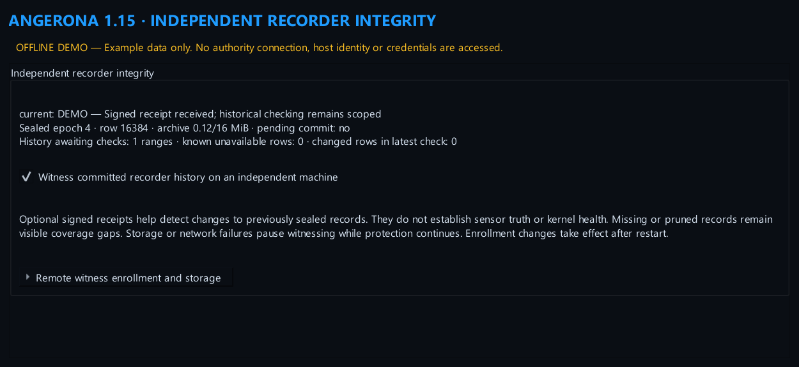
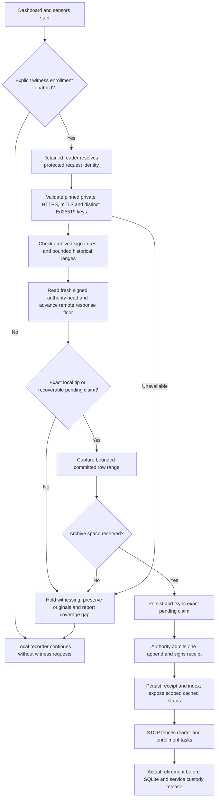

# Independent recorder integrity

Angerona 1.15 can ask a separately administered authority to sign commitments
to committed Flight Recorder rows. This option is **off by default**. Local
collection and the dashboard continue if the authority, enrollment or archive
is unavailable. A signature commits bytes; it does not verify the truth of an
event, sensor coverage, an uncompromised kernel or the physical independence
of the authority.

The image is an offline demonstration. Its receipt, counts and connection state
are synthetic; no host key, witness or service was accessed to create it.

## What it changes

The authority has a dedicated append operation. It checks each epoch's exact
predecessor, next epoch number and increasing, nonoverlapping row range before
signing. The host's request key and the authority's Ed25519 signing key must
have different raw public-key material, even when their labels differ. The
authority's signing private key remains on the independent machine.

Each archived receipt commits an ordered index of per-row SHA-256 commitments,
including the original stored timestamp, module, severity, message, details
text and HMAC. Rewriting an older row and recomputing a valid host HMAC cannot
produce a matching independent receipt. Missing rows, including holes caused
by severity-based retention, remain unavailable evidence. Angerona does not
attribute that loss to an attacker or silently call it successful verification.

This design avoids claiming secure erasure of Python objects or rotating the
existing recorder key. Possession of the current host request credential can
authorize new append requests; it does not authorize replacement of already
sealed ranges. Compromise of the authority or its signing key is a separate
failure boundary.

## Enrollment

1. Prepare an authority on another independently administered machine, outside
   the monitored host's disk snapshots and restore jobs. The supplied
   [authority server](../tools/personal_sentinel_server.py) requires protected
   state and keys, mutual TLS, a private bind address, separate client-public
   and authority-private Ed25519 keys, and the matching installation/client IDs.
   Enable both `--enable-recorder-epochs` and `--enable-client-response-floors`.
   Protection against rollback of the authority's own entire state requires
   a separately supplied generation floor or accepted hardware binding.
2. In **Settings > General > Independent recorder integrity**, expand
   **Remote witness enrollment and storage**. Use **Create or show this host's
   public enrollment key** to resolve the profile's protected request identity
   on a retained worker. Enroll that public key and the displayed IDs on the
   authority. Existing malformed or unavailable private identities are held,
   rather than automatically replaced. No private request key is displayed.
3. Enter the authority's private HTTPS IP address ending in `/v1/authority`,
   TLS certificate SHA-256 pin, authority Ed25519 public PEM, matching IDs,
   and absolute local client-certificate/key paths. An optional CA file can
   supply the authority's PKI chain. TLS validation and the pin are both
   required. Public, loopback, metadata and DNS-discovered endpoints are not
   accepted by this enrollment profile.
4. Confirm independent administration, choose the storage limit, enable the
   option, save and restart. The declaration is an operator assertion, not
   physical-host attestation. Settings contains public enrollment metadata and
   TLS file paths; the request private key belongs to the OS credential store.

The GUI-generated identity belongs to the current runtime profile. An isolated
`NT SERVICE\AngeronaProtection` installation requires credentials provisioned
under that actual service account and its protected data root. An interactive
user's identity does not automatically enroll the service. The status-only
protection console has no key or settings mutation endpoint.

Full Setup also exposes these eleven public enrollment/storage settings and
points to the running-dashboard controls above for protected host identity
enrollment. Setup does not generate a request identity, collect private PEM
contents or contact the authority. A client TLS key setting is a local file
path, not the private key's contents. Profiles keep witnessing disabled; a
missing witness or credential holds this optional feature while local
protection continues.

## Windows metadata custody

New pending, write-scratch and writer-lock files are created with the actual
current token user's owner SID and a protected DACL for that user, SYSTEM and
Administrators before bytes are written. Admission checks the opened object's
security descriptor, file identity and single-link state. Existing inherited
private files can be admitted; nonprivate, aliased or multilink objects are
preserved and held rather than repaired, deleted or overwritten automatically.

The native file handle has one owner across transfer to the CRT descriptor.
Uncertain creation, transfer or auxiliary/file/descriptor cleanup retains
tracked custody and prevents optional-worker replacement. Numeric handles are
not blindly retried after an ambiguous close. The SQLite protection writer
remains usable, and ordinary file-lease callers and POSIX mode 0600 keep their
existing behavior. Parent-directory checks are path checks, **not retained
directory leases**. Private files in source mode remain inside the same-user,
administrator and kernel trust boundaries; these DACLs do not establish a new
independent security principal.

An ordinary-user probe accepted inherited private fixtures and observed token
owner equal to token user. It did not reproduce the proposed elevated-CI
Administrators-owner explanation. Focused checks covered 82 distinct cases
across a 79-pass/three-fixture-failure run and a corrected three-pass rerun with
unchanged product bytes. This is not a single all-pass cohort or signed-service
deployment acceptance. See the [sanitized follow-up](../analysis/hardening-v1.15-2026-10-30-followup.md).

The final changed-source Full/STOP observation met bounded lifecycle acceptance
and retired all observed generations with unchanged source/preferences. It did
not enroll a witness or prove complete sensor coverage. Critical/degraded and
unknown states, a fresh-status settling delay and the earlier unresolved native
shutdown crash remain separate limitations in the follow-up record.

## Storage, progress and recovery

The default receipt archive budget is **16 MiB**, configurable from **4–64 MiB**,
with at most **128 sealed epochs**. The admission budget includes archived,
pending and write-scratch bytes, and reserves room before a remote append.
Metadata has its own 1 MiB per-file bound. These are application admission
limits, not an OS disk quota or protection against unrelated writers.

At the default 60-second cadence, continuous new rows may reach the epoch-count
limit in roughly two hours, earlier if the byte limit is reached. The worker
preserves existing receipts, pauses sealing and reports the hold. It does not
delete originals, silently start a new history or block protection startup.
Review/export and controlled archive lifecycle management require explicit
operator handling; automatic long-term rollover is not provided in this version.

Each capture is limited to 4,096 rows and 16 MiB of row data; larger valid
batches are split into bounded prefixes. Historical verification checks up to
10 ranges per cycle with a cooperative five-second local-work budget. Cached
status shows the sealed tip, archive use, pending commit, verification backlog,
known missing rows and latest changed rows. A completed cycle does not mean
every historic row was checked during that cycle. Supplementary SQLite runtime
limits are used where available; mandatory bounded SQL projections also apply
on supported Python versions without that API.

A durable pending claim precedes the remote append. On reply loss or failed
local finalization, restart reconciles only that exact claim with a fresh
signed authority head. Unexpected ahead/behind/forked state, missing archives,
corrupt metadata and unexplained scratch are preserved and held for review.
There is no automatic baseline reset, key replacement or evidence repair.

Closing Settings detaches its view. The runtime still owns an admitted
credential task and drains it on STOP. Both that task and the recorder reader
must actually retire before their storage/custody is released. Uncertain
native cleanup retains its owner and cannot claim successful replacement.

## Freshness limits

Archived signatures alone are historical authenticity, not proof of the
current authority head. Production requests require pinned HTTPS, fresh signed
nonce-bound responses and a remote response continuity floor. That floor is
outside the monitored host's snapshot boundary; it is not a local counter file.
Rollback of the authority's own entire trusted root still needs independent
generation-floor or hardware protection. A response sequence floor alone is
not a permanent incident latch or proof against every authority rollback.

The separate TPM verification library requires authenticated physical-device
enrollment and a protected external writer. It is not automatically deployed
or substituted for a missing witness. See the [1.15 release scope](releases/v1.15.0.md)
for the other hardening layers and their remaining deployment requirements.
