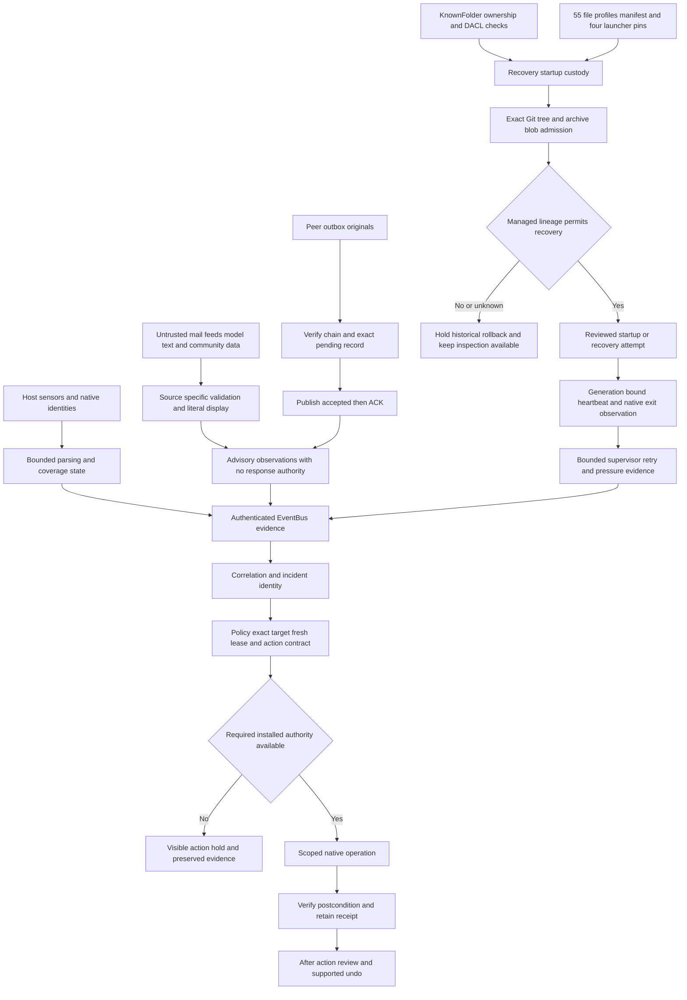

# Angerona 1.15.1 security patches and remaining exposure

13 November 2026

Angerona's reviewed security candidate strengthens recovery, local control,
source delivery, IPC admission, alert handling and optional integrations. Several
unsafe actions now stop before they can change the host. The work does not
remove the security ceiling of an editable user-mode application. Some of the
29 reported weaknesses are mitigated only in part; optional native components
and independent trust or freshness guarantees remain open.

This report explains the concrete changes, the evidence supporting them, and
the attacks an operator must still plan for. The security maintenance version
is 1.15.1. The initial reviewed candidate was based on 3291279; the integrated
maintenance includes the PC baseline fd378df and the separate signing/unsigned
mode changes. Earlier accepted tests retain their exact source scope. This
report does not establish publication, exact-commit live acceptance or a
certification of protection.

## Third watchdog modes in this maintenance

An unsigned bundled third watchdog can be explicitly enabled as an ordinary-user
monitor in Settings > Watchdog; the default is off. Fresh advancing liveness is
shown separately from its signature. Unsigned or unverified mode is labeled
Reduced protection, has no privileged service/firewall/containment authority and
retains explicit recovery/lifetime limits. The current unsigned monitor shares
the Core job lifetime and reports independent recovery unavailable. A signature
check marker opens the signing settings directly. A verified signed image in
this ordinary-user mode is still reduced monitoring, not installed protection.
Its active label requires fresh advancing native evidence.

Installed operation requires the helper's own verified signing and protected
enrollment as well as its existing engine, service and configuration authority.
The selected-file inspector never executes a candidate, and signing-update
requests remain untrusted until a separately governed installer applies them.
New scoped maintenance checks are recorded separately; prior worklist gate
counts below are not silently promoted to proof of this combined revision.
No real validly signed and enrolled deployment has been accepted as a positive
case in this review. Mocked signer tests and an unsigned native test image do
not prove machine-chain trust, installed activation or privileged recovery.

Uncertain native cleanup now retains the affected provider inputs and exact
file handles under a sticky quarantine. Later native admission in that process
is refused; an unknown close is never retried to manufacture success. Source
observer admission streams the directory and bounds entries, input counts,
per-file/image bytes and checked elapsed time. Oversized, changed or unavailable
inputs produce an explicit optional-helper hold without granting signing trust.
[Exact current limits and operator workflow](v1.15.1.md#native-custody-and-source-input-limits).

## What the operator gains

A forged stopped heartbeat cannot by itself tell the supervisor to stand down.
A damaged bookkeeping file or ring header has a bounded recovery path instead
of silently making every later retry useless. New source archives must match
the exact verified Git file set and blob contents before they reach staging.
Malformed settings preserve their original bytes and advertise degraded
configuration instead of silently saving replacement defaults.

Mail and peer observations retain their evidence without automatically becoming
authority to terminate a process. Mobile response admission has persistent
attempt accounting and consumes one-time material before checking a PIN.
Local IPC separates unauthenticated admission from authenticated work.
Untrusted model and feed text is displayed as text rather than executable
markup.

Two restrictions are especially visible. The automatic POSIX binary installer
is held until it can verify its payload. New Windows deception canary creation
is held until a reviewed object-relative implementation can prevent directory
redirection throughout creation. Neither unavailable capability counts as a
successful protection test. Existing reviewed source setup and exact static
canary monitoring have separate scopes.

## 1.15.1 integration follow-up

The optional observer now waits on a single-use admission event. Native work
cannot begin before Thread.start returns successfully; an uncertain start stays
held while other Core workers continue. Scanner GUI quit is queued only after
authenticated STOP and successful cleanup. Maintenance process ownership accepts
at most 16 harmless interpreter prefix switches before the known entry and does
not confuse -c commands or unknown entries with owned Angerona workers.

AI provider self-test text now explains required per-machine write custody.
Unverified custody remains FAIL. A separate read-only host assessment confirmed
that write protection was unverified. It assessed custody only, made no verdict
on the presence or absence of malware/compromise, and changed no provider ACL.
Better explanation is not a successful protection test.

[The sanitized integration acceptance record](../../analysis/maintenance-v1.15.1-acceptance-2026-11-13.md)
contains the newly accepted scoped gates, native Go/vet results and two real
authenticated advancing observer frames. That observer used a diagnostic Core
endpoint; it did not prove protection of the actual application. Actual unsigned
copy inspection and an inactive exit-5 validate-only request are separate from
the still-unaccepted real signed/enrolled positive deployment. Final full-suite
and publication/hosted receipts retain their own acceptance slots.

## Evidence and acceptance limits

The accepted tests below used confined diagnostic processes, private fixtures
and source/origin and retirement receipts. They did not change the operator's
firewall, enroll a service or driver, send a Signal message, access the real
mobile PIN or start, stop or install an Ollama provider.

| Area | Accepted scoped evidence | Meaning |
| --- | --- | --- |
| Supervision and outboxes | 233 cases | Local STOP, recovery and delivery contracts in the tested scope |
| Ring and scanner recovery | 135 cases | Cursor, invalid-header and retry boundaries |
| Source staging | 101 cases | Git object reconstruction and exact archive admission |
| Resource and preservation | 46 cases and one unavailable Windows 8.3 fixture | Confined preservation behavior; no 8.3 coverage claim |
| Recovery profile parity | 24 cases | Builder, verifier and application all declare 55 members and current pins |
| Historical recovery lineage | 66 cases | Managed source does not silently fall back to historical HEAD |
| Windows release custody | 120 cases | Inert workflow, version, path and elevation-policy fixtures |
| Mobile bridge | 91 cases | Filtering, cumulative PIN admission and rollback boundaries |
| Engine and diagnostic IPC | 50 cases | Mutual proof, admission deadlines and exact close ownership |
| Live Debug | 132 cases and one availability skip | Advisory PID audit and private pipe fixtures |
| Ollama admission | 332 cases plus two separate private native lease cases | Fake provider boundaries and confined file lease behavior |
| Deception containment | 60 cases | Windows mutation hold, read-only admission and COM ownership |
| Self-test hold handling | 134 cases | SKIP classification without overriding real FAIL results |
| Callable integrity | 26 cases | New locked supervisor methods are checked dependencies |
| File integrity and process startup | 32 and 141 cases respectively | Per-root FIM admission and expiry of PID-only startup suppression |
| Memory protection modifiers | 126 cases | Base classification, raw protection evidence and unchanged identity/repeat gates |
| Dormant native build containment | 32 cases | Actual Python build-entry refusals and existing fake fallback/import boundaries; no native compilation |
| Key and credential ACLs | 128 cases | Trusted command path, clean environment and readback boundaries |
| Final WLAN command | 16 cases | Trusted native path and read-only query |
| Final offscreen selfcheck | 29 phases passed and zero failed | 70 module PASS, 16 module SKIP across 86 modules, plus one separate pipeline PASS |

These scopes overlap and must not be added into a unique suite total. The
independent final source review checked six remediation paths and confirmed no
new actionable defect within that scope; it did not clear all 29 findings.

The first selfcheck attempt passed 27 phases and encountered two child-launch
refusals from the diagnostic harness. That result is retained and is not
relabeled green. After the WLAN trusted-command fix and confined harness
admission, the complete offscreen selfcheck passed all 29 phases. Its 16 module
skips remain unavailable or unexercised coverage. All 13 widget owners, 13 readers
and eight Python workers retired, and Qt shutdown completed.

A separate inert Red Team fixture passed 30 steps in two phases using private
inventory and exact owned idle children. This is a harness acceptance result,
not proof of live sensor detection or containment. The actual fixed System32
WLAN query was read-only. Whole-source syntax checking covered 1655 Python files
with verified compilation and retirement receipts; late WLAN files were compiled
by their focused tests and selfcheck.

Two broader activation/coherence cohorts exceeded their diagnostic budgets and
lack final test/origin receipts. They remain incomplete. Two representative
real-flush update/rollback cases passed separately. Production flushes were
retained; simulated-fsync fault tests cannot establish durability after power
loss.

The original native Go test image passed 63 top-level cases locally, with one
export-only skip. The same unchanged image then passed those 63 cases
with one export-only skip using a verified real C-drive short-name TEMP and
private profile. The owned C fixture was retired and its empty directories
removed. This narrows an alias-only hypothesis without reproducing the hosted
environment or proving the missing-file cause. The 27 original source files and compiled image remained
unchanged. This was a confined non-race reproduction, not an explanation of
the public missing-spawnlock failure. Public CI on 3291279 failed that native
job and three Python matrix interoperability jobs. The candidate gives every
Python matrix job the pinned Go compiler; fresh hosted checks are still
required.

## Privilege control and recovery

### PW 01 Elevated source execution

Source checkout helpers no longer offer their mutable Python tree as the
administrator control implementation. Elevated control admission requires the
installed package boundary, sanitized bootstrap environment and checked native
completion. Black Box's source relaunch-as-administrator route was removed,
and the source kill helper does not self-elevate.

This closes the reviewed source-helper escalation path. It does not certify a
real signed package, administrator consent flow or production deployment.
A user-writable interpreter or checkout cannot become a privileged trust root
merely because UAC was accepted.

### PW 02 Planted administrator STOP authority

The authority namespace now resolves through the fixed Windows KnownFolder.
Ownership, DACL rights, ancestry and relevant file custody are checked
conservatively. Authority keys receive restrictive access before publication;
pre-existing untrusted or uncertain custody does not trigger silent repair or
reopen the legacy STOP path.

The remaining limit is freshness and the administrator boundary. This work
does not add an independent HKLM or hardware fingerprint floor, and cannot
defend this store against an administrator who controls the machine.

### PW 03 Same user heartbeat and restart authority

A stopped heartbeat flag is no longer enough to establish an intentional
shutdown. The supervisor needs generation-bound native exit evidence.
Restart claims have bounded freshness and consumed nonces; accepted future
state is constrained rather than parking protection for days.

Heartbeat and other source keys still share the interactive user's failure
domain. Independent per-launch key distribution and service separation are
not implemented here. Separate pressure accounting for manual restarts also
remains open. Local proof checks narrow misuse; they do not make stolen keys
trustworthy.

### PW 04 Stale recovery pins

The publication and CI preconditions now compare the complete 55-file recovery
manifest, all four unique launcher literals, the PowerShell closed list and
the application's literal recovery profile. A stale committed pin or omitted
profile member must stop publication before network work.

This prevents the reviewed stale-manifest publication mistake. It does not
provide a monotonic runtime recovery generation, independent anti-rollback
storage or consent before every source overwrite. A compromised writable
launcher anchor remains a trust problem.

### PW 05 Installer path and module custody

Windows installer/verifier paths come from native Windows directories and
KnownFolders. Child execution uses a sanitized environment, trusted inbox
modules, quoted arguments, protected staging handles and a serialized
installation lease. The reviewed source does not trust redirected inherited
ProgramFiles, ProgramData or module search paths as authority.

The 120-case provenance/custody scope includes the earlier 93-case installer
scope. These confined tests do not substitute for a real elevation and signed
package acceptance exercise.

### PW 06 Recovering from damaged local state

Spawn claims are bounded in age and future skew. Corrupt recovery bookkeeping
is preserved and retried under capped policy. A rejected heartbeat can be
checked against a retained native process handle, so authenticated garbage
cannot indefinitely hide the exit of that known generation. Startup timeouts
can retire only the exact owned launch and account for that failed attempt.

Ring readers retain their own high-water cursor. Unauthenticated slots cannot
advance acknowledgements; writers derive authority from their local counters.
Pre-existing corrupt layouts are preserved and held while the scanner remains
available to report degraded retry. Bounded scans avoid repeatedly ingesting
the same stale slots.

These changes do not authenticate a new incarnation across a complete ring
rollback. The rejected header sample is memory-only, not durable original
evidence. An alive scanner heartbeat establishes a responding worker, not
proof that its collectors saw every event. Unknown native ownership continues
to block destructive retirement of an uncertain process.

### PW 07 Oversized and replayed restart files

Restart-file reads are bounded. Claims require a short freshness window with
future-skew checks, and consumed nonces are persisted before an effect can be
admitted. A giant or malformed file cannot repeatedly force an unbounded read
inside the lifecycle lock.

A matching replay of the entire authenticated state and key store is still
outside the local freshness model. Rejecting a single reused nonce does not
solve whole-root rollback.

### PW 08 Source archive authenticity and recovery downgrade

The updater obtains bounded metadata from the canonical GitHub Git endpoints,
reconstructs the returned tree objects and checks their object IDs. The ZIP
must contain the exact expected file set; each file must match its Git blob
digest before candidate writes.

Historical recovery separately checks managed source lineage. When an applied
base or activation-pending record exists, or its custody is uncertain, the
helper holds restoration from the preserved historical Git HEAD. It no longer
silently tries the GitHub parent as an unattended fallback. Healthy normal
startup and inspection remain separate from a held rollback action.

GitHub HTTPS is still the supplier binding the requested commit to that
metadata. There is no independently pinned maintainer signature, separately
witnessed freshness floor or raw-commit signature reconstruction. A directly
supplied descendant target is not proved to be current main merely by this
archive check. Full receipt validation and consent before overwrite are
separate remaining work.

### PW 09 Bytes outside the recovery pin set

Canonical source startup now selects a fresh private bytecode prefix before
helper imports, regardless of whether a managed-update receipt exists.
Package initializer files were added to the recovery pin set. This reduces
the opportunity for a matching stale or planted local pyc to substitute for
the checked source.

The complete import closure, interpreter DLL and standard library custody, and
venv payload verification are not established. A source hash does not attest
the entire runtime that interprets it.

### PW 10 Release verification

Windows verification binds the exact official release workflow, expected
version tag and hosted-runner policy. Strict original asset names can supply
the expected version; renamed assets and setup cases need an explicit version.
Missing embedded publisher identity remains a hold, rather than receiving a
fabricated certificate pin.

The POSIX binary installer now refuses before copy, delete or launch. Help
remains informational; reviewed source installation is unchanged. A signed,
payload-bound POSIX binary installation path remains to be built and tested.

## Settings alerts and outside channels

### PW 11 Malformed and unauthenticated settings

Ports, intervals and module-state values are parsed individually with type and
size bounds. A malformed document preserves original bytes, marks settings
degraded, holds automatic response and refuses an ordinary save until the
problem is reviewed. Later fields are not silently replaced and persisted
because an earlier conversion threw an exception.

The security subset is not authenticated independently of the editable
settings file. A well-formed unauthorized edit by the same user can still be
outside this parser's ability to distinguish from an operator choice.

### PW 12 Incident specific lift decisions

Host-only breach identity includes a bounded report identifier. Different
UGCAP report IDs no longer collapse into one case and inherit the same
previous lift decision. Existing process and file identity behavior remains.

A case identifier still depends on correct producer evidence. This change
does not make a repeated authenticated identifier a new independent incident,
nor does it certify effective host-wide network containment.

### PW 13 Mobile token feedback and capacity

The mobile bridge filters its own, health and review-only observations before
protected authentication reads, target probes or response-token allocation.
Eligible actions retain their reserved capacity. Unauthorized sender floods
become bounded aggregate observations, and expiry is INFO without a fabricated
CRITICAL suspension request.

The 91-case mobile cohort included the corrected ordering regression. There
was no real Signal send or remote action during this review.

### PW 14 Persistent PIN attempt admission

Remote command admission uses protected-store-only state, a six-to-twelve digit
ASCII PIN and explicit local enrollment or rearm. Old four-digit enrollment
is preserved but held. Nonces and action tokens are consumed before PIN
comparison. A durable failure charge is reserved before comparison; uncertainty
does not erase it. Cumulative failures back off and latch at ten until local
rearm.

Correct admission removes only its own provisional charge, not the prior
failure floor. Generic settings rollback cannot overwrite concurrent mobile
authentication state. Independent whole-store rollback detection and Signal
identity-key enrollment remain absent. No operator PIN was read or changed.

### PW 15 Repeating phishing observations

Inbox handling now remembers delivered messages in a bounded mailbox-scoped
in-memory deduplication set. Failed delivery is not remembered as success.
Mail observations are advisory, at most HIGH, and explicitly cannot authorize
native response. This limits repeat polling from holding the suite in a
false active CRITICAL state.

The deduplication set does not survive restart. Restarting can produce another
observation of a retained message; durable deduplication remains open.

### PW 16 IMAP transport

IMAP uses a verified TLS context with hostname checking and bounded I/O and
deadlines. Authentication-Results text inside a message remains unverified
metadata; it does not become native authentication evidence.

This addresses the reviewed certificate-validation path. It does not make a
malicious mailbox, server or attachment trustworthy.

### PW 17 Untrusted GUI text

Model and feed content uses literal text or controlled escaped fields.
CVE identifiers and official NVD links are constrained, and ingestion sizes
are bounded. An arbitrary model recommendation or feed field cannot request
a remote image through automatic Qt rich-text interpretation in the reviewed
surfaces.

No browser or model request was exercised by these fixtures. Broader imported
content still needs its own rendering and link policy.

### PW 18 Acknowledgements and process trust

Acknowledgements are authenticated, exact and expiring. Broad legacy rows
remain review data and cannot suppress a new target. Process policy uses
authenticated digest and birth-bound semantics; digest-less and basename-only
legacy authority is not promoted into suppression. Integrity dependencies
include the new policy call paths.

Same-user theft of the signing key or replay of a matching whole policy store
remains a limit. A local MAC detects changes only while its key and freshness
assumptions hold.

### PW 19 Engine and diagnostic IPC

Engine protocol v2 provides role-separated mutual MAC proofs bound to the
instance and fresh nonces, without a v1 fallback. Eight pre-authentication
slots use one absolute one-second deadline separate from four authenticated
dispatch slots. Exact-object close claims prevent two cleanup paths from
independently closing the same connection.

The AUTH diagnostic listener is exclusive and ephemeral. Its self-check is
a bounded codec check; it does not claim that every live channel was tested.
Failed codec health stays degraded and retries; a genuine accept-loop death
still fails. Same-user key access and CPU or connection flooding remain
possible denial-of-service sources.

### PW 20 Teams reply and sender binding

Teams admission requires the expected channel and AAD operator identity.
The activity service URL must match authenticated claims and exact accepted
service hosts. Metadata and activity caches are bounded, and conversation
path data is encoded before reply construction.

The fake-transport/native-command scope passed 22 cases. A real tenant,
Connector transport and operator enrollment have not been accepted by this
review.

## Native components provider custody and coverage

### PW 21 Optional kernel sensor

The reported native ring-index, device ACL and IOCTL ownership issues remain
open for a WDK and native source review. This job did not load the optional
unsigned driver, claim it safe or use it to justify stronger detection.
Absence of a loaded driver narrows current exposure but is not a source fix.

### PW 22 Legacy FRZ and hypervisor watchdogs

The separate public Go/SCM supervisor is an additional implementation with its
own package and service guards. It does not replace or remediate every legacy
FRZ/hypervisor entry point. Reported legacy firewall restore, command parsing,
retry, ACL and build issues remain separate open work.

The public native spawnlock failure remains unexplained despite the confined
local reproduction passing. No native Go product source was changed to make
the test green.

### PW 23 Ollama provider and model paths

Both normal and linked-token admission use a shared fixed-local model-path
validator. UNC, device, SUBST, ADS, traversal and reparse paths are rejected.
Package review bounds metadata and validates protected code and DLL tree
custody. Signature admission uses a machine-context code-signing chain and
machine-root membership rather than accepting a subject string from a
per-user trust root.

Recursive package work and signing checks run in a worker. Cached admission
is bounded by the captured review epoch; an older worker cannot relabel its
result as fresh. Legacy broad-kill, download, installation and environment
persistence helpers are retired. Their explicit launch option delegates to
reviewed ordinary source startup instead of bypassing lifecycle controls.

A writable per-user provider can be held. The review does not rewrite its
ACLs or relocate it. There is no independent publisher fingerprint or actual
vendor-PKI acceptance result. File snapshots and deny-share handles do not
exclude every attribute-only mutation; the model root is not held for the
daemon's full lifetime. A foreign or shared daemon's PID and image do not prove
its actual model location, cloud setting or startup environment.

### PW 24 Source keys and ledger rollback

Peer-outbox continuity and delivered-cursor admission are stronger. Delivery
uses peek, accepted EventBus publication, then acknowledgement; original IDs
and MACs remain in nonauthorizing observations. The two new locked supervisor
bodies are mandatory callable-integrity dependencies.

The main event ledger has not been converted into a separately witnessed
forward-integrity chain. Keys in the interactive user context cannot resist
that same account being compromised. A restored matching old database, key
and checkpoint remain an independent-freshness problem.

### PW 25 Live Debug

Connection audit uses the operating system's reported client PID before the
hello exchange. Four active audit slots, capped counters, a 64-record memory
history and explicit loss reporting bound the additional work. INFO audit
events are rate limited. PID availability is advisory and never supplies
image, birth, trust or response authority.

The opt-in pipe still permits the intended same-SID readers. Four draining
clients can occupy the slots; no fairness lease was added. Nonreading-client
timeouts do not prove bounded native cancellation retirement. Free-text
redaction is best effort, and audit history is not durable across restart.

### PW 26 Sensor coverage

File Integrity Monitor evaluates and adopts each covered root independently.
An incomplete user root no longer suppresses a completed protected root.
Cached stat metadata is paired with its verified digest and adopted baseline;
run caches reset. Invocation budgets are bounded across retries.

Process Monitor retires its PID-only startup suppression after a fresh typed
inventory with valid counts, even when protected PIDs lack full identity.
Exact process birth and executable semantics still govern later evidence.
FIM passed 32 cases and Process Monitor 141 in their respective scopes.

Memory classification now checks the base protection byte while retaining the
full raw protection value in evidence and repeat identity. A guard, cache or
CFG modifier no longer hides an otherwise qualifying executable-writable
private committed region, and labels use the same base classification. The
126-case memory/coverage/self-test cohort passed; no remote memory was read
by those new modifier fixtures. The existing process identity, size and
response gates remain in force. Microsoft documents these modifiers in its
[Windows memory protection reference](https://learn.microsoft.com/en-us/windows/win32/memory/memory-protection-constants).

The remaining work is substantial: complete Chill/full-pass accounting,
persistent sweep baselines, resumable address-space traversal, executable-only
region heuristics, continuous ETW
round trips, named dropped-event evidence, hard-linked YARA coverage,
pressure-stretched sampling, UDP/QUIC and internal-peer visibility. A
cooperative deadline cannot interrupt a blocked native I/O call. A healthy
thread or empty findings list is not complete collection.

### PW 27 Deception path redirection

Exclusive creation and ordinary deny-share handles were found insufficient on
Windows: attribute-only access can change a parent into a reparse point.
The reviewed production path therefore holds all new Windows directory,
file-content and attribute mutations before any effect. Registry writes and
unauthenticated shared-log writes are also removed or held.

Exact pre-existing static canaries can be admitted for read-only monitoring.
POSIX no-follow dirfd creation has a separate scope and does not claim immunity
to every same-user rename. New Windows deployment and restaging remain
unavailable pending a reviewed object-relative provider. Self-test reports
the exact expected native hold as SKIP; contract, crash, timeout and worker
faults retain FAIL precedence.

### PW 28 Trusted background command execution

Black Box passes identifiers as data to a constant trusted PowerShell query.
Reviewed GUI command paths use trusted absolute executables, clean child
environments and fixed working directories. Required key-ACL operations use
the native OS directory and fresh DACL readback. The insecure optional
credential CLI fallback was removed; DPAPI requirements remain.

A later final-harness review identified another bare netsh path in WLAN. Its
trusted native-path remediation passed 16 focused cases and the complete
offscreen selfcheck. A broader inventory and lint of all native spawn sites
remains open; this batch cannot certify every helper solely from corrected
examples.

### PW 29 Dormant syscall bridge

The inherited Python implementation hard-holds native loading and reports
health 55 with an explicit unavailable/degraded reason. Its descriptive
self-test does not exercise native fallback operations or prove their efficacy.
That existing native-load containment is preserved.

This review also blocks the legacy build paths. Every command through
`syscall_bridge/setup.py` exits before importing packaging helpers; an
unconditional preprocessor error rejects direct compilation before native
headers. There is no environment or argument override. The normal Angerona
package build does not invoke this component. The historical implementation
remains available for review in the source tree. The 32-case build-hold and
fallback-boundary cohort passed without invoking a native compiler.

The C memory, stub and bounds defects remain unpatched and untested. This is
containment of accidental build/deployment, not corrected native code, safe
existing binaries or resistance to an attacker rewriting the source. See the
[component limits and replacement requirements](../../syscall_bridge/README.md).

## Security flow and trust boundaries

The diagram separates evidence, authority and verification. An observation,
review annotation, model recommendation or heartbeat never grants response
authority merely by reaching the dashboard.

Source keys and peers remain in the user-mode failure domain. The diagram does
not imply a deployed privileged broker, working kernel sensor, hardware
freshness floor or prevention of a compromised kernel rewriting memory.

## Coordinated attack exposure that remains

A same-user attacker may still read source-profile keys, modify well-formed
unauthenticated settings or interfere with user-mode resources. The strongest
next deployment step is an independently protected service and storage boundary,
with a reviewed desktop-to-service protocol. Signing a local record with a key
the attacker can also read does not create that boundary.

An administrator or kernel adversary can suspend peers together, blind telemetry
or restore an old matching trusted root. BYOVD blocking, continuous independent
kernel-event canaries, ELAM/PPL signing, a TPM or remote freshness witness and
verified native egress enforcement require separate engineering and acceptance.
None is established by the tests in this report.

These gaps can combine. A coordinated attacker could first gain the same user,
then impair a collector while keeping peers responsive, then exploit a restart
or rollback window. The new local checks make several individual steps harder
and produce clearer coverage evidence, but they do not close that whole chain.
Unexpected silence must remain a coverage concern, not be relabeled as no
malware found.

Containment also has limits. Source Observe does not provide the accepted
installed network authority. A path rule's presence does not prove effective
PID-birth-bound admission or teardown of an inherited established socket.
This report does not certify PPL resistance, a production WDAC policy, continuous
kernel telemetry, every process-handle lease or whole-host network isolation.

## Operator decisions and next acceptance work

Use the current module coverage and action holds to decide which protection is
actually available. Preserve malformed settings, rejected authentication
records and incomplete scans for review. Do not clear an alert or replace a
baseline solely to make status green. A skipped native capability and an
incomplete scan both require an explicit coverage explanation.

For an update, keep a recoverable copy of local edits and preferences. Accept
only a reviewed source revision or a verified signed asset with the expected
version. A held historical recovery is a prompt to inspect lineage, not a
reason to run an older tree blindly. Ollama held for writable package custody
needs a reviewed installation choice, not an automatic ACL rewrite.

The release gates still required are complete diff review, current companion
and readable-manual reconciliation, fresh bounded observation of the exact
changed Core generation, guarded GitHub publication and successful fresh hosted
checks. The Word/PDF master manual remains the older 1.15.0 edition; no newly
rendered 1.15.1 Word/PDF artifact is delivered by these source companions.
Unexplained hosted failures and incomplete broad activation cohorts must retain
their evidence and status. No current result supports describing Angerona as
unbreakable or immune to an administrator or kernel compromise.

## Review records

- [Per-item progress and diagnostic scope](../../analysis/security-worklist-progress-2026-11-13.md).
- [Independent scoped final source review](../../analysis/security-final-review-2026-11-13.md).
- [Current 1.15.1 source companion](v1.15.1.md).
- [Readable operator manual and older Word/PDF edition notice](../master-manual.md).
- [Live Debug evidence and access rules](../live-debug-harness.md).
- [Version 1.15 source preview and existing platform limits](v1.15.0.md).
