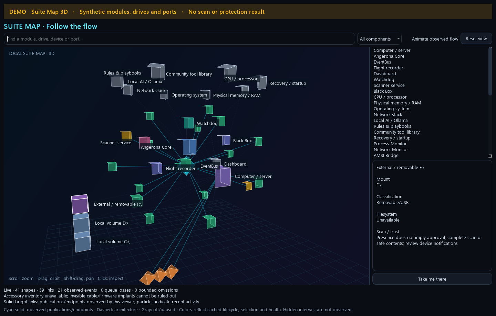

# LinkedIn draft: Angerona 1.15 source preview

Prepared for maintainer review. This document does not publish a post.

## Post text

Angerona 1.15 makes local security easier to explore, test and understand.

I'm building an open-source security suite that brings endpoint detection and
response (EDR), network detection and response (NDR), and security orchestration,
automation and response (SOAR) into one desktop workspace.

The latest source preview adds:

- A 3D Suite Map: orbit and zoom through Core, EventBus, modules, mounted drives,
  visible devices and observed endpoints, then open the controls behind a shape.
- Suggested GitHub tools: reviewed adapters, the managed Zero-Breach scanner,
  per-tool self-checks, separate editable source copies and visible credits.
- Rules & Playbooks: YARA drafts and declarative SOAR tactics with an X/O
  strategy board, validation, sample checks and explicit activation/rollback.
- A separate Red Team application: keep the dashboard available while Core
  retains validation, response policy and report authority.
- SpywareGuard scan progress and after-action review that distinguish findings,
  incomplete coverage and the next investigation steps.
- Cleaner screens: current status and findings first, expandable setup/details,
  and consistent colors for monitoring, analysis, settings and response controls.

If you build a home lab, develop detections or want to inspect how a security
tool reaches its decisions, try the source preview and help improve it.
Community runtime rules/playbooks start off; supported capabilities depend on
the platform, configuration and installed authority. Source Observe still has
an open outbound-network containment gap; the preview documents that limit
alongside its controlled validation results.

Explore the project and installation options:
https://github.com/Ag3nt47/AngeronaSuite

Download the current source:
https://github.com/Ag3nt47/AngeronaSuite/archive/refs/heads/main.zip

The attached screenshot is an actual application view using synthetic DEMO
data. It shows the interface, not a measured detection rate or protection result.

#Cybersecurity #OpenSource #EDR #NDR #SOAR

## Suggested attachment

[Suite Map DEMO screenshot](../screenshots/suite-map-3d-demo.png)

**Alt text:** Angerona's dark 3D Suite Map shows labeled cubes for Core,
EventBus, watchdog, modules and local/removable volumes, connected by cyan and
dashed architectural lines. A sidebar lists components and explains that the
selected drive's presence does not establish approval or a completed scan.
The visible DEMO banner states that the data is synthetic and is not a scan or
protection result.

**Optional media:** [70-second application DEMO](../../assets/demo/angerona-demo.gif) ·
[18-second synthetic workspace tour](../media/community-suite-tour-demo.gif).
LinkedIn upload-format support should be checked before choosing animation;
the PNG is the prepared attachment.
