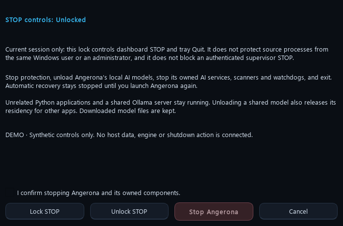

# Angerona 1.15.2 — source-session STOP and optional locks

16 November 2026 · Windows source preview

The ordinary desktop source app previously reached the installed control-package
authorization gate before shutdown. That gate correctly rejected mutable source
code, but it also prevented an end user from stopping their ordinary-user app.
This maintenance candidate gives admitted source sessions a separate, bounded
shutdown protocol; installed service authorization remains unchanged. Final
canonical launcher and live-family acceptance are still pending.

## Operator controls

Dashboard **STOP** and tray **Quit** open the same modeless confirmation window.
The session starts unlocked. Optional **Lock STOP** disables the local Stop action; choose
the unlock confirmation and **Unlock STOP** to re-enable it, then separately
confirm **Stop Angerona**. Cancel, Escape, X and unlocking never stop the suite.
An authenticated supervisor STOP bypasses this accidental-use UI lock.

Confirmed STOP persists the source session's intent before fencing work admission.
Its watchdog, scanner and recovery attempts stay attached to that epoch and may
not resurrect it. A fresh explicit desktop launch, after obtaining the singleton,
creates a new epoch and inhibits the older family. A second launcher cannot rotate
a running session. Corrupt or missing admission holds replacement attempts. A signed latest-epoch
fence also inhibits older same-user sessions/source paths; only verified
supersession allows their presenters to retire themselves.

Shutdown targets exact Angerona-owned process generations, private child Jobs
and retained worker references. It requests retirement of scanners, watchdogs,
Black Box and owned helpers, releases configured local AI residency and stops
owned AI services when their exact custody allows it.
Unrelated Python applications and a shared Ollama server remain running.
Unloading a configured model from a shared server also releases that model's
residency for other applications; it does not terminate the shared server.
Downloaded models, settings, alerts and authenticated evidence are preserved.
A standalone history viewer explicitly opened after a stopped session remains
independent; inherited old-family windows never silently switch to that mode.

## Security boundaries

The source session key is ordinary-user coordination, not protection against
malware already controlling that user, an administrator or the kernel. The UI
lock is not an OS tamper-protection feature. Source STOP cannot stop installed
privileged services or grant response authority. Installed Protect supervision
still requires a signed, enrolled package and its separate protected controls.

Retirement uses retained native exit/close evidence, not numerical PID absence,
status labels or a returned cleanup function. Independent cleanup continues when
one component fails. Unknown custody remains incomplete. A finite GUI fallback
does not certify that every external process retired. Clean epoch records may be
reclaimed only after authenticated retirement and exact closing-Core exit proof;
uncertain records are preserved within the bounded coordination store.

## Validation

The targeted source-protocol, peer, startup, modeless UI and protected-control
cohort passed **682 tests with 2 skips before the canonical launcher bridge
follow-up**. A real ordinary-user Windows token separately admitted a private
source session, accepted STOP and denied subsequent respawn. That private protocol
result does not prove dashboard startup or retirement of a complete live family.

The canonical launcher bridge is being corrected. Fresh regression checks after
that correction, live-family STOP acceptance, and exact-commit GitHub publication
remain pending. Final results must record their reviewed revision and actual
scope. Historical 1.15.1 hosted results do not validate these changes, and these
source checks do not certify signed installed Protect.

The [readable manual](../master-manual.md) links this current companion. The Word/PDF
manual remains the earlier 1.15.0 / 9 November edition. Earlier security work and
remaining Source Observe network-containment limits are documented in
[1.15.1](v1.15.1.md).
