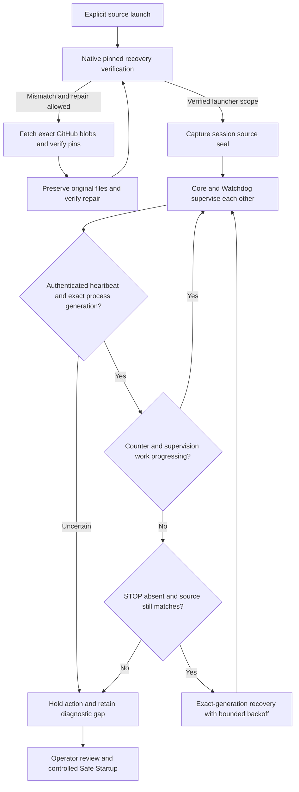

# Component heartbeats and mutual recovery

Angerona starts its peer watchdog, telemetry scanner and enabled Black Box
recorder through the existing resilience supervisor. The watchdog supervises
the core in return. Both sides use adoption, shared spawn coordination, retained
process identity and bounded backoff to avoid duplicate or repeated launches.
These processes share the host and user-mode trust boundary; this is not an
independent security appliance or kernel guarantee.

## Watchdog hardening in the 8 November source update

The Python Watchdog and Core now check three separate things: authenticated
heartbeat bytes, the identity of the process writing them, and completed work
by their supervision loop. A live PID or a timer thread alone cannot renew all
three checks. The compiled external Watchdog retains its separate protocol.

| Layer | Behavior and limit |
| --- | --- |
| Exact peer identity | An authenticated heartbeat must match the expected arguments, executable and process birth. Windows uses a query-only native process lease while observing. Identity uncertainty holds adoption, duplicate launch and destructive recovery. Observations do not retain an execution lease indefinitely. |
| Actual heartbeat progress | A newly observed generation waits for counter advancement. Rewriting wall-clock time without advancing the authenticated counter cannot manufacture continuing health. |
| Supervision work | Startup has 180 seconds of grace. Afterwards a completed supervision pass must occur within 60 seconds. Failed passes, PID presence and thread presence cannot renew that deadline. Core and Python Watchdog stop advancing their heartbeat when this check fails. The peer's ordinary stale-heartbeat deadline and recovery backoff still apply. |
| Source continuity | Each source session seals the bounded execution tree. Its digest travels to peers as an inhibit-only continuity check. A changed, new, removed, aliased or unreadable execution file holds subsequent launches. A failed check stays held for this session, even if the file later looks restored. |
| Import isolation | Initial source Core launches, the four canonical Python peer modules and the exact Black Box script use the current interpreter's isolated mode. A new working-directory package cannot shadow the installed package through Python's implicit import path. Existing fresh-cache options remain active. Editable-install hooks and site packages remain separate bootstrap inputs. |
| Periodic observation | Background workers inspect source every 60 seconds plus scan/scheduling time. Each actual launch also performs fresh verification. Checks stay outside Qt and outside the Watchdog heartbeat loop. Cached status reads do not wait for disk checks. |
| In-memory detection | The existing Self-Integrity Monitor also fingerprints the new source, launch, native-identity and supervision-progress gates and selected dependencies. This remains a detector inside the Python trust boundary. |
| Verified repair | Safe Startup's native pinned recovery bundle covers 48 operational files, including the mutual-supervision chain. It can fetch exact canonical GitHub blobs, check independent local pins, preserve originals and repair before Python launches. Offline or disabled network repair remains an explicit hold. |
| Operator intent | Signed STOP, source-update custody, backoff and crash-loop limits remain authoritative. A source hold adds no new crash debt and never grants permission to terminate a live peer. A failed relaunch is reported as deferred rather than successful. |



### User changes and repair

These checks do not distinguish an owner editing code from malware running as
that same owner. Use Source Sandbox to edit copies, review the change, then use
the approved source activation workflow or a reviewed fresh checkout. A fresh
explicit session can adopt a reviewed source tree; a peer cannot silently
replace the inherited parent seal. Settings and ordinary user data are outside
the source seal and are not reset by it.

Changes to covered operational files also need a coherent recovery manifest
and launcher pins from the approved source workflow. Merely restarting after
an unreviewed operational edit can restore the pinned version while retaining
the edited original in quarantine. Do not automatically enroll changed bytes.

No runtime source check downloads or overwrites files. GitHub file repair occurs
through the existing Safe Startup custody boundary. Mismatching operational
originals are retained for review. Review intentional changes before approving
or initiating recovery; do not erase original files or pending update records.
The [39-to-48-file migration instructions](safe-startup-recovery.md#recovery-profile-migration)
explain the explicit transition required by older source updaters.

### What this cannot guarantee

The seal checks file bytes relative to an initial launcher decision. It does not
attest already loaded code, ordinary bytecode caches, dependencies outside the
execution tree, the interpreter, or the kernel. A file can change between a
successful observation and subsequent execution. A hostile same-user process
can attack the local trust anchor and an administrator or kernel attacker can
disable both peers. These are explicit limits, not a claim of tamper immunity.

Stronger Windows isolation depends on an accepted signed deployment and OS
protections. Microsoft's protected antimalware service boundary requires ELAM
enrollment and signing; a Python source update cannot create that authority.
[Protected antimalware services](https://learn.microsoft.com/en-us/windows/win32/services/protecting-anti-malware-services-)
and [Microsoft's vulnerable-driver blocking guidance](https://learn.microsoft.com/windows/security/threat-protection/windows-defender-application-control/microsoft-recommended-driver-block-rules)
describe those separate controls. This update does not alter WDAC, Secure Boot,
Memory Integrity, driver policy, ACLs or service enrollment on the operator's PC.

## Read the footer

Click the EKG strip beside CPU/RAM/network status for component details.

| Display | Meaning |
| --- | --- |
| Green beating trace | A real authenticated heartbeat advanced for the observed native process generation and is still fresh. |
| Red flatline | A usable heartbeat is missing, stale, stopped, disabled, starting or unavailable. Details distinguish the reason. |
| Additional helpers | Open details for separate monitors, inventory and local AI. A helper without a compatible progress heartbeat remains explicitly unavailable; process presence does not manufacture a pulse. |

The core, Python peer watchdog and scanner publish their existing authenticated
progress signals. Black Box now beats from its real Qt event loop, so an
independent timer thread cannot mask a frozen recorder window. The background
observer checks exact process generations and advancing counters; the footer
copies memory and expires old observations without inspecting the host on Qt.
A pulse establishes recent liveness, not sensor completeness, threat absence,
trusted code or response authority. Native external watchdogs use a separate
protocol and are labeled when a compatible component heartbeat is unavailable.

## Check or request recovery

For an ordinary-user Windows source checkout, open a terminal in the repository:

```powershell
.\Ensure-Angerona-Recovery.bat --check-only
```

Check-only does not create keys, start a core, publish restart requests or change
preferences. The result reports whether authenticated supervision was observed;
it does not claim protection. A held or unavailable result returns a nonzero exit.

To request a bounded repair through the existing supervisor:

```powershell
.\Ensure-Angerona-Recovery.bat
```

With a verified active core and fresh authenticated supervision, the helper can
request missing enabled peers through their existing authenticated restart
inboxes, then observe briefly for recovery. It creates no competing manager or
daemon and terminates no process itself. Disabled Black Box stays disabled.
If no core owns the instance lease, the helper can request the normal guarded
source launcher with automatic-start inhibition. A launch request is not proof
that a dashboard or protection engine became ready.

An existing STOP or ambiguous maintenance record holds this helper. To resume
after intentional STOP, run the normal explicit `start-angerona.bat` launcher.
A STOP arriving during a helper-requested launch must remain effective. An
active core without authenticated supervision requires a controlled restart:
use dashboard STOP or tray Quit, then the normal launcher. The helper does not
guess a process to kill or attach a new manager to an existing core.

Repeated failures retain backoff and crash-loop state. The supervisor retries
eligible non-faulted state after its cooldown. Unknown authority, unsafe paths
and unresolved ownership remain held; they are not cleared to make an indicator
green. Inspect the private diagnostic explanation if recovery is still unavailable.

## Standalone Red Team startup

The dashboard opens the separate Red Team tool through one retained owner. It
is not a component that the Watchdog repeatedly relaunches. Source checks,
authenticated IPC, exact native admission and operator STOP remain mandatory.

| Stage | Original allowance and boundary |
| --- | --- |
| Source verification and bootstrap | One absolute 90-second deadline begins before the parent's source capture and is inherited unchanged by the child. Both source checks remain required. |
| Qt presentation | A separate 15-second allowance begins after authenticated hello, native admission and initialization. Child observations cannot reset it. |
| Whole attempt | An independent 105-second admission cap and STOP fences apply throughout. Native filesystem calls are cooperatively checked; a Python deadline cannot interrupt an already-blocked OS call. |

The owned stderr reader retains at most 16 closed advisory records within
64 KiB/256 lines and 512 bytes per line. It never retains raw stderr, keys or
protocol frames. Private startup diagnostics save a bounded projection through
the real writer, with counted omissions. The first startup receipt and later
retirement supplement keep separate **pending**, **written** or **held** states;
written means that bounded projection was saved. Final receipt admission or a
terminal held disposition precedes shutdown quiescence and owner replacement.

Mandatory process/control/marker admission, Job retirement, reader EOF and
stdio closure cannot be waived by a diagnostic snapshot. Optional read/query
observations have a separate small allowance within the original STOP-call
remainder and cannot block that mandatory cleanup. An uncertain optional
query-handle close remains an explicit gap, is not retried, and disables later
optional query collection for that Bridge lifetime. It is not an
all-handles-closed claim or an exception for action/write capabilities.

The final 118-case inert startup cohort and two-case native execution/retirement
gate passed. They do not establish catch coverage or full production drill/scan
acceptance. A recorder hold below its configured free-space reserve still
requires storage review; neither a painted tool nor an authenticated AAR can
bypass it. [Scoped results and limits](../analysis/hardening-v1.15-2026-11-09-community-workspaces.md#separate-source-and-presentation-startup-budgets)

### Later startup and probe diagnosis

A writer-first startup failure now records the first closed terminal before
requesting stop. The retained primary receipt and retirement supplement include
its phase/type, fixed operation/message kind and known or unknown stop-request
origin. A later stop or cleanup failure cannot replace that first terminal.
These records use the existing bounded private writer; a saved projection does
not establish complete history or make advisory observations authoritative.
The 90/15/105-second budgets, source checks, native admission and STOP fences
above are unchanged.

Nonempty report history is encoded as JSON lists at its producer, preserving
strict channel validation. Process-probe admission supplies the verifier's
required monotonic clock. An unavailable process step now reports bounded
required/attempted/bound counts plus its first closed phase and exception class.
Do not infer that no process was created from an empty bound-target list; a
failure may occur after creation. Neither a natural target exit nor cleanup
earns containment credit.

Validation-canary response proof is now passed explicitly into the first Combat
lease. Initial admission does not borrow ambient thread-local proof. Original
target, source, lease and policy checks remain mandatory. A fresh authenticated
APT run verified 37/37 controlled containment checks, including exact original
process commits before natural exit. This is simulation validation, with zero
native-analytic credit in that run, rather than a general malware catch rate.

A separate fail-forward path handles only the exact optional-tool free-space
hold before a toolkit operation started: native SpywareGuard continues to its
own finish, while Zero-Breach remains held. It does not weaken the 3 GiB reserve
plus working allowance, reinterpret other scanner errors or turn partial
coverage into a clean result. A fresh combined Entire PC workflow finished in
47:49 under its original one-hour budget. Native completed with explicit gaps;
Zero-Breach returned findings (exit 2), rather than timing out. Every toolkit
reader retained unchecked areas, including unavailable execution artifacts. One
historical HSTS trace overlaps the native advisory and two contextual references;
none establishes active infection or response authority. One Start and unchanged
saved preferences were recorded; no response or alert clearing was performed.

The Combat cohort passed 252 cases, with one expected skip and two deselected;
all 24 new cases are within that total. The first storage-gate helper failed
before test bootstrap, so zero tests ran. The corrected cohort passed 162 cases,
with one private-harness denial of a bounded inert fixture and seven deselected;
that exact failed
node passed after the fixed inert fixture was admitted. All 15 new cases had
already passed. The genuine Source Observe network-containment gap remains open.

The earlier focused inert cohort passed 155 cases. A separate 55-case alerts/UI
cohort checks coalesced/cached sizing and correctness. These overlap earlier
cohorts, and neither proves production detection or response coverage. Earlier
startup failures and the genuine Shark T1041 network-response gap remain
visible in the [source review](../analysis/hardening-v1.15-2026-11-09-community-workspaces.md#later-alerts-and-red-team-source-follow-up).

### Initial window fit and settled scan work

Red Team keeps full readiness and warning text with Launch/Stop outside the
scrolling middle. Its first normal show fits the available frame/client area;
tall secondary pages scroll without raising the Run page minimum. Initial native
client-cache synchronization uses the same issued rectangle. Queued fit still
respects hide/close and operator geometry, and does not continue resizing later.
SpywareGuard counts known completed native-reader work in the workflow fraction
when its detailed percent becomes unavailable. This does not close an aggregate
stage, change raw reader counters or hide coverage gaps; missing observations
can still lower the recomputed fraction.

Complete header captions now use a ceiling of their fractional font span and
remain unelided when the full styled budget fits. True underallocation still
elides. A known ready dedicated Spyware view with no request binding shows the
selected next-run budget, rather than a generic status action's elapsed/limit.
The existing summary path refreshes it when that selection changes; unknown,
active, held, partial, completed and standalone timing keeps the original path.

The private 42-case fit gate and canonical-import 62-case presentation gate
passed with overlapping scopes. Later header81/81, scan-presentation64/64 and
canonical-import30/30 gates passed in separate overlapping scopes. The latter uses tracked modules directly.
The completed scan session's normal STOP retired its 13 recorded generations,
released 11 source anchors and preserved all 161 saved preferences byte-for-byte.
A later actual default Red Team normal window fit without resize/maximize; the
subsequent normal STOP retired 16 recorded generations, released 12 anchors and
again preserved all 161 saved preferences byte-for-byte before caption/timing
integration. A later canonical default-window observation confirmed full STOP
and SELF-TEST captions and ready Spyware timing at the selected one-hour budget,
without manual resize/maximize. It preserved all 161 preferences and started no
new scan. Its later normal STOP exited 0; 13 held original generations retired,
12 runtime source anchors were released and all 161 preferences remained
byte-identical. Earlier snapshot-only transients are not counted in that
retained-generation proof. Current local Ruff, in-memory syntax, diff and
unchanged recovery-manifest/bootstrap checks passed in separate scoped runs;
private validation-bootstrap failures remain retained rather than rewritten.

## Dashboard presentation recovery

The dashboard places its title, posture and Current Assessment above one
horizontal action row. On narrow windows, scroll or use Tab to reveal actions;
fully labeled STOP remains fixed at the right edge outside that viewport.
Function colors describe purpose, not protection: blue monitoring, violet
analysis, amber configuration/recovery and red controlled response. Existing
severity and unknown-state colors remain separate. Main panels open by default
except module health; secondary help/provenance can expand independently.
Progress, critical findings, coverage gaps, permission warnings and Stop remain
visible. Collapsing detail changes presentation only; it neither acknowledges
an alert nor changes a sensor, response policy or saved setting.

Use **Open Angerona** in the tray menu or the orb's Core control to restore the
dashboard. These routes restore Qt's logical window and child visibility. An
external native frame restore alone can leave Qt's children logically hidden;
it is not a substitute for Angerona's own restore route.

The actual Qt window appears before the optional orb animation. Display recovery
then permits two attempts: ordinary restore and one plain restore with owned
visual effects retired. Each has one owned Qt timer, nominally 900 ms; a stalled
event loop can delay it. Optional Python clock readings do not extend retries.
The plain path restores saved masks belonging to Angerona's reveal coordinator
and enables paints; it does not clear arbitrary masks, enable disabled controls,
accept prompts or change response policy. Motion preferences are not saved or
reset. A delivered central-widget paint and coherent Qt visibility are advisory
display observations, not proof of readable pixels, compositor health or sensor
coverage.

If both attempts remain unconfirmed, a plain nonmodal **Display recovery** notice
offers **Retry display**, **Safe STOP** and **Close notice**. Retry requests another
two-attempt display sequence. Safe STOP follows ordinary Angerona shutdown;
after exit, the normal Safe Startup launcher remains the recovery route. No
additional supervisor or PowerShell process starts while Core is alive. Closing
or hiding the dashboard, terminating it, or making a new restore request fences
older callbacks. The notice itself cannot verify protection.

Closed phase, outcome and error-type records go to the existing bounded private
Core logger, subject to its storage policy. The coordinator also retains at most
16 records in memory. Raw exception text, event bodies and host paths are not
included in these records. This does not clear existing evidence or log limits.

| Confirmed failure class | Bounded action | Regression coverage and limit |
| --- | --- | --- |
| Optional reveal refuses an action | One retained dispatch owner runs the original action once | Busy/refusal/error/termination Qt fixtures; an action failure is never retried |
| Orb restore waits on an optional decoration | Show the Qt window first; retire broken owned trails | Interrupted/missing completion and cleanup fixtures; no compositor guarantee |
| Normal display has no confirmed paint | One plain retry, then nonmodal recovery choices | Real offscreen Qt paint, missing paint, clock/cleanup faults and stale callbacks; fresh native-window acceptance is separate |
| Initial Full startup continues after Chill is selected | Recheck current pause intent for each initial module admission | Deterministic staged-start regression; explicit wake, maintenance, lifecycle and UGCAP gates retain their roles |

Chill pauses deep scanners while the live monitoring and response plane remains
on. The module count is **live / selected**. Its held caption and tooltip explain
why a selected checkbox can remain enabled while its worker is paused. A pause
request is not proof of native thread retirement: in-flight checks can finish.
Existing explicit threat escalation and sparse maintenance retain their policy.

The focused 205-case Qt/Chill/lifecycle/layout gate overlaps earlier checks.
It does not establish scan coverage, catch rate or successful response to an
actual attack. Recovery cannot repair every Qt, operating-system, dependency or
hardware fault; unresolved states remain visible for review.

## The October 28 launch defect

The affected supervisor supplied the entire inherited environment as strict
child overrides. The environment validator rejected `APPDATA`, preventing the
watchdog, scanner and Black Box from spawning. The corrected adapter supplies
inherited values through the allowlisted source path. Credentials, proxies and
Python path controls remain excluded; explicit unsafe overrides remain rejected.
Existing failure evidence and keys are preserved.

See [Safe Startup](safe-startup-recovery.md) for runtime/source recovery and
[security flow](security-flow.md) for STOP, authority and coverage boundaries.
Source publication does not update previously installed signed binaries; those
require their separate accepted build, signing and installation process.
