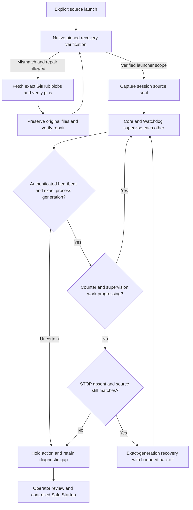

# Component heartbeats and mutual recovery

Angerona starts its peer watchdog, telemetry scanner and enabled Black Box
recorder through the existing resilience supervisor. The watchdog supervises
the core in return. Both sides use adoption, shared spawn coordination, retained
process identity and bounded backoff to avoid duplicate or repeated launches.
These processes share the host and user-mode trust boundary; this is not an
independent security appliance or kernel guarantee.

## Watchdog hardening in the 8 November source update

The Python Watchdog and Core now check three separate things: authenticated
heartbeat bytes, the identity of the process writing them, and completed work
by their supervision loop. A live PID or a timer thread alone cannot renew all
three checks. The compiled external Watchdog retains its separate protocol.

| Layer | Behavior and limit |
| --- | --- |
| Exact peer identity | An authenticated heartbeat must match the expected arguments, executable and process birth. Windows uses a query-only native process lease while observing. Identity uncertainty holds adoption, duplicate launch and destructive recovery. Observations do not retain an execution lease indefinitely. |
| Actual heartbeat progress | A newly observed generation waits for counter advancement. Rewriting wall-clock time without advancing the authenticated counter cannot manufacture continuing health. |
| Supervision work | Startup has 180 seconds of grace. Afterwards a completed supervision pass must occur within 60 seconds. Failed passes, PID presence and thread presence cannot renew that deadline. Core and Python Watchdog stop advancing their heartbeat when this check fails. The peer's ordinary stale-heartbeat deadline and recovery backoff still apply. |
| Source continuity | Each source session seals the bounded execution tree. Its digest travels to peers as an inhibit-only continuity check. A changed, new, removed, aliased or unreadable execution file holds subsequent launches. A failed check stays held for this session, even if the file later looks restored. |
| Import isolation | Initial source Core launches, the four canonical Python peer modules and the exact Black Box script use the current interpreter's isolated mode. A new working-directory package cannot shadow the installed package through Python's implicit import path. Existing fresh-cache options remain active. Editable-install hooks and site packages remain separate bootstrap inputs. |
| Periodic observation | Background workers inspect source every 60 seconds plus scan/scheduling time. Each actual launch also performs fresh verification. Checks stay outside Qt and outside the Watchdog heartbeat loop. Cached status reads do not wait for disk checks. |
| In-memory detection | The existing Self-Integrity Monitor also fingerprints the new source, launch, native-identity and supervision-progress gates and selected dependencies. This remains a detector inside the Python trust boundary. |
| Verified repair | Safe Startup's native pinned recovery bundle covers 48 operational files, including the mutual-supervision chain. It can fetch exact canonical GitHub blobs, check independent local pins, preserve originals and repair before Python launches. Offline or disabled network repair remains an explicit hold. |
| Operator intent | Signed STOP, source-update custody, backoff and crash-loop limits remain authoritative. A source hold adds no new crash debt and never grants permission to terminate a live peer. A failed relaunch is reported as deferred rather than successful. |



### User changes and repair

These checks do not distinguish an owner editing code from malware running as
that same owner. Use Source Sandbox to edit copies, review the change, then use
the approved source activation workflow or a reviewed fresh checkout. A fresh
explicit session can adopt a reviewed source tree; a peer cannot silently
replace the inherited parent seal. Settings and ordinary user data are outside
the source seal and are not reset by it.

Changes to covered operational files also need a coherent recovery manifest
and launcher pins from the approved source workflow. Merely restarting after
an unreviewed operational edit can restore the pinned version while retaining
the edited original in quarantine. Do not automatically enroll changed bytes.

No runtime source check downloads or overwrites files. GitHub file repair occurs
through the existing Safe Startup custody boundary. Mismatching operational
originals are retained for review. Review intentional changes before approving
or initiating recovery; do not erase original files or pending update records.
The [39-to-48-file migration instructions](safe-startup-recovery.md#recovery-profile-migration)
explain the explicit transition required by older source updaters.

### What this cannot guarantee

The seal checks file bytes relative to an initial launcher decision. It does not
attest already loaded code, ordinary bytecode caches, dependencies outside the
execution tree, the interpreter, or the kernel. A file can change between a
successful observation and subsequent execution. A hostile same-user process
can attack the local trust anchor and an administrator or kernel attacker can
disable both peers. These are explicit limits, not a claim of tamper immunity.

Stronger Windows isolation depends on an accepted signed deployment and OS
protections. Microsoft's protected antimalware service boundary requires ELAM
enrollment and signing; a Python source update cannot create that authority.
[Protected antimalware services](https://learn.microsoft.com/en-us/windows/win32/services/protecting-anti-malware-services-)
and [Microsoft's vulnerable-driver blocking guidance](https://learn.microsoft.com/windows/security/threat-protection/windows-defender-application-control/microsoft-recommended-driver-block-rules)
describe those separate controls. This update does not alter WDAC, Secure Boot,
Memory Integrity, driver policy, ACLs or service enrollment on the operator's PC.

## Read the footer

Click the EKG strip beside CPU/RAM/network status for component details.

| Display | Meaning |
| --- | --- |
| Green beating trace | A real authenticated heartbeat advanced for the observed native process generation and is still fresh. |
| Red flatline | A usable heartbeat is missing, stale, stopped, disabled, starting or unavailable. Details distinguish the reason. |
| Additional helpers | Open details for separate monitors, inventory and local AI. A helper without a compatible progress heartbeat remains explicitly unavailable; process presence does not manufacture a pulse. |

The core, Python peer watchdog and scanner publish their existing authenticated
progress signals. Black Box now beats from its real Qt event loop, so an
independent timer thread cannot mask a frozen recorder window. The background
observer checks exact process generations and advancing counters; the footer
copies memory and expires old observations without inspecting the host on Qt.
A pulse establishes recent liveness, not sensor completeness, threat absence,
trusted code or response authority. Native external watchdogs use a separate
protocol and are labeled when a compatible component heartbeat is unavailable.

## Check or request recovery

For an ordinary-user Windows source checkout, open a terminal in the repository:

```powershell
.\Ensure-Angerona-Recovery.bat --check-only
```

Check-only does not create keys, start a core, publish restart requests or change
preferences. The result reports whether authenticated supervision was observed;
it does not claim protection. A held or unavailable result returns a nonzero exit.

To request a bounded repair through the existing supervisor:

```powershell
.\Ensure-Angerona-Recovery.bat
```

With a verified active core and fresh authenticated supervision, the helper can
request missing enabled peers through their existing authenticated restart
inboxes, then observe briefly for recovery. It creates no competing manager or
daemon and terminates no process itself. Disabled Black Box stays disabled.
If no core owns the instance lease, the helper can request the normal guarded
source launcher with automatic-start inhibition. A launch request is not proof
that a dashboard or protection engine became ready.

An existing STOP or ambiguous maintenance record holds this helper. To resume
after intentional STOP, run the normal explicit `start-angerona.bat` launcher.
A STOP arriving during a helper-requested launch must remain effective. An
active core without authenticated supervision requires a controlled restart:
use dashboard STOP or tray Quit, then the normal launcher. The helper does not
guess a process to kill or attach a new manager to an existing core.

Repeated failures retain backoff and crash-loop state. The supervisor retries
eligible non-faulted state after its cooldown. Unknown authority, unsafe paths
and unresolved ownership remain held; they are not cleared to make an indicator
green. Inspect the private diagnostic explanation if recovery is still unavailable.

## The October 28 launch defect

The affected supervisor supplied the entire inherited environment as strict
child overrides. The environment validator rejected `APPDATA`, preventing the
watchdog, scanner and Black Box from spawning. The corrected adapter supplies
inherited values through the allowlisted source path. Credentials, proxies and
Python path controls remain excluded; explicit unsafe overrides remain rejected.
Existing failure evidence and keys are preserved.

See [Safe Startup](safe-startup-recovery.md) for runtime/source recovery and
[security flow](security-flow.md) for STOP, authority and coverage boundaries.
Source publication does not update previously installed signed binaries; those
require their separate accepted build, signing and installation process.
