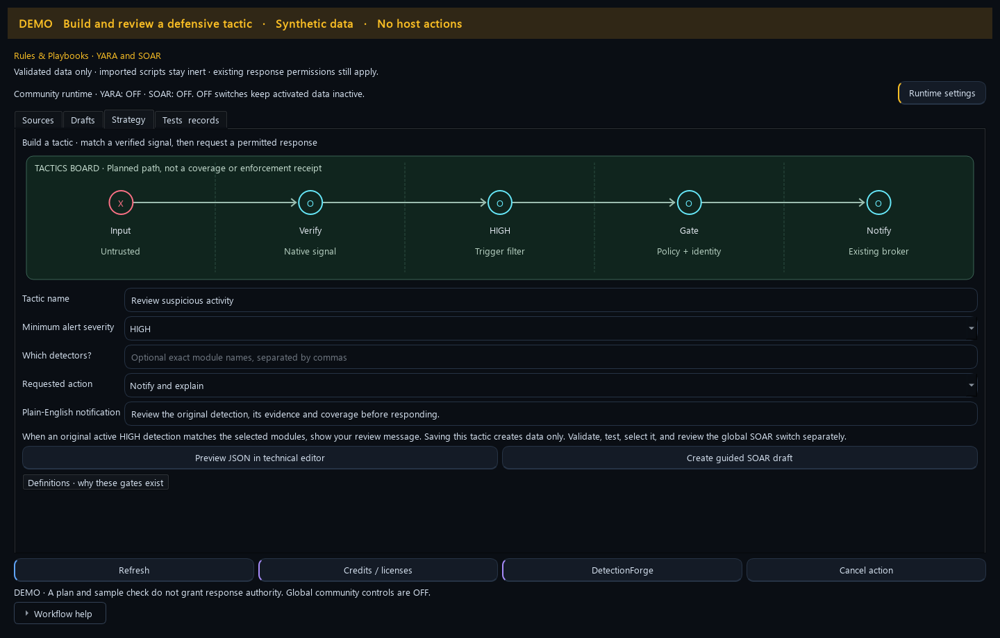

# Rules & Playbooks

The **Rules & Playbooks** page helps an operator add compatible YARA detection
data and declarative SOAR tactics while retaining the source, validation result
and rollback revision. Open it from the dashboard shortcut or the GitHub Tools
hub. Its X/O tactics board explains the planned path from untrusted input,
through verification and policy, to a notification or containment request.
The diagram is a planning aid, not an enforcement receipt.

DEMO data only; the displayed tactic has performed no host action.
[Short workspace tour](media/community-suite-tour-demo.gif)

## Start with the two runtime switches

Both community runtime switches default **off**. Choose **Runtime settings**,
or open **GitHub Tools → Settings → Community rules and playbooks**:

- **Use individually activated community YARA rules** permits compatible active
  YARA data to join bundled scanning.
- **Use individually activated community SOAR playbooks** permits compatible
  active playbooks to use the existing scoped runner.

Read the warning under each switch, then choose **Save tool settings**. Saving
runs in a background worker. A failed save preserves the previous preferences
and resets these switches to their saved values. Activating one item does not
turn on either global switch or widen response permissions.

Turn off the relevant global switch to stop new community routing of that
kind. **Disable** stops routing one active item. These actions preserve its
original, draft and prior revision for later review.

## Find and batch-import compatible data

In **Sources**:

1. Select a predefined source or paste a public HTTPS GitHub repository URL.
   File/folder URLs must use a full 40-character commit. Repository revisions
   resolve to immutable source imports before use.
2. Choose **YARA + SOAR**, **YARA rules** or **SOAR playbooks**, then **Fetch catalog**.
   Inspect source/license metadata and use **Review source** to inspect the
   actual import in Source Library.
3. Search the available entries. Check the compatible ones individually, or
   choose **Select compatible**. **Clear selection** changes selection only.
   **Install checked** imports drafts; it does not activate them.

Predefined sources include the local Angerona examples, YARA Forge, Signature
Base, Shuffle workflows and Cortex analyzers/responders. These are source
discovery choices. Per-rule licensing and syntax vary. Foreign workflow JSON,
analyzers and Python/PowerShell/shell scripts remain review-only when they do
not match Angerona's supported schema.

The library bounds retained data, file count, per-item size and batch size.
Invalid archives, incompatible entries and storage holds are reported. Existing
drafts and evidence are not silently deleted to admit another batch.

## Build, test, activate and roll back

Use **Drafts** for the selected item. The guided SOAR builder
lets you choose a severity, exact module names and a fixed action. **Preview
JSON in technical editor** shows the resulting document; **Create guided SOAR
draft** creates a reviewable draft. You can also choose a type/name and **Create
draft**.

| Control | What it establishes |
| --- | --- |
| **Save draft** | Stores the edited draft separately from the original and active revision. Editing makes previous test results stale. |
| **Validate** | Checks the supported syntax/schema and current source binding. YARA validation uses the bounded owned native probe. |
| **Sample test** | Tests the exact current draft. The result states which fixture and positive/negative checks actually ran. |
| **Diff** | Shows changes against retained source/revisions. |
| **Activate validated** | Commits compatible validated data after current source review and whole-active-set checks. The global switch remains separate. |
| **Disable** | Removes this item from active routing while retaining its revisions. |
| **Rollback** | Restores the retained prior candidate after current review and validation checks. It is not a way to bypass revocation or syntax checks. |
| **Refresh** | Re-reads current item and routing state. |
| **Credits / licenses** | Shows repository, pinned revision, path and retained license metadata. |
| **DetectionForge** | Opens the existing detection authoring workflow. |
| **Cancel action** | Requests cancellation of this background operation; committed state and uncertain native custody remain explicit. |

Global runtime states and **Runtime settings** remain visible above the tabs.
The selected draft name/type/state stays visible; expand **Source details** for
its license, path and pinned revision. **Workflow help** explains the import,
test and activation sequence without changing a switch. Blue button edges mark
inspection, violet analysis and amber configuration; severity/status colors
retain their existing meaning.

Read **Tests & records** for the actual reason behind a checkmark, red X or
held/untested state. A green sample result requires the known expected positive
and negative fixture outcomes. An arbitrary imported rule that merely compiles
and scans a buffer does not receive a claim of detection accuracy. A sample
test cannot establish whole-PC coverage or a false-positive rate.

## Supported YARA path

Compatible rules are UTF-8 YARA data without includes or imported modules. The
active aggregate is limited to **32 sources / 64 KiB**. Separate namespaces
prevent identical rule names in different items from replacing one another.
Raw source hashes and exact compile-input hashes remain distinct when a UTF-8
byte-order mark is stripped; line endings are not silently normalized.

Activation and rollback compile the candidate aggregate in an ordinary-user
owned helper before commit. The worker has a 15-second wall budget, bounded
input/output and actual OS resource admission. Windows checks its retained outer
Job membership and 512 MiB memory, four-process, kill-on-close and 30% CPU caps,
including a nested venv child. POSIX workers install/read back 512 MiB
address-space and ten-second CPU limits. This is process/resource isolation,
not an operating-system sandbox.

Runtime uses current active data and the global setting. Source revocation and
changes are re-read through a short, bounded cache, including continued archive
scanning. Invalid optional rules, unavailable native work or an invalid clock
leave bundled scanning available and show the community coverage gap. They do
not turn an unavailable result into a clean verdict or extend detector proof.

## Supported SOAR schema and authority

Angerona accepts the closed **`angerona-playbook/v1`** JSON schema. A trigger
uses **HIGH** or **CRITICAL** minimum severity and optional exact module names.
Supported actions are:

- **`notify`**: a bounded message for review.
- **`request_containment`**: a request to the existing governed response path.

Playbooks contain no executable command, arbitrary target PID, pathname or
network destination. Importing a Shuffle/Cortex workflow does not translate its
scripts into native actions. Containment still requires verified original event
evidence, existing automatic-response opt-in, exact target identity,
corroboration and the normal Combat admission/receipt checks. Neither an LLM,
a community match nor a playbook JSON document grants administrator authority.

For example, build a notification tactic first for a specific producer. Review
its positive and negative fixture results, then activate it with the global
switch enabled. If you later choose a containment request, inspect why an actual
event qualifies or is held; do not remove identity or evidence gates to obtain
a green result.

These user-mode controls do not resist a fully compromised operating system or
promise kernel/PPL protection. See [community tools](community-tools.md),
[security flow](security-flow.md) and [module authoring](writing-modules.md).
