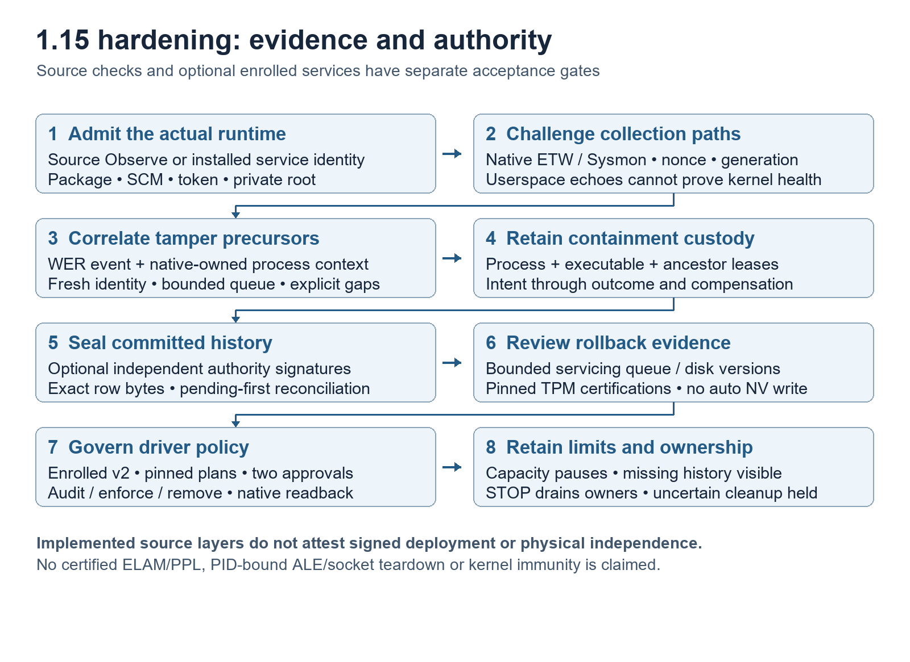

# Angerona security flow and review map

This map follows the whole suite from launch and evidence collection through
investigation, authority, action, storage and recovery. It identifies attack
surfaces and the code/tests a reviewer should inspect. It is an implementation
map, not proof of complete attack coverage or independent field efficacy.
The [capability register](../ANGERONA_CAPABILITIES.md), per-module contracts and
live coverage state provide the detailed operating scope.

## 1 Installation and startup

Source and signed installed releases have different authority. Source setup
uses an ordinary-user development environment and starts in Observe/Chill.
Installed Protect requires an independently trusted signed payload, provisioned
identities and accepted native enforcement. A release tag, hash or source test
alone cannot establish publisher trust or privileged deployment.

The source launcher checks canonical local paths, explicit settings, operational
startup bytes, runtime/dependency consistency, storage and process exclusion.
After operational verification, an independent OS Windows Forms startup dashboard
paints before Python/dependency checks. It reports verification pending and
protection unavailable while the parent runs checks and eligible repairs in
owned background processes. A current-run first-paint receipt is separate from
application readiness. The parent uses fixed repair tools and ordered candidates; every candidate must
pass fresh checks. Readiness is a nonce-bound receipt from a fresh live dashboard
after its event loop responds. It does not certify sensors or response readiness.
[Safe Startup recovery](safe-startup-recovery.md) documents the alternatives,
preserved edits, private transactions, independent UI and disk budgets.

Windows source Safe Startup treats retained diagnostic history and recommended
free-space reserves as advisory for normal dashboard startup. Critical launch
work uses four reusable purposes per canonical temporary-data base, with fixed
admission budgets and managed-output limits. A live
producer's inherited lease prevents reuse until that producer exits. Actual
private storage access, source/runtime trust and process custody remain checked;
optional downloads and repairs retain their separate storage admission.

## 2 Inputs and collection

Inputs include OS process/file/memory/network observations, event logs, Defender
and other supported providers; user-selected files and archives; imported
Syslog/Windows/NetFlow/JSON evidence; approved intelligence/definition packs;
local AI models and documents; optional browser/identity/SSH integrations; and
explicit defensive exercises. They are untrusted at entry, including their text,
paths, timestamps, URLs, embedded instructions and claimed severity.

Collectors retain available source identity, PID and creation time, freshness,
partial results and losses. Shared immutable snapshots reduce duplicate native
collection. Missing permissions, disabled providers, queue overflow and stale
samples cannot become a healthy or negative detection result. Sensor provenance
separately verifies enrolled producer identity, schema, sequence/replay and loss
where supported; an HMAC over stored bytes alone does not prove producer truth.

## 3 Detection and correlation

Modules evaluate their declared inputs: process lineage, YARA file/archives,
memory/persistence indicators, ransomware/recovery tamper, removable media,
authentication, network patterns, vulnerable-driver posture and other listed
capabilities. SentinelLens and evidence/correlation services connect process,
file, network, technique and proof relationships. A heuristic lead remains a
lead unless its evidence contract supports a stronger claim. VPN topology,
timing alone, a practice marker or imported text cannot create containment
authority. Collection loss and an unconfirmed cause remain visible.

Module contracts describe mode, platform, permissions, egress, retention,
dependencies, lifecycle, loss and self-test. The catalog below inventories each
built-in source module. A compatibility declaration does not establish the same
assurance as a natively accepted collector or response path.

## 4 Investigation and optional AI

The dashboard, Scan Center, module inspectors, Black Box, cases and timelines
show evidence and coverage. Worker-prepared bounded snapshots and paint batches
keep slow/native work away from Qt where implemented. Human review annotations
are advisory; they cannot clear authenticated originals or change trust.

Dashboard panels have individual **Minimize / Restore** buttons in their own
headings. Panels start open except **Module health & activity**, which starts
minimized. There is no separate Operations group heading. Collapsing a panel
hides its body while retaining its widgets and state; module lifecycle remains
separate. Collapse choices apply to the current run; folded stat cards retain
their current values. Critical/failed, degraded and live coverage counts remain
visible, as does the CPU/RAM/network footer. Small windows can scroll.

The compact EKG beside that footer shows **Core**, **Watch**, **Scan** and
**BlackBox**. A green pulse requires a real recent heartbeat for the exact
component generation. Missing, stale, disabled, starting, stopped or unavailable
evidence produces a red flatline with its state retained in details. Process
presence alone never produces a pulse. Click the strip or press Enter/Space for
the PID, native birth-bound generation, heartbeat age, deadline and reason;
additional helpers appear there when they publish actual heartbeat evidence.

The GUI consumes only copied in-memory publications. It does not query processes,
read heartbeat files or acquire native inspection locks while painting. Freshness
uses monotonic time and a finite deadline of at most 120 seconds; the configured
component deadline can be shorter. A replacement generation cannot reuse the
preceding generation's timestamp. A pulse reports liveness, not sensor coverage,
response authority or a verified security state.

Modules keeps search visible while its panel is open. Its **Filters** disclosure
retains the active summary, such as **Filters: observe**; **Columns** reveals
optional metadata. Live Alerts **Columns** exposes optional artifact/evidence
and inline actions. Full tooltips and selected-row **Details / Enter** preserve
complete text. Time, Status and Assurance widths account for the native font
rather than relying on a fixed character count.

Manual AI consultation uses a bounded sanitized preview and explicit Send.
Optional Ollama runs through its configured local boundary; Chill blocks its
startup and requests until explicitly disabled. Approved model manifests,
provenance and agent instruction/tool digests have independent integrity gates.
Model prose, retrieval text and URLs remain untrusted proposals. No language
model is needed for deterministic detection or governed response. See
[AI consultation privacy](ai-consult-privacy.md) and
[key and communication integrity](key-and-communication-integrity.md).

### Curated tools and priority scans

The **GitHub Tools** hub and **SpywareGuard > Zero Breach** share one controller
and the pinned Zero Breach Toolkit v0.1.10 installation. The complete engine and
required notices ship with Angerona; optional restoration uses the fixed reviewed
release. Third-party Python runs in a separate owned ordinary-user process,
never by importing its socket-changing globals into the core or GUI. Current
installed/elevated execution is held pending an accepted ordinary-user broker.
The existing Source Library remains a data-only repository review path.

**Spyware Scan** schedules the selected native and curated checks with visible
priority, resource and privilege-coverage controls. High is the supported ceiling;
REALTIME is not used. The requested 10% routine-background pace is a cadence
choice, not a CPU guarantee. Critical control, heartbeat and event intake retain
their cadence. Missing inputs, dependencies, privileges or measurements remain
coverage gaps. Full upstream advanced execution remains held until its managed
adapters are accepted. See the [toolkit guide](zero-breach-toolkit.md).

Request-bound progress describes each selected check, its current task or
observed file, elapsed time and available estimates. The toolkit worker publishes
only a bounded latest snapshot under its owned job. Paths and activity text are
untrusted display data; neither progress nor resource samples grant response
authority. Timeout, incomplete coverage and native cancellation remain visible
until the corresponding owner has settled.

## 5 Response authority and execution

A supported response begins with typed evidence and exact target identity,
then checks policy, response capability, operator approval and current deployment
authority. Role-Based Access Control (RBAC) and an authenticated approval identity
are distinct from clicking a button. The broker validates the operation before
a separately authorized adapter mutates the target. Where supported, action
journals precede publication and the worker verifies the observable result.

Outcomes can be denied, held, failed, partial, unverified or completed. Undo and
reconciliation require retained original custody; a displayed success message
cannot replace outcome evidence. The suite must not reset a key, delete an alert,
replace a baseline or accept an unknown rollback solely to pass a self-check.
Source Observe and a diagnostic response-service fixture cannot claim a fully
deployed privileged service or process-bound egress adapter.

### Verified breach review and lockdown

The red/orange **Breached** state requires fresh manager-enrolled native LIVE
evidence, a registered current producer, an exact response contract and explicit
active-attack or active-exploitation evidence. Health failures, exposure, practice
markers, remote Observe events, raw critical severity and third-party findings
alone cannot create it. An explicit `spyware_confirmed=False` remains uncertainty.
A bounded case identity links the latched brand warning, critical report, border
state and after-action review. The threat card and footer project **Compromised**
for the active case while preserving the engine's underlying scores and counts.
Displaying a breach grants no response authority.

| Next step | Behavior and boundary |
| --- | --- |
| Investigate | Opens the case and retained report for read-only review. |
| Trace | Follows the case's process, network and evidence context without mutation. |
| Isolate | Requests host network lockdown only with current evidence, its original host-scope contract, saved policy and verified signed installed Protect/Administrator authority. |
| Kill | Requires an exact current process target, its permitted action and the same response authority; confirmation cannot create a missing contract. |
| Patch | Disabled when no reviewed patch operation is bound to this evidence; report text cannot become a command. |
| Lift Lockdown | Removes only verified Angerona-managed lockdown rules through authenticated Undo and absence checks; unrelated policy and preferences remain. |

The automatic-lockdown preference defaults on, but mutation still goes through
the existing Adversary Combat worker and its full policy, deployment and journal
checks. Current source Observe controls show **HELD** with their reason. There is
no accepted signed release implied by these implemented source controls.

The requested network scope covers Ethernet, Wi-Fi and other interfaces;
IPv4/IPv6, inbound/outbound traffic, all protocols and ports. The adapter must
verify rule scope, enabled profiles and effective-policy prerequisites before it
can report containment. Unknown enterprise policy or ambiguous readback remains
held or unverified. Rule configuration and an authenticated receipt do not prove
packet drops, kernel integrity or resistance to a hostile administrator.

On Windows, the fixed owned query reads Domain, Private and Public profiles from
`Get-NetFirewallProfile -PolicyStore ActiveStore` and checks
`INetFwPolicy2.LocalPolicyModifyState`. Every required enabled-profile,
local-rule-merge and inbound-rule setting must be explicit, with no excluded
interfaces. Unknown or NotConfigured results remain held; the adapter preserves
the existing policy. Microsoft documents the
[ActiveStore profile query](https://learn.microsoft.com/en-us/powershell/module/netsecurity/get-netfirewallprofile?view=windowsserver2025-ps)
and the read-only [local-policy modification state](https://learn.microsoft.com/en-us/windows/win32/api/netfw/nf-netfw-inetfwpolicy2-get_localpolicymodifystate).

Lift requires the exact managed receipt and verified removal. A saved bounded
case decision prevents automatic relocking of that same lifted case; a new case
can request containment again. Lifting restrictions does not erase the breach
evidence or resolve the red review state. **Review resolved** remains separate.
STOP does not automatically remove persistent lockdown rules.

If isolation removes remote access, use the local console or an approved
out-of-band administration route. Prefer the report's **Lift Lockdown** control.
If Angerona cannot open, review Windows Defender Firewall with Advanced Security
locally and match the exact rule names to the retained authenticated action
receipt before changing only those rules. Preserve the case and receipt; a
matching name prefix alone is insufficient. Do not reset the whole firewall,
disable protection or remove unrelated rules as a recovery shortcut. Missing or
ambiguous receipts require reviewed OS administration rather than a guessed Undo.

### STOP and deliberate shutdown

The core-side supervisor watches the watchdog, scanner and BlackBox. The peer
watchdog watches the core and shared helpers. Authenticated advancing heartbeat
records, exact process generations, adoption checks, spawn exclusion and bounded
backoff govern recovery. Repeated failures enter a visible safe mode rather than
an unlimited process-spawn loop. An optional native watchdog requires its own
deployment evidence. These peers remain within the same user-mode failure domain;
they are not independent protection against a hostile administrator or kernel.

The red **STOP** confirmation and tray **Quit** use the same application-owned
teardown. Closing the window hides it to the tray. On explicit operator exit,
the app first durably records authenticated operator standdown. It then fences
new work, AI requests and supervisor respawn, and signals a proven parent before
teardown. Cleanup follows those checks before the app's own final hard exit.
Queued restart requests cannot override that intent. Automatic recovery children
cannot clear it. Modern automatic sign-in launch is also inhibit-only: an
authenticated STOP returns quietly without opening a UI or starting repair.
An explicit source launch can clear an existing authenticated stop once after
full preflight, then tags its child to honor any new STOP during warmup. The
intent has no age expiry. Generic startup-failure cleanup does not create
operator standdown or suppress later recovery.

If the primary stop record cannot be saved, cleanup does not begin and the
window stays open with the failure. If the native-parent bridge fails after
the local record was saved, exit is held and the app can be partly paused.
Follow the reported free-space/permission correction and retry STOP.

Cleanup has a bounded 30-second wait before the app's own hard exit. Direct
Black Box and AI retirement precede supervisor/healer and module/storage drains.
Windows helpers use retained owned Jobs; adopted helpers require exact native
PID/birth/image and validated redirector lineage. Resilience Jobs preserve crash
recovery when an owner handle closes; explicit STOP retires proven owned work.
Ollama Jobs also stop their owned runners on close. Ownership failures remain
explicit rather than authorizing a broad kill. POSIX retains its prior
process/API cleanup and was outside this native tree-custody validation.

The app requests unloading of resident app-selected Ollama models. A shared
pre-existing daemon stays running;
an unload request for a shared model can affect another app using that model.
Downloaded model weights remain on disk. No broad process-name or Python-root
kill is authorized, and a late startup task cannot bypass the shutdown fence.

The durable `ipc/standdown.cmd` uses a dedicated protected `shutdown.key` and
HMAC verification. These user-mode controls do not grant kernel authority.
Source rollback candidates must satisfy the operator-STOP compatibility floor;
that floor is not a trust baseline or signing authority. A local native build
or source test does not establish release acceptance. Release binaries still
need rebuilding, signing and deployment acceptance; this guide does not claim
an already accepted release binary contains these changes.
Legacy installed startup retains its older route until rebuilt and accepted.

## 6 Persistence and capacity

Runtime configuration, IPC keys, approved baselines, authenticated event history,
quarantine originals, forensic cases and recovery transactions are separate data
classes. Retention must distinguish protected originals from disposable logs,
scratch and caches. Bounded readers, archive expansion limits, queues, caches and
worker budgets reduce resource exhaustion; explicit loss states preserve the
limit's effect on coverage.

ShadowShield file recovery uses cache admission, configurable size and free-space
reserve controls in **Settings > System > Drive space and recovery data**.
Startup source backups have their own bounded private quota
and never become security baselines. Diagnostics rotate; unknown interrupted
transactions and unreviewed source edits are preserved and can hold recovery.
An operator can block future cache creation, delete selected copies, or change
policy. Deletion permanently removes the selected restore points.

## 7 Independent trust and recovery

UGCAP requires explicit known-clean vault enrollment and supports selected-path
review/recovery. Strict startup and the rotating local mesh depend on their
freshness and custody gates. An independent witness needs separately deployed
authority, enrolled identity, mTLS and certificate/signing pins; a local process
or deleting retained witness state is not an independent failure domain.

Release integrity validates the approved installed payload and publisher chain.
Source recovery verifies exact candidates but cannot confer signed installed
authority. A writable batch trust anchor, a Python integrity check or a private
HMAC key in the same compromised user context cannot make the suite immune to
that attacker. Recovery never silently enrolls changed files into UGCAP.

## 8 Ring 3 and platform limits

The desktop/source application runs in user mode, commonly called Ring 3.
Administrator/UAC authority remains user mode. Supported OS interfaces can
provide kernel-originated data or authorized enforcement, but availability,
privilege and driver/service deployment must be established separately.
Angerona ships no production kernel driver and promises no control over a hostile
kernel, hypervisor, firmware, compromised OS or hostile administrator. Microsoft
describes [user and kernel execution](https://learn.microsoft.com/en-us/windows-hardware/drivers/gettingstarted/user-mode-and-kernel-mode)
and [Windows security boundaries](https://www.microsoft.com/en-us/msrc/windows-security-servicing-criteria).

Kernel integrity, Secure Boot, supported OS security, trusted backups and
independent authorities complement the application. On macOS/Linux, module
platform gates and Observe scope remain visible; optional Linux eBPF is a
separately configured capability, not a blanket parity claim.

## 9 Network and extension boundaries

| Path | Data and authority boundary |
| --- | --- |
| Source recovery | Fixed canonical GitHub commit/tree/archive or pinned blob HTTPS reads. No host evidence/failed-edit uploads. GitHub sees ordinary request metadata. Optional GitHub setting and master recovery control apply. |
| Runtime repair | Reviewed signed PSF Python and hash-locked dependencies; successful download does not bypass runtime/source/readiness gates. |
| Local AI | Explicit configured local endpoint and integrity/privacy gates. SentinelLens narrative has a strict loopback boundary; no cloud fallback. Manual consultation needs preview/Send. |
| Intelligence/news/research | Per-feature opt-in/configured source rules. Imported URLs and retrieved prose are data, never executable repair or response instructions. |
| Witness and fleet | Separate enrolled remote authority, endpoint authentication and typed schema. Disabled/unavailable deployment stays a gap. |
| Live Debug and engine IPC | Authenticated bounded local records and typed controls. Read-only review cannot authorize mutation. Shared user context remains part of the threat model. |
| Third-party Python modules | Explicitly loaded code executes in a process with that process's authority. Contract metadata is not sandboxing; review extensions and their dependencies. |
| Curated Zero Breach scanner | Exact bundled or pinned-release bytes and retained licenses; separate owned ordinary-user job, private temporary data and validated reports. No automatic feed refresh; third-party results remain leads. Source Library imports and advanced acquisition/dependencies retain separate holds. |

The GitHub recovery implementation follows the official
[blob](https://docs.github.com/en/rest/git/blobs),
[commit](https://docs.github.com/en/rest/git/commits) and
[tree](https://docs.github.com/en/rest/git/trees) object APIs. Each integration's
actual configured endpoint and live contract remain the operating authority.

## 10 Version 1.15 hardening layers

The source implementation adds the layers below. Installed and independent
paths require their own enrollment; they do not silently become active because
the source version changes. [Release notes](releases/v1.15.0.md) and the
[sanitized Full-mode review](../analysis/hardening-v1.15-2026-10-30.md) retain the
focused checks, observed limits and unresolved work.

| Attack surface | Implemented layer | Remaining boundary |
| --- | --- | --- |
| Alive but blind sensor process | Separate native ETW/Sysmon canary provenance, generation, benign probe and recorder acknowledgment; missing receipts remain explicit. | Userspace echoes and EKG liveness do not establish intact callbacks. Unavailable native collectors are unavailable, not a confirmed attack. |
| WER dump/suspend precursor | Bounded creation/access correlation against a current native-owned process cache, with exact birth/GUID evidence where available. | Post-event observation cannot guarantee pre-dump blocking. Certified ELAM/PPL deployment is not supplied. |
| Executable/path replacement during containment | Retained OS process, executable and ancestor leases through durable transaction outcomes and managed compensation. | The acquired file is not original mapped-image proof. PID-bound ALE admission, socket inheritance and established-flow teardown need a native backend. |
| OS or whole-root rollback | Bounded recognized servicing operations, independent freshness composition and issuer-pinned TPM certification/policy-plan code. | Disk VERSIONINFO is not loaded-image or patch truth. Physical enrollment, protected serialized writes and vendor mitigations remain separate. |
| Same-user history forgery | Optional remote signatures commit exact recorder row bytes; service-private engine admission separates installed key/storage custody. | Source Observe shares the user's failure domain. A compromised authority, whole-authority rollback and physical independence need separate controls. |

### Independent recorder history and storage

[Independent recorder integrity](recorder-integrity.md) is off by default.
Enrollment uses the protected runtime request identity, pinned private HTTPS,
mTLS, distinct authority signing keys and fresh signed head replies. The
authority admits only the next epoch/predecessor/nonoverlapping row range. A
durable pending claim supports exact reply-loss reconciliation; missing and
changed history are separate outcomes. It does not rotate or claim secure
erasure of Python keys.

The archive defaults to 16 MiB and 128 epochs, with a 4–64 MiB setting. At the
60-second cadence the count limit can fill in roughly two hours of new data.
Existing receipts are preserved and sealing pauses; there is no silent rollover
or protection-startup block. Historical SQL work uses freshly proved indexed
row identity, at most ten ranges per cycle and a five-second cooperative budget.
STOP drains the retained reader and enrollment owner before SQLite release.

### Installed service and driver-policy authority

The isolated engine validates the actual `NT SERVICE\AngeronaProtection`
virtual account, SCM own-process registration, restricted service token,
package and native ProgramData root before loading configuration, keys or
sensors. A separate enrolled desktop viewer receives bounded status only,
with no key/settings mutation or fallback local engine. Lifecycle counts do
not attest detector coverage. Actual signed installer provisioning and
clean-VM acceptance remain required.

[Managed driver policy](managed-driver-policy.md) is diagnostic-only in default
v1. Only an explicitly pinned installed v2 `own-unsigned-multiple-policy`
profile registers its executor. Server-owned plans, two independent OS-bound
non-requester approvals, durable single-use capabilities, fixed reviewed local
materials and native readback govern each operation. Bounded asynchronous jobs
retain native custody through STOP. Uncertain completion holds rather than
retrying stale handle numbers. Its unsigned removable policy, admin tampering,
boot fallback/reboot and already-loaded-driver limits remain explicit;
`kernel_prevention_verified` stays false.

### Observation and version history

| Version | Change | Evidence |
| --- | --- | --- |
| 1.15.0 | Telemetry assurance, transaction custody, independent recorder history, installed service admission, governed driver policy and bounded rollback review. | Focused offline cohorts and a fresh 180-second Full observation, with coverage and CPU/UI follow-ups retained; signed/hardware acceptance remains separate. |

The Full observation ran 75/75 enabled workers but kept native ETW/Sysmon gaps,
six intermittent WER-owned-cache warnings and an initial 4,446-record retention
gap. No confirmed breach was established. Core/inventory CPU cost and occasional
UI delays remain unresolved. The broad selfcheck retains its host Ollama
listener-attestation failure. A later focused Watchdog wording fix describes
worker lifecycle/deadlines without overriding detector health or coverage.
Counter-Agentic's later focused presentation fix includes bounded socket state,
endpoints and role; a port observation alone does not imply a listener, hijack
or connection initiator. Both fixes have offline gates and preserve detection
and response policy; the 180-second capture predates the changed wording.

### Availability and evidence continuity

An earlier 120-second follow-up session ended with a confirmed native PySide access
violation after STOP. Static saved-dump unwinding included QObject/widget
destruction and event dispatch, but the exact cause is unknown. This remains
an unresolved P0 availability finding. The final logging-enabled 120-second
session exited natively with zero and retired retained generations with source
and preferences unchanged; that does not establish a crash fix. Its observation
was not accepted because a bounded inventory guard fired twice, with count
versus deadline cause unknown. It retained an initial 2,898-record gap, native
ETW/Sysmon unavailability and 69 unknown collector states despite 75/75 running
workers. No confirmed breach was established.

Crash logging now reports both configured STARTUP writes, Python/thread/Qt
hook arming and one native-fault destination, with partial/unavailable states
that do not block startup. Its 55-pass observability gate is separate from
native availability. Both named crash logs were later absent for an unproved
reason; captured diagnostic text is preserved privately. A logged COM exception
preceded continued events and was not the process exit failure. Missing logs
are not attributed to an attacker, source cleanup or an external cleaner.

## Attack surface review matrix

The patch column describes the maintained guard or review action, not an
assertion that every listed historical test was rerun for this change. Test
files are regression entry points; native deployment and efficacy need their
own receipts.

| Surface and failure | Main code | Regression entry points | Guard or patch direction |
| --- | --- | --- | --- |
| Launcher, missing/corrupt operational code | `start-angerona.bat`, `tools/verify_startup_recovery_bundle.ps1`, `tools/build_startup_recovery_manifest.py` | `tests/test_startup_recovery_bundle.py` | Independent pins, exact public Git blob verification, fixed allowlist, private raw originals, exclusion/read leases, partial result held. |
| Corrupt frozen helper or unknown native child state | `tools/packaged_safe_start.cs`, `tools/build_packaged_safe_start.ps1`, strict MSIX entry | `tests/test_packaged_safe_start.py`, `tests/test_msix_package.py` | Independent OS .NET interface, fixed final-helper pin, native ancestry/file/process leases, no timeout kill or unsigned package repair; signing order remains an external acceptance gate. |
| Wrong Python/dependency, native GUI failure | `tools/Invoke-AngeronaStartupRepair.ps1`, `tools/startup_repair_common.ps1`, `tools/source_trust_preflight.py` | `tests/test_startup_repair_tools.py`, `tests/test_startup_python_discovery.py`, `tests/test_startup_repair_storage.py` | Signed interpreter discovery, hash-locked candidate, independent validation, durable runtime transaction and capacity admission. |
| App crash, source edits and interrupted rollback | `tools/Invoke-AngeronaSourceStartup.ps1`, `tools/startup_source_recovery.py` | `tests/test_source_startup_strategies.py`, `tests/test_startup_source_recovery.py` | Fingerprint before launch, preserve failed revision, no live source publication, reconcile only provable generations. |
| Recovery unavailable or hostile log text | `tools/angerona_recovery.py`, `tools/Show-AngeronaStartupRecovery.ps1`, `core/startup_diagnostics.py` | `tests/test_independent_startup_recovery.py`, `tests/test_startup_source_review_ui.py`, `tests/test_startup_diagnostics.py` | No app imports, plain bounded display, safe internal log view, independent native fallback. |
| Dependency timeout misclassified as broken source | `startup.py`, `tools/Invoke-AngeronaSourceStartup.ps1`, `tools/startup_repair_common.ps1` | `tests/test_safe_startup.py`, `tests/test_source_startup_strategies.py` | Separate phase/overall budgets, exact disposable-tree retirement, typed infrastructure/cancellation outcomes, no source rollback from probe failure. |
| Helper presence mistaken for a real heartbeat | `gui/component_heartbeat.py`, `resilience/heartbeat.py`, `resilience/manager.py` | `tests/test_component_heartbeat.py`, `tests/test_resilience_heartbeat_auth.py` | Copied memory only on Qt, exact generation and advancing evidence, finite monotonic freshness, red unavailable/stale flatline. |
| Dashboard density hides context or changes operation | `gui/main_window.py`, `gui/dashboard_sections.py`, `gui/pages.py` | `tests/test_dashboard_compact_sections.py`, `tests/test_dashboard_compact_tables.py` | Individual heading controls, visible coverage summary, active-filter summary, full-text details and native-font column sizing; presentation remains separate from module lifecycle. |
| Operator STOP races queued recovery or AI startup | `app.py`, `gui/main_window.py`, `resilience/shutdown_token.py`, `resilience/supervisor.py`, `core/windows_child_job.py` | `tests/test_operator_stop_lifecycle.py`, `tests/test_cycle8_recovery_supervisor.py` | Explicit-exit intent before teardown, persistent authenticated standdown, inhibit-only automatic recovery, bounded owned-work cleanup and no broad process kill; ordinary startup failure retains recovery eligibility. |
| Spoofed readiness, duplicate engine | `startup.py`, `core/startup_protocol.py`, `core/startup_recovery.py` | `tests/test_safe_startup.py`, `tests/test_startup_dashboard_ready.py`, `tests/test_startup_recovery_flow.py` | Fresh nonce/process generation, event-loop readiness, singleton and owned-process retirement evidence. |
| Storage pressure, lost originals | `core/config.py`, `core/shadow_cache_cleanup.py`, ShadowShield | `tests/test_shadow_storage_controls.py`, `tests/test_shadow_cache_cleanup.py`, `tests/test_startup_recovery_settings.py` | Cache cap/reserve, user controls, bounded state, no eviction of unreviewed source edits. |
| Spoofed/replayed sensor event | `core/sensor_provenance.py`, `core/eventbus.py` | `tests/test_sensor_provenance.py`, `tests/test_provenance_replay_liveness.py` | Enrolled producer/schema/continuity verification; preserve loss and authority separation. |
| PID reuse, partial process/network collection | `telemetry/sensors.py` and process/network modules | `tests/test_process_observation_retry_fairness.py`, `tests/test_scan_center_failure_coverage.py` | PID/birth/freshness binding, bounded retry, partial evidence remains a gap. |
| Forged response target or operation | `core/response_contract.py`, `core/response_broker.py`, `core/response_capability.py` | `tests/test_response_broker.py`, `tests/test_response_capability.py`, `tests/test_semantic_response_contracts.py` | Typed evidence, capability/policy/approval, exact live target and verified outcome. |
| Approval impersonation or privileged IPC | `core/approval_identity.py`, `core/response_service_host.py` | `tests/test_approval_identity.py`, `tests/test_response_service_host.py`, `tests/test_privileged_pipe_response_receipt.py` | Authenticated role/identity, narrow service schema, native deployment boundary. |
| Firewall/quarantine partial publication | response adapters, `core/spyware_quarantine.py` | `tests/test_wfp_containment_transactions.py`, `tests/test_spyware_quarantine.py` | Durable custody, exact target, supported Undo, unresolved reconciliation held. |
| IPC/key replacement or unbounded parser | local IPC/key readers and model integrity readers | `tests/test_ipc_key_custody.py`, `tests/test_shared_ipc_contract.py`, `tests/test_ai_model_parser_normalization.py` | Serialized initialization, bounded no-link reads, identity readback and typed refusal. |
| Prompt injection, model/provenance drift | `core/ai_security_broker.py`, `core/agent_integrity.py`, `core/rag_provenance.py` | `tests/test_ai_security_broker.py`, `tests/test_agent_integrity.py`, `tests/test_ai_consult_privacy.py`, `tests/test_rag_provenance_guard.py` | Advisory output, preview/Send, approved digests and separate mutation authority. |
| Integrity baseline/witness substitution | UGCAP, release integrity, rotating mesh | `tests/test_ugcap_startup_protocol.py`, `tests/test_release_integrity.py`, `tests/test_v12_self_integrity.py` | Explicit enrollment, exact payload/source identities, fresh independently deployed authority where required. |
| Practice marker confused with real evidence | defensive exercise producer/lease and response contracts | `tests/test_practice_provenance.py`, `tests/test_adversary_response_producers.py` | Exact live issuer/owned target, synthetic labels, no text-only authority. |
| Retention hides loss or discards evidence | `core/storage.py`, `core/alert_retention.py`, Live Debug | `tests/test_alert_retention.py`, `tests/test_cleanup_preservation.py`, `tests/test_live_debug_app_startup.py` | Distinct protected/disposable classes, pinned originals, bounded loss-aware review. |
| Supply-chain or public asset drift | release/update code and guarded publisher | `tools/validate_documentation_drift.py`, `tools/verify_published_readme_assets.py` | Reviewed locks, signing/deployment gates, exact public main and byte-identical tracked images. |
| Curated engine tamper, orphan job or unsafe report cleanup | `core/curated_tools.py`, `core/curated_tool_worker.py`, `gui/curated_tools.py` | `tests/test_curated_tools.py`, `tests/test_zero_breach_bundle.py`, `tests/test_curated_app_lifecycle.py` | Fixed artifact identities, separate process/job custody, validated bounded reports, private job roots and preservation of unknown or modified originals. |
| Priority scan starves essential work or overstates privileges | SpywareGuard, `core/background_pacing.py`, curated scan controls | `tests/test_spyware_priority_scan.py`, `tests/test_curated_tools_ui.py` | Explicit scanner toggles, supported priority ceiling, copied resource state and coverage; critical controls/intake remain independent of routine pacing. |
| Untrusted lead becomes breach or unjustified lockdown | `core/breach_state.py`, Adversary Combat, `gui/breach_display.py` | `tests/test_breach_state.py`, `tests/test_breach_lockdown.py`, `tests/test_breach_display.py` | Fresh native current-generation evidence, original target/action contract, signed installed authority, effective-policy/scope checks, durable receipts and managed-only verified Lift. |

Code paths abbreviated to `core/`, `startup.py` or telemetry above are under
`src/angerona`. A patch should preserve authenticated originals, reproduce the
specific fault, add the smallest meaningful regression, run focused checks,
retire exact owned diagnostic processes and observe the changed revision before
claiming runtime improvement. Passing a static test does not prove the cause of
an earlier live failure.

## Validation interpretation

Readiness, test counts, signed receipts and observed performance each answer a
different question. Source tests do not create independent authorities or prove
real-world detection rates. Historical README totals retain their dated scope.
Final offline validation, live observation and exact GitHub publication are
separate completion gates. Raw private captures are not public documentation.

## Built in capability source inventory

The following catalog is generated by static AST inspection of built-in
`BaseModule` classes. It lists declared mode and response authority where those
are explicit in the class. An inherited compatibility contract is labelled
accordingly; consult Capability Center for the validated live contract and
coverage. This catalog includes every built-in source declaration in this
revision and does not load or start the modules.

<!-- CAPABILITY_SOURCE_INVENTORY -->

**86 built-in capability declarations.**

| Capability | Source | Declared mode | Declared response authority |
| --- | --- | --- | --- |
| Adversary Combat | [adversary_combat.py](../src/angerona/modules/adversary_combat.py) | respond | typed-response |
| AI Model Integrity Guard | [ai_model_integrity.py](../src/angerona/modules/ai_model_integrity.py) | inherited contract | inherited contract |
| AI Triage (Ollama) | [ai_triage.py](../src/angerona/modules/ai_triage.py) | detect | inherited contract |
| AMSI Bridge | [amsi_bridge.py](../src/angerona/modules/amsi_bridge.py) | inherited contract | inherited contract |
| API Patch / Anti-Blinding Detector | [api_patch_detector.py](../src/angerona/modules/api_patch_detector.py) | inherited contract | inherited contract |
| App Control Decision Evidence | [app_control_monitor.py](../src/angerona/modules/app_control_monitor.py) | observe | inherited contract |
| ARP Watchdog | [arp_watchdog.py](../src/angerona/modules/arp_watchdog.py) | inherited contract | inherited contract |
| Audit Log Integrity Guard | [audit_log_guard.py](../src/angerona/modules/audit_log_guard.py) | observe | inherited contract |
| AuthenticationExtensionIntegrityGuardModule | [authentication_extension_guard.py](../src/angerona/modules/authentication_extension_guard.py) | observe | none |
| AV Telemetry Bridge | [av_telemetry_bridge.py](../src/angerona/modules/av_telemetry_bridge.py) | inherited contract | inherited contract |
| C2 Beacon Detector | [beacon_detector.py](../src/angerona/modules/beacon_detector.py) | inherited contract | inherited contract |
| TUNE | [behavioral_tuner.py](../src/angerona/modules/behavioral_tuner.py) | inherited contract | inherited contract |
| Telemetry Canary Drills | [canary_drill.py](../src/angerona/modules/canary_drill.py) | inherited contract | inherited contract |
| CHAOS | [chaos_harness.py](../src/angerona/modules/chaos_harness.py) | inherited contract | inherited contract |
| Cloud CTI Escalation | [cloud_escalation.py](../src/angerona/modules/cloud_escalation.py) | inherited contract | inherited contract |
| Compliance Mapper | [compliance_mapper.py](../src/angerona/modules/compliance_mapper.py) | inherited contract | inherited contract |
| Counter-Agentic Detection | [counter_agentic.py](../src/angerona/modules/counter_agentic.py) | inherited contract | inherited contract |
| Scheduled AI Security Briefing | [daily_briefing.py](../src/angerona/modules/daily_briefing.py) | inherited contract | inherited contract |
| Active Deception | [deception.py](../src/angerona/modules/deception.py) | inherited contract | inherited contract |
| DetectionRuntimeModule | [detection_runtime.py](../src/angerona/modules/detection_runtime.py) | detect | none |
| Driver Provenance Guard | [driver_provenance_guard.py](../src/angerona/modules/driver_provenance_guard.py) | observe | inherited contract |
| Dynamic Resource Governor | [dynamic_resource.py](../src/angerona/modules/dynamic_resource.py) | inherited contract | inherited contract |
| Linux eBPF Sensor | [ebpf_sensor.py](../src/angerona/modules/ebpf_sensor.py) | observe | inherited contract |
| ETW Core Listener | [etw_listener.py](../src/angerona/modules/etw_listener.py) | inherited contract | inherited contract |
| ETW Real-Time Process Sensor | [etw_realtime_sensor.py](../src/angerona/modules/etw_realtime_sensor.py) | inherited contract | inherited contract |
| Evidence Lattice Fusion | [evidence_lattice.py](../src/angerona/modules/evidence_lattice.py) | inherited contract | inherited contract |
| Evolution Engine | [evolution_engine.py](../src/angerona/modules/evolution_engine.py) | inherited contract | inherited contract |
| ExposureGraphGuardModule | [exposure_graph_guard.py](../src/angerona/modules/exposure_graph_guard.py) | observe | none |
| Deterministic Fast-Path Interceptor | [fast_path.py](../src/angerona/modules/fast_path.py) | inherited contract | inherited contract |
| File Integrity Monitor | [file_integrity.py](../src/angerona/modules/file_integrity.py) | inherited contract | inherited contract |
| FleetHealthMonitorModule | [fleet_health_monitor.py](../src/angerona/modules/fleet_health_monitor.py) | detect | none |
| In-Memory Flight Cache | [flight_cache.py](../src/angerona/modules/flight_cache.py) | inherited contract | inherited contract |
| Forensics Capture | [forensics.py](../src/angerona/modules/forensics.py) | inherited contract | inherited contract |
| Anti-Suspension Heartbeat | [frz_heartbeat.py](../src/angerona/modules/frz_heartbeat.py) | inherited contract | inherited contract |
| Hardware-Rooted Integrity | [hardware_crypto.py](../src/angerona/modules/hardware_crypto.py) | inherited contract | inherited contract |
| Monolithic Packaging | [hermetic_packager.py](../src/angerona/modules/hermetic_packager.py) | inherited contract | inherited contract |
| IdentitySessionGuardModule | [identity_session_guard.py](../src/angerona/modules/identity_session_guard.py) | observe | inherited contract |
| ImmutableRecoveryGuardModule | [immutable_recovery_guard.py](../src/angerona/modules/immutable_recovery_guard.py) | observe | inherited contract |
| Upstream Threat Intel Sync | [intel_sync.py](../src/angerona/modules/intel_sync.py) | inherited contract | inherited contract |
| Zero-Trust Local IPC Guard | [ipc_guard.py](../src/angerona/modules/ipc_guard.py) | observe | none |
| Kernel Sensor Bridge | [kernel_bridge.py](../src/angerona/modules/kernel_bridge.py) | inherited contract | inherited contract |
| Kernel-Boundary Posture Ledger | [kernel_posture_ledger.py](../src/angerona/modules/kernel_posture_ledger.py) | inherited contract | inherited contract |
| Linux Observe Sensor | [linux_observe.py](../src/angerona/modules/linux_observe.py) | detect | inherited contract |
| LSASS Credential-Access Guard | [lsass_guard.py](../src/angerona/modules/lsass_guard.py) | inherited contract | inherited contract |
| macOS Observe Sensor | [macos_observe.py](../src/angerona/modules/macos_observe.py) | observe | inherited contract |
| Memory Injection Scanner | [mem_inject_scanner.py](../src/angerona/modules/mem_inject_scanner.py) | inherited contract | inherited contract |
| Memory Time-Machine | [memory_timemachine.py](../src/angerona/modules/memory_timemachine.py) | inherited contract | inherited contract |
| Mobile Response Bridge | [mobile_bridge.py](../src/angerona/modules/mobile_bridge.py) | inherited contract | inherited contract |
| Network Monitor | [network_monitor.py](../src/angerona/modules/network_monitor.py) | inherited contract | inherited contract |
| Network Protocol Deep Decoder | [network_protocol_decoder.py](../src/angerona/modules/network_protocol_decoder.py) | inherited contract | inherited contract |
| Zero-Trust Network Path Monitor | [network_trust_monitor.py](../src/angerona/modules/network_trust_monitor.py) | observe | inherited contract |
| Packet Sniffer | [packet_sniffer.py](../src/angerona/modules/packet_sniffer.py) | inherited contract | inherited contract |
| PeripheralDMAGuardModule | [peripheral_dma_guard.py](../src/angerona/modules/peripheral_dma_guard.py) | observe | inherited contract |
| Persistence Sweep | [persistence_sweep.py](../src/angerona/modules/persistence_sweep.py) | detect | none |
| Platform Attestation Guard | [platform_attestation_guard.py](../src/angerona/modules/platform_attestation_guard.py) | observe | inherited contract |
| Posture Hardening | [posture_hardening.py](../src/angerona/modules/posture_hardening.py) | inherited contract | inherited contract |
| ProcessEgressGuardModule | [process_egress_guard.py](../src/angerona/modules/process_egress_guard.py) | observe | inherited contract |
| Process Monitor | [process_monitor.py](../src/angerona/modules/process_monitor.py) | detect | none |
| Data Provenance Graph | [provenance_graph.py](../src/angerona/modules/provenance_graph.py) | inherited contract | inherited contract |
| Purple Remediation Guard | [purple_guard.py](../src/angerona/modules/purple_guard.py) | inherited contract | inherited contract |
| RAGProvenanceGuardModule | [rag_provenance_guard.py](../src/angerona/modules/rag_provenance_guard.py) | observe | inherited contract |
| Ransomware Heuristics | [ransomware_heuristics.py](../src/angerona/modules/ransomware_heuristics.py) | inherited contract | inherited contract |
| ReleaseTransparencyGuardModule | [release_transparency_guard.py](../src/angerona/modules/release_transparency_guard.py) | observe | inherited contract |
| Remote Bridge | [remote_bridge.py](../src/angerona/modules/remote_bridge.py) | observe | none |
| Adaptive Resource Governor | [resource_governor.py](../src/angerona/modules/resource_governor.py) | protect | inherited contract |
| HEAL | [self_healer.py](../src/angerona/modules/self_healer.py) | inherited contract | inherited contract |
| Self-Integrity Monitor | [self_integrity.py](../src/angerona/modules/self_integrity.py) | inherited contract | inherited contract |
| Shadow Shield | [shadow_shield.py](../src/angerona/modules/shadow_shield.py) | inherited contract | inherited contract |
| Shadow-Copy / Recovery Tamper Guard | [shadowcopy_guard.py](../src/angerona/modules/shadowcopy_guard.py) | inherited contract | inherited contract |
| SIEM Forwarder | [siem_forwarder.py](../src/angerona/modules/siem_forwarder.py) | observe | none |
| Smart Deception | [smart_deception.py](../src/angerona/modules/smart_deception.py) | inherited contract | inherited contract |
| SOAR Automation | [soar.py](../src/angerona/modules/soar.py) | respond | typed-response |
| Active Response SOAR | [soar_engine.py](../src/angerona/modules/soar_engine.py) | respond | typed-response |
| Speculative Triage Pre-Warm | [speculative_triage.py](../src/angerona/modules/speculative_triage.py) | inherited contract | inherited contract |
| SpywareGuardModule | [spyware_guard.py](../src/angerona/modules/spyware_guard.py) | detect | typed-response |
| SSH Surface / Key / Tunnel Guard | [ssh_surface_guard.py](../src/angerona/modules/ssh_surface_guard.py) | observe | inherited contract |
| Storage Hygiene Enforcer | [storage_hygiene.py](../src/angerona/modules/storage_hygiene.py) | inherited contract | inherited contract |
| Indirect Syscall Bridge | [sys_bridge.py](../src/angerona/modules/sys_bridge.py) | inherited contract | inherited contract |
| Sysmon Event Bridge | [sysmon_listener.py](../src/angerona/modules/sysmon_listener.py) | inherited contract | inherited contract |
| TemporalTradecraftCorrelatorModule | [temporal_tradecraft_correlator.py](../src/angerona/modules/temporal_tradecraft_correlator.py) | observe | inherited contract |
| UGCAP Integrity Guard | [ugcap_guard.py](../src/angerona/modules/ugcap_guard.py) | protect | typed-response |
| Removable-Media / USB Monitor | [usb_monitor.py](../src/angerona/modules/usb_monitor.py) | inherited contract | inherited contract |
| Watchdog Monitor | [watchdog_monitor.py](../src/angerona/modules/watchdog_monitor.py) | inherited contract | inherited contract |
| WFP Controller | [wfp_controller.py](../src/angerona/modules/wfp_controller.py) | inherited contract | inherited contract |
| WLAN Monitor | [wlan_monitor.py](../src/angerona/modules/wlan_monitor.py) | inherited contract | inherited contract |
| YARA Scanner | [yara_scanner.py](../src/angerona/modules/yara_scanner.py) | inherited contract | inherited contract |
