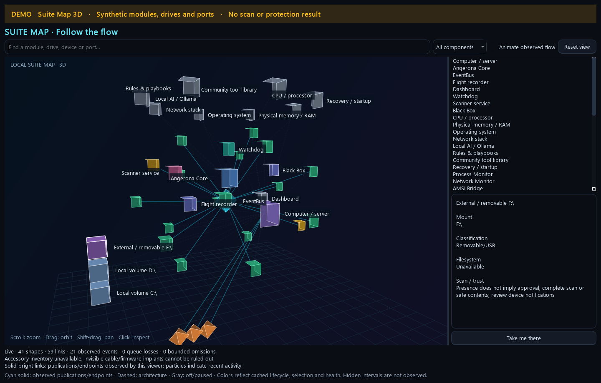

# Suite Map · 3D

The dashboard's **SUITE MAP · 3D** button opens an interactive local view of
Angerona's components and their relationships. Use it to find a module, inspect
its cached status and reach the owning controls without searching through
several windows. It supplements the existing World View and component
heartbeats; it does not replace their detailed coverage checks.

DEMO: the illustrated modules, drives and endpoint observations are synthetic;
this is not a scan or protection result.
[Watch the workspace tour](media/community-suite-tour-demo.gif)

## Controls

| Action | Result |
| --- | --- |
| Scroll | Zoom in or out. |
| Drag | Orbit the scene. |
| Shift-drag | Pan. |
| Hover a shape | Inspect its label and explanatory information. |
| Click a shape or list entry | Keep that component selected and read its details. |
| Search | Filter by a module/component name or kind. |
| **All components / Modules / Drives & devices / Network ports** | Narrow the displayed inventory. |
| **Animate observed flow** | Toggle visual particles; reduced-motion preferences govern the initial state. |
| **Reset view** | Restore the camera and fit the current layout. |
| **Take me there** | Open the selected component's existing view when a navigation route is available. |

The window supports the shared window controls. Rendering uses software-drawn
3D shapes and does not require OpenGL. Animation is limited to the visible view;
hiding or closing the window stops its painting timers and observation lifetime.
Use the component list and text details when a dense scene is hard to navigate.

## What the shapes represent

| Shape/group | Meaning |
| --- | --- |
| Computer/server, Core and EventBus | This host and the local orchestration/publication architecture. |
| Modules | Cached lifecycle, enabled/paused policy context and health from existing owners. Open the module inspector for measured coverage. |
| Watchdog, scanner, Black Box, recorder and dashboard | Architectural roles and shortcuts to their current status views. A labeled node is not a fresh liveness proof. |
| Drives and mounted volumes | Available cached volume/mount observations, including known removable storage. A local-volume label does not infer a physical storage bus or establish trust. |
| Accessories | Host-visible peripheral function combinations supplied by the existing posture module. |
| Network paths and ports | Cached path observations and retained endpoint metadata published while this viewer observes the EventBus. |

Presence of a drive or accessory does not approve it, unlock it or prove that a
scan completed. **Take me there** opens the existing device/notification review;
the original device identity, consent and PIN requirements remain effective.
Unmounted storage and cable/firmware implants invisible to the OS cannot be
inventoried by this viewer.

## Read the flow and coverage correctly

Solid bright links show publications or endpoint metadata observed by this
viewer. Dashed links describe architecture. Moving particles show recent
observed activity. They do not prove subscriber delivery, recorder persistence,
an active socket, successful containment or a blocked attack. A retained
endpoint's age is shown; it is not a geographic location or a listening-port
scan.

Module colors reflect cached policy/lifecycle/health: off or paused states are
gray, degraded or unavailable states require review, and green indicates the
available cached health state. A green shape is not a whole-system protection
certification. Open its owner to distinguish enabled configuration, a running
thread, fresh sensor evidence and authority to respond.

The status text reports displayed shapes/links, observed events, queue losses
and bounded omissions. Current limits include 192 modules, 128 drive entries,
48 endpoint entries, 400 nodes and 512 links. Missing owner inventories and
hidden observation intervals remain coverage gaps. The viewer uses bounded
cached data rather than starting network scans, querying every process or
opening drive contents from the GUI thread.

For a suspicious endpoint, navigate to the network/alert view and inspect the
original evidence and target. For a paused module, open its inspector to review
policy and prerequisites. For stale watchdog status, use the heartbeat details;
animation in this map cannot certify that a sensor or peer is alive.

[Security flow](security-flow.md) · [Live diagnostics and heartbeat review](live-debug-harness.md) ·
[Community tools](community-tools.md)
