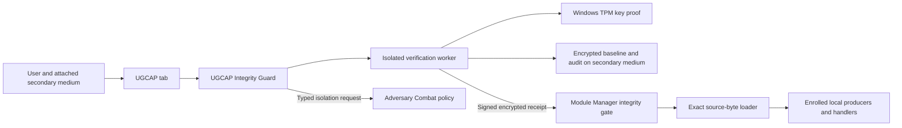

# UGCAP and the rotating Enclave Mesh

The User-Gated Cryptographic Attestation Protocol (UGCAP) is Angerona's newest
integrity and local-communications preview, under
active development in v1.13.0. Its dedicated tab brings an explicitly enrolled
offline baseline, Windows TPM key proof, source differences, recovery review
and challenge scheduling together. The optional Enclave Mesh authenticates
participating producers and handlers with fresh local traffic keys every ten
seconds. Scheduled integrity enforcement and the general producer/handler mesh
are disabled by default; explicit hardware provisioning uses its separate
control channel.

This is a user-mode source-integrity workflow. “Enclave” names the local
protocol; it does not mean an impenetrable hardware enclave, a protected kernel
or independent remote attestation. [SpywareGuard](spyware-guard.md) remains the
separate surveillanceware detection, research and emergency-beacon dashboard.

## Enable it deliberately

1. Start from an installation whose origin and code you have independently
   reviewed. **Initialize baseline** records the current protected files; it
   cannot establish that an already compromised installation was clean.
2. Install the optional `ugcap` dependency through your normal reviewed source
   environment. [The project extra](../pyproject.toml) pins official `blake3`
   **1.0.11 on Python 3.11+**, or **1.0.8 on Python 3.10**. Both provide BLAKE3;
   unavailable BLAKE3 fails closed rather than selecting another hash.
3. Open the **UGCAP** tab and its **Schedule / Hardware** settings. Enable
   challenges, choose the interval and apply the settings. **Restart Angerona**
   before supplying a vault challenge. Strict startup must hold ordinary module
   imports before they execute. Enabling the feature in a process that already
   imported those modules cannot retroactively attest their executed code.
4. On supported Windows hardware, explicitly select **Provision hardware TPM
   key**. The default current-user key name is `Angerona.UGCAP.v1`. Existing keys
   are opened and proved, never silently overwritten. Provisioning and baseline
   enrollment are separate actions. The backend requires the Microsoft Platform
   Crypto Provider and TPM 2.0; no software-key or YubiKey fallback is implemented.
5. Physically attach your secondary medium and create its parent folder yourself.
   Choose a **vault file**, for example `E:\AngeronaVault\angerona.ugcap`.
   The parent must already exist, the path must be outside the repository, and
   the default volume-identity guard requires a different volume. A different
   directory or drive-letter alias for the same volume does not qualify. This
   identifies logical volumes; physical-device independence remains your choice.
6. Enter the passphrase and explicitly initialize the reviewed baseline. A
   complete subsequent verification must match before ordinary managed workers
   can resume. Merely opening the tab or choosing a filename creates no baseline.
7. Remove the medium after the operation completes. Angerona does not mount or
   eject it. Startup, **Verify now**, recovery and later scheduled challenges
   require your authorized challenge again; no passphrase or derived vault key
   is retained for unattended decryption.

The default scheduled interval is **168 hours**, configurable from **1 to 8,760
hours**. A due challenge holds the managed workspace and asks you to attach the
medium and enter the passphrase. It does not silently open an offline vault.
Missing hardware, media, source or complete proof keeps the gate closed.

## What verifies, and what communicates

The [UGCAP guard](../src/angerona/modules/ugcap_guard.py) queues bounded user
operations and pauses ordinary managed workers before verification. Its
[separate worker process](../src/angerona/core/ugcap_worker.py) receives initial
session material only through inherited anonymous pipes. Passphrases then
travel inside signed, encrypted application frames, with request identifiers
and nonces bound to the response. They are not command-line arguments or
environment variables. The worker inherits the launching user's token; it is
process separation, not a privilege drop or OS enclave.

The [vault](../src/angerona/core/ugcap.py) authenticates its cryptographic
parameters, repository, scopes, media and hardware identity. It combines a
**600,000-iteration PBKDF2-HMAC-SHA256** passphrase result with a random
**32-byte hardware-wrapped secret** through HKDF-SHA256, then uses
**AES-256-GCM** for the compressed pristine backups and manifest. Initialization,
verification and restore require fresh hardware unseal/key-possession proof. The
[Windows adapter](../src/angerona/core/ugcap_hardware.py) uses the real CNG
provider, nonexportable key checks and asymmetric proof; a displayed key name
alone is insufficient. Microsoft documents the
[TPM-backed Platform Crypto Provider](https://learn.microsoft.com/en-us/windows/win32/seccertenroll/cng-key-storage-providers).

A complete matching verification supplies a receipt containing the baseline
generation, report identity, full source-manifest digest and per-file BLAKE3
digests. The [Module Manager](../src/angerona/core/module_manager.py) checks that
receipt against the current source bytes. Ordinary modules need a fresh source
load before enrollment. Its exact-byte loader compiles the checked snapshot
directly and never accepts or writes a `.pyc` cache as a substitute. An already
executed module without that load proof requires a fresh process.

The [Enclave Mesh](../src/angerona/core/enclave_mesh.py) provides per-peer
identity/epoch certificates, Ed25519 packet signatures, source-digest bindings,
expiry checks and replay counters. An ephemeral session authority signs the
certificates. Fresh **X25519 private keys**, exchanged on a **ten-second**
rotation, feed direction- and purpose-specific HKDF-SHA256 derivation for
AES-256-GCM traffic keys. Counter-bound nonces and checked sessions prevent
replaying an old accepted packet. The cross-process pipe uses a signed
four-message rekey handshake, pumped independently while a worker operation is
busy. Expired or unverified traffic is refused; ten seconds is a configured
rotation interval, not a hard real-time scheduling guarantee.

UGCAP's private control channel and Adversary Combat control remain available
while the general mesh is frozen. This allows an integrity challenge, status
inspection and independently governed response to proceed without reopening
ordinary traffic. The gate applies to managed worker and participating event
paths; it does not wrap every Python call or revoke every OS socket.

## Differences, isolation and recovery

The **Vault / Review** tab distinguishes added, missing, modified and unreadable
files. A coverage error is incomplete evidence, never a healthy match. The view
renders at most 500 diff rows, and each recovery request allows at most 128
individually selected paths. Added files and read errors are review-only.

Restoration requires the exact last complete drift report, unchanged observed
bytes, the same vault generation and a fresh passphrase/hardware challenge.
There is no automatic source repair or automatic deletion of unexpected files.

- **Windows source/configuration recovery** retains exact file and directory
  custody, checks a private pristine stage, displaces the approved original by
  handle and publishes with a kernel no-replace operation. A raced new target
  is never overwritten. The displaced original remains in a private
  `.ugcap-recovery` directory for explicit forensic review. A failure can require
  manual recovery; the workflow does not promise an indivisible multi-file
  transaction or uninterrupted pathname across displacement/publication.
- **Executable binaries** are deferred for offline recovery, including PE, ELF
  and Mach-O content even when renamed, and versioned shared libraries. The
  application never overwrites a running binary or restarts itself.
- **POSIX modified targets** and **missing-parent paths** require offline
  recovery. Supported missing-file publication uses retained directory/file
  descriptors and a no-replace operation; unavailable primitives fail closed.

Any restored source requires a **new Angerona process and a new complete
verification**. Replacing a file cannot repair code already executing in memory.
Restore, deferred work, read errors and `recovery_required` outcomes do not
reopen ordinary workers. Private retained artifacts are never deleted through a
guessed pathname.

Verified divergence holds the managed workspace. With `ugcap_lockdown` enabled,
the guard additionally requests local-host isolation through Adversary Combat's
typed response contract. That broker independently checks its policy, platform,
authority and action prerequisites; a request is not proof of an applied
firewall rule. Disabling this additional request does not remove the integrity
workspace hold. Worker pauses are cooperative, and in-flight OS calls may still
retire; this is not an atomic kill switch for every process or connection.

If the separately configured [Hail Mary beacon](spyware-guard.md) is enabled,
UGCAP divergence can enqueue a bounded incident notification. Delivery remains
best effort and can be prevented by containment, network failure or power loss.

## Scope and resource limits

Default protected directories are `src`, `tools`, `native`, `kernel`,
`syscall_bridge`, `rules`, `modules`, `config`, `playbooks`, `detection-packages`,
`assets`, `installer`, `bin`, `docs` and `tests`. Selected root-level source,
configuration, documentation and binary suffixes, versioned `.so` files and
`LICENSE` are included. This is an explicit program scope, not every file on
the computer or every workspace build output.

The policy excludes Git metadata, virtual environments, frozen/dependency
trees, runtime data, logs, IPC/diagnostic state, caches, `.env`, `node_modules`
and the exact private `.ugcap-recovery` component. `build`, `dist` and `release`
outputs are outside the default directory list unless an explicit protected
scope is supplied. Existing symlink, reparse and hard-link paths are refused.
Oversized, unreadable, changing or casefold-colliding protected files prevent
complete enrollment or verification; they are not silently skipped as trusted.

| Core bound | Limit |
| --- | ---: |
| Protected files / enumerated entries | 10,000 / 50,000 |
| One protected file / total pristine bytes | 32 MiB / 128 MiB |
| Expanded backup payload / encrypted container | 192 MiB / 260 MiB |
| Encrypted audit records / aggregate audit bytes | 2,048 / 8 MiB |
| One audit record / selected restore paths | 256 KiB / 128 |
| Core operation budget | 120 seconds |
| Local mesh application payload / isolated-worker payload | 256 KiB / 4 MiB |

The worker rejects oversized results rather than silently dropping source
proof. The source loader also retains its bounded source-read policy. A core
deadline is checked between bounded operations; the separate worker's transport
deadline provides process-level retirement when a native call does not return.
No live throughput, every-hardware compatibility or whole-PC speed guarantee is
implied by these limits.

The encrypted baseline and pristine backups remain on the selected medium.
Encrypted audit records are immutable exclusive creates beside the vault:
`angerona.ugcap.audit`, `angerona.ugcap.audit.00000001`, and subsequent
contiguous records for the example filename.
Each record authenticates the generation, sequence and previous digest. Normal
public health/alert metadata can still use Angerona's ordinary runtime state.
If initial audit creation failed before a record existed, only an explicit
**Initialize** can resume that pending enrollment: the old ciphertext and
generation must authenticate and the complete current scope must still match.
Existing complete vaults are never overwritten. Partial or malformed audit
records require review.

## Trust limits and user extensions

This preview does not create a trusted execution environment from an untrusted
interpreter. The bootstrap, Python, cryptographic libraries and their packaging
remain an externally trusted computing base. Frozen or sourceless deployments
need a separate signed-build receipt; this source workflow otherwise cannot
establish their proof. Third-party packages outside the selected scopes are not
silently covered by an Angerona source match.

Local TPM key continuity is not physical or remote attestation. A virtual TPM
or replicated environment can preserve virtual hardware state; this adapter
does not prove that the key is on independently attested, non-clonable physical
hardware. No YubiKey backend, kernel rootkit shield, firmware attestation or
remote attestation service is supplied. An attached drive is visible to the
kernel. Root/Administrator, a compromised runtime or hostile firmware can
defeat user-mode controls. Audit chains are tamper-evident but cannot prove
against deletion of a valid tail or rollback of all local copies without an
independent trusted witness.

Mutable key and passphrase buffers are wiped best effort. Python, Qt, base64,
native cryptography, paging and crash dumps may retain copies. There is no
zero-allocation or perfect-memory-erasure claim.

Users can edit the MIT-licensed source and add security capabilities of their
own choosing. Follow [Writing modules](writing-modules.md) and
[Contributing](../CONTRIBUTING.md), preserve typed authority and custody checks,
and run the appropriate offline fixtures. UGCAP should flag intentional edits:
review the changed code, then explicitly enroll a new vault/baseline. Never
blindly accept detected drift or overwrite the original baseline to make an
alert disappear.

## Evidence and primary references

The [Adaptation review](adaptation-button-review.md) reports the synthetic
4.321× median collector-scheduling ratio. The
[Self-Test / Red Team review](selftest-redteam-button-review.md) reports the
approximately 34× PID-count query improvement and its **pre-UGCAP** 28-phase /
85-module checkpoint. These component results do not measure whole-PC speed or
live spyware efficacy. The repository's final validation record supplies the
completed update's source boundary; historical test counts remain historical.

Implementation checks live in `tests/test_ugcap.py`, `tests/test_ugcap_hardware.py`,
`tests/test_enclave_mesh.py` and the associated worker, manager and UI suites.
Injected hardware fixtures prove protocol/error behavior; they do not establish
physical TPM compatibility or externally attested platform security.

Primary contracts: [BLAKE3 package](https://pypi.org/project/blake3/),
[TPM/CNG provider](https://learn.microsoft.com/en-us/windows/win32/seccertenroll/cng-key-storage-providers),
[X25519](https://cryptography.io/en/latest/hazmat/primitives/asymmetric/x25519/),
[Ed25519](https://cryptography.io/en/latest/hazmat/primitives/asymmetric/ed25519/),
[HKDF/PBKDF2](https://cryptography.io/en/latest/hazmat/primitives/key-derivation-functions/)
and [AES-GCM](https://cryptography.io/en/latest/hazmat/primitives/aead/).
